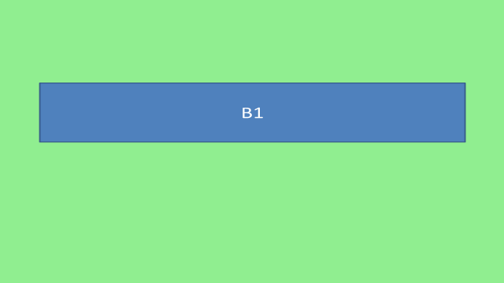
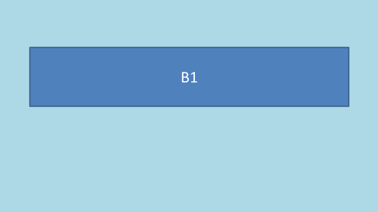

Merge complete decks or selected slides and choose between source design and a destination layout.

## Input and prerequisites

The code creates its own synthetic input; no presentation or image download is required. Use .NET 8 SDK 8.0.427 and Aspose.Slides for .NET 26.10.0; the supplied project pins these versions and was tested on Windows. Set the **ASPOSE_LICENSE_PATH** environment variable to your own valid license file to run every assertion in this complete example. Evaluation limits can change the saved content, so the program fails clearly when no license has been applied.

[Download the complete project](example.zip), including the pinned project, package lock and the code below. The license file is not included.

## Example

The program creates two three-slide presentations with distinct master backgrounds, notes and sections. AddClone(sourceSlide) retains the source design in this fixture. Its layout overload places the green source slide on a blue destination layout. Removing the destination's default slide avoids an unexpected blank first slide.

```csharp
using System;
using System.Collections.Generic;
using System.Drawing;
using System.IO;
using System.Linq;
using System.Security.Cryptography;
using System.Text.Json;
using Aspose.Slides;
using Aspose.Slides.Export;

internal static class Program
{
    private static void CreateDeck(string path, string prefix, Color color)
    {
        using var deck = new Presentation();
        deck.SlideSize.SetSize(640, 360, SlideSizeScaleType.DoNotScale);
        deck.Masters[0].Background.Type = BackgroundType.OwnBackground;
        deck.Masters[0].Background.FillFormat.FillType = FillType.Solid;
        deck.Masters[0].Background.FillFormat.SolidFillColor.Color = color;
        var blank = deck.LayoutSlides.GetByType(SlideLayoutType.Blank);
        for (int i = 0; i < 3; i++)
        {
            ISlide slide = i == 0 ? deck.Slides[0] : deck.Slides.AddEmptySlide(blank);
            Label(slide, prefix + (i + 1));
            slide.NotesSlideManager.AddNotesSlide().NotesTextFrame.Text = "Notes for " + prefix + (i + 1);
        }
        deck.Sections.AddSection("Opening", deck.Slides[0]);
        deck.Sections.AddSection("Details", deck.Slides[1]);
        deck.Save(path, SaveFormat.Pptx);
    }

    private static void CheckOrder(string path, params string[] expected)
    {
        using var result = new Presentation(path);
        Require(result.Slides.Count == expected.Length, "Extra or missing slide in " + path);
        Require(result.Slides.Select(Text).SequenceEqual(expected), "Wrong slide order in " + path);
    }

    private static void Main()
    {
        ApplyLicense();
        CreateDeck("blue.pptx", "A", Color.LightBlue);
        CreateDeck("green.pptx", "B", Color.LightGreen);
        string blueHash = Hash("blue.pptx"), greenHash = Hash("green.pptx");
        using var blue = new Presentation("blue.pptx");
        using var green = new Presentation("green.pptx");
        using (var merged = new Presentation())
        {
            merged.Slides.RemoveAt(0); // Remove the destination's default blank slide.
            foreach (var slide in blue.Slides) merged.Slides.AddClone(slide);
            foreach (var slide in green.Slides) merged.Slides.AddClone(slide);
            merged.Save("merged.pptx", SaveFormat.Pptx);
        }
        CheckOrder("merged.pptx", "A1", "A2", "A3", "B1", "B2", "B3");
        using (var merged = new Presentation("merged.pptx"))
        {
            Require(merged.Slides[0].LayoutSlide.MasterSlide.Background.FillFormat.SolidFillColor.Color.ToArgb() == Color.LightBlue.ToArgb(), "Blue master was lost.");
            Require(merged.Slides[3].LayoutSlide.MasterSlide.Background.FillFormat.SolidFillColor.Color.ToArgb() == Color.LightGreen.ToArgb(), "Green master was lost.");
            Require(merged.Slides[3].NotesSlideManager.NotesSlide.NotesTextFrame.Text.Contains("Notes for B1"), "Speaker notes were lost.");
            using var first = merged.Slides[0].GetImage(new Size(640, 360));
            first.Save("source-design-blue.png", Aspose.Slides.ImageFormat.Png);
            using var fourth = merged.Slides[3].GetImage(new Size(640, 360));
            fourth.Save("source-design-green.png", Aspose.Slides.ImageFormat.Png);
        }
        using (var selected = new Presentation())
        {
            selected.Slides.RemoveAt(0);
            selected.Slides.AddClone(blue.Slides[2]);
            selected.Slides.AddClone(green.Slides[0]);
            selected.Save("selected.pptx", SaveFormat.Pptx);
        }
        CheckOrder("selected.pptx", "A3", "B1");
        using (var destination = new Presentation("blue.pptx"))
        {
            destination.Slides.RemoveAt(0);
            destination.Slides.RemoveAt(0);
            destination.Slides.RemoveAt(0);
            var destinationLayout = destination.LayoutSlides.GetByType(SlideLayoutType.Blank);
            destination.Slides.AddClone(green.Slides[0], destinationLayout);
            destination.Save("destination-design.pptx", SaveFormat.Pptx);
        }
        CheckOrder("destination-design.pptx", "B1");
        using (var result = new Presentation("destination-design.pptx"))
        {
            Require(result.Slides[0].LayoutSlide.MasterSlide.Background.FillFormat.SolidFillColor.Color.ToArgb() == Color.LightBlue.ToArgb(), "Destination layout was not applied.");
            using var image = result.Slides[0].GetImage(new Size(640, 360));
            image.Save("destination-design.png", Aspose.Slides.ImageFormat.Png);
        }
        Require(Hash("blue.pptx") == blueHash && Hash("green.pptx") == greenHash, "A source file changed.");
        Report(new { merged_slides = 6, selected_slides = 2, order_verified = true, source_masters_retained = true, destination_layout_applied = true, notes_retained = true, originals_unchanged = true });
    }

    private static void ApplyLicense()
    {
        string? path = Environment.GetEnvironmentVariable("ASPOSE_LICENSE_PATH");
        var license = new Aspose.Slides.License();
        if (!string.IsNullOrWhiteSpace(path)) license.SetLicense(path);
        if (!license.IsLicensed())
            throw new InvalidOperationException("Set ASPOSE_LICENSE_PATH to a valid license file for this complete example.");
    }

    private static void Require(bool condition, string message)
    {
        if (!condition) throw new InvalidOperationException(message);
    }

    private static IAutoShape Label(ISlide slide, string text)
    {
        var shape = slide.Shapes.AddAutoShape(ShapeType.Rectangle, 50, 80, 540, 100);
        shape.Name = "content-" + text;
        shape.TextFrame.Text = text;
        shape.TextFrame.Paragraphs[0].Portions[0].PortionFormat.FontHeight = 28;
        return shape;
    }

    private static string Text(ISlide slide) => string.Join("|", slide.Shapes.OfType<IAutoShape>().Select(s => s.TextFrame.Text));
    private static string Hash(string file) => Convert.ToHexString(SHA256.HashData(File.ReadAllBytes(file)));
    private static void Report(object checks)
    {
        string json = JsonSerializer.Serialize(new { checks }, new JsonSerializerOptions { WriteIndented = true });
        File.WriteAllText("result.json", json);
        Console.WriteLine(json);
    }
}
```

## Run and check the result

Extract the project into an empty working directory, restore its locked packages, then run it:

```text
dotnet restore Example.csproj --locked-mode
dotnet run --project Example.csproj --configuration Release --no-restore
```

The example writes "blue.pptx", "green.pptx", "merged.pptx", "selected.pptx", "destination-design.pptx", "source-design-blue.png", "source-design-green.png", "destination-design.png" and "result.json". It reopens the generated presentation files and checks the expected data. A failed check raises an exception; successful checks are recorded in "result.json".


## Output previews







## Practical limits

The output order follows the application loop. Importing slides does not automatically recreate the source decks' named section organization; create destination sections deliberately if you need them. Applying a layout changes master/layout-based design, not explicit formatting on individual shapes. These checks cover the demonstrated content and do not promise preservation of every feature or format.

See the [detailed guide](/slides/net/merge-presentation/) and [individual slide examples](/slides/net/examples/elements/slide/).
