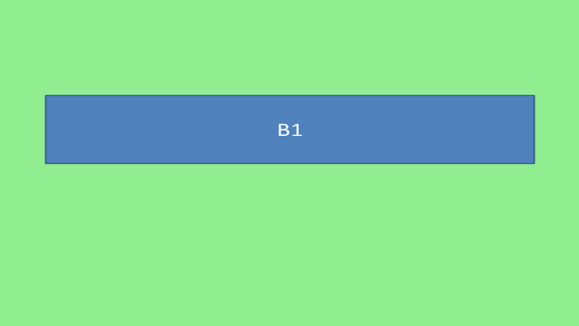
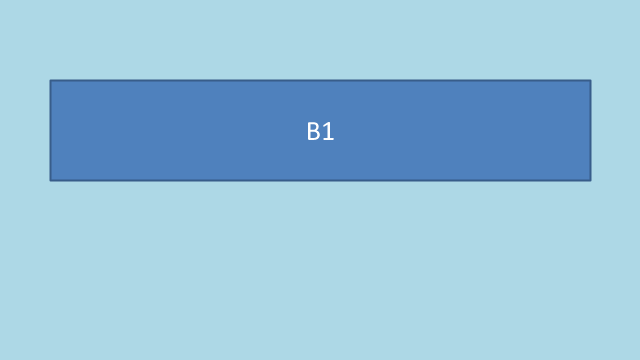

Merge complete decks or selected slides and choose between source design and a destination layout.

## **Input and prerequisites**

The copied program generates its own input. See the [setup guide](/slides/net/examples/getting-started/) for supported SDKs and native dependencies. Evaluation output includes the SDK watermark and text limits.

## **Example**

The program creates two three-slide presentations with distinct master backgrounds, notes and sections. AddClone(sourceSlide) retains the source design in this fixture. Its layout overload places the green source slide on a blue destination layout. Removing the destination's default slide avoids an unexpected blank first slide.

Copy a C# block into `Program.cs` in a .NET project with `Aspose.Slides.NET6.CrossPlatform` installed. Each block is a complete program. Run one block at a time. The ZIP contains the IDE-ready project and its verification checks.
The copied program writes its files in the current working directory.

```csharp
using System;
using System.Drawing;
using Aspose.Slides;
using Aspose.Slides.Export;

internal static class Program
{
    private static void Main()
    {
        string? licensePath = Environment.GetEnvironmentVariable("ASPOSE_LICENSE_PATH");
        if (!string.IsNullOrWhiteSpace(licensePath))
            new License().SetLicense(licensePath);

        CreateDeck("blue.pptx", "A", Color.LightBlue);
        CreateDeck("green.pptx", "B", Color.LightGreen);
        using var blue = new Presentation("blue.pptx");
        using var green = new Presentation("green.pptx");

        // Merge both complete decks with their source designs.
        using (var merged = new Presentation())
        {
            merged.Slides.RemoveAt(0);
            foreach (var slide in blue.Slides)
                merged.Slides.AddClone(slide);
            foreach (var slide in green.Slides)
                merged.Slides.AddClone(slide);
            merged.Save("merged.pptx", SaveFormat.Pptx);
        }

        // Select the third blue slide, then the first green slide.
        using (var selected = new Presentation())
        {
            selected.Slides.RemoveAt(0);
            selected.Slides.AddClone(blue.Slides[2]);
            selected.Slides.AddClone(green.Slides[0]);
            selected.Save("selected.pptx", SaveFormat.Pptx);
        }

        // Retain the destination's blue master and apply its blank layout.
        using (var destination = new Presentation("blue.pptx"))
        {
            for (int i = destination.Slides.Count - 1; i >= 0; i--)
                destination.Slides.RemoveAt(i);
            var destinationLayout = destination.LayoutSlides.GetByType(SlideLayoutType.Blank);
            destination.Slides.AddClone(green.Slides[0], destinationLayout);
            destination.Save("destination-design.pptx", SaveFormat.Pptx);
        }

        Console.WriteLine("Created merged.pptx, selected.pptx and destination-design.pptx.");
    }

    private static void CreateDeck(string path, string prefix, Color color)
    {
        using var deck = new Presentation();
        deck.SlideSize.SetSize(640, 360, SlideSizeScaleType.DoNotScale);
        deck.Masters[0].Background.Type = BackgroundType.OwnBackground;
        deck.Masters[0].Background.FillFormat.FillType = FillType.Solid;
        deck.Masters[0].Background.FillFormat.SolidFillColor.Color = color;
        var blank = deck.LayoutSlides.GetByType(SlideLayoutType.Blank);
        for (int i = 0; i < 3; i++)
        {
            ISlide slide = i == 0 ? deck.Slides[0] : deck.Slides.AddEmptySlide(blank);
            AddTitle(slide, prefix + (i + 1));
            slide.NotesSlideManager.AddNotesSlide().NotesTextFrame.Text = "Notes for " + prefix + (i + 1);
        }

        deck.Sections.AddSection("Opening", deck.Slides[0]);
        deck.Sections.AddSection("Details", deck.Slides[1]);
        deck.Save(path, SaveFormat.Pptx);
    }

    private static IAutoShape AddTitle(ISlide slide, string text)
    {
        var title = slide.Shapes.AddAutoShape(ShapeType.Rectangle, 30, 20, 580, 55);
        title.Name = "RecipeTitle";
        title.TextFrame.Text = text;
        title.TextFrame.Paragraphs[0].Portions[0].PortionFormat.FontHeight = 26;
        return title;
    }
}
```

<span id="run-and-check-the-result"></span>

## **Download and run**

[Download the complete project](example.zip), extract it, and open `Example.sln` or run the following commands.

```text
dotnet restore Example.sln
dotnet run --project Example.csproj --configuration Release --no-restore -- --mode evaluation
```

The downloaded project writes "blue.pptx", "green.pptx", "merged.pptx", "selected.pptx", "destination-design.pptx", "source-design-blue.png", "source-design-green.png", "destination-design.png" and "result.json". It reopens the generated presentation files and checks the expected data. A failed check raises an exception; successful checks are recorded in "result.json".

Use `--mode licensed` with your authorized `ASPOSE_LICENSE_PATH` for unrestricted checks. The project prints its output directory.


## **Output previews**







## **Practical limits**

The output order follows the application loop. Importing slides does not automatically recreate the source decks' named section organization; create destination sections deliberately if you need them. Applying a layout changes master/layout-based design, not explicit formatting on individual shapes. These checks cover the demonstrated content and do not promise preservation of every feature or format.

See the [detailed guide](/slides/net/merge-presentation/) and [individual slide examples](/slides/net/examples/elements/slide/).
