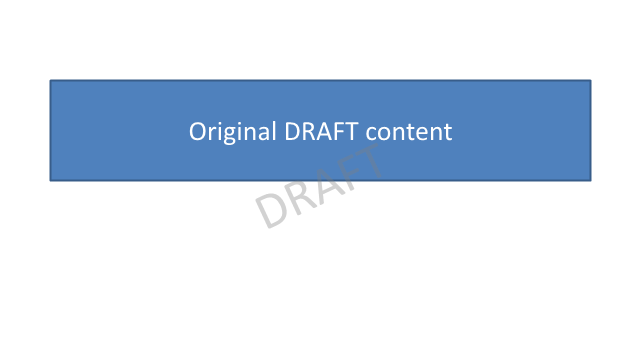
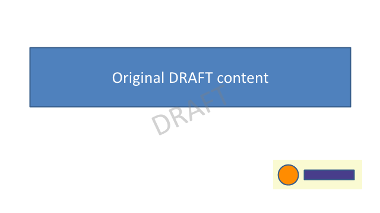
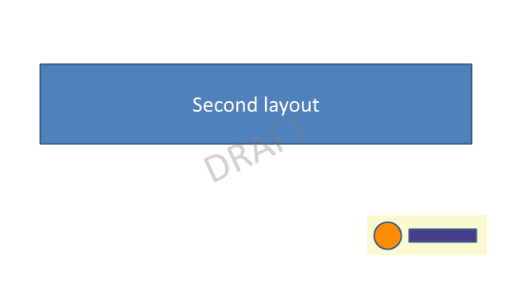

Apply text and image watermarks to slides, then remove only the shapes identified by your application.

## Input and prerequisites

The code creates its own synthetic input; no presentation or image download is required. Use .NET 8 SDK 8.0.427 and Aspose.Slides for .NET 26.10.0; the supplied project pins these versions and was tested on Windows. Set the **ASPOSE_LICENSE_PATH** environment variable to your own valid license file to run every assertion in this complete example. Evaluation limits can change the saved content, so the program fails clearly when no license has been applied.

[Download the complete project](example.zip), including the pinned project, package lock and the code below. The license file is not included.

## Example

This example chooses slide-level watermarks so each target slide receives the marker independently of its layout. The original PNG is generated by the code. AlternativeText stores an application-specific marker; removal matches that marker rather than deleting every shape containing the word DRAFT.

```csharp
using System;
using System.Collections.Generic;
using System.Drawing;
using System.IO;
using System.Linq;
using System.Security.Cryptography;
using System.Text.Json;
using Aspose.Slides;
using Aspose.Slides.Export;

internal static class Program
{
    private const string WatermarkTag = "example-watermark:";

    private static void MarkText(Presentation presentation)
    {
        foreach (var slide in presentation.Slides)
        {
            var shape = slide.Shapes.AddAutoShape(ShapeType.Rectangle, 100, 150, 440, 70);
            shape.AlternativeText = WatermarkTag + "text";
            shape.FillFormat.FillType = FillType.NoFill;
            shape.LineFormat.FillFormat.FillType = FillType.NoFill;
            shape.Rotation = -25;
            shape.TextFrame.Text = "DRAFT";
            var format = shape.TextFrame.Paragraphs[0].Portions[0].PortionFormat;
            format.FontHeight = 52;
            format.FillFormat.FillType = FillType.Solid;
            format.FillFormat.SolidFillColor.Color = Color.FromArgb(90, Color.Gray);
        }
    }

    private static void MarkImage(Presentation presentation)
    {
        var image = presentation.Images.AddImage(File.ReadAllBytes("watermark.png"));
        foreach (var slide in presentation.Slides)
        {
            var frame = slide.Shapes.AddPictureFrame(ShapeType.Rectangle, 460, 270, 150, 50, image);
            frame.AlternativeText = WatermarkTag + "image";
        }
    }

    private static void RemoveOurWatermarks(Presentation presentation)
    {
        foreach (var slide in presentation.Slides)
            for (int i = slide.Shapes.Count - 1; i >= 0; i--)
                if (slide.Shapes[i].AlternativeText.StartsWith(WatermarkTag, StringComparison.Ordinal))
                    slide.Shapes.RemoveAt(i);
    }

    private static void Main()
    {
        ApplyLicense();
        using (var logo = new Presentation())
        {
            logo.SlideSize.SetSize(150, 50, SlideSizeScaleType.DoNotScale);
            var slide = logo.Slides[0];
            slide.Background.Type = BackgroundType.OwnBackground;
            slide.Background.FillFormat.FillType = FillType.Solid;
            slide.Background.FillFormat.SolidFillColor.Color = Color.LightGoldenrodYellow;
            var circle = slide.Shapes.AddAutoShape(ShapeType.Ellipse, 8, 8, 34, 34);
            circle.FillFormat.FillType = FillType.Solid;
            circle.FillFormat.SolidFillColor.Color = Color.DarkOrange;
            var bar = slide.Shapes.AddAutoShape(ShapeType.Rectangle, 52, 17, 84, 16);
            bar.FillFormat.FillType = FillType.Solid;
            bar.FillFormat.SolidFillColor.Color = Color.DarkSlateBlue;
            using var rendered = slide.GetImage(new Size(150, 50));
            rendered.Save("watermark.png", Aspose.Slides.ImageFormat.Png);
        }
        using (var created = new Presentation())
        {
            created.SlideSize.SetSize(640, 360, SlideSizeScaleType.DoNotScale);
            Label(created.Slides[0], "Original DRAFT content"); // Must survive removal.
            var second = created.Slides.AddEmptySlide(created.LayoutSlides.GetByType(SlideLayoutType.TitleOnly));
            Label(second, "Second layout");
            created.Save("input.pptx", SaveFormat.Pptx);
        }
        string inputHash = Hash("input.pptx");
        using (var text = new Presentation("input.pptx"))
        {
            MarkText(text);
            text.Save("text-watermark.pptx", SaveFormat.Pptx);
            using var preview = text.Slides[0].GetImage(new Size(640, 360));
            preview.Save("preview-text.png", Aspose.Slides.ImageFormat.Png);
        }
        using (var image = new Presentation("text-watermark.pptx"))
        {
            MarkImage(image);
            image.Save("image-watermark.pptx", SaveFormat.Pptx);
            for (int i = 0; i < image.Slides.Count; i++)
            {
                Require(image.Slides[i].Shapes.Count(s => s.AlternativeText.StartsWith(WatermarkTag, StringComparison.Ordinal)) == 2, "A watermark is missing.");
                using var preview = image.Slides[i].GetImage(new Size(640, 360));
                preview.Save($"preview-image-{i + 1}.png", Aspose.Slides.ImageFormat.Png);
            }
            RemoveOurWatermarks(image);
            image.Save("removed.pptx", SaveFormat.Pptx);
        }
        using (var original = new Presentation("input.pptx"))
        using (var removed = new Presentation("removed.pptx"))
        {
            Require(removed.Slides.Count == original.Slides.Count, "Slide count changed.");
            for (int i = 0; i < original.Slides.Count; i++)
            {
                Require(removed.Slides[i].Shapes.Count == original.Slides[i].Shapes.Count, "Original shape count changed.");
                Require(Text(removed.Slides[i]) == Text(original.Slides[i]), "Original text changed.");
                Require(removed.Slides[i].Shapes.Select(s => s.Name).SequenceEqual(original.Slides[i].Shapes.Select(s => s.Name)), "Original shape identities changed.");
            }
        }
        Require(Hash("input.pptx") == inputHash, "The source was overwritten.");
        Report(new { slides = 2, text_and_image_applied = true, multiple_layouts_rendered = true, originals_retained = true, tagged_removal_only = true, original_unchanged = true });
    }

    private static void ApplyLicense()
    {
        string? path = Environment.GetEnvironmentVariable("ASPOSE_LICENSE_PATH");
        var license = new Aspose.Slides.License();
        if (!string.IsNullOrWhiteSpace(path)) license.SetLicense(path);
        if (!license.IsLicensed())
            throw new InvalidOperationException("Set ASPOSE_LICENSE_PATH to a valid license file for this complete example.");
    }

    private static void Require(bool condition, string message)
    {
        if (!condition) throw new InvalidOperationException(message);
    }

    private static IAutoShape Label(ISlide slide, string text)
    {
        var shape = slide.Shapes.AddAutoShape(ShapeType.Rectangle, 50, 80, 540, 100);
        shape.Name = "content-" + text;
        shape.TextFrame.Text = text;
        shape.TextFrame.Paragraphs[0].Portions[0].PortionFormat.FontHeight = 28;
        return shape;
    }

    private static string Text(ISlide slide) => string.Join("|", slide.Shapes.OfType<IAutoShape>().Select(s => s.TextFrame.Text));
    private static string Hash(string file) => Convert.ToHexString(SHA256.HashData(File.ReadAllBytes(file)));
    private static void Report(object checks)
    {
        string json = JsonSerializer.Serialize(new { checks }, new JsonSerializerOptions { WriteIndented = true });
        File.WriteAllText("result.json", json);
        Console.WriteLine(json);
    }
}
```

## Run and check the result

Extract the project into an empty working directory, restore its locked packages, then run it:

```text
dotnet restore Example.csproj --locked-mode
dotnet run --project Example.csproj --configuration Release --no-restore
```

The example writes "watermark.png", "input.pptx", "text-watermark.pptx", "image-watermark.pptx", "removed.pptx", "preview-text.png", "preview-image-1.png", "preview-image-2.png" and "result.json". It reopens the generated presentation files and checks the expected data. A failed check raises an exception; successful checks are recorded in "result.json".


## Output previews








## Practical limits

A watermark is a visual label and can be edited or removed; it does not encrypt or restrict access to the presentation. Reserve an unambiguous marker in your own application. A master-level watermark is another option, but its visibility depends on slide and layout settings. The small PNG is rendered from original shapes by the example itself.

See the [detailed guide](/slides/net/watermark/) and [individual slide examples](/slides/net/examples/elements/slide/).
