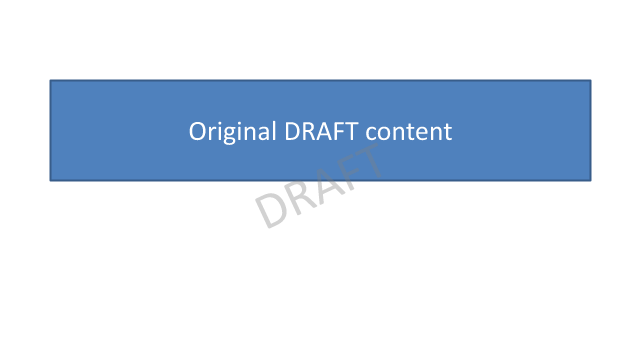
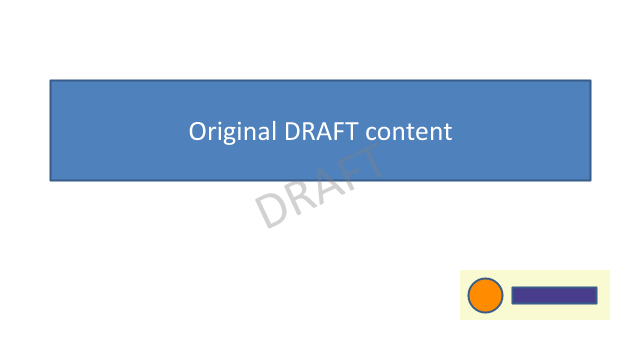
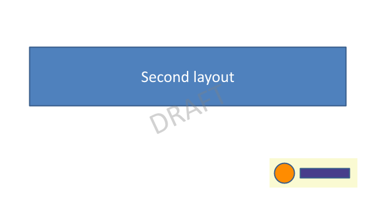

Apply text and image watermarks to slides, then remove only the shapes identified by your application.

## **Input and prerequisites**

The copied program generates its own input. See the [setup guide](/slides/net/examples/getting-started/) for supported SDKs and native dependencies. Evaluation output includes the SDK watermark and text limits.

## **Example**

This example chooses slide-level watermarks so each target slide receives the marker independently of its layout. The original PNG is generated by the code. AlternativeText stores an application-specific marker; removal matches that marker rather than deleting every shape containing the word DRAFT.

Copy a C# block into `Program.cs` in a .NET project with `Aspose.Slides.NET6.CrossPlatform` installed. Each block is a complete program. Run one block at a time. The ZIP contains the IDE-ready project and its verification checks.
The copied program writes its files in the current working directory.

```csharp
using System;
using System.Drawing;
using System.IO;
using System.Linq;
using Aspose.Slides;
using Aspose.Slides.Export;

internal static class Program
{
    private static void Main()
    {
        string? licensePath = Environment.GetEnvironmentVariable("ASPOSE_LICENSE_PATH");
        if (!string.IsNullOrWhiteSpace(licensePath))
            new License().SetLicense(licensePath);

        CreateInput();
        using var presentation = new Presentation("input.pptx");
        MarkText(presentation);
        presentation.Save("text-watermark.pptx", SaveFormat.Pptx);
        MarkImage(presentation);
        presentation.Save("image-watermark.pptx", SaveFormat.Pptx);
        for (int i = 0; i < presentation.Slides.Count; i++)
        {
            using var preview = presentation.Slides[i].GetImage(new Size(640, 360));
            preview.Save($"preview-image-{i + 1}.png", Aspose.Slides.ImageFormat.Png);
        }

        RemoveOurWatermarks(presentation);
        presentation.Save("removed.pptx", SaveFormat.Pptx);
        int remaining = presentation.Slides.Sum(slide => slide.Shapes.Count(IsApplicationWatermark));
        Console.WriteLine($"Application watermarks after removal: {remaining}");
    }

    private const string WatermarkTag = "example-watermark:";
    private static bool IsApplicationWatermark(IShape shape) => shape.AlternativeText.StartsWith(WatermarkTag, StringComparison.Ordinal);
    private static void MarkText(Presentation presentation)
    {
        foreach (var slide in presentation.Slides)
        {
            var shape = slide.Shapes.AddAutoShape(ShapeType.Rectangle, 100, 150, 440, 70);
            shape.AlternativeText = WatermarkTag + "text";
            shape.FillFormat.FillType = FillType.NoFill;
            shape.LineFormat.FillFormat.FillType = FillType.NoFill;
            shape.Rotation = -25;
            shape.TextFrame.Text = "DRAFT";
            var format = shape.TextFrame.Paragraphs[0].Portions[0].PortionFormat;
            format.FontHeight = 52;
            format.FillFormat.FillType = FillType.Solid;
            format.FillFormat.SolidFillColor.Color = Color.FromArgb(90, Color.Gray);
        }
    }

    private static void MarkImage(Presentation presentation)
    {
        var image = presentation.Images.AddImage(File.ReadAllBytes("watermark.png"));
        foreach (var slide in presentation.Slides)
        {
            var frame = slide.Shapes.AddPictureFrame(ShapeType.Rectangle, 460, 270, 150, 50, image);
            frame.AlternativeText = WatermarkTag + "image";
        }
    }

    private static void RemoveOurWatermarks(Presentation presentation)
    {
        foreach (var slide in presentation.Slides)
            for (int i = slide.Shapes.Count - 1; i >= 0; i--)
                if (IsApplicationWatermark(slide.Shapes[i]))
                    slide.Shapes.RemoveAt(i);
    }

    private static void CreateInput()
    {
        using (var logo = new Presentation())
        {
            logo.SlideSize.SetSize(150, 50, SlideSizeScaleType.DoNotScale);
            var slide = logo.Slides[0];
            slide.Background.Type = BackgroundType.OwnBackground;
            slide.Background.FillFormat.FillType = FillType.Solid;
            slide.Background.FillFormat.SolidFillColor.Color = Color.LightGoldenrodYellow;
            var circle = slide.Shapes.AddAutoShape(ShapeType.Ellipse, 8, 8, 34, 34);
            circle.FillFormat.FillType = FillType.Solid;
            circle.FillFormat.SolidFillColor.Color = Color.DarkOrange;
            var bar = slide.Shapes.AddAutoShape(ShapeType.Rectangle, 52, 17, 84, 16);
            bar.FillFormat.FillType = FillType.Solid;
            bar.FillFormat.SolidFillColor.Color = Color.DarkSlateBlue;
            using var rendered = slide.GetImage(new Size(150, 50));
            rendered.Save("watermark.png", Aspose.Slides.ImageFormat.Png);
        }

        using (var created = new Presentation())
        {
            created.SlideSize.SetSize(640, 360, SlideSizeScaleType.DoNotScale);
            AddTitle(created.Slides[0], "DRAFT"); // Must survive removal.
            var second = created.Slides.AddEmptySlide(created.LayoutSlides.GetByType(SlideLayoutType.TitleOnly));
            AddTitle(second, "Other");
            created.Save("input.pptx", SaveFormat.Pptx);
        }
    }

    private static IAutoShape AddTitle(ISlide slide, string text)
    {
        var title = slide.Shapes.AddAutoShape(ShapeType.Rectangle, 30, 20, 580, 55);
        title.Name = "RecipeTitle";
        title.TextFrame.Text = text;
        title.TextFrame.Paragraphs[0].Portions[0].PortionFormat.FontHeight = 26;
        return title;
    }
}
```

<span id="run-and-check-the-result"></span>

## **Download and run**

[Download the complete project](example.zip), extract it, and open `Example.sln` or run the following commands.

```text
dotnet restore Example.sln
dotnet run --project Example.csproj --configuration Release --no-restore -- --mode evaluation
```

The downloaded project writes "watermark.png", "input.pptx", "text-watermark.pptx", "image-watermark.pptx", "removed.pptx", "preview-text.png", "preview-image-1.png", "preview-image-2.png" and "result.json". It reopens the generated presentation files and checks the expected data. A failed check raises an exception; successful checks are recorded in "result.json".

Use `--mode licensed` with your authorized `ASPOSE_LICENSE_PATH` for unrestricted checks. The project prints its output directory.


## **Output previews**








## **Practical limits**

A watermark is a visual label and can be edited or removed; it does not encrypt or restrict access to the presentation. Reserve an unambiguous marker in your own application. A master-level watermark is another option, but its visibility depends on slide and layout settings. The small PNG is rendered from original shapes by the example itself.

See the [detailed guide](/slides/net/watermark/) and [individual slide examples](/slides/net/examples/elements/slide/).
