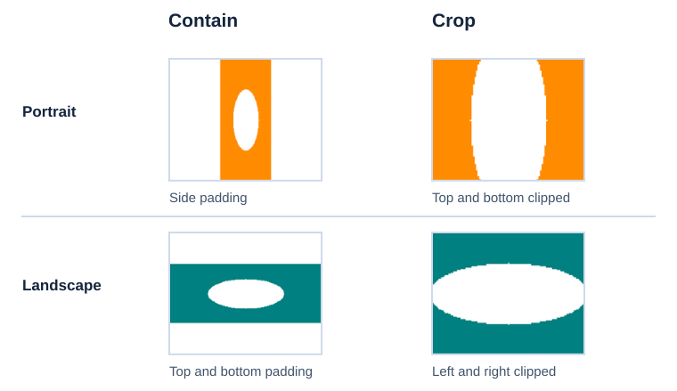

Replace two named pictures using contain and crop choices while retaining the original picture frames. Both portrait and landscape replacements are tested.

<span id="run-the-example"></span>

## **Example**

Copy a C# block into `Program.cs` in a .NET project with `Aspose.Slides.NET6.CrossPlatform` installed. Each block is a complete program. Run one block at a time. The ZIP contains the IDE-ready project and its verification checks.
The copied program writes its files in the current working directory.

```csharp
using System;
using System.Collections.Generic;
using System.Drawing;
using System.IO;
using System.Linq;
using Aspose.Slides;
using Aspose.Slides.Export;

internal static class Program
{
    private static void Main()
    {
        string? licensePath = Environment.GetEnvironmentVariable("ASPOSE_LICENSE_PATH");
        if (!string.IsNullOrWhiteSpace(licensePath))
            new License().SetLicense(licensePath);

        using (var template = new Presentation())
        {
            byte[] placeholderBytes = FittedBitmap(100, 100, Color.SlateGray, 100, 100, false);
            var placeholder = template.Images.AddImage(placeholderBytes);
            template.Slides[0].Shapes.AddPictureFrame(ShapeType.Rectangle, 40, 80, 250, 200, placeholder).Name = "Contain";
            template.Slides[0].Shapes.AddPictureFrame(ShapeType.Rectangle, 350, 80, 250, 200, placeholder).Name = "Crop";
            template.Save("template.pptx", SaveFormat.Pptx);
        }

        var fixtures = new[]
        {
            (Name: "portrait", Width: 100, Height: 240, Color: Color.DarkOrange),
            (Name: "landscape", Width: 260, Height: 100, Color: Color.Teal)
        };
        var targets = new[]
        {
            (Name: "Contain", Crop: false),
            (Name: "Crop", Crop: true)
        };
        foreach (var fixture in fixtures)
        {
            using var presentation = new Presentation("template.pptx");
            foreach (var target in targets)
            {
                var frame = FindNamed<IPictureFrame>(presentation.Slides[0], target.Name);
                if (frame is null)
                    return;
                byte[] fitted = FittedBitmap(fixture.Width, fixture.Height, fixture.Color, 500, 400, target.Crop);
                frame.PictureFormat.Picture.Image = presentation.Images.AddImage(fitted);
            }

            presentation.Save(fixture.Name + ".pptx", SaveFormat.Pptx);
            SavePreview(presentation, fixture.Name + "-preview.png");
        }

        Console.WriteLine("Created portrait and landscape presentations and previews.");
    }

    private static byte[] FittedBitmap(int sourceWidth, int sourceHeight, Color color, int width, int height, bool crop)
    {
        double horizontalScale = (double)width / sourceWidth;
        double verticalScale = (double)height / sourceHeight;
        double scale = crop ? Math.Max(horizontalScale, verticalScale) : Math.Min(horizontalScale, verticalScale);
        double left = (width - sourceWidth * scale) / 2;
        double top = (height - sourceHeight * scale) / 2;
        int stride = (width * 3 + 3) & ~3;

        // A bounded 24-bit BMP writer for our original synthetic pixels, not an image decoder.
        using var stream = new MemoryStream();
        using var writer = new BinaryWriter(stream);
        writer.Write((ushort)0x4D42);
        writer.Write(54 + stride * height);
        writer.Write(0);
        writer.Write(54);
        writer.Write(40);
        writer.Write(width);
        writer.Write(height);
        writer.Write((ushort)1);
        writer.Write((ushort)24);
        writer.Write(0);
        writer.Write(stride * height);
        writer.Write(new byte[16]);
        for (int y = height - 1; y >= 0; y--)
        {
            for (int x = 0; x < width; x++)
            {
                int sourceX = (int)Math.Floor((x - left) / scale);
                int sourceY = (int)Math.Floor((y - top) / scale);
                var pixel = Color.White;
                if (sourceX >= 0 && sourceX < sourceWidth && sourceY >= 0 && sourceY < sourceHeight)
                {
                    double dx = (sourceX - sourceWidth / 2.0) / (sourceWidth / 4.0);
                    double dy = (sourceY - sourceHeight / 2.0) / (sourceHeight / 4.0);
                    pixel = dx * dx + dy * dy <= 1 ? Color.White : color;
                }

                writer.Write(pixel.B);
                writer.Write(pixel.G);
                writer.Write(pixel.R);
            }

            writer.Write(new byte[stride - width * 3]);
        }

        return stream.ToArray();
    }

    private static IEnumerable<IShape> Walk(IShapeCollection shapes)
    {
        foreach (var shape in shapes)
        {
            yield return shape;
            if (shape is IGroupShape group)
            {
                foreach (var child in Walk(group.Shapes))
                    yield return child;
            }
        }
    }

    private static T? FindNamed<T>(ISlide slide, string name)
        where T : class, IShape
    {
        var matches = Walk(slide.Shapes).Where(shape => shape.Name == name).ToArray();
        if (matches.Length == 1 && matches[0] is T result)
            return result;
        Console.Error.WriteLine("Expected exactly one named shape: " + name);
        return null;
    }

    private static void SavePreview(Presentation presentation, string path)
    {
        using var image = presentation.Slides[0].GetImage(new Size(800, 450));
        image.Save(path, Aspose.Slides.ImageFormat.Png);
    }
}
```

## **Expected result and checks**

`portrait-preview.png` and `landscape-preview.png` compare contain (left) with crop (right). Contain shows the whole image with white padding; crop fills the frame and clips its edges. `portrait.pptx` and `landscape.pptx` retain both original frame positions and sizes. The bounded bitmap helper generates original pixels directly for these two fixtures; adapting it to real images requires an image-loading route.

<!-- visual-explanation:examples-templates-data-replace-images:start -->
[](visual-examples-templates-data-replace-images-0575aaf5bf89.svg)

*In the example previews, Contain shows the whole image with white padding. Crop fills the same frame and clips the image edges.*
<!-- visual-explanation:examples-templates-data-replace-images:end -->


The downloaded project writes its verification checks to `output/result.json`. The following values describe the ZIP’s checks; the copied program does not write this report:

```json
{
  "frame_geometry_preserved": true,
  "portrait_and_landscape_checked": true
}
```

The contain/crop helper creates a 24-bit BMP from the original synthetic pixels, matching the existing frame's aspect ratio. The replacement updates the picture data while retaining the frame's position and dimensions.

## **Learn more**

- [Manage Picture Frames in Presentations in .NET](/slides/net/picture-frame/)
- [Optimize Image Management in Presentations in .NET](/slides/net/image/)


## **Open and run the complete project**

[Download the complete project](example.zip), extract it and open `Example.sln`, or run:

```text
dotnet restore Example.sln
dotnet run --project Example.csproj --configuration Release -- --mode evaluation
```

Use the current supported .NET 10 SDK/runtime. The project keeps a stable `net8.0`
target and accepts compatible stable SDKs; no exact SDK patch is required.
Evaluation runs without a license and explicitly ignores license environment settings.
It uses bounded fixtures and checks valid output while allowing the evaluation watermark
and documented read-back text truncation. For unrestricted checks, use `--mode licensed`
with your authorized `ASPOSE_LICENSE_PATH`. No license is included.

Inputs are copied from `Fixtures` into a separate output workspace. The program prints
the absolute output path; `execution.json` records the actual runtime and verified action.
See [setup and prerequisites](/slides/net/examples/getting-started/) for native libraries,
fonts, IDE settings and the .NET 8/9 runtime support boundary of 2026-11-10.
