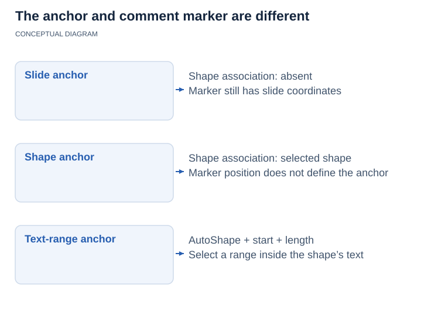

## **Overview**

This article explains how to manage presentation comments with Aspose.Slides for Node.js via Java. It introduces the main comment-related types and demonstrates how to add comments to slides, access existing comments, work with replies and modern comments, and remove comments from a presentation.

The examples cover common review and collaboration scenarios in PowerPoint, such as assigning comments to authors, reading comment text and metadata, building reply chains, and removing selected comments or all comments.

In PowerPoint, comments appear as annotations on slides. Selecting a comment displays its text and related discussion.

To request that comments be shown or hidden when a presentation opens without changing the comments themselves, see [Show or Hide Comments When Opening a Presentation](/slides/nodejs-java/presentation-view-properties/).

## **Why Add Comments to Presentations?**

You can use comments to provide feedback and collaborate with colleagues when reviewing presentations.

Aspose.Slides for Node.js via Java provides the following APIs for working with comments:

* The [Presentation](https://reference.aspose.com/slides/nodejs-java/aspose.slides/presentation/) class, which provides access to the presentation's comment authors.
* The [CommentCollection](https://reference.aspose.com/slides/nodejs-java/aspose.slides/commentcollection/) class, which represents the comments associated with an individual author.
* The [Comment](https://reference.aspose.com/slides/nodejs-java/aspose.slides/comment/) class, which provides information about a comment, including its author, creation time, position, and text.
* The [CommentAuthor](https://reference.aspose.com/slides/nodejs-java/aspose.slides/commentauthor/) class, which provides information about an author, including their name, initials, and associated comments.

## **Add Slide Comments**

The example creates two slides and registers a comment author with [addAuthor](https://reference.aspose.com/slides/nodejs-java/aspose.slides/commentauthorcollection/addauthor/). It uses [addComment](https://reference.aspose.com/slides/nodejs-java/aspose.slides/commentcollection/addcomment/) to place one comment on each slide, then retrieves the first slide's comments for that author with [getSlideComments](https://reference.aspose.com/slides/nodejs-java/aspose.slides/slide/getslidecomments/). The console displays the first comment's text twice, demonstrating access through both the slide and the author, and the saved presentation contains both comments.

```javascript
var aspose = aspose || {};
aspose.slides = require("aspose.slides.via.java");
const java = require("java");

const presentation = new aspose.slides.Presentation();
try {
    const firstSlide = presentation.getSlides().get_Item(0);
    const secondSlide = presentation.getSlides().addEmptySlide(presentation.getLayoutSlides().get_Item(0));

    const author = presentation.getCommentAuthors().addAuthor("Jawad", "MF");
    const position = java.newInstanceSync("com.aspose.slides.Point2DFloat", java.newFloat(0.2), java.newFloat(0.2));
    const createdTime = java.newInstanceSync("java.util.Date");

    author.getComments().addComment("Hello Jawad, this is a slide comment", firstSlide, position, createdTime);
    author.getComments().addComment("Hello Jawad, this is the second slide comment", secondSlide, position, createdTime);

    const comments = firstSlide.getSlideComments(author);
    if (comments.length > 0) {
        const firstComment = comments[0];
        console.log(firstComment.getText());

        const commentText = firstComment.getAuthor().getComments().get_Item(0).getText();
        console.log(commentText);
    }

    presentation.save("Comments_out.pptx", aspose.slides.SaveFormat.Pptx);
} finally {
    presentation.dispose();
}
```

## **Find or Create a Comment Author**

When an automated review processes the same presentation repeatedly, search the collection returned by [getCommentAuthors](https://reference.aspose.com/slides/nodejs-java/aspose.slides/presentation/getcommentauthors/) before adding an author. [findByNameAndInitials](https://reference.aspose.com/slides/nodejs-java/aspose.slides/commentauthorcollection/findbynameandinitials/) matches both the name and initials and returns an array of matching authors, or an empty array if no matches exist. In contrast, [findByName](https://reference.aspose.com/slides/nodejs-java/aspose.slides/commentauthorcollection/findbyname/) searches by name alone, regardless of initials. Calling [addAuthor](https://reference.aspose.com/slides/nodejs-java/aspose.slides/commentauthorcollection/addauthor/) with a name and initials already present in the collection throws an exception.

The example requires a presentation file with at least one slide. On each of two passes, it reuses the first matching author, or creates one only when the result is empty. If there are multiple matches, it selects the first array element without merging or removing the other authors. It then calls [addComment](https://reference.aspose.com/slides/nodejs-java/aspose.slides/commentcollection/addcomment/) for the selected author and saves the presentation. The second pass opens the first pass's output and repeats the operation.

```javascript
var aspose = aspose || {};
aspose.slides = require("aspose.slides.via.java");
const java = require("java");

const authorName = "Reviewer";
const authorInitials = "RV";

let inputFile = "input.pptx";
const position = java.newInstanceSync("com.aspose.slides.Point2DFloat", java.newFloat(20), java.newFloat(20));

for (let pass = 1; pass <= 2; pass++) {
    const presentation = new aspose.slides.Presentation(inputFile);
    try {
        const matches = presentation.getCommentAuthors().findByNameAndInitials(authorName, authorInitials);

        const author = matches.length > 0 ? matches[0] : presentation.getCommentAuthors().addAuthor(authorName, authorInitials);
        const createdTime = java.newInstanceSync("java.util.Date");
        author.getComments().addComment("Please review this slide.", presentation.getSlides().get_Item(0), position, createdTime);

        const outputFile = "review_pass_" + pass + ".pptx";
        presentation.save(outputFile, aspose.slides.SaveFormat.Pptx);
        inputFile = outputFile;
    } finally {
        presentation.dispose();
    }
}
```

The second pass adds another comment without adding another author or removing existing comments. The final file, `review_pass_2.pptx`, contains both new comments alongside any original comments. Reusing an author does not deduplicate comments: to avoid repeatedly adding the same comment, implement separate duplicate detection before adding it.

## **Access Slide Comments**

The example opens an existing presentation and reads the collection returned by [getCommentAuthors](https://reference.aspose.com/slides/nodejs-java/aspose.slides/presentation/getcommentauthors/). For each author, it iterates through the collection returned by [getComments](https://reference.aspose.com/slides/nodejs-java/aspose.slides/commentauthor/getcomments/) and prints the slide number, comment text, author name, and creation time. The input presentation must contain comments to produce console output.

```javascript
var aspose = aspose || {};
aspose.slides = require("aspose.slides.via.java");

const presentation = new aspose.slides.Presentation("Comments1.pptx");
try {
    const authors = presentation.getCommentAuthors();
    for (let authorIndex = 0; authorIndex < authors.size(); authorIndex++) {
        const author = authors.get_Item(authorIndex);
        const comments = author.getComments();

        for (let commentIndex = 0; commentIndex < comments.size(); commentIndex++) {
            const comment = comments.get_Item(commentIndex);
            console.log("Slide: " + comment.getSlide().getSlideNumber());
            console.log("Comment: " + comment.getText());
            console.log("Author: " + comment.getAuthor().getName());
            console.log("Posted at: " + comment.getCreatedTime());
            console.log();
        }
    }
} finally {
    presentation.dispose();
}
```

## **Reply to Comments**

A parent comment is the original comment at the top of a reply hierarchy. The [Comment.getParentComment](https://reference.aspose.com/slides/nodejs-java/aspose.slides/comment/getparentcomment/) and [Comment.setParentComment](https://reference.aspose.com/slides/nodejs-java/aspose.slides/comment/setparentcomment/) methods let you get or set the parent of a comment.

The example creates comments from two authors and uses [setParentComment](https://reference.aspose.com/slides/nodejs-java/aspose.slides/comment/setparentcomment/) to build replies, including a reply to another reply. Passing `null` to [getSlideComments](https://reference.aspose.com/slides/nodejs-java/aspose.slides/slide/getslidecomments/) retrieves comments from all authors; the console indents each entry according to its depth in the reply hierarchy. The example saves the complete discussion, calls [remove](https://reference.aspose.com/slides/nodejs-java/aspose.slides/comment/remove/) on the first root comment, and saves a second presentation with that comment and its replies removed.

```javascript
var aspose = aspose || {};
aspose.slides = require("aspose.slides.via.java");
const java = require("java");

const presentation = new aspose.slides.Presentation();
try {
    const slide = presentation.getSlides().get_Item(0);

    const position = java.newInstanceSync("com.aspose.slides.Point2DFloat", java.newFloat(10), java.newFloat(10));
    const createdTime = java.newInstanceSync("java.util.Date");

    const originalAuthor = presentation.getCommentAuthors().addAuthor("Author_1", "A.A.");
    const rootComment = originalAuthor.getComments().addComment("comment 1", slide, position, createdTime);

    const reviewer = presentation.getCommentAuthors().addAuthor("Author_2", "B.B.");
    const firstReply = reviewer.getComments().addComment("reply 1 for comment 1", slide, position, createdTime);
    firstReply.setParentComment(rootComment);

    const secondReply = reviewer.getComments().addComment("reply 2 for comment 1", slide, position, createdTime);
    secondReply.setParentComment(rootComment);

    const subReply = originalAuthor.getComments().addComment("subreply 3 for reply 2", slide, position, createdTime);
    subReply.setParentComment(secondReply);

    reviewer.getComments().addComment("comment 2", slide, position, createdTime);
    const separateComment = reviewer.getComments().addComment("comment 3", slide, position, createdTime);

    const separateReply = originalAuthor.getComments().addComment("reply 4 for comment 3", slide, position, createdTime);
    separateReply.setParentComment(separateComment);

    const comments = slide.getSlideComments(null);
    for (let index = 0; index < comments.length; index++) {
        let comment = comments[index];
        let indentation = "";
        while (comment.getParentComment() != null) {
            indentation += "\t";
            comment = comment.getParentComment();
        }

        console.log(indentation + comments[index].getAuthor().getName() + ": " + comments[index].getText());
    }

    presentation.save("parent_comment.pptx", aspose.slides.SaveFormat.Pptx);

    rootComment.remove();
    presentation.save("remove_comment.pptx", aspose.slides.SaveFormat.Pptx);
} finally {
    presentation.dispose();
}
```

{}

* When the [Comment.remove](https://reference.aspose.com/slides/nodejs-java/aspose.slides/comment/remove/) method is used to delete a comment, all replies to that comment are also deleted.
* If [Comment.setParentComment](https://reference.aspose.com/slides/nodejs-java/aspose.slides/comment/setparentcomment/) creates a circular reference, a [PptxEditException](https://reference.aspose.com/slides/nodejs-java/aspose.slides/pptxeditexception/) is thrown.

{}

## **Add Modern Comments**

Modern comments can be associated with the slide itself, with a specific shape, or with a text range inside an AutoShape. The [CommentCollection.addModernComment](https://reference.aspose.com/slides/nodejs-java/aspose.slides/commentcollection/addmoderncomment/) method accepts an [Shape](https://reference.aspose.com/slides/nodejs-java/aspose.slides/shape/) argument in addition to the slide and comment-marker coordinates.

When `null` is passed for the shape argument, the comment is a slide-level comment. Its marker is positioned by the supplied coordinates, but it is not associated with a particular shape, so [ModernComment.getShape](https://reference.aspose.com/slides/nodejs-java/aspose.slides/moderncomment/getshape/) returns `null`. When an [Shape](https://reference.aspose.com/slides/nodejs-java/aspose.slides/shape/) is supplied, the comment is anchored to that shape. The coordinates still define the position of the comment marker on the slide, while the shape association can be retrieved through [ModernComment.getShape](https://reference.aspose.com/slides/nodejs-java/aspose.slides/moderncomment/getshape/).


<!-- visual-explanation:presentation-comments:start -->
[](visual-presentation-comments-3cbd80a755df.svg)

*A modern comment can have a slide, shape or AutoShape text-range anchor. Marker coordinates place its visual marker; they do not select the anchor. A text range adds a starting character index and length to the shape association.*
<!-- visual-explanation:presentation-comments:end -->

### **Anchor a Modern Comment to a Shape**

The example calls [addModernComment](https://reference.aspose.com/slides/nodejs-java/aspose.slides/commentcollection/addmoderncomment/) twice: once with a `null` shape for a slide-level comment and once with a rectangle as the anchor. Reading [getShape](https://reference.aspose.com/slides/nodejs-java/aspose.slides/moderncomment/getshape/) prints `true` for the slide-level comment's null check and `Revenue title` for the anchored comment. Both comments are saved with the presentation.

```javascript
var aspose = aspose || {};
aspose.slides = require("aspose.slides.via.java");
const java = require("java");

const presentation = new aspose.slides.Presentation();
try {
    const slide = presentation.getSlides().get_Item(0);

    const author = presentation.getCommentAuthors().addAuthor("Reviewer", "RV");

    const shape = slide.getShapes().addAutoShape(aspose.slides.ShapeType.Rectangle, 50, 50, 300, 80);
    shape.setName("Revenue title");
    shape.getTextFrame().setText("Quarterly revenue");

    const createdTime = java.newInstanceSync("java.util.Date");
    const slideCommentPosition = java.newInstanceSync("com.aspose.slides.Point2DFloat", java.newFloat(20), java.newFloat(20));
    const shapeCommentPosition = java.newInstanceSync("com.aspose.slides.Point2DFloat", java.newFloat(60), java.newFloat(60));
    const slideComment = author.getComments().addModernComment("Review the overall slide layout.", slide, null, slideCommentPosition, createdTime);
    const shapeComment = author.getComments().addModernComment("Check this title.", slide, shape, shapeCommentPosition, createdTime);

    console.log(slideComment.getShape() == null);
    console.log(shapeComment.getShape().getName());

    presentation.save("modern_comments.pptx", aspose.slides.SaveFormat.Pptx);
} finally {
    presentation.dispose();
}
```

### **Anchor Comments to Different Shape Types**

Any slide object derived from [Shape](https://reference.aspose.com/slides/nodejs-java/aspose.slides/shape/) can be used as a shape anchor. Common examples include [AutoShape](https://reference.aspose.com/slides/nodejs-java/aspose.slides/autoshape/), [PictureFrame](https://reference.aspose.com/slides/nodejs-java/aspose.slides/pictureframe/), [GroupShape](https://reference.aspose.com/slides/nodejs-java/aspose.slides/groupshape/), [Connector](https://reference.aspose.com/slides/nodejs-java/aspose.slides/connector/), and [GraphicalObject](https://reference.aspose.com/slides/nodejs-java/aspose.slides/graphicalobject/) instances such as charts.

The example uses [addModernComment](https://reference.aspose.com/slides/nodejs-java/aspose.slides/commentcollection/addmoderncomment/) to associate a comment with each of five shape types: an AutoShape, a picture frame, a group, a connector, and a chart. The picture uses embedded image data, so no external image is required. Each comment has its own marker position, and the saved presentation retains all five shape associations.

```javascript
var aspose = aspose || {};
aspose.slides = require("aspose.slides.via.java");
const java = require("java");

const presentation = new aspose.slides.Presentation();
try {
    const slide = presentation.getSlides().get_Item(0);

    const author = presentation.getCommentAuthors().addAuthor("Reviewer", "RV");
    const createdTime = java.newInstanceSync("java.util.Date");

    const autoShape = slide.getShapes().addAutoShape(aspose.slides.ShapeType.Rectangle, 20, 20, 180, 60);
    autoShape.getTextFrame().setText("AutoShape");

    const autoShapeCommentPosition = java.newInstanceSync("com.aspose.slides.Point2DFloat", java.newFloat(30), java.newFloat(30));
    author.getComments().addModernComment("Comment on an AutoShape.", slide, autoShape, autoShapeCommentPosition, createdTime);

    const imageBase64 = "iVBORw0KGgoAAAANSUhEUgAAAAIAAAACCAIAAAD91JpzAAAAFklEQVR4nGP8//8/AwMDEwMDAwMDAwAkBgMB/DXemwAAAABJRU5ErkJggg==";
    const imageData = java.newArray("byte", Array.from(Buffer.from(imageBase64, "base64")));
    const image = presentation.getImages().addImage(imageData);
    const pictureFrame = slide.getShapes().addPictureFrame(aspose.slides.ShapeType.Rectangle, 220, 20, 120, 80, image);
    const pictureCommentPosition = java.newInstanceSync("com.aspose.slides.Point2DFloat", java.newFloat(230), java.newFloat(30));
    author.getComments().addModernComment("Comment on a picture.", slide, pictureFrame, pictureCommentPosition, createdTime);

    const groupShape = slide.getShapes().addGroupShape();
    groupShape.getShapes().addAutoShape(aspose.slides.ShapeType.Rectangle, 0, 0, 80, 40);
    groupShape.getShapes().addAutoShape(aspose.slides.ShapeType.Ellipse, 100, 0, 80, 40);
    const groupCommentPosition = java.newInstanceSync("com.aspose.slides.Point2DFloat", java.newFloat(40), java.newFloat(150));
    author.getComments().addModernComment("Comment on a group.", slide, groupShape, groupCommentPosition, createdTime);

    const connector = slide.getShapes().addConnector(aspose.slides.ShapeType.StraightConnector1, 220, 150, 140, 40);
    const connectorCommentPosition = java.newInstanceSync("com.aspose.slides.Point2DFloat", java.newFloat(240), java.newFloat(150));
    author.getComments().addModernComment("Comment on a connector.", slide, connector, connectorCommentPosition, createdTime);

    const chart = slide.getShapes().addChart(aspose.slides.ChartType.ClusteredColumn, 400, 20, 250, 180);
    const chartCommentPosition = java.newInstanceSync("com.aspose.slides.Point2DFloat", java.newFloat(420), java.newFloat(40));
    author.getComments().addModernComment("Comment on a graphical object.", slide, chart, chartCommentPosition, createdTime);

    presentation.save("modern_comment_shape_types.pptx", aspose.slides.SaveFormat.Pptx);
} finally {
    presentation.dispose();
}
```

### **Anchor a Comment to Text and Set Its Status**

For a modern comment associated with an [AutoShape](https://reference.aspose.com/slides/nodejs-java/aspose.slides/autoshape/), [ModernComment.getTextSelectionStart](https://reference.aspose.com/slides/nodejs-java/aspose.slides/moderncomment/gettextselectionstart/) and [ModernComment.setTextSelectionStart](https://reference.aspose.com/slides/nodejs-java/aspose.slides/moderncomment/settextselectionstart/) access the starting position of the selected text in the shape's text frame. [ModernComment.getTextSelectionLength](https://reference.aspose.com/slides/nodejs-java/aspose.slides/moderncomment/gettextselectionlength/) and [ModernComment.setTextSelectionLength](https://reference.aspose.com/slides/nodejs-java/aspose.slides/moderncomment/settextselectionlength/) access the length of the selection. Together, these values associate the comment with a specific text range inside the AutoShape.

The [ModernComment.getStatus](https://reference.aspose.com/slides/nodejs-java/aspose.slides/moderncomment/getstatus/) and [ModernComment.setStatus](https://reference.aspose.com/slides/nodejs-java/aspose.slides/moderncomment/setstatus/) methods access a value from the [ModernCommentStatus](https://reference.aspose.com/slides/nodejs-java/aspose.slides/moderncommentstatus/) enumeration:

- `NotDefined` — no specific modern-comment status is defined.
- `Active` — the comment is active.
- `Resolved` — the comment has been resolved.
- `Closed` — the comment is closed.

The example anchors a modern comment to the words "quarterly revenue" in a rectangle's text. It calculates the zero-based selection start from the text and passes it to [setTextSelectionStart](https://reference.aspose.com/slides/nodejs-java/aspose.slides/moderncomment/settextselectionstart/) and uses [setTextSelectionLength](https://reference.aspose.com/slides/nodejs-java/aspose.slides/moderncomment/settextselectionlength/) to set the number of selected characters. After calling [setStatus](https://reference.aspose.com/slides/nodejs-java/aspose.slides/moderncomment/setstatus/) with `Resolved`, it saves and reopens the presentation. The four console checks should each print `true`, confirming that the shape anchor, text range, and status were preserved.

```javascript
var aspose = aspose || {};
aspose.slides = require("aspose.slides.via.java");
const java = require("java");

const outputFile = "modern_comment_text_anchor.pptx";
const shapeText = "Review the quarterly revenue forecast.";
const selectedText = "quarterly revenue";
const expectedSelectionStart = shapeText.indexOf(selectedText);

const presentation = new aspose.slides.Presentation();
try {
    const slide = presentation.getSlides().get_Item(0);

    const shape = slide.getShapes().addAutoShape(aspose.slides.ShapeType.Rectangle, 50, 50, 400, 100);
    shape.setName("Forecast text");
    shape.getTextFrame().setText(shapeText);

    const author = presentation.getCommentAuthors().addAuthor("Reviewer", "RV");
    const commentPosition = java.newInstanceSync("com.aspose.slides.Point2DFloat", java.newFloat(60), java.newFloat(60));
    const createdTime = java.newInstanceSync("java.util.Date");
    const comment = author.getComments().addModernComment("Verify this forecast wording.", slide, shape, commentPosition, createdTime);
    comment.setTextSelectionStart(expectedSelectionStart);
    comment.setTextSelectionLength(selectedText.length);
    comment.setStatus(java.newByte(aspose.slides.ModernCommentStatus.Resolved));

    presentation.save(outputFile, aspose.slides.SaveFormat.Pptx);
} finally {
    presentation.dispose();
}

const reopenedPresentation = new aspose.slides.Presentation(outputFile);
try {
    const reopenedSlide = reopenedPresentation.getSlides().get_Item(0);
    const reopenedComments = reopenedSlide.getSlideComments(null);

    for (let index = 0; index < reopenedComments.length; index++) {
        const reopenedComment = reopenedComments[index];
        if (!java.instanceOf(reopenedComment, "com.aspose.slides.IModernComment")) {
            continue;
        }

        const shapeMatches = reopenedComment.getShape() != null && reopenedComment.getShape().getName() === "Forecast text";
        const selectionStartMatches = reopenedComment.getTextSelectionStart() === expectedSelectionStart;
        const selectionLengthMatches = reopenedComment.getTextSelectionLength() === selectedText.length;
        const statusMatches = reopenedComment.getStatus() === aspose.slides.ModernCommentStatus.Resolved;

        console.log("Shape anchor preserved: " + shapeMatches);
        console.log("Text selection start preserved: " + selectionStartMatches);
        console.log("Text selection length preserved: " + selectionLengthMatches);
        console.log("Resolved status preserved: " + statusMatches);
    }
} finally {
    reopenedPresentation.dispose();
}
```

### **Inspect Existing Modern Comments**

The example requires an existing presentation containing modern comments and prints their text, status, and anchor details. To inspect it, check which comments are instances of [ModernComment](https://reference.aspose.com/slides/nodejs-java/aspose.slides/moderncomment/), then examine [ModernComment.getShape](https://reference.aspose.com/slides/nodejs-java/aspose.slides/moderncomment/getshape/), [ModernComment.getTextSelectionStart](https://reference.aspose.com/slides/nodejs-java/aspose.slides/moderncomment/gettextselectionstart/), [ModernComment.getTextSelectionLength](https://reference.aspose.com/slides/nodejs-java/aspose.slides/moderncomment/gettextselectionlength/), and [ModernComment.getStatus](https://reference.aspose.com/slides/nodejs-java/aspose.slides/moderncomment/getstatus/). A `null` shape indicates a slide-level comment. For an [AutoShape](https://reference.aspose.com/slides/nodejs-java/aspose.slides/autoshape/) anchor, the text-selection methods identify the associated range in the shape's text frame.

```javascript
var aspose = aspose || {};
aspose.slides = require("aspose.slides.via.java");
const java = require("java");

const presentation = new aspose.slides.Presentation("comments.pptx");
try {
    const slides = presentation.getSlides();
    for (let slideIndex = 0; slideIndex < slides.size(); slideIndex++) {
        const slide = slides.get_Item(slideIndex);
        const comments = slide.getSlideComments(null);

        for (let commentIndex = 0; commentIndex < comments.length; commentIndex++) {
            const comment = comments[commentIndex];
            if (!java.instanceOf(comment, "com.aspose.slides.IModernComment")) {
                continue;
            }

            console.log("Slide: " + slide.getSlideNumber());
            console.log("Text: " + comment.getText());
            console.log("Status: " + comment.getStatus());

            const shape = comment.getShape();
            if (shape == null) {
                console.log("Anchor: slide level");
            } else {
                console.log("Anchor shape: " + shape.getName());
                console.log("Anchor type: " + shape.getClass().getSimpleName());

                if (java.instanceOf(shape, "com.aspose.slides.IAutoShape")) {
                    console.log("Text selection start: " + comment.getTextSelectionStart());
                    console.log("Text selection length: " + comment.getTextSelectionLength());
                }
            }

            console.log();
        }
    }
} finally {
    presentation.dispose();
}
```

## **Remove Comments**

Aspose.Slides for Node.js via Java lets you remove all comments and their authors from a presentation or delete selected comments while keeping the rest. The following examples demonstrate both approaches and save the updated presentation.

### **Remove All Comments and Comment Authors**

The example opens an existing presentation and calls [CommentCollection.clear](https://reference.aspose.com/slides/nodejs-java/aspose.slides/commentcollection/clear/) for each author, then calls [CommentAuthorCollection.clear](https://reference.aspose.com/slides/nodejs-java/aspose.slides/commentauthorcollection/clear/) to remove the authors themselves. The saved presentation contains neither comments nor comment authors. Use a presentation containing comments to observe the removal.

```javascript
var aspose = aspose || {};
aspose.slides = require("aspose.slides.via.java");

const presentation = new aspose.slides.Presentation("example.pptx");
try {
    const authors = presentation.getCommentAuthors();
    for (let index = 0; index < authors.size(); index++) {
        authors.get_Item(index).getComments().clear();
    }

    authors.clear();

    presentation.save("example_out.pptx", aspose.slides.SaveFormat.Pptx);
} finally {
    presentation.dispose();
}
```

### **Remove Specific Comments**

The example creates two comments on one slide and uses [getSlideComments](https://reference.aspose.com/slides/nodejs-java/aspose.slides/slide/getslidecomments/) to find comments by each author. It collects comments whose text equals "comment 1" before calling [CommentCollection.remove](https://reference.aspose.com/slides/nodejs-java/aspose.slides/commentcollection/remove/), avoiding changes to the collection during selection. The saved presentation retains only "comment 2".

```javascript
var aspose = aspose || {};
aspose.slides = require("aspose.slides.via.java");
const java = require("java");

const presentation = new aspose.slides.Presentation();
try {
    const slide = presentation.getSlides().get_Item(0);

    const author = presentation.getCommentAuthors().addAuthor("Author", "A");
    const createdTime = java.newInstanceSync("java.util.Date");

    const firstCommentPosition = java.newInstanceSync("com.aspose.slides.Point2DFloat", java.newFloat(0.2), java.newFloat(0.2));
    const secondCommentPosition = java.newInstanceSync("com.aspose.slides.Point2DFloat", java.newFloat(0.3), java.newFloat(0.2));
    author.getComments().addComment("comment 1", slide, firstCommentPosition, createdTime);
    author.getComments().addComment("comment 2", slide, secondCommentPosition, createdTime);

    const authors = presentation.getCommentAuthors();
    for (let authorIndex = 0; authorIndex < authors.size(); authorIndex++) {
        const commentAuthor = authors.get_Item(authorIndex);
        const commentsToRemove = [];
        const comments = slide.getSlideComments(commentAuthor);

        for (let commentIndex = 0; commentIndex < comments.length; commentIndex++) {
            const comment = comments[commentIndex];
            if (comment.getText() === "comment 1") {
                commentsToRemove.push(comment);
            }
        }

        for (const comment of commentsToRemove) {
            commentAuthor.getComments().remove(comment);
        }
    }

    presentation.save("pres.pptx", aspose.slides.SaveFormat.Pptx);
} finally {
    presentation.dispose();
}
```

## **FAQ**

**Does Aspose.Slides support a resolved status for modern comments?**

Yes. [ModernComment.getStatus](https://reference.aspose.com/slides/nodejs-java/aspose.slides/moderncomment/getstatus/) and [ModernComment.setStatus](https://reference.aspose.com/slides/nodejs-java/aspose.slides/moderncomment/setstatus/) access a [ModernCommentStatus](https://reference.aspose.com/slides/nodejs-java/aspose.slides/moderncommentstatus/) value, including `Resolved`. The status is stored in the presentation and can be read again after the file is reopened.

**Are threaded discussions (reply chains) supported, and is there a nesting limit?**

Yes. Each comment can reference its [parent comment](https://reference.aspose.com/slides/nodejs-java/aspose.slides/comment/getparentcomment/), enabling reply chains. The API does not define a specific nesting-depth limit.

**In what coordinate system is a comment marker's position defined on a slide?**

The marker position is defined by floating-point coordinates in the slide coordinate system, allowing you to place it precisely on the slide.
