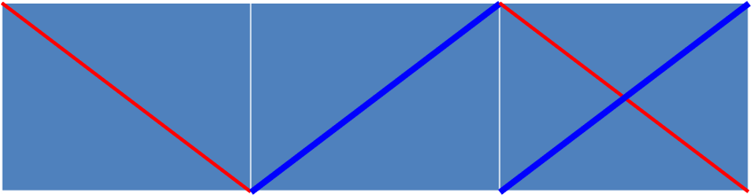
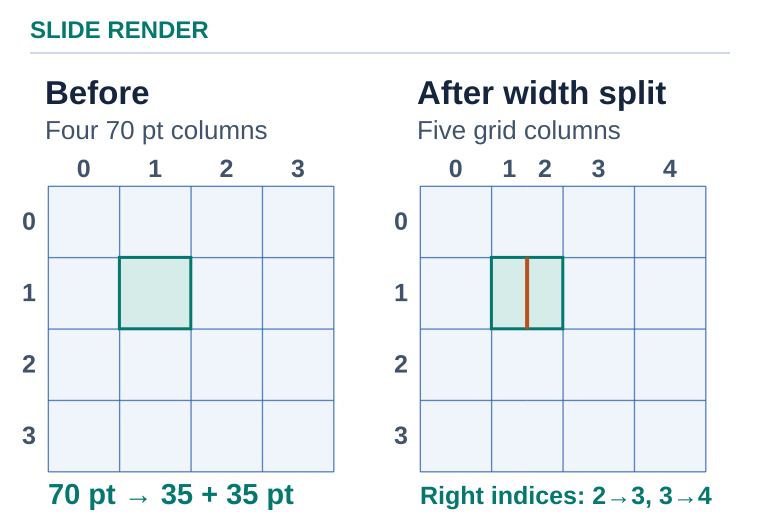

## **Overview**

Aspose.Slides allows you to access and modify table cells in PowerPoint presentations. This article explains how to identify merged table cells, remove cell borders, work with cell numbering after merging or splitting cells, change a cell’s background color, and add an image inside a table cell. The examples show how to create or open a presentation, get a table from a slide, update cell formatting through cell properties, and save the modified presentation as a PPTX file.

Aspose.Slides uses zero-based indices to access table cells in the order `(column, row)`.

## **Identify a Merged Table Cell**

The example opens an existing presentation and accesses the first shape on the first slide as a table. It assumes that the slide and shape exist and that the shape is a table. It then iterates through all rows and columns and uses [isMergedCell](https://reference.aspose.com/slides/nodejs-java/aspose.slides/cell/ismergedcell/) to identify cells in merged regions. For each match, it prints the cell coordinates in `row;column` order, [getRowSpan](https://reference.aspose.com/slides/nodejs-java/aspose.slides/cell/getrowspan/), [getColSpan](https://reference.aspose.com/slides/nodejs-java/aspose.slides/cell/getcolspan/), and the region's starting coordinates, [getFirstRowIndex](https://reference.aspose.com/slides/nodejs-java/aspose.slides/cell/getfirstrowindex/) and [getFirstColumnIndex](https://reference.aspose.com/slides/nodejs-java/aspose.slides/cell/getfirstcolumnindex/).

```javascript
const aspose = { slides: require("aspose.slides.via.java") };
const java = require("java");

const presentation = new aspose.slides.Presentation("presentation_with_table.pptx");
try {
    const slide = presentation.getSlides().get_Item(0);
    const table = slide.getShapes().get_Item(0);

    const rowCount = table.getRows().size();
    for (let rowIndex = 0; rowIndex < rowCount; rowIndex++) {
        const columnCount = table.getColumns().size();
        for (let columnIndex = 0; columnIndex < columnCount; columnIndex++) {
            const cell = table.get_Item(columnIndex, rowIndex);
            if (cell.isMergedCell()) {
                console.log("Cell %d;%d belongs to a merged region with RowSpan=%d and ColSpan=%d starting at %d;%d.", rowIndex, columnIndex, cell.getRowSpan(), cell.getColSpan(), cell.getFirstRowIndex(), cell.getFirstColumnIndex());
            }
        }
    }
} finally {
    presentation.dispose();
}
```

## **Remove Table Cell Borders**

Create a [Presentation](https://reference.aspose.com/slides/nodejs-java/aspose.slides/presentation/) and add a table to its first slide with [addTable](https://reference.aspose.com/slides/nodejs-java/aspose.slides/shapecollection/addtable/). Column widths, row heights, and the table position are specified in points. The example sets all four cell borders to [FillType.NoFill](https://reference.aspose.com/slides/nodejs-java/aspose.slides/filltype/), making them invisible.

```javascript
const aspose = { slides: require("aspose.slides.via.java") };
const java = require("java");

const presentation = new aspose.slides.Presentation();
try {
    const slide = presentation.getSlides().get_Item(0);

    const columnWidths = java.newArray("double", [50, 50, 50, 50]);
    const rowHeights = java.newArray("double", [50, 30, 30, 30, 30]);
    const table = slide.getShapes().addTable(100, 50, columnWidths, rowHeights);

    for (let rowIndex = 0; rowIndex < table.getRows().size(); rowIndex++) {
        const row = table.getRows().get_Item(rowIndex);
        for (let columnIndex = 0; columnIndex < row.size(); columnIndex++) {
            const cell = row.get_Item(columnIndex);
            cell.getCellFormat().getBorderTop().getFillFormat().setFillType(java.newByte(aspose.slides.FillType.NoFill));
            cell.getCellFormat().getBorderBottom().getFillFormat().setFillType(java.newByte(aspose.slides.FillType.NoFill));
            cell.getCellFormat().getBorderLeft().getFillFormat().setFillType(java.newByte(aspose.slides.FillType.NoFill));
            cell.getCellFormat().getBorderRight().getFillFormat().setFillType(java.newByte(aspose.slides.FillType.NoFill));
        }
    }

    presentation.save("table.pptx", aspose.slides.SaveFormat.Pptx);
} finally {
    presentation.dispose();
}
```

## **Add Diagonal Cell Borders**

Use [getBorderDiagonalDown](https://reference.aspose.com/slides/nodejs-java/aspose.slides/cellformat/getborderdiagonaldown/) to draw a line from the top-left corner to the bottom-right, and [getBorderDiagonalUp](https://reference.aspose.com/slides/nodejs-java/aspose.slides/cellformat/getborderdiagonalup/) to draw a line from the bottom-left corner to the top-right. A diagonal can mark a corner header; both diagonals can form an X to mark a cell as not applicable.

Each diagonal is a [LineFormat](https://reference.aspose.com/slides/nodejs-java/aspose.slides/lineformat/). In its [getFillFormat](https://reference.aspose.com/slides/nodejs-java/aspose.slides/lineformat/getfillformat/), use [setFillType](https://reference.aspose.com/slides/nodejs-java/aspose.slides/fillformat/setfilltype/) to select [FillType.Solid](https://reference.aspose.com/slides/nodejs-java/aspose.slides/filltype/) and choose a color through [getSolidFillColor](https://reference.aspose.com/slides/nodejs-java/aspose.slides/fillformat/getsolidfillcolor/). Set the line's width in points with [setWidth](https://reference.aspose.com/slides/nodejs-java/aspose.slides/lineformat/setwidth/).

The example creates three cells in one row: a red downward diagonal, a blue upward diagonal, and both diagonals. It leaves the top, bottom, left, and right cell borders unchanged.

```javascript
const aspose = { slides: require("aspose.slides.via.java") };
const java = require("java");

const presentation = new aspose.slides.Presentation();
try {
    const slide = presentation.getSlides().get_Item(0);

    const columnWidths = java.newArray("double", [210, 210, 210]);
    const rowHeights = java.newArray("double", [160]);
    const table = slide.getShapes().addTable(45, 130, columnWidths, rowHeights);

    const downwardBorder = table.get_Item(0, 0).getCellFormat().getBorderDiagonalDown();
    downwardBorder.getFillFormat().setFillType(java.newByte(aspose.slides.FillType.Solid));
    downwardBorder.getFillFormat().getSolidFillColor().setColor(java.getStaticFieldValue("java.awt.Color", "RED"));
    downwardBorder.setWidth(3);

    const upwardBorder = table.get_Item(1, 0).getCellFormat().getBorderDiagonalUp();
    upwardBorder.getFillFormat().setFillType(java.newByte(aspose.slides.FillType.Solid));
    upwardBorder.getFillFormat().getSolidFillColor().setColor(java.getStaticFieldValue("java.awt.Color", "BLUE"));
    upwardBorder.setWidth(5);

    const crossDownwardBorder = table.get_Item(2, 0).getCellFormat().getBorderDiagonalDown();
    crossDownwardBorder.getFillFormat().setFillType(java.newByte(aspose.slides.FillType.Solid));
    crossDownwardBorder.getFillFormat().getSolidFillColor().setColor(java.getStaticFieldValue("java.awt.Color", "RED"));
    crossDownwardBorder.setWidth(3);

    const crossUpwardBorder = table.get_Item(2, 0).getCellFormat().getBorderDiagonalUp();
    crossUpwardBorder.getFillFormat().setFillType(java.newByte(aspose.slides.FillType.Solid));
    crossUpwardBorder.getFillFormat().getSolidFillColor().setColor(java.getStaticFieldValue("java.awt.Color", "BLUE"));
    crossUpwardBorder.setWidth(5);

    presentation.save("diagonal_cell_borders.pptx", aspose.slides.SaveFormat.Pptx);
} finally {
    presentation.dispose();
}
```

A diagonal is a formatting property, not a cell split. Each cell retains a single text frame, accessed through [getTextFrame](https://reference.aspose.com/slides/nodejs-java/aspose.slides/cell/gettextframe/); the regions on either side of a diagonal cannot be edited independently.

The saved table, rendered in Microsoft PowerPoint:



*Left to right: downward diagonal (red, 3 pt), upward diagonal (blue, 5 pt), and both diagonals.*

## **Merge Table Cells**

Use [mergeCells](https://reference.aspose.com/slides/nodejs-java/aspose.slides/table/mergecells/) to combine a rectangular range of table cells into one cell. Specify the cells at the top-left and bottom-right corners of the range. The final argument controls whether the merge may include cells outside the specified range; `false` keeps the merge within that range.

The example creates a 4-by-4 table with 70-point columns and rows, then merges the four central cells from `(1, 1)` through `(2, 2)`. The resulting cell spans two columns and two rows, while the table's underlying grid retains four columns and four rows. To access the merged cell's content or formatting, use its top-left position: `table.get_Item(1, 1)` in this example. The other positions in the merged range remain part of the table grid, so the indices of cells outside the range do not change.

```javascript
const aspose = { slides: require("aspose.slides.via.java") };
const java = require("java");

const presentation = new aspose.slides.Presentation();
try {
    const slide = presentation.getSlides().get_Item(0);

    const columnWidths = java.newArray("double", [70, 70, 70, 70]);
    const rowHeights = java.newArray("double", [70, 70, 70, 70]);
    const table = slide.getShapes().addTable(100, 50, columnWidths, rowHeights);

    table.mergeCells(table.get_Item(1, 1), table.get_Item(2, 2), false);

    presentation.save("merged_cells.pptx", aspose.slides.SaveFormat.Pptx);
} finally {
    presentation.dispose();
}
```

## **Split Table Cells**

Merging cells in the previous example preserves the table's grid. Splitting a cell can introduce a new grid column and change the column indices of cells to its right. Aspose.Slides follows PowerPoint's table grid model.

This example creates a 4-by-4 table with 70-point columns and rows and calls [splitByWidth](https://reference.aspose.com/slides/nodejs-java/aspose.slides/cell/splitbywidth/) on cell `(1, 1)`. Half of the cell's 70-point width is passed to create two equal-width cells.

After this split, the two halves are accessed as `table.get_Item(1, 1)` and `table.get_Item(2, 1)`. The table grid now has five columns: cells originally in columns 2 and 3 move to columns 3 and 4, respectively. Row indices remain unchanged. Use these updated column indices when accessing cells after the split.

```javascript
const aspose = { slides: require("aspose.slides.via.java") };
const java = require("java");

const presentation = new aspose.slides.Presentation();
try {
    const slide = presentation.getSlides().get_Item(0);

    const columnWidths = java.newArray("double", [70, 70, 70, 70]);
    const rowHeights = java.newArray("double", [70, 70, 70, 70]);
    const table = slide.getShapes().addTable(100, 50, columnWidths, rowHeights);

    table.get_Item(1, 1).splitByWidth(table.get_Item(1, 1).getWidth() / 2);

    presentation.save("split_cells.pptx", aspose.slides.SaveFormat.Pptx);
} finally {
    presentation.dispose();
}
```


<!-- visual-explanation:manage-cells:start -->
[](visual-manage-cells-04c40789d81c.svg)

*The width split affects cell (1, 1), using zero-based (column, row) indices. Other rows keep a cell spanning both new column positions.*
<!-- visual-explanation:manage-cells:end -->

### **Split Merged Cells by Row or Column Span**

To prepare merged template cells for data population, use [splitByRowSpan](https://reference.aspose.com/slides/nodejs-java/aspose.slides/cell/splitbyrowspan/) to split along an existing row boundary, or [splitByColSpan](https://reference.aspose.com/slides/nodejs-java/aspose.slides/cell/splitbycolspan/) to split along a column boundary.

The `index` argument counts rows in the upper part or columns in the left part of the split; it is relative to the merged region:

- Row split: `0 < index <` [getRowSpan](https://reference.aspose.com/slides/nodejs-java/aspose.slides/cell/getrowspan/).
- Column split: `0 < index <` [getColSpan](https://reference.aspose.com/slides/nodejs-java/aspose.slides/cell/getcolspan/).

The example expects a presentation to have a table as the first shape on the first slide, with `(1, 2)` and `(1, 3)` merged vertically. Starting from the lower position, it uses [getFirstColumnIndex](https://reference.aspose.com/slides/nodejs-java/aspose.slides/cell/getfirstcolumnindex/) and [getFirstRowIndex](https://reference.aspose.com/slides/nodejs-java/aspose.slides/cell/getfirstrowindex/) to locate the origin and checks both spans. `splitByRowSpan(1)` then separates rows 2 and 3 for product names. For a horizontal two-column merge, use `splitByColSpan(1)` instead.

```javascript
const aspose = { slides: require("aspose.slides.via.java") };
const java = require("java");

const presentation = new aspose.slides.Presentation("table_template.pptx");
try {
    const slide = presentation.getSlides().get_Item(0);
    const table = slide.getShapes().get_Item(0);

    const selectedCell = table.get_Item(1, 3);
    const firstColumnIndex = selectedCell.getFirstColumnIndex();
    const firstRowIndex = selectedCell.getFirstRowIndex();
    const mergedCell = table.get_Item(firstColumnIndex, firstRowIndex);

    if (mergedCell.isMergedCell() && mergedCell.getRowSpan() == 2 && mergedCell.getColSpan() == 1) {
        mergedCell.splitByRowSpan(1);

        // Retrieve the resulting cells from the table after splitting.
        const upperCell = table.get_Item(firstColumnIndex, firstRowIndex);
        const lowerCell = table.get_Item(firstColumnIndex, firstRowIndex + 1);
        console.log("Upper cell merged: " + upperCell.isMergedCell());
        console.log("Lower cell merged: " + lowerCell.isMergedCell());

        upperCell.getTextFrame().setText("Product A");
        lowerCell.getTextFrame().setText("Product B");

        presentation.save("split_template.pptx", aspose.slides.SaveFormat.Pptx);
    } else {
        console.log("Select a merged region spanning exactly two rows and one column.");
    }
} finally {
    presentation.dispose();
}
```

The table grid and surrounding cell indices stay unchanged. Retrieve the resulting cells by their coordinates; here, both have spans of 1 and [isMergedCell](https://reference.aspose.com/slides/nodejs-java/aspose.slides/cell/ismergedcell/) prints `false`. Larger regions can remain partly merged after one split.

The original text and its formatting remain in the upper (or left) cell; the new cell is empty but inherits cell formatting such as fill, borders, and margins. Populate the cells after splitting and set any required text formatting explicitly.

The saved presentation contains separate "Product A" and "Product B" cells with the template's cell formatting retained. See the [Cell API Reference](https://reference.aspose.com/slides/nodejs-java/aspose.slides/cell/) for details.

### **Split a Cell at a Specific Height**

[splitByHeight](https://reference.aspose.com/slides/nodejs-java/aspose.slides/cell/splitbyheight/) takes the height of the upper part in points. [splitByRowSpan](https://reference.aspose.com/slides/nodejs-java/aspose.slides/cell/splitbyrowspan/) takes the number of existing grid rows in the upper part. To center a 40-point cell in the right column, subtract 40 from the cell’s actual height and divide the remaining space equally above and below it.

```javascript
const aspose = { slides: require("aspose.slides.via.java") };
const java = require("java");

const presentation = new aspose.slides.Presentation();
try {
    const slide = presentation.getSlides().get_Item(0);

    const columnWidths = java.newArray("double", [160, 160]);
    const rowHeights = java.newArray("double", [140]);

    const table = slide.getShapes().addTable(50, 50, columnWidths, rowHeights);
    table.get_Item(0, 0).getTextFrame().setText("Left");

    const height = table.get_Item(1, 0).getHeight();
    const margin = (height - 40) / 2;

    table.get_Item(1, 0).splitByHeight(margin);
    table.get_Item(1, 1).splitByHeight(40);
    table.get_Item(1, 1).getTextFrame().setText("Middle");

    presentation.save("split_by_height.pptx", aspose.slides.SaveFormat.Pptx);
} finally {
    presentation.dispose();
}
```

The first split adds a grid row and leaves the lower 90 points in cell `(1, 1)`. The second split divides that cell into a 40-point middle cell and a 50-point bottom cell. The right column now has three cells with heights of 50, 40, and 50 points from top to bottom. The left cell spans all three rows and retains its original height of 140 points.


## **Change the Table Cell Background Color**

This example creates a table with 150-point columns and 50-point rows. It uses [setFillType](https://reference.aspose.com/slides/nodejs-java/aspose.slides/fillformat/setfilltype/) to select a solid fill and sets the color returned by [getSolidFillColor](https://reference.aspose.com/slides/nodejs-java/aspose.slides/fillformat/getsolidfillcolor/) to red for cell `(2, 3)`, in the third column and fourth row.

```javascript
const aspose = { slides: require("aspose.slides.via.java") };
const java = require("java");

const presentation = new aspose.slides.Presentation();
try {
    const slide = presentation.getSlides().get_Item(0);

    const columnWidths = java.newArray("double", [150, 150, 150, 150]);
    const rowHeights = java.newArray("double", [50, 50, 50, 50, 50]);
    const table = slide.getShapes().addTable(50, 50, columnWidths, rowHeights);

    const cell = table.get_Item(2, 3);
    cell.getCellFormat().getFillFormat().setFillType(java.newByte(aspose.slides.FillType.Solid));
    cell.getCellFormat().getFillFormat().getSolidFillColor().setColor(java.getStaticFieldValue("java.awt.Color", "RED"));

    presentation.save("cell_background_color.pptx", aspose.slides.SaveFormat.Pptx);
} finally {
    presentation.dispose();
}
```

## **Add an Image Inside a Table Cell**

Place the input image in the working directory before running this example. It loads the image with [Images.fromFile](https://reference.aspose.com/slides/nodejs-java/aspose.slides/images/#fromFile) and adds it to the presentation's image collection with [addImage](https://reference.aspose.com/slides/nodejs-java/aspose.slides/imagecollection/addimage/). It then assigns the image to the picture fill of cell `(0, 0)`, the first cell in the table.

[PictureFillMode.Stretch](https://reference.aspose.com/slides/nodejs-java/aspose.slides/picturefillmode/) stretches the image to fill the cell, which may change its aspect ratio. Column widths and row heights are in points. The loaded image is disposed in a `finally` block after it is added to the presentation.

```javascript
const aspose = { slides: require("aspose.slides.via.java") };
const java = require("java");

const presentation = new aspose.slides.Presentation();
try {
    const slide = presentation.getSlides().get_Item(0);

    const columnWidths = java.newArray("double", [150, 150, 150, 150]);
    const rowHeights = java.newArray("double", [100, 100, 100, 100, 90]);
    const table = slide.getShapes().addTable(50, 50, columnWidths, rowHeights);

    let ppImage;
    const image = aspose.slides.Images.fromFile("aspose_logo.jpg");
    try {
        ppImage = presentation.getImages().addImage(image);
    } finally {
        image.dispose();
    }

    table.get_Item(0, 0).getCellFormat().getFillFormat().setFillType(java.newByte(aspose.slides.FillType.Picture));
    table.get_Item(0, 0).getCellFormat().getFillFormat().getPictureFillFormat().setPictureFillMode(aspose.slides.PictureFillMode.Stretch);
    table.get_Item(0, 0).getCellFormat().getFillFormat().getPictureFillFormat().getPicture().setImage(ppImage);

    presentation.save("table_cell_with_image.pptx", aspose.slides.SaveFormat.Pptx);
} finally {
    presentation.dispose();
}
```

## **FAQ**

**Can I set different line thicknesses and styles for different sides of a single cell?**

Yes. The [top](https://reference.aspose.com/slides/nodejs-java/aspose.slides/cellformat/getbordertop/)/[bottom](https://reference.aspose.com/slides/nodejs-java/aspose.slides/cellformat/getborderbottom/)/[left](https://reference.aspose.com/slides/nodejs-java/aspose.slides/cellformat/getborderleft/)/[right](https://reference.aspose.com/slides/nodejs-java/aspose.slides/cellformat/getborderright/) borders have separate properties, so the thickness and style of each side can differ.

**What happens to the image if I change the column/row size after setting a picture as the cell’s background?**

The behavior depends on the [fill mode](https://reference.aspose.com/slides/nodejs-java/aspose.slides/picturefillmode/) (stretch/tile). With stretching, the image adjusts to the new cell; with tiling, the tiles are recalculated.

**Can I assign a hyperlink to all the content of a cell?**

[Hyperlinks](/slides/nodejs-java/manage-hyperlinks/) are set at the text (portion) level inside the cell’s text frame or at the level of the entire table/shape. In practice, you assign the link to a portion or to all the text in the cell.

**Can I set different fonts within a single cell?**

Yes. A cell’s text frame supports [portions](https://reference.aspose.com/slides/nodejs-java/aspose.slides/portion/) (runs) with independent formatting—font family, style, size, and color.
