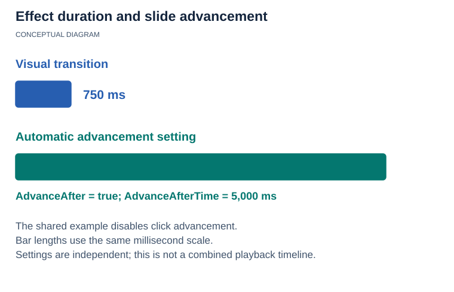

## **Overview**

Slide transitions control how slides appear during a slide show. With Aspose.Slides for Node.js via Java, you can choose a transition effect for each slide, configure advancement by mouse click or timer, and adjust options specific to an effect. This article uses JavaScript examples to apply transitions, set exact transition durations, manage slide timing, and create a Morph transition between two slides. The examples also show how to save the settings to a PPTX file.

## **Add Slide Transition**

To apply a transition, load a presentation with the [Presentation](https://reference.aspose.com/slides/nodejs-java/aspose.slides/presentation/) class and access the slide's transition settings through [getSlideShowTransition](https://reference.aspose.com/slides/nodejs-java/aspose.slides/baseslide/#getSlideShowTransition). Use [setType](https://reference.aspose.com/slides/nodejs-java/aspose.slides/slideshowtransition/#setType) with a value from the [TransitionType](https://reference.aspose.com/slides/nodejs-java/aspose.slides/transitiontype/) enumeration, then save the presentation.

The following example applies a Circle transition to the first slide and a Comb transition to the second. Use an `input.pptx` file with at least two slides.

```javascript
const slides = require("aspose.slides.via.java");

const presentation = new slides.Presentation("input.pptx");
try {
    if (presentation.getSlides().size() >= 2) {
        presentation.getSlides().get_Item(0).getSlideShowTransition().setType(slides.TransitionType.Circle);
        presentation.getSlides().get_Item(1).getSlideShowTransition().setType(slides.TransitionType.Comb);

        presentation.save("slide-transitions.pptx", slides.SaveFormat.Pptx);
    } else {
        console.log("The input presentation must contain at least two slides.");
    }
} finally {
    presentation.dispose();
}
```

## **Wheel Transition**

The [setSpokes](https://reference.aspose.com/slides/nodejs-java/aspose.slides/wheeltransition/#setSpokes) method of [WheelTransition](https://reference.aspose.com/slides/nodejs-java/aspose.slides/wheeltransition/) controls the number of radial sectors that reveal the destination slide. Set the slide's transition type to Wheel from [TransitionType](https://reference.aspose.com/slides/nodejs-java/aspose.slides/transitiontype/) using [setType](https://reference.aspose.com/slides/nodejs-java/aspose.slides/slideshowtransition/#setType) before accessing [getValue](https://reference.aspose.com/slides/nodejs-java/aspose.slides/slideshowtransition/#getValue) as [WheelTransition](https://reference.aspose.com/slides/nodejs-java/aspose.slides/wheeltransition/).

This example creates two identical pairs of slides: a black slide followed by a slide with a gold rectangle. The destination slides use spoke counts of 1 and 8, with the same speed set through [setSpeed](https://reference.aspose.com/slides/nodejs-java/aspose.slides/slideshowtransition/#setSpeed) and an explicit duration of 8,000 milliseconds set through [setDuration](https://reference.aspose.com/slides/nodejs-java/aspose.slides/slideshowtransition/#setDuration) to make the difference easy to observe.

```javascript
const java = require("java");
const slides = require("aspose.slides.via.java");

const presentation = new slides.Presentation();
try {
    const slideWidth = presentation.getSlideSize().getSize().getWidth();
    const slideHeight = presentation.getSlideSize().getSize().getHeight();

    const blackSlide = presentation.getSlides().get_Item(0);
    blackSlide.getShapes().clear();
    blackSlide.getBackground().setType(java.newByte(slides.BackgroundType.OwnBackground));
    blackSlide.getBackground().getFillFormat().setFillType(java.newByte(slides.FillType.Solid));
    const black = java.newInstanceSync("java.awt.Color", 0, 0, 0);
    blackSlide.getBackground().getFillFormat().getSolidFillColor().setColor(black);

    const destinationSlide = presentation.getSlides().addClone(blackSlide);
    const rectangle = destinationSlide.getShapes().addAutoShape(slides.ShapeType.Rectangle, 0, 0, slideWidth, slideHeight);
    rectangle.getFillFormat().setFillType(java.newByte(slides.FillType.Solid));
    const gold = java.newInstanceSync("java.awt.Color", 255, 215, 0);
    rectangle.getFillFormat().getSolidFillColor().setColor(gold);
    rectangle.getTextFrame().setText("Wheel transition");

    presentation.getSlides().addClone(blackSlide);
    presentation.getSlides().addClone(destinationSlide);

    const spokeCounts = [1, 8];
    for (let i = 0; i < spokeCounts.length; i++) {
        const transition = presentation.getSlides().get_Item(i * 2 + 1).getSlideShowTransition();
        transition.setType(slides.TransitionType.Wheel);
        const wheelTransition = transition.getValue();
        wheelTransition.setSpokes(java.newLong(spokeCounts[i]));
        transition.setSpeed(slides.TransitionSpeed.Slow);
        transition.setDuration(8000);
    }

    presentation.save("wheel-transitions.pptx", slides.SaveFormat.Pptx);
} finally {
    presentation.dispose();
}
```

Open the output presentation in PowerPoint and run the slide show. Advance from slide 1 to slide 2, then from slide 3 to slide 4. In PowerPoint playback, the verified spoke count of 1 reveals the slide with one clockwise sweep; the verified count of 8 reveals it through eight radial sectors simultaneously. The destination content and transition timing are identical, so the difference is the number of reveal sectors.

## **Fade Through Black with the Reveal Transition**

Set the destination slide's transition type to Reveal, then call [setThroughBlack](https://reference.aspose.com/slides/nodejs-java/aspose.slides/revealtransition/#setThroughBlack) on its [RevealTransition](https://reference.aspose.com/slides/nodejs-java/aspose.slides/revealtransition/) settings. This example creates a teal source slide and a coral destination slide, then clones both. Each pair uses the same two-second Reveal transition. Only the second pair fades through black.

```javascript
const java = require("java");
const slides = require("aspose.slides.via.java");

const presentation = new slides.Presentation();
try {
    const source = presentation.getSlides().get_Item(0);
    const destination = presentation.getSlides().addClone(source);
    const teal = java.newInstanceSync("java.awt.Color", 0, 128, 128);
    const coral = java.newInstanceSync("java.awt.Color", 255, 127, 80);

    for (const [slide, color, label] of [[source, teal, "Source"], [destination, coral, "Destination"]]) {
        slide.getBackground().setType(java.newByte(slides.BackgroundType.OwnBackground));
        const fill = slide.getBackground().getFillFormat();
        fill.setFillType(java.newByte(slides.FillType.Solid));
        fill.getSolidFillColor().setColor(color);

        const shape = slide.getShapes().addAutoShape(slides.ShapeType.Rectangle, 160, 180, 400, 130);
        const textFrame = shape.getTextFrame();
        textFrame.setText(label);
        textFrame.getParagraphs().get_Item(0).getPortions().get_Item(0).getPortionFormat().setFontHeight(44);
    }

    presentation.getSlides().addClone(source);
    const clonedDestination = presentation.getSlides().addClone(destination);
    for (const slide of [destination, clonedDestination]) {
        const transition = slide.getSlideShowTransition();
        transition.setType(slides.TransitionType.Reveal);
        transition.setSpeed(slides.TransitionSpeed.Slow);
        transition.setDuration(2000);

        const reveal = transition.getValue();
        reveal.setDirection(slides.TransitionLeftRightDirectionType.Left);
        reveal.setThroughBlack(slide === clonedDestination);
    }

    presentation.save("reveal-transitions.pptx", slides.SaveFormat.Pptx);
} finally {
    presentation.dispose();
}
```

Open the saved presentation in PowerPoint and start the slide show. Advance from slide 1 to slide 2 to see teal fade directly into coral. Then advance from slide 3 to slide 4. The screen briefly darkens to near black before the coral slide appears. Both slides keep their original background colors.

The rows below show frames from PowerPoint at half-second intervals. Compare the middle frame in each row to see the effect.


## **Add Advanced Slide Transition**

You can configure how long a slide remains on screen and whether a mouse click advances the slide show. The following methods control this behavior:

- [setAdvanceOnClick](https://reference.aspose.com/slides/nodejs-java/aspose.slides/slideshowtransition/#setAdvanceOnClick) allows the viewer to advance by clicking the mouse.
- [setAdvanceAfter](https://reference.aspose.com/slides/nodejs-java/aspose.slides/slideshowtransition/#setAdvanceAfter) enables automatic advancement.
- [setAdvanceAfterTime](https://reference.aspose.com/slides/nodejs-java/aspose.slides/slideshowtransition/#setAdvanceAfterTime) specifies the delay before automatic advancement, in milliseconds.

Enable both click and timed advancement to let the viewer move on with a click or wait for the timer. To use only the timer, pass `false` to [setAdvanceOnClick](https://reference.aspose.com/slides/nodejs-java/aspose.slides/slideshowtransition/#setAdvanceOnClick). The delay controls when the slide show advances; it does not set the duration of the visual transition effect.

This example assigns different effects to the first three slides and enables automatic advancement after 3, 5, and 7 seconds, respectively. Mouse clicks can also advance these slides. Use an `input.pptx` file with at least three slides.

```javascript
const slides = require("aspose.slides.via.java");

const presentation = new slides.Presentation("input.pptx");
try {
    if (presentation.getSlides().size() >= 3) {
        const firstTransition = presentation.getSlides().get_Item(0).getSlideShowTransition();
        firstTransition.setType(slides.TransitionType.Circle);
        firstTransition.setAdvanceOnClick(true);
        firstTransition.setAdvanceAfter(true);
        firstTransition.setAdvanceAfterTime(3000);

        const secondTransition = presentation.getSlides().get_Item(1).getSlideShowTransition();
        secondTransition.setType(slides.TransitionType.Comb);
        secondTransition.setAdvanceOnClick(true);
        secondTransition.setAdvanceAfter(true);
        secondTransition.setAdvanceAfterTime(5000);

        const thirdTransition = presentation.getSlides().get_Item(2).getSlideShowTransition();
        thirdTransition.setType(slides.TransitionType.Zoom);
        thirdTransition.setAdvanceOnClick(true);
        thirdTransition.setAdvanceAfter(true);
        thirdTransition.setAdvanceAfterTime(7000);

        presentation.save("advanced-transitions.pptx", slides.SaveFormat.Pptx);
    } else {
        console.log("The input presentation must contain at least three slides.");
    }
} finally {
    presentation.dispose();
}
```

To check whether timed advancement is enabled, call [getAdvanceAfter](https://reference.aspose.com/slides/nodejs-java/aspose.slides/slideshowtransition/#getAdvanceAfter). A stored delay alone does not indicate that the timer is active.

The next example opens the file saved above, reports each enabled timer, and disables automatic advancement for slides with a delay greater than two seconds. It enables mouse clicks for those slides and saves the updated settings.

```javascript
const slides = require("aspose.slides.via.java");

const presentation = new slides.Presentation("advanced-transitions.pptx");
try {
    for (let i = 0; i < presentation.getSlides().size(); i++) {
        const slide = presentation.getSlides().get_Item(i);
        const transition = slide.getSlideShowTransition();

        if (transition.getAdvanceAfter()) {
            console.log("Slide " + slide.getSlideNumber() + ": advance after " + transition.getAdvanceAfterTime() + " ms.");

            if (transition.getAdvanceAfterTime() > 2000) {
                transition.setAdvanceAfter(false);
                transition.setAdvanceOnClick(true);
            }
        }
    }

    presentation.save("adjusted-transitions.pptx", slides.SaveFormat.Pptx);
} finally {
    presentation.dispose();
}
```

## **Control Transition Timing Precisely**

Use [setDuration](https://reference.aspose.com/slides/nodejs-java/aspose.slides/slideshowtransition/#setDuration) to specify the exact length of a transition effect in milliseconds. The slide's [getSlideShowTransition](https://reference.aspose.com/slides/nodejs-java/aspose.slides/baseslide/#getSlideShowTransition) method exposes these settings through [SlideShowTransition](https://reference.aspose.com/slides/nodejs-java/aspose.slides/slideshowtransition/):

| Method | Purpose |
| --- | --- |
| [setDuration](https://reference.aspose.com/slides/nodejs-java/aspose.slides/slideshowtransition/#setDuration) | Sets the duration of the transition effect itself, in milliseconds. |
| [setAdvanceAfterTime](https://reference.aspose.com/slides/nodejs-java/aspose.slides/slideshowtransition/#setAdvanceAfterTime) | Sets the delay before the slide advances automatically, in milliseconds. Pass `true` to [setAdvanceAfter](https://reference.aspose.com/slides/nodejs-java/aspose.slides/slideshowtransition/#setAdvanceAfter) to activate this timer. |
| [setSpeed](https://reference.aspose.com/slides/nodejs-java/aspose.slides/slideshowtransition/#setSpeed) | Selects a predefined speed category from [TransitionSpeed](https://reference.aspose.com/slides/nodejs-java/aspose.slides/transitionspeed/): Slow, Medium, or Fast. It is used when an exact duration is not specified. |

[setDuration](https://reference.aspose.com/slides/nodejs-java/aspose.slides/slideshowtransition/#setDuration) controls only the transition effect; it does not determine how long the slide remains visible. Configure the automatic advancement delay separately. When no explicit duration is set, Aspose.Slides determines the effect duration from the transition type and the [getSpeed](https://reference.aspose.com/slides/nodejs-java/aspose.slides/slideshowtransition/#getSpeed) value.


<!-- visual-explanation:slide-transition:start -->
[](visual-slide-transition-1f705a740cf6.svg)

*The shared example gives each slide a 750-ms Fade transition and separately enables automatic advancement at 5,000 ms. Transition duration controls the effect; advancement controls when to leave the slide. These bars are schematic settings, not a measured combined timeline.*
<!-- visual-explanation:slide-transition:end -->

### **Apply the Same Duration to Every Slide**

For consistent pacing, apply the same effect and exact duration to every slide. This example loads `input.pptx`, selects Fade from [TransitionType](https://reference.aspose.com/slides/nodejs-java/aspose.slides/transitiontype/), and gives each transition a duration of 750 milliseconds. It separately enables automatic advancement after 5,000 milliseconds and disables advancement by mouse click, then saves the result as PPTX.

```javascript
const slides = require("aspose.slides.via.java");

const presentation = new slides.Presentation("input.pptx");
try {
    for (let i = 0; i < presentation.getSlides().size(); i++) {
        const slide = presentation.getSlides().get_Item(i);
        const transition = slide.getSlideShowTransition();
        transition.setType(slides.TransitionType.Fade);
        transition.setDuration(750);

        // Configure automatic advancement independently of the effect duration.
        transition.setAdvanceAfter(true);
        transition.setAdvanceAfterTime(5000);
        transition.setAdvanceOnClick(false);
    }

    presentation.save("precise-transitions.pptx", slides.SaveFormat.Pptx);
} finally {
    presentation.dispose();
}
```

### **Set Different Durations for Individual Slides**

Different slides can use different effect durations. For example, use a brief transition for a title slide and a longer transition for a section introduction. This example sets 500 milliseconds for the first slide and 1,200 milliseconds for the second. Use an `input.pptx` file with at least two slides.

```javascript
const slides = require("aspose.slides.via.java");

const presentation = new slides.Presentation("input.pptx");
try {
    if (presentation.getSlides().size() >= 2) {
        const firstTransition = presentation.getSlides().get_Item(0).getSlideShowTransition();
        firstTransition.setType(slides.TransitionType.Fade);
        firstTransition.setDuration(500);

        const secondTransition = presentation.getSlides().get_Item(1).getSlideShowTransition();
        secondTransition.setType(slides.TransitionType.Push);
        secondTransition.setDuration(1200);

        presentation.save("individual-transition-durations.pptx", slides.SaveFormat.Pptx);
    } else {
        console.log("The input presentation must contain at least two slides.");
    }
} finally {
    presentation.dispose();
}
```

### **Coordinate Transitions with Animated Output**

When preparing an [animated GIF](/slides/nodejs-java/convert-powerpoint-to-animated-gif/), [HTML5 presentation](/slides/nodejs-java/export-to-html5/), or [video](/slides/nodejs-java/convert-powerpoint-to-video/), set exact transition durations before export to match the intended pacing. For example, use a 600-millisecond fade between scenes, and adjust each slide's advancement delay separately to allow time for its narration or content.

For GIF and video, coordinate the output frame rate with the effect duration: 600 milliseconds corresponds to 18 frames at 30 frames per second. In HTML5, enable animated transitions in the export settings. Check the chosen export format's supported effects and timing options, and preview the output to confirm synchronization.

### **Read an Existing Transition Duration**

Call [getDuration](https://reference.aspose.com/slides/nodejs-java/aspose.slides/slideshowtransition/#getDuration) before modifying the transition to determine whether an explicit value is stored. A value of `-1` means no explicit duration is set; a nonnegative value specifies the stored duration in milliseconds. The unset value is not the calculated playback duration: Aspose.Slides uses the transition type and the [getSpeed](https://reference.aspose.com/slides/nodejs-java/aspose.slides/slideshowtransition/#getSpeed) value to determine that duration. Setting a transition type can initialize a duration, so inspect the original settings first.

```javascript
const slides = require("aspose.slides.via.java");

const presentation = new slides.Presentation("input.pptx");
try {
    for (let i = 0; i < presentation.getSlides().size(); i++) {
        const slide = presentation.getSlides().get_Item(i);
        const transition = slide.getSlideShowTransition();
        const duration = transition.getDuration();

        if (duration >= 0) {
            console.log("Slide " + slide.getSlideNumber() + ": stored transition duration is " + duration + " ms.");
        } else {
            console.log("Slide " + slide.getSlideNumber() + ": no explicit duration; timing depends on transition type " + transition.getType() + " and speed " + transition.getSpeed() + ".");
        }
    }
} finally {
    presentation.dispose();
}
```

## **Morph Transition**

The Morph transition animates changes between objects on consecutive slides. To create a simple Morph effect, clone a slide, move or resize an object on the clone, and apply the Morph transition to the second slide. This gives the transition corresponding objects to animate between their original and modified states.

The following example creates a slide with a text rectangle, clones the slide, and changes the rectangle's position and size on the clone. It then selects Morph from the [TransitionType](https://reference.aspose.com/slides/nodejs-java/aspose.slides/transitiontype/) enumeration for the second slide. Open the saved file in a presentation viewer that supports Morph to see the effect during a slide show.

```javascript
const slides = require("aspose.slides.via.java");

const presentation = new slides.Presentation();
try {
    const firstSlide = presentation.getSlides().get_Item(0);
    const rectangle = firstSlide.getShapes().addAutoShape(slides.ShapeType.Rectangle, 100, 100, 400, 100);
    rectangle.getTextFrame().setText("Morph transition");

    const secondSlide = presentation.getSlides().addClone(firstSlide);
    const movedRectangle = secondSlide.getShapes().get_Item(0);
    movedRectangle.setX(movedRectangle.getX() + 100);
    movedRectangle.setY(movedRectangle.getY() + 50);
    movedRectangle.setWidth(movedRectangle.getWidth() - 200);
    movedRectangle.setHeight(movedRectangle.getHeight() - 10);

    secondSlide.getSlideShowTransition().setType(slides.TransitionType.Morph);

    presentation.save("morph-transition.pptx", slides.SaveFormat.Pptx);
} finally {
    presentation.dispose();
}
```

## **Morph Transition Types**

The [TransitionMorphType](https://reference.aspose.com/slides/nodejs-java/aspose.slides/transitionmorphtype/) enumeration controls how Morph matches and animates content:

- [ByObject](https://reference.aspose.com/slides/nodejs-java/aspose.slides/transitionmorphtype/#ByObject) treats each shape as a whole object.
- [ByWord](https://reference.aspose.com/slides/nodejs-java/aspose.slides/transitionmorphtype/#ByWord) animates text by matching words where possible.
- [ByChar](https://reference.aspose.com/slides/nodejs-java/aspose.slides/transitionmorphtype/#ByChar) animates text by matching characters where possible.

Use [setType](https://reference.aspose.com/slides/nodejs-java/aspose.slides/slideshowtransition/#setType) to select Morph before accessing [getValue](https://reference.aspose.com/slides/nodejs-java/aspose.slides/slideshowtransition/#getValue). The value then provides a [MorphTransition](https://reference.aspose.com/slides/nodejs-java/aspose.slides/morphtransition/) object, whose [setMorphType](https://reference.aspose.com/slides/nodejs-java/aspose.slides/morphtransition/#setMorphType) method selects the matching mode.

This example opens the presentation created in the previous section and configures the second slide to use word-based Morph animation.

```javascript
const java = require("java");
const slides = require("aspose.slides.via.java");

const presentation = new slides.Presentation("morph-transition.pptx");
try {
    if (presentation.getSlides().size() >= 2) {
        const transition = presentation.getSlides().get_Item(1).getSlideShowTransition();
        transition.setType(slides.TransitionType.Morph);
        const transitionValue = transition.getValue();

        if (java.instanceOf(transitionValue, "com.aspose.slides.IMorphTransition")) {
            transitionValue.setMorphType(slides.TransitionMorphType.ByWord);
            presentation.save("morph-by-word.pptx", slides.SaveFormat.Pptx);
        } else {
            console.log("Morph transition options are unavailable.");
        }
    } else {
        console.log("The input presentation must contain at least two slides.");
    }
} finally {
    presentation.dispose();
}
```

## **Set Transition Effects**

Some transitions expose additional options, such as direction or whether the effect starts from a black screen. The available options depend on the transition selected with [setType](https://reference.aspose.com/slides/nodejs-java/aspose.slides/slideshowtransition/#setType). Set the type first, then use the appropriate transition object from [getValue](https://reference.aspose.com/slides/nodejs-java/aspose.slides/slideshowtransition/#getValue).

The following example applies a Cut transition to the first slide of `input.pptx`. It calls [setFromBlack](https://reference.aspose.com/slides/nodejs-java/aspose.slides/optionalblacktransition/#setFromBlack) through [OptionalBlackTransition](https://reference.aspose.com/slides/nodejs-java/aspose.slides/optionalblacktransition/) so that the transition starts from a black screen.

```javascript
const java = require("java");
const slides = require("aspose.slides.via.java");

const presentation = new slides.Presentation("input.pptx");
try {
    const transition = presentation.getSlides().get_Item(0).getSlideShowTransition();
    transition.setType(slides.TransitionType.Cut);
    const transitionValue = transition.getValue();

    if (java.instanceOf(transitionValue, "com.aspose.slides.IOptionalBlackTransition")) {
        transitionValue.setFromBlack(true);
        presentation.save("cut-from-black.pptx", slides.SaveFormat.Pptx);
    } else {
        console.log("Cut transition options are unavailable.");
    }
} finally {
    presentation.dispose();
}
```

## **FAQ**

**Can I control the playback speed of a slide transition?**

Yes. Prefer [setDuration](https://reference.aspose.com/slides/nodejs-java/aspose.slides/slideshowtransition/#setDuration) when you need an exact effect duration in milliseconds. Use [setSpeed](https://reference.aspose.com/slides/nodejs-java/aspose.slides/slideshowtransition/#setSpeed) when a predefined [TransitionSpeed](https://reference.aspose.com/slides/nodejs-java/aspose.slides/transitionspeed/) category—Slow, Medium, or Fast—is sufficient and no explicit duration is set. These settings control the transition effect independently of the automatic advancement delay.

**Can I attach audio to a transition and make it loop?**

Yes. Assign embedded audio with [setSound](https://reference.aspose.com/slides/nodejs-java/aspose.slides/slideshowtransition/#setSound), pass StartSound from the [TransitionSoundMode](https://reference.aspose.com/slides/nodejs-java/aspose.slides/transitionsoundmode/) enumeration to [setSoundMode](https://reference.aspose.com/slides/nodejs-java/aspose.slides/slideshowtransition/#setSoundMode), and enable [setSoundLoop](https://reference.aspose.com/slides/nodejs-java/aspose.slides/slideshowtransition/#setSoundLoop) with `true`. The audio loops until the next sound event in the slide show.

**What's the fastest way to apply the same transition to every slide?**

Loop through the presentation's [getSlides](https://reference.aspose.com/slides/nodejs-java/aspose.slides/presentation/#getSlides) collection and call [setType](https://reference.aspose.com/slides/nodejs-java/aspose.slides/slideshowtransition/#setType) with the same value for each slide's transition. Set any timing and effect options in the same loop to keep the behavior consistent across slides.

**How can I check which transition is currently set on a slide?**

Call [getType](https://reference.aspose.com/slides/nodejs-java/aspose.slides/slideshowtransition/#getType) on the slide's [getSlideShowTransition](https://reference.aspose.com/slides/nodejs-java/aspose.slides/baseslide/#getSlideShowTransition) result. It returns a value from the [TransitionType](https://reference.aspose.com/slides/nodejs-java/aspose.slides/transitiontype/) enumeration; None means that no transition effect is applied.
