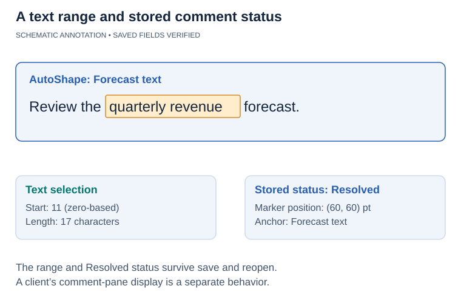

## **Overview**

This article explains how to manage presentation comments with Aspose.Slides for Python via .NET. It introduces the main comment-related types and demonstrates how to add comments to slides, access existing comments, work with replies and modern comments, and remove comments from a presentation.

The examples cover common review and collaboration scenarios in PowerPoint, such as assigning comments to authors, reading comment text and metadata, building reply chains, and removing selected comments or all comments.

In PowerPoint, comments appear as annotations on slides. Selecting a comment displays its text and related discussion.

To request that comments be shown or hidden when a presentation opens without changing the comments themselves, see [Show or Hide Comments When Opening a Presentation](/slides/python-net/presentation-view-properties/).

## **Why Add Comments to Presentations?**

You can use comments to provide feedback and collaborate with colleagues when reviewing presentations.

Aspose.Slides for Python via .NET provides the following APIs for working with comments:

* The [Presentation](https://reference.aspose.com/slides/python-net/aspose.slides/presentation/) class, which provides access to the presentation's comment authors.
* The [CommentCollection](https://reference.aspose.com/slides/python-net/aspose.slides/commentcollection/) class, which represents the comments associated with an individual author.
* The [Comment](https://reference.aspose.com/slides/python-net/aspose.slides/comment/) class, which provides information about a comment, including its author, creation time, position, and text.
* The [CommentAuthor](https://reference.aspose.com/slides/python-net/aspose.slides/commentauthor/) class, which provides information about an author, including their name, initials, and associated comments.

## **Add Slide Comments**

The example creates two slides and registers a comment author with [add_author](https://reference.aspose.com/slides/python-net/aspose.slides/commentauthorcollection/add_author/). It uses [add_comment](https://reference.aspose.com/slides/python-net/aspose.slides/commentcollection/add_comment/) to place one comment on each slide, then retrieves the first slide's comments for that author with [get_slide_comments](https://reference.aspose.com/slides/python-net/aspose.slides/slide/get_slide_comments/). The console displays the first comment's text twice, demonstrating access through both the slide and the author, and the saved presentation contains both comments.

```python
from datetime import datetime

import aspose.slides as slides

with slides.Presentation() as presentation:
    first_slide = presentation.slides[0]
    second_slide = presentation.slides.add_empty_slide(presentation.layout_slides[0])

    author = presentation.comment_authors.add_author("Jawad", "MF")
    position = slides.PointF(0.2, 0.2)
    created_time = datetime.now()

    author.comments.add_comment("Hello Jawad, this is a slide comment", first_slide, position, created_time)
    author.comments.add_comment("Hello Jawad, this is the second slide comment", second_slide, position, created_time)

    comments = first_slide.get_slide_comments(author)
    if len(comments) > 0:
        first_comment = comments[0]
        print(first_comment.text)

        comment_text = first_comment.author.comments[0].text
        print(comment_text)

    presentation.save("Comments_out.pptx", slides.export.SaveFormat.PPTX)
```

## **Find or Create a Comment Author**

When an automated review processes the same presentation repeatedly, search its [comment_authors](https://reference.aspose.com/slides/python-net/aspose.slides/presentation/comment_authors/) collection before adding an author. [find_by_name_and_initials](https://reference.aspose.com/slides/python-net/aspose.slides/commentauthorcollection/find_by_name_and_initials/) matches both the name and initials and returns an array of matching authors, or an empty array if no matches exist. In contrast, [find_by_name](https://reference.aspose.com/slides/python-net/aspose.slides/commentauthorcollection/find_by_name/) searches by name alone, regardless of initials. Calling [add_author](https://reference.aspose.com/slides/python-net/aspose.slides/commentauthorcollection/add_author/) with a name and initials already present in the collection throws an exception.

The example requires a presentation file with at least one slide. On each of two passes, it reuses the first matching author, or creates one only when the result is empty. If there are multiple matches, it selects the first array element without merging or removing the other authors. It then calls [add_comment](https://reference.aspose.com/slides/python-net/aspose.slides/commentcollection/add_comment/) for the selected author and saves the presentation. The second pass opens the first pass's output and repeats the operation.

```python
from datetime import datetime

import aspose.slides as slides

author_name = "Reviewer"
author_initials = "RV"

input_file = "input.pptx"
position = slides.PointF(20, 20)

for pass_number in range(1, 3):
    with slides.Presentation(input_file) as presentation:
        matches = presentation.comment_authors.find_by_name_and_initials(author_name, author_initials)

        author = matches[0] if len(matches) > 0 else presentation.comment_authors.add_author(author_name, author_initials)
        author.comments.add_comment("Please review this slide.", presentation.slides[0], position, datetime.now())

        output_file = f"review_pass_{pass_number}.pptx"
        presentation.save(output_file, slides.export.SaveFormat.PPTX)
        input_file = output_file
```

The second pass adds another comment without adding another author or removing existing comments. The final file, `review_pass_2.pptx`, contains both new comments alongside any original comments. Reusing an author does not deduplicate comments: to avoid repeatedly adding the same comment, implement separate duplicate detection before adding it.

## **Access Slide Comments**

The example opens an existing presentation and reads its [comment_authors](https://reference.aspose.com/slides/python-net/aspose.slides/presentation/comment_authors/) collection. For each author, it iterates through [comments](https://reference.aspose.com/slides/python-net/aspose.slides/commentauthor/comments/) and prints the slide number, comment text, author name, and creation time. The input presentation must contain comments to produce console output.

```python
import aspose.slides as slides

with slides.Presentation("Comments1.pptx") as presentation:
    for author in presentation.comment_authors:
        for comment in author.comments:
            print("Slide: " + str(comment.slide.slide_number))
            print("Comment: " + comment.text)
            print("Author: " + comment.author.name)
            print("Posted at: " + str(comment.created_time))
            print()
```

## **Reply to Comments**

A parent comment is the original comment at the top of a reply hierarchy. The [parent_comment](https://reference.aspose.com/slides/python-net/aspose.slides/comment/parent_comment/) property of the [Comment](https://reference.aspose.com/slides/python-net/aspose.slides/comment/) class lets you get or set the parent of a comment.

The example creates comments from two authors and uses [parent_comment](https://reference.aspose.com/slides/python-net/aspose.slides/comment/parent_comment/) to build replies, including a reply to another reply. Passing `None` to [get_slide_comments](https://reference.aspose.com/slides/python-net/aspose.slides/slide/get_slide_comments/) retrieves comments from all authors; the console indents each entry according to its depth in the reply hierarchy. The example saves the complete discussion, calls [remove](https://reference.aspose.com/slides/python-net/aspose.slides/comment/remove/) on the first root comment, and saves a second presentation with that comment and its replies removed.

```python
from datetime import datetime

import aspose.slides as slides

with slides.Presentation() as presentation:
    slide = presentation.slides[0]

    position = slides.PointF(10, 10)
    created_time = datetime.now()

    original_author = presentation.comment_authors.add_author("Author_1", "A.A.")
    root_comment = original_author.comments.add_comment("comment 1", slide, position, created_time)

    reviewer = presentation.comment_authors.add_author("Author_2", "B.B.")
    first_reply = reviewer.comments.add_comment("reply 1 for comment 1", slide, position, created_time)
    first_reply.parent_comment = root_comment

    second_reply = reviewer.comments.add_comment("reply 2 for comment 1", slide, position, created_time)
    second_reply.parent_comment = root_comment

    sub_reply = original_author.comments.add_comment("subreply 3 for reply 2", slide, position, created_time)
    sub_reply.parent_comment = second_reply

    reviewer.comments.add_comment("comment 2", slide, position, created_time)
    separate_comment = reviewer.comments.add_comment("comment 3", slide, position, created_time)

    separate_reply = original_author.comments.add_comment("reply 4 for comment 3", slide, position, created_time)
    separate_reply.parent_comment = separate_comment

    comments = slide.get_slide_comments(None)
    for current_comment in comments:
        comment = current_comment
        while comment.parent_comment is not None:
            print("\t", end="")
            comment = comment.parent_comment

        print(current_comment.author.name + ": " + current_comment.text)

    presentation.save("parent_comment.pptx", slides.export.SaveFormat.PPTX)

    root_comment.remove()
    presentation.save("remove_comment.pptx", slides.export.SaveFormat.PPTX)
```

{}

* When the [remove](https://reference.aspose.com/slides/python-net/aspose.slides/comment/remove/) method of the [Comment](https://reference.aspose.com/slides/python-net/aspose.slides/comment/) class is used to delete a comment, all replies to that comment are also deleted.
* If the [parent_comment](https://reference.aspose.com/slides/python-net/aspose.slides/comment/parent_comment/) property creates a circular reference, a [PptxEditException](https://reference.aspose.com/slides/python-net/aspose.slides/pptxeditexception/) is thrown.

{}

## **Add Modern Comments**

Modern comments can be associated with the slide itself, with a specific shape, or with a text range inside an AutoShape. The [CommentCollection.add_modern_comment](https://reference.aspose.com/slides/python-net/aspose.slides/commentcollection/add_modern_comment/) method accepts a [Shape](https://reference.aspose.com/slides/python-net/aspose.slides/shape/) argument in addition to the slide and comment-marker coordinates.

When `None` is passed for the shape argument, the comment is a slide-level comment. Its marker is positioned by the supplied coordinates, but it is not associated with a particular shape, so [ModernComment.shape](https://reference.aspose.com/slides/python-net/aspose.slides/moderncomment/shape/) returns `None`. When a [Shape](https://reference.aspose.com/slides/python-net/aspose.slides/shape/) is supplied, the comment is anchored to that shape. The coordinates still define the position of the comment marker on the slide, while the shape association can be retrieved through [ModernComment.shape](https://reference.aspose.com/slides/python-net/aspose.slides/moderncomment/shape/).

### **Anchor a Modern Comment to a Shape**

The example calls [add_modern_comment](https://reference.aspose.com/slides/python-net/aspose.slides/commentcollection/add_modern_comment/) twice: once with a `None` shape for a slide-level comment and once with a rectangle as the anchor. Reading [shape](https://reference.aspose.com/slides/python-net/aspose.slides/moderncomment/shape/) prints `True` for the slide-level comment's null check and `Revenue title` for the anchored comment. Both comments are saved with the presentation.

```python
from datetime import datetime

import aspose.slides as slides

with slides.Presentation() as presentation:
    slide = presentation.slides[0]

    author = presentation.comment_authors.add_author("Reviewer", "RV")

    shape = slide.shapes.add_auto_shape(slides.ShapeType.RECTANGLE, 50, 50, 300, 80)
    shape.name = "Revenue title"
    shape.text_frame.text = "Quarterly revenue"

    created_time = datetime.now()
    slide_comment_position = slides.PointF(20, 20)
    shape_comment_position = slides.PointF(60, 60)
    slide_comment = author.comments.add_modern_comment("Review the overall slide layout.", slide, None, slide_comment_position, created_time)
    shape_comment = author.comments.add_modern_comment("Check this title.", slide, shape, shape_comment_position, created_time)

    print(slide_comment.shape is None)
    print(shape_comment.shape.name)

    presentation.save("modern_comments.pptx", slides.export.SaveFormat.PPTX)
```

### **Anchor Comments to Different Shape Types**

Any slide object derived from [Shape](https://reference.aspose.com/slides/python-net/aspose.slides/shape/) can be used as a shape anchor. Common examples include [AutoShape](https://reference.aspose.com/slides/python-net/aspose.slides/autoshape/), [PictureFrame](https://reference.aspose.com/slides/python-net/aspose.slides/pictureframe/), [GroupShape](https://reference.aspose.com/slides/python-net/aspose.slides/groupshape/), [Connector](https://reference.aspose.com/slides/python-net/aspose.slides/connector/), and [GraphicalObject](https://reference.aspose.com/slides/python-net/aspose.slides/graphicalobject/) instances such as charts.

The example uses [add_modern_comment](https://reference.aspose.com/slides/python-net/aspose.slides/commentcollection/add_modern_comment/) to associate a comment with each of five shape types: an AutoShape, a picture frame, a group, a connector, and a chart. The picture uses embedded image data, so no external image is required. Each comment has its own marker position, and the saved presentation retains all five shape associations.

```python
import base64
from datetime import datetime

import aspose.slides as slides

with slides.Presentation() as presentation:
    slide = presentation.slides[0]

    author = presentation.comment_authors.add_author("Reviewer", "RV")
    created_time = datetime.now()

    auto_shape = slide.shapes.add_auto_shape(slides.ShapeType.RECTANGLE, 20, 20, 180, 60)
    auto_shape.text_frame.text = "AutoShape"

    auto_shape_comment_position = slides.PointF(30, 30)
    author.comments.add_modern_comment("Comment on an AutoShape.", slide, auto_shape, auto_shape_comment_position, created_time)

    image_base64 = "iVBORw0KGgoAAAANSUhEUgAAAAIAAAACCAIAAAD91JpzAAAAFklEQVR4nGP8//8/AwMDEwMDAwMDAwAkBgMB/DXemwAAAABJRU5ErkJggg=="
    image_data = base64.b64decode(image_base64)
    image = presentation.images.add_image(image_data)
    picture_frame = slide.shapes.add_picture_frame(slides.ShapeType.RECTANGLE, 220, 20, 120, 80, image)
    picture_comment_position = slides.PointF(230, 30)
    author.comments.add_modern_comment("Comment on a picture.", slide, picture_frame, picture_comment_position, created_time)

    group_shape = slide.shapes.add_group_shape()
    group_shape.shapes.add_auto_shape(slides.ShapeType.RECTANGLE, 0, 0, 80, 40)
    group_shape.shapes.add_auto_shape(slides.ShapeType.ELLIPSE, 100, 0, 80, 40)
    group_comment_position = slides.PointF(40, 150)
    author.comments.add_modern_comment("Comment on a group.", slide, group_shape, group_comment_position, created_time)

    connector = slide.shapes.add_connector(slides.ShapeType.STRAIGHT_CONNECTOR1, 220, 150, 140, 40)
    connector_comment_position = slides.PointF(240, 150)
    author.comments.add_modern_comment("Comment on a connector.", slide, connector, connector_comment_position, created_time)

    chart = slide.shapes.add_chart(slides.charts.ChartType.CLUSTERED_COLUMN, 400, 20, 250, 180)
    chart_comment_position = slides.PointF(420, 40)
    author.comments.add_modern_comment("Comment on a graphical object.", slide, chart, chart_comment_position, created_time)

    presentation.save("modern_comment_shape_types.pptx", slides.export.SaveFormat.PPTX)
```

### **Anchor a Comment to Text and Set Its Status**

For a modern comment associated with an [AutoShape](https://reference.aspose.com/slides/python-net/aspose.slides/autoshape/), [ModernComment.text_selection_start](https://reference.aspose.com/slides/python-net/aspose.slides/moderncomment/text_selection_start/) specifies the starting position of the selected text in the shape's text frame, while [ModernComment.text_selection_length](https://reference.aspose.com/slides/python-net/aspose.slides/moderncomment/text_selection_length/) specifies the length of the selection. Together, these properties associate the comment with a specific text range inside the AutoShape.

The [ModernComment.status](https://reference.aspose.com/slides/python-net/aspose.slides/moderncomment/status/) property can be read or updated with a value from the [ModernCommentStatus](https://reference.aspose.com/slides/python-net/aspose.slides/moderncommentstatus/) enumeration:

- `NOT_DEFINED` — no specific modern-comment status is defined.
- `ACTIVE` — the comment is active.
- `RESOLVED` — the comment has been resolved.
- `CLOSED` — the comment is closed.

The example anchors a modern comment to the words "quarterly revenue" in a rectangle's text. It calculates the zero-based [text_selection_start](https://reference.aspose.com/slides/python-net/aspose.slides/moderncomment/text_selection_start/) from the text and sets [text_selection_length](https://reference.aspose.com/slides/python-net/aspose.slides/moderncomment/text_selection_length/) to the number of selected characters. After setting [status](https://reference.aspose.com/slides/python-net/aspose.slides/moderncomment/status/) to `RESOLVED`, it saves and reopens the presentation. The four console checks should each print `True`, confirming that the shape anchor, text range, and status were preserved.

```python
from datetime import datetime

import aspose.slides as slides

output_file = "modern_comment_text_anchor.pptx"
shape_text = "Review the quarterly revenue forecast."
selected_text = "quarterly revenue"
expected_selection_start = shape_text.index(selected_text)

with slides.Presentation() as presentation:
    slide = presentation.slides[0]

    shape = slide.shapes.add_auto_shape(slides.ShapeType.RECTANGLE, 50, 50, 400, 100)
    shape.name = "Forecast text"
    shape.text_frame.text = shape_text

    author = presentation.comment_authors.add_author("Reviewer", "RV")
    comment_position = slides.PointF(60, 60)
    comment = author.comments.add_modern_comment("Verify this forecast wording.", slide, shape, comment_position, datetime.now())
    comment.text_selection_start = expected_selection_start
    comment.text_selection_length = len(selected_text)
    comment.status = slides.ModernCommentStatus.RESOLVED

    presentation.save(output_file, slides.export.SaveFormat.PPTX)

with slides.Presentation(output_file) as reopened_presentation:
    reopened_slide = reopened_presentation.slides[0]
    reopened_comments = reopened_slide.get_slide_comments(None)

    for reopened_comment in reopened_comments:
        if not isinstance(reopened_comment, slides.ModernComment):
            continue

        shape_matches = reopened_comment.shape.name == "Forecast text"
        selection_start_matches = reopened_comment.text_selection_start == expected_selection_start
        selection_length_matches = reopened_comment.text_selection_length == len(selected_text)
        status_matches = reopened_comment.status == slides.ModernCommentStatus.RESOLVED

        print("Shape anchor preserved: " + str(shape_matches))
        print("Text selection start preserved: " + str(selection_start_matches))
        print("Text selection length preserved: " + str(selection_length_matches))
        print("Resolved status preserved: " + str(status_matches))
```


<!-- visual-explanation:presentation-comments:start -->
[](visual-presentation-comments-94241d308643.svg)

*Schematic annotation of the example’s text range. A licensed .NET 26.11 save/reopen check retained the Forecast text anchor, start 11, length 17 and Resolved status. Marker coordinates are separate from the anchor; this figure does not depict a client comment pane.*
<!-- visual-explanation:presentation-comments:end -->

### **Inspect Existing Modern Comments**

The example requires an existing presentation containing modern comments and prints their text, status, and anchor details. To inspect it, check which comments are instances of [ModernComment](https://reference.aspose.com/slides/python-net/aspose.slides/moderncomment/), then examine [ModernComment.shape](https://reference.aspose.com/slides/python-net/aspose.slides/moderncomment/shape/), [ModernComment.text_selection_start](https://reference.aspose.com/slides/python-net/aspose.slides/moderncomment/text_selection_start/), [ModernComment.text_selection_length](https://reference.aspose.com/slides/python-net/aspose.slides/moderncomment/text_selection_length/), and [ModernComment.status](https://reference.aspose.com/slides/python-net/aspose.slides/moderncomment/status/). A `None` shape indicates a slide-level comment. For an [AutoShape](https://reference.aspose.com/slides/python-net/aspose.slides/autoshape/) anchor, the text-selection properties identify the associated range in the shape's text frame.

```python
import aspose.slides as slides

with slides.Presentation("comments.pptx") as presentation:
    for slide in presentation.slides:
        comments = slide.get_slide_comments(None)
        for comment in comments:
            if not isinstance(comment, slides.ModernComment):
                continue

            print("Slide: " + str(slide.slide_number))
            print("Text: " + comment.text)
            print("Status: " + str(comment.status))

            shape = comment.shape
            if shape is None:
                print("Anchor: slide level")
            else:
                print("Anchor shape: " + shape.name)
                print("Anchor type: " + type(shape).__name__)

                if isinstance(shape, slides.AutoShape):
                    print("Text selection start: " + str(comment.text_selection_start))
                    print("Text selection length: " + str(comment.text_selection_length))

            print()
```

## **Remove Comments**

Aspose.Slides for Python via .NET lets you remove all comments and their authors from a presentation or delete selected comments while keeping the rest. The following examples demonstrate both approaches and save the updated presentation.

### **Remove All Comments and Comment Authors**

The example opens an existing presentation and calls [CommentCollection.clear](https://reference.aspose.com/slides/python-net/aspose.slides/commentcollection/clear/) for each author, then calls [CommentAuthorCollection.clear](https://reference.aspose.com/slides/python-net/aspose.slides/commentauthorcollection/clear/) to remove the authors themselves. The saved presentation contains neither comments nor comment authors. Use a presentation containing comments to observe the removal.

```python
import aspose.slides as slides

with slides.Presentation("example.pptx") as presentation:
    for author in presentation.comment_authors:
        author.comments.clear()

    presentation.comment_authors.clear()

    presentation.save("example_out.pptx", slides.export.SaveFormat.PPTX)
```

### **Remove Specific Comments**

The example creates two comments on one slide and uses [get_slide_comments](https://reference.aspose.com/slides/python-net/aspose.slides/slide/get_slide_comments/) to find comments by each author. It collects comments whose text equals "comment 1" before calling [CommentCollection.remove](https://reference.aspose.com/slides/python-net/aspose.slides/commentcollection/remove/), avoiding changes to the collection during selection. The saved presentation retains only "comment 2".

```python
from datetime import datetime

import aspose.slides as slides

with slides.Presentation() as presentation:
    slide = presentation.slides[0]

    author = presentation.comment_authors.add_author("Author", "A")
    created_time = datetime.now()

    first_comment_position = slides.PointF(0.2, 0.2)
    second_comment_position = slides.PointF(0.3, 0.2)
    author.comments.add_comment("comment 1", slide, first_comment_position, created_time)
    author.comments.add_comment("comment 2", slide, second_comment_position, created_time)

    for comment_author in presentation.comment_authors:
        comments_to_remove = []
        comments = slide.get_slide_comments(comment_author)

        for comment in comments:
            if comment.text == "comment 1":
                comments_to_remove.append(comment)

        for comment in comments_to_remove:
            comment_author.comments.remove(comment)

    presentation.save("pres.pptx", slides.export.SaveFormat.PPTX)
```

## **FAQ**

**Does Aspose.Slides support a resolved status for modern comments?**

Yes. [ModernComment.status](https://reference.aspose.com/slides/python-net/aspose.slides/moderncomment/status/) can be read and set with a [ModernCommentStatus](https://reference.aspose.com/slides/python-net/aspose.slides/moderncommentstatus/) value, including `RESOLVED`. The status is stored in the presentation and can be read again after the file is reopened.

**Are threaded discussions (reply chains) supported, and is there a nesting limit?**

Yes. Each comment can reference its [parent comment](https://reference.aspose.com/slides/python-net/aspose.slides/comment/parent_comment/), enabling reply chains. The API does not define a specific nesting-depth limit.

**In what coordinate system is a comment marker's position defined on a slide?**

The marker position is defined by floating-point coordinates in the slide coordinate system, allowing you to place it precisely on the slide.
