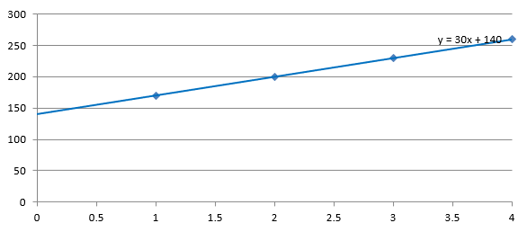

## **Overview**

This article explains how to add trend lines to presentation charts by using Aspose.Slides. It shows how to create a chart, add trend lines to chart series, and work with several trend line types, including exponential, linear, logarithmic, moving average, polynomial, and power.

It also describes how to add a custom line to a chart by inserting a line shape, and includes a short FAQ about forward and backward trend line projection values and whether trend lines are preserved during export to PDF or SVG and when rendering charts as images.

## **Add a Trend Line**

Use [TrendlineCollection.add](https://reference.aspose.com/slides/python-net/aspose.slides.charts/trendlinecollection/add/) to add a trend line to a chart series, selecting its type with [TrendlineType](https://reference.aspose.com/slides/python-net/aspose.slides.charts/trendlinetype/). The example creates a clustered column chart with default data and adds two trend lines to each of its three series.

The exponential trend line hides its equation and R-squared value through [display_equation](https://reference.aspose.com/slides/python-net/aspose.slides.charts/trendline/display_equation/) and [display_r_squared_value](https://reference.aspose.com/slides/python-net/aspose.slides.charts/trendline/display_r_squared_value/), while the linear trend line is red. The logarithmic trend line uses [add_text_frame_for_overriding](https://reference.aspose.com/slides/python-net/aspose.slides.charts/trendline/add_text_frame_for_overriding/) for a custom label. The moving average uses a [period](https://reference.aspose.com/slides/python-net/aspose.slides.charts/trendline/period/) of three data points and a custom [trendline_name](https://reference.aspose.com/slides/python-net/aspose.slides.charts/trendline/trendline_name/).

The polynomial trend line has an [order](https://reference.aspose.com/slides/python-net/aspose.slides.charts/trendline/order/) of three and extends one category forward through [forward](https://reference.aspose.com/slides/python-net/aspose.slides.charts/trendline/forward/). The power trend line extends one category backward through [backward](https://reference.aspose.com/slides/python-net/aspose.slides.charts/trendline/backward/).

```python
import aspose.slides as slides
import aspose.slides.charts as charts

with slides.Presentation() as presentation:
    slide = presentation.slides[0]

    chart = slide.shapes.add_chart(charts.ChartType.CLUSTERED_COLUMN, 20, 20, 500, 400)

    first_series = chart.chart_data.series[0]

    exponential_trendline = first_series.trend_lines.add(charts.TrendlineType.EXPONENTIAL)
    exponential_trendline.display_equation = False
    exponential_trendline.display_r_squared_value = False

    linear_trendline = first_series.trend_lines.add(charts.TrendlineType.LINEAR)
    linear_trendline.format.line.fill_format.fill_type = slides.FillType.SOLID
    linear_trendline.format.line.fill_format.solid_fill_color.r = 255
    linear_trendline.format.line.fill_format.solid_fill_color.g = 0
    linear_trendline.format.line.fill_format.solid_fill_color.b = 0

    second_series = chart.chart_data.series[1]

    logarithmic_trendline = second_series.trend_lines.add(charts.TrendlineType.LOGARITHMIC)
    logarithmic_trendline.add_text_frame_for_overriding("New log trend line")

    moving_average_trendline = second_series.trend_lines.add(charts.TrendlineType.MOVING_AVERAGE)
    moving_average_trendline.period = 3
    moving_average_trendline.trendline_name = "New TrendLine Name"

    third_series = chart.chart_data.series[2]

    polynomial_trendline = third_series.trend_lines.add(charts.TrendlineType.POLYNOMIAL)
    polynomial_trendline.forward = 1
    polynomial_trendline.order = 3

    power_trendline = third_series.trend_lines.add(charts.TrendlineType.POWER)
    power_trendline.backward = 1

    presentation.save("ChartTrendLines.pptx", slides.export.SaveFormat.PPTX)
```

## **Set a Trend Line Intercept**

Use [intercept](https://reference.aspose.com/slides/python-net/aspose.slides.charts/trendline/intercept/) to fix a trend line's Y value at X = 0. This setting is supported for linear, exponential, and polynomial trend lines.

For example, a production cost model may need to start at known fixed costs of 100, even when measurements at nonzero production volumes suggest a different baseline. For a linear trend line, fixing the intercept constrains the equation `y = ax + b` to `b = 100`; the slope is fitted to the data under that constraint. It does not simply move an already fitted line. Axis crossing settings control where the chart axes meet, not the coefficients of the fitted trend line.

The following example creates a scatter (XY) chart with production volumes from 1 to 4 and costs of 170, 200, 230, and 260. It saves the chart with the default automatic intercept, sets the intercept to 100, and saves a second PPTX. The two files differ only in the intercept setting. The trend line displays its equation and extends back to X = 0.

```python
import aspose.slides as slides
import aspose.slides.charts as charts

with slides.Presentation() as presentation:
    slide = presentation.slides[0]

    chart = slide.shapes.add_chart(charts.ChartType.SCATTER_WITH_MARKERS, 20, 20, 480, 210)
    chart.has_legend = False

    chart.chart_data.series.clear()
    chart.chart_data.categories.clear()

    workbook = chart.chart_data.chart_data_workbook
    workbook.clear(0)

    name_cell = workbook.get_cell(0, 0, 1, "Production cost")
    series = chart.chart_data.series.add(name_cell, charts.ChartType.SCATTER_WITH_MARKERS)
    costs = [170, 200, 230, 260]

    for i, cost in enumerate(costs):
        x_cell = workbook.get_cell(0, i + 1, 0, i + 1)
        y_cell = workbook.get_cell(0, i + 1, 1, cost)
        series.data_points.add_data_point_for_scatter_series(x_cell, y_cell)

    trendline = series.trend_lines.add(charts.TrendlineType.LINEAR)
    trendline.display_equation = True
    trendline.backward = 1

    presentation.save("AutomaticIntercept.pptx", slides.export.SaveFormat.PPTX)

    trendline.intercept = 100
    presentation.save("FixedIntercept.pptx", slides.export.SaveFormat.PPTX)
```

With automatic calculation, these data produce `y = 30x + 140`. Setting the intercept to 100 instead produces approximately `y = 43.33x + 100`: the fitted value at zero matches the known baseline, while the line no longer passes through every data point.

| Automatic intercept | Fixed intercept of 100 |
| --- | --- |
|  |  |

Both images use the same data and axis scales. The trend lines are extended back to X = 0 to show their intercepts.

By default, the property contains `float("nan")`, which represents an unspecified intercept rather than zero. The intercept is then calculated automatically from the data.

## **Add a Custom Line**

A custom line is a shape drawn over the chart rather than a trend line calculated from series data. This example uses [ShapeCollection.add_auto_shape](https://reference.aspose.com/slides/python-net/aspose.slides/shapecollection/add_auto_shape/) to add a horizontal line to the slide over the chart. The line's position is specified in slide coordinates, measured in points, so it starts at the chart's left edge and sits halfway down the chart. Its width matches the chart's width. The [line_format](https://reference.aspose.com/slides/python-net/aspose.slides/shape/line_format/) gives the line a solid red color.

```python
import aspose.slides as slides
import aspose.slides.charts as charts

with slides.Presentation() as presentation:
    slide = presentation.slides[0]

    chart = slide.shapes.add_chart(charts.ChartType.CLUSTERED_COLUMN, 100, 100, 500, 400)

    line = slide.shapes.add_auto_shape(slides.ShapeType.LINE, chart.x, chart.y + chart.height / 2, chart.width, 0)
    line.line_format.fill_format.fill_type = slides.FillType.SOLID
    line.line_format.fill_format.solid_fill_color.r = 255
    line.line_format.fill_format.solid_fill_color.g = 0
    line.line_format.fill_format.solid_fill_color.b = 0

    presentation.save("AddCustomLines.pptx", slides.export.SaveFormat.PPTX)
```

## **FAQ**

**What do 'forward' and 'backward' mean for a trend line?**

They are the lengths of the trend line projected forward/backward: for scatter (XY) charts — in axis units; for non-scatter charts — in number of categories. Only non-negative values are allowed.

**Will the trend line be preserved when exporting the presentation to PDF or SVG, or when rendering a slide to an image?**

Yes. Aspose.Slides converts presentations to [PDF](/slides/python-net/convert-powerpoint-to-pdf/) or [SVG](/slides/python-net/render-a-slide-as-an-svg-image/) and renders charts to images; trend lines, as part of the chart, are preserved during these operations. A method is also available to [export an image of the chart](/slides/python-net/create-shape-thumbnails/) itself.
