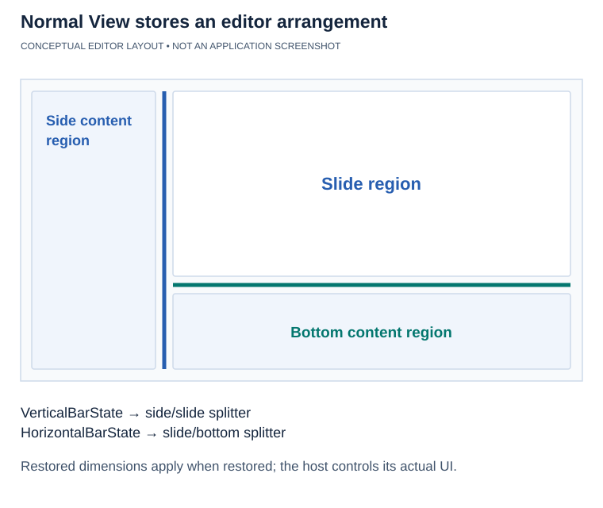

## **Introduction**

In PowerPoint's normal view, the slide appears between a side pane for thumbnails or an outline and a notes pane below. Aspose.Slides for Python via .NET exposes the presentation's saved editing preferences through [Presentation.view_properties](https://reference.aspose.com/slides/python-net/aspose.slides/presentation/view_properties/). These include the pane layout, zoom levels, grid spacing, and comment visibility.

## **About NormalViewProperties**

Use [normal_view_properties](https://reference.aspose.com/slides/python-net/aspose.slides/viewproperties/normal_view_properties/) to access the [NormalViewProperties](https://reference.aspose.com/slides/python-net/aspose.slides/normalviewproperties/) object. [show_outline_icons](https://reference.aspose.com/slides/python-net/aspose.slides/normalviewproperties/show_outline_icons/) controls whether icons appear beside slide titles in the outline. [snap_vertical_splitter](https://reference.aspose.com/slides/python-net/aspose.slides/normalviewproperties/snap_vertical_splitter/) lets the side pane snap to its minimized state when the user narrows it. [prefer_single_view](https://reference.aspose.com/slides/python-net/aspose.slides/normalviewproperties/prefer_single_view/) indicates a preference for displaying one pane in the full window.

[vertical_bar_state](https://reference.aspose.com/slides/python-net/aspose.slides/normalviewproperties/vertical_bar_state/) controls the divider between the side pane and the slide. [horizontal_bar_state](https://reference.aspose.com/slides/python-net/aspose.slides/normalviewproperties/horizontal_bar_state/) controls the divider above the notes pane. Both accept a [SplitterBarStateType](https://reference.aspose.com/slides/python-net/aspose.slides/splitterbarstatetype/) value of `MINIMIZED`, `MAXIMIZED`, or `RESTORED`.

<!-- visual-explanation:presentation-view-properties:start -->
[](visual-presentation-view-properties-40ae1765a743.svg)

*In normal view, the vertical divider controls the width of the side pane. The horizontal divider controls the space above the notes pane.*
<!-- visual-explanation:presentation-view-properties:end -->

## **About Restoring NormalViewProperties**

When a divider is restored, [restored_left](https://reference.aspose.com/slides/python-net/aspose.slides/normalviewproperties/restored_left/) supplies the saved size of the side pane and [restored_top](https://reference.aspose.com/slides/python-net/aspose.slides/normalviewproperties/restored_top/) supplies the saved size of the upper slide area. Both expose [NormalViewRestoredProperties](https://reference.aspose.com/slides/python-net/aspose.slides/normalviewrestoredproperties/). Its [dimension_size](https://reference.aspose.com/slides/python-net/aspose.slides/normalviewrestoredproperties/dimension_size/) property accepts a percentage from 0 to 100, and [auto_adjust](https://reference.aspose.com/slides/python-net/aspose.slides/normalviewrestoredproperties/auto_adjust/) controls whether the editor adjusts the size when the window is resized.

This example updates an existing presentation. It restores the horizontal divider, sets [restored_top](https://reference.aspose.com/slides/python-net/aspose.slides/normalviewproperties/restored_top/) to 80% with automatic adjustment enabled, and maximizes the vertical divider. It also enables [show_outline_icons](https://reference.aspose.com/slides/python-net/aspose.slides/normalviewproperties/show_outline_icons/) for outline view.

```py
import aspose.slides as slides

with slides.Presentation("demo.pptx") as presentation:
    normal_view = presentation.view_properties.normal_view_properties
    normal_view.horizontal_bar_state = slides.SplitterBarStateType.RESTORED
    normal_view.vertical_bar_state = slides.SplitterBarStateType.MAXIMIZED
    normal_view.restored_top.auto_adjust = True
    normal_view.restored_top.dimension_size = 80
    normal_view.show_outline_icons = True

    presentation.save("presentation_normal_view_state.pptx", slides.export.SaveFormat.PPTX)
```

## **Set the Default Zoom Value**

[slide_view_properties](https://reference.aspose.com/slides/python-net/aspose.slides/viewproperties/slide_view_properties/) and [notes_view_properties](https://reference.aspose.com/slides/python-net/aspose.slides/viewproperties/notes_view_properties/) store independent zoom settings for the editor. These settings do not affect slide dimensions, slide-show playback, or image export resolution.

This example opens an existing presentation and enables [variable_scale](https://reference.aspose.com/slides/python-net/aspose.slides/commonslideviewproperties/variable_scale/) to fit the slide to the editing window. For the notes page, it disables automatic scaling and sets [scale](https://reference.aspose.com/slides/python-net/aspose.slides/commonslideviewproperties/scale/) to a fixed 80% zoom.

```py
import aspose.slides as slides

with slides.Presentation("demo.pptx") as presentation:
    view_properties = presentation.view_properties
    view_properties.slide_view_properties.variable_scale = True
    view_properties.notes_view_properties.variable_scale = False
    view_properties.notes_view_properties.scale = 80

    presentation.save("zoom.pptx", slides.export.SaveFormat.PPTX)
```

## **Set the Grid Spacing**

[grid_spacing](https://reference.aspose.com/slides/python-net/aspose.slides/viewproperties/grid_spacing/) sets the distance between editing grid lines throughout the presentation. It takes a positive value in points, with 72 points per inch. This example prints the current spacing in an existing presentation and saves a quarter-inch grid by setting the interval to 18 points.

```py
import aspose.slides as slides

with slides.Presentation("demo.pptx") as presentation:
    view_properties = presentation.view_properties
    print(f"Current grid spacing: {view_properties.grid_spacing} points")

    view_properties.grid_spacing = 18.0

    presentation.save("grid-spacing.pptx", slides.export.SaveFormat.PPTX)
```

The grid repeats at a fixed interval. [Drawing guides](/slides/python-net/drawing-guides/) mark individual horizontal or vertical positions. Both are editing aids and appear only in editors that display them. Slide shows and exports to PDF, images, or SVG omit them.

## **Show or Hide Comments When Opening a Presentation**

[show_comments](https://reference.aspose.com/slides/python-net/aspose.slides/viewproperties/show_comments/) stores a preference that compatible editors use when opening the presentation. For an existing presentation with comments, this example prints the current setting and saves a copy with comments hidden. It also sets [last_view](https://reference.aspose.com/slides/python-net/aspose.slides/viewproperties/last_view/) to [ViewType.SLIDE_VIEW](https://reference.aspose.com/slides/python-net/aspose.slides/viewtype/) so the copy opens in slide view.

```py
import aspose.slides as slides

with slides.Presentation("comments.pptx") as presentation:
    view_properties = presentation.view_properties
    print(f"Current comment visibility: {view_properties.show_comments}")

    view_properties.show_comments = slides.NullableBool.FALSE
    view_properties.last_view = slides.ViewType.SLIDE_VIEW
    
    presentation.save("comments-hidden.pptx", slides.export.SaveFormat.PPTX)
```

Hiding comments preserves their text, authors, positions, replies, and statuses. To change the comments themselves, see [Presentation Comments](/slides/python-net/presentation-comments/). Export settings control whether comments appear in PDF, HTML, images, notes, or handouts.

## **FAQ**

**Why is the grid hidden when I reopen the presentation?**

The presentation stores the grid interval. To see the grid, enable grid visibility in the editor.

**Does clearing drawing guides change the grid spacing?**

No. Adding, moving, or clearing a guide leaves the grid interval unchanged.

**Can different sections of a presentation have different view settings?**

No. [Presentation.view_properties](https://reference.aspose.com/slides/python-net/aspose.slides/presentation/view_properties/) applies to the entire presentation.

**Can I save different view settings for different users?**

The file stores one set of view properties for everyone. An editor may also apply a user's local preferences.

**Can I save view settings in a template?**

Yes. Presentations created from the template inherit its saved view settings.
