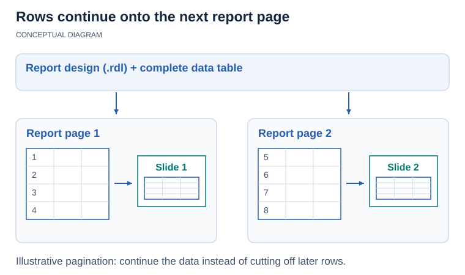

{} 

Aspose.Slides for Reporting Services implemented support for Power BI. 

{} 

Paginated reports are reports formatted to fit well on a page. Such reports are ideal for export operations and printing. Paginated reports are designed such that they provide as many pages as necessary to print or export every row of data in your table. 

<!-- visual-explanation:paginated-reports:start -->

*Conceptual example: the report creates enough pages to include all table rows. The report design and export route determine the actual pagination and slide output.*
<!-- visual-explanation:paginated-reports:end -->

For example, if you are looking to create a report so that owners of that report can view the quantity of product, price at sale, and profit for every item sold in the last 12 months, then a paginated report is what you need. 

To allow you to create paginated reports, Microsoft provides Power BI Report Builder in Power BI. After you create a paginated report and save it to your machine, the resulting file gets the .rdl extension. 
