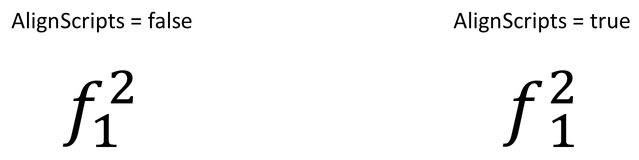

## **Visión general**

PowerPoint almacena ecuaciones como Office Math Markup Language (OMML). Con Aspose.Slides para Android a través de Java, puedes crear el mismo tipo de contenido matemático de forma programada: fracciones, radicales, funciones, límites, operadores N-ario, matrices, arreglos y bloques matemáticos con formato.

En PowerPoint, los usuarios normalmente añaden ecuaciones desde **Insertar > Ecuación**:


El resultado es texto matemático editable en la diapositiva:


Aspose.Slides construye ese texto matemático mediante tres objetos principales:

- Una forma matemática, creada con [addMathShape](https://reference.aspose.com/slides/androidjava/com.aspose.slides/ishapecollection/), es la forma que contiene la ecuación.
- [MathPortion](https://reference.aspose.com/slides/androidjava/com.aspose.slides/mathportion/) almacena el contenido matemático dentro del marco de texto de la forma.
- [MathParagraph](https://reference.aspose.com/slides/androidjava/com.aspose.slides/mathparagraph/) contiene uno o más objetos [MathBlock](https://reference.aspose.com/slides/androidjava/com.aspose.slides/mathblock/).

La mayoría de los ejemplos a continuación utilizan [MathematicalText](https://reference.aspose.com/slides/androidjava/com.aspose.slides/mathematicaltext/) y los métodos fluidos de [IMathElement](https://reference.aspose.com/slides/androidjava/com.aspose.slides/imathelement/) para mantener el código corto y legible.

Para escenarios de exportación a MathML, consulta [Exportar ecuaciones matemáticas desde presentaciones en Android](/slides/es/androidjava/exporting-math-equations/).

## **Crear una ecuación**

Este ejemplo usa [addMathShape](https://reference.aspose.com/slides/androidjava/com.aspose.slides/ishapecollection/#addMathShape-float-float-float-float-) para crear una forma matemática y añade el teorema de Pitágoras:


```java
import com.aspose.slides.*;

Presentation presentation = new Presentation();
try {
    ISlide slide = presentation.getSlides().get_Item(0);

    IAutoShape mathShape = slide.getShapes().addMathShape(20, 20, 700, 120);
    IMathParagraph mathParagraph = ((MathPortion) mathShape.getTextFrame().getParagraphs()
            .get_Item(0).getPortions().get_Item(0)).getMathParagraph();

    IMathBlock equation = new MathematicalText("c")
            .setSuperscript("2")
            .join("=")
            .join(new MathematicalText("a").setSuperscript("2"))
            .join("+")
            .join(new MathematicalText("b").setSuperscript("2"));

    mathParagraph.add(equation);

    presentation.save("pythagorean-theorem.pptx", SaveFormat.Pptx);
} finally {
    presentation.dispose();
}
```

{}

[addMathShape](https://reference.aspose.com/slides/androidjava/com.aspose.slides/ishapecollection/#addMathShape-float-float-float-float-) crea una forma que ya contiene un párrafo matemático. Accede al primer [MathPortion](https://reference.aspose.com/slides/androidjava/com.aspose.slides/mathportion/), llama a [getMathParagraph](https://reference.aspose.com/slides/androidjava/com.aspose.slides/imathportion/#getMathParagraph--), y añade bloques o elementos matemáticos a él.

{}

### **Combinar bloques matemáticos**

Cuando partes de una ecuación se construyen independientemente como objetos [IMathBlock](https://reference.aspose.com/slides/androidjava/com.aspose.slides/imathblock/), usa [joinBlock](https://reference.aspose.com/slides/androidjava/com.aspose.slides/imathblock/#joinBlock-com.aspose.slides.IMathBlock-) para combinarlos. El ejemplo construye `c² =` en el bloque izquierdo y `a² + b²` en el bloque derecho. [setSuperscript](https://reference.aspose.com/slides/androidjava/com.aspose.slides/imathelement/#setSuperscript-java.lang.String-) crea superíndices matemáticos editables para los tres exponentes.

```java
import com.aspose.slides.*;

Presentation presentation = new Presentation();
try {
    ISlide slide = presentation.getSlides().get_Item(0);

    IAutoShape shape = slide.getShapes().addMathShape(20, 20, 600, 100);
    IMathPortion mathPortion = (IMathPortion) shape.getTextFrame().getParagraphs().get_Item(0).getPortions().get_Item(0);
    IMathParagraph mathParagraph = mathPortion.getMathParagraph();

    MathBlock leftBlock = new MathBlock();
    leftBlock.add(new MathematicalText("c").setSuperscript("2"));
    leftBlock.add(new MathematicalText("="));

    MathBlock rightBlock = new MathBlock();
    rightBlock.add(new MathematicalText("a").setSuperscript("2"));
    rightBlock.add(new MathematicalText("+"));
    rightBlock.add(new MathematicalText("b").setSuperscript("2"));

    IMathBlock combinedBlock = leftBlock.joinBlock(rightBlock);
    mathParagraph.add(combinedBlock);

    presentation.save("equation.pptx", SaveFormat.Pptx);
} finally {
    presentation.dispose();
}
```

[joinBlock](https://reference.aspose.com/slides/androidjava/com.aspose.slides/imathblock/#joinBlock-com.aspose.slides.IMathBlock-) devuelve el propio `leftBlock`, que ahora contiene ambas partes en orden, y deja `rightBlock` vacío. Añade el bloque combinado al [IMathParagraph](https://reference.aspose.com/slides/androidjava/com.aspose.slides/imathparagraph/) solo una vez. Después de volver a abrir `equation.pptx`, el párrafo contiene un bloque que representa `c² = a² + b²`, con los tres exponentes conservados como superíndices matemáticos.

Llamar a [add](https://reference.aspose.com/slides/androidjava/com.aspose.slides/imathelementcollection/#add-com.aspose.slides.IMathElement-) como `leftBlock.add(rightBlock)` intenta anidar un bloque directamente dentro de otro y lanza `InvalidOperationException`.

## **Añadir fracciones**

Usa [divide](https://reference.aspose.com/slides/androidjava/com.aspose.slides/imathelement/#divide-com.aspose.slides.IMathElement-) para crear una fracción. Puedes elegir un estilo de fracción con [MathFractionTypes](https://reference.aspose.com/slides/androidjava/com.aspose.slides/mathfractiontypes/).


```java
import com.aspose.slides.*;

Presentation presentation = new Presentation();
try {
    ISlide slide = presentation.getSlides().get_Item(0);

    IAutoShape mathShape = slide.getShapes().addMathShape(20, 20, 700, 100);
    IMathParagraph mathParagraph = ((MathPortion) mathShape.getTextFrame().getParagraphs()
            .get_Item(0).getPortions().get_Item(0)).getMathParagraph();

    IMathFraction fraction = new MathematicalText("1")
            .divide("x", MathFractionTypes.Skewed);

    mathParagraph.add(new MathBlock(fraction));

    presentation.save("fraction.pptx", SaveFormat.Pptx);
} finally {
    presentation.dispose();
}
```

Para una fracción apilada, usa [MathFractionTypes.Bar](https://reference.aspose.com/slides/androidjava/com.aspose.slides/mathfractiontypes/#Bar):

```java
import com.aspose.slides.*;

IMathFraction stackedFraction = new MathematicalText("x + 1").divide("y - 1", MathFractionTypes.Bar);
```

## **Añadir radicales**

Usa [radical](https://reference.aspose.com/slides/androidjava/com.aspose.slides/imathelement/#radical-com.aspose.slides.IMathElement-) para crear una raíz cuadrada, cúbica u otra raíz. El elemento actual se convierte en la base y el argumento en el grado.


```java
import com.aspose.slides.*;

Presentation presentation = new Presentation();
try {
    ISlide slide = presentation.getSlides().get_Item(0);

    IAutoShape mathShape = slide.getShapes().addMathShape(20, 20, 700, 100);
    IMathParagraph mathParagraph = ((MathPortion) mathShape.getTextFrame().getParagraphs()
            .get_Item(0).getPortions().get_Item(0)).getMathParagraph();

    IMathRadical radical = new MathematicalText("x")
            .radical("n");

    mathParagraph.add(new MathBlock(radical));

    presentation.save("radical.pptx", SaveFormat.Pptx);
} finally {
    presentation.dispose();
}
```

### **Mostrar o ocultar el grado de una raíz cuadrada**

Una raíz cuadrada puede mostrar un 2 explícito o usar la notación convencional √x. El método [setHideDegree](https://reference.aspose.com/slides/androidjava/com.aspose.slides/imathradical/#setHideDegree-boolean-) de [IMathRadical](https://reference.aspose.com/slides/androidjava/com.aspose.slides/imathradical/) controla qué forma aparece. Ambas formas conservan el grado 2 y el radicando x en la ecuación editable.


El ejemplo guarda la misma raíz cuadrada dos veces. En `visible-degree.pptx`, el 2 es visible. En `hidden-degree.pptx`, está oculto.

```java
import com.aspose.slides.*;

Presentation presentation = new Presentation();
try {
    ISlide slide = presentation.getSlides().get_Item(0);

    IMathRadical radical = new MathematicalText("x").radical("2");

    IAutoShape shape = slide.getShapes().addMathShape(20, 20, 200, 100);
    IMathPortion portion = (IMathPortion) shape.getTextFrame().getParagraphs().get_Item(0).getPortions().get_Item(0);
    portion.getMathParagraph().add(new MathBlock(radical));

    radical.setHideDegree(false);
    presentation.save("visible-degree.pptx", SaveFormat.Pptx);

    radical.setHideDegree(true);
    presentation.save("hidden-degree.pptx", SaveFormat.Pptx);
} finally {
    presentation.dispose();
}
```

## **Añadir funciones y límites**

Usa [asArgumentOfFunction](https://reference.aspose.com/slides/androidjava/com.aspose.slides/imathelement/#asArgumentOfFunction-com.aspose.slides.IMathElement-) o [function](https://reference.aspose.com/slides/androidjava/com.aspose.slides/imathelement/#function-com.aspose.slides.IMathElement-) para funciones como `sin(x)`, `log(x)` o nombres de funciones personalizados. Para límites, coloca `lim` en un [MathLimit](https://reference.aspose.com/slides/androidjava/com.aspose.slides/mathlimit/) o usa [setLowerLimit](https://reference.aspose.com/slides/androidjava/com.aspose.slides/imathelement/#setLowerLimit-com.aspose.slides.IMathElement-).


```java
import com.aspose.slides.*;

Presentation presentation = new Presentation();
try {
    ISlide slide = presentation.getSlides().get_Item(0);

    IAutoShape mathShape = slide.getShapes().addMathShape(20, 20, 700, 100);
    IMathParagraph mathParagraph = ((MathPortion) mathShape.getTextFrame().getParagraphs()
            .get_Item(0).getPortions().get_Item(0)).getMathParagraph();

    IMathFunction limit = new MathematicalText("lim")
            .setLowerLimit("x→∞")
            .function("x");

    mathParagraph.add(new MathBlock(limit));

    presentation.save("functions-and-limits.pptx", SaveFormat.Pptx);
} finally {
    presentation.dispose();
}
```

Para un nombre de función personalizado, haz del nombre de la función el elemento actual y llama a [function](https://reference.aspose.com/slides/androidjava/com.aspose.slides/imathelement/#function-com.aspose.slides.IMathElement-) con su argumento:

```java
import com.aspose.slides.*;

IMathFunction customFunction = new MathematicalText("f").function("x + 1");
```

## **Añadir operadores N-ario e integrales**

Usa [nary](https://reference.aspose.com/slides/androidjava/com.aspose.slides/imathelement/#nary-int-com.aspose.slides.IMathElement-com.aspose.slides.IMathElement-) para sumatorios, uniones, intersecciones y otros operadores grandes. Usa [integral](https://reference.aspose.com/slides/androidjava/com.aspose.slides/imathelement/#integral-int-com.aspose.slides.IMathElement-com.aspose.slides.IMathElement-) para integrales. Ambos métodos permiten establecer límites inferior y superior.


```java
import com.aspose.slides.*;

Presentation presentation = new Presentation();
try {
    ISlide slide = presentation.getSlides().get_Item(0);

    IAutoShape mathShape = slide.getShapes().addMathShape(20, 20, 700, 120);
    IMathParagraph mathParagraph = ((MathPortion) mathShape.getTextFrame().getParagraphs()
            .get_Item(0).getPortions().get_Item(0)).getMathParagraph();

    IMathBlock summationBase = new MathematicalText("x")
            .setSuperscript("k")
            .join(new MathematicalText("a").setSuperscript("n-k"));

    IMathNaryOperator summation = summationBase.nary(MathNaryOperatorTypes.Summation, "k=0", "n");

    mathParagraph.add(new MathBlock(summation));

    presentation.save("nary-operators.pptx", SaveFormat.Pptx);
} finally {
    presentation.dispose();
}
```

Los operadores N-ario son para operadores grandes con límites opcionales. Los operadores simples como `+`, `-` y `=` se añaden normalmente como [MathematicalText](https://reference.aspose.com/slides/androidjava/com.aspose.slides/mathematicaltext/) y se unen a la expresión.

Para una integral, usa [integral](https://reference.aspose.com/slides/androidjava/com.aspose.slides/imathelement/#integral-int-com.aspose.slides.IMathElement-com.aspose.slides.IMathElement-):

```java
import com.aspose.slides.*;

IMathBlock integralBase = new MathematicalText("x").join(new MathematicalText("dx").toBox());
IMathNaryOperator integral = integralBase.integral(MathIntegralTypes.Simple, "0", "1");
```

## **Añadir matrices**

Usa [MathMatrix](https://reference.aspose.com/slides/androidjava/com.aspose.slides/mathmatrix/) para filas y columnas. Las matrices no incluyen corchetes por defecto, por lo que hay que encerrarlas cuando necesites paréntesis, corchetes o llaves.


```java
import com.aspose.slides.*;

Presentation presentation = new Presentation();
try {
    ISlide slide = presentation.getSlides().get_Item(0);

    IAutoShape mathShape = slide.getShapes().addMathShape(20, 20, 700, 120);
    IMathParagraph mathParagraph = ((MathPortion) mathShape.getTextFrame().getParagraphs()
            .get_Item(0).getPortions().get_Item(0)).getMathParagraph();

    MathMatrix matrix = new MathMatrix(2, 3);
    matrix.set_Item(0, 0, new MathematicalText("1"));
    matrix.set_Item(0, 1, new MathematicalText("x"));
    matrix.set_Item(1, 0, new MathematicalText("x"));
    matrix.set_Item(1, 1, new MathematicalText("2"));
    matrix.set_Item(1, 2, new MathematicalText("y"));

    mathParagraph.add(new MathBlock(matrix));

    presentation.save("matrix.pptx", SaveFormat.Pptx);
} finally {
    presentation.dispose();
}
```

### **Editar una matriz existente**

Supongamos que una lección de álgebra lineal comienza con la matriz de coeficientes en `matrix.pptx`, guardada por el ejemplo anterior. Para el siguiente ejercicio, conserva la primera ecuación, reemplaza la segunda con dos ecuaciones nuevas y revisa el conjunto de variables. Abre la matriz existente a través de [IMathMatrix](https://reference.aspose.com/slides/androidjava/com.aspose.slides/imathmatrix/) para mantener los coeficientes que aún son válidos.


Los índices de filas y columnas comienzan en cero y se refieren a la matriz tal y como está en cada llamada. Insertar una fila antes del índice 1 desplaza la segunda fila original al índice 2. Insertar después del índice 2 agrega una fila. Eliminar la fila 2 quita la ecuación original segunda y mueve la fila añadida una posición arriba. Las columnas se desplazan de la misma manera.

```java
import com.aspose.slides.*;

Presentation presentation = new Presentation("matrix.pptx");
try {
    IAutoShape shape = (IAutoShape) presentation.getSlides().get_Item(0).getShapes().get_Item(0);
    IMathPortion portion = (IMathPortion) shape.getTextFrame().getParagraphs().get_Item(0).getPortions().get_Item(0);
    IMathMatrix matrix = (IMathMatrix) portion.getMathParagraph().get_Item(0).get_Item(0);

    matrix.insertRowBefore(1);
    matrix.insertRowAfter(2);
    matrix.deleteRow(2);

    matrix.insertColumnBefore(1);
    matrix.insertColumnAfter(3);
    matrix.deleteColumn(3);

    // Nuevas celdas son inicialmente nulas. Establece primero los coeficientes diferentes de cero.
    matrix.set_Item(1, 0, new MathematicalText("12"));
    matrix.set_Item(1, 1, new MathematicalText("1"));
    matrix.set_Item(2, 2, new MathematicalText("10"));
    matrix.set_Item(2, 3, new MathematicalText("1"));
    for (int row = 0; row < matrix.getRowCount(); row++) {
        for (int column = 0; column < matrix.getColumnCount(); column++) {
            if (matrix.get_Item(row, column) == null) {
                matrix.set_Item(row, column, new MathematicalText("0"));
            }
        }
    }

    matrix.setColumnAlignment(0, MathHorizontalAlignment.Left);
    matrix.setColumnsAlignment(1, 3, MathHorizontalAlignment.Right);

    presentation.save("updated-matrix.pptx", SaveFormat.Pptx);
} finally {
    presentation.dispose();
}
```

[setColumnAlignment](https://reference.aspose.com/slides/androidjava/com.aspose.slides/imathmatrix/#setColumnAlignment-int-int-) alinea la primera columna a la izquierda. [setColumnsAlignment](https://reference.aspose.com/slides/androidjava/com.aspose.slides/imathmatrix/#setColumnsAlignment-int-long-int-) alinea tres columnas consecutivas a la derecha, comenzando en el índice 1. En `updated-matrix.pptx`, la matriz tiene tres ecuaciones y cuatro variables. Los coeficientes originales de la primera fila `1` y `x` aparecen ahora en la primera y tercera columna.


## **Añadir arreglos de ecuaciones**

Usa [toMathArray](https://reference.aspose.com/slides/androidjava/com.aspose.slides/imathelement/#toMathArray--) cuando necesites ecuaciones alineadas o una pila vertical de expresiones.


```java
import com.aspose.slides.*;

Presentation presentation = new Presentation();
try {
    ISlide slide = presentation.getSlides().get_Item(0);

    IAutoShape mathShape = slide.getShapes().addMathShape(20, 20, 700, 140);
    IMathParagraph mathParagraph = ((MathPortion) mathShape.getTextFrame().getParagraphs()
            .get_Item(0).getPortions().get_Item(0)).getMathParagraph();

    IMathArray equationArray = new MathematicalText("x")
            .join("y")
            .toMathArray();

    mathParagraph.add(new MathBlock(equationArray));

    presentation.save("equation-array.pptx", SaveFormat.Pptx);
} finally {
    presentation.dispose();
}
```

### **Alinear un arreglo con elementos circundantes**

[setBaseJustification](https://reference.aspose.com/slides/androidjava/com.aspose.slides/imatharray/#setBaseJustification-int-) controla la alineación vertical de un arreglo respecto a los elementos matemáticos a su lado. El ejemplo siguiente compara la alineación con la primera fila, el centro del arreglo y la última fila.

El siguiente ejemplo crea tres arreglos idénticos, cada uno con tres filas y los elementos vecinos `A=` y `=B`. Todo el texto matemático usa Cambria Math a 24 puntos. Solo cambia la alineación del arreglo.

```java
import com.aspose.slides.*;
import android.graphics.Color;

class MathTextFactory {
    MathematicalText createText(String value) {
        MathematicalText text = new MathematicalText(value);
        text.getFormat().setFontHeight(24);
        text.getFormat().setLatinFont(new FontData("Cambria Math"));
        return text;
    }
}

MathTextFactory factory = new MathTextFactory();
Presentation presentation = new Presentation();
try {
    presentation.getSlideSize().setSize(780, 200, SlideSizeScaleType.DoNotScale);
    ISlide slide = presentation.getSlides().get_Item(0);

    int[] alignments = { MathVerticalAlignment.Top, MathVerticalAlignment.Center, MathVerticalAlignment.Bottom };
    String[] alignmentNames = { "Top", "Center", "Bottom" };

    for (int i = 0; i < alignments.length; i++) {
        IAutoShape label = slide.getShapes().addAutoShape(ShapeType.Rectangle, 20 + i * 260, 10, 240, 30);
        label.getFillFormat().setFillType(FillType.NoFill);
        label.getLineFormat().getFillFormat().setFillType(FillType.NoFill);
        label.getTextFrame().setText(alignmentNames[i]);
        IPortionFormat labelFormat = label.getTextFrame().getParagraphs().get_Item(0).getPortions().get_Item(0).getPortionFormat();
        labelFormat.setFontHeight(16);
        labelFormat.getFillFormat().setFillType(FillType.Solid);
        labelFormat.getFillFormat().getSolidFillColor().setColor(Color.BLACK);

        IAutoShape mathShape = slide.getShapes().addMathShape(20 + i * 260, 60, 240, 130);
        mathShape.getTextFrame().getTextFrameFormat().setAnchoringType(TextAnchorType.Top);
        IMathParagraph mathParagraph = ((IMathPortion) mathShape.getTextFrame().getParagraphs().get_Item(0).getPortions().get_Item(0)).getMathParagraph();
        mathParagraph.setJustification(MathJustification.LeftJustified);

        IMathElement[] rows = { factory.createText("x+y=3"), factory.createText("x-y=1"), factory.createText("x=2") };
        MathArray equationArray = new MathArray(rows[0]);
        equationArray.getArguments().add(rows[1]);
        equationArray.getArguments().add(rows[2]);
        equationArray.setBaseJustification(alignments[i]);
        MathematicalText leftText = factory.createText("A=");
        MathematicalText rightText = factory.createText("=B");
        IMathBlock equation = new MathBlock(leftText).join(equationArray).join(rightText);
        mathParagraph.add(equation);
    }

    presentation.save("equation-array-alignment.pptx", SaveFormat.Pptx);
} finally {
    presentation.dispose();
}
```

La siguiente comparación muestra la presentación guardada en PowerPoint. Observa la posición de `A=` y `=B` junto a cada arreglo.


### **Configurar el espaciado de filas**

[setRowSpacingRule](https://reference.aspose.com/slides/androidjava/com.aspose.slides/imatharray/#setRowSpacingRule-int-) selecciona la regla de espaciado para las filas dentro del arreglo. [setRowSpacing](https://reference.aspose.com/slides/androidjava/com.aspose.slides/imatharray/#setRowSpacing-long-) proporciona un valor numérico para una regla de espaciado explícita y se ignora cuando se usan reglas predefinidas.

Para un espaciado exacto, el valor se mide en puntos. Para espaciado proporcional, se mide en medio‑líneas: el valor `3` en el ejemplo indica 1,5 líneas. Establece ambas propiedades cuando especificas un valor explícito; cambiar solo el valor numérico no selecciona una regla de espaciado.

El ejemplo a continuación guarda cinco presentaciones con las mismas ecuaciones, alineación y configuración de fuente. Las primeras tres usan valores predefinidos; las dos últimas muestran valores explícitos.

```java
import com.aspose.slides.*;

class MathTextFactory {
    MathematicalText createText(String value) {
        MathematicalText text = new MathematicalText(value);
        text.getFormat().setFontHeight(24);
        text.getFormat().setLatinFont(new FontData("Cambria Math"));
        return text;
    }
}

MathTextFactory factory = new MathTextFactory();
int[] rules = { MathRowSpacingRule.SingleLineGap, MathRowSpacingRule.OneAndAHalfLineGap, MathRowSpacingRule.TwoLineGap, MathRowSpacingRule.Exactly, MathRowSpacingRule.Multiple };
int[] spacingValues = { 0, 0, 0, 20, 3 };
String[] ruleNames = { "SingleLineGap", "OneAndAHalfLineGap", "TwoLineGap", "Exactly", "Multiple" };

for (int i = 0; i < rules.length; i++) {
    String fileName = "equation-array-" + ruleNames[i] + ".pptx";
    Presentation presentation = new Presentation();
    try {
        IAutoShape mathShape = presentation.getSlides().get_Item(0).getShapes().addMathShape(20, 20, 600, 300);
        IParagraph paragraph = mathShape.getTextFrame().getParagraphs().get_Item(0);
        paragraph.getParagraphFormat().setSpaceBefore(0);
        paragraph.getParagraphFormat().setSpaceAfter(0);
        IMathParagraph mathParagraph = ((IMathPortion) paragraph.getPortions().get_Item(0)).getMathParagraph();
        mathParagraph.setJustification(MathJustification.LeftJustified);

        IMathElement[] rows = { factory.createText("x+y=3"), factory.createText("x-y=1"), factory.createText("x=2") };
        MathArray equationArray = new MathArray(rows[0]);
        equationArray.getArguments().add(rows[1]);
        equationArray.getArguments().add(rows[2]);
        equationArray.setBaseJustification(MathVerticalAlignment.Center);
        equationArray.setRowSpacingRule(rules[i]);
        equationArray.setRowSpacing(spacingValues[i]);
        MathematicalText leftText = factory.createText("A=");
        MathematicalText rightText = factory.createText("=B");
        IMathBlock equation = new MathBlock(leftText).join(equationArray).join(rightText);
        mathParagraph.add(equation);

        presentation.save(fileName, SaveFormat.Pptx);
    } finally {
        presentation.dispose();
    }
}
```

El espaciado de filas del arreglo es independiente del espaciado de párrafos. [setSpaceBefore](https://reference.aspose.com/slides/androidjava/com.aspose.slides/iparagraphformat/#setSpaceBefore-float-) y [setSpaceAfter](https://reference.aspose.com/slides/androidjava/com.aspose.slides/iparagraphformat/#setSpaceAfter-float-) añaden espacio alrededor del párrafo contenedor, no entre filas del arreglo. Del mismo modo, [IMathParagraph.setJustification](https://reference.aspose.com/slides/androidjava/com.aspose.slides/imathparagraph/#setJustification-int-) posiciona todo el párrafo matemático horizontalmente; no sustituye la configuración de alineación vertical del arreglo.

## **Añadir funciones trigonométricas**

Usa [asArgumentOfFunction](https://reference.aspose.com/slides/androidjava/com.aspose.slides/imathelement/#asArgumentOfFunction-com.aspose.slides.IMathElement-) cuando el argumento es el elemento actual y el nombre de la función es conocido.


```java
import com.aspose.slides.*;

Presentation presentation = new Presentation();
try {
    ISlide slide = presentation.getSlides().get_Item(0);

    IAutoShape mathShape = slide.getShapes().addMathShape(20, 20, 700, 100);
    IMathParagraph mathParagraph = ((MathPortion) mathShape.getTextFrame().getParagraphs()
            .get_Item(0).getPortions().get_Item(0)).getMathParagraph();

    IMathFunction cosine = new MathematicalText("2x")
            .asArgumentOfFunction(MathFunctionsOfOneArgument.Cos);

    mathParagraph.add(new MathBlock(cosine));

    presentation.save("trigonometric-function.pptx", SaveFormat.Pptx);
} finally {
    presentation.dispose();
}
```

## **Añadir subíndices y superíndices**

Usa los asistentes de subíndice y superíndice para índices y potencias. Cuando los índices deben aparecer al lado izquierdo de la base, usa [setSubSuperscriptOnTheLeft](https://reference.aspose.com/slides/androidjava/com.aspose.slides/imathelement/#setSubSuperscriptOnTheLeft-com.aspose.slides.IMathElement-com.aspose.slides.IMathElement-).


```java
import com.aspose.slides.*;

Presentation presentation = new Presentation();
try {
    ISlide slide = presentation.getSlides().get_Item(0);

    IAutoShape mathShape = slide.getShapes().addMathShape(20, 20, 700, 100);
    IMathParagraph mathParagraph = ((MathPortion) mathShape.getTextFrame().getParagraphs()
            .get_Item(0).getPortions().get_Item(0)).getMathParagraph();

    IMathLeftSubSuperscriptElement scripts = new MathematicalText("Y")
            .setSubSuperscriptOnTheLeft("1", "n");

    mathParagraph.add(new MathBlock(scripts));

    presentation.save("subscript-superscript.pptx", SaveFormat.Pptx);
} finally {
    presentation.dispose();
}
```

### **Alinear subíndices y superíndices a la derecha**

Cuando ambos scripts pertenecen a la misma base, usa [MathRightSubSuperscriptElement](https://reference.aspose.com/slides/androidjava/com.aspose.slides/mathrightsubsuperscriptelement/). Su método [setAlignScripts](https://reference.aspose.com/slides/androidjava/com.aspose.slides/imathrightsubsuperscriptelement/#setAlignScripts-boolean-) controla sus posiciones horizontales: `false` (valor predeterminado) los hace seguir el contorno de la base, mientras que `true` alinea los scripts horizontalmente entre sí.

Este ejemplo coloca dos copias de la misma expresión editable una al lado de la otra. Ambas usan la letra itálica matemática f (U+1D453), un subíndice 1, un superíndice 2 y Cambria Math a 72 puntos. La base inclinada hace visible la diferencia en PowerPoint. Instala Cambria Math antes de ejecutar el ejemplo.

```java
import com.aspose.slides.*;

Presentation presentation = new Presentation();
try {
    presentation.getSlideSize().setSize(900, 250, SlideSizeScaleType.DoNotScale);
    ISlide slide = presentation.getSlides().get_Item(0);

    PortionFormat format = new PortionFormat();
    format.setFontHeight(72);
    format.setLatinFont(new FontData("Cambria Math"));

    for (int i = 0; i < 2; i++) {
        int left = 40 + i * 440;
        IAutoShape shape = slide.getShapes().addMathShape(left, 75, 380, 150);

        MathematicalText baseText = new MathematicalText("\uD835\uDC53", format);
        MathematicalText subscript = new MathematicalText("1", format);
        MathematicalText superscript = new MathematicalText("2", format);
        MathRightSubSuperscriptElement scripts = new MathRightSubSuperscriptElement(baseText, subscript, superscript);
        scripts.setAlignScripts(i == 1);

        MathPortion portion = (MathPortion) shape.getTextFrame().getParagraphs().get_Item(0).getPortions().get_Item(0);
        portion.getPortionFormat().setFontHeight(format.getFontHeight());
        portion.getPortionFormat().setLatinFont(format.getLatinFont());
        portion.getMathParagraph().add(new MathBlock(scripts));
    }

    presentation.save("aligned-scripts.pptx", SaveFormat.Pptx);
} finally {
    presentation.dispose();
}
```



A la izquierda, el subíndice comienza más a la izquierda que el superíndice, siguiendo el contorno de la base. A la derecha, los dos scripts se alinean horizontalmente entre sí.

## **Añadir delimitadores**

Usa [enclose](https://reference.aspose.com/slides/androidjava/com.aspose.slides/imathelement/#enclose-char-char-) para colocar una expresión dentro de delimitadores. También puedes establecer un carácter separador para expresiones delimitadoras que contengan varios elementos.


```java
import com.aspose.slides.*;

Presentation presentation = new Presentation();
try {
    ISlide slide = presentation.getSlides().get_Item(0);

    IAutoShape mathShape = slide.getShapes().addMathShape(20, 20, 700, 100);
    IMathParagraph mathParagraph = ((MathPortion) mathShape.getTextFrame().getParagraphs()
            .get_Item(0).getPortions().get_Item(0)).getMathParagraph();

    IMathDelimiter delimiter = new MathematicalText("x")
            .join("y")
            .join("z")
            .enclose('<', '>');
    delimiter.setSeparatorCharacter('|');

    mathParagraph.add(new MathBlock(delimiter));

    presentation.save("delimiters.pptx", SaveFormat.Pptx);
} finally {
    presentation.dispose();
}
```

### **Tamaño y alineación de delimitadores**

Pasa `true` a [setGrowToMatchOperandHeight](https://reference.aspose.com/slides/androidjava/com.aspose.slides/imathdelimiter/#setGrowToMatchOperandHeight-boolean-) para que los paréntesis crezcan alrededor de un operando alto, o `false` para mantener su tamaño normal. Usa [setDelimiterShape](https://reference.aspose.com/slides/androidjava/com.aspose.slides/imathdelimiter/#setDelimiterShape-int-) con uno de los valores de [MathDelimiterShape](https://reference.aspose.com/slides/androidjava/com.aspose.slides/mathdelimitershape/). `Centered` centra los paréntesis en el eje matemático, que pasa por la mitad del signo igual. `Match` los alinea con el contenido encerrado. Ambas configuraciones afectan solo a los delimitadores. La expresión interior permanece igual.

El ejemplo coloca una fracción en el exponente de `x` de modo que la expresión se extienda más por encima de la línea base que por debajo. Las cuatro ecuaciones usan los mismos paréntesis y configuración de fuente.

```java
import com.aspose.slides.*;

Presentation presentation = new Presentation();
try {
    ISlide slide = presentation.getSlides().get_Item(0);
    for (int row = 0; row < 2; row++) {
        for (int column = 0; column < 2; column++) {
            IMathFraction fraction = new MathematicalText("a + b").divide("c + d");
            IMathSuperscriptElement power = new MathematicalText("x").setSuperscript(fraction);
            IMathDelimiter delimiter = power.enclose('(', ')');
            delimiter.setGrowToMatchOperandHeight(row == 0);
            delimiter.setDelimiterShape(column == 0 ? MathDelimiterShape.Centered : MathDelimiterShape.Match);

            IAutoShape mathShape = slide.getShapes().addMathShape(20 + 330 * column, 20 + 120 * row, 300, 100);
            MathPortion portion = (MathPortion) mathShape.getTextFrame().getParagraphs().get_Item(0).getPortions().get_Item(0);
            portion.getPortionFormat().setFontHeight(32);
            IMathBlock equation = new MathematicalText("y = ").join(delimiter);
            portion.getMathParagraph().add(equation);
        }
    }
    presentation.save("delimiter-sizing.pptx", SaveFormat.Pptx);
} finally {
    presentation.dispose();
}
```

En PowerPoint, compara las filas para ver el efecto del crecimiento. En la fila superior, los paréntesis crecen para encerrar el exponente y se ven iguales para ambas formas. En la fila inferior, el crecimiento está desactivado. Los paréntesis más pequeños a la izquierda (`Centered`) se alinean con el signo igual, mientras que los de la derecha (`Match`) se sitúan más altos alrededor de la expresión.


## **Añadir un cuadro con borde**

Llama a [toBorderBox](https://reference.aspose.com/slides/androidjava/com.aspose.slides/imathelement/#toBorderBox--) sobre una fracción para encuadrar toda la expresión. El [IMathBorderBox](https://reference.aspose.com/slides/androidjava/com.aspose.slides/imathborderbox/) devuelto muestra los cuatro lados por defecto. Usa [setHideTop](https://reference.aspose.com/slides/androidjava/com.aspose.slides/imathborderbox/#setHideTop-boolean-), [setHideBottom](https://reference.aspose.com/slides/androidjava/com.aspose.slides/imathborderbox/#setHideBottom-boolean-), [setHideLeft](https://reference.aspose.com/slides/androidjava/com.aspose.slides/imathborderbox/#setHideLeft-boolean-), y [setHideRight](https://reference.aspose.com/slides/androidjava/com.aspose.slides/imathborderbox/#setHideRight-boolean-) para eliminar lados individuales.

El ejemplo coloca seis copias de la misma fracción en una diapositiva. Para mostrar cancelación, oculta los cuatro lados y pasa `true` a [setStrikethroughBottomLeftToTopRight](https://reference.aspose.com/slides/androidjava/com.aspose.slides/imathborderbox/#setStrikethroughBottomLeftToTopRight-boolean-) para una diagonal ascendente (↗) o a [setStrikethroughTopLeftToBottomRight](https://reference.aspose.com/slides/androidjava/com.aspose.slides/imathborderbox/#setStrikethroughTopLeftToBottomRight-boolean-) para una diagonal descendente (↘). También puedes usar [setStrikethroughHorizontal](https://reference.aspose.com/slides/androidjava/com.aspose.slides/imathborderbox/#setStrikethroughHorizontal-boolean-) o [setStrikethroughVertical](https://reference.aspose.com/slides/androidjava/com.aspose.slides/imathborderbox/#setStrikethroughVertical-boolean-) con cualquier combinación de lados visibles.

```java
import com.aspose.slides.*;

Presentation presentation = new Presentation();
try {
    presentation.getSlideSize().setSize(540, 220, SlideSizeScaleType.DoNotScale);
    ISlide slide = presentation.getSlides().get_Item(0);

    class FractionBuilder {
        IMathBorderBox addFraction(float x, float y, boolean hideBorder) {
            IMathFraction fraction = new MathematicalText("x+1").divide("y+2");
            IMathBorderBox box = fraction.toBorderBox();
            box.setHideTop(hideBorder);
            box.setHideBottom(hideBorder);
            box.setHideLeft(hideBorder);
            box.setHideRight(hideBorder);

            IAutoShape shape = slide.getShapes().addMathShape(x, y, 160, 90);
            MathPortion portion = (MathPortion) shape.getTextFrame().getParagraphs().get_Item(0).getPortions().get_Item(0);
            portion.getPortionFormat().setFontHeight(28);
            portion.getMathParagraph().add(new MathBlock(box));
            return box;
        }
    }

    FractionBuilder builder = new FractionBuilder();
    builder.addFraction(10, 10, false);

    IMathBorderBox partial = builder.addFraction(190, 10, false);
    partial.setHideTop(true);
    partial.setHideRight(true);

    builder.addFraction(370, 10, true).setStrikethroughBottomLeftToTopRight(true);
    builder.addFraction(10, 120, true).setStrikethroughTopLeftToBottomRight(true);
    builder.addFraction(190, 120, true).setStrikethroughHorizontal(true);
    builder.addFraction(370, 120, false).setStrikethroughVertical(true);

    presentation.save("border-box.pptx", SaveFormat.Pptx);
} finally {
    presentation.dispose();
}
```


En esta fracción, la raya horizontal se superpone a la barra de la fracción. La raya vertical cruza tanto el numerador como el denominador mientras el borde circundante sigue visible. Estas líneas decoran toda la expresión. El tachado de texto corriente se aplica a caracteres en una ejecución de texto. Después de volver a abrir la presentación en PowerPoint, aún puedes editar el numerador y el denominador de forma independiente.

## **Controlar la visibilidad y el diseño con elementos fantasma**

Envuelve una expresión en [MathPhantom](https://reference.aspose.com/slides/androidjava/com.aspose.slides/mathphantom/) para controlar su visibilidad y el espacio que aporta a una ecuación de forma independiente. Los métodos de [IMathPhantom](https://reference.aspose.com/slides/androidjava/com.aspose.slides/imathphantom/) controlan lo siguiente:

| Method | Effect |
| --- | --- |
| [setShow](https://reference.aspose.com/slides/androidjava/com.aspose.slides/imathphantom/#setShow-boolean-) | Pasa `false` para ocultar la expresión. Sus dimensiones siguen aportando al diseño a menos que los métodos correspondientes a continuación reciban `true`. |
| [setZeroWidth](https://reference.aspose.com/slides/androidjava/com.aspose.slides/imathphantom/#setZeroWidth-boolean-) | Trata el ancho horizontal de la expresión como cero, permitiendo que los elementos vecinos se acerquen. |
| [setZeroAsc](https://reference.aspose.com/slides/androidjava/com.aspose.slides/imathphantom/#setZeroAsc-boolean-) | Trata su ascenso, la altura sobre la línea base, como cero. Esto puede reducir el espacio reservado sobre los elementos vecinos. |
| [setZeroDesc](https://reference.aspose.com/slides/androidjava/com.aspose.slides/imathphantom/#setZeroDesc-boolean-) | Trata su descenso, la profundidad bajo la línea base, como cero. Esto puede acercar una barra de fracción u otro contenido bajo la expresión a sus vecinos. |

La línea base es la referencia sobre la que se asientan las letras matemáticas habituales. Ocultar contenido no elimina sus dimensiones, y tratar una dimensión como cero no borra la expresión. La expresión subyacente sigue disponible mediante [getBase](https://reference.aspose.com/slides/androidjava/com.aspose.slides/imathphantom/#getBase--). Pasa `true` a [setShow](https://reference.aspose.com/slides/androidjava/com.aspose.slides/imathphantom/#setShow-boolean-) para volver a mostrarla; la configuración de dimensiones permanece sin cambios.

El ejemplo a continuación crea cinco variantes lado a lado: una fracción visible, una fracción oculta que reserva espacio y tres fracciones ocultas con una dimensión tratada como cero. Cada variante usa la misma expresión circundante y Cambria Math a 24 puntos. Todas las formas de ecuación tienen la misma posición superior, marcada por la guía gris. Colocar el fantasma en el numerador de una fracción externa facilita ver los cambios de diseño vertical.

```java
import com.aspose.slides.*;
import android.graphics.Color;

class MathTextFactory {
    MathematicalText createText(String value) {
        MathematicalText text = new MathematicalText(value);
        text.getFormat().setFontHeight(24);
        text.getFormat().setLatinFont(new FontData("Cambria Math"));
        return text;
    }
}

MathTextFactory factory = new MathTextFactory();
Presentation presentation = new Presentation();
try {
    presentation.getSlideSize().setSize(1000, 180, SlideSizeScaleType.DoNotScale);
    ISlide slide = presentation.getSlides().get_Item(0);

    String[] labels = { "Visible", "Hidden: reserves space", "Hidden: ZeroWidth", "Hidden: ZeroAsc", "Hidden: ZeroDesc" };

    IAutoShape guide = slide.getShapes().addAutoShape(ShapeType.Line, 10, 60, 980, 0);
    guide.getLineFormat().getFillFormat().setFillType(FillType.Solid);
    guide.getLineFormat().getFillFormat().getSolidFillColor().setColor(Color.LTGRAY);

    for (int i = 0; i < labels.length; i++) {
        int left = 10 + i * 200;

        IAutoShape label = slide.getShapes().addAutoShape(ShapeType.Rectangle, left, 10, 190, 30);
        label.getFillFormat().setFillType(FillType.NoFill);
        label.getLineFormat().getFillFormat().setFillType(FillType.NoFill);
        label.getTextFrame().setText(labels[i]);

        IPortionFormat labelFormat = label.getTextFrame().getParagraphs().get_Item(0).getPortions().get_Item(0).getPortionFormat();
        labelFormat.setFontHeight(14);
        labelFormat.getFillFormat().setFillType(FillType.Solid);
        labelFormat.getFillFormat().getSolidFillColor().setColor(Color.BLACK);

        MathematicalText fractionNumerator = factory.createText("a+b");
        MathematicalText fractionDenominator = factory.createText("c+d");
        MathFraction fraction = new MathFraction(fractionNumerator, fractionDenominator);
        MathPhantom phantom = new MathPhantom(fraction);
        phantom.setShow(i == 0);
        phantom.setZeroWidth(i == 2);
        phantom.setZeroAsc(i == 3);
        phantom.setZeroDesc(i == 4);

        MathematicalText leftText = factory.createText("x+");
        MathematicalText rightText = factory.createText("+y");
        IMathBlock numerator = new MathBlock(leftText).join(phantom).join(rightText);
        MathematicalText denominator = factory.createText("z");
        MathFraction equation = new MathFraction(numerator, denominator);

        IAutoShape shape = slide.getShapes().addMathShape(left, 60, 190, 100);
        shape.getTextFrame().getTextFrameFormat().setAnchoringType(TextAnchorType.Top);

        IMathPortion mathPortion = (IMathPortion) shape.getTextFrame().getParagraphs().get_Item(0).getPortions().get_Item(0);
        IMathParagraph mathParagraph = mathPortion.getMathParagraph();
        mathParagraph.add(new MathBlock(equation));
    }

    presentation.save("math-phantom.pptx", SaveFormat.Pptx);
} finally {
    presentation.dispose();
}
```


## **Agrupar términos**

Usa [group](https://reference.aspose.com/slides/androidjava/com.aspose.slides/imathelement/#group-char-int-int-) para colocar un carácter de agrupación encima o debajo de una expresión. Añade un límite para etiquetar los términos agrupados.


```java
import com.aspose.slides.*;

Presentation presentation = new Presentation();
try {
    ISlide slide = presentation.getSlides().get_Item(0);

    IAutoShape mathShape = slide.getShapes().addMathShape(20, 20, 700, 120);
    IMathParagraph mathParagraph = ((MathPortion) mathShape.getTextFrame().getParagraphs()
            .get_Item(0).getPortions().get_Item(0)).getMathParagraph();

    IMathLimit grouped = new MathematicalText("x + y")
            .group('\u23DF', MathTopBotPositions.Bottom, MathTopBotPositions.Top)
            .setLowerLimit("any text");

    mathParagraph.add(new MathBlock(grouped));

    presentation.save("grouped-terms.pptx", SaveFormat.Pptx);
} finally {
    presentation.dispose();
}
```

## **Dar formato a los elementos matemáticos**

Usa asistentes de formato solo donde clarifiquen la fórmula. Por ejemplo, [overbar](https://reference.aspose.com/slides/androidjava/com.aspose.slides/imathelement/#overbar--) coloca una barra sobre un elemento matemático.


```java
import com.aspose.slides.*;

Presentation presentation = new Presentation();
try {
    ISlide slide = presentation.getSlides().get_Item(0);

    IAutoShape mathShape = slide.getShapes().addMathShape(20, 20, 700, 100);
    IMathParagraph mathParagraph = ((MathPortion) mathShape.getTextFrame().getParagraphs()
            .get_Item(0).getPortions().get_Item(0)).getMathParagraph();

    IMathBar overbar = new MathematicalText("ABC").overbar();

    mathParagraph.add(new MathBlock(overbar));

    presentation.save("overbar.pptx", SaveFormat.Pptx);
} finally {
    presentation.dispose();
}
```

### **Dar formato al texto en una ecuación existente**

Para dar formato al texto en una ecuación existente, recorre el árbol de elementos de cada bloque matemático. [IMathElement.getChildren](https://reference.aspose.com/slides/androidjava/com.aspose.slides/imathelement/#getChildren--) devuelve solo los hijos inmediatos, por lo que hay que llamarlo recursivamente para alcanzar el texto dentro de fracciones, scripts, radicales y otras estructuras anidadas. Comprueba el elemento actual así como sus hijos para incluir el elemento inicial cuando sea [MathematicalText](https://reference.aspose.com/slides/androidjava/com.aspose.slides/mathematicaltext/).

Este ejemplo asume que `input.pptx` contiene una ecuación como `z = xᵢ / ∛y`, con una fracción que contiene un subíndice en el numerador y un radical en el denominador. Procesar solo los elementos de nivel superior del bloque omitirá el texto dentro de la fracción. El ejemplo encuentra porciones matemáticas en los marcos de texto de diapositivas, accede a sus bloques a través de [IMathPortion.getMathParagraph](https://reference.aspose.com/slides/androidjava/com.aspose.slides/imathportion/#getMathParagraph--), y usa [setFontHeight](https://reference.aspose.com/slides/androidjava/com.aspose.slides/baseportionformat/#setFontHeight-float-) para establecer el tamaño de fuente a 28 puntos mediante el método [getFormat](https://reference.aspose.com/slides/androidjava/com.aspose.slides/mathematicaltext/#getFormat--) de cada elemento de texto.

```java
import com.aspose.slides.*;

class MathTextFormatter {
    void formatMathText(IMathElement element) {
        if (element instanceof MathematicalText) {
            MathematicalText text = (MathematicalText) element;
            text.getFormat().setFontHeight(28);
        }

        for (IMathElement child : element.getChildren()) {
            formatMathText(child);
        }
    }
}

MathTextFormatter formatter = new MathTextFormatter();
Presentation presentation = new Presentation("input.pptx");
try {
    for (ISlide slide : presentation.getSlides()) {
        for (IShape shape : slide.getShapes()) {
            if (!(shape instanceof IAutoShape)) {
                continue;
            }

            IAutoShape autoShape = (IAutoShape) shape;
            if (autoShape.getTextFrame() == null) {
                continue;
            }

            for (IParagraph paragraph : autoShape.getTextFrame().getParagraphs()) {
                for (IPortion portion : paragraph.getPortions()) {
                    if (portion instanceof IMathPortion) {
                        IMathPortion mathPortion = (IMathPortion) portion;
                        for (IMathBlock block : mathPortion.getMathParagraph()) {
                            formatter.formatMathText(block);
                        }
                    }
                }
            }
        }
    }

    presentation.save("formatted-equations.pptx", SaveFormat.Pptx);
} finally {
    presentation.dispose();
}
```

La presentación guardada contiene el formato de texto actualizado en cada nivel de cada ecuación procesada, preservando su contenido textual y su estructura matemática.

## **Referencia rápida**

| Task | Main API |
| --- | --- |
| Crear texto matemático | [MathematicalText](https://reference.aspose.com/slides/androidjava/com.aspose.slides/mathematicaltext/) |
| Combinar elementos | [IMathElement.join](https://reference.aspose.com/slides/androidjava/com.aspose.slides/imathelement/) |
| Crear fracciones | [IMathElement.divide](https://reference.aspose.com/slides/androidjava/com.aspose.slides/imathelement/) |
| Añadir superíndice o subíndice | [setSuperscript](https://reference.aspose.com/slides/androidjava/com.aspose.slides/imathelement/), [setSubscript](https://reference.aspose.com/slides/androidjava/com.aspose.slides/imathelement/) |
| Añadir funciones | [function](https://reference.aspose.com/slides/androidjava/com.aspose.slides/imathelement/), [asArgumentOfFunction](https://reference.aspose.com/slides/androidjava/com.aspose.slides/imathelement/) |
| Añadir radicales | [IMathElement.radical](https://reference.aspose.com/slides/androidjava/com.aspose.slides/imathelement/) |
| Añadir límites | [setLowerLimit](https://reference.aspose.com/slides/androidjava/com.aspose.slides/imathelement/), [setUpperLimit](https://reference.aspose.com/slides/androidjava/com.aspose.slides/imathelement/) |
| Añadir scripts a la izquierda | [setSubSuperscriptOnTheLeft](https://reference.aspose.com/slides/androidjava/com.aspose.slides/imathelement/) |
| Añadir sumatorios e integrales | [nary](https://reference.aspose.com/slides/androidjava/com.aspose.slides/imathelement/), [integral](https://reference.aspose.com/slides/androidjava/com.aspose.slides/imathelement/) |
| Añadir matrices | [MathMatrix](https://reference.aspose.com/slides/androidjava/com.aspose.slides/mathmatrix/) |
| Añadir arreglos de ecuaciones | [toMathArray](https://reference.aspose.com/slides/androidjava/com.aspose.slides/imathelement/) |
| Añadir delimitadores | [enclose](https://reference.aspose.com/slides/androidjava/com.aspose.slides/imathelement/) |
| Añadir barras y bordes | [overbar](https://reference.aspose.com/slides/androidjava/com.aspose.slides/imathelement/), [toBorderBox](https://reference.aspose.com/slides/androidjava/com.aspose.slides/imathelement/) |
| Agrupar términos | [group](https://reference.aspose.com/slides/androidjava/com.aspose.slides/imathelement/) |

## **Preguntas frecuentes**

**¿Puedo editar una ecuación existente de PowerPoint?**

Sí. Abre la presentación, encuentra la forma que contiene un [MathPortion](https://reference.aspose.com/slides/androidjava/com.aspose.slides/mathportion/), llama a [getMathParagraph](https://reference.aspose.com/slides/androidjava/com.aspose.slides/imathportion/#getMathParagraph--), y actualiza los bloques matemáticos en ese párrafo.

**¿Se guardan las ecuaciones como matemáticas editables de PowerPoint?**

Sí. Al guardar en PPTX, Aspose.Slides escribe la ecuación como contenido matemático de Office editable.

**¿Puedo exportar ecuaciones a LaTeX?**

Sí. Obtén el [IMathParagraph](https://reference.aspose.com/slides/androidjava/com.aspose.slides/imathparagraph/) de su [IMathPortion](https://reference.aspose.com/slides/androidjava/com.aspose.slides/imathportion/), y llama a [IMathParagraph.toLatex](https://reference.aspose.com/slides/androidjava/com.aspose.slides/imathparagraph/#toLatex--) para exportarla directamente. Para un ejemplo completo, consulta [Exportar ecuaciones matemáticas desde presentaciones en Android mediante Java](/slides/es/androidjava/exporting-math-equations/#export-math-equations-to-latex).