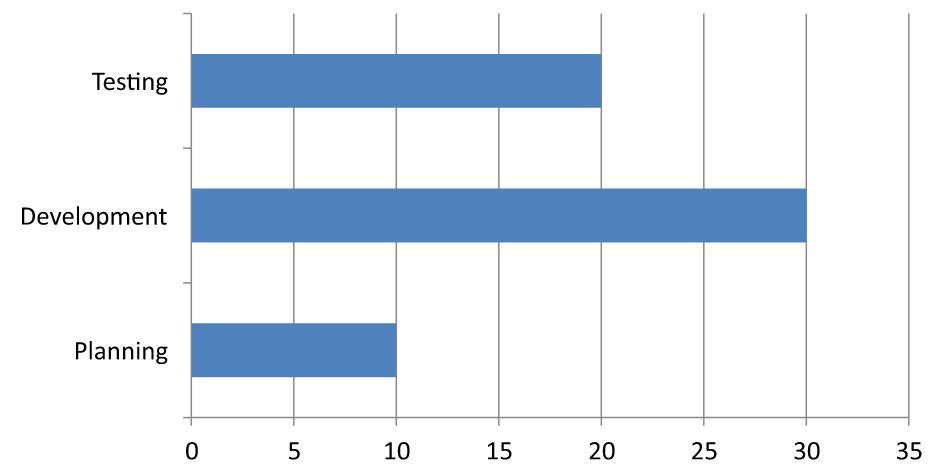

## **Descripción general**

Este artículo explica cómo personalizar los ejes de los gráficos con Aspose.Slides para C++. Cubre valores de eje calculados, intercambio de filas y columnas del gráfico, visibilidad del eje, intervalos de etiquetas de categoría y marcas de graduación, categorías de fechas y formato, rotación del título, posicionamiento del eje, unidades de visualización y escalado logarítmico.

## **Obtener los valores máximos en el eje vertical de los gráficos**

Cree una [Presentation](https://reference.aspose.com/slides/cpp/aspose.slides/presentation/) y añada un gráfico de áreas con datos predeterminados. Llame a [ValidateChartLayout](https://reference.aspose.com/slides/cpp/aspose.slides.charts/chart/validatechartlayout/) antes de leer los valores de eje calculados para que el diseño del gráfico esté actualizado.

Lea [get_ActualMaxValue](https://reference.aspose.com/slides/cpp/aspose.slides.charts/axis/get_actualmaxvalue/) y [get_ActualMinValue](https://reference.aspose.com/slides/cpp/aspose.slides.charts/axis/get_actualminvalue/) para los límites del eje, y [get_ActualMajorUnit](https://reference.aspose.com/slides/cpp/aspose.slides.charts/axis/get_actualmajorunit/) y [get_ActualMinorUnit](https://reference.aspose.com/slides/cpp/aspose.slides.charts/axis/get_actualminorunit/) para los intervalos de marcas. [get_ActualMajorUnitScale](https://reference.aspose.com/slides/cpp/aspose.slides.charts/axis/get_actualmajorunitscale/) y [get_ActualMinorUnitScale](https://reference.aspose.com/slides/cpp/aspose.slides.charts/axis/get_actualminorunitscale/) proporcionan escalas de unidad de tiempo, que son relevantes para los ejes de fecha. El ejemplo almacena estos valores en variables locales y guarda el gráfico.

```cpp
#include <DOM/Presentation.h>
#include <DOM/ISlide.h>
#include <DOM/IShapeCollection.h>
#include <DOM/IChart.h>
#include <DOM/Chart/ChartType.h>
#include <DOM/Chart/IAxesManager.h>
#include <DOM/Chart/IAxis.h>
#include <Export/SaveFormat.h>

using namespace Aspose::Slides;
using namespace Aspose::Slides::Charts;
using namespace Aspose::Slides::Export;

auto presentation = System::MakeObject<Presentation>();
auto slide = presentation->get_Slide(0);

auto chart = slide->get_Shapes()->AddChart(ChartType::Area, 100, 100, 500, 350);
chart->ValidateChartLayout();

auto maxValue = chart->get_Axes()->get_VerticalAxis()->get_ActualMaxValue();
auto minValue = chart->get_Axes()->get_VerticalAxis()->get_ActualMinValue();

auto majorUnit = chart->get_Axes()->get_VerticalAxis()->get_ActualMajorUnit();
auto minorUnit = chart->get_Axes()->get_VerticalAxis()->get_ActualMinorUnit();

auto majorUnitScale = chart->get_Axes()->get_VerticalAxis()->get_ActualMajorUnitScale();
auto minorUnitScale = chart->get_Axes()->get_VerticalAxis()->get_ActualMinorUnitScale();

presentation->Save(u"AxisValues_out.pptx", SaveFormat::Pptx);
```

## **Intercambiar los datos entre ejes**

Utilice [SwitchRowColumn](https://reference.aspose.com/slides/cpp/aspose.slides.charts/chartdata/switchrowcolumn/) para intercambiar los roles de series y categorías en los datos del gráfico. Cada categoría anterior se convierte en una serie, y cada serie anterior en una categoría. Esto cambia cómo se agrupan los datos; no intercambia los ejes horizontal y vertical. El ejemplo usa [SetRange](https://reference.aspose.com/slides/cpp/aspose.slides.charts/chartdata/setrange/) para vincular los datos predeterminados a `Sheet1!A1:D5`, incluida la fila de encabezado y la columna de categoría, antes de intercambiar filas y columnas. Guarda un gráfico con cuatro series y tres categorías.

```cpp
#include <DOM/Presentation.h>
#include <DOM/ISlide.h>
#include <DOM/IShapeCollection.h>
#include <DOM/IChart.h>
#include <DOM/Chart/ChartType.h>
#include <DOM/Chart/IAxesManager.h>
#include <DOM/Chart/IAxis.h>
#include <Export/SaveFormat.h>
#include <DOM/Chart/IChartData.h>

using namespace Aspose::Slides;
using namespace Aspose::Slides::Charts;
using namespace Aspose::Slides::Export;

auto presentation = System::MakeObject<Presentation>();
auto slide = presentation->get_Slide(0);

auto chart = slide->get_Shapes()->AddChart(ChartType::ClusteredColumn, 100, 100, 400, 300);

chart->get_ChartData()->SetRange(u"Sheet1!A1:D5");
chart->get_ChartData()->SwitchRowColumn();

presentation->Save(u"SwitchChartRowColumns_out.pptx", SaveFormat::Pptx);
```

## **Invertir el orden de trazado de un eje**

Utilice [set_IsPlotOrderReversed](https://reference.aspose.com/slides/cpp/aspose.slides.charts/axis/set_isplotorderreversed/) para invertir un eje de categoría o de valores. Por ejemplo, un gráfico de barras horizontal puede mostrar las etapas del proyecto de arriba a abajo en el mismo orden que la hoja de cálculo: Planning, Development, Testing. Invertir un eje cambia la dirección del trazado; no ordena ni reorganiza los datos del libro de trabajo. En comparación, [SwitchRowColumn](https://reference.aspose.com/slides/cpp/aspose.slides.charts/chartdata/switchrowcolumn/) intercambia los roles de series y categorías.

El siguiente ejemplo crea un gráfico de barras horizontal con tres etapas y una serie. Guarda una presentación con tres diapositivas: orden normal, categorías invertidas y valores invertidos. Cada copia usa el mismo conjunto de datos, y solo se invierte un eje en cada copia.

```cpp
#include <DOM/Presentation.h>
#include <DOM/ISlide.h>
#include <DOM/ISlideCollection.h>
#include <DOM/IShapeCollection.h>
#include <DOM/IChart.h>
#include <DOM/Chart/ChartType.h>
#include <DOM/Chart/IAxesManager.h>
#include <DOM/Chart/IAxis.h>
#include <DOM/Chart/CrossesType.h>
#include <DOM/Chart/IChartData.h>
#include <DOM/Chart/IChartDataWorkbook.h>
#include <DOM/Chart/IChartDataCell.h>
#include <DOM/Chart/IChartCategoryCollection.h>
#include <DOM/Chart/IChartSeriesCollection.h>
#include <DOM/Chart/IChartSeries.h>
#include <DOM/Chart/IChartDataPointCollection.h>
#include <Export/SaveFormat.h>
#include <system/object_ext.h>
#include <array>

using namespace Aspose::Slides;
using namespace Aspose::Slides::Charts;
using namespace Aspose::Slides::Export;

auto presentation = System::MakeObject<Presentation>();
auto slide = presentation->get_Slide(0);

auto chart = slide->get_Shapes()->AddChart(ChartType::ClusteredBar, 50, 40, 620, 320);
chart->set_HasLegend(false);

chart->get_ChartData()->get_Categories()->Clear();
chart->get_ChartData()->get_Series()->Clear();

auto workbook = chart->get_ChartData()->get_ChartDataWorkbook();
workbook->Clear(0);

auto series = chart->get_ChartData()->get_Series()->Add(ChartType::ClusteredBar);
auto stages = std::array<System::String, 3>{u"Planning", u"Development", u"Testing"};
auto values = std::array<int, 3>{10, 30, 20};
for (auto i = 0; i < stages.size(); i++)
{
    auto categoryCell = workbook->GetCell(0, i + 1, 0, System::ObjectExt::Box(stages[i]));
    chart->get_ChartData()->get_Categories()->Add(categoryCell);
    auto valueCell = workbook->GetCell(0, i + 1, 1, System::ObjectExt::Box(values[i]));
    series->get_DataPoints()->AddDataPointForBarSeries(valueCell);
}

// Diapositiva 2: mostrar la primera categoría en la parte superior.
auto categorySlide = presentation->get_Slides()->AddClone(slide);
auto categoryChart = System::ExplicitCast<IChart>(categorySlide->get_Shape(0));
categoryChart->get_Axes()->get_VerticalAxis()->set_IsPlotOrderReversed(true);
// Mantener el eje de valores horizontal en la parte inferior.
categoryChart->get_Axes()->get_VerticalAxis()->set_CrossType(CrossesType::Maximum);

// Diapositiva 3: invertir solo la escala numérica horizontal.
auto valueSlide = presentation->get_Slides()->AddClone(slide);
auto valueChart = System::ExplicitCast<IChart>(valueSlide->get_Shape(0));
valueChart->get_Axes()->get_HorizontalAxis()->set_IsPlotOrderReversed(true);

presentation->Save(u"ReversedAxes.pptx", SaveFormat::Pptx);
```

Invertir un eje también puede mover el eje perpendicular al lado opuesto del trazado. [set_CrossType](https://reference.aspose.com/slides/cpp/aspose.slides.charts/axis/set_crosstype/) controla dónde cruza el otro eje con el eje que se está configurando. En la diapositiva 2, establecerlo en `Maximum` en el eje de categoría invertido mantiene el eje de valores horizontal en la parte inferior. Para un punto de cruce específico, use [set_CrossAt](https://reference.aspose.com/slides/cpp/aspose.slides.charts/axis/set_crossat/). Verifique la configuración de cruce al cambiar la dirección, especialmente si el gráfico ya tiene un punto de cruce personalizado. Llame a `set_IsPlotOrderReversed` con `false` para restaurar la dirección de trazado normal; la configuración de cruce es independiente.

| Orden normal (diapositiva 1) | Categorías invertidas (diapositiva 2) | Valores invertidos (diapositiva 3) |
| --- | --- | --- |
|  |  |  |
| Las categorías van de abajo a arriba; los valores aumentan de izquierda a derecha. | Planning, Development y Testing van de arriba a abajo. Los valores y el orden de filas del libro de trabajo no cambian. | Las categorías conservan su orden normal; los valores aumentan de derecha a izquierda. El eje de categoría cruza en cero a la derecha. |

## **Desactivar el eje vertical en gráficos de líneas**

Utilice [set_IsVisible](https://reference.aspose.com/slides/cpp/aspose.slides.charts/axis/set_isvisible/) con `false` en el eje vertical para ocultarlo. El ejemplo crea un gráfico de líneas con datos predeterminados y lo guarda con el eje vertical oculto.

```cpp
#include <DOM/Presentation.h>
#include <DOM/ISlide.h>
#include <DOM/IShapeCollection.h>
#include <DOM/IChart.h>
#include <DOM/Chart/ChartType.h>
#include <DOM/Chart/IAxesManager.h>
#include <DOM/Chart/IAxis.h>
#include <Export/SaveFormat.h>

using namespace Aspose::Slides;
using namespace Aspose::Slides::Charts;
using namespace Aspose::Slides::Export;

auto presentation = System::MakeObject<Presentation>();
auto slide = presentation->get_Slide(0);

auto chart = slide->get_Shapes()->AddChart(ChartType::Line, 100, 100, 400, 300);
chart->get_Axes()->get_VerticalAxis()->set_IsVisible(false);

presentation->Save(u"HiddenVerticalAxis.pptx", SaveFormat::Pptx);
```

## **Desactivar el eje horizontal en gráficos de líneas**

Utilice [set_IsVisible](https://reference.aspose.com/slides/cpp/aspose.slides.charts/axis/set_isvisible/) con `false` en el eje horizontal para ocultarlo. El ejemplo crea un gráfico de líneas con datos predeterminados y lo guarda con el eje horizontal oculto.

```cpp
#include <DOM/Presentation.h>
#include <DOM/ISlide.h>
#include <DOM/IShapeCollection.h>
#include <DOM/IChart.h>
#include <DOM/Chart/ChartType.h>
#include <DOM/Chart/IAxesManager.h>
#include <DOM/Chart/IAxis.h>
#include <Export/SaveFormat.h>

using namespace Aspose::Slides;
using namespace Aspose::Slides::Charts;
using namespace Aspose::Slides::Export;

auto presentation = System::MakeObject<Presentation>();
auto slide = presentation->get_Slide(0);

auto chart = slide->get_Shapes()->AddChart(ChartType::Line, 100, 100, 400, 300);
chart->get_Axes()->get_HorizontalAxis()->set_IsVisible(false);

presentation->Save(u"HiddenHorizontalAxis.pptx", SaveFormat::Pptx);
```

## **Mostrar u ocultar las líneas de cuadrícula del gráfico**

Utilice [get_ShowMajorGridLines](https://reference.aspose.com/slides/cpp/aspose.slides.charts/iaxis/get_showmajorgridlines/) y [get_ShowMinorGridLines](https://reference.aspose.com/slides/cpp/aspose.slides.charts/iaxis/get_showminorgridlines/) para comprobar qué líneas de cuadrícula muestra un eje. Ambas propiedades son de solo lectura. Para mostrar líneas de cuadrícula menores, use [get_MinorGridLinesFormat](https://reference.aspose.com/slides/cpp/aspose.slides.charts/iaxis/get_minorgridlinesformat/) y establezca el relleno de la línea a un color sólido visible. Para ocultarlas, establezca el relleno a [FillType::NoFill](https://reference.aspose.com/slides/cpp/aspose.slides/filltype/). Use [get_MajorGridLinesFormat](https://reference.aspose.com/slides/cpp/aspose.slides.charts/iaxis/get_majorgridlinesformat/) para cambiar las líneas de cuadrícula mayores de la misma manera. Cambiar el relleno de la línea de cuadrícula preserva la visibilidad del eje y las marcas de graduación.

El eje vertical de este gráfico de columnas agrupadas inicialmente muestra solo líneas de cuadrícula mayores. El ejemplo muestra líneas de cuadrícula menores en naranja, luego las oculta de nuevo antes de guardar la presentación.

```cpp
#include <DOM/Presentation.h>
#include <DOM/ISlide.h>
#include <DOM/IShapeCollection.h>
#include <DOM/IChart.h>
#include <DOM/Chart/ChartType.h>
#include <DOM/Chart/IAxesManager.h>
#include <DOM/Chart/IAxis.h>
#include <DOM/Chart/IChartLinesFormat.h>
#include <DOM/ILineFormat.h>
#include <DOM/ILineFillFormat.h>
#include <DOM/IColorFormat.h>
#include <DOM/FillType.h>
#include <Export/SaveFormat.h>
#include <drawing/color.h>
#include <iostream>

using namespace Aspose::Slides;
using namespace Aspose::Slides::Charts;
using namespace Aspose::Slides::Export;
using namespace System::Drawing;

auto presentation = System::MakeObject<Presentation>();
auto slide = presentation->get_Slide(0);

auto chart = slide->get_Shapes()->AddChart(ChartType::ClusteredColumn, 30, 30, 660, 230);
auto axis = chart->get_Axes()->get_VerticalAxis();
std::cout << std::boolalpha << "Initial: major=" << axis->get_ShowMajorGridLines() << ", minor=" << axis->get_ShowMinorGridLines() << '\n';

auto minorFill = axis->get_MinorGridLinesFormat()->get_Line()->get_FillFormat();
minorFill->set_FillType(FillType::Solid);
minorFill->get_SolidFillColor()->set_Color(Color::get_DarkOrange());
std::cout << "Enabled: minor=" << axis->get_ShowMinorGridLines() << '\n';

minorFill->set_FillType(FillType::NoFill);
std::cout << "Hidden: major=" << axis->get_ShowMajorGridLines() << ", minor=" << axis->get_ShowMinorGridLines() << '\n';

presentation->Save(u"ChartGridlines.pptx", SaveFormat::Pptx);
```

| Líneas de cuadrícula menores activadas | Líneas de cuadrícula menores ocultas |
| --- | --- |
|  |  |

## **Cambiar un eje de categoría**

Utilice [set_CategoryAxisType](https://reference.aspose.com/slides/cpp/aspose.slides.charts/axis/set_categoryaxistype/) para elegir un eje de categoría de fecha o texto. Este ejemplo requiere `ExistingChart.pptx`, con un gráfico como la primera forma en la primera diapositiva y celdas de categoría que contienen valores de fecha numéricos de Excel. Cambia el eje horizontal a un eje de fecha. Llamar a [set_IsAutomaticMajorUnit](https://reference.aspose.com/slides/cpp/aspose.slides.charts/axis/set_isautomaticmajorunit/) con `false`, [set_MajorUnit](https://reference.aspose.com/slides/cpp/aspose.slides.charts/axis/set_majorunit/) con `1` y [set_MajorUnitScale](https://reference.aspose.com/slides/cpp/aspose.slides.charts/axis/set_majorunitscale/) con meses coloca marcas mayores a intervalos de un mes.

```cpp
#include <DOM/Presentation.h>
#include <DOM/ISlide.h>
#include <DOM/IShapeCollection.h>
#include <DOM/IChart.h>
#include <DOM/Chart/ChartType.h>
#include <DOM/Chart/IAxesManager.h>
#include <DOM/Chart/IAxis.h>
#include <Export/SaveFormat.h>
#include <DOM/Chart/CategoryAxisType.h>
#include <DOM/Chart/TimeUnitType.h>
#include <system/object_ext.h>

using namespace Aspose::Slides;
using namespace Aspose::Slides::Charts;
using namespace Aspose::Slides::Export;

auto presentation = System::MakeObject<Presentation>(u"ExistingChart.pptx");
auto slide = presentation->get_Slide(0);

auto chart = System::ExplicitCast<IChart>(slide->get_Shape(0));
chart->get_Axes()->get_HorizontalAxis()->set_CategoryAxisType(CategoryAxisType::Date);
chart->get_Axes()->get_HorizontalAxis()->set_IsAutomaticMajorUnit(false);
chart->get_Axes()->get_HorizontalAxis()->set_MajorUnit(1);
chart->get_Axes()->get_HorizontalAxis()->set_MajorUnitScale(TimeUnitType::Months);

presentation->Save(u"ChangeChartCategoryAxis_out.pptx", SaveFormat::Pptx);
```

### **Determinar el tipo de eje de categoría a partir de los datos**

Llame a [SetCategoryAxisTypeAutomatically](https://reference.aspose.com/slides/cpp/aspose.slides.charts/iaxis/setcategoryaxistypeautomatically/) después de rellenar las categorías, y luego llame a [get_CategoryAxisType](https://reference.aspose.com/slides/cpp/aspose.slides.charts/iaxis/get_categoryaxistype/) para inspeccionar la selección. Esto es útil cuando el mismo gráfico recibe etiquetas de texto o valores de fecha numéricos. El método determina el tipo al llamarse; no habilita un modo persistente que reevalúe cambios de datos posteriores. Llámelo de nuevo después de sustituir las categorías.

El siguiente ejemplo crea un gráfico con categorías de texto e imprime `Text`. Luego sustituye los valores de las celdas de categoría por fechas y llama al método de nuevo, lo que imprime `Date`. Las fechas se almacenan como valores numéricos de OLE Automation devueltos por [System::DateTime::ToOADate](https://reference.aspose.com/slides/cpp/system/datetime/tooadate/), en lugar de cadenas de fecha. [set_CustomNumberFormat](https://reference.aspose.com/slides/cpp/aspose.slides.charts/ichartdatacell/set_customnumberformat/) controla cómo se muestran esos valores; no convierte texto en fechas numéricas. Para obtener más información sobre las celdas de categoría, consulte [Libro de trabajo del gráfico](/slides/es/cpp/chart-workbook/).

Utilice la determinación automática cuando se sepa que la entrada contiene categorías de texto o fechas numéricas, como en este ejemplo. Para etiquetas numéricas ordinarias, categorías mixtas o datos vacíos, llame explícitamente a [set_CategoryAxisType](https://reference.aspose.com/slides/cpp/aspose.slides.charts/iaxis/set_categoryaxistype/) para coincidir con el significado deseado. Los valores numéricos por sí solos no establecen que las categorías representen fechas.

```cpp
#include <DOM/Presentation.h>
#include <DOM/ISlide.h>
#include <DOM/IShapeCollection.h>
#include <DOM/IChart.h>
#include <DOM/Chart/ChartType.h>
#include <DOM/Chart/IAxesManager.h>
#include <DOM/Chart/IAxis.h>
#include <DOM/Chart/CategoryAxisType.h>
#include <DOM/Chart/IChartData.h>
#include <DOM/Chart/IChartDataWorkbook.h>
#include <DOM/Chart/IChartDataCell.h>
#include <DOM/Chart/IChartCategoryCollection.h>
#include <DOM/Chart/IChartSeriesCollection.h>
#include <DOM/Chart/IChartSeries.h>
#include <DOM/Chart/IChartDataPointCollection.h>
#include <Export/SaveFormat.h>
#include <system/object_ext.h>
#include <system/date_time.h>
#include <system/console.h>
#include <system/enum.h>
#include <array>

using namespace Aspose::Slides;
using namespace Aspose::Slides::Charts;
using namespace Aspose::Slides::Export;

auto presentation = System::MakeObject<Presentation>();
auto slide = presentation->get_Slide(0);

auto chart = slide->get_Shapes()->AddChart(ChartType::ClusteredColumn, 30, 40, 660, 320);

chart->get_ChartData()->get_Categories()->Clear();
chart->get_ChartData()->get_Series()->Clear();

auto workbook = chart->get_ChartData()->get_ChartDataWorkbook();
workbook->Clear(0);

auto seriesName = workbook->GetCell(0, 0, 1, System::ObjectExt::Box(System::String(u"Sales")));
auto series = chart->get_ChartData()->get_Series()->Add(seriesName, chart->get_Type());
auto labels = std::array<System::String, 3>{u"First", u"Second", u"Third"};

for (auto i = 0; i < labels.size(); i++)
{
    auto categoryCell = workbook->GetCell(0, i + 1, 0, System::ObjectExt::Box(labels[i]));
    chart->get_ChartData()->get_Categories()->Add(categoryCell);

    auto valueCell = workbook->GetCell(0, i + 1, 1, System::ObjectExt::Box((i + 1) * 10));
    series->get_DataPoints()->AddDataPointForBarSeries(valueCell);
}

auto axis = chart->get_Axes()->get_HorizontalAxis();
axis->SetCategoryAxisTypeAutomatically();
System::Console::WriteLine(System::Enum<CategoryAxisType>::GetName(axis->get_CategoryAxisType())); // Texto

auto dates = std::array<System::DateTime, 3>{System::DateTime(2026, 1, 1), System::DateTime(2026, 1, 2), System::DateTime(2026, 2, 1)};

for (auto i = 0; i < dates.size(); i++)
{
    auto categoryCell = workbook->GetCell(0, i + 1, 0);
    categoryCell->set_Value(System::ObjectExt::Box(dates[i].ToOADate()));
    categoryCell->set_CustomNumberFormat(u"yyyy-mm-dd");
}

axis->SetCategoryAxisTypeAutomatically();
System::Console::WriteLine(System::Enum<CategoryAxisType>::GetName(axis->get_CategoryAxisType())); // Fecha

presentation->Save(u"AutomaticCategoryAxis.pptx", SaveFormat::Pptx);
```

## **Controlar los intervalos de etiquetas del eje de categoría**

Cuando un gráfico tiene muchas categorías, reduzca el número de etiquetas de eje visibles sin eliminar categorías ni puntos de datos. Utilice [set_IsAutomaticTickLabelSpacing](https://reference.aspose.com/slides/cpp/aspose.slides.charts/iaxis/set_isautomaticticklabelspacing/) con `false`, y luego [set_TickLabelSpacing](https://reference.aspose.com/slides/cpp/aspose.slides.charts/iaxis/set_ticklabelspacing/) con el intervalo de categoría deseado. Para categorías de texto en su orden normal, el recuento comienza en la primera categoría:

| Intervalo | Etiquetas mostradas en el ejemplo |
| --- | --- |
| `1` | Categoría 1, Categoría 2, Categoría 3, ... Categoría 24 |
| `2` | Categoría 1, Categoría 3, Categoría 5, ... Categoría 23 |
| `3` | Categoría 1, Categoría 4, Categoría 7, ... Categoría 22 |

Un intervalo de `3` muestra cada tercera etiqueta, dejando dos etiquetas ocultas entre las mostradas. No elimina las columnas correspondientes. El espaciado automático elige un intervalo en función del espacio disponible; no muestra necesariamente cada etiqueta.

Las marcas de graduación tienen controles separados. Utilice [set_IsAutomaticTickMarksSpacing](https://reference.aspose.com/slides/cpp/aspose.slides.charts/iaxis/set_isautomatictickmarksspacing/) con `false` y use [set_TickMarksSpacing](https://reference.aspose.com/slides/cpp/aspose.slides.charts/iaxis/set_tickmarksspacing/) para establecer su intervalo. Por ejemplo, `1` mantiene una marca de graduación en cada intervalo de categoría mientras las etiquetas aparecen solo cada tercera categoría. Use [set_MajorTickMark](https://reference.aspose.com/slides/cpp/aspose.slides.charts/iaxis/set_majortickmark/) con un estilo visible para que pueda ver el resultado. Configurar cualquiera de las propiedades de espaciado automático de nuevo a `true` permite que el gráfico elija ese intervalo otra vez.

El siguiente ejemplo independiente crea 24 categorías y una serie, y luego guarda tres diapositivas en `CategoryAxisIntervals.pptx`: espaciado automático, espaciado manual de etiquetas con marcas de graduación independientes, y espaciado automático restaurado. Las dos copias conservan los datos originales del gráfico. No se necesita una presentación de entrada. El texto de las etiquetas horizontales facilita ver la diferencia de densidad.

```cpp
#include <DOM/Presentation.h>
#include <DOM/ISlide.h>
#include <DOM/IShapeCollection.h>
#include <DOM/IChart.h>
#include <DOM/Chart/ChartType.h>
#include <DOM/Chart/IAxesManager.h>
#include <DOM/Chart/IAxis.h>
#include <Export/SaveFormat.h>
#include <DOM/Chart/IChartData.h>
#include <DOM/Chart/CategoryAxisType.h>
#include <DOM/Chart/TickMarkType.h>
#include <DOM/Chart/IChartTextFormat.h>
#include <DOM/Chart/IChartTextBlockFormat.h>
#include <DOM/Chart/IChartPortionFormat.h>
#include <DOM/Chart/IChartDataWorkbook.h>
#include <DOM/Chart/IChartDataCell.h>
#include <DOM/Chart/IChartCategoryCollection.h>
#include <DOM/Chart/IChartSeriesCollection.h>
#include <DOM/Chart/IChartSeries.h>
#include <DOM/Chart/IChartDataPointCollection.h>
#include <system/object_ext.h>
#include <DOM/ISlideCollection.h>

using namespace Aspose::Slides;
using namespace Aspose::Slides::Charts;
using namespace Aspose::Slides::Export;

auto presentation = System::MakeObject<Presentation>();
auto slide = presentation->get_Slide(0);

auto chart = slide->get_Shapes()->AddChart(ChartType::ClusteredColumn, 30, 40, 660, 320);

chart->set_HasLegend(false);
chart->get_ChartData()->get_Categories()->Clear();
chart->get_ChartData()->get_Series()->Clear();

auto workbook = chart->get_ChartData()->get_ChartDataWorkbook();
workbook->Clear(0);

auto series = chart->get_ChartData()->get_Series()->Add(ChartType::ClusteredColumn);
for (auto i = 0; i < 24; i++)
{
    auto categoryName = System::String::Format(u"Category {0}", i + 1);
    auto categoryCell = workbook->GetCell(0, i + 1, 0, System::ObjectExt::Box(categoryName));
    chart->get_ChartData()->get_Categories()->Add(categoryCell);
    auto valueCell = workbook->GetCell(0, i + 1, 1, System::ObjectExt::Box(10 + i % 6 * 5));
    series->get_DataPoints()->AddDataPointForBarSeries(valueCell);
}

auto axis = chart->get_Axes()->get_HorizontalAxis();
axis->set_CategoryAxisType(CategoryAxisType::Text);
axis->get_TextFormat()->get_TextBlockFormat()->set_RotationAngle(0);
axis->get_TextFormat()->get_PortionFormat()->set_FontHeight(12);
axis->set_MajorTickMark(TickMarkType::Outside);
axis->set_IsAutomaticTickLabelSpacing(true);
axis->set_IsAutomaticTickMarksSpacing(true);

// Diapositiva 2: mostrar cada tercera etiqueta, pero mantener una marca de graduación para cada categoría.
auto manualSlide = presentation->get_Slides()->AddClone(slide);
auto manualChart = System::ExplicitCast<IChart>(manualSlide->get_Shape(0));
auto manualAxis = manualChart->get_Axes()->get_HorizontalAxis();
manualAxis->set_IsAutomaticTickLabelSpacing(false);
manualAxis->set_TickLabelSpacing(3);
manualAxis->set_IsAutomaticTickMarksSpacing(false);
manualAxis->set_TickMarksSpacing(1);

// Diapositiva 3: permitir que el gráfico elija ambos intervalos de nuevo.
auto restoredSlide = presentation->get_Slides()->AddClone(manualSlide);
auto restoredChart = System::ExplicitCast<IChart>(restoredSlide->get_Shape(0));
restoredChart->get_Axes()->get_HorizontalAxis()->set_IsAutomaticTickLabelSpacing(true);
restoredChart->get_Axes()->get_HorizontalAxis()->set_IsAutomaticTickMarksSpacing(true);

presentation->Save(u"CategoryAxisIntervals.pptx", SaveFormat::Pptx);
```

**Espaciado automático (diapositiva 1):** En esta representación, se muestra cada segunda etiqueta de categoría y se envuelve en dos líneas. El resultado automático puede variar con el tamaño del gráfico, las fuentes y el motor de renderizado.


**Espaciado manual (diapositiva 2):** Cada tercera etiqueta se muestra en una línea, mientras las marcas de graduación permanecen en cada intervalo de categoría. Las 24 columnas, incluidas las que no tienen etiquetas, siguen visibles con los mismos valores. La diapositiva 3 restaura la apariencia automática mostrada arriba.


### **Elegir el eje y el intervalo correctos**

Utilice este intervalo de recuento de categorías para un eje de categoría de texto, como el eje de categoría de un gráfico de columnas, líneas, áreas o barras. En un gráfico de columnas, es el eje horizontal. En un gráfico de barras horizontal, el eje de categoría es vertical, por lo que debe aplicar estos ajustes a [get_VerticalAxis](https://reference.aspose.com/slides/cpp/aspose.slides.charts/iaxesmanager/get_verticalaxis/). El espaciado de marcas de graduación también se aplica a un eje de series en los gráficos que lo poseen.

No utilice el espaciado de etiquetas de categoría para establecer la escala numérica de un eje de valores. En un eje de valores, [set_MajorUnit](https://reference.aspose.com/slides/cpp/aspose.slides.charts/iaxis/set_majorunit/) especifica una diferencia en los valores: por ejemplo, una unidad mayor de `10` produce marcas en 0, 10, 20, etc., cuando el eje comienza en cero. Un intervalo de etiqueta de categoría de `3` cuenta, en cambio, posiciones de categoría, independientemente de sus valores de datos. Los gráficos de dispersión y burbuja utilizan ejes de valores en lugar de un eje de categoría de texto. Para un eje de fecha, use unidades mayores y escalas basadas en tiempo como se describe en [Cambiar un eje de categoría](#change-a-category-axis).

## **Establecer el formato de fecha para los valores del eje de categoría**

El ejemplo sustituye los datos predeterminados del gráfico por cuatro valores anuales. Las fechas se almacenan como números de serie OLE Automation en la primera hoja de cálculo (índice `0`). Utilice [set_CategoryAxisType](https://reference.aspose.com/slides/cpp/aspose.slides.charts/axis/set_categoryaxistype/) para seleccionar un eje de fecha, desactive el formato vinculado al origen con [set_IsNumberFormatLinkedToSource](https://reference.aspose.com/slides/cpp/aspose.slides.charts/axis/set_isnumberformatlinkedtosource/), y asigne `yyyy` con [set_NumberFormat](https://reference.aspose.com/slides/cpp/aspose.slides.charts/axis/set_numberformat/) para que las etiquetas de categoría muestren años de cuatro dígitos independientemente del formato de la celda.

```cpp
#include <DOM/Presentation.h>
#include <DOM/ISlide.h>
#include <DOM/IShapeCollection.h>
#include <DOM/IChart.h>
#include <DOM/Chart/ChartType.h>
#include <DOM/Chart/IAxesManager.h>
#include <DOM/Chart/IAxis.h>
#include <Export/SaveFormat.h>
#include <DOM/Chart/IChartData.h>
#include <DOM/Chart/CategoryAxisType.h>
#include <DOM/Chart/IChartDataWorkbook.h>
#include <DOM/Chart/IChartDataCell.h>
#include <DOM/Chart/IChartCategoryCollection.h>
#include <DOM/Chart/IChartSeriesCollection.h>
#include <DOM/Chart/IChartSeries.h>
#include <DOM/Chart/IChartDataPointCollection.h>
#include <system/object_ext.h>
#include <system/date_time.h>

using namespace Aspose::Slides;
using namespace Aspose::Slides::Charts;
using namespace Aspose::Slides::Export;

auto presentation = System::MakeObject<Presentation>();
auto slide = presentation->get_Slide(0);

auto chart = slide->get_Shapes()->AddChart(ChartType::Line, 50, 50, 450, 300);

chart->get_ChartData()->get_Categories()->Clear();
chart->get_ChartData()->get_Series()->Clear();

auto workbook = chart->get_ChartData()->get_ChartDataWorkbook();
workbook->Clear(0);

auto series = chart->get_ChartData()->get_Series()->Add(ChartType::Line);
for (auto i = 0; i < 4; i++)
{
    auto date = System::DateTime(2015 + i, 1, 1);
    auto categoryCell = workbook->GetCell(0, i + 1, 0, System::ObjectExt::Box(date.ToOADate()));
    chart->get_ChartData()->get_Categories()->Add(categoryCell);

    auto valueCell = workbook->GetCell(0, i + 1, 1, System::ObjectExt::Box(i + 1));
    series->get_DataPoints()->AddDataPointForLineSeries(valueCell);
}

chart->get_Axes()->get_HorizontalAxis()->set_CategoryAxisType(CategoryAxisType::Date);
chart->get_Axes()->get_HorizontalAxis()->set_IsNumberFormatLinkedToSource(false);
chart->get_Axes()->get_HorizontalAxis()->set_NumberFormat(u"yyyy");

presentation->Save(u"DateAxisFormat.pptx", SaveFormat::Pptx);
```

## **Establecer un ángulo de rotación para el título de un eje de gráfico**

Habilite el título del eje vertical con [set_HasTitle](https://reference.aspose.com/slides/cpp/aspose.slides.charts/axis/set_hastitle/), proporcione el texto del título y use [set_RotationAngle](https://reference.aspose.com/slides/cpp/aspose.slides.charts/icharttextblockformat/set_rotationangle/) para rotarlo. El ángulo se mide en grados; este ejemplo guarda un gráfico de columnas con su título del eje de valores girado 90 grados.

```cpp
#include <DOM/Presentation.h>
#include <DOM/ISlide.h>
#include <DOM/IShapeCollection.h>
#include <DOM/IChart.h>
#include <DOM/Chart/ChartType.h>
#include <DOM/Chart/IAxesManager.h>
#include <DOM/Chart/IAxis.h>
#include <Export/SaveFormat.h>
#include <DOM/Chart/IChartTextFormat.h>
#include <DOM/Chart/IChartTextBlockFormat.h>
#include <DOM/Chart/IChartTitle.h>

using namespace Aspose::Slides;
using namespace Aspose::Slides::Charts;
using namespace Aspose::Slides::Export;

auto presentation = System::MakeObject<Presentation>();
auto slide = presentation->get_Slide(0);

auto chart = slide->get_Shapes()->AddChart(ChartType::ClusteredColumn, 50, 50, 450, 300);
chart->get_Axes()->get_VerticalAxis()->set_HasTitle(true);
chart->get_Axes()->get_VerticalAxis()->get_Title()->AddTextFrameForOverriding(u"Value");
chart->get_Axes()->get_VerticalAxis()->get_Title()->get_TextFormat()->get_TextBlockFormat()->set_RotationAngle(90);

presentation->Save(u"RotatedAxisTitle.pptx", SaveFormat::Pptx);
```

## **Establecer la posición del eje en un eje de categoría o de valor**

Utilice [set_AxisBetweenCategories](https://reference.aspose.com/slides/cpp/aspose.slides.charts/axis/set_axisbetweencategories/) para controlar si el eje de valores cruza el eje de categoría entre categorías o en marcas de categoría. Esta propiedad se aplica a los ejes de categoría. El ejemplo lo establece en `true` en el eje de categoría horizontal de un gráfico de columnas y guarda el resultado.

```cpp
#include <DOM/Presentation.h>
#include <DOM/ISlide.h>
#include <DOM/IShapeCollection.h>
#include <DOM/IChart.h>
#include <DOM/Chart/ChartType.h>
#include <DOM/Chart/IAxesManager.h>
#include <DOM/Chart/IAxis.h>
#include <Export/SaveFormat.h>

using namespace Aspose::Slides;
using namespace Aspose::Slides::Charts;
using namespace Aspose::Slides::Export;

auto presentation = System::MakeObject<Presentation>();
auto slide = presentation->get_Slide(0);

auto chart = slide->get_Shapes()->AddChart(ChartType::ClusteredColumn, 50, 50, 450, 300);
chart->get_Axes()->get_HorizontalAxis()->set_AxisBetweenCategories(true);

presentation->Save(u"AxisBetweenCategories.pptx", SaveFormat::Pptx);
```

## **Establecer la unidad de visualización en un eje de valores del gráfico**

Utilice [set_DisplayUnit](https://reference.aspose.com/slides/cpp/aspose.slides.charts/axis/set_displayunit/) para escalar las etiquetas de un eje de valores sin cambiar los datos subyacentes. Con [DisplayUnitType](https://reference.aspose.com/slides/cpp/aspose.slides.charts/displayunittype/) configurado a `Millions`, un valor de 60 000 000 se muestra como 60. El ejemplo crea un gráfico de columnas y aplica la unidad de visualización en millones a su eje vertical.

```cpp
#include <DOM/Presentation.h>
#include <DOM/ISlide.h>
#include <DOM/IShapeCollection.h>
#include <DOM/IChart.h>
#include <DOM/Chart/ChartType.h>
#include <DOM/Chart/IAxesManager.h>
#include <DOM/Chart/IAxis.h>
#include <Export/SaveFormat.h>
#include <DOM/Chart/DisplayUnitType.h>

using namespace Aspose::Slides;
using namespace Aspose::Slides::Charts;
using namespace Aspose::Slides::Export;

auto presentation = System::MakeObject<Presentation>();
auto slide = presentation->get_Slide(0);

auto chart = slide->get_Shapes()->AddChart(ChartType::ClusteredColumn, 50, 50, 450, 300);
chart->get_Axes()->get_VerticalAxis()->set_DisplayUnit(DisplayUnitType::Millions);

presentation->Save(u"Result.pptx", SaveFormat::Pptx);
```

## **Configurar un eje de valores logarítmico**

Un eje de valores logarítmico es útil cuando los valores positivos abarcan varios órdenes de magnitud. Por ejemplo, un servicio podría recibir 10, 100, 1 000, 10 000 y 100 000 solicitudes en cinco períodos. En una escala lineal, los valores más pequeños aparecen muy juntos cerca de cero. Una escala logarítmica facilita comparar su crecimiento relativo: las distancias iguales representan razones iguales en lugar de diferencias iguales.

Llame a [set_IsLogarithmic](https://reference.aspose.com/slides/cpp/aspose.slides.charts/axis/set_islogarithmic/) con `true` en el eje de valores y use [set_LogBase](https://reference.aspose.com/slides/cpp/aspose.slides.charts/axis/set_logbase/) para elegir la base. Esto cambia cómo se muestran los valores existentes; no modifica los datos ni añade una línea de tendencia logarítmica. Una línea de tendencia representa una relación ajustada en los datos y es una característica separada.

### **Elegir el eje de valores y la base**

Para un gráfico de líneas o de columnas, el eje de valores es [get_VerticalAxis](https://reference.aspose.com/slides/cpp/aspose.slides.charts/iaxesmanager/get_verticalaxis/). Para un gráfico de barras horizontal, es [get_HorizontalAxis](https://reference.aspose.com/slides/cpp/aspose.slides.charts/iaxesmanager/get_horizontalaxis/). Los gráficos de dispersión y burbuja tienen dos ejes de valores, por lo que se elige el eje horizontal para los valores X, el eje vertical para los valores Y, o ambos. No aplique escalado logarítmico a un eje de categoría.

La base logarítmica predeterminada es `10`. Para gráficos PPTX, use una base entre `2` y `1000`, inclusive; también se admiten bases fraccionarias como `2.5`. Con la base `10`, las potencias sucesivas como 10, 100, 1 000 y 10 000 están espaciadas uniformemente.

### **Comparar escalado lineal y logarítmico**

El siguiente ejemplo independiente crea un gráfico de líneas con los cinco conteos de solicitudes en la primera diapositiva, luego clona esa diapositiva y habilita un eje de valores logarítmico de base 10 en la segunda. Ambas diapositivas conservan los mismos datos.

```cpp
#include <DOM/Presentation.h>
#include <DOM/ISlide.h>
#include <DOM/ISlideCollection.h>
#include <DOM/IShapeCollection.h>
#include <DOM/IChart.h>
#include <DOM/Chart/ChartType.h>
#include <DOM/Chart/IAxesManager.h>
#include <DOM/Chart/IAxis.h>
#include <DOM/Chart/IChartData.h>
#include <DOM/Chart/IChartDataWorkbook.h>
#include <DOM/Chart/IChartDataCell.h>
#include <DOM/Chart/IChartCategoryCollection.h>
#include <DOM/Chart/IChartSeriesCollection.h>
#include <DOM/Chart/IChartSeries.h>
#include <DOM/Chart/IChartDataPointCollection.h>
#include <Export/SaveFormat.h>
#include <system/object_ext.h>
#include <array>

using namespace Aspose::Slides;
using namespace Aspose::Slides::Charts;
using namespace Aspose::Slides::Export;

auto presentation = System::MakeObject<Presentation>();
auto slide = presentation->get_Slide(0);

auto chart = slide->get_Shapes()->AddChart(ChartType::Line, 30, 40, 660, 200);

chart->set_HasLegend(false);

chart->get_ChartData()->get_Categories()->Clear();
chart->get_ChartData()->get_Series()->Clear();

auto workbook = chart->get_ChartData()->get_ChartDataWorkbook();
workbook->Clear(0);

auto series = chart->get_ChartData()->get_Series()->Add(ChartType::Line);
auto values = std::array<double, 5>{10, 100, 1000, 10000, 100000};

for (auto i = 0; i < values.size(); i++)
{
    auto categoryName = System::String::Format(u"Period {0}", i + 1);
    auto categoryCell = workbook->GetCell(0, i + 1, 0, System::ObjectExt::Box(categoryName));
    chart->get_ChartData()->get_Categories()->Add(categoryCell);

    auto valueCell = workbook->GetCell(0, i + 1, 1, System::ObjectExt::Box(values[i]));
    series->get_DataPoints()->AddDataPointForLineSeries(valueCell);
}

// Mantener la primera diapositiva lineal y cambiar solo la escala del eje de valores de la copia.
auto logarithmicSlide = presentation->get_Slides()->AddClone(slide);
auto logarithmicChart = System::ExplicitCast<IChart>(logarithmicSlide->get_Shape(0));
auto valueAxis = logarithmicChart->get_Axes()->get_VerticalAxis();
valueAxis->set_IsLogarithmic(true);
valueAxis->set_LogBase(10);

presentation->Save(u"LogarithmicAxis.pptx", SaveFormat::Pptx);
```

**Escala lineal (diapositiva 1):** El valor más grande domina el gráfico, lo que dificulta distinguir los valores más pequeños.


**Escala logarítmica (diapositiva 2):** Las mismas cinco solicitudes en PowerPoint en un eje de valores logarítmico de base 10.


### **Gestionar valores cero y negativos**

Una escala logarítmica solo puede mostrar valores estrictamente positivos. Verifique los datos antes de habilitarla. Si los valores cero o negativos son significativos, mantenga una escala lineal o muéstrelos por separado. Si excluir esos valores es apropiado para el análisis, explique la omisión. No los reemplace silenciosamente por números positivos pequeños, ya que eso altera el significado de los datos. Cualquier mínimo o máximo configurado manualmente para un eje logarítmico también debe ser positivo.

## **Preguntas frecuentes**

**¿Cómo establezco el valor en el que un eje cruza al otro (cruce del eje)?**

Use [set_CrossType](https://reference.aspose.com/slides/cpp/aspose.slides.charts/axis/set_crosstype/) para seleccionar el comportamiento de cruce. Para especificar un valor numérico de cruce, use [set_CrossAt](https://reference.aspose.com/slides/cpp/aspose.slides.charts/axis/set_crossat/). Estas configuraciones le permiten mover el cruce del eje a una línea base adecuada.

**¿Cómo puedo posicionar las etiquetas de graduación respecto al eje?**

Use [set_TickLabelPosition](https://reference.aspose.com/slides/cpp/aspose.slides.charts/axis/set_ticklabelposition/) con un valor de [TickLabelPositionType](https://reference.aspose.com/slides/cpp/aspose.slides.charts/ticklabelpositiontype/): `Low`, `High`, `NextTo` o `None`. Para controlar las marcas de graduación en sí, use [set_MajorTickMark](https://reference.aspose.com/slides/cpp/aspose.slides.charts/axis/set_majortickmark/) o [set_MinorTickMark](https://reference.aspose.com/slides/cpp/aspose.slides.charts/axis/set_minortickmark/); son independientes del posicionamiento de las etiquetas.