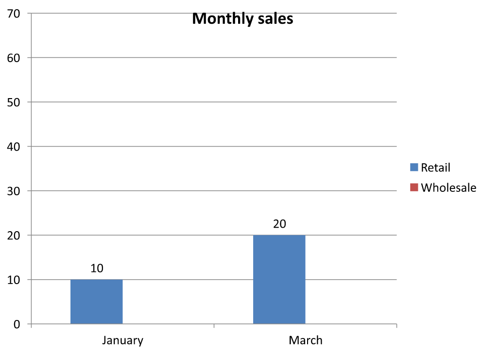
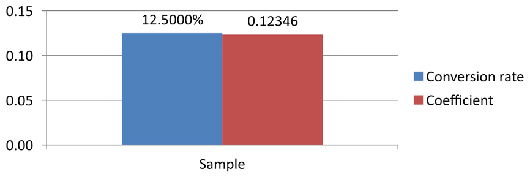

## **Visión general**

Este artículo explica cómo trabajar con libros de trabajo de gráficos en Aspose.Slides. Muestra cómo leer y escribir datos de gráficos mediante flujos de libros de trabajo, usar celdas de libro de trabajo como etiquetas de datos del gráfico, acceder a colecciones de hojas de cálculo y especificar el tipo de origen de datos para los valores del gráfico.

También cubre el trabajo con libros de trabajo externos como fuentes de datos de gráficos. Los ejemplos demuestran cómo crear y asignar un libro de trabajo externo, obtener la ruta de un libro de trabajo externo vinculado a un gráfico y editar los datos del gráfico cuando el libro de trabajo está disponible.

Para celdas de libro de trabajo que representan datos faltantes, consulte [Controlar la visualización de celdas vacías](/slides/es/java/chart-series/) para conocer la diferencia entre una celda vacía y cero, y una comparación de gráfico de líneas de los modos de visualización disponibles.

## **Incluir datos de filas y columnas ocultas**

Utilice [IChart.setPlotVisibleCellsOnly](https://reference.aspose.com/slides/java/com.aspose.slides/ichart/#setPlotVisibleCellsOnly-boolean-) para controlar si un gráfico traza datos de filas y columnas de hoja de cálculo ocultas. Establézcalo en `true` para trazar solo celdas visibles, o en `false` para incluir tanto celdas visibles como ocultas. Esta configuración controla el trazado del gráfico; no oculta ni muestra filas o columnas de la hoja de cálculo.

La [presentación de ejemplo](hidden-source-data.pptx) contiene un gráfico de columnas como la primera forma en su primera diapositiva. La hoja de cálculo incrustada, `Sheet1`, contiene el siguiente rango de origen, `A1:C4`. La fila 3 y la columna C están ocultas, pero sus celdas siguen conteniendo valores.

| Fila de hoja de cálculo | A: Mes | B: Venta minorista | C: Venta al por mayor (columna oculta) |
| --- | --- | --- | --- |
| 2 | enero | 10 | 30 |
| 3 (fila oculta) | febrero | 40 | 60 |
| 4 | marzo | 20 | 50 |

Acceda a las celdas de origen mediante [IChartData.getChartDataWorkbook](https://reference.aspose.com/slides/java/com.aspose.slides/ichartdata/#getChartDataWorkbook--) y lea [IChartDataCell.isHidden](https://reference.aspose.com/slides/java/com.aspose.slides/ichartdatacell/#isHidden--) para inspeccionar su estado oculto. Este método informa del estado oculto sin modificarlo. En este archivo, B2 es visible, B3 pertenece a la fila oculta y C2 pertenece a la columna oculta; el ejemplo imprime `false`, `true` y `true`, respectivamente.

Para este ejemplo, actualice los datos del gráfico después de cambiar la configuración de trazado: conserve el libro de trabajo incrustado con [readWorkbookStream](https://reference.aspose.com/slides/java/com.aspose.slides/ichartdata/#readWorkbookStream--) y recárguelo con [writeWorkbookStream](https://reference.aspose.com/slides/java/com.aspose.slides/ichartdata/#writeWorkbookStream-byte---). Al incluir todas las celdas, también use [setRange](https://reference.aspose.com/slides/java/com.aspose.slides/ichartdata/#setRange-java.lang.String-) para restaurar el rango completo, incluida la categoría oculta de febrero. Simplemente cambiar la bandera no es suficiente para actualizar los datos en caché del gráfico y las etiquetas de categoría de esta muestra.

```java
import com.aspose.slides.*;

Presentation presentation = new Presentation("hidden-source-data.pptx");
try {
    ISlide slide = presentation.getSlides().get_Item(0);

    int shapeCount = slide.getShapes().size();
    if (shapeCount > 0 && slide.getShapes().get_Item(0) instanceof IChart) {
        IChart chart = (IChart) slide.getShapes().get_Item(0);
        IChartDataWorkbook workbook = chart.getChartData().getChartDataWorkbook();
        System.out.println("B2 hidden: " + workbook.getCell(0, "B2").isHidden());
        System.out.println("B3 hidden: " + workbook.getCell(0, "B3").isHidden());
        System.out.println("C2 hidden: " + workbook.getCell(0, "C2").isHidden());

        byte[] workbookData = chart.getChartData().readWorkbookStream();
        for (boolean visibleOnly : new boolean[] { true, false }) {
            chart.setPlotVisibleCellsOnly(visibleOnly);

            // Actualizar los datos del gráfico desde el libro de trabajo incrustado.
            chart.getChartData().writeWorkbookStream(workbookData);
            if (!visibleOnly) {
                // Restaurar el rango de origen completo, incluidas las categorías ocultas.
                chart.getChartData().setRange("Sheet1!$A$1:$C$4");
            }

            presentation.save("hidden_cells_" + visibleOnly + ".pptx", SaveFormat.Pptx);
        }
    } else {
        System.out.println("The first shape is not a chart.");
    }
} finally {
    presentation.dispose();
}
```

El ejemplo guarda dos versiones de la presentación: una con solo los valores de venta minorista visibles (10 y 20) y otra con los seis valores. Las imágenes a continuación ilustran los dos modos de trazado. La fila 3 y la columna C permanecen ocultas en ambos libros de trabajo incrustados.

| Solo celdas visibles (`true`) | Todas las celdas (`false`) |
| --- | --- |
|  |  |

Una celda oculta que contiene un valor es diferente de una celda vacía. [IChart.setDisplayBlanksAs](https://reference.aspose.com/slides/java/com.aspose.slides/ichart/#setDisplayBlanksAs-int-) controla cómo se visualizan los valores faltantes; no incluye ni excluye datos de origen ocultos. Consulte [Controlar la visualización de celdas vacías](/slides/es/java/chart-series/#control-the-display-of-empty-cells) para ver un ejemplo.

## **Recuperar el rango de datos de un gráfico**

Antes de actualizar los datos del libro de trabajo en una presentación existente, inspeccione los rangos de origen para identificar qué celdas de hoja de cálculo usa cada gráfico. El método [IChartData.getRange](https://reference.aspose.com/slides/java/com.aspose.slides/ichartdata/#getRange--) devuelve el rango de datos actual como una fórmula calificada por hoja de cálculo, por ejemplo `Sheet1!$A$1:$D$5`. Aquí, `Sheet1` es el nombre de la hoja, `!` lo separa del rango de celdas y `$A$1:$D$5` identifica las celdas A1 a D5, inclusive. Los signos de dólar indican referencias absolutas de fila y columna.

El método lee el rango actual sin modificar el gráfico ni su libro de trabajo. Si el gráfico no usa un libro de trabajo como fuente de datos, lanza `InvalidOperationException`. Para obtener más información, consulte la [Referencia de la API ChartData](https://reference.aspose.com/slides/java/com.aspose.slides/chartdata/).

Este ejemplo abre una presentación y comprueba directamente las formas en cada diapositiva para buscar gráficos. Imprime el nombre y el rango de origen de cada gráfico. Si un gráfico no usa un libro de trabajo, imprime un mensaje y continúa con el siguiente gráfico.

```java
import com.aspose.slides.*;
import com.aspose.slides.exceptions.InvalidOperationException;

Presentation presentation = new Presentation("presentation.pptx");
try {
    for (ISlide slide : presentation.getSlides()) {
        for (IShape shape : slide.getShapes()) {
            if (shape instanceof IChart) {
                IChart chart = (IChart) shape;
                try {
                    String range = chart.getChartData().getRange();
                    System.out.println(chart.getName() + ": " + range);
                } catch (InvalidOperationException exception) {
                    System.out.println(chart.getName() + ": The chart does not use a workbook as its data source.");
                }
            }
        }
    }
} finally {
    presentation.dispose();
}
```

## **Leer y escribir datos del gráfico desde un libro de trabajo**

Aspose.Slides for Java proporciona los métodos [readWorkbookStream](https://reference.aspose.com/slides/java/com.aspose.slides/ichartdata/#readWorkbookStream--) y [writeWorkbookStream](https://reference.aspose.com/slides/java/com.aspose.slides/ichartdata/#writeWorkbookStream-byte---) que le permiten leer y escribir libros de trabajo de datos de gráficos (que contienen datos de gráficos editados con Aspose.Cells). **Nota** que los datos del gráfico deben organizarse de la misma manera o disponer de una estructura similar a la del origen.

Este ejemplo usa una presentación con un gráfico como la primera forma en su primera diapositiva. Lee el libro de trabajo incrustado en una matriz de bytes, borra las series y categorías existentes y escribe de nuevo el mismo libro de trabajo. Los cambios permanecen en memoria; el ejemplo no guarda la presentación.

```java
import com.aspose.slides.*;

Presentation presentation = new Presentation("chart.pptx");
try {
    ISlide slide = presentation.getSlides().get_Item(0);

    int shapeCount = slide.getShapes().size();
    if (shapeCount > 0 && slide.getShapes().get_Item(0) instanceof IChart) {
        IChart chart = (IChart) slide.getShapes().get_Item(0);
        IChartData chartData = chart.getChartData();
        byte[] workbookData = chartData.readWorkbookStream();

        chartData.getSeries().clear();
        chartData.getCategories().clear();

        chartData.writeWorkbookStream(workbookData);
    } else {
        System.out.println("The first shape is not a chart.");
    }
} finally {
    presentation.dispose();
}
```

### **Validar el diseño del gráfico después de la modificación del libro de trabajo**

Al reemplazar un libro de trabajo incrustado por uno modificado, el gráfico conserva sus colecciones originales de series y categorías. Esta discordancia puede hacer que [IChart.validateChartLayout](https://reference.aspose.com/slides/java/com.aspose.slides/ichart/#validateChartLayout--) falle con un error de índice fuera de rango. Borre las series y categorías existentes antes de escribir el libro de trabajo actualizado de nuevo en el gráfico. Este ejemplo usa un gráfico que es la primera forma en la primera diapositiva. El comentario marca dónde se produciría la edición del libro de trabajo; el ejemplo ejecutable escribe el libro de trabajo original de nuevo y valida el diseño en memoria.

```java
import com.aspose.slides.*;

Presentation presentation = new Presentation("chart.pptx");
try {
    ISlide slide = presentation.getSlides().get_Item(0);

    int shapeCount = slide.getShapes().size();
    if (shapeCount > 0 && slide.getShapes().get_Item(0) instanceof IChart) {
        IChart chart = (IChart) slide.getShapes().get_Item(0);
        IChartData chartData = chart.getChartData();
        byte[] workbookData = chartData.readWorkbookStream();

        // Modificar los bytes del libro de trabajo aquí, por ejemplo, usando Aspose.Cells.

        chartData.getSeries().clear();
        chartData.getCategories().clear();

        chartData.writeWorkbookStream(workbookData);
        chart.validateChartLayout();
    } else {
        System.out.println("The first shape is not a chart.");
    }
} finally {
    presentation.dispose();
}
```

Borrar las colecciones elimina referencias de datos obsoletas antes de que el libro de trabajo se escriba de nuevo. Reconstruya cualquier asignación de series y categorías requerida para el libro de trabajo actualizado antes de usar el gráfico.

## **Establecer formatos numéricos personalizados para celdas de libro de trabajo**

Utilice [IChartDataCell.setCustomNumberFormat](https://reference.aspose.com/slides/java/com.aspose.slides/ichartdatacell/#setCustomNumberFormat-java.lang.String-) para controlar cómo aparecen los valores numéricos en el libro de trabajo incrustado de un gráfico. Por ejemplo, un informe puede necesitar una tasa de conversión mostrada como porcentaje con cuatro decimales y un coeficiente mostrado con cinco decimales. Mantenga ambos valores como numéricos para que sigan estando disponibles para cálculos y trazado del gráfico.

Un formato numérico cambia la visualización, no el valor almacenado. El formato `0.0000%` muestra `0.125` como `12.5000%`; no reemplaza el número almacenado por `12.5`. De manera similar, `0.00000` muestra `0.1234567` como `0.12346` sin redondear el valor almacenado. Si el formato personalizado es una cadena vacía (`""`), se utiliza el formato devuelto por [getPresetNumberFormat](https://reference.aspose.com/slides/java/com.aspose.slides/ichartdatacell/#getPresetNumberFormat--).

El siguiente ejemplo crea un gráfico de columnas y accede a sus celdas mediante [getChartDataWorkbook](https://reference.aspose.com/slides/java/com.aspose.slides/ichartdata/#getChartDataWorkbook--). En la hoja 0, B2 contiene la tasa de conversión y C2 contiene el coeficiente. Ambas celdas suministran valores al gráfico. El ejemplo también habilita etiquetas de valores vinculadas a los formatos de origen.

```java
import com.aspose.slides.*;

Presentation presentation = new Presentation();
try {
    presentation.getSlideSize().setSize(720, 270, SlideSizeScaleType.DoNotScale);
    ISlide slide = presentation.getSlides().get_Item(0);

    IChart chart = slide.getShapes().addChart(ChartType.ClusteredColumn, 50, 20, 620, 210);
    chart.setTitle(false);

    chart.getAxes().getVerticalAxis().setNumberFormatLinkedToSource(false);
    chart.getAxes().getVerticalAxis().setNumberFormat("0.00");
    chart.getAxes().getVerticalAxis().setAutomaticMinValue(false);
    chart.getAxes().getVerticalAxis().setMinValue(0);

    chart.getChartData().getSeries().clear();
    chart.getChartData().getCategories().clear();

    IChartDataWorkbook workbook = chart.getChartData().getChartDataWorkbook();
    workbook.clear(0);

    IChartDataCell categoryCell = workbook.getCell(0, "A2", "Sample");
    chart.getChartData().getCategories().add(categoryCell);

    IChartDataCell percentageCell = workbook.getCell(0, "B2", 0.125);
    percentageCell.setCustomNumberFormat("0.0000%");
    IChartDataCell percentageName = workbook.getCell(0, "B1", "Conversion rate");
    IChartSeries percentageSeries = chart.getChartData().getSeries().add(percentageName, chart.getType());
    percentageSeries.getDataPoints().addDataPointForBarSeries(percentageCell);

    IChartDataCell precisionCell = workbook.getCell(0, "C2", 0.1234567);
    precisionCell.setCustomNumberFormat("0.00000");
    IChartDataCell precisionName = workbook.getCell(0, "C1", "Coefficient");
    IChartSeries precisionSeries = chart.getChartData().getSeries().add(precisionName, chart.getType());
    precisionSeries.getDataPoints().addDataPointForBarSeries(precisionCell);

    for (IChartSeries series : chart.getChartData().getSeries()) {
        IDataLabelFormat labelFormat = series.getDataPoints().get_Item(0).getLabel().getDataLabelFormat();
        labelFormat.setShowValue(true);
        labelFormat.setNumberFormatLinkedToSource(true);
    }

    presentation.save("CustomCellFormats.pptx", SaveFormat.Pptx);
} finally {
    presentation.dispose();
}
```

Los formatos de celda del libro de trabajo son independientes de los formatos establecidos directamente en los ejes del gráfico o en las etiquetas de datos. En este ejemplo, cada etiqueta muestra el valor de su celda de origen porque [setShowValue](https://reference.aspose.com/slides/java/com.aspose.slides/idatalabelformat/#setShowValue-boolean-) está establecido en `true`, y sigue el formato numérico de origen porque [setNumberFormatLinkedToSource](https://reference.aspose.com/slides/java/com.aspose.slides/idatalabelformat/#setNumberFormatLinkedToSource-boolean-) está en `true`. Después de guardar y volver a abrir la presentación, las etiquetas muestran `12.5000%` y `0.12346`, como se muestra a continuación. El eje vertical usa su propio formato numérico, asignado con [setNumberFormat](https://reference.aspose.com/slides/java/com.aspose.slides/iaxis/#setNumberFormat-java.lang.String-) como `0.00`, con [setNumberFormatLinkedToSource](https://reference.aspose.com/slides/java/com.aspose.slides/iaxis/#setNumberFormatLinkedToSource-boolean-) en `false`.

Para formatear una etiqueta de datos de forma independiente, desactive su bandera de vínculo al origen (`false`) y asigne un formato con [setNumberFormat](https://reference.aspose.com/slides/java/com.aspose.slides/idatalabelformat/#setNumberFormat-java.lang.String-). Esto no cambia el formato de la celda del libro de trabajo. Por ejemplo, un formato de etiqueta independiente `0.00` muestra el primer valor como `0.13`, mientras que B2 sigue mostrando `12.5000%`. Vea [Chart Data Labels](/slides/es/java/chart-data-label/#set-percentage-sign-with-chart-data-labels) para formatear directamente las etiquetas.



## **Establecer una celda del libro de trabajo como etiqueta de datos del gráfico**

Puede usar texto de celdas del libro de trabajo como etiquetas de datos del gráfico.

Este ejemplo añade un gráfico de burbujas con datos predeterminados a la primera diapositiva de una presentación existente. Utiliza las celdas A10:A12 en la hoja 0 para las primeras tres etiquetas de la primera serie, habilita las etiquetas desde celdas y guarda la presentación actualizada.

```java
import com.aspose.slides.*;

Presentation presentation = new Presentation("chart2.pptx");
try {
    ISlide slide = presentation.getSlides().get_Item(0);

    IChart chart = slide.getShapes().addChart(ChartType.Bubble, 50, 50, 600, 400, true);
    IChartSeries series = chart.getChartData().getSeries().get_Item(0);
    IChartDataWorkbook workbook = chart.getChartData().getChartDataWorkbook();

    series.getLabels().getDefaultDataLabelFormat().setShowLabelValueFromCell(true);
    series.getLabels().get_Item(0).setValueFromCell(workbook.getCell(0, "A10", "Label 0 cell value"));
    series.getLabels().get_Item(1).setValueFromCell(workbook.getCell(0, "A11", "Label 1 cell value"));
    series.getLabels().get_Item(2).setValueFromCell(workbook.getCell(0, "A12", "Label 2 cell value"));

    presentation.save("resultchart.pptx", SaveFormat.Pptx);
} finally {
    presentation.dispose();
}
```

## **Administrar hojas de cálculo**

El método [IChartDataWorkbook.getWorksheets](https://reference.aspose.com/slides/java/com.aspose.slides/ichartdataworkbook/#getWorksheets--) proporciona acceso a las hojas de cálculo en un libro de trabajo de gráfico. Este ejemplo crea un gráfico circular con datos predeterminados y muestra el nombre de cada hoja de cálculo en la consola.

```java
import com.aspose.slides.*;

Presentation presentation = new Presentation();
try {
    ISlide slide = presentation.getSlides().get_Item(0);

    IChart chart = slide.getShapes().addChart(ChartType.Pie, 50, 50, 400, 500);
    IChartDataWorkbook workbook = chart.getChartData().getChartDataWorkbook();

    for (int i = 0; i < workbook.getWorksheets().size(); i++) {
        System.out.println(workbook.getWorksheets().get_Item(i).getName());
    }
} finally {
    presentation.dispose();
}
```

## **Especificar el tipo de origen de datos**

Este ejemplo crea un gráfico de columnas 3D con datos predeterminados y establece dos nombres de series usando distintas fuentes de datos. El primer nombre usa un literal de cadena; el segundo usa la celda C1 en la hoja 0. La enumeración [DataSourceType](https://reference.aspose.com/slides/java/com.aspose.slides/datasourcetype/) selecciona la fuente para cada nombre. El ejemplo guarda la presentación con los nombres de series actualizados.

```java
import com.aspose.slides.*;

Presentation presentation = new Presentation();
try {
    ISlide slide = presentation.getSlides().get_Item(0);

    IChart chart = slide.getShapes().addChart(ChartType.Column3D, 50, 50, 600, 400, true);
    IStringChartValue literalName = chart.getChartData().getSeries().get_Item(0).getName();

    literalName.setDataSourceType(DataSourceType.StringLiterals);
    literalName.setData("LiteralString");

    IStringChartValue cellName = chart.getChartData().getSeries().get_Item(1).getName();
    IChartDataCell nameCell = chart.getChartData().getChartDataWorkbook().getCell(0, "C1", "NewCell");
    cellName.setDataSourceType(DataSourceType.Worksheet);
    cellName.setData(nameCell);

    presentation.save("pres.pptx", SaveFormat.Pptx);
} finally {
    presentation.dispose();
}
```

## **Detectar formatos de libro de trabajo incrustados no compatibles**

Aspose.Slides no admite el formato de libro de trabajo binario de Excel (.xlsb) que puede incrustarse en algunos gráficos. Puede usar el método [getEmbeddedWorkbookType](https://reference.aspose.com/slides/java/com.aspose.slides/ichartdata/#getEmbeddedWorkbookType--) en [IChartData](https://reference.aspose.com/slides/java/com.aspose.slides/ichartdata/) junto con la enumeración [WorkbookType](https://reference.aspose.com/slides/java/com.aspose.slides/workbooktype/) para detectar formatos no compatibles y omitir esos gráficos. Este ejemplo inspecciona las formas en la primera diapositiva de una presentación existente, omite las formas que no son gráficos y muestra un mensaje diagnóstico para cada gráfico con un libro de trabajo .xlsb incrustado.

```java
import com.aspose.slides.*;

Presentation presentation = new Presentation("sample.pptx");
try {
    ISlide slide = presentation.getSlides().get_Item(0);

    for (IShape shape : slide.getShapes()) {
        if (!(shape instanceof IChart)) {
            continue;
        }

        IChart chart = (IChart) shape;
        IChartData chartData = chart.getChartData();
        boolean isInternalWorkbook = chartData.getDataSourceType() == ChartDataSourceType.InternalWorkbook;
        boolean isBinaryMacro = chartData.getEmbeddedWorkbookType() == WorkbookType.WorkbookBinaryMacro;

        if (isInternalWorkbook && isBinaryMacro) {
            System.out.println("Skipping a chart with an unsupported .xlsb workbook.");
            continue;
        }

        // Leer o modificar aquí los datos del libro de trabajo del gráfico compatibles.
    }
} finally {
    presentation.dispose();
}
```

## **Libro de trabajo externo**

Aspose.Slides admite el uso de libros de trabajo externos como fuente de datos para los gráficos.

### **Crear un libro de trabajo externo**

Utilice [readWorkbookStream](https://reference.aspose.com/slides/java/com.aspose.slides/ichartdata/#readWorkbookStream--) y [setExternalWorkbook](https://reference.aspose.com/slides/java/com.aspose.slides/ichartdata/#setExternalWorkbook-java.lang.String-) para exportar un libro de trabajo de gráfico incrustado a un archivo y vincular el gráfico a ese libro de trabajo externo.

Este ejemplo crea un gráfico circular con datos predeterminados y exporta su libro de trabajo. Completa la escritura del archivo antes de asignar el libro de trabajo externo como fuente de datos del gráfico, y luego guarda la presentación vinculada.

```java
import com.aspose.slides.*;
import java.io.IOException;
import java.nio.file.Files;
import java.nio.file.Path;
import java.nio.file.Paths;

Presentation presentation = new Presentation();
try {
    ISlide slide = presentation.getSlides().get_Item(0);

    IChart chart = slide.getShapes().addChart(ChartType.Pie, 50, 50, 400, 600);
    Path workbookPath = Paths.get("externalWorkbook1.xlsx").toAbsolutePath();
    byte[] workbookData = chart.getChartData().readWorkbookStream();
    try {
        Files.write(workbookPath, workbookData);
        chart.getChartData().setExternalWorkbook(workbookPath.toString());
        presentation.save("externalWorkbook.pptx", SaveFormat.Pptx);
    } catch (IOException exception) {
        System.out.println("Could not write the external workbook: " + exception.getMessage());
    }
} finally {
    presentation.dispose();
}
```

### **Establecer un libro de trabajo externo**

Usando el método [setExternalWorkbook](https://reference.aspose.com/slides/java/com.aspose.slides/ichartdata/#setExternalWorkbook-java.lang.String-), puede asignar un libro de trabajo externo a un gráfico como su fuente de datos. Este método también puede usarse para actualizar la ruta al libro de trabajo externo (si éste ha sido movido).

Aunque no puede editar los datos en libros de trabajo almacenados en ubicaciones remotas o recursos, puede seguir utilizándolos como fuente de datos externa. Si se proporciona una ruta relativa para un libro de trabajo externo, se convierte automáticamente a una ruta completa.

Este ejemplo usa un libro de trabajo externo cuya hoja, llamada `Sheet1`, contiene un nombre de serie en B1, nombres de categorías en A2:A4 y valores numéricos en B2:B4. El ejemplo crea un gráfico circular, vincula el libro de trabajo y usa [setRange](https://reference.aspose.com/slides/java/com.aspose.slides/ichartdata/#setRange-java.lang.String-) para mapear A1:B4 a una serie y tres categorías. Guarda la presentación con el gráfico vinculado.

```java
import com.aspose.slides.*;
import java.nio.file.Paths;

Presentation presentation = new Presentation();
try {
    ISlide slide = presentation.getSlides().get_Item(0);

    IChart chart = slide.getShapes().addChart(ChartType.Pie, 50, 50, 400, 600, true);
    IChartData chartData = chart.getChartData();
    String workbookPath = Paths.get("externalWorkbook.xlsx").toAbsolutePath().toString();

    chartData.setExternalWorkbook(workbookPath);
    chartData.setRange("Sheet1!$A$1:$B$4");

    presentation.save("Presentation_with_externalWorkbook.pptx", SaveFormat.Pptx);
} finally {
    presentation.dispose();
}
```

El parámetro `updateChartData` del método [setExternalWorkbook](https://reference.aspose.com/slides/java/com.aspose.slides/ichartdata/#setExternalWorkbook-java.lang.String-boolean-) controla si el libro de trabajo se carga.

* Cuando `updateChartData` es `false`, solo se actualiza la ruta del libro de trabajo. Los datos del gráfico no se cargan ni actualizan desde el libro de trabajo de destino, por lo que el libro de trabajo puede estar indisponible.
* Cuando `updateChartData` es `true`, los datos del gráfico se actualizan desde el libro de trabajo de destino.

El siguiente ejemplo asigna una URL de marcador de posición con `updateChartData` configurado en `false`. Conserva los datos predeterminados del gráfico circular y guarda la presentación sin cargar el libro de trabajo indisponible.

```java
import com.aspose.slides.*;

Presentation presentation = new Presentation();
try {
    ISlide slide = presentation.getSlides().get_Item(0);

    IChart chart = slide.getShapes().addChart(ChartType.Pie, 50, 50, 400, 600, true);
    chart.getChartData().setExternalWorkbook("https://example.com/unavailable-workbook.xlsx", false);

    presentation.save("SetExternalWorkbookWithUpdateChartData.pptx", SaveFormat.Pptx);
} finally {
    presentation.dispose();
}
```

### **Obtener la ruta del libro de trabajo de origen de datos externo de un gráfico**

Para identificar el libro de trabajo vinculado a un gráfico, compruebe si el gráfico usa una fuente de datos externa y recupere su ruta de libro de trabajo.

Este ejemplo inspecciona la primera forma en la primera diapositiva de una presentación con un libro de trabajo externo vinculado. Si es un gráfico vinculado a un libro de trabajo externo, el ejemplo muestra [getExternalWorkbookPath](https://reference.aspose.com/slides/java/com.aspose.slides/ichartdata/#getExternalWorkbookPath--) en la consola. Luego guarda una copia de la presentación.

```java
import com.aspose.slides.*;

Presentation presentation = new Presentation("externalWorkbook.pptx");
try {
    ISlide slide = presentation.getSlides().get_Item(0);

    if (slide.getShapes().size() > 0 && slide.getShapes().get_Item(0) instanceof IChart) {
        IChart chart = (IChart) slide.getShapes().get_Item(0);
        IChartData chartData = chart.getChartData();
        if (chartData.getDataSourceType() == ChartDataSourceType.ExternalWorkbook) {
            System.out.println(chartData.getExternalWorkbookPath());
        } else {
            System.out.println("The chart does not use an external workbook.");
        }
    } else {
        System.out.println("The first shape is not a chart.");
    }

    presentation.save("Result.pptx", SaveFormat.Pptx);
} finally {
    presentation.dispose();
}
```

### **Editar datos del gráfico**

Puede editar los datos en libros de trabajo externos del mismo modo que realiza cambios en el contenido de libros de trabajo internos. Cuando un libro de trabajo externo no puede cargarse, se lanza una excepción.

Este ejemplo usa un gráfico que es la primera forma en la primera diapositiva y está vinculado a un libro de trabajo externo accesible. Establece el valor respaldado por celda del primer punto de datos de la primera serie a 100 y guarda la presentación actualizada. Editar valores de celda puede actualizar el archivo XLSX externo vinculado, por lo que debería usar una copia si necesita preservar el libro de trabajo original.

```java
import com.aspose.slides.*;

Presentation presentation = new Presentation("presentation.pptx");
try {
    ISlide slide = presentation.getSlides().get_Item(0);

    int shapeCount = slide.getShapes().size();
    if (shapeCount > 0 && slide.getShapes().get_Item(0) instanceof IChart) {
        IChart chart = (IChart) slide.getShapes().get_Item(0);
        IChartSeriesCollection series = chart.getChartData().getSeries();
        if (series.size() > 0 && series.get_Item(0).getDataPoints().size() > 0) {
            IChartDataCell valueCell = series.get_Item(0).getDataPoints().get_Item(0).getValue().getAsCell();
            if (valueCell != null) {
                valueCell.setValue(100);
                presentation.save("presentation_out.pptx", SaveFormat.Pptx);
            } else {
                System.out.println("The first data point is not linked to a workbook cell.");
            }
        } else {
            System.out.println("The chart has no data points to edit.");
        }
    } else {
        System.out.println("The first shape is not a chart.");
    }
} finally {
    presentation.dispose();
}
```

### **Recuperar un libro de trabajo de la caché del gráfico**

Si un gráfico usa un libro de trabajo externo que falta o no está disponible, Aspose.Slides puede reconstruir el libro de trabajo del gráfico a partir de los datos almacenados en caché en la presentación. Cree [LoadOptions](https://reference.aspose.com/slides/java/com.aspose.slides/loadoptions/), llame a [LoadOptions.setSpreadsheetOptions](https://reference.aspose.com/slides/java/com.aspose.slides/loadoptions/#setSpreadsheetOptions-com.aspose.slides.ISpreadsheetOptions-), y establezca [ISpreadsheetOptions.setRecoverWorkbookFromChartCache](https://reference.aspose.com/slides/java/com.aspose.slides/ispreadsheetoptions/#setRecoverWorkbookFromChartCache-boolean-) en `true` antes de abrir la presentación.

El siguiente ejemplo Java recupera los datos del libro de trabajo para un gráfico que es la primera forma en la primera diapositiva y hace referencia a un libro de trabajo externo indisponible. Accede a los datos recuperados mediante [IChart.getChartData](https://reference.aspose.com/slides/java/com.aspose.slides/ichart/#getChartData--) y [IChartData.getChartDataWorkbook](https://reference.aspose.com/slides/java/com.aspose.slides/ichartdata/#getChartDataWorkbook--):

```java
import com.aspose.slides.*;

SpreadsheetOptions spreadsheetOptions = new SpreadsheetOptions();
spreadsheetOptions.setRecoverWorkbookFromChartCache(true);

LoadOptions loadOptions = new LoadOptions();
loadOptions.setSpreadsheetOptions(spreadsheetOptions);

Presentation presentation = new Presentation("presentation.pptx", loadOptions);
try {
    ISlide slide = presentation.getSlides().get_Item(0);

    int shapeCount = slide.getShapes().size();
    if (shapeCount > 0 && slide.getShapes().get_Item(0) instanceof IChart) {
        IChart chart = (IChart) slide.getShapes().get_Item(0);
        IChartDataWorkbook recoveredWorkbook = chart.getChartData().getChartDataWorkbook();

        // Leer o modificar los datos del libro de trabajo recuperado aquí.
    } else {
        System.out.println("The first shape is not a chart.");
    }
} finally {
    presentation.dispose();
}
```

Si el libro de trabajo externo no está disponible y la recuperación está desactivada, Aspose.Slides lanza una excepción. Active la recuperación solo cuando usar los datos del gráfico en caché sea una solución aceptable, ya que la caché puede no contener cambios realizados en el libro de trabajo externo después de la última actualización de la presentación.

## **Preguntas frecuentes**

**¿Puedo determinar si un gráfico específico está vinculado a un libro de trabajo externo o incrustado?**

Sí. Un gráfico tiene un [tipo de origen de datos](https://reference.aspose.com/slides/java/com.aspose.slides/chartdata/#getDataSourceType--) y una [ruta a un libro de trabajo externo](https://reference.aspose.com/slides/java/com.aspose.slides/chartdata/#getExternalWorkbookPath--); si el origen es un libro de trabajo externo, puede leer la ruta completa para asegurarse de que se está usando un archivo externo.

**¿Se admiten rutas relativas a libros de trabajo externos y cómo se almacenan?**

Sí. Si especifica una ruta relativa, se convierte automáticamente en una ruta absoluta. La presentación almacena la ruta absoluta en el archivo PPTX, por lo que mover el libro de trabajo puede requerir actualizar el enlace.

**¿Puedo usar libros de trabajo ubicados en recursos/redes compartidas?**

Sí, esos libros de trabajo pueden usarse como fuente de datos externa. Sin embargo, la edición directa de libros de trabajo remotos desde Aspose.Slides no está soportada; solo pueden utilizarse como origen.

**¿Aspose.Slides sobrescribe el XLSX externo al guardar la presentación?**

La presentación almacena un [enlace al archivo externo](https://reference.aspose.com/slides/java/com.aspose.slides/chartdata/#getExternalWorkbookPath--). Editar datos de gráfico respaldados por celdas también puede actualizar el archivo XLSX local vinculado. Use una copia del libro de trabajo si el original debe permanecer sin cambios.

**¿Qué debo hacer si el archivo externo está protegido con contraseña?**

Aspose.Slides no acepta una contraseña al crear el vínculo. Un enfoque habitual es eliminar la protección con antelación o preparar una copia descifrada (por ejemplo, usando [Aspose.Cells](https://reference.aspose.com/cells/java/)) y enlazar a esa copia.

**¿Pueden varios gráficos hacer referencia al mismo libro de trabajo externo?**

Sí. Cada gráfico almacena su propio enlace. Si todos apuntan al mismo archivo, la actualización de ese archivo se reflejará en cada gráfico la próxima vez que se carguen los datos.