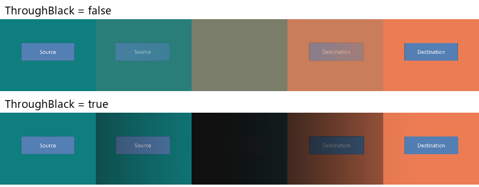

## **Visión general**

Las transiciones de diapositivas controlan cómo aparecen las diapositivas durante una presentación. Con Aspose.Slides para Java, puede elegir un efecto de transición para cada diapositiva, configurar el avance mediante clic del ratón o temporizador, y ajustar opciones específicas de un efecto. Este artículo utiliza ejemplos en Java para aplicar transiciones, establecer duraciones exactas de transición, gestionar el tiempo de la diapositiva y crear una transición Morph entre dos diapositivas. Los ejemplos también muestran cómo guardar la configuración en un archivo PPTX.

## **Añadir transición de diapositiva**

Para aplicar una transición, cargue una presentación con la clase [Presentation](https://reference.aspose.com/slides/java/com.aspose.slides/presentation/) y acceda a la configuración de transición de la diapositiva a través de [getSlideShowTransition](https://reference.aspose.com/slides/java/com.aspose.slides/ibaseslide/#getSlideShowTransition--). Use [setType](https://reference.aspose.com/slides/java/com.aspose.slides/islideshowtransition/#setType-int-) con un valor de la enumeración [TransitionType](https://reference.aspose.com/slides/java/com.aspose.slides/transitiontype/) y, a continuación, guarde la presentación.

El siguiente ejemplo aplica una transición Circle a la primera diapositiva y una transición Comb a la segunda. Utilice un archivo `input.pptx` con al menos dos diapositivas.

```java
import com.aspose.slides.*;

Presentation presentation = new Presentation("input.pptx");
try {
    if (presentation.getSlides().size() >= 2) {
        presentation.getSlides().get_Item(0).getSlideShowTransition().setType(TransitionType.Circle);
        presentation.getSlides().get_Item(1).getSlideShowTransition().setType(TransitionType.Comb);

        presentation.save("slide-transitions.pptx", SaveFormat.Pptx);
    } else {
        System.out.println("The input presentation must contain at least two slides.");
    }
} finally {
    presentation.dispose();
}
```

## **Transición de rueda**

El método [setSpokes](https://reference.aspose.com/slides/java/com.aspose.slides/iwheeltransition/#setSpokes-long-) de [IWheelTransition](https://reference.aspose.com/slides/java/com.aspose.slides/iwheeltransition/) controla el número de sectores radiales que revelan la diapositiva de destino. Establezca el tipo de transición de la diapositiva a Wheel desde [TransitionType](https://reference.aspose.com/slides/java/com.aspose.slides/transitiontype/) usando [setType](https://reference.aspose.com/slides/java/com.aspose.slides/islideshowtransition/#setType-int-) antes de acceder a [getValue](https://reference.aspose.com/slides/java/com.aspose.slides/islideshowtransition/#getValue--) como [IWheelTransition](https://reference.aspose.com/slides/java/com.aspose.slides/iwheeltransition/).

Este ejemplo crea dos pares idénticos de diapositivas: una diapositiva negra seguida de una diapositiva con un rectángulo dorado. Las diapositivas de destino utilizan recuentos de radios de 1 y 8, con la misma velocidad establecida mediante [setSpeed](https://reference.aspose.com/slides/java/com.aspose.slides/islideshowtransition/#setSpeed-int-) y una duración explícita de 8 000 milisegundos fijada mediante [setDuration](https://reference.aspose.com/slides/java/com.aspose.slides/islideshowtransition/#setDuration-int-) para que la diferencia sea fácil de observar.

```java
import java.awt.Color;
import com.aspose.slides.*;

Presentation presentation = new Presentation();
try {
    float slideWidth = (float) presentation.getSlideSize().getSize().getWidth();
    float slideHeight = (float) presentation.getSlideSize().getSize().getHeight();

    ISlide blackSlide = presentation.getSlides().get_Item(0);
    blackSlide.getShapes().clear();
    blackSlide.getBackground().setType(BackgroundType.OwnBackground);
    blackSlide.getBackground().getFillFormat().setFillType(FillType.Solid);
    blackSlide.getBackground().getFillFormat().getSolidFillColor().setColor(Color.BLACK);

    ISlide destinationSlide = presentation.getSlides().addClone(blackSlide);
    IAutoShape rectangle = destinationSlide.getShapes().addAutoShape(ShapeType.Rectangle, 0, 0, slideWidth, slideHeight);
    rectangle.getFillFormat().setFillType(FillType.Solid);
    Color gold = new Color(255, 215, 0);
    rectangle.getFillFormat().getSolidFillColor().setColor(gold);
    rectangle.getTextFrame().setText("Wheel transition");

    presentation.getSlides().addClone(blackSlide);
    presentation.getSlides().addClone(destinationSlide);

    long[] spokeCounts = { 1, 8 };
    for (int i = 0; i < spokeCounts.length; i++) {
        ISlideShowTransition transition = presentation.getSlides().get_Item(i * 2 + 1).getSlideShowTransition();
        transition.setType(TransitionType.Wheel);
        IWheelTransition wheelTransition = (IWheelTransition) transition.getValue();
        wheelTransition.setSpokes(spokeCounts[i]);
        transition.setSpeed(TransitionSpeed.Slow);
        transition.setDuration(8000);
    }

    presentation.save("wheel-transitions.pptx", SaveFormat.Pptx);
} finally {
    presentation.dispose();
}
```

Abra la presentación resultante en PowerPoint y ejecute la presentación. Avance de la diapositiva 1 a la diapositiva 2 y, a continuación, de la diapositiva 3 a la diapositiva 4. En la reproducción de PowerPoint, el recuento verificado de radios 1 revela la diapositiva con un barrido horario; el recuento verificado de 8 la revela mediante ocho sectores radiales simultáneamente. El contenido de destino y el tiempo de transición son idénticos, por lo que la diferencia reside en el número de sectores de revelado.

## **Desvanecimiento a negro con la transición Reveal**

Establezca el tipo de transición de la diapositiva de destino a Reveal y, a continuación, llame a [setThroughBlack](https://reference.aspose.com/slides/java/com.aspose.slides/irevealtransition/#setThroughBlack-boolean-) sobre su configuración [IRevealTransition](https://reference.aspose.com/slides/java/com.aspose.slides/irevealtransition/). El ejemplo crea una diapositiva origen color teal y una diapositiva destino color coral, y luego clona ambas. Cada par utiliza la misma transición Reveal de dos segundos. Sólo el segundo par se desvanece a través del negro.

```java
import java.awt.Color;
import com.aspose.slides.*;

Presentation presentation = new Presentation();
try {
    ISlide source = presentation.getSlides().get_Item(0);
    ISlide destination = presentation.getSlides().addClone(source);
    ISlide[] slides = { source, destination };
    Color[] backgrounds = { new Color(0, 128, 128), new Color(255, 127, 80) };
    String[] labels = { "Source", "Destination" };

    for (int i = 0; i < slides.length; i++) {
        ISlide slide = slides[i];
        slide.getBackground().setType(BackgroundType.OwnBackground);
        slide.getBackground().getFillFormat().setFillType(FillType.Solid);
        slide.getBackground().getFillFormat().getSolidFillColor().setColor(backgrounds[i]);

        IAutoShape shape = slide.getShapes().addAutoShape(ShapeType.Rectangle, 160, 180, 400, 130);
        shape.getTextFrame().setText(labels[i]);
        shape.getTextFrame().getParagraphs().get_Item(0).getPortions().get_Item(0).getPortionFormat().setFontHeight(44);
    }

    presentation.getSlides().addClone(source);
    ISlide clonedDestination = presentation.getSlides().addClone(destination);
    for (ISlide slide : new ISlide[] { destination, clonedDestination }) {
        ISlideShowTransition transition = slide.getSlideShowTransition();
        transition.setType(TransitionType.Reveal);
        transition.setSpeed(TransitionSpeed.Slow);
        transition.setDuration(2000);

        IRevealTransition reveal = (IRevealTransition) transition.getValue();
        reveal.setDirection(TransitionLeftRightDirectionType.Left);
        reveal.setThroughBlack(slide == clonedDestination);
    }

    presentation.save("reveal-transitions.pptx", SaveFormat.Pptx);
} finally {
    presentation.dispose();
}
```

Abra la presentación guardada en PowerPoint y comience la presentación. Avance de la diapositiva 1 a la diapositiva 2 para ver cómo el teal se desvanece directamente en coral. Después avance de la diapositiva 3 a la diapositiva 4. La pantalla se oscurece brevemente casi hasta negro antes de que aparezca la diapositiva coral. Ambas diapositivas conservan sus colores de fondo originales.

Las filas siguientes muestran fotogramas de PowerPoint a intervalos de medio segundo. Compare el fotograma central de cada fila para observar el efecto.



## **Agregar transición de diapositiva avanzada**

Puede configurar cuánto tiempo permanece una diapositiva en pantalla y si un clic del ratón avanza la presentación. Los siguientes métodos controlan este comportamiento:

- [setAdvanceOnClick](https://reference.aspose.com/slides/java/com.aspose.slides/islideshowtransition/#setAdvanceOnClick-boolean-) permite al espectador avanzar haciendo clic con el ratón.
- [setAdvanceAfter](https://reference.aspose.com/slides/java/com.aspose.slides/islideshowtransition/#setAdvanceAfter-boolean-) habilita el avance automático.
- [setAdvanceAfterTime](https://reference.aspose.com/slides/java/com.aspose.slides/islideshowtransition/#setAdvanceAfterTime-long-) especifica el retraso antes del avance automático, en milisegundos.

Habilite tanto el avance por clic como el cronometrado para que el espectador pueda pasar a la siguiente diapositiva con un clic o esperar al temporizador. Para usar solo el temporizador, pase `false` a [setAdvanceOnClick](https://reference.aspose.com/slides/java/com.aspose.slides/islideshowtransition/#setAdvanceOnClick-boolean-). El retraso controla cuándo avanza la presentación; no establece la duración del efecto visual de transición.

Este ejemplo asigna efectos diferentes a las tres primeras diapositivas y habilita el avance automático después de 3, 5 y 7 segundos, respectivamente. Los clics del ratón también pueden avanzar estas diapositivas. Utilice un archivo `input.pptx` con al menos tres diapositivas.

```java
import com.aspose.slides.*;

Presentation presentation = new Presentation("input.pptx");
try {
    if (presentation.getSlides().size() >= 3) {
        ISlideShowTransition firstTransition = presentation.getSlides().get_Item(0).getSlideShowTransition();
        firstTransition.setType(TransitionType.Circle);
        firstTransition.setAdvanceOnClick(true);
        firstTransition.setAdvanceAfter(true);
        firstTransition.setAdvanceAfterTime(3000);

        ISlideShowTransition secondTransition = presentation.getSlides().get_Item(1).getSlideShowTransition();
        secondTransition.setType(TransitionType.Comb);
        secondTransition.setAdvanceOnClick(true);
        secondTransition.setAdvanceAfter(true);
        secondTransition.setAdvanceAfterTime(5000);

        ISlideShowTransition thirdTransition = presentation.getSlides().get_Item(2).getSlideShowTransition();
        thirdTransition.setType(TransitionType.Zoom);
        thirdTransition.setAdvanceOnClick(true);
        thirdTransition.setAdvanceAfter(true);
        thirdTransition.setAdvanceAfterTime(7000);

        presentation.save("advanced-transitions.pptx", SaveFormat.Pptx);
    } else {
        System.out.println("The input presentation must contain at least three slides.");
    }
} finally {
    presentation.dispose();
}
```

Para comprobar si el avance cronometrado está habilitado, llame a [getAdvanceAfter](https://reference.aspose.com/slides/java/com.aspose.slides/islideshowtransition/#getAdvanceAfter--). Un retraso almacenado por sí solo no indica que el temporizador esté activo.

El siguiente ejemplo abre el archivo guardado anteriormente, informa de cada temporizador habilitado y desactiva el avance automático para las diapositivas con un retraso superior a dos segundos. Habilita los clics del ratón para esas diapositivas y guarda la configuración actualizada.

```java
import com.aspose.slides.*;

Presentation presentation = new Presentation("advanced-transitions.pptx");
try {
    for (ISlide slide : presentation.getSlides()) {
        ISlideShowTransition transition = slide.getSlideShowTransition();

        if (transition.getAdvanceAfter()) {
            System.out.println("Slide " + slide.getSlideNumber() + ": advance after " + transition.getAdvanceAfterTime() + " ms.");

            if (transition.getAdvanceAfterTime() > 2000) {
                transition.setAdvanceAfter(false);
                transition.setAdvanceOnClick(true);
            }
        }
    }

    presentation.save("adjusted-transitions.pptx", SaveFormat.Pptx);
} finally {
    presentation.dispose();
}
```

## **Controlar el tiempo de transición con precisión**

Use [setDuration](https://reference.aspose.com/slides/java/com.aspose.slides/islideshowtransition/#setDuration-int-) para especificar la longitud exacta de un efecto de transición en milisegundos. El método [getSlideShowTransition](https://reference.aspose.com/slides/java/com.aspose.slides/ibaseslide/#getSlideShowTransition--) de la diapositiva expone estas configuraciones a través de [ISlideShowTransition](https://reference.aspose.com/slides/java/com.aspose.slides/islideshowtransition/):

| Método | Propósito |
| --- | --- |
| [setDuration](https://reference.aspose.com/slides/java/com.aspose.slides/islideshowtransition/#setDuration-int-) | Establece la duración del propio efecto de transición, en milisegundos. |
| [setAdvanceAfterTime](https://reference.aspose.com/slides/java/com.aspose.slides/islideshowtransition/#setAdvanceAfterTime-long-) | Establece el retraso antes de que la diapositiva avance automáticamente, en milisegundos. Pase `true` a [setAdvanceAfter](https://reference.aspose.com/slides/java/com.aspose.slides/islideshowtransition/#setAdvanceAfter-boolean-) para activar este temporizador. |
| [setSpeed](https://reference.aspose.com/slides/java/com.aspose.slides/islideshowtransition/#setSpeed-int-) | Selecciona una categoría de velocidad predefinida de [TransitionSpeed](https://reference.aspose.com/slides/java/com.aspose.slides/transitionspeed/): Lenta, Media o Rápida. Se usa cuando no se especifica una duración exacta. |

[setDuration](https://reference.aspose.com/slides/java/com.aspose.slides/islideshowtransition/#setDuration-int-) controla sólo el efecto de transición; no determina cuánto tiempo permanece visible la diapositiva. Configure el retraso de avance automático por separado. Cuando no se establece una duración explícita, Aspose.Slides determina la duración del efecto a partir del tipo de transición y el valor de [getSpeed](https://reference.aspose.com/slides/java/com.aspose.slides/islideshowtransition/#getSpeed--).

<!-- visual-explanation:slide-transition:start -->
[](visual-slide-transition-1f705a740cf6.svg)

*El ejemplo compartido asigna a cada diapositiva una transición Fade de 750 ms y habilita por separado el avance automático a los 5 000 ms. La duración de la transición controla el efecto; el avance controla cuándo abandonar la diapositiva. Estas barras son configuraciones esquemáticas, no una línea de tiempo combinada medida.*
<!-- visual-explanation:slide-transition:end -->

### **Aplicar la misma duración a cada diapositiva**

Para lograr un ritmo constante, aplique el mismo efecto y la misma duración exacta a cada diapositiva. Este ejemplo carga `input.pptx`, selecciona Fade de [TransitionType](https://reference.aspose.com/slides/java/com.aspose.slides/transitiontype/) y asigna a cada transición una duración de 750 milisegundos. Habilita por separado el avance automático después de 5 000 milisegundos y desactiva el avance mediante clic del ratón, y luego guarda el resultado como PPTX.

```java
import com.aspose.slides.*;

Presentation presentation = new Presentation("input.pptx");
try {
    for (ISlide slide : presentation.getSlides()) {
        ISlideShowTransition transition = slide.getSlideShowTransition();
        transition.setType(TransitionType.Fade);
        transition.setDuration(750);

        // Configura el avance automático independientemente de la duración del efecto.
        transition.setAdvanceAfter(true);
        transition.setAdvanceAfterTime(5000);
        transition.setAdvanceOnClick(false);
    }

    presentation.save("precise-transitions.pptx", SaveFormat.Pptx);
} finally {
    presentation.dispose();
}
```

### **Establecer duraciones diferentes para diapositivas individuales**

Las distintas diapositivas pueden usar duraciones de efecto diferentes. Por ejemplo, utilice una transición breve para una diapositiva de título y una más larga para la introducción de una sección. Este ejemplo establece 500 ms para la primera diapositiva y 1 200 ms para la segunda. Use un archivo `input.pptx` con al menos dos diapositivas.

```java
import com.aspose.slides.*;

Presentation presentation = new Presentation("input.pptx");
try {
    if (presentation.getSlides().size() >= 2) {
        ISlideShowTransition firstTransition = presentation.getSlides().get_Item(0).getSlideShowTransition();
        firstTransition.setType(TransitionType.Fade);
        firstTransition.setDuration(500);

        ISlideShowTransition secondTransition = presentation.getSlides().get_Item(1).getSlideShowTransition();
        secondTransition.setType(TransitionType.Push);
        secondTransition.setDuration(1200);

        presentation.save("individual-transition-durations.pptx", SaveFormat.Pptx);
    } else {
        System.out.println("The input presentation must contain at least two slides.");
    }
} finally {
    presentation.dispose();
}
```

### **Coordinar transiciones con salida animada**

Al preparar un [animated GIF](/slides/es/java/convert-powerpoint-to-animated-gif/), una [presentación HTML5](/slides/es/java/export-to-html5/) o un [video](/slides/es/java/convert-powerpoint-to-video/), establezca duraciones exactas de transición antes de la exportación para que coincidan con el ritmo deseado. Por ejemplo, use un fundido de 600 ms entre escenas y ajuste por separado el retraso de avance de cada diapositiva para permitir tiempo a la narración o al contenido.

Para GIF y video, coordine la velocidad de fotogramas de salida con la duración del efecto: 600 ms corresponden a 18 fotogramas a 30 fps. En HTML5, habilite las transiciones animadas en la configuración de exportación. Consulte los efectos y opciones de temporización admitidos por el formato de exportación elegido y previsualice la salida para confirmar la sincronización.

### **Leer la duración de una transición existente**

Llame a [getDuration](https://reference.aspose.com/slides/java/com.aspose.slides/islideshowtransition/#getDuration--) antes de modificar la transición para determinar si se almacena un valor explícito. Un valor de `-1` indica que no se ha establecido una duración explícita; un valor no negativo especifica la duración almacenada en milisegundos. El valor no establecido no es la duración de reproducción calculada: Aspose.Slides usa el tipo de transición y el valor de [getSpeed](https://reference.aspose.com/slides/java/com.aspose.slides/islideshowtransition/#getSpeed--) para determinar esa duración. Establecer un tipo de transición puede inicializar una duración, por lo que es conveniente inspeccionar primero la configuración original.

```java
import com.aspose.slides.*;

Presentation presentation = new Presentation("input.pptx");
try {
    for (ISlide slide : presentation.getSlides()) {
        ISlideShowTransition transition = slide.getSlideShowTransition();
        int duration = transition.getDuration();

        if (duration >= 0) {
            System.out.println("Slide " + slide.getSlideNumber() + ": stored transition duration is " + duration + " ms.");
        } else {
            System.out.println("Slide " + slide.getSlideNumber() + ": no explicit duration; timing depends on transition type " + transition.getType() + " and speed " + transition.getSpeed() + ".");
        }
    }
} finally {
    presentation.dispose();
}
```

## **Transición Morph**

La transición Morph anima los cambios entre objetos en diapositivas consecutivas. Para crear un efecto Morph sencillo, clone una diapositiva, mueva o cambie el tamaño de un objeto en el clon y aplique la transición Morph a la segunda diapositiva. Esto da a la transición los objetos correspondientes para animar entre sus estados original y modificado.

El siguiente ejemplo crea una diapositiva con un rectángulo de texto, clona la diapositiva y cambia la posición y el tamaño del rectángulo en el clon. Después selecciona Morph de la enumeración [TransitionType](https://reference.aspose.com/slides/java/com.aspose.slides/transitiontype/) para la segunda diapositiva. Abra el archivo guardado en un visor de presentaciones que admita Morph para ver el efecto durante una presentación.

```java
import com.aspose.slides.*;

Presentation presentation = new Presentation();
try {
    ISlide firstSlide = presentation.getSlides().get_Item(0);
    IAutoShape rectangle = firstSlide.getShapes().addAutoShape(ShapeType.Rectangle, 100, 100, 400, 100);
    rectangle.getTextFrame().setText("Morph transition");

    ISlide secondSlide = presentation.getSlides().addClone(firstSlide);
    IShape movedRectangle = secondSlide.getShapes().get_Item(0);
    movedRectangle.setX(movedRectangle.getX() + 100);
    movedRectangle.setY(movedRectangle.getY() + 50);
    movedRectangle.setWidth(movedRectangle.getWidth() - 200);
    movedRectangle.setHeight(movedRectangle.getHeight() - 10);

    secondSlide.getSlideShowTransition().setType(TransitionType.Morph);

    presentation.save("morph-transition.pptx", SaveFormat.Pptx);
} finally {
    presentation.dispose();
}
```

## **Tipos de transición Morph**

La enumeración [TransitionMorphType](https://reference.aspose.com/slides/java/com.aspose.slides/transitionmorphtype/) controla cómo Morph empareja y anima el contenido:

- [ByObject](https://reference.aspose.com/slides/java/com.aspose.slides/transitionmorphtype/#ByObject) trata cada forma como un objeto completo.
- [ByWord](https://reference.aspose.com/slides/java/com.aspose.slides/transitionmorphtype/#ByWord) anima el texto coincidendo palabras donde sea posible.
- [ByChar](https://reference.aspose.com/slides/java/com.aspose.slides/transitionmorphtype/#ByChar) anima el texto coincidendo caracteres donde sea posible.

Use [setType](https://reference.aspose.com/slides/java/com.aspose.slides/islideshowtransition/#setType-int-) para seleccionar Morph antes de acceder a [getValue](https://reference.aspose.com/slides/java/com.aspose.slides/islideshowtransition/#getValue--). El valor devuelve entonces la interfaz [IMorphTransition](https://reference.aspose.com/slides/java/com.aspose.slides/imorphtransition/), cuyo método [setMorphType](https://reference.aspose.com/slides/java/com.aspose.slides/imorphtransition/#setMorphType-int-) selecciona el modo de emparejamiento.

Este ejemplo abre la presentación creada en la sección anterior y configura la segunda diapositiva para usar animación Morph basada en palabras.

```java
import com.aspose.slides.*;

Presentation presentation = new Presentation("morph-transition.pptx");
try {
    if (presentation.getSlides().size() >= 2) {
        ISlideShowTransition transition = presentation.getSlides().get_Item(1).getSlideShowTransition();
        transition.setType(TransitionType.Morph);
        ITransitionValueBase transitionValue = transition.getValue();

        if (transitionValue instanceof IMorphTransition) {
            IMorphTransition morphTransition = (IMorphTransition) transitionValue;
            morphTransition.setMorphType(TransitionMorphType.ByWord);
            presentation.save("morph-by-word.pptx", SaveFormat.Pptx);
        } else {
            System.out.println("Morph transition options are unavailable.");
        }
    } else {
        System.out.println("The input presentation must contain at least two slides.");
    }
} finally {
    presentation.dispose();
}
```

## **Establecer efectos de transición**

Algunas transiciones exponen opciones adicionales, como la dirección o si el efecto comienza desde una pantalla negra. Las opciones disponibles dependen de la transición seleccionada con [setType](https://reference.aspose.com/slides/java/com.aspose.slides/islideshowtransition/#setType-int-). Establezca primero el tipo y, a continuación, utilice la interfaz apropiada obtenida mediante [getValue](https://reference.aspose.com/slides/java/com.aspose.slides/islideshowtransition/#getValue--).

El siguiente ejemplo aplica una transición Cut a la primera diapositiva de `input.pptx`. Llama a [setFromBlack](https://reference.aspose.com/slides/java/com.aspose.slides/ioptionalblacktransition/#setFromBlack-boolean-) a través de [IOptionalBlackTransition](https://reference.aspose.com/slides/java/com.aspose.slides/ioptionalblacktransition/) para que la transición comience desde una pantalla negra.

```java
import com.aspose.slides.*;

Presentation presentation = new Presentation("input.pptx");
try {
    ISlideShowTransition transition = presentation.getSlides().get_Item(0).getSlideShowTransition();
    transition.setType(TransitionType.Cut);
    ITransitionValueBase transitionValue = transition.getValue();

    if (transitionValue instanceof IOptionalBlackTransition) {
        IOptionalBlackTransition cutTransition = (IOptionalBlackTransition) transitionValue;
        cutTransition.setFromBlack(true);
        presentation.save("cut-from-black.pptx", SaveFormat.Pptx);
    } else {
        System.out.println("Cut transition options are unavailable.");
    }
} finally {
    presentation.dispose();
}
```

## **FAQ**

**¿Puedo controlar la velocidad de reproducción de una transición de diapositiva?**

Sí. Prefiera [setDuration](https://reference.aspose.com/slides/java/com.aspose.slides/islideshowtransition/#setDuration-int-) cuando necesite una duración exacta del efecto en milisegundos. Use [setSpeed](https://reference.aspose.com/slides/java/com.aspose.slides/islideshowtransition/#setSpeed-int-) cuando una categoría predefinida de [TransitionSpeed](https://reference.aspose.com/slides/java/com.aspose.slides/transitionspeed/) — Lenta, Media o Rápida — sea suficiente y no se establezca una duración explícita. Estas configuraciones controlan el efecto de transición independientemente del retraso de avance automático.

**¿Puedo adjuntar audio a una transición y hacer que se repita?**

Sí. Asigne audio incrustado con [setSound](https://reference.aspose.com/slides/java/com.aspose.slides/islideshowtransition/#setSound-com.aspose.slides.IAudio-), pase StartSound de la enumeración [TransitionSoundMode](https://reference.aspose.com/slides/java/com.aspose.slides/transitionsoundmode/) a [setSoundMode](https://reference.aspose.com/slides/java/com.aspose.slides/islideshowtransition/#setSoundMode-int-), y habilite [setSoundLoop](https://reference.aspose.com/slides/java/com.aspose.slides/islideshowtransition/#setSoundLoop-boolean-) con `true`. El audio se repite hasta el siguiente evento de sonido en la presentación.

**¿Cuál es la forma más rápida de aplicar la misma transición a cada diapositiva?**

Recorra la colección [getSlides](https://reference.aspose.com/slides/java/com.aspose.slides/presentation/#getSlides--) de la presentación y llame a [setType](https://reference.aspose.com/slides/java/com.aspose.slides/islideshowtransition/#setType-int-) con el mismo valor para la transición de cada diapositiva. Establezca cualquier opción de tiempo y efecto en el mismo bucle para mantener el comportamiento coherente en todas las diapositivas.

**¿Cómo puedo comprobar qué transición está establecida actualmente en una diapositiva?**

Llame a [getType](https://reference.aspose.com/slides/java/com.aspose.slides/islideshowtransition/#getType--) sobre el resultado de [getSlideShowTransition](https://reference.aspose.com/slides/java/com.aspose.slides/ibaseslide/#getSlideShowTransition--) de la diapositiva. Devuelve un valor de la enumeración [TransitionType](https://reference.aspose.com/slides/java/com.aspose.slides/transitiontype/); None significa que no se ha aplicado ningún efecto de transición.