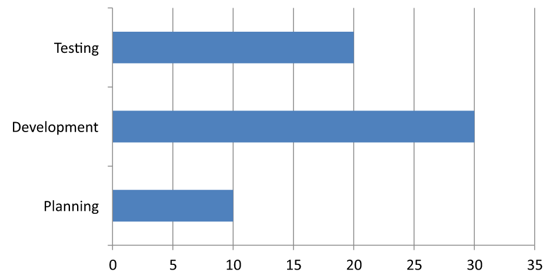

## **Visión general**

Este artículo explica cómo personalizar los ejes de los gráficos con Aspose.Slides para PHP a través de Java. Cubre valores de ejes calculados, cambio de filas y columnas del gráfico, visibilidad del eje, intervalos de etiquetas de categoría y marcas de graduación, categorías de fecha y formato, rotación del título, posicionamiento del eje, unidades de visualización y escalado logarítmico.

## **Obtener los valores máximos en el eje vertical de los gráficos**

Cree una [Presentation](https://reference.aspose.com/slides/php-java/aspose.slides/presentation/) y añada un gráfico de áreas con datos predeterminados. Llame a [validateChartLayout](https://reference.aspose.com/slides/php-java/aspose.slides/chart/validatechartlayout/) antes de leer los valores de eje calculados para que la disposición del gráfico esté actualizada.

Lea [getActualMaxValue](https://reference.aspose.com/slides/php-java/aspose.slides/axis/getactualmaxvalue/) y [getActualMinValue](https://reference.aspose.com/slides/php-java/aspose.slides/axis/getactualminvalue/) para los límites del eje, y [getActualMajorUnit](https://reference.aspose.com/slides/php-java/aspose.slides/axis/getactualmajorunit/) y [getActualMinorUnit](https://reference.aspose.com/slides/php-java/aspose.slides/axis/getactualminorunit/) para los intervalos de marcas. [getActualMajorUnitScale](https://reference.aspose.com/slides/php-java/aspose.slides/axis/getactualmajorunitscale/) y [getActualMinorUnitScale](https://reference.aspose.com/slides/php-java/aspose.slides/axis/getactualminorunitscale/) proporcionan escalas de unidades de tiempo, relevantes para ejes de fecha. El ejemplo almacena estos valores en variables locales y guarda el gráfico.

```php
use aspose\slides\ChartType;
use aspose\slides\Presentation;
use aspose\slides\SaveFormat;

$presentation = new Presentation();
try {
    $slide = $presentation->getSlides()->get_Item(0);

    $chart = $slide->getShapes()->addChart(ChartType::Area, 100, 100, 500, 350);
    $chart->validateChartLayout();

    $maxValue = $chart->getAxes()->getVerticalAxis()->getActualMaxValue();
    $minValue = $chart->getAxes()->getVerticalAxis()->getActualMinValue();

    $majorUnit = $chart->getAxes()->getVerticalAxis()->getActualMajorUnit();
    $minorUnit = $chart->getAxes()->getVerticalAxis()->getActualMinorUnit();

    $majorUnitScale = $chart->getAxes()->getVerticalAxis()->getActualMajorUnitScale();
    $minorUnitScale = $chart->getAxes()->getVerticalAxis()->getActualMinorUnitScale();

    $presentation->save("AxisValues_out.pptx", SaveFormat::Pptx);
} finally {
    $presentation->dispose();
}
```

## **Intercambiar los datos entre ejes**

Utilice [switchRowColumn](https://reference.aspose.com/slides/php-java/aspose.slides/chartdata/switchrowcolumn/) para intercambiar los roles de series y categorías en los datos del gráfico. Cada categoría anterior se convierte en una serie, y cada serie anterior en una categoría. Esto cambia la forma en que se agrupan los datos; no intercambia los ejes horizontal y vertical. El ejemplo usa [setRange](https://reference.aspose.com/slides/php-java/aspose.slides/chartdata/setrange/) para asignar los datos predeterminados a `Sheet1!A1:D5`, incluida la fila de encabezado y la columna de categoría, antes de cambiar filas y columnas. Guarda un gráfico con cuatro series y tres categorías.

```php
use aspose\slides\ChartType;
use aspose\slides\Presentation;
use aspose\slides\SaveFormat;

$presentation = new Presentation();
try {
    $slide = $presentation->getSlides()->get_Item(0);

    $chart = $slide->getShapes()->addChart(ChartType::ClusteredColumn, 100, 100, 400, 300);
    $chart->getChartData()->setRange("Sheet1!A1:D5");
    $chart->getChartData()->switchRowColumn();

    $presentation->save("SwitchChartRowColumns_out.pptx", SaveFormat::Pptx);
} finally {
    $presentation->dispose();
}
```

## **Invertir el orden de trazado de un eje**

Utilice [setPlotOrderReversed](https://reference.aspose.com/slides/php-java/aspose.slides/axis/setplotorderreversed/) para invertir un eje de categoría o de valor. Por ejemplo, un gráfico de barras horizontal puede mostrar las fases del proyecto de arriba a abajo en el mismo orden que la hoja de cálculo: Planificación, Desarrollo, Pruebas. Invertir un eje cambia la dirección del trazado; no ordena ni reorganiza los datos de la hoja de cálculo. Por comparación, [switchRowColumn](https://reference.aspose.com/slides/php-java/aspose.slides/chartdata/switchrowcolumn/) intercambia los roles de series y categorías.

El siguiente ejemplo crea un gráfico de barras horizontal con tres fases y una serie. Guarda una presentación con tres diapositivas: orden normal, categorías invertidas y valores invertidos. Cada copia usa el mismo conjunto de datos, y solo un eje está invertido en cada copia.

```php
use aspose\slides\ChartType;
use aspose\slides\CrossesType;
use aspose\slides\Presentation;
use aspose\slides\SaveFormat;

$presentation = new Presentation();
try {
    $slide = $presentation->getSlides()->get_Item(0);

    $chart = $slide->getShapes()->addChart(ChartType::ClusteredBar, 50, 40, 620, 320);
    $chart->setLegend(false);

    $chart->getChartData()->getCategories()->clear();
    $chart->getChartData()->getSeries()->clear();

    $workbook = $chart->getChartData()->getChartDataWorkbook();
    $workbook->clear(0);

    $series = $chart->getChartData()->getSeries()->add(ChartType::ClusteredBar);
    $stages = ["Planning", "Development", "Testing"];
    $values = [10, 30, 20];
    for ($i = 0; $i < count($stages); $i++) {
        $categoryCell = $workbook->getCell(0, $i + 1, 0, $stages[$i]);
        $chart->getChartData()->getCategories()->add($categoryCell);
        $valueCell = $workbook->getCell(0, $i + 1, 1, $values[$i]);
        $series->getDataPoints()->addDataPointForBarSeries($valueCell);
    }

    // Diapositiva 2: muestra la primera categoría en la parte superior.
    $categorySlide = $presentation->getSlides()->addClone($slide);
    $categoryChart = $categorySlide->getShapes()->get_Item(0);
    $categoryChart->getAxes()->getVerticalAxis()->setPlotOrderReversed(true);
    // Mantén el eje de valores horizontal en la parte inferior.
    $categoryChart->getAxes()->getVerticalAxis()->setCrossType(CrossesType::Maximum);

    // Diapositiva 3: invierte solo la escala numérica horizontal.
    $valueSlide = $presentation->getSlides()->addClone($slide);
    $valueChart = $valueSlide->getShapes()->get_Item(0);
    $valueChart->getAxes()->getHorizontalAxis()->setPlotOrderReversed(true);

    $presentation->save("ReversedAxes.pptx", SaveFormat::Pptx);
} finally {
    $presentation->dispose();
}
```

Invertir un eje también puede mover el eje perpendicular al lado opuesto del trazado. [setCrossType](https://reference.aspose.com/slides/php-java/aspose.slides/axis/setcrosstype/) controla dónde el otro eje cruza el eje que se está configurando. En la diapositiva 2, llamarlo con `CrossesType::Maximum` en el eje de categoría invertido mantiene el eje de valor horizontal en la parte inferior. Para un punto de cruce específico, use [setCrossAt](https://reference.aspose.com/slides/php-java/aspose.slides/axis/setcrossat/). Verifique la configuración de cruce al cambiar la dirección, especialmente si el gráfico ya tiene un punto de cruce personalizado. Llame a `setPlotOrderReversed` con `false` para restaurar la dirección de trazado normal; la configuración de cruce es independiente.

| Orden normal (diapositiva 1) | Categorías invertidas (diapositiva 2) | Valores invertidos (diapositiva 3) |
| --- | --- | --- |
|  |  |  |
| Las categorías van de abajo a arriba; los valores aumentan de izquierda a derecha. | Planificación, Desarrollo y Pruebas van de arriba a abajo. Los valores y el orden de filas de la hoja de cálculo permanecen sin cambios. | Las categorías conservan su orden normal; los valores aumentan de derecha a izquierda. El eje de categoría cruza en cero a la derecha. |

## **Desactivar el eje vertical para gráficos de líneas**

Llame a [setVisible](https://reference.aspose.com/slides/php-java/aspose.slides/axis/setvisible/) con `false` en el eje vertical para ocultarlo. El ejemplo crea un gráfico de líneas con datos predeterminados y lo guarda con el eje vertical oculto.

```php
use aspose\slides\ChartType;
use aspose\slides\Presentation;
use aspose\slides\SaveFormat;

$presentation = new Presentation();
try {
    $slide = $presentation->getSlides()->get_Item(0);

    $chart = $slide->getShapes()->addChart(ChartType::Line, 100, 100, 400, 300);
    $chart->getAxes()->getVerticalAxis()->setVisible(false);

    $presentation->save("HiddenVerticalAxis.pptx", SaveFormat::Pptx);
} finally {
    $presentation->dispose();
}
```

## **Desactivar el eje horizontal para gráficos de líneas**

Llame a [setVisible](https://reference.aspose.com/slides/php-java/aspose.slides/axis/setvisible/) con `false` en el eje horizontal para ocultarlo. El ejemplo crea un gráfico de líneas con datos predeterminados y lo guarda con el eje horizontal oculto.

```php
use aspose\slides\ChartType;
use aspose\slides\Presentation;
use aspose\slides\SaveFormat;

$presentation = new Presentation();
try {
    $slide = $presentation->getSlides()->get_Item(0);

    $chart = $slide->getShapes()->addChart(ChartType::Line, 100, 100, 400, 300);
    $chart->getAxes()->getHorizontalAxis()->setVisible(false);

    $presentation->save("HiddenHorizontalAxis.pptx", SaveFormat::Pptx);
} finally {
    $presentation->dispose();
}
```

## **Cambiar un eje de categoría**

Utilice [setCategoryAxisType](https://reference.aspose.com/slides/php-java/aspose.slides/axis/setcategoryaxistype/) para elegir un eje de categoría de fecha o de texto. Este ejemplo requiere `ExistingChart.pptx`, con un gráfico como la primera forma de la primera diapositiva y celdas de categoría que contienen valores de fecha numéricos de Excel. Cambia el eje horizontal a un eje de fecha. Llamar a [setAutomaticMajorUnit](https://reference.aspose.com/slides/php-java/aspose.slides/axis/setautomaticmajorunit/) con `false`, [setMajorUnit](https://reference.aspose.com/slides/php-java/aspose.slides/axis/setmajorunit/) con `1` y [setMajorUnitScale](https://reference.aspose.com/slides/php-java/aspose.slides/axis/setmajorunitscale/) con `TimeUnitType::Months` coloca marcas principales en intervalos de un mes.

```php
use aspose\slides\CategoryAxisType;
use aspose\slides\Presentation;
use aspose\slides\SaveFormat;
use aspose\slides\TimeUnitType;

$presentation = new Presentation("ExistingChart.pptx");
try {
    $slide = $presentation->getSlides()->get_Item(0);

    $chart = $slide->getShapes()->get_Item(0);
    $chart->getAxes()->getHorizontalAxis()->setCategoryAxisType(CategoryAxisType::Date);
    $chart->getAxes()->getHorizontalAxis()->setAutomaticMajorUnit(false);
    $chart->getAxes()->getHorizontalAxis()->setMajorUnit(1);
    $chart->getAxes()->getHorizontalAxis()->setMajorUnitScale(TimeUnitType::Months);

    $presentation->save("ChangeChartCategoryAxis_out.pptx", SaveFormat::Pptx);
} finally {
    $presentation->dispose();
}
```

## **Controlar intervalos de etiquetas del eje de categoría**

Cuando un gráfico tiene muchas categorías, reduzca el número de etiquetas de eje visibles sin eliminar categorías ni puntos de datos. Llame a [setAutomaticTickLabelSpacing](https://reference.aspose.com/slides/php-java/aspose.slides/axis/setautomaticticklabelspacing/) con `false`, y luego pase el intervalo de categoría deseado a [setTickLabelSpacing](https://reference.aspose.com/slides/php-java/aspose.slides/axis/setticklabelspacing/). Para categorías de texto en su orden normal, el recuento comienza en la primera categoría:

| Intervalo | Etiquetas mostradas en el ejemplo |
| --- | --- |
| `1` | Categoría 1, Categoría 2, Categoría 3, ... Categoría 24 |
| `2` | Categoría 1, Categoría 3, Categoría 5, ... Categoría 23 |
| `3` | Categoría 1, Categoría 4, Categoría 7, ... Categoría 22 |

Un intervalo de `3` muestra cada tercera etiqueta, dejando dos etiquetas ocultas entre las mostradas. No elimina las columnas correspondientes. El espaciado automático elige un intervalo según el espacio disponible; no muestra necesariamente todas las etiquetas.

Las marcas de graduación tienen controles independientes. Llame a [setAutomaticTickMarksSpacing](https://reference.aspose.com/slides/php-java/aspose.slides/axis/setautomatictickmarksspacing/) con `false` y use [setTickMarksSpacing](https://reference.aspose.com/slides/php-java/aspose.slides/axis/settickmarksspacing/) para fijar su intervalo. Por ejemplo, `1` mantiene una marca en cada intervalo de categoría mientras las etiquetas aparecen solo cada tercera categoría. Use [setMajorTickMark](https://reference.aspose.com/slides/php-java/aspose.slides/axis/setmajortickmark/) con un estilo visible para observar el resultado. Volver a establecer cualquiera de los setters automáticos con `true` permite que el gráfico elija ese intervalo nuevamente.

El siguiente ejemplo autónomo crea 24 categorías y una serie, y guarda tres diapositivas en `CategoryAxisIntervals.pptx`: espaciado automático, espaciado manual de etiquetas con marcas de graduación independientes y espaciado automático restaurado. Las dos copias conservan los datos originales del gráfico. No se necesita una presentación de entrada. El texto de la etiqueta horizontal facilita la percepción de la densidad.

```php
use aspose\slides\CategoryAxisType;
use aspose\slides\ChartType;
use aspose\slides\Presentation;
use aspose\slides\SaveFormat;
use aspose\slides\TickMarkType;

$presentation = new Presentation();
try {
    $slide = $presentation->getSlides()->get_Item(0);

    $chart = $slide->getShapes()->addChart(ChartType::ClusteredColumn, 30, 40, 660, 320);

    $chart->setLegend(false);
    $chart->getChartData()->getCategories()->clear();
    $chart->getChartData()->getSeries()->clear();

    $workbook = $chart->getChartData()->getChartDataWorkbook();
    $workbook->clear(0);

    $series = $chart->getChartData()->getSeries()->add(ChartType::ClusteredColumn);
    for ($i = 0; $i < 24; $i++) {
        $categoryCell = $workbook->getCell(0, $i + 1, 0, "Category " . ($i + 1));
        $chart->getChartData()->getCategories()->add($categoryCell);
        $valueCell = $workbook->getCell(0, $i + 1, 1, 10 + $i % 6 * 5);
        $series->getDataPoints()->addDataPointForBarSeries($valueCell);
    }

    $axis = $chart->getAxes()->getHorizontalAxis();
    $axis->setCategoryAxisType(CategoryAxisType::Text);
    $axis->getTextFormat()->getTextBlockFormat()->setRotationAngle(0);
    $axis->getTextFormat()->getPortionFormat()->setFontHeight(12);
    $axis->setMajorTickMark(TickMarkType::Outside);
    $axis->setAutomaticTickLabelSpacing(true);
    $axis->setAutomaticTickMarksSpacing(true);

    // Diapositiva 2: muestra cada tercera etiqueta, pero mantiene una marca de graduación para cada categoría.
    $manualSlide = $presentation->getSlides()->addClone($slide);
    $manualChart = $manualSlide->getShapes()->get_Item(0);
    $manualAxis = $manualChart->getAxes()->getHorizontalAxis();
    $manualAxis->setAutomaticTickLabelSpacing(false);
    $manualAxis->setTickLabelSpacing(3);
    $manualAxis->setAutomaticTickMarksSpacing(false);
    $manualAxis->setTickMarksSpacing(1);

    // Diapositiva 3: permite que el gráfico elija ambos intervalos nuevamente.
    $restoredSlide = $presentation->getSlides()->addClone($manualSlide);
    $restoredChart = $restoredSlide->getShapes()->get_Item(0);
    $restoredChart->getAxes()->getHorizontalAxis()->setAutomaticTickLabelSpacing(true);
    $restoredChart->getAxes()->getHorizontalAxis()->setAutomaticTickMarksSpacing(true);

    $presentation->save("CategoryAxisIntervals.pptx", SaveFormat::Pptx);
} finally {
    $presentation->dispose();
}
```

**Espaciado automático (diapositiva 1):** En esta representación, se muestra cada segunda etiqueta de categoría y se envuelve en dos líneas. El resultado automático puede variar según el tamaño del gráfico, las fuentes y el motor de renderizado.


**Espaciado manual (diapositiva 2):** Cada tercera etiqueta se muestra en una línea, mientras las marcas de graduación permanecen en cada intervalo de categoría. Las 24 columnas, incluidas las que no tienen etiquetas, siguen visibles con los mismos valores. La diapositiva 3 restaura la apariencia automática mostrada arriba.


### **Elegir el eje y el intervalo correctos**

Utilice este intervalo de recuento de categorías para un eje de categoría de texto, como el eje de categoría de un gráfico de columnas, líneas, áreas o barras. En un gráfico de columnas, es el eje horizontal. En un gráfico de barras horizontal, el eje de categoría es vertical, por lo que aplique estos ajustes al eje devuelto por [getVerticalAxis](https://reference.aspose.com/slides/php-java/aspose.slides/axesmanager/getverticalaxis/). El espaciado de marcas de graduación también se aplica a un eje de serie en gráficos que lo poseen.

No utilice el espaciado de etiquetas de categoría para establecer la escala numérica de un eje de valor. En un eje de valor, [setMajorUnit](https://reference.aspose.com/slides/php-java/aspose.slides/axis/setmajorunit/) especifica una diferencia en los valores: por ejemplo, una unidad mayor de `10` produce marcas en 0, 10, 20, etc., cuando el eje comienza en cero. Un intervalo de etiqueta de categoría de `3` cuenta posiciones de categoría, sin importar sus valores de datos. Los gráficos de dispersión y de burbujas usan ejes de valor en lugar de un eje de categoría de texto. Para un eje de fecha, use unidades mayores basadas en tiempo y escalas como se describe en [Cambiar un eje de categoría](#cambiar-un-eje-de-categoría).

## **Establecer el formato de fecha para los valores del eje de categoría**

El ejemplo sustituye los datos predeterminados del gráfico por cuatro valores anuales. Las fechas se almacenan como números de serie OLE Automation en la primera hoja de cálculo (índice `0`), calculadas como el número de días transcurridos desde el 30 de diciembre de 1899. Utilice [setCategoryAxisType](https://reference.aspose.com/slides/php-java/aspose.slides/axis/setcategoryaxistype/) con `CategoryAxisType::Date`, llame a [setNumberFormatLinkedToSource](https://reference.aspose.com/slides/php-java/aspose.slides/axis/setnumberformatlinkedtosource/) con `false` y pase `yyyy` a [setNumberFormat](https://reference.aspose.com/slides/php-java/aspose.slides/axis/setnumberformat/) para que las etiquetas de categoría muestren años de cuatro dígitos independientemente del formato de celda.

```php
use aspose\slides\CategoryAxisType;
use aspose\slides\ChartType;
use aspose\slides\Presentation;
use aspose\slides\SaveFormat;

$presentation = new Presentation();
try {
    $slide = $presentation->getSlides()->get_Item(0);

    $chart = $slide->getShapes()->addChart(ChartType::Line, 50, 50, 450, 300);

    $chart->getChartData()->getCategories()->clear();
    $chart->getChartData()->getSeries()->clear();

    $workbook = $chart->getChartData()->getChartDataWorkbook();
    $workbook->clear(0);

    $baseDate = gmmktime(0, 0, 0, 12, 30, 1899);

    $series = $chart->getChartData()->getSeries()->add(ChartType::Line);
    for ($i = 0; $i < 4; $i++) {
        $date = gmmktime(0, 0, 0, 1, 1, 2015 + $i);
        $serialDate = ($date - $baseDate) / 86400;
        $categoryCell = $workbook->getCell(0, $i + 1, 0, $serialDate);
        $chart->getChartData()->getCategories()->add($categoryCell);

        $valueCell = $workbook->getCell(0, $i + 1, 1, $i + 1);
        $series->getDataPoints()->addDataPointForLineSeries($valueCell);
    }

    $chart->getAxes()->getHorizontalAxis()->setCategoryAxisType(CategoryAxisType::Date);
    $chart->getAxes()->getHorizontalAxis()->setNumberFormatLinkedToSource(false);
    $chart->getAxes()->getHorizontalAxis()->setNumberFormat("yyyy");

    $presentation->save("DateAxisFormat.pptx", SaveFormat::Pptx);
} finally {
    $presentation->dispose();
}
```

## **Establecer un ángulo de rotación para el título del eje del gráfico**

Llame a [setTitle](https://reference.aspose.com/slides/php-java/aspose.slides/axis/settitle/) con `true` en el eje vertical, proporcione el texto del título y use [setRotationAngle](https://reference.aspose.com/slides/java/com.aspose.slides/icharttextblockformat/#setRotationAngle-float-) para rotarlo. El ángulo se mide en grados; este ejemplo guarda un gráfico de columnas con su título del eje de valores rotado 90 grados.

```php
use aspose\slides\ChartType;
use aspose\slides\Presentation;
use aspose\slides\SaveFormat;

$presentation = new Presentation();
try {
    $slide = $presentation->getSlides()->get_Item(0);

    $chart = $slide->getShapes()->addChart(ChartType::ClusteredColumn, 50, 50, 450, 300);
    $chart->getAxes()->getVerticalAxis()->setTitle(true);
    $chart->getAxes()->getVerticalAxis()->getTitle()->addTextFrameForOverriding("Value");
    $chart->getAxes()->getVerticalAxis()->getTitle()->getTextFormat()->getTextBlockFormat()->setRotationAngle(90);

    $presentation->save("RotatedAxisTitle.pptx", SaveFormat::Pptx);
} finally {
    $presentation->dispose();
}
```

## **Establecer la posición del eje en un eje de categoría o de valor**

Utilice [setAxisBetweenCategories](https://reference.aspose.com/slides/php-java/aspose.slides/axis/setaxisbetweencategories/) para controlar si el eje de valor cruza el eje de categoría entre categorías o en las marcas de categoría. Esta configuración se aplica a los ejes de categoría. El ejemplo lo establece en `true` en el eje de categoría horizontal de un gráfico de columnas y guarda el resultado.

```php
use aspose\slides\ChartType;
use aspose\slides\Presentation;
use aspose\slides\SaveFormat;

$presentation = new Presentation();
try {
    $slide = $presentation->getSlides()->get_Item(0);

    $chart = $slide->getShapes()->addChart(ChartType::ClusteredColumn, 50, 50, 450, 300);
    $chart->getAxes()->getHorizontalAxis()->setAxisBetweenCategories(true);

    $presentation->save("AxisBetweenCategories.pptx", SaveFormat::Pptx);
} finally {
    $presentation->dispose();
}
```

## **Establecer la unidad de visualización en un eje de valor del gráfico**

Utilice [setDisplayUnit](https://reference.aspose.com/slides/php-java/aspose.slides/axis/setdisplayunit/) para escalar las etiquetas de un eje de valor sin modificar los datos subyacentes. Con [DisplayUnitType](https://reference.aspose.com/slides/php-java/aspose.slides/displayunittype/) establecido en `Millions`, un valor de 60 000 000 se muestra como 60. El ejemplo crea un gráfico de columnas y aplica la unidad de visualización en millones a su eje vertical.

```php
use aspose\slides\ChartType;
use aspose\slides\DisplayUnitType;
use aspose\slides\Presentation;
use aspose\slides\SaveFormat;

$presentation = new Presentation();
try {
    $slide = $presentation->getSlides()->get_Item(0);

    $chart = $slide->getShapes()->addChart(ChartType::ClusteredColumn, 50, 50, 450, 300);
    $chart->getAxes()->getVerticalAxis()->setDisplayUnit(DisplayUnitType::Millions);

    $presentation->save("Result.pptx", SaveFormat::Pptx);
} finally {
    $presentation->dispose();
}
```

## **Configurar un eje de valor logarítmico**

Un eje de valor logarítmico es útil cuando los valores positivos abarcan varios órdenes de magnitud. Por ejemplo, un servicio podría recibir 10, 100, 1 000, 10 000 y 100 000 solicitudes durante cinco periodos. En una escala lineal, los valores menores aparecen muy juntos cerca de cero. Una escala logarítmica facilita la comparación de su crecimiento relativo: las distancias iguales representan razones iguales en lugar de diferencias iguales.

Llame a [setLogarithmic](https://reference.aspose.com/slides/php-java/aspose.slides/axis/setlogarithmic/) con `true` en el eje de valor y use [setLogBase](https://reference.aspose.com/slides/php-java/aspose.slides/axis/setlogbase/) para elegir la base. Esto cambia la forma en que se muestran los valores existentes; no modifica los datos ni añade una línea de tendencia logarítmica. Una línea de tendencia representa una relación ajustada a los datos y es una característica independiente.

### **Elegir el eje de valor y la base**

Para un gráfico de líneas o de columnas, el eje de valor se obtiene con [getVerticalAxis](https://reference.aspose.com/slides/php-java/aspose.slides/axesmanager/getverticalaxis/). Para un gráfico de barras horizontal, se obtiene con [getHorizontalAxis](https://reference.aspose.com/slides/php-java/aspose.slides/axesmanager/gethorizontalaxis/). Los gráficos de dispersión y de burbujas tienen dos ejes de valor, por lo que elija el eje horizontal para los valores X, el eje vertical para los valores Y, o ambos. No aplique escalado logarítmico a un eje de categoría.

La base logarítmica predeterminada es `10`. Para gráficos PPTX, use una base entre `2` y `1000`, inclusive; también se admiten bases fraccionarias como `2.5`. Con la base `10`, las potencias sucesivas 10, 100, 1 000 y 10 000 están igualmente espaciadas.

### **Comparar el escalado lineal y logarítmico**

El siguiente ejemplo autónomo crea un gráfico de líneas con los cinco recuentos de solicitudes en la primera diapositiva, luego clona esa diapositiva y habilita un eje de valor logarítmico base 10 en la segunda. Ambas diapositivas conservan los mismos datos.

```php
use aspose\slides\ChartType;
use aspose\slides\Presentation;
use aspose\slides\SaveFormat;

$presentation = new Presentation();
try {
    $slide = $presentation->getSlides()->get_Item(0);

    $chart = $slide->getShapes()->addChart(ChartType::Line, 30, 40, 660, 200);

    $chart->setLegend(false);

    $chart->getChartData()->getCategories()->clear();
    $chart->getChartData()->getSeries()->clear();

    $workbook = $chart->getChartData()->getChartDataWorkbook();
    $workbook->clear(0);

    $series = $chart->getChartData()->getSeries()->add(ChartType::Line);
    $values = [10, 100, 1000, 10000, 100000];

    for ($i = 0; $i < count($values); $i++) {
        $categoryCell = $workbook->getCell(0, $i + 1, 0, "Period " . ($i + 1));
        $chart->getChartData()->getCategories()->add($categoryCell);

        $valueCell = $workbook->getCell(0, $i + 1, 1, $values[$i]);
        $series->getDataPoints()->addDataPointForLineSeries($valueCell);
    }

    // Mantén la primera diapositiva lineal y cambia solo la escala del eje de valores de la copia.
    $logarithmicSlide = $presentation->getSlides()->addClone($slide);
    $logarithmicChart = $logarithmicSlide->getShapes()->get_Item(0);
    $valueAxis = $logarithmicChart->getAxes()->getVerticalAxis();
    $valueAxis->setLogarithmic(true);
    $valueAxis->setLogBase(10);

    $presentation->save("LogarithmicAxis.pptx", SaveFormat::Pptx);
} finally {
    $presentation->dispose();
}
```

**Escala lineal (diapositiva 1):** Distancias verticales iguales representan diferencias iguales en los recuentos de solicitudes. El valor más grande domina el gráfico, dificultando la distinción de los valores menores.


**Escala logarítmica (diapositiva 2):** Distancias verticales iguales representan razones iguales. Cada periodo tiene diez veces más solicitudes que el anterior, por lo que los puntos forman una línea recta ascendente en la escala base 10. Las etiquetas del eje siguen mostrando los recuentos originales.


### **Gestionar valores cero y negativos**

Una escala logarítmica solo puede mostrar valores estrictamente positivos. Verifique los datos antes de habilitarla. Si los valores cero o negativos son significativos, mantenga una escala lineal o muéstralos por separado. Si excluir esos valores es apropiado para el análisis, explique la omisión. No los reemplace silenciosamente por números positivos pequeños, ya que eso alteraría el significado de los datos. Cualquier mínimo o máximo configurado manualmente para un eje logarítmico también debe ser positivo.

## **Preguntas frecuentes**

**¿Cómo establezco el valor en el que un eje cruza al otro (cruce del eje)?**

Utilice [setCrossType](https://reference.aspose.com/slides/php-java/aspose.slides/axis/setcrosstype/) para seleccionar el comportamiento del cruce. Para especificar un valor numérico de cruce, use [setCrossAt](https://reference.aspose.com/slides/php-java/aspose.slides/axis/setcrossat/). Estas configuraciones le permiten mover el cruce del eje a una posición base adecuada.

**¿Cómo puedo posicionar las etiquetas de graduación respecto al eje?**

Llame a [setTickLabelPosition](https://reference.aspose.com/slides/php-java/aspose.slides/axis/setticklabelposition/) usando [TickLabelPositionType](https://reference.aspose.com/slides/php-java/aspose.slides/ticklabelpositiontype/): `Low`, `High`, `NextTo` o `None`. Para controlar las marcas de graduación en sí, use [setMajorTickMark](https://reference.aspose.com/slides/php-java/aspose.slides/axis/setmajortickmark/) o [setMinorTickMark](https://reference.aspose.com/slides/php-java/aspose.slides/axis/setminortickmark/); son independientes de la posición de las etiquetas.