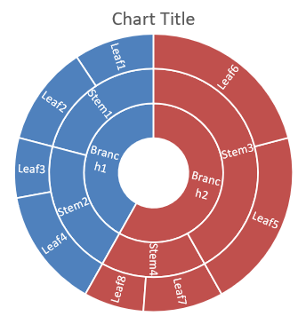

## **Visión general**

Este artículo proporciona una guía completa sobre cómo crear y personalizar gráficos utilizando Aspose.Slides for PHP a través de Java. Aprenderá cómo agregar programáticamente un gráfico a una diapositiva, rellenarlo con datos y aplicar varias opciones de formato para adaptarse a sus requisitos de diseño específicos. A lo largo del artículo, se ilustran con ejemplos de código detallados cada paso, desde la inicialización de la presentación y el objeto del gráfico hasta la configuración de series, ejes y leyendas. Siguiendo esta guía, obtendrá una comprensión sólida de cómo integrar la generación dinámica de gráficos en sus aplicaciones PHP, optimizando el proceso de creación de presentaciones basadas en datos.

## **Crear un gráfico**

Los gráficos ayudan a las personas a visualizar rápidamente los datos y obtener ideas que pueden no ser evidentes de inmediato a partir de una tabla o hoja de cálculo.

**¿Por qué crear gráficos?**

* agregar, condensar o resumir grandes cantidades de datos en una sola diapositiva de una presentación;
* exponer patrones y tendencias en los datos;
* deducir la dirección y el impulso de los datos a lo largo del tiempo o respecto a una unidad de medida específica;
* identificar valores atípicos, aberraciones, desviaciones, errores y datos sin sentido;
* comunicar o presentar datos complejos.

En PowerPoint, puede crear gráficos a través de la función *Insertar*, que ofrece plantillas para diseñar muchos tipos de gráficos. Con Aspose.Slides, puede crear tanto gráficos regulares (basados en tipos de gráfico populares) como gráficos personalizados.

{}
Utilice la enumeración [ChartType](https://reference.aspose.com/slides/php-java/aspose.slides/charttype/) en el espacio de nombres [aspose\slides](https://reference.aspose.com/slides/php-java/aspose.slides/). Los valores de esta enumeración corresponden a diferentes tipos de gráficos.
{}

### **Crear gráficos de columnas agrupadas**

Este ejemplo utiliza [addChart](https://reference.aspose.com/slides/php-java/aspose.slides/shapecollection/addchart/) para crear un gráfico de columnas agrupadas que compara dos series en tres categorías. Las series usan rellenos rojo y verde, y las etiquetas individuales muestran los nombres de categoría, los nombres de serie y los valores. El índice de hoja de cálculo 0 se refiere a la primera hoja del libro de trabajo del gráfico incrustado.

```php
use aspose\slides\ChartType;
use aspose\slides\FillType;
use aspose\slides\NullableBool;
use aspose\slides\Presentation;
use aspose\slides\SaveFormat;

$presentation = new Presentation();
try
{
    $slide = $presentation->getSlides()->get_Item(0);

    $chart = $slide->getShapes()->addChart(ChartType::ClusteredColumn, 20, 20, 500, 300);

    $chart->getChartTitle()->addTextFrameForOverriding("Sample Title");
    $chart->getChartTitle()->getTextFrameForOverriding()->getTextFrameFormat()->setCenterText(NullableBool::True);
    $chart->getChartTitle()->setHeight(20);
    $chart->setTitle(true);

    $workbook = $chart->getChartData()->getChartDataWorkbook();
    $worksheetIndex = 0;

    $chart->getChartData()->getSeries()->clear();
    $chart->getChartData()->getCategories()->clear();

    $seriesNameCell = $workbook->getCell($worksheetIndex, 0, 1, "Series 1");
    $chart->getChartData()->getSeries()->add($seriesNameCell, $chart->getType());
    $seriesNameCell = $workbook->getCell($worksheetIndex, 0, 2, "Series 2");
    $chart->getChartData()->getSeries()->add($seriesNameCell, $chart->getType());

    $categoryCell = $workbook->getCell($worksheetIndex, 1, 0, "Category 1");
    $chart->getChartData()->getCategories()->add($categoryCell);
    $categoryCell = $workbook->getCell($worksheetIndex, 2, 0, "Category 2");
    $chart->getChartData()->getCategories()->add($categoryCell);
    $categoryCell = $workbook->getCell($worksheetIndex, 3, 0, "Category 3");
    $chart->getChartData()->getCategories()->add($categoryCell);

    $series = $chart->getChartData()->getSeries()->get_Item(0);

    $valueCell = $workbook->getCell($worksheetIndex, 1, 1, 20);
    $series->getDataPoints()->addDataPointForBarSeries($valueCell);
    $valueCell = $workbook->getCell($worksheetIndex, 2, 1, 50);
    $series->getDataPoints()->addDataPointForBarSeries($valueCell);
    $valueCell = $workbook->getCell($worksheetIndex, 3, 1, 30);
    $series->getDataPoints()->addDataPointForBarSeries($valueCell);

    $series->getFormat()->getFill()->setFillType(FillType::Solid);
    $color = new Java("java.awt.Color", 255, 0, 0);
    $series->getFormat()->getFill()->getSolidFillColor()->setColor($color);

    $series = $chart->getChartData()->getSeries()->get_Item(1);

    $valueCell = $workbook->getCell($worksheetIndex, 1, 2, 30);
    $series->getDataPoints()->addDataPointForBarSeries($valueCell);
    $valueCell = $workbook->getCell($worksheetIndex, 2, 2, 10);
    $series->getDataPoints()->addDataPointForBarSeries($valueCell);
    $valueCell = $workbook->getCell($worksheetIndex, 3, 2, 60);
    $series->getDataPoints()->addDataPointForBarSeries($valueCell);

    $series->getFormat()->getFill()->setFillType(FillType::Solid);
    $color = new Java("java.awt.Color", 0, 128, 0);
    $series->getFormat()->getFill()->getSolidFillColor()->setColor($color);

    $label = $series->getDataPoints()->get_Item(0)->getLabel();
    $label->getDataLabelFormat()->setShowCategoryName(true);

    $label = $series->getDataPoints()->get_Item(1)->getLabel();
    $label->getDataLabelFormat()->setShowSeriesName(true);

    $label = $series->getDataPoints()->get_Item(2)->getLabel();
    $label->getDataLabelFormat()->setShowValue(true);
    $label->getDataLabelFormat()->setShowSeriesName(true);
    $label->getDataLabelFormat()->setSeparator("/");

    $presentation->save("AsposeChart.pptx", SaveFormat::Pptx);
}
finally
{
    $presentation->dispose();
}
```

El resultado:


### **Crear gráficos de dispersión**

Los gráficos de dispersión (también conocidos como diagramas de dispersión o gráficos x‑y) se utilizan a menudo para buscar patrones o demostrar correlaciones entre dos variables.

Utilice un gráfico de dispersión cuando:

* disponga de datos numéricos emparejados.
* tenga dos variables que se relacionen bien entre sí.
* desee determinar si las dos variables están relacionadas.
* disponga de una variable independiente que tenga múltiples valores para una variable dependiente.

Este ejemplo traza dos conjuntos de valores x‑y. La primera serie utiliza líneas rectas con marcadores de estrella, mientras que la segunda usa líneas suaves con marcadores de círculo; ambas usan un tamaño de marcador de 10, configurado con [setSize](https://reference.aspose.com/slides/php-java/aspose.slides/marker/setsize/). El método [setSymbol](https://reference.aspose.com/slides/php-java/aspose.slides/marker/setsymbol/) controla la forma del marcador.

```php
use aspose\slides\ChartType;
use aspose\slides\MarkerStyleType;
use aspose\slides\Presentation;
use aspose\slides\SaveFormat;

$presentation = new Presentation();
try
{
    $slide = $presentation->getSlides()->get_Item(0);

    $chart = $slide->getShapes()->addChart(ChartType::ScatterWithSmoothLines, 20, 20, 500, 300);

    $workbook = $chart->getChartData()->getChartDataWorkbook();
    $worksheetIndex = 0;

    $chart->getChartData()->getSeries()->clear();

    $seriesNameCell = $workbook->getCell($worksheetIndex, 1, 1, "Series 1");
    $chart->getChartData()->getSeries()->add($seriesNameCell, $chart->getType());
    $seriesNameCell = $workbook->getCell($worksheetIndex, 1, 3, "Series 2");
    $chart->getChartData()->getSeries()->add($seriesNameCell, $chart->getType());

    $series = $chart->getChartData()->getSeries()->get_Item(0);

    $xValueCell = $workbook->getCell($worksheetIndex, 2, 1, 1);
    $yValueCell = $workbook->getCell($worksheetIndex, 2, 2, 3);
    $series->getDataPoints()->addDataPointForScatterSeries($xValueCell, $yValueCell);

    $xValueCell = $workbook->getCell($worksheetIndex, 3, 1, 2);
    $yValueCell = $workbook->getCell($worksheetIndex, 3, 2, 10);
    $series->getDataPoints()->addDataPointForScatterSeries($xValueCell, $yValueCell);

    $series->setType(ChartType::ScatterWithStraightLinesAndMarkers);

    $series->getMarker()->setSize(10);
    $series->getMarker()->setSymbol(MarkerStyleType::Star);

    $series = $chart->getChartData()->getSeries()->get_Item(1);

    $xValueCell = $workbook->getCell($worksheetIndex, 2, 3, 5);
    $yValueCell = $workbook->getCell($worksheetIndex, 2, 4, 2);
    $series->getDataPoints()->addDataPointForScatterSeries($xValueCell, $yValueCell);

    $xValueCell = $workbook->getCell($worksheetIndex, 3, 3, 3);
    $yValueCell = $workbook->getCell($worksheetIndex, 3, 4, 1);
    $series->getDataPoints()->addDataPointForScatterSeries($xValueCell, $yValueCell);

    $xValueCell = $workbook->getCell($worksheetIndex, 4, 3, 2);
    $yValueCell = $workbook->getCell($worksheetIndex, 4, 4, 2);
    $series->getDataPoints()->addDataPointForScatterSeries($xValueCell, $yValueCell);

    $xValueCell = $workbook->getCell($worksheetIndex, 5, 3, 5);
    $yValueCell = $workbook->getCell($worksheetIndex, 5, 4, 1);
    $series->getDataPoints()->addDataPointForScatterSeries($xValueCell, $yValueCell);

    $series->getMarker()->setSize(10);
    $series->getMarker()->setSymbol(MarkerStyleType::Circle);

    $presentation->save("AsposeChart.pptx", SaveFormat::Pptx);
}
finally
{
    $presentation->dispose();
}
```

El resultado:


### **Crear gráficos circulares**

Los gráficos circulares son los más adecuados para mostrar la relación parte‑todo en los datos, especialmente cuando los datos contienen etiquetas categóricas con valores numéricos. Sin embargo, si sus datos contienen muchas partes o etiquetas, podría considerar utilizar un gráfico de barras en su lugar.

Este ejemplo crea un gráfico circular con tres valores trimestrales. Cada porción tiene un relleno y borde personalizados, y las etiquetas muestran diferentes combinaciones de valores, porcentajes e información de la serie. El método [setFirstSliceAngle](https://reference.aspose.com/slides/php-java/aspose.slides/chartseriesgroup/setfirstsliceangle/) establece que la primera porción comience a 180 grados.

```php
use aspose\slides\ChartType;
use aspose\slides\FillType;
use aspose\slides\LineDashStyle;
use aspose\slides\LineStyle;
use aspose\slides\NullableBool;
use aspose\slides\Presentation;
use aspose\slides\SaveFormat;

$presentation = new Presentation();
try
{
    $slide = $presentation->getSlides()->get_Item(0);

    $chart = $slide->getShapes()->addChart(ChartType::Pie, 20, 20, 500, 300);

    $chart->getChartTitle()->addTextFrameForOverriding("Sample Title");
    $chart->getChartTitle()->getTextFrameForOverriding()->getTextFrameFormat()->setCenterText(NullableBool::True);
    $chart->getChartTitle()->setHeight(20);
    $chart->setTitle(true);

    $chart->getChartData()->getSeries()->get_Item(0)->getLabels()->getDefaultDataLabelFormat()->setShowValue(true);

    $workbook = $chart->getChartData()->getChartDataWorkbook();
    $worksheetIndex = 0;

    $chart->getChartData()->getSeries()->clear();
    $chart->getChartData()->getCategories()->clear();

    $categoryCell = $workbook->getCell(0, 1, 0, "1st Qtr");
    $chart->getChartData()->getCategories()->add($categoryCell);
    $categoryCell = $workbook->getCell(0, 2, 0, "2nd Qtr");
    $chart->getChartData()->getCategories()->add($categoryCell);
    $categoryCell = $workbook->getCell(0, 3, 0, "3rd Qtr");
    $chart->getChartData()->getCategories()->add($categoryCell);

    $seriesNameCell = $workbook->getCell(0, 0, 1, "Series 1");
    $series = $chart->getChartData()->getSeries()->add($seriesNameCell, $chart->getType());

    $valueCell = $workbook->getCell($worksheetIndex, 1, 1, 20);
    $series->getDataPoints()->addDataPointForPieSeries($valueCell);
    $valueCell = $workbook->getCell($worksheetIndex, 2, 1, 50);
    $series->getDataPoints()->addDataPointForPieSeries($valueCell);
    $valueCell = $workbook->getCell($worksheetIndex, 3, 1, 30);
    $series->getDataPoints()->addDataPointForPieSeries($valueCell);

    $chart->getChartData()->getSeriesGroups()->get_Item(0)->setColorVaried(true);

    $firstSlice = $series->getDataPoints()->get_Item(0);
    $firstSlice->getFormat()->getFill()->setFillType(FillType::Solid);
    $color = new Java("java.awt.Color", 0, 255, 255);
    $firstSlice->getFormat()->getFill()->getSolidFillColor()->setColor($color);

    $firstSlice->getFormat()->getLine()->getFillFormat()->setFillType(FillType::Solid);
    $color = new Java("java.awt.Color", 128, 128, 128);
    $firstSlice->getFormat()->getLine()->getFillFormat()->getSolidFillColor()->setColor($color);
    $firstSlice->getFormat()->getLine()->setWidth(3.0);
    $firstSlice->getFormat()->getLine()->setStyle(LineStyle::ThinThick);
    $firstSlice->getFormat()->getLine()->setDashStyle(LineDashStyle::LargeDash);

    $secondSlice = $series->getDataPoints()->get_Item(1);
    $secondSlice->getFormat()->getFill()->setFillType(FillType::Solid);
    $color = new Java("java.awt.Color", 165, 42, 42);
    $secondSlice->getFormat()->getFill()->getSolidFillColor()->setColor($color);

    $secondSlice->getFormat()->getLine()->getFillFormat()->setFillType(FillType::Solid);
    $color = new Java("java.awt.Color", 0, 0, 255);
    $secondSlice->getFormat()->getLine()->getFillFormat()->getSolidFillColor()->setColor($color);
    $secondSlice->getFormat()->getLine()->setWidth(3.0);
    $secondSlice->getFormat()->getLine()->setStyle(LineStyle::Single);
    $secondSlice->getFormat()->getLine()->setDashStyle(LineDashStyle::LargeDashDot);

    $thirdSlice = $series->getDataPoints()->get_Item(2);
    $thirdSlice->getFormat()->getFill()->setFillType(FillType::Solid);
    $color = new Java("java.awt.Color", 255, 127, 80);
    $thirdSlice->getFormat()->getFill()->getSolidFillColor()->setColor($color);

    $thirdSlice->getFormat()->getLine()->getFillFormat()->setFillType(FillType::Solid);
    $color = new Java("java.awt.Color", 255, 0, 0);
    $thirdSlice->getFormat()->getLine()->getFillFormat()->getSolidFillColor()->setColor($color);
    $thirdSlice->getFormat()->getLine()->setWidth(2.0);
    $thirdSlice->getFormat()->getLine()->setStyle(LineStyle::ThinThin);
    $thirdSlice->getFormat()->getLine()->setDashStyle(LineDashStyle::LargeDashDotDot);

    $firstLabel = $series->getDataPoints()->get_Item(0)->getLabel();
    $firstLabel->getDataLabelFormat()->setShowValue(true);

    $secondLabel = $series->getDataPoints()->get_Item(1)->getLabel();
    $secondLabel->getDataLabelFormat()->setShowValue(true);
    $secondLabel->getDataLabelFormat()->setShowLegendKey(true);
    $secondLabel->getDataLabelFormat()->setShowPercentage(true);

    $thirdLabel = $series->getDataPoints()->get_Item(2)->getLabel();
    $thirdLabel->getDataLabelFormat()->setShowSeriesName(true);
    $thirdLabel->getDataLabelFormat()->setShowPercentage(true);

    $series->getLabels()->getDefaultDataLabelFormat()->setShowLeaderLines(true);

    $chart->getChartData()->getSeriesGroups()->get_Item(0)->setFirstSliceAngle(180);

    $presentation->save("PieChart.pptx", SaveFormat::Pptx);
}
finally
{
    $presentation->dispose();
}
```

El resultado:


### **Crear gráficos de líneas**

Los gráficos de líneas (también conocidos como diagramas de líneas) son más adecuados en situaciones en las que desea demostrar cambios en el valor a lo largo del tiempo. Con un gráfico de líneas, puede comparar una gran cantidad de datos a la vez, seguir cambios y tendencias a lo largo del tiempo, resaltar anomalías en series de datos, y más.

Este ejemplo utiliza [addChart](https://reference.aspose.com/slides/php-java/aspose.slides/shapecollection/addchart/) para crear un gráfico de líneas con las series y categorías predeterminadas, y luego guarda la presentación como PPTX.

```php
use aspose\slides\ChartType;
use aspose\slides\Presentation;
use aspose\slides\SaveFormat;

$presentation = new Presentation();
try
{
    $slide = $presentation->getSlides()->get_Item(0);

    $lineChart = $slide->getShapes()->addChart(ChartType::Line, 20, 20, 500, 300);

    $presentation->save("lineChart.pptx", SaveFormat::Pptx);
}
finally
{
    $presentation->dispose();
}
```

Por defecto, los puntos en un gráfico de líneas están unidos por líneas continuas rectas. Si desea que los puntos se unan mediante guiones, llame a [setDashStyle](https://reference.aspose.com/slides/php-java/aspose.slides/lineformat/setdashstyle/) con un valor de [LineDashStyle](https://reference.aspose.com/slides/php-java/aspose.slides/linedashstyle/):

```php
use aspose\slides\ChartType;
use aspose\slides\LineDashStyle;
use aspose\slides\Presentation;

$presentation = new Presentation();
try
{
    $slide = $presentation->getSlides()->get_Item(0);

    $lineChart = $slide->getShapes()->addChart(ChartType::Line, 20, 20, 500, 300);

    for ($i = 0; $i < java_values($lineChart->getChartData()->getSeries()->size()); $i++)
    {
        $series = $lineChart->getChartData()->getSeries()->get_Item($i);
        $series->getFormat()->getLine()->setDashStyle(LineDashStyle::Dash);
    }
}
finally
{
    $presentation->dispose();
}
```

El resultado:


### **Crear gráficos de mapa de árbol**

Los gráficos de mapa de árbol son los más adecuados para datos de ventas cuando se desea mostrar el tamaño relativo de las categorías de datos y llamar rápidamente la atención sobre los elementos que son grandes contribuidores dentro de cada categoría.

Este ejemplo crea un mapa de árbol con ocho hojas agrupadas en cuatro tallos y dos ramas. El método [setGroupingItem](https://reference.aspose.com/slides/php-java/aspose.slides/chartcategorylevelsmanager/setgroupingitem/) asigna tallos en el nivel de agrupación 1 y ramas en el nivel 2. Los valores determinan los tamaños relativos de los rectángulos, mientras que las etiquetas de categoría y las etiquetas de padre superpuestas identifican la jerarquía.

```php
use aspose\slides\ChartType;
use aspose\slides\ParentLabelLayoutType;
use aspose\slides\Presentation;
use aspose\slides\SaveFormat;

$presentation = new Presentation();
try
{
    $slide = $presentation->getSlides()->get_Item(0);

    $chart = $slide->getShapes()->addChart(ChartType::Treemap, 20, 20, 500, 300);

    $chart->getChartData()->getCategories()->clear();
    $chart->getChartData()->getSeries()->clear();

    $workbook = $chart->getChartData()->getChartDataWorkbook();
    $workbook->clear(0);

    // Rama 1
    $categoryCell = $workbook->getCell(0, "C1", "Leaf1");
    $leaf = $chart->getChartData()->getCategories()->add($categoryCell);
    $leaf->getGroupingLevels()->setGroupingItem(1, "Stem1");
    $leaf->getGroupingLevels()->setGroupingItem(2, "Branch1");

    $categoryCell = $workbook->getCell(0, "C2", "Leaf2");
    $chart->getChartData()->getCategories()->add($categoryCell);

    $categoryCell = $workbook->getCell(0, "C3", "Leaf3");
    $leaf = $chart->getChartData()->getCategories()->add($categoryCell);
    $leaf->getGroupingLevels()->setGroupingItem(1, "Stem2");

    $categoryCell = $workbook->getCell(0, "C4", "Leaf4");
    $chart->getChartData()->getCategories()->add($categoryCell);

    // Rama 2
    $categoryCell = $workbook->getCell(0, "C5", "Leaf5");
    $leaf = $chart->getChartData()->getCategories()->add($categoryCell);
    $leaf->getGroupingLevels()->setGroupingItem(1, "Stem3");
    $leaf->getGroupingLevels()->setGroupingItem(2, "Branch2");

    $categoryCell = $workbook->getCell(0, "C6", "Leaf6");
    $chart->getChartData()->getCategories()->add($categoryCell);

    $categoryCell = $workbook->getCell(0, "C7", "Leaf7");
    $leaf = $chart->getChartData()->getCategories()->add($categoryCell);
    $leaf->getGroupingLevels()->setGroupingItem(1, "Stem4");

    $categoryCell = $workbook->getCell(0, "C8", "Leaf8");
    $chart->getChartData()->getCategories()->add($categoryCell);

    $series = $chart->getChartData()->getSeries()->add(ChartType::Treemap);
    $series->getLabels()->getDefaultDataLabelFormat()->setShowCategoryName(true);
    $valueCell = $workbook->getCell(0, "D1", 4);
    $series->getDataPoints()->addDataPointForTreemapSeries($valueCell);
    $valueCell = $workbook->getCell(0, "D2", 5);
    $series->getDataPoints()->addDataPointForTreemapSeries($valueCell);
    $valueCell = $workbook->getCell(0, "D3", 3);
    $series->getDataPoints()->addDataPointForTreemapSeries($valueCell);
    $valueCell = $workbook->getCell(0, "D4", 6);
    $series->getDataPoints()->addDataPointForTreemapSeries($valueCell);
    $valueCell = $workbook->getCell(0, "D5", 9);
    $series->getDataPoints()->addDataPointForTreemapSeries($valueCell);
    $valueCell = $workbook->getCell(0, "D6", 9);
    $series->getDataPoints()->addDataPointForTreemapSeries($valueCell);
    $valueCell = $workbook->getCell(0, "D7", 4);
    $series->getDataPoints()->addDataPointForTreemapSeries($valueCell);
    $valueCell = $workbook->getCell(0, "D8", 3);
    $series->getDataPoints()->addDataPointForTreemapSeries($valueCell);

    $series->setParentLabelLayout(ParentLabelLayoutType::Overlapping);

    $presentation->save("Treemap.pptx", SaveFormat::Pptx);
}
finally
{
    $presentation->dispose();
}
```

El resultado:


### **Crear gráficos de cascada**

Un gráfico de cascada muestra cómo los cambios positivos y negativos contribuyen a un valor final. Por ejemplo, un desglose de beneficios puede comenzar con los ingresos, restar los costes y añadir otros ingresos. Las columnas de cambio flotan entre los valores acumulados anteriores y los nuevos, mientras que las columnas totales se extienden desde cero hasta el valor acumulado.

| Categoría | Valor del libro | Tipo de columna |
| --- | ---: | --- |
| Ingresos | 1000 | Incremento |
| Coste de ventas | -400 | Decremento |
| Beneficio bruto | 600 | Total intermedio |
| Gastos operativos | -200 | Decremento |
| Otros ingresos | 50 | Incremento |
| Beneficio neto | 450 | Total final |

Para marcar un punto como total intermedio o final, llame a su método [setSetAsTotal](https://reference.aspose.com/slides/php-java/aspose.slides/chartdatapoint/setsetastotal/) con `true`. Proporcione la cantidad acumulada real en la celda del libro de ese punto: `600` para el beneficio bruto (`1000 - 400`) y `450` para el beneficio neto (`600 - 200 + 50`). El método marca la columna como total; no calcula ni rellena el valor de la celda. No use cero como marcador de posición ni proporcione otro cambio para un punto total. Una columna total muestra el valor acumulado sin añadirlo nuevamente al valor en curso.

Este ejemplo completo en PHP crea un gráfico utilizando el miembro `Waterfall` de [ChartType](https://reference.aspose.com/slides/php-java/aspose.slides/charttype/), borra los datos predeterminados y rellena el libro de trabajo incrustado. El índice de hoja de cálculo `0` selecciona la primera hoja; la columna A contiene los nombres de categoría y la columna B contiene los valores. Cada celda de valor se añade con [addDataPointForWaterfallSeries](https://reference.aspose.com/slides/php-java/aspose.slides/chartdatapointcollection/adddatapointforwaterfallseries/). Los índices de punto basados en cero `2` y `5` identifican los totales intermedios y finales. Llamar a [setShowValue](https://reference.aspose.com/slides/php-java/aspose.slides/datalabelformat/setshowvalue/) con `true` muestra las cantidades en las columnas. No se requiere una presentación o libro de trabajo de entrada.

```php
use aspose\slides\ChartType;
use aspose\slides\Presentation;
use aspose\slides\SaveFormat;

$presentation = new Presentation();
try
{
    $slide = $presentation->getSlides()->get_Item(0);

    $chart = $slide->getShapes()->addChart(ChartType::Waterfall, 20, 20, 680, 200);

    $chart->setTitle(true);
    $chart->getChartTitle()->addTextFrameForOverriding("Profit breakdown (USD thousands)");
    $chart->getChartTitle()->setOverlay(false);
    $chart->setLegend(false);

    $chart->getChartData()->getSeries()->clear();
    $chart->getChartData()->getCategories()->clear();

    $workbook = $chart->getChartData()->getChartDataWorkbook();
    $worksheetIndex = 0;

    $workbook->clear($worksheetIndex);

    $seriesNameCell = $workbook->getCell($worksheetIndex, 0, 1, "Profit");
    $series = $chart->getChartData()->getSeries()->add($seriesNameCell, ChartType::Waterfall);
    $categories = [ "Revenue", "Cost of sales", "Gross profit", "Operating expenses", "Other income", "Net profit" ];
    $values = [ 1000, -400, 600, -200, 50, 450 ];

    for ($i = 0; $i < count($categories); $i++)
    {
        $categoryCell = $workbook->getCell($worksheetIndex, $i + 1, 0, $categories[$i]);
        $chart->getChartData()->getCategories()->add($categoryCell);
        $valueCell = $workbook->getCell($worksheetIndex, $i + 1, 1, $values[$i]);
        $series->getDataPoints()->addDataPointForWaterfallSeries($valueCell);
    }

    // Los puntos tercero y sexto representan totales, no cambios adicionales.
    $series->getDataPoints()->get_Item(2)->setSetAsTotal(true);
    $series->getDataPoints()->get_Item(5)->setSetAsTotal(true);
    $series->setShowConnectorLines(true);
    $series->getLabels()->getDefaultDataLabelFormat()->setShowValue(true);

    $presentation->save("WaterfallChart.pptx", SaveFormat::Pptx);
}
finally
{
    $presentation->dispose();
}
```

Llame al método a nivel de serie [setShowConnectorLines](https://reference.aspose.com/slides/php-java/aspose.slides/chartseries/setshowconnectorlines/) con `true` para mostrar líneas que conectan columnas consecutivas y facilitar el seguimiento del valor acumulado. Para ocultar estas líneas, reemplace la llamada al método en el ejemplo por `$series->setShowConnectorLines(false);` antes de guardar. Esto solo cambia la visibilidad de la línea, no los datos ni los totales.

La presentación guardada muestra un beneficio bruto de 600 y un beneficio neto de 450, con ambos totales dibujados desde cero:


### **Crear gráficos de valores bursátiles**

Los gráficos bursátiles se utilizan para mostrar datos financieros como precios de apertura, máximo, mínimo y cierre, ayudando a analizar tendencias y volatilidad del mercado. Ofrecen información esencial sobre el rendimiento de las acciones, ayudando a inversores y analistas a tomar decisiones informadas.

Este ejemplo crea un gráfico de apertura‑máximo‑mínimo‑cierre con cuatro series en ese orden y tres categorías. El método [setUpDownBars](https://reference.aspose.com/slides/php-java/aspose.slides/updownbarsmanager/setupdownbars/) habilita las barras up/down, y [getHiLowLinesFormat](https://reference.aspose.com/slides/php-java/aspose.slides/chartseriesgroup/gethilowlinesformat/) controla las líneas alto‑bajo que muestran los rangos de precios, mientras que las líneas de series individuales y las líneas de cuadrícula horizontales menores están ocultas.

```php
use aspose\slides\ChartType;
use aspose\slides\FillType;
use aspose\slides\Presentation;
use aspose\slides\SaveFormat;

$presentation = new Presentation();
try
{
    $slide = $presentation->getSlides()->get_Item(0);

    $chart = $slide->getShapes()->addChart(ChartType::OpenHighLowClose, 20, 20, 500, 300, false);

    $workbook = $chart->getChartData()->getChartDataWorkbook();

    $categoryCell = $workbook->getCell(0, 1, 0, "A");
    $chart->getChartData()->getCategories()->add($categoryCell);
    $categoryCell = $workbook->getCell(0, 2, 0, "B");
    $chart->getChartData()->getCategories()->add($categoryCell);
    $categoryCell = $workbook->getCell(0, 3, 0, "C");
    $chart->getChartData()->getCategories()->add($categoryCell);

    $seriesNameCell = $workbook->getCell(0, 0, 1, "Open");
    $chart->getChartData()->getSeries()->add($seriesNameCell, ChartType::OpenHighLowClose);
    $seriesNameCell = $workbook->getCell(0, 0, 2, "High");
    $chart->getChartData()->getSeries()->add($seriesNameCell, ChartType::OpenHighLowClose);
    $seriesNameCell = $workbook->getCell(0, 0, 3, "Low");
    $chart->getChartData()->getSeries()->add($seriesNameCell, ChartType::OpenHighLowClose);
    $seriesNameCell = $workbook->getCell(0, 0, 4, "Close");
    $chart->getChartData()->getSeries()->add($seriesNameCell, ChartType::OpenHighLowClose);

    $series = $chart->getChartData()->getSeries()->get_Item(0);
    $valueCell = $workbook->getCell(0, 1, 1, 72);
    $series->getDataPoints()->addDataPointForStockSeries($valueCell);
    $valueCell = $workbook->getCell(0, 2, 1, 25);
    $series->getDataPoints()->addDataPointForStockSeries($valueCell);
    $valueCell = $workbook->getCell(0, 3, 1, 38);
    $series->getDataPoints()->addDataPointForStockSeries($valueCell);

    $series = $chart->getChartData()->getSeries()->get_Item(1);
    $valueCell = $workbook->getCell(0, 1, 2, 172);
    $series->getDataPoints()->addDataPointForStockSeries($valueCell);
    $valueCell = $workbook->getCell(0, 2, 2, 57);
    $series->getDataPoints()->addDataPointForStockSeries($valueCell);
    $valueCell = $workbook->getCell(0, 3, 2, 57);
    $series->getDataPoints()->addDataPointForStockSeries($valueCell);

    $series = $chart->getChartData()->getSeries()->get_Item(2);
    $valueCell = $workbook->getCell(0, 1, 3, 12);
    $series->getDataPoints()->addDataPointForStockSeries($valueCell);
    $valueCell = $workbook->getCell(0, 2, 3, 12);
    $series->getDataPoints()->addDataPointForStockSeries($valueCell);
    $valueCell = $workbook->getCell(0, 3, 3, 13);
    $series->getDataPoints()->addDataPointForStockSeries($valueCell);

    $series = $chart->getChartData()->getSeries()->get_Item(3);
    $valueCell = $workbook->getCell(0, 1, 4, 25);
    $series->getDataPoints()->addDataPointForStockSeries($valueCell);
    $valueCell = $workbook->getCell(0, 2, 4, 38);
    $series->getDataPoints()->addDataPointForStockSeries($valueCell);
    $valueCell = $workbook->getCell(0, 3, 4, 50);
    $series->getDataPoints()->addDataPointForStockSeries($valueCell);

    $chart->getChartData()->getSeriesGroups()->get_Item(0)->getUpDownBars()->setUpDownBars(true);
    $chart->getChartData()->getSeriesGroups()->get_Item(0)->getHiLowLinesFormat()->getLine()->getFillFormat()->setFillType(FillType::Solid);

    for ($i = 0; $i < java_values($chart->getChartData()->getSeries()->size()); $i++)
    {
        $stockSeries = $chart->getChartData()->getSeries()->get_Item($i);
        $stockSeries->getFormat()->getLine()->getFillFormat()->setFillType(FillType::NoFill);
    }

    $chart->getAxes()->getVerticalAxis()->getMinorGridLinesFormat()->getLine()->getFillFormat()->setFillType(FillType::NoFill);

    $presentation->save("Stock-chart.pptx", SaveFormat::Pptx);
}
finally
{
    $presentation->dispose();
}
```

El resultado:


### **Crear gráficos de caja y bigotes**

Los gráficos de caja y bigotes se utilizan para mostrar la distribución de los datos resumendo medidas estadísticas clave, como la mediana, los cuartiles y los posibles valores atípicos. Son particularmente útiles en análisis exploratorio de datos y estudios estadísticos para comprender rápidamente la variabilidad de los datos e identificar anomalías.

Este ejemplo crea un gráfico de caja y bigotes a partir de seis valores. El método [setQuartileMethod](https://reference.aspose.com/slides/php-java/aspose.slides/chartseries/setquartilemethod/) selecciona el cálculo exclusivo de cuartiles. El ejemplo también habilita líneas de media, marcadores de media, puntos internos y puntos de valores atípicos.

```php
use aspose\slides\ChartType;
use aspose\slides\Presentation;
use aspose\slides\QuartileMethodType;
use aspose\slides\SaveFormat;

$presentation = new Presentation();
try
{
    $slide = $presentation->getSlides()->get_Item(0);

    $chart = $slide->getShapes()->addChart(ChartType::BoxAndWhisker, 20, 20, 500, 300);

    $chart->getChartData()->getCategories()->clear();
    $chart->getChartData()->getSeries()->clear();

    $workbook = $chart->getChartData()->getChartDataWorkbook();
    $workbook->clear(0);

    $categoryCell = $workbook->getCell(0, "A1", "Category 1");
    $chart->getChartData()->getCategories()->add($categoryCell);
    $categoryCell = $workbook->getCell(0, "A2", "Category 2");
    $chart->getChartData()->getCategories()->add($categoryCell);
    $categoryCell = $workbook->getCell(0, "A3", "Category 3");
    $chart->getChartData()->getCategories()->add($categoryCell);
    $categoryCell = $workbook->getCell(0, "A4", "Category 4");
    $chart->getChartData()->getCategories()->add($categoryCell);
    $categoryCell = $workbook->getCell(0, "A5", "Category 5");
    $chart->getChartData()->getCategories()->add($categoryCell);
    $categoryCell = $workbook->getCell(0, "A6", "Category 6");
    $chart->getChartData()->getCategories()->add($categoryCell);

    $series = $chart->getChartData()->getSeries()->add(ChartType::BoxAndWhisker);

    $series->setQuartileMethod(QuartileMethodType::Exclusive);
    $series->setShowMeanLine(true);
    $series->setShowMeanMarkers(true);
    $series->setShowInnerPoints(true);
    $series->setShowOutlierPoints(true);

    $valueCell = $workbook->getCell(0, "B1", 15);
    $series->getDataPoints()->addDataPointForBoxAndWhiskerSeries($valueCell);
    $valueCell = $workbook->getCell(0, "B2", 41);
    $series->getDataPoints()->addDataPointForBoxAndWhiskerSeries($valueCell);
    $valueCell = $workbook->getCell(0, "B3", 16);
    $series->getDataPoints()->addDataPointForBoxAndWhiskerSeries($valueCell);
    $valueCell = $workbook->getCell(0, "B4", 10);
    $series->getDataPoints()->addDataPointForBoxAndWhiskerSeries($valueCell);
    $valueCell = $workbook->getCell(0, "B5", 23);
    $series->getDataPoints()->addDataPointForBoxAndWhiskerSeries($valueCell);
    $valueCell = $workbook->getCell(0, "B6", 16);
    $series->getDataPoints()->addDataPointForBoxAndWhiskerSeries($valueCell);

    $presentation->save("BoxAndWhisker.pptx", SaveFormat::Pptx);
}
finally
{
    $presentation->dispose();
}
```

### **Crear gráficos de embudo**

Los gráficos de embudo se utilizan para visualizar procesos que implican etapas secuenciales, donde el volumen de datos disminuye a medida que avanza de un paso al siguiente. Son especialmente útiles para analizar tasas de conversión, identificar cuellos de botella y seguir la eficiencia de procesos de ventas o marketing.

Este ejemplo utiliza [addChart](https://reference.aspose.com/slides/php-java/aspose.slides/shapecollection/addchart/) para añadir un gráfico de embudo a la primera diapositiva de una presentación existente. Reemplaza los datos predeterminados con seis categorías y valores que van de 50 a 500, y luego guarda la presentación actualizada. La presentación de entrada debe contener al menos una diapositiva.

```php
use aspose\slides\ChartType;
use aspose\slides\Presentation;
use aspose\slides\SaveFormat;

$presentation = new Presentation("test.pptx");
try
{
    $slide = $presentation->getSlides()->get_Item(0);

    $chart = $slide->getShapes()->addChart(ChartType::Funnel, 50, 50, 500, 400);

    $chart->getChartData()->getCategories()->clear();
    $chart->getChartData()->getSeries()->clear();

    $workbook = $chart->getChartData()->getChartDataWorkbook();
    $workbook->clear(0);

    $categoryCell = $workbook->getCell(0, "A1", "Category 1");
    $chart->getChartData()->getCategories()->add($categoryCell);
    $categoryCell = $workbook->getCell(0, "A2", "Category 2");
    $chart->getChartData()->getCategories()->add($categoryCell);
    $categoryCell = $workbook->getCell(0, "A3", "Category 3");
    $chart->getChartData()->getCategories()->add($categoryCell);
    $categoryCell = $workbook->getCell(0, "A4", "Category 4");
    $chart->getChartData()->getCategories()->add($categoryCell);
    $categoryCell = $workbook->getCell(0, "A5", "Category 5");
    $chart->getChartData()->getCategories()->add($categoryCell);
    $categoryCell = $workbook->getCell(0, "A6", "Category 6");
    $chart->getChartData()->getCategories()->add($categoryCell);

    $series = $chart->getChartData()->getSeries()->add(ChartType::Funnel);

    $valueCell = $workbook->getCell(0, "B1", 50);
    $series->getDataPoints()->addDataPointForFunnelSeries($valueCell);
    $valueCell = $workbook->getCell(0, "B2", 100);
    $series->getDataPoints()->addDataPointForFunnelSeries($valueCell);
    $valueCell = $workbook->getCell(0, "B3", 200);
    $series->getDataPoints()->addDataPointForFunnelSeries($valueCell);
    $valueCell = $workbook->getCell(0, "B4", 300);
    $series->getDataPoints()->addDataPointForFunnelSeries($valueCell);
    $valueCell = $workbook->getCell(0, "B5", 400);
    $series->getDataPoints()->addDataPointForFunnelSeries($valueCell);
    $valueCell = $workbook->getCell(0, "B6", 500);
    $series->getDataPoints()->addDataPointForFunnelSeries($valueCell);

    $presentation->save("Funnel.pptx", SaveFormat::Pptx);
}
finally
{
    $presentation->dispose();
}
```

El resultado:


### **Crear gráficos Sunburst**

Los gráficos Sunburst se utilizan para visualizar datos jerárquicos, mostrando los niveles como anillos concéntricos. Ayudan a ilustrar relaciones parte‑todo y son ideales para representar categorías y subcategorías anidadas de forma clara y compacta.

Este ejemplo crea un gráfico Sunburst con ocho hojas agrupadas en cuatro tallos y dos ramas. El método [setGroupingItem](https://reference.aspose.com/slides/php-java/aspose.slides/chartcategorylevelsmanager/setgroupingitem/) asigna tallos en el nivel de agrupación 1 y ramas en el nivel 2. Las etiquetas de categoría identifican los segmentos, y los valores determinan sus tamaños relativos.

```php
use aspose\slides\ChartType;
use aspose\slides\Presentation;
use aspose\slides\SaveFormat;

$presentation = new Presentation();
try
{
    $slide = $presentation->getSlides()->get_Item(0);

    $chart = $slide->getShapes()->addChart(ChartType::Sunburst, 20, 20, 500, 300);

    $chart->getChartData()->getCategories()->clear();
    $chart->getChartData()->getSeries()->clear();

    $workbook = $chart->getChartData()->getChartDataWorkbook();
    $workbook->clear(0);

    // Rama 1
    $categoryCell = $workbook->getCell(0, "C1", "Leaf1");
    $leaf = $chart->getChartData()->getCategories()->add($categoryCell);
    $leaf->getGroupingLevels()->setGroupingItem(1, "Stem1");
    $leaf->getGroupingLevels()->setGroupingItem(2, "Branch1");

    $categoryCell = $workbook->getCell(0, "C2", "Leaf2");
    $chart->getChartData()->getCategories()->add($categoryCell);

    $categoryCell = $workbook->getCell(0, "C3", "Leaf3");
    $leaf = $chart->getChartData()->getCategories()->add($categoryCell);
    $leaf->getGroupingLevels()->setGroupingItem(1, "Stem2");

    $categoryCell = $workbook->getCell(0, "C4", "Leaf4");
    $chart->getChartData()->getCategories()->add($categoryCell);

    // Rama 2
    $categoryCell = $workbook->getCell(0, "C5", "Leaf5");
    $leaf = $chart->getChartData()->getCategories()->add($categoryCell);
    $leaf->getGroupingLevels()->setGroupingItem(1, "Stem3");
    $leaf->getGroupingLevels()->setGroupingItem(2, "Branch2");

    $categoryCell = $workbook->getCell(0, "C6", "Leaf6");
    $chart->getChartData()->getCategories()->add($categoryCell);

    $categoryCell = $workbook->getCell(0, "C7", "Leaf7");
    $leaf = $chart->getChartData()->getCategories()->add($categoryCell);
    $leaf->getGroupingLevels()->setGroupingItem(1, "Stem4");

    $categoryCell = $workbook->getCell(0, "C8", "Leaf8");
    $chart->getChartData()->getCategories()->add($categoryCell);

    $series = $chart->getChartData()->getSeries()->add(ChartType::Sunburst);
    $series->getLabels()->getDefaultDataLabelFormat()->setShowCategoryName(true);
    $valueCell = $workbook->getCell(0, "D1", 4);
    $series->getDataPoints()->addDataPointForSunburstSeries($valueCell);
    $valueCell = $workbook->getCell(0, "D2", 5);
    $series->getDataPoints()->addDataPointForSunburstSeries($valueCell);
    $valueCell = $workbook->getCell(0, "D3", 3);
    $series->getDataPoints()->addDataPointForSunburstSeries($valueCell);
    $valueCell = $workbook->getCell(0, "D4", 6);
    $series->getDataPoints()->addDataPointForSunburstSeries($valueCell);
    $valueCell = $workbook->getCell(0, "D5", 9);
    $series->getDataPoints()->addDataPointForSunburstSeries($valueCell);
    $valueCell = $workbook->getCell(0, "D6", 9);
    $series->getDataPoints()->addDataPointForSunburstSeries($valueCell);
    $valueCell = $workbook->getCell(0, "D7", 4);
    $series->getDataPoints()->addDataPointForSunburstSeries($valueCell);
    $valueCell = $workbook->getCell(0, "D8", 3);
    $series->getDataPoints()->addDataPointForSunburstSeries($valueCell);

    $presentation->save("Sunburst.pptx", SaveFormat::Pptx);
}
finally
{
    $presentation->dispose();
}
```

El resultado:



### **Crear gráficos de histograma**

Los gráficos de histograma se utilizan para representar la distribución de datos numéricos agrupando los valores en intervalos o contenedores. Son particularmente útiles para identificar patrones de datos como frecuencia, sesgo y dispersión, y para detectar valores atípicos en un conjunto de datos.

Este ejemplo crea un histograma a partir de seis valores numéricos, incluidos valores negativos. Llamar a [setAggregationType](https://reference.aspose.com/slides/php-java/aspose.slides/axis/setaggregationtype/) con el tipo de agregación automática permite que el gráfico determine los intervalos utilizados para mostrar la distribución.

```php
use aspose\slides\AxisAggregationType;
use aspose\slides\ChartType;
use aspose\slides\Presentation;
use aspose\slides\SaveFormat;

$presentation = new Presentation();
try
{
    $slide = $presentation->getSlides()->get_Item(0);

    $chart = $slide->getShapes()->addChart(ChartType::Histogram, 20, 20, 500, 300);

    $chart->getChartData()->getCategories()->clear();
    $chart->getChartData()->getSeries()->clear();

    $workbook = $chart->getChartData()->getChartDataWorkbook();
    $workbook->clear(0);

    $series = $chart->getChartData()->getSeries()->add(ChartType::Histogram);
    $valueCell = $workbook->getCell(0, "A1", 15);
    $series->getDataPoints()->addDataPointForHistogramSeries($valueCell);
    $valueCell = $workbook->getCell(0, "A2", -41);
    $series->getDataPoints()->addDataPointForHistogramSeries($valueCell);
    $valueCell = $workbook->getCell(0, "A3", 16);
    $series->getDataPoints()->addDataPointForHistogramSeries($valueCell);
    $valueCell = $workbook->getCell(0, "A4", 10);
    $series->getDataPoints()->addDataPointForHistogramSeries($valueCell);
    $valueCell = $workbook->getCell(0, "A5", -23);
    $series->getDataPoints()->addDataPointForHistogramSeries($valueCell);
    $valueCell = $workbook->getCell(0, "A6", 16);
    $series->getDataPoints()->addDataPointForHistogramSeries($valueCell);

    $chart->getAxes()->getHorizontalAxis()->setAggregationType(AxisAggregationType::Automatic);

    $presentation->save("Histogram.pptx", SaveFormat::Pptx);
}
finally
{
    $presentation->dispose();
}
```

El resultado:


### **Crear gráficos de radar**

Los gráficos de radar se utilizan para mostrar datos multivariados en un formato bidimensional, lo que permite comparar fácilmente varias variables simultáneamente. Son particularmente útiles para identificar patrones, fortalezas y debilidades en múltiples métricas o atributos de rendimiento.

Este ejemplo utiliza [addChart](https://reference.aspose.com/slides/php-java/aspose.slides/shapecollection/addchart/) para crear un gráfico de radar con las series y categorías predeterminadas, y luego guarda la presentación como PPTX.

```php
use aspose\slides\ChartType;
use aspose\slides\Presentation;
use aspose\slides\SaveFormat;

$presentation = new Presentation();
try
{
    $slide = $presentation->getSlides()->get_Item(0);

    $slide->getShapes()->addChart(ChartType::Radar, 20, 20, 500, 300);

    $presentation->save("Radar-chart.pptx", SaveFormat::Pptx);
}
finally
{
    $presentation->dispose();
}
```

El resultado:


### **Crear gráficos de múltiples categorías**

Los gráficos de múltiples categorías se utilizan para mostrar datos que involucran más de un agrupamiento categórico, lo que permite comparar valores a través de múltiples dimensiones simultáneamente. Son particularmente útiles cuando se necesita analizar tendencias y relaciones dentro de conjuntos de datos complejos y multilayer.

Este ejemplo crea un gráfico de columnas agrupadas con ocho categorías organizadas en cuatro pares. El método [setGroupingItem](https://reference.aspose.com/slides/php-java/aspose.slides/chartcategorylevelsmanager/setgroupingitem/) asigna a cada par una etiqueta compartida en el nivel de agrupación 1, produciendo un eje de categorías con etiquetas individuales y de grupo.

```php
use aspose\slides\ChartType;
use aspose\slides\Presentation;
use aspose\slides\SaveFormat;

$presentation = new Presentation();
try
{
    $slide = $presentation->getSlides()->get_Item(0);

    $chart = $slide->getShapes()->addChart(ChartType::ClusteredColumn, 20, 20, 500, 300);

    $chart->getChartData()->getSeries()->clear();
    $chart->getChartData()->getCategories()->clear();

    $workbook = $chart->getChartData()->getChartDataWorkbook();
    $workbook->clear(0);

    $worksheetIndex = 0;

    $categoryCell = $workbook->getCell(0, "c2", "A");
    $category = $chart->getChartData()->getCategories()->add($categoryCell);
    $category->getGroupingLevels()->setGroupingItem(1, "Group1");
    $categoryCell = $workbook->getCell(0, "c3", "B");
    $category = $chart->getChartData()->getCategories()->add($categoryCell);

    $categoryCell = $workbook->getCell(0, "c4", "C");
    $category = $chart->getChartData()->getCategories()->add($categoryCell);
    $category->getGroupingLevels()->setGroupingItem(1, "Group2");
    $categoryCell = $workbook->getCell(0, "c5", "D");
    $category = $chart->getChartData()->getCategories()->add($categoryCell);

    $categoryCell = $workbook->getCell(0, "c6", "E");
    $category = $chart->getChartData()->getCategories()->add($categoryCell);
    $category->getGroupingLevels()->setGroupingItem(1, "Group3");
    $categoryCell = $workbook->getCell(0, "c7", "F");
    $category = $chart->getChartData()->getCategories()->add($categoryCell);

    $categoryCell = $workbook->getCell(0, "c8", "G");
    $category = $chart->getChartData()->getCategories()->add($categoryCell);
    $category->getGroupingLevels()->setGroupingItem(1, "Group4");
    $categoryCell = $workbook->getCell(0, "c9", "H");
    $category = $chart->getChartData()->getCategories()->add($categoryCell);

    $seriesNameCell = $workbook->getCell(0, "D1", "Series 1");
    $series = $chart->getChartData()->getSeries()->add($seriesNameCell, ChartType::ClusteredColumn);

    $valueCell = $workbook->getCell($worksheetIndex, "D2", 10);
    $series->getDataPoints()->addDataPointForBarSeries($valueCell);
    $valueCell = $workbook->getCell($worksheetIndex, "D3", 20);
    $series->getDataPoints()->addDataPointForBarSeries($valueCell);
    $valueCell = $workbook->getCell($worksheetIndex, "D4", 30);
    $series->getDataPoints()->addDataPointForBarSeries($valueCell);
    $valueCell = $workbook->getCell($worksheetIndex, "D5", 40);
    $series->getDataPoints()->addDataPointForBarSeries($valueCell);
    $valueCell = $workbook->getCell($worksheetIndex, "D6", 50);
    $series->getDataPoints()->addDataPointForBarSeries($valueCell);
    $valueCell = $workbook->getCell($worksheetIndex, "D7", 60);
    $series->getDataPoints()->addDataPointForBarSeries($valueCell);
    $valueCell = $workbook->getCell($worksheetIndex, "D8", 70);
    $series->getDataPoints()->addDataPointForBarSeries($valueCell);
    $valueCell = $workbook->getCell($worksheetIndex, "D9", 80);
    $series->getDataPoints()->addDataPointForBarSeries($valueCell);

    $presentation->save("AsposeChart.pptx", SaveFormat::Pptx);
}
finally
{
    $presentation->dispose();
}
```

El resultado:


### **Crear gráficos de mapa**

Los gráficos de mapa se utilizan para visualizar datos geográficos asignando información a ubicaciones específicas como países, provincias o ciudades. Son particularmente útiles para analizar tendencias regionales, datos demográficos y distribuciones espaciales de manera clara y visualmente atractiva.

Este ejemplo utiliza [addChart](https://reference.aspose.com/slides/php-java/aspose.slides/shapecollection/addchart/) para crear un gráfico de mapa con los datos geográficos predeterminados y lo guarda para su visualización en PowerPoint.

```php
use aspose\slides\ChartType;
use aspose\slides\Presentation;
use aspose\slides\SaveFormat;

$presentation = new Presentation();
try
{
    $slide = $presentation->getSlides()->get_Item(0);

    $chart = $slide->getShapes()->addChart(ChartType::Map, 20, 20, 500, 300);

    $presentation->save("mapChart.pptx", SaveFormat::Pptx);
}
finally
{
    $presentation->dispose();
}
```

El resultado:


{}
La imagen anterior muestra la presentación guardada abierta en PowerPoint. Aspose.Slides escribe el gráfico de mapa y sus datos correctamente, pero no dibuja los gráficos de mapa por sí mismo: cuando una diapositiva que contiene uno se renderiza a una imagen o se convierte a PDF o SVG, el área del gráfico queda en blanco. Las demás formas en la misma diapositiva no se ven afectadas.
{}

### **Crear gráficos combinados**

Un gráfico combinado (o gráfico combo) combina dos o más tipos de gráficos en un solo diagrama. Este gráfico le permite resaltar, comparar o examinar diferencias entre dos o más conjuntos de datos, ayudándole a identificar relaciones entre ellos.


Este ejemplo combina dos series de columnas agrupadas con una serie de línea en cuatro categorías. Las columnas utilizan el eje vertical principal, mientras que [setPlotOnSecondAxis](https://reference.aspose.com/slides/php-java/aspose.slides/chartseries/setplotonsecondaxis/) coloca la línea en un eje vertical secundario a la derecha. Las funciones auxiliares configuran el título, la leyenda, las etiquetas de los ejes y las líneas de cuadrícula.

```php
use aspose\slides\AxisPositionType;
use aspose\slides\ChartType;
use aspose\slides\CrossesType;
use aspose\slides\FillType;
use aspose\slides\LegendPositionType;
use aspose\slides\NullableBool;
use aspose\slides\Presentation;
use aspose\slides\SaveFormat;

function createComboChart()
{
    $presentation = new Presentation();
    try
    {
        $chart = createChartWithFirstSeries($presentation->getSlides()->get_Item(0));

        addSecondSeriesToChart($chart);
        addThirdSeriesToChart($chart);

        setPrimaryAxesFormat($chart);
        setSecondaryAxesFormat($chart);

        $presentation->save("combo-chart.pptx", SaveFormat::Pptx);
    }
    finally
    {
        $presentation->dispose();
    }
}

function createChartWithFirstSeries($slide)
{
    $chart = $slide->getShapes()->addChart(ChartType::ClusteredColumn, 50, 50, 600, 400);

    $chart->setTitle(true);
    $chart->getChartTitle()->addTextFrameForOverriding("Chart Title");
    $chart->getChartTitle()->setOverlay(false);
    $portionFormat = $chart->getChartTitle()->getTextFrameForOverriding()->getParagraphs()->get_Item(0)->getParagraphFormat()->getDefaultPortionFormat();
    $portionFormat->setFontBold(NullableBool::False);
    $portionFormat->setFontHeight(18);

    $chart->getLegend()->setPosition(LegendPositionType::Bottom);
    $chart->getLegend()->getTextFormat()->getPortionFormat()->setFontHeight(12);

    $chart->getChartData()->getSeries()->clear();
    $chart->getChartData()->getCategories()->clear();

    $workbook = $chart->getChartData()->getChartDataWorkbook();
    $worksheetIndex = 0;

    $categoryCell = $workbook->getCell($worksheetIndex, 1, 0, "Category 1");
    $chart->getChartData()->getCategories()->add($categoryCell);
    $categoryCell = $workbook->getCell($worksheetIndex, 2, 0, "Category 2");
    $chart->getChartData()->getCategories()->add($categoryCell);
    $categoryCell = $workbook->getCell($worksheetIndex, 3, 0, "Category 3");
    $chart->getChartData()->getCategories()->add($categoryCell);
    $categoryCell = $workbook->getCell($worksheetIndex, 4, 0, "Category 4");
    $chart->getChartData()->getCategories()->add($categoryCell);

    $seriesNameCell = $workbook->getCell($worksheetIndex, 0, 1, "Series 1");
    $series = $chart->getChartData()->getSeries()->add($seriesNameCell, $chart->getType());

    $series->getParentSeriesGroup()->setOverlap(-25);
    $series->getParentSeriesGroup()->setGapWidth(220);

    $valueCell = $workbook->getCell($worksheetIndex, 1, 1, 4.3);
    $series->getDataPoints()->addDataPointForBarSeries($valueCell);
    $valueCell = $workbook->getCell($worksheetIndex, 2, 1, 2.5);
    $series->getDataPoints()->addDataPointForBarSeries($valueCell);
    $valueCell = $workbook->getCell($worksheetIndex, 3, 1, 3.5);
    $series->getDataPoints()->addDataPointForBarSeries($valueCell);
    $valueCell = $workbook->getCell($worksheetIndex, 4, 1, 4.5);
    $series->getDataPoints()->addDataPointForBarSeries($valueCell);

    return $chart;
}

function addSecondSeriesToChart($chart)
{
    $workbook = $chart->getChartData()->getChartDataWorkbook();
    $worksheetIndex = 0;

    $seriesNameCell = $workbook->getCell($worksheetIndex, 0, 2, "Series 2");
    $series = $chart->getChartData()->getSeries()->add($seriesNameCell, ChartType::ClusteredColumn);

    $series->getParentSeriesGroup()->setOverlap(-25);
    $series->getParentSeriesGroup()->setGapWidth(220);

    $valueCell = $workbook->getCell($worksheetIndex, 1, 2, 2.4);
    $series->getDataPoints()->addDataPointForBarSeries($valueCell);
    $valueCell = $workbook->getCell($worksheetIndex, 2, 2, 4.4);
    $series->getDataPoints()->addDataPointForBarSeries($valueCell);
    $valueCell = $workbook->getCell($worksheetIndex, 3, 2, 1.8);
    $series->getDataPoints()->addDataPointForBarSeries($valueCell);
    $valueCell = $workbook->getCell($worksheetIndex, 4, 2, 2.8);
    $series->getDataPoints()->addDataPointForBarSeries($valueCell);
}

function addThirdSeriesToChart($chart)
{
    $workbook = $chart->getChartData()->getChartDataWorkbook();
    $worksheetIndex = 0;

    $seriesNameCell = $workbook->getCell($worksheetIndex, 0, 3, "Series 3");
    $series = $chart->getChartData()->getSeries()->add($seriesNameCell, ChartType::Line);

    $valueCell = $workbook->getCell($worksheetIndex, 1, 3, 2.0);
    $series->getDataPoints()->addDataPointForLineSeries($valueCell);
    $valueCell = $workbook->getCell($worksheetIndex, 2, 3, 2.0);
    $series->getDataPoints()->addDataPointForLineSeries($valueCell);
    $valueCell = $workbook->getCell($worksheetIndex, 3, 3, 3.0);
    $series->getDataPoints()->addDataPointForLineSeries($valueCell);
    $valueCell = $workbook->getCell($worksheetIndex, 4, 3, 5.0);
    $series->getDataPoints()->addDataPointForLineSeries($valueCell);

    $series->setPlotOnSecondAxis(true);
}

function setPrimaryAxesFormat($chart)
{
    $horizontalAxis = $chart->getAxes()->getHorizontalAxis();
    $horizontalAxis->getTextFormat()->getPortionFormat()->setFontHeight(12);
    $horizontalAxis->getFormat()->getLine()->getFillFormat()->setFillType(FillType::NoFill);

    setAxisTitle($horizontalAxis, "X Axis");

    $verticalAxis = $chart->getAxes()->getVerticalAxis();
    $verticalAxis->getTextFormat()->getPortionFormat()->setFontHeight(12);
    $verticalAxis->getFormat()->getLine()->getFillFormat()->setFillType(FillType::NoFill);

    setAxisTitle($verticalAxis, "Y Axis 1");

    $majorGridLinesFormat = $verticalAxis->getMajorGridLinesFormat()->getLine()->getFillFormat();
    $majorGridLinesFormat->setFillType(FillType::Solid);
    $color = new Java("java.awt.Color", 217, 217, 217);
    $majorGridLinesFormat->getSolidFillColor()->setColor($color);
}

function setSecondaryAxesFormat($chart)
{
    $secondaryHorizontalAxis = $chart->getAxes()->getSecondaryHorizontalAxis();
    $secondaryHorizontalAxis->setPosition(AxisPositionType::Bottom);
    $secondaryHorizontalAxis->setCrossType(CrossesType::Maximum);
    $secondaryHorizontalAxis->setVisible(false);
    $secondaryHorizontalAxis->getMajorGridLinesFormat()->getLine()->getFillFormat()->setFillType(FillType::NoFill);
    $secondaryHorizontalAxis->getMinorGridLinesFormat()->getLine()->getFillFormat()->setFillType(FillType::NoFill);

    $secondaryVerticalAxis = $chart->getAxes()->getSecondaryVerticalAxis();
    $secondaryVerticalAxis->setPosition(AxisPositionType::Right);
    $secondaryVerticalAxis->getTextFormat()->getPortionFormat()->setFontHeight(12);
    $secondaryVerticalAxis->getFormat()->getLine()->getFillFormat()->setFillType(FillType::NoFill);
    $secondaryVerticalAxis->getMajorGridLinesFormat()->getLine()->getFillFormat()->setFillType(FillType::NoFill);
    $secondaryVerticalAxis->getMinorGridLinesFormat()->getLine()->getFillFormat()->setFillType(FillType::NoFill);

    setAxisTitle($secondaryVerticalAxis, "Y Axis 2");
}

function setAxisTitle($axis, $axisTitle)
{
    $axis->setTitle(true);
    $axis->getTitle()->setOverlay(false);
    $titlePortionFormat = $axis->getTitle()->addTextFrameForOverriding($axisTitle)->getParagraphs()->get_Item(0)->getParagraphFormat()->getDefaultPortionFormat();
    $titlePortionFormat->setFontBold(NullableBool::False);
    $titlePortionFormat->setFontHeight(12);
}

createComboChart();
```

## **Actualizar gráficos**

Aspose.Slides for PHP a través de Java le permite actualizar los gráficos de PowerPoint modificando los datos del gráfico, el formato y el estilo. Esta funcionalidad simplifica el proceso de mantener las presentaciones actualizadas con contenido dinámico y asegura que los gráficos reflejen con precisión los datos y estándares visuales actuales.

Este ejemplo actualiza el gráfico llamado "My chart" en la primera diapositiva de una presentación existente. Requiere dos series de columnas con tres puntos de datos cada una, con etiquetas de categoría en la columna A y nombres de serie en la primera fila de la primera hoja de cálculo. El ejemplo utiliza [getCell](https://reference.aspose.com/slides/php-java/aspose.slides/chartdataworkbook/getcell/) para cambiar celdas del libro de trabajo, actualiza los valores de las series, añade una tercera serie y cambia el gráfico a cilindros agrupados mediante [setType](https://reference.aspose.com/slides/php-java/aspose.slides/chart/settype/).

```php
use aspose\slides\ChartType;
use aspose\slides\Presentation;
use aspose\slides\SaveFormat;

$chartName = "My chart";
$chartClass = new JavaClass("com.aspose.slides.IChart");

$presentation = new Presentation("ExistingChart.pptx");
try
{
    $slide = $presentation->getSlides()->get_Item(0);

    for ($i = 0; $i < java_values($slide->getShapes()->size()); $i++)
    {
        $shape = $slide->getShapes()->get_Item($i);
        if (java_instanceof($shape, $chartClass) && $chartName === java_values($shape->getName()))
        {
            $chart = $shape;
            $worksheetIndex = 0;

            $workbook = $chart->getChartData()->getChartDataWorkbook();

            $workbook->getCell($worksheetIndex, 1, 0, "Modified Category 1");
            $workbook->getCell($worksheetIndex, 2, 0, "Modified Category 2");

            $series = $chart->getChartData()->getSeries()->get_Item(0);

            $workbook->getCell($worksheetIndex, 0, 1, "New_Series 1");
            $series->getDataPoints()->get_Item(0)->getValue()->setData(90);
            $series->getDataPoints()->get_Item(1)->getValue()->setData(123);
            $series->getDataPoints()->get_Item(2)->getValue()->setData(44);

            $series = $chart->getChartData()->getSeries()->get_Item(1);

            $workbook->getCell($worksheetIndex, 0, 2, "New_Series 2");
            $series->getDataPoints()->get_Item(0)->getValue()->setData(23);
            $series->getDataPoints()->get_Item(1)->getValue()->setData(67);
            $series->getDataPoints()->get_Item(2)->getValue()->setData(99);

            $seriesNameCell = $workbook->getCell($worksheetIndex, 0, 3, "Series 3");
            $series = $chart->getChartData()->getSeries()->add($seriesNameCell, $chart->getType());

            $valueCell = $workbook->getCell($worksheetIndex, 1, 3, 20);
            $series->getDataPoints()->addDataPointForBarSeries($valueCell);
            $valueCell = $workbook->getCell($worksheetIndex, 2, 3, 50);
            $series->getDataPoints()->addDataPointForBarSeries($valueCell);
            $valueCell = $workbook->getCell($worksheetIndex, 3, 3, 30);
            $series->getDataPoints()->addDataPointForBarSeries($valueCell);

            $chart->setType(ChartType::ClusteredCylinder);
        }
    }

    $presentation->save("AsposeChartModified.pptx", SaveFormat::Pptx);
}
finally
{
    $presentation->dispose();
}
```

## **Definir rango de datos para un gráfico**

Para inspeccionar el rango ya utilizado por un gráfico existente, consulte [Retrieve a Chart's Data Range](/slides/es/php-java/chart-workbook/#retrieve-a-charts-data-range).

Aspose.Slides for PHP a través de Java ofrece la flexibilidad de definir un rango de datos específico de una hoja de cálculo como fuente para los datos de su gráfico. Esto significa que puede mapear directamente una parte de su hoja de cálculo al gráfico, lo que le permite controlar qué celdas contribuyen a las series y categorías del gráfico. Como resultado, puede actualizar y sincronizar fácilmente sus gráficos con los últimos cambios de datos en su hoja de cálculo, garantizando que sus presentaciones de PowerPoint reflejen información actual y precisa.

Este ejemplo utiliza [setRange](https://reference.aspose.com/slides/php-java/aspose.slides/chartdata/setrange/) para establecer la fuente de datos del gráfico llamado "My chart" en la primera diapositiva de una presentación existente a `Sheet1!A1:B4`. El libro de datos del gráfico debe contener esa hoja y un rango poblado con un encabezado de serie en la primera fila, etiquetas de categoría en la columna A y tres valores en la columna B.

```php
use aspose\slides\Presentation;
use aspose\slides\SaveFormat;

$chartName = "My chart";
$chartClass = new JavaClass("com.aspose.slides.IChart");

$presentation = new Presentation("ExistingChart.pptx");
try
{
    $slide = $presentation->getSlides()->get_Item(0);

    for ($i = 0; $i < java_values($slide->getShapes()->size()); $i++)
    {
        $shape = $slide->getShapes()->get_Item($i);
        if (java_instanceof($shape, $chartClass) && $chartName === java_values($shape->getName()))
        {
            $chart = $shape;
            $chart->getChartData()->setRange("Sheet1!A1:B4");
        }
    }

    $presentation->save("SetDataRange.pptx", SaveFormat::Pptx);
}
finally
{
    $presentation->dispose();
}
```

## **Utilizar marcadores predeterminados en los gráficos**

Cuando se utilizan marcadores predeterminados en los gráficos, cada serie del gráfico obtiene automáticamente un símbolo de marcador predeterminado diferente.

Este ejemplo utiliza [addChart](https://reference.aspose.com/slides/php-java/aspose.slides/shapecollection/addchart/) para crear un gráfico con dos series de líneas y una leyenda. La configuración de marcadores accedida a través de [getMarker](https://reference.aspose.com/slides/php-java/aspose.slides/chartseries/getmarker/) conserva los símbolos de marcador asignados automáticamente. La primera serie incluye un valor negativo y un valor ausente, representado por `null`, mientras que la segunda tiene un valor para cada categoría.

```php
use aspose\slides\ChartType;
use aspose\slides\Presentation;
use aspose\slides\SaveFormat;

$presentation = new Presentation();
try
{
    $slide = $presentation->getSlides()->get_Item(0);

    $chart = $slide->getShapes()->addChart(ChartType::LineWithMarkers, 10, 10, 400, 400);

    $chart->getChartData()->getSeries()->clear();
    $chart->getChartData()->getCategories()->clear();

    $workbook = $chart->getChartData()->getChartDataWorkbook();

    $seriesNameCell = $workbook->getCell(0, 0, 1, "Series 1");
    $series = $chart->getChartData()->getSeries()->add($seriesNameCell, $chart->getType());

    $categoryCell = $workbook->getCell(0, 1, 0, "C1");
    $chart->getChartData()->getCategories()->add($categoryCell);
    $valueCell = $workbook->getCell(0, 1, 1, 24);
    $series->getDataPoints()->addDataPointForLineSeries($valueCell);

    $categoryCell = $workbook->getCell(0, 2, 0, "C2");
    $chart->getChartData()->getCategories()->add($categoryCell);
    $valueCell = $workbook->getCell(0, 2, 1, 23);
    $series->getDataPoints()->addDataPointForLineSeries($valueCell);

    $categoryCell = $workbook->getCell(0, 3, 0, "C3");
    $chart->getChartData()->getCategories()->add($categoryCell);
    $valueCell = $workbook->getCell(0, 3, 1, -10);
    $series->getDataPoints()->addDataPointForLineSeries($valueCell);

    $categoryCell = $workbook->getCell(0, 4, 0, "C4");
    $chart->getChartData()->getCategories()->add($categoryCell);
    $valueCell = $workbook->getCell(0, 4, 1, null);
    $series->getDataPoints()->addDataPointForLineSeries($valueCell);

    $seriesNameCell = $workbook->getCell(0, 0, 2, "Series 2");
    $secondSeries = $chart->getChartData()->getSeries()->add($seriesNameCell, $chart->getType());

    $valueCell = $workbook->getCell(0, 1, 2, 30);
    $secondSeries->getDataPoints()->addDataPointForLineSeries($valueCell);
    $valueCell = $workbook->getCell(0, 2, 2, 10);
    $secondSeries->getDataPoints()->addDataPointForLineSeries($valueCell);
    $valueCell = $workbook->getCell(0, 3, 2, 60);
    $secondSeries->getDataPoints()->addDataPointForLineSeries($valueCell);
    $valueCell = $workbook->getCell(0, 4, 2, 40);
    $secondSeries->getDataPoints()->addDataPointForLineSeries($valueCell);

    $chart->setLegend(true);
    $chart->getLegend()->setOverlay(false);

    $presentation->save("DefaultMarkersInChart.pptx", SaveFormat::Pptx);
}
finally
{
    $presentation->dispose();
}
```

## **FAQ**

**¿Qué tipos de gráficos son compatibles con Aspose.Slides for PHP a través de Java?**

Aspose.Slides for PHP a través de Java soporta una amplia variedad de tipos de gráficos, incluidos de barras, líneas, circulares, de áreas, de dispersión, histograma, radar y muchos más. Esta flexibilidad le permite elegir el tipo de gráfico más adecuado para sus necesidades de visualización de datos.

**¿Cómo añado un nuevo gráfico a una diapositiva?**

Para añadir un gráfico, primero crea una instancia de la clase [Presentation](https://reference.aspose.com/slides/php-java/aspose.slides/presentation/), recupera la diapositiva deseada mediante su índice y luego llama al método para añadir un gráfico, especificando el tipo de gráfico y los datos iniciales. Este proceso integra el gráfico directamente en su presentación.

**¿Cómo puedo actualizar los datos mostrados en un gráfico?**

Puede actualizar los datos de un gráfico accediendo a su libro de datos ([ChartDataWorkbook](https://reference.aspose.com/slides/php-java/aspose.slides/chartdataworkbook/)), borrando cualquier serie y categoría predeterminada, y luego añadiendo sus datos personalizados. Esto le permite refrescar programáticamente el gráfico para reflejar los datos más recientes.

**¿Es posible personalizar la apariencia del gráfico?**

Sí, Aspose.Slides for PHP a través de Java ofrece amplias opciones de personalización. Puede modificar colores, fuentes, etiquetas, leyendas y otros elementos de formato para adaptar la apariencia del gráfico a sus requisitos de diseño específicos.