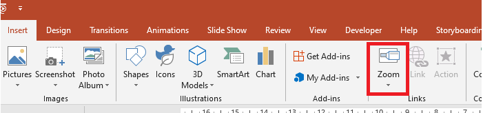

## **Introducción**

Los zoom de PowerPoint le permiten navegar entre diapositivas y secciones específicas durante una presentación. Con Aspose.Slides for Python via Java, puede crear zoom de diapositiva, de sección y de resumen, y personalizar sus vistas previas, bordes y transiciones.



* Para resumir toda la presentación en una sola diapositiva, use un [Summary Zoom](#summary-zoom).
* Para mostrar solo diapositivas seleccionadas, use un [Slide Zoom](#slide-zoom).
* Para mostrar solo una sección, use un [Section Zoom](#section-zoom).

## **Zoom de diapositiva**

Un zoom de diapositiva puede hacer su presentación más dinámica, permitiéndole navegar libremente entre diapositivas en cualquier orden que elija sin interrumpir el flujo de su presentación. Los zoom de diapositiva son ideales para presentaciones cortas sin muchas secciones, aunque también pueden usarse en distintos escenarios de presentación.

Los zoom de diapositiva le permiten explorar información relacionada desde una única diapositiva de visión general.


Para los objetos de zoom de diapositiva, Aspose.Slides proporciona la enumeración [ZoomImageType](https://reference.aspose.com/slides/python-java/aspose.slides/zoomimagetype/), la clase [ZoomFrame](https://reference.aspose.com/slides/python-java/aspose.slides/zoomframe/) y los métodos de la clase [ShapeCollection](https://reference.aspose.com/slides/python-java/aspose.slides/shapecollection/).

### **Crear marcos de zoom**

Utilice [ShapeCollection.addZoomFrame](https://reference.aspose.com/slides/python-java/aspose.slides/shapecollection/#addZoomFrame) para colocar enlaces a diapositivas individuales en una diapositiva de visión general. Este ejemplo crea dos diapositivas de destino con fondos y etiquetas distintos, luego añade una vista previa de cada una a la primera diapositiva y guarda la presentación como PPTX. Las posiciones y dimensiones del marco se especifican en puntos.

```python
import jpype
import asposeslides

if not jpype.isJVMStarted():
    jpype.startJVM()

from asposeslides.api import BackgroundType, FillType, Presentation, SaveFormat, ShapeType
from java.awt import Color

presentation = Presentation()
try:
    overview_slide = presentation.getSlides().get_Item(0)

    second_slide = presentation.getSlides().addEmptySlide(overview_slide.getLayoutSlide())
    third_slide = presentation.getSlides().addEmptySlide(overview_slide.getLayoutSlide())

    second_slide.getBackground().setType(BackgroundType.OwnBackground)
    second_slide.getBackground().getFillFormat().setFillType(FillType.Solid)
    second_slide.getBackground().getFillFormat().getSolidFillColor().setColor(Color.CYAN)

    text_box = second_slide.getShapes().addAutoShape(ShapeType.Rectangle, 100, 200, 500, 200)
    text_box.getTextFrame().setText("Second Slide")

    third_slide.getBackground().setType(BackgroundType.OwnBackground)
    third_slide.getBackground().getFillFormat().setFillType(FillType.Solid)
    third_slide.getBackground().getFillFormat().getSolidFillColor().setColor(Color(189, 183, 107))

    text_box = third_slide.getShapes().addAutoShape(ShapeType.Rectangle, 100, 200, 500, 200)
    text_box.getTextFrame().setText("Third Slide")

    overview_slide.getShapes().addZoomFrame(20, 20, 250, 200, second_slide)
    overview_slide.getShapes().addZoomFrame(200, 250, 250, 200, third_slide)

    presentation.save("presentation.pptx", SaveFormat.Pptx)
finally:
    presentation.dispose()
```

### **Crear marcos de zoom con imágenes personalizadas**

Pase una imagen personalizada a [ShapeCollection.addZoomFrame](https://reference.aspose.com/slides/python-java/aspose.slides/shapecollection/#addZoomFrame) para sustituir la vista previa predeterminada de la diapositiva de destino. Este ejemplo requiere una imagen local, la carga con [Images.fromFile](https://reference.aspose.com/slides/python-java/aspose.slides/images/#fromFile), y la añade a la presentación mediante [ImageCollection.addImage](https://reference.aspose.com/slides/python-java/aspose.slides/imagecollection/#addImage). El marco resultante muestra esa imagen mientras sigue enlazando a la segunda diapositiva.

```python
import jpype
import asposeslides

if not jpype.isJVMStarted():
    jpype.startJVM()

from asposeslides.api import BackgroundType, FillType, Images, Presentation, SaveFormat, ShapeType
from java.awt import Color

presentation = Presentation()
try:
    overview_slide = presentation.getSlides().get_Item(0)

    slide = presentation.getSlides().addEmptySlide(overview_slide.getLayoutSlide())
    slide.getBackground().setType(BackgroundType.OwnBackground)
    slide.getBackground().getFillFormat().setFillType(FillType.Solid)
    slide.getBackground().getFillFormat().getSolidFillColor().setColor(Color.CYAN)

    text_box = slide.getShapes().addAutoShape(ShapeType.Rectangle, 100, 200, 500, 200)
    text_box.getTextFrame().setText("Second Slide")

    image = Images.fromFile("image.png")
    try:
        preview_image = presentation.getImages().addImage(image)
    finally:
        image.dispose()

    overview_slide.getShapes().addZoomFrame(20, 20, 300, 200, slide, preview_image)

    presentation.save("presentation.pptx", SaveFormat.Pptx)
finally:
    presentation.dispose()
```

### **Dar formato a los marcos de zoom**

Este ejemplo personaliza dos marcos de zoom de diapositiva. Asigna una imagen local al primer marco mediante [ZoomObject.setZoomImage](https://reference.aspose.com/slides/python-java/aspose.slides/zoomobject/#setZoomImage), y da al segundo marco un borde rosa de cinco puntos, guión‑punto, mediante [Shape.getLineFormat](https://reference.aspose.com/slides/python-java/aspose.slides/shape/#getLineFormat). Pasar `False` a [ZoomObject.setShowBackground](https://reference.aspose.com/slides/python-java/aspose.slides/zoomobject/#setShowBackground) oculta el fondo del segundo marco. Se requiere una imagen local para la vista previa personalizada; ambos marcos conservan sus destinos de diapositiva en el PPTX guardado.

```python
import jpype
import asposeslides

if not jpype.isJVMStarted():
    jpype.startJVM()

from asposeslides.api import BackgroundType, FillType, Images, LineDashStyle, Presentation, SaveFormat, ShapeType
from java.awt import Color

presentation = Presentation()
try:
    overview_slide = presentation.getSlides().get_Item(0)

    second_slide = presentation.getSlides().addEmptySlide(overview_slide.getLayoutSlide())
    third_slide = presentation.getSlides().addEmptySlide(overview_slide.getLayoutSlide())

    second_slide.getBackground().setType(BackgroundType.OwnBackground)
    second_slide.getBackground().getFillFormat().setFillType(FillType.Solid)
    second_slide.getBackground().getFillFormat().getSolidFillColor().setColor(Color.CYAN)

    text_box = second_slide.getShapes().addAutoShape(ShapeType.Rectangle, 100, 200, 500, 200)
    text_box.getTextFrame().setText("Second Slide")

    third_slide.getBackground().setType(BackgroundType.OwnBackground)
    third_slide.getBackground().getFillFormat().setFillType(FillType.Solid)
    third_slide.getBackground().getFillFormat().getSolidFillColor().setColor(Color(189, 183, 107))

    text_box = third_slide.getShapes().addAutoShape(ShapeType.Rectangle, 100, 200, 500, 200)
    text_box.getTextFrame().setText("Third Slide")

    first_zoom_frame = overview_slide.getShapes().addZoomFrame(20, 20, 250, 200, second_slide)
    second_zoom_frame = overview_slide.getShapes().addZoomFrame(200, 250, 250, 200, third_slide)

    image = Images.fromFile("image.png")
    try:
        preview_image = presentation.getImages().addImage(image)
    finally:
        image.dispose()

    first_zoom_frame.setZoomImage(preview_image)

    second_zoom_frame.getLineFormat().setWidth(5)
    second_zoom_frame.getLineFormat().getFillFormat().setFillType(FillType.Solid)
    second_zoom_frame.getLineFormat().getFillFormat().getSolidFillColor().setColor(Color(255, 105, 180))
    second_zoom_frame.getLineFormat().setDashStyle(LineDashStyle.DashDot)

    second_zoom_frame.setShowBackground(False)

    presentation.save("presentation.pptx", SaveFormat.Pptx)
finally:
    presentation.dispose()
```

## **Zoom de sección**

Un zoom de sección enlaza a una sección de su presentación. Úselo para volver a un tema o para mostrar cómo se conectan diferentes partes de la presentación.


Para los objetos de zoom de sección, Aspose.Slides proporciona la clase [SectionZoomFrame](https://reference.aspose.com/slides/python-java/aspose.slides/sectionzoomframe/) y los métodos de la clase [ShapeCollection](https://reference.aspose.com/slides/python-java/aspose.slides/shapecollection/).

### **Crear marcos de zoom de sección**

Cree una sección con [SectionCollection.addSection](https://reference.aspose.com/slides/python-java/aspose.slides/sectioncollection/#addSection), y luego pase la sección devuelta a [ShapeCollection.addSectionZoomFrame](https://reference.aspose.com/slides/python-java/aspose.slides/shapecollection/#addSectionZoomFrame). Este ejemplo coloca un zoom de sección en la primera diapositiva y lo enlaza a una sección que comienza con una diapositiva de color. La posición y dimensiones del marco se especifican en puntos, y la presentación se guarda como PPTX.

```python
import jpype
import asposeslides

if not jpype.isJVMStarted():
    jpype.startJVM()

from asposeslides.api import BackgroundType, FillType, Presentation, SaveFormat
from java.awt import Color

presentation = Presentation()
try:
    overview_slide = presentation.getSlides().get_Item(0)

    slide = presentation.getSlides().addEmptySlide(overview_slide.getLayoutSlide())
    slide.getBackground().getFillFormat().setFillType(FillType.Solid)
    slide.getBackground().getFillFormat().getSolidFillColor().setColor(Color(154, 205, 50))
    slide.getBackground().setType(BackgroundType.OwnBackground)

    section = presentation.getSections().addSection("Section 1", slide)
    section_zoom_frame = overview_slide.getShapes().addSectionZoomFrame(20, 20, 300, 200, section)

    presentation.save("presentation.pptx", SaveFormat.Pptx)
finally:
    presentation.dispose()
```

### **Crear marcos de zoom de sección con imágenes personalizadas**

La sobrecarga de imagen de [ShapeCollection.addSectionZoomFrame](https://reference.aspose.com/slides/python-java/aspose.slides/shapecollection/#addSectionZoomFrame) le permite mostrar una vista previa personalizada sin cambiar la sección de destino. Este ejemplo requiere una imagen local, que se carga con [Images.fromFile](https://reference.aspose.com/slides/python-java/aspose.slides/images/#fromFile) y se añade mediante [ImageCollection.addImage](https://reference.aspose.com/slides/python-java/aspose.slides/imagecollection/#addImage). La presentación guardada contiene un zoom de sección en la primera diapositiva enlazado a la sección recién creada.

```python
import jpype
import asposeslides

if not jpype.isJVMStarted():
    jpype.startJVM()

from asposeslides.api import BackgroundType, FillType, Images, Presentation, SaveFormat
from java.awt import Color

presentation = Presentation()
try:
    overview_slide = presentation.getSlides().get_Item(0)

    slide = presentation.getSlides().addEmptySlide(overview_slide.getLayoutSlide())
    slide.getBackground().getFillFormat().setFillType(FillType.Solid)
    slide.getBackground().getFillFormat().getSolidFillColor().setColor(Color(154, 205, 50))
    slide.getBackground().setType(BackgroundType.OwnBackground)

    image = Images.fromFile("image.png")
    try:
        preview_image = presentation.getImages().addImage(image)
    finally:
        image.dispose()

    section = presentation.getSections().addSection("Section 1", slide)
    section_zoom_frame = overview_slide.getShapes().addSectionZoomFrame(20, 20, 300, 200, section, preview_image)

    presentation.save("presentation.pptx", SaveFormat.Pptx)
finally:
    presentation.dispose()
```

### **Cambiar la sección de destino de un zoom de sección**

Utilice [SectionZoomFrame.setTargetSection](https://reference.aspose.com/slides/python-java/aspose.slides/sectionzoomframe/#setTargetSection) para redirigir un zoom de sección existente sin recrearlo. Elija una sección poblada de la colección [Presentation.getSections](https://reference.aspose.com/slides/python-java/aspose.slides/presentation/#getSections) de la misma presentación. Asignar una sección vacía deja el destino actual sin cambios, por lo que debe comprobar [Section.getSlidesListOfSection](https://reference.aspose.com/slides/python-java/aspose.slides/section/#getSlidesListOfSection) antes de asignarla. Consulte [Manage Slide Sections](/slides/es/python-java/slide-section/) para obtener más información sobre las secciones.

El siguiente ejemplo carga un archivo de presentación, que debe contener varias secciones pobladas, un zoom de sección existente llamado `Section navigation` y una sección con el nombre único `Results`. Busca el zoom en todas las diapositivas y encuentra el destino por nombre en lugar de por un índice de colección que puede cambiar cuando se reordenan las secciones. Si los nombres no son únicos, use [Section.getSectionId](https://reference.aspose.com/slides/python-java/aspose.slides/section/#getSectionId) para identificar el destino.

```python
import jpype
import asposeslides

if not jpype.isJVMStarted():
    jpype.startJVM()

from asposeslides.api import Presentation, SaveFormat, SectionZoomFrame

presentation = Presentation("section-zoom.pptx")
try:
    zoom = None
    for slide in presentation.getSlides():
        for shape in slide.getShapes():
            if isinstance(shape, SectionZoomFrame) and shape.getName() == "Section navigation":
                zoom = shape
                break
        if zoom is not None:
            break

    target_section = None
    for section in presentation.getSections():
        if section.getName() == "Results":
            target_section = section
            break

    if zoom is None or target_section is None:
        print("The section zoom or destination section was not found.")
    elif target_section.getSlidesListOfSection().size() == 0:
        print("The destination section is empty.")
    else:
        current_section = zoom.getTargetSection()
        current_name = "" if current_section is None else current_section.getName()
        print("Current section: " + str(current_name))
        zoom.setTargetSection(target_section)
        presentation.save("section-zoom-updated.pptx", SaveFormat.Pptx)
finally:
    presentation.dispose()
```

### **Dar formato a los marcos de zoom de sección**

Este ejemplo mueve y redimensiona un zoom de sección a 100 × 75 puntos, asigna una imagen local mediante [ZoomObject.setZoomImage](https://reference.aspose.com/slides/python-java/aspose.slides/zoomobject/#setZoomImage), y aplica un borde marrón de 2,5 puntos, guión‑punto. Habilita [ZoomObject.setReturnToParent](https://reference.aspose.com/slides/python-java/aspose.slides/zoomobject/#setReturnToParent) para volver a la diapositiva de origen después de la sección, deshabilita [ZoomObject.setShowBackground](https://reference.aspose.com/slides/python-java/aspose.slides/zoomobject/#setShowBackground), y establece [ZoomObject.setTransitionDuration](https://reference.aspose.com/slides/python-java/aspose.slides/zoomobject/#setTransitionDuration) a 1,5 segundos. Se requiere una imagen local para la vista previa personalizada.

```python
import jpype
import asposeslides

if not jpype.isJVMStarted():
    jpype.startJVM()

from asposeslides.api import BackgroundType, FillType, Images, LineDashStyle, Presentation, SaveFormat
from java.awt import Color

presentation = Presentation()
try:
    overview_slide = presentation.getSlides().get_Item(0)

    slide = presentation.getSlides().addEmptySlide(overview_slide.getLayoutSlide())
    slide.getBackground().getFillFormat().setFillType(FillType.Solid)
    slide.getBackground().getFillFormat().getSolidFillColor().setColor(Color(154, 205, 50))
    slide.getBackground().setType(BackgroundType.OwnBackground)

    section = presentation.getSections().addSection("Section 1", slide)

    section_zoom_frame = overview_slide.getShapes().addSectionZoomFrame(20, 20, 300, 200, section)
    section_zoom_frame.setX(100)
    section_zoom_frame.setY(300)
    section_zoom_frame.setWidth(100)
    section_zoom_frame.setHeight(75)

    image = Images.fromFile("image.png")
    try:
        preview_image = presentation.getImages().addImage(image)
    finally:
        image.dispose()

    section_zoom_frame.setZoomImage(preview_image)

    section_zoom_frame.setReturnToParent(True)
    section_zoom_frame.setShowBackground(False)

    section_zoom_frame.getLineFormat().getFillFormat().setFillType(FillType.Solid)
    section_zoom_frame.getLineFormat().getFillFormat().getSolidFillColor().setColor(Color(165, 42, 42))
    section_zoom_frame.getLineFormat().setDashStyle(LineDashStyle.DashDot)
    section_zoom_frame.getLineFormat().setWidth(2.5)

    section_zoom_frame.setTransitionDuration(1.5)

    presentation.save("presentation.pptx", SaveFormat.Pptx)
finally:
    presentation.dispose()
```

## **Zoom de resumen**

Un zoom de resumen ofrece una visión general de las secciones de la presentación. Durante una presentación, puede usarlo para saltar a una sección, adelantar o volver a un tema sin seguir el orden de las diapositivas.


Para los objetos de zoom de resumen, Aspose.Slides proporciona las clases [SummaryZoomFrame](https://reference.aspose.com/slides/python-java/aspose.slides/summaryzoomframe/), [SummaryZoomSection](https://reference.aspose.com/slides/python-java/aspose.slides/summaryzoomsection/), y [SummaryZoomSectionCollection](https://reference.aspose.com/slides/python-java/aspose.slides/summaryzoomsectioncollection/), y los métodos de la clase [ShapeCollection](https://reference.aspose.com/slides/python-java/aspose.slides/shapecollection/).

### **Crear un zoom de resumen**

Utilice [ShapeCollection.addSummaryZoomFrame](https://reference.aspose.com/slides/python-java/aspose.slides/shapecollection/#addSummaryZoomFrame) para crear una visión general de las secciones de la presentación. Este ejemplo crea cuatro secciones con fondos de diapositiva distintos y añade un zoom de resumen a la primera diapositiva. La posición y dimensiones del marco se especifican en puntos, y la visión general resultante se guarda en una presentación PPTX.

```python
import jpype
import asposeslides

if not jpype.isJVMStarted():
    jpype.startJVM()

from asposeslides.api import BackgroundType, FillType, Presentation, SaveFormat
from java.awt import Color

presentation = Presentation()
try:
    overview_slide = presentation.getSlides().get_Item(0)

    slide = presentation.getSlides().addEmptySlide(overview_slide.getLayoutSlide())
    slide.getBackground().getFillFormat().setFillType(FillType.Solid)
    slide.getBackground().getFillFormat().getSolidFillColor().setColor(Color(165, 42, 42))
    slide.getBackground().setType(BackgroundType.OwnBackground)

    presentation.getSections().addSection("Section 1", slide)

    slide = presentation.getSlides().addEmptySlide(overview_slide.getLayoutSlide())
    slide.getBackground().getFillFormat().setFillType(FillType.Solid)
    slide.getBackground().getFillFormat().getSolidFillColor().setColor(Color.CYAN)
    slide.getBackground().setType(BackgroundType.OwnBackground)

    presentation.getSections().addSection("Section 2", slide)

    slide = presentation.getSlides().addEmptySlide(overview_slide.getLayoutSlide())
    slide.getBackground().getFillFormat().setFillType(FillType.Solid)
    slide.getBackground().getFillFormat().getSolidFillColor().setColor(Color(127, 255, 0))
    slide.getBackground().setType(BackgroundType.OwnBackground)

    presentation.getSections().addSection("Section 3", slide)

    slide = presentation.getSlides().addEmptySlide(overview_slide.getLayoutSlide())
    slide.getBackground().getFillFormat().setFillType(FillType.Solid)
    slide.getBackground().getFillFormat().getSolidFillColor().setColor(Color(0, 100, 0))
    slide.getBackground().setType(BackgroundType.OwnBackground)

    presentation.getSections().addSection("Section 4", slide)

    summary_zoom_frame = overview_slide.getShapes().addSummaryZoomFrame(150, 50, 300, 200)

    presentation.save("presentation.pptx", SaveFormat.Pptx)
finally:
    presentation.dispose()
```

### **Añadir y eliminar una sección de zoom de resumen**

Un zoom de resumen almacena sus objetos [SummaryZoomSection](https://reference.aspose.com/slides/python-java/aspose.slides/summaryzoomsection/) en [SummaryZoomFrame.getSummaryZoomCollection](https://reference.aspose.com/slides/python-java/aspose.slides/summaryzoomframe/#getSummaryZoomCollection). Este ejemplo crea una visión general de dos secciones, añade una tercera sección mediante [SummaryZoomSectionCollection.addSummaryZoomSection](https://reference.aspose.com/slides/python-java/aspose.slides/summaryzoomsectioncollection/#addSummaryZoomSection), y elimina la entrada de la primera sección mediante [SummaryZoomSectionCollection.removeSummaryZoomSection](https://reference.aspose.com/slides/python-java/aspose.slides/summaryzoomsectioncollection/#removeSummaryZoomSection). Eliminar la entrada deja la sección de la presentación y sus diapositivas intactas.

```python
import jpype
import asposeslides

if not jpype.isJVMStarted():
    jpype.startJVM()

from asposeslides.api import BackgroundType, FillType, Presentation, SaveFormat
from java.awt import Color

presentation = Presentation()
try:
    overview_slide = presentation.getSlides().get_Item(0)

    slide = presentation.getSlides().addEmptySlide(overview_slide.getLayoutSlide())
    slide.getBackground().getFillFormat().setFillType(FillType.Solid)
    slide.getBackground().getFillFormat().getSolidFillColor().setColor(Color(165, 42, 42))
    slide.getBackground().setType(BackgroundType.OwnBackground)

    first_section = presentation.getSections().addSection("Section 1", slide)

    slide = presentation.getSlides().addEmptySlide(overview_slide.getLayoutSlide())
    slide.getBackground().getFillFormat().setFillType(FillType.Solid)
    slide.getBackground().getFillFormat().getSolidFillColor().setColor(Color.CYAN)
    slide.getBackground().setType(BackgroundType.OwnBackground)

    presentation.getSections().addSection("Section 2", slide)

    summary_zoom_frame = overview_slide.getShapes().addSummaryZoomFrame(150, 50, 300, 200)

    slide = presentation.getSlides().addEmptySlide(overview_slide.getLayoutSlide())
    slide.getBackground().getFillFormat().setFillType(FillType.Solid)
    slide.getBackground().getFillFormat().getSolidFillColor().setColor(Color(127, 255, 0))
    slide.getBackground().setType(BackgroundType.OwnBackground)

    third_section = presentation.getSections().addSection("Section 3", slide)

    summary_zoom_frame.getSummaryZoomCollection().addSummaryZoomSection(third_section)

    summary_zoom_frame.getSummaryZoomCollection().removeSummaryZoomSection(first_section)

    presentation.save("presentation.pptx", SaveFormat.Pptx)
finally:
    presentation.dispose()
```

### **Dar formato a las secciones de zoom de resumen**

Este ejemplo da formato a la primera entrada en [SummaryZoomFrame.getSummaryZoomCollection](https://reference.aspose.com/slides/python-java/aspose.slides/summaryzoomframe/#getSummaryZoomCollection), usando el índice base cero `0`. Requiere una imagen local para [ZoomObject.setZoomImage](https://reference.aspose.com/slides/python-java/aspose.slides/zoomobject/#setZoomImage), aplica un borde negro de 1,5 puntos, guión‑punto, y establece [ZoomObject.setTransitionDuration](https://reference.aspose.com/slides/python-java/aspose.slides/zoomobject/#setTransitionDuration) a 1,5 segundos. Pasar `False` a [ZoomObject.setReturnToParent](https://reference.aspose.com/slides/python-java/aspose.slides/zoomobject/#setReturnToParent) desactiva el retorno automático a la diapositiva de resumen para esta entrada.

```python
import jpype
import asposeslides

if not jpype.isJVMStarted():
    jpype.startJVM()

from asposeslides.api import BackgroundType, FillType, Images, LineDashStyle, Presentation, SaveFormat
from java.awt import Color

presentation = Presentation()
try:
    overview_slide = presentation.getSlides().get_Item(0)

    slide = presentation.getSlides().addEmptySlide(overview_slide.getLayoutSlide())
    slide.getBackground().getFillFormat().setFillType(FillType.Solid)
    slide.getBackground().getFillFormat().getSolidFillColor().setColor(Color(165, 42, 42))
    slide.getBackground().setType(BackgroundType.OwnBackground)

    presentation.getSections().addSection("Section 1", slide)

    slide = presentation.getSlides().addEmptySlide(overview_slide.getLayoutSlide())
    slide.getBackground().getFillFormat().setFillType(FillType.Solid)
    slide.getBackground().getFillFormat().getSolidFillColor().setColor(Color.CYAN)
    slide.getBackground().setType(BackgroundType.OwnBackground)

    presentation.getSections().addSection("Section 2", slide)

    summary_zoom_frame = overview_slide.getShapes().addSummaryZoomFrame(150, 50, 300, 200)

    summary_section = summary_zoom_frame.getSummaryZoomCollection().get_Item(0)

    image = Images.fromFile("image.png")
    try:
        preview_image = presentation.getImages().addImage(image)
    finally:
        image.dispose()

    summary_section.setZoomImage(preview_image)
    summary_section.setReturnToParent(False)

    summary_section.getLineFormat().getFillFormat().setFillType(FillType.Solid)
    summary_section.getLineFormat().getFillFormat().getSolidFillColor().setColor(Color.BLACK)
    summary_section.getLineFormat().setDashStyle(LineDashStyle.DashDot)
    summary_section.getLineFormat().setWidth(1.5)

    summary_section.setTransitionDuration(1.5)

    presentation.save("presentation.pptx", SaveFormat.Pptx)
finally:
    presentation.dispose()
```

## **Preguntas frecuentes**

**¿Puedo controlar el regreso a la diapositiva “padre” después de mostrar el objetivo?**

Sí. Llame a [ZoomObject.setReturnToParent](https://reference.aspose.com/slides/python-java/aspose.slides/zoomobject/#setReturnToParent) con `True` para volver a la diapositiva de origen después de que se muestre el contenido objetivo.

**¿Puedo ajustar la “velocidad” o duración de la transición del Zoom?**

Sí. Utilice [ZoomObject.setTransitionDuration](https://reference.aspose.com/slides/python-java/aspose.slides/zoomobject/#setTransitionDuration) para controlar la duración de la transición en segundos.

**¿Existen límites en la cantidad de objetos Zoom que puede contener una presentación?**

No hay un límite estricto de API documentado. Los límites prácticos dependen de la complejidad general de la presentación y del rendimiento del visor. Puede añadir muchos marcos de Zoom, pero tenga en cuenta el tamaño del archivo y el tiempo de renderizado.