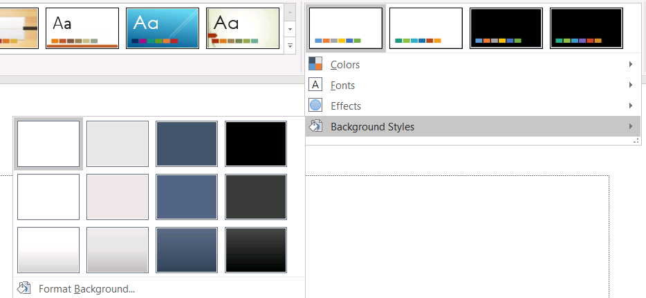

## **Introducción**

Un tema de presentación define un conjunto coordinado de colores, fuentes, estilos de fondo, rellenos, líneas y efectos. Los objetos con conocimiento de tema hacen referencia a estas definiciones compartidas en lugar de almacenar cada propiedad visual como un valor fijo, de modo que un cambio de tema puede actualizar muchos objetos a la vez.

En Aspose.Slides, el tema a nivel de presentación está disponible a través de [Presentation.getMasterTheme](https://reference.aspose.com/slides/python-java/aspose.slides/presentation/#getMasterTheme). Una presentación también puede contener anulaciones de tema en niveles inferiores. Un maestro puede anular el tema de la presentación mediante [MasterThemeManager.getOverrideTheme](https://reference.aspose.com/slides/python-java/aspose.slides/masterthememanager/#getOverrideTheme), mientras que una diapositiva de diseño o una diapositiva individual pueden anular su tema heredado mediante [BaseOverrideThemeManager.getOverrideTheme](https://reference.aspose.com/slides/python-java/aspose.slides/baseoverridethememanager/#getOverrideTheme). En la práctica, el tema efectivo para una diapositiva se resuelve mediante esta cadena de herencia: tema de presentación, anulación del maestro, anulación del diseño y anulación de la diapositiva.


Las secciones siguientes muestran los flujos de trabajo de tema más habituales: inspeccionar un tema, cambiar colores y fuentes, copiar o aplicar un tema, actualizar estilos de fondo y de efecto, y leer valores efectivos después de que se hayan resuelto la herencia y las anulaciones.

## **Inspeccionar un Tema**

El objeto [MasterTheme](https://reference.aspose.com/slides/python-java/aspose.slides/mastertheme/) expone el esquema de colores, el esquema de fuentes y el esquema de formato del tema a través de [MasterTheme.getColorScheme](https://reference.aspose.com/slides/python-java/aspose.slides/mastertheme/#getColorScheme), [MasterTheme.getFontScheme](https://reference.aspose.com/slides/python-java/aspose.slides/mastertheme/#getFontScheme) y [MasterTheme.getFormatScheme](https://reference.aspose.com/slides/python-java/aspose.slides/mastertheme/#getFormatScheme). Inspeccionar estas colecciones antes de modificarlas es especialmente útil cuando una presentación proviene de una fuente externa, ya que el número y el contenido de las entradas de estilo pueden variar.

El siguiente ejemplo lee las propiedades principales del tema e informa cuántos estilos de fondo, relleno, línea y efecto están almacenados en el tema:

```python
import jpype
import asposeslides

if not jpype.isJVMStarted():
    jpype.startJVM()

from asposeslides.api import Presentation

presentation = Presentation("input.pptx")
try:
    theme = presentation.getMasterTheme()

    print("Theme name:", theme.getName())
    print("Accent 1:", theme.getColorScheme().getAccent1().getColor())
    print("Major Latin font:", theme.getFontScheme().getMajor().getLatinFont().getFontName())
    print("Minor Latin font:", theme.getFontScheme().getMinor().getLatinFont().getFontName())
    print("Background fill styles:", theme.getFormatScheme().getBackgroundFillStyles().size())
    print("Fill styles:", theme.getFormatScheme().getFillStyles().size())
    print("Line styles:", theme.getFormatScheme().getLineStyles().size())
    print("Effect styles:", theme.getFormatScheme().getEffectStyles().size())
finally:
    presentation.dispose()
```

Si un archivo utiliza varios maestros, no asuma que cada diapositiva tiene el mismo tema efectivo. Inspeccione el maestro asociado a la diapositiva y utilice el flujo de trabajo de tema efectivo que se muestra más adelante en este artículo cuando puedan existir anulaciones de diseño o de diapositiva.

## **Cambiar los Colores del Tema**

Los rellenos, líneas y textos con conocimiento de tema pueden referirse a un color lógico de la enumeración [SchemeColor](https://reference.aspose.com/slides/python-java/aspose.slides/schemecolor/). Cuando cambie la entrada correspondiente en el [ColorScheme](https://reference.aspose.com/slides/python-java/aspose.slides/colorscheme/), todos los objetos que aún hacen referencia a ese color del tema se resuelven contra el nuevo valor. Los objetos que usan un color RGB directo no se modifican con una actualización de color del tema.

El siguiente ejemplo de extremo a extremo crea una forma que utiliza `Accent4`, cambia el color `Accent4` del tema a rojo, guarda la presentación, la vuelve a abrir y muestra el color de relleno efectivo:

```python
import jpype
import asposeslides

if not jpype.isJVMStarted():
    jpype.startJVM()

from asposeslides.api import FillType, Presentation, SaveFormat, SchemeColor, ShapeType
from java.awt import Color

presentation = Presentation()
try:
    slide = presentation.getSlides().get_Item(0)

    shape = slide.getShapes().addAutoShape(ShapeType.Rectangle, 10, 10, 100, 100)
    shape.getFillFormat().setFillType(FillType.Solid)
    shape.getFillFormat().getSolidFillColor().setSchemeColor(SchemeColor.Accent4)

    presentation.getMasterTheme().getColorScheme().getAccent4().setColor(Color.RED)

    presentation.save("theme-color.pptx", SaveFormat.Pptx)
finally:
    presentation.dispose()

saved_presentation = Presentation("theme-color.pptx")
try:
    saved_slide = saved_presentation.getSlides().get_Item(0)
    saved_shape = saved_slide.getShapes().get_Item(0)
    effective_fill = saved_shape.getFillFormat().getEffective()
    print("Effective fill color:", effective_fill.getSolidFillColor())
finally:
    saved_presentation.dispose()
```

Como el rectángulo sigue enlazado a `Accent4`, su color visible se vuelve rojo tras el cambio del tema. Si reemplaza el color del esquema por un color directo en la forma, los cambios posteriores de `Accent4` ya no afectarán a ese relleno.

### **Usar Colores de la Paleta Adicional**

PowerPoint genera variantes más claras y más oscuras a partir de un color del tema aplicando transformaciones de color. Aspose.Slides expone estas transformaciones mediante la enumeración [ColorTransformOperation](https://reference.aspose.com/slides/python-java/aspose.slides/colortransformoperation/).


**1** - Colores principales del tema.

**2** - Variantes más claras y más oscuras producidas a partir de los colores principales del tema.

El siguiente ejemplo crea seis rectángulos basados en `Accent4`, aplica transformaciones de luminancia a cinco de ellos y guarda el resultado:

```python
import jpype
import asposeslides

if not jpype.isJVMStarted():
    jpype.startJVM()

from asposeslides.api import ColorTransformOperation, FillType, Presentation, SaveFormat, SchemeColor, ShapeType

presentation = Presentation()
try:
    slide = presentation.getSlides().get_Item(0)

    base_shape = slide.getShapes().addAutoShape(ShapeType.Rectangle, 10, 10, 50, 50)
    base_shape.getFillFormat().setFillType(FillType.Solid)
    base_shape.getFillFormat().getSolidFillColor().setSchemeColor(SchemeColor.Accent4)

    lightest_shape = slide.getShapes().addAutoShape(ShapeType.Rectangle, 10, 70, 50, 50)
    lightest_shape.getFillFormat().setFillType(FillType.Solid)
    lightest_shape.getFillFormat().getSolidFillColor().setSchemeColor(SchemeColor.Accent4)
    lightest_shape.getFillFormat().getSolidFillColor().getColorTransform().add(ColorTransformOperation.MultiplyLuminance, 0.2)
    lightest_shape.getFillFormat().getSolidFillColor().getColorTransform().add(ColorTransformOperation.AddLuminance, 0.8)

    lighter_shape = slide.getShapes().addAutoShape(ShapeType.Rectangle, 10, 130, 50, 50)
    lighter_shape.getFillFormat().setFillType(FillType.Solid)
    lighter_shape.getFillFormat().getSolidFillColor().setSchemeColor(SchemeColor.Accent4)
    lighter_shape.getFillFormat().getSolidFillColor().getColorTransform().add(ColorTransformOperation.MultiplyLuminance, 0.4)
    lighter_shape.getFillFormat().getSolidFillColor().getColorTransform().add(ColorTransformOperation.AddLuminance, 0.6)

    light_shape = slide.getShapes().addAutoShape(ShapeType.Rectangle, 10, 190, 50, 50)
    light_shape.getFillFormat().setFillType(FillType.Solid)
    light_shape.getFillFormat().getSolidFillColor().setSchemeColor(SchemeColor.Accent4)
    light_shape.getFillFormat().getSolidFillColor().getColorTransform().add(ColorTransformOperation.MultiplyLuminance, 0.6)
    light_shape.getFillFormat().getSolidFillColor().getColorTransform().add(ColorTransformOperation.AddLuminance, 0.4)

    dark_shape = slide.getShapes().addAutoShape(ShapeType.Rectangle, 10, 250, 50, 50)
    dark_shape.getFillFormat().setFillType(FillType.Solid)
    dark_shape.getFillFormat().getSolidFillColor().setSchemeColor(SchemeColor.Accent4)
    dark_shape.getFillFormat().getSolidFillColor().getColorTransform().add(ColorTransformOperation.MultiplyLuminance, 0.75)

    darker_shape = slide.getShapes().addAutoShape(ShapeType.Rectangle, 10, 310, 50, 50)
    darker_shape.getFillFormat().setFillType(FillType.Solid)
    darker_shape.getFillFormat().getSolidFillColor().setSchemeColor(SchemeColor.Accent4)
    darker_shape.getFillFormat().getSolidFillColor().getColorTransform().add(ColorTransformOperation.MultiplyLuminance, 0.5)

    presentation.save("theme-color-palette.pptx", SaveFormat.Pptx)
finally:
    presentation.dispose()
```

Estas variantes siguen basadas en el color del tema. Si `Accent4` cambia más adelante, los colores transformados se recalculan a partir del nuevo valor de `Accent4`.

### **Asignar Valores de `SchemeColor` a Ranuras de `ColorScheme`**

La enumeración [SchemeColor](https://reference.aspose.com/slides/python-java/aspose.slides/schemecolor/) utiliza `Text1`, `Background1`, `Text2` y `Background2`, mientras que el [ColorScheme](https://reference.aspose.com/slides/python-java/aspose.slides/colorscheme/) expone las mismas ranuras del tema como `Dark1`, `Light1`, `Dark2` y `Light2`. La asignación es fija:

* `Text1` = `Dark1`
* `Background1` = `Light1`
* `Text2` = `Dark2`
* `Background2` = `Light2`

Estos son nombres alternativos para las mismas ranuras del tema; no son valores que se conviertan dinámicamente de una forma a otra.

## **Cambiar las Fuentes del Tema**

Un esquema de fuentes del tema contiene un conjunto principal de fuentes para encabezados y un conjunto secundario para el cuerpo del texto. Los métodos [FontScheme.getMajor](https://reference.aspose.com/slides/python-java/aspose.slides/fontscheme/#getMajor) y [FontScheme.getMinor](https://reference.aspose.com/slides/python-java/aspose.slides/fontscheme/#getMinor) exponen esos conjuntos.

Los identificadores de fuentes de tema compatibles con PowerPoint pueden usarse en el formato de texto:

* `+mn-lt` - Fuente del cuerpo Latin (Minor Latin Font)
* `+mj-lt` - Fuente del encabezado Latin (Major Latin Font)
* `+mn-ea` - Fuente del cuerpo East Asian (Minor East Asian Font)
* `+mj-ea` - Fuente del encabezado East Asian (Major East Asian Font)
* `+mn-cs` - Fuente del cuerpo Complex Script (Minor Complex Script Font)
* `+mj-cs` - Fuente del encabezado Complex Script (Major Complex Script Font)

El siguiente ejemplo crea un encabezado que utiliza la fuente latina principal del tema y una línea de cuerpo que utiliza la fuente latina secundaria del tema. Luego cambia las fuentes del tema y guarda el resultado:

```python
import jpype
import asposeslides

if not jpype.isJVMStarted():
    jpype.startJVM()

from asposeslides.api import FontData, Presentation, SaveFormat, ShapeType

presentation = Presentation()
try:
    slide = presentation.getSlides().get_Item(0)

    heading = slide.getShapes().addAutoShape(ShapeType.Rectangle, 40, 40, 500, 60)
    heading.getTextFrame().setText("Theme heading")
    font_data = FontData("+mj-lt")
    heading.getTextFrame().getParagraphs().get_Item(0).getPortions().get_Item(0).getPortionFormat().setLatinFont(font_data)

    body = slide.getShapes().addAutoShape(ShapeType.Rectangle, 40, 120, 500, 60)
    body.getTextFrame().setText("Theme body text")
    font_data = FontData("+mn-lt")
    body.getTextFrame().getParagraphs().get_Item(0).getPortions().get_Item(0).getPortionFormat().setLatinFont(font_data)

    font_data = FontData("Aptos Display")
    presentation.getMasterTheme().getFontScheme().getMajor().setLatinFont(font_data)
    font_data = FontData("Arial")
    presentation.getMasterTheme().getFontScheme().getMinor().setLatinFont(font_data)
    presentation.save("theme-fonts.pptx", SaveFormat.Pptx)
finally:
    presentation.dispose()
```

El encabezado sigue la fuente principal y el texto del cuerpo sigue la fuente secundaria. Un texto que tenga un nombre de fuente explícito en lugar de un identificador de tema no cambiará automáticamente cuando cambie el esquema de fuentes del tema.

Las colecciones de fuentes principales y secundarias también pueden contener asignaciones de fuentes para sistemas de escritura individuales, como cirílico, árabe, japonés, georgiano y thaana. Para inspeccionar, añadir, reemplazar o eliminar estas asignaciones, vea [Script-Specific Theme Fonts](/slides/es/python-java/script-specific-font-mappings/).

{}

Para obtener más información sobre fuentes en presentaciones, consulte [Fuentes de PowerPoint](/slides/es/python-java/powerpoint-fonts/).

{}

### **Resolver Referencias de Fuente del Tema**

Al inspeccionar texto, [FontData.getFontName](https://reference.aspose.com/slides/python-java/aspose.slides/fontdata/#getFontName) puede devolver una referencia de tema como `+mn-lt` en lugar del nombre de familia de fuente. Llame a [FontData.getFontName](https://reference.aspose.com/slides/python-java/aspose.slides/fontdata/#getFontName) con los datos del tema efectivo apropiados para resolver esa referencia. Los prefijos `+mj` y `+mn` seleccionan los conjuntos de fuentes principal y secundario; los sufijos `-lt`, `-ea` y `-cs` seleccionan sus fuentes Latin, East Asian y Complex Script, respectivamente.

Obtenga el tema efectivo mediante [BaseOverrideThemeManager.createThemeEffective](https://reference.aspose.com/slides/python-java/aspose.slides/baseoverridethememanager/#createThemeEffective) en el gestor de tema del objeto cuyo tema se aplica al texto inspeccionado. Para texto ordinario en una diapositiva, use el gestor de tema de la diapositiva para que el contexto incluya el tema heredado de esa diapositiva y sus anulaciones locales. Al inspeccionar un diseño o un maestro, use su propio tema efectivo. No asuma que el tema del primer maestro se aplica a todas las diapositivas.

El siguiente ejemplo crea una porción de texto que hace referencia explícita a la fuente latina secundaria. Inicializa un esquema de fuentes de diapositiva mediante [OverrideTheme.initFontSchemeFromInherited](https://reference.aspose.com/slides/python-java/aspose.slides/overridetheme/#initFontSchemeFromInherited) y establece las familias latinas principales y secundarias en `Arial` y `Calibri`, haciendo que el resultado sea reproducible sin un archivo de entrada.

```python
import jpype
import asposeslides

if not jpype.isJVMStarted():
    jpype.startJVM()

from asposeslides.api import FontData, Presentation, ShapeType

presentation = Presentation()
try:
    slide = presentation.getSlides().get_Item(0)

    theme = slide.getThemeManager().getOverrideTheme()
    theme.initFontSchemeFromInherited()
    major_font = FontData("Arial")
    theme.getFontScheme().getMajor().setLatinFont(major_font)
    minor_font = FontData("Calibri")
    theme.getFontScheme().getMinor().setLatinFont(minor_font)

    shape = slide.getShapes().addAutoShape(ShapeType.Rectangle, 20, 20, 400, 60)
    shape.getTextFrame().setText("Text using the minor theme font")

    portion = shape.getTextFrame().getParagraphs().get_Item(0).getPortions().get_Item(0)
    theme_font = FontData("+mn-lt")
    portion.getPortionFormat().setLatinFont(theme_font)

    font = portion.getPortionFormat().getLatinFont()
    effective_theme = slide.getThemeManager().createThemeEffective()
    print(f"{font.getFontName()} -> {font.getFontName(effective_theme)}")

    explicit_font = FontData("Verdana")
    print(f"{explicit_font.getFontName()} -> {explicit_font.getFontName(effective_theme)}")
finally:
    presentation.dispose()
```

La salida es `+mn-lt -> Calibri` seguida de `Verdana -> Verdana`. La referencia almacenada permanece sin cambios, mientras que el nombre de familia explícito se devuelve tal cual. Si la porción hubiera usado `+mj-lt`, se resolvería a `Arial` en este tema.

Resolver una referencia de tema identifica la familia de fuente especificada por el tema. No verifica la disponibilidad de la fuente ni determina el archivo de fuente que se usará finalmente después de la sustitución o la sustitución de glifos durante el renderizado. Consulte [Secuencia de Selección de Fuente](/slides/es/python-java/font-selection-sequence/) y [Sustitución de Fuente](/slides/es/python-java/font-substitution/) para esos pasos separados.

## **Copiar o Aplicar un Tema**

Los flujos de trabajo siguientes resuelven diferentes problemas relacionados con temas.

### **Aplicar un Tema Externo a Diapositivas Dependientes de un Maestro**

Utilice [MasterSlide.applyExternalThemeToDependingSlides](https://reference.aspose.com/slides/python-java/aspose.slides/masterslide/#applyExternalThemeToDependingSlides) cuando disponga de un archivo de tema de PowerPoint (`.thmx`) y desee reestilizar cada diapositiva que dependa de un maestro concreto. Seleccione el maestro de la colección [Presentation.getMasters](https://reference.aspose.com/slides/python-java/aspose.slides/presentation/#getMasters), representada por [MasterSlideCollection](https://reference.aspose.com/slides/python-java/aspose.slides/masterslidecollection/), y pase la ruta del archivo de tema al método.

El método realiza las siguientes operaciones:

1. Crea una nueva diapositiva maestra basada en el maestro seleccionado.  
1. Aplica el tema externo a la nueva maestra.  
1. Asigna la nueva maestra a todas las diapositivas que previamente dependían del maestro seleccionado.  
1. Devuelve la nueva [MasterSlide](https://reference.aspose.com/slides/python-java/aspose.slides/masterslide/).

El siguiente ejemplo aplica un tema externo a las diapositivas que dependen del primer maestro y guarda la presentación:

```python
import jpype
import asposeslides

if not jpype.isJVMStarted():
    jpype.startJVM()

from asposeslides.api import Presentation, SaveFormat

presentation = Presentation("presentation.pptx")
try:
    selected_master = presentation.getMasters().get_Item(0)
    themed_master = selected_master.applyExternalThemeToDependingSlides("corporate-theme.thmx")
    print("Created master:", themed_master.getName())

    presentation.save("presentation-with-external-theme.pptx", SaveFormat.Pptx)
finally:
    presentation.dispose()
```

Un tema inválido, dañado o no compatible puede provocar una [PptxReadException](https://reference.aspose.com/slides/python-java/aspose.slides/pptxreadexception/). Valide las rutas suministradas por los usuarios, gestione los fallos de acceso al sistema de archivos y guarde la presentación sólo después de que el tema se haya aplicado correctamente.

Sólo se reasignan las diapositivas que dependían del maestro seleccionado. Las diapositivas asociadas a otros maestros conservan sus maestros y temas existentes. Los colores, fuentes, rellenos, líneas, fondos y efectos con conocimiento de tema se resuelven contra el tema externo. Los colores, fuentes, rellenos y demás formatos asignados directamente pueden permanecer sin cambios. Las anulaciones a nivel de diseño y de diapositiva también pueden tener prioridad sobre los valores heredados del nuevo maestro.

El tema puede referenciar fuentes que no estén disponibles en el entorno de ejecución. Para una representación y exportación coherentes, instale las fuentes requeridas, proporciónelas mediante [fuentes personalizadas](/slides/es/python-java/custom-font/), o configure la [sustitución de fuentes](/slides/es/python-java/font-substitution/).

Este es un flujo de trabajo directo a nivel de maestro: el método acepta una ruta a un archivo `.thmx` y no requiere crear manualmente anulaciones de tema a nivel de diapositiva o de diseño.

### **Aplicar Diferentes Temas Externos en una Presentación Multi-Maestro**

Cuando el maestro relevante no se conoce de antemano, obténgalo a partir de una diapositiva representativa mediante [Slide.getLayoutSlide](https://reference.aspose.com/slides/python-java/aspose.slides/slide/#getLayoutSlide) y [LayoutSlide.getMasterSlide](https://reference.aspose.com/slides/python-java/aspose.slides/layoutslide/#getMasterSlide). Almacene las referencias originales de los maestros antes de aplicar cualquier tema, ya que cada llamada crea otro maestro en la presentación.

El siguiente ejemplo usa diapositivas de dos secciones para localizar sus maestros y aplica un tema externo distinto a cada grupo:

```python
import jpype
import asposeslides

if not jpype.isJVMStarted():
    jpype.startJVM()

from asposeslides.api import Presentation, SaveFormat

presentation = Presentation("multi-master-presentation.pptx")
try:
    if presentation.getSlides().size() < 5:
        print("The presentation does not contain the expected representative slides.")
    else:
        first_group_master = presentation.getSlides().get_Item(0).getLayoutSlide().getMasterSlide()
        second_group_master = presentation.getSlides().get_Item(4).getLayoutSlide().getMasterSlide()

        if first_group_master.getSlideId() == second_group_master.getSlideId():
            print("The representative slides use the same master.")
        else:
            first_themed_master = first_group_master.applyExternalThemeToDependingSlides("blue-theme.thmx")
            second_themed_master = second_group_master.applyExternalThemeToDependingSlides("green-theme.thmx")

            print("First themed master:", first_themed_master.getName())
            print("Second themed master:", second_themed_master.getName())

            presentation.save("multi-master-with-external-themes.pptx", SaveFormat.Pptx)
finally:
    presentation.dispose()
```

La primera llamada afecta sólo a las diapositivas que dependían de `first_group_master`, y la segunda llamada afecta sólo a las que dependían de `second_group_master`. Las diapositivas pertenecientes a cualquier otro maestro no se reestilizan.

### **Conservar un Tema de Origen al Mover Diapositivas**

Si desea mover una diapositiva a otra presentación y conservar su diseño original, clone el maestro de origen en la presentación destino con [MasterSlideCollection.addClone](https://reference.aspose.com/slides/python-java/aspose.slides/masterslidecollection/#addClone), luego clone la diapositiva con [SlideCollection.addClone](https://reference.aspose.com/slides/python-java/aspose.slides/slidecollection/#addClone) y el maestro clonado. Esto lleva consigo el maestro, sus diseños y el tema asociado.

```python
import jpype
import asposeslides

if not jpype.isJVMStarted():
    jpype.startJVM()

from asposeslides.api import Presentation, SaveFormat

source = Presentation("source-theme.pptx")
try:
    target = Presentation("target.pptx")
    try:
        source_slide = source.getSlides().get_Item(0)

        source_master = source_slide.getLayoutSlide().getMasterSlide()
        cloned_master = target.getMasters().addClone(source_master)
        target.getSlides().addClone(source_slide, cloned_master, True)

        target.save("theme-preserved.pptx", SaveFormat.Pptx)
    finally:
        target.dispose()
finally:
    source.dispose()
```

Este es el flujo de trabajo recomendado cuando la diapositiva de origen debe verse idéntica en el destino. Simplemente clonar el contenido sobre un maestro de destino no relacionado puede cambiar los colores, fuentes, fondos y efectos impulsados por el tema.

### **Aplicar Valores de Tema a una Diapositiva Existente**

Si la diapositiva objetivo debe permanecer en su maestro y diseño actuales, inicialice una anulación a nivel de diapositiva a partir del tema de origen. Los métodos [OverrideTheme.initColorSchemeFrom](https://reference.aspose.com/slides/python-java/aspose.slides/overridetheme/#initColorSchemeFrom), [OverrideTheme.initFontSchemeFrom](https://reference.aspose.com/slides/python-java/aspose.slides/overridetheme/#initFontSchemeFrom) y [OverrideTheme.initFormatSchemeFrom](https://reference.aspose.com/slides/python-java/aspose.slides/overridetheme/#initFormatSchemeFrom) copian los tres componentes principales del tema en la anulación.

```python
import jpype
import asposeslides

if not jpype.isJVMStarted():
    jpype.startJVM()

from asposeslides.api import Presentation, SaveFormat

source = Presentation("source-theme.pptx")
try:
    target = Presentation("target.pptx")
    try:
        target_slide = target.getSlides().get_Item(0)

        override_theme = target_slide.getThemeManager().getOverrideTheme()
        override_theme.initColorSchemeFrom(source.getMasterTheme().getColorScheme())
        override_theme.initFontSchemeFrom(source.getMasterTheme().getFontScheme())
        override_theme.initFormatSchemeFrom(source.getMasterTheme().getFormatScheme())

        target.save("theme-applied-to-slide.pptx", SaveFormat.Pptx)
    finally:
        target.dispose()
finally:
    source.dispose()
```

Esto cambia el tema usado por esa diapositiva sin modificar el tema heredado por otras diapositivas. Para eliminar la anulación local y volver a los valores heredados, llame a [OverrideTheme.clear](https://reference.aspose.com/slides/python-java/aspose.slides/overridetheme/#clear).

### **Aplicar una Anulación de Tema a un Diseño**

Una anulación a nivel de diseño se aplica a las diapositivas que usan ese diseño, a menos que una diapositiva concreta tenga su propia anulación. Los mismos métodos de inicialización pueden usarse a través del [LayoutSlideThemeManager](https://reference.aspose.com/slides/python-java/aspose.slides/layoutslidethememanager/):

```python
import jpype
import asposeslides

if not jpype.isJVMStarted():
    jpype.startJVM()

from asposeslides.api import Presentation, SaveFormat

source = Presentation("source-theme.pptx")
try:
    target = Presentation("target.pptx")
    try:
        target_slide = target.getSlides().get_Item(0)

        target_layout = target_slide.getLayoutSlide()
        override_theme = target_layout.getThemeManager().getOverrideTheme()
        override_theme.initColorSchemeFrom(source.getMasterTheme().getColorScheme())
        override_theme.initFontSchemeFrom(source.getMasterTheme().getFontScheme())
        override_theme.initFormatSchemeFrom(source.getMasterTheme().getFormatScheme())

        target.save("theme-applied-to-layout.pptx", SaveFormat.Pptx)
    finally:
        target.dispose()
finally:
    source.dispose()
```

Utilice un tema a nivel de maestro o de presentación cuando muchos diseños y diapositivas deben compartir el mismo diseño base, una anulación de diseño cuando una familia de diseños necesita un estilo diferente, y una anulación de diapositiva solo para excepciones reales. Un exceso de anulaciones a nivel de diapositiva dificulta predecir los cambios de tema globales posteriores.


<!-- visual-explanation:presentation-theme:start -->
[](visual-presentation-theme-20ad12f2193b.svg)

*Una anulación de diseño se aplica a las diapositivas que usan ese diseño a menos que una diapositiva proporcione su propia anulación. Los valores basados en tema siguen su esquema resuelto; los objetos con formato explícito pueden conservar su apariencia local. Mantenga las anulaciones tan estrechas como la excepción de diseño prevista.*
<!-- visual-explanation:presentation-theme:end -->

## **Actualizar Estilos de Fondo del Tema**

Los rellenos de fondo del tema se almacenan en [FormatScheme.getBackgroundFillStyles](https://reference.aspose.com/slides/python-java/aspose.slides/formatscheme/#getBackgroundFillStyles). PowerPoint puede presentar más opciones de fondo en su interfaz que el número de definiciones de relleno almacenadas físicamente en esta colección, ya que la UI puede combinar rellenos de tema con colores de tema y otras referencias de estilo.



Antes de usar un estilo de fondo, inspeccione la colección almacenada y el índice de estilo actual mediante [Background.getStyleIndex](https://reference.aspose.com/slides/python-java/aspose.slides/background/#getStyleIndex). Un índice de estilo `0` significa que no hay relleno temático; los valores positivos son referencias de estilo de fondo temático. Esto difiere de indexar directamente la colección, donde `get_Item(0)` es el primer elemento almacenado. No asuma que cada presentación contiene el mismo número de estilos de relleno de fondo.

El siguiente ejemplo informa el recuento disponible de rellenos de fondo, asigna una referencia de fondo temático al primer maestro y guarda la presentación:

```python
import jpype
import asposeslides

if not jpype.isJVMStarted():
    jpype.startJVM()

from asposeslides.api import BackgroundType, Presentation, SaveFormat

presentation = Presentation("input.pptx")
try:
    background_styles = presentation.getMasterTheme().getFormatScheme().getBackgroundFillStyles()
    print("Background fill styles:", background_styles.size())
    if background_styles.size() == 0:
        print("The presentation theme does not contain background fill styles.")
    else:
        master_slide = presentation.getMasters().get_Item(0)
        master_slide.getBackground().setType(BackgroundType.Themed)
        master_slide.getBackground().setStyleIndex(1)

        presentation.save("theme-background.pptx", SaveFormat.Pptx)
finally:
    presentation.dispose()
```

El resultado visible depende de la entrada de tema a la que haga referencia el maestro y de cualquier anulación de fondo a nivel de diseño o diapositiva. Si una diapositiva usa su propio fondo, cambiar solo el fondo del maestro puede no afectar a esa diapositiva. Use [Background.getEffective](https://reference.aspose.com/slides/python-java/aspose.slides/background/#getEffective) cuando necesite conocer el fondo final tras aplicar la herencia.

{}

No trate el índice de estilo como un índice de colección basado en cero. Además, evite codificar un número de estilo de un archivo y asumir que tiene la misma apariencia en otro archivo; las definiciones de estilo de tema son específicas de la presentación.

{}

{}

Para formateo directo de fondos y herencia de fondos, consulte [Fondo de la Presentación](/slides/es/python-java/presentation-background/).

{}

## **Actualizar Efectos del Tema**

Un esquema de formato del tema contiene colecciones separadas de estilos de relleno, línea y efecto expuestas a través de [FormatScheme.getFillStyles](https://reference.aspose.com/slides/python-java/aspose.slides/formatscheme/#getFillStyles), [FormatScheme.getLineStyles](https://reference.aspose.com/slides/python-java/aspose.slides/formatscheme/#getLineStyles) y [FormatScheme.getEffectStyles](https://reference.aspose.com/slides/python-java/aspose.slides/formatscheme/#getEffectStyles). Los temas típicos de Office a menudo contienen tres entradas de estilo principales que corresponden visualmente a formatos sutiles, moderados e intensos, pero el código debe inspeccionar cada colección en lugar de asumir un recuento fijo.


Al acceder a estas colecciones en Python vía Java, el índice de la colección comienza en cero: `get_Item(0)` es el primer estilo almacenado y `get_Item(2)` el tercero. Los índices de referencia de estilo de una forma son un concepto separado, expuesto a través de [ShapeStyle](https://reference.aspose.com/slides/python-java/aspose.slides/shapestyle/). Modificar un estilo de tema afecta a las formas que referencian ese estilo; las formas con formato directo pueden permanecer sin cambios.

El siguiente ejemplo comprueba que existen las entradas de estilo requeridas, cambia el primer estilo de línea, cambia el tercer estilo de relleno, habilita una sombra externa en el tercer estilo de efecto y guarda el resultado:

```python
import jpype
import asposeslides

if not jpype.isJVMStarted():
    jpype.startJVM()

from asposeslides.api import FillType, Presentation, SaveFormat
from java.awt import Color

presentation = Presentation("Subtle_Moderate_Intense.pptx")
try:
    format_scheme = presentation.getMasterTheme().getFormatScheme()
    if format_scheme.getLineStyles().size() < 1 or format_scheme.getFillStyles().size() < 3 or format_scheme.getEffectStyles().size() < 3:
        print("The theme does not contain the style entries required by this example.")
    else:
        format_scheme.getLineStyles().get_Item(0).getFillFormat().setFillType(FillType.Solid)
        format_scheme.getLineStyles().get_Item(0).getFillFormat().getSolidFillColor().setColor(Color.RED)
        format_scheme.getFillStyles().get_Item(2).setFillType(FillType.Solid)
        forest_green = Color(34, 139, 34)
        format_scheme.getFillStyles().get_Item(2).getSolidFillColor().setColor(forest_green)
        effect_format = format_scheme.getEffectStyles().get_Item(2).getEffectFormat()
        effect_format.enableOuterShadowEffect()
        effect_format.getOuterShadowEffect().setDistance(10)

        presentation.save("theme-effects.pptx", SaveFormat.Pptx)
finally:
    presentation.dispose()
```

Para las formas que referencian estas ranuras, el primer estilo de línea del tema se vuelve rojo, el tercer estilo de relleno del tema se vuelve verde bosque sólido, y el tercer estilo de efecto adquiere una sombra externa con una distancia de 10 puntos. El resultado visual exacto sigue dependiendo de qué ranuras de estilo referencie cada forma y si el formato directo anula el tema.


## **Seleccionar Estilos de Relleno y Línea del Tema para una Forma**

Una forma puede seleccionar su relleno y contorno de forma independiente mediante [ShapeStyle.setFillStyleIndex](https://reference.aspose.com/slides/python-java/aspose.slides/shapestyle/#setFillStyleIndex) y [ShapeStyle.setLineStyleIndex](https://reference.aspose.com/slides/python-java/aspose.slides/shapestyle/#setLineStyleIndex). Para cualquiera de los métodos, el índice `1` selecciona la primera entrada en la colección temática correspondiente (`get_Item(0)`), y el índice `2` selecciona la segunda (`get_Item(1)`).

El siguiente ejemplo configura dos estilos de relleno (oro y azul celeste) y dos estilos de línea (azul oscuro a 6 pt y rojo oscuro a 12 pt) en el tema predeterminado de una presentación nueva. Guarda la diapositiva en tres etapas para que pueda comparar los resultados en PowerPoint.

```python
import jpype
import asposeslides

if not jpype.isJVMStarted():
    jpype.startJVM()

from asposeslides.api import FillType, Presentation, SaveFormat, ShapeType
from java.awt import Color

presentation = Presentation()
try:
    styles = presentation.getMasterTheme().getFormatScheme()

    gold_fill = styles.getFillStyles().get_Item(0)
    gold_fill.setFillType(FillType.Solid)
    gold_fill.getSolidFillColor().setColor(Color(255, 215, 0))
    blue_fill = styles.getFillStyles().get_Item(1)
    blue_fill.setFillType(FillType.Solid)
    blue_fill.getSolidFillColor().setColor(Color(135, 206, 235))

    thin_line = styles.getLineStyles().get_Item(0)
    thin_line.getFillFormat().setFillType(FillType.Solid)
    thin_line.getFillFormat().getSolidFillColor().setColor(Color(0, 0, 139))
    thin_line.setWidth(6)
    thick_line = styles.getLineStyles().get_Item(1)
    thick_line.getFillFormat().setFillType(FillType.Solid)
    thick_line.getFillFormat().getSolidFillColor().setColor(Color(139, 0, 0))
    thick_line.setWidth(12)

    shapes = presentation.getSlides().get_Item(0).getShapes()
    left = shapes.addAutoShape(ShapeType.Rectangle, 100, 205, 200, 130)
    right = shapes.addAutoShape(ShapeType.Rectangle, 420, 205, 200, 130)
    left.getShapeStyle().setFillStyleIndex(1)
    right.getShapeStyle().setFillStyleIndex(2)
    left.getShapeStyle().setLineStyleIndex(1)
    right.getShapeStyle().setLineStyleIndex(1)
    presentation.save("01-initial.pptx", SaveFormat.Pptx)

    right.getShapeStyle().setLineStyleIndex(2)
    presentation.save("02-line-changed.pptx", SaveFormat.Pptx)

    gold_fill.getSolidFillColor().setColor(Color(46, 139, 87))
    presentation.save("03-theme-changed.pptx", SaveFormat.Pptx)
finally:
    presentation.dispose()
```

| Estilos iniciales | Cambiar el contorno derecho | Editar el primer relleno del tema |
|:---:|:---:|:---:|
|  |  |  |

Seleccionar un estilo de línea diferente solo cambia el contorno del rectángulo derecho. Editar el primer relleno del tema actualiza cada forma que lo usa. Aquí, solo el rectángulo izquierdo se vuelve verde.

En una forma existente, un color de relleno local, un color de línea o un grosor de línea pueden anular esa parte del estilo del tema. Si cambiar un índice de estilo no produce efecto visible, compruebe el [formato directo](/slides/es/python-java/shape-formatting/) de la forma.

## **Determinar si un Relleno Sólido Efectivo Usa un Color del Tema**

Un relleno puede almacenarse directamente en un objeto o heredarse de un párrafo, diseño, maestro, estilo de tema u otro nivel de formato. Llame a [FillFormat.getEffective](https://reference.aspose.com/slides/python-java/aspose.slides/fillformat/#getEffective) para resolver esa jerarquía en datos de relleno inmutables efectivos. Primero compruebe `getFillType` en el objeto de datos efectivo. Sólo cuando sea `FillType.Solid` debe leer las propiedades del relleno sólido.

Para un relleno sólido, `getSolidFillColor` devuelve el valor RGB final renderizado después de la herencia, la búsqueda en el tema y la aplicación de transformaciones de color. `getSolidFillSchemeColor` devuelve la ranura lógica correspondiente de [SchemeColor](https://reference.aspose.com/slides/python-java/aspose.slides/schemecolor/), como `Text1` o `Accent6`. Un valor de `SchemeColor.NotDefined` indica que el relleno sólido efectivo no se basa en un color de esquema. En un flujo donde los rellenos son colores de tema o colores RGB directos, este valor identifica un relleno RGB directo.

No utilice únicamente el valor local de [ColorFormat.getSchemeColor](https://reference.aspose.com/slides/python-java/aspose.slides/colorformat/#getSchemeColor) para clasificar un relleno. Por ejemplo, una porción de texto puede no tener un color de esquema definido localmente, por lo que su valor local es `NotDefined`, mientras que su relleno efectivo hereda un color de tema y se resuelve a `Text1` o `Accent6`. Por el contrario, `getSolidFillSchemeColor` le indica qué ranura lógica de tema produjo el color efectivo, pero no indica si esa ranura proviene del objeto, párrafo, diseño, maestro u otro nivel de la jerarquía de formato.

El siguiente ejemplo carga una presentación, audita los rellenos de forma y de porción de texto, muestra cada valor RGB final y el color de esquema asociado, y marca los rellenos sólidos que no seguirán los cambios de color del tema:

```python
import jpype
import asposeslides

if not jpype.isJVMStarted():
    jpype.startJVM()

from asposeslides.api import AutoShape, FillType, Presentation, SchemeColor

def audit_fill(object_name, local_fill):
    effective_fill = local_fill.getEffective()
    if effective_fill.getFillType() != FillType.Solid:
        print(f"{object_name}: fill type = {effective_fill.getFillType()}; not a solid fill.")
        return

    rgb = effective_fill.getSolidFillColor()
    effective_scheme_color = effective_fill.getSolidFillSchemeColor()
    local_scheme_color = local_fill.getSolidFillColor().getSchemeColor()
    print(f"{object_name}: RGB = #{rgb.getRed():02X}{rgb.getGreen():02X}{rgb.getBlue():02X}")
    print(f"{object_name}: local scheme = {local_scheme_color}, effective scheme = {effective_scheme_color}")
    if effective_scheme_color == SchemeColor.NotDefined:
        print(f"{object_name}: direct RGB or another non-scheme fill; audit as theme-independent.")
    else:
        print(f"{object_name}: theme-dependent through {effective_scheme_color}.")


presentation = Presentation("input.pptx")
try:
    for slide_index, slide in enumerate(presentation.getSlides()):
        for shape_index, shape in enumerate(slide.getShapes()):
            shape_name = f"Slide {slide_index + 1}, shape {shape_index + 1}"
            audit_fill(shape_name, shape.getFillFormat())
            if isinstance(shape, AutoShape):
                for paragraph_index, paragraph in enumerate(shape.getTextFrame().getParagraphs()):
                    for portion_index, portion in enumerate(paragraph.getPortions()):
                        portion_name = f"{shape_name}, paragraph {paragraph_index + 1}, portion {portion_index + 1}"
                        audit_fill(portion_name, portion.getPortionFormat().getFillFormat())
finally:
    presentation.dispose()
```

La rama `NotDefined` proporciona una lista de auditoría de rellenos sólidos que no responderán a cambios en las ranuras de color del tema. Revise esos objetos cuando una presentación deba seguir una nueva paleta de marca. El valor RGB informado sigue mostrando la apariencia actual, mientras que el valor de esquema explica si esa apariencia está conectada al tema.

Los objetos de formato efectivo son instantáneas. Después de cambiar el tema de la presentación, una anulación de tema o cualquier formato heredado, llame a `getEffective` nuevamente y lea un nuevo objeto de datos de relleno efectivo antes de comparar o informar colores.

## **Leer Valores Efectivos del Tema**

Los objetos de tema sin procesar le indican lo que está definido en un nivel determinado. Los valores efectivos le indican lo que una diapositiva o forma usa realmente después de que se resuelvan la herencia y las anulaciones locales. Para una diapositiva, llame a [BaseOverrideThemeManager.createThemeEffective](https://reference.aspose.com/slides/python-java/aspose.slides/baseoverridethememanager/#createThemeEffective). Para un fondo, use [Background.getEffective](https://reference.aspose.com/slides/python-java/aspose.slides/background/#getEffective), y para un relleno, use [FillFormat.getEffective](https://reference.aspose.com/slides/python-java/aspose.slides/fillformat/#getEffective).

El siguiente ejemplo lee el tema efectivo, el fondo y el primer relleno de forma de una diapositiva:

```python
import jpype
import asposeslides

if not jpype.isJVMStarted():
    jpype.startJVM()

from asposeslides.api import FillType, Presentation

presentation = Presentation("input.pptx")
try:
    slide = presentation.getSlides().get_Item(0)

    effective_theme = slide.getThemeManager().createThemeEffective()
    effective_background = slide.getBackground().getEffective()
    
    print("Effective major Latin font:", effective_theme.getFontScheme().getMajor().getLatinFont().getFontName())
    print("Effective minor Latin font:", effective_theme.getFontScheme().getMinor().getLatinFont().getFontName())
    print("Effective background fill type:", effective_background.getFillFormat().getFillType())
    if slide.getShapes().size() > 0:
        effective_fill = slide.getShapes().get_Item(0).getFillFormat().getEffective()
        print("First shape effective fill type:", effective_fill.getFillType())
        if effective_fill.getFillType() == FillType.Solid:
            print("First shape effective fill color:", effective_fill.getSolidFillColor())
finally:
    presentation.dispose()
```

Utilice datos efectivos para diagnósticos de renderizado, validación y comparaciones. Si solo inspecciona [Presentation.getMasterTheme](https://reference.aspose.com/slides/python-java/aspose.slides/presentation/#getMasterTheme), puede pasar por alto una anulación de maestro, diseño, diapositiva o forma que cambie la apariencia final.

## **Preguntas Frecuentes**

**¿Aplicar un tema externo afecta a todas las diapositivas de la presentación?**

No. [MasterSlide.applyExternalThemeToDependingSlides](https://reference.aspose.com/slides/python-java/aspose.slides/masterslide/#applyExternalThemeToDependingSlides) reasigna solo las diapositivas que dependen del maestro seleccionado. Las diapositivas que usan otros maestros conservan sus temas existentes.

**¿Puedo aplicar un tema a una sola diapositiva sin cambiar el maestro?**

Sí. Utilice el [SlideThemeManager](https://reference.aspose.com/slides/python-java/aspose.slides/slidethememanager/) de la diapositiva e inicialice su tema de anulación. El cambio permanece local a esa diapositiva; las demás continúan heredando sus temas actuales.

**¿Cuál es la forma más segura de trasladar un tema de una presentación a otra?**

Al mover una diapositiva y conservar su apariencia de origen, clone el maestro de origen en el destino y clone la diapositiva con ese maestro mediante [MasterSlideCollection.addClone](https://reference.aspose.com/slides/python-java/aspose.slides/masterslidecollection/#addClone) y [SlideCollection.addClone](https://reference.aspose.com/slides/python-java/aspose.slides/slidecollection/#addClone). Esto mantiene juntos el maestro, los diseños y el tema.

**¿Cómo puedo ver los valores efectivos después de la herencia y las anulaciones?**

Utilice [BaseOverrideThemeManager.createThemeEffective](https://reference.aspose.com/slides/python-java/aspose.slides/baseoverridethememanager/#createThemeEffective) para un tema de diapositiva o de diseño y los métodos de datos efectivos correspondientes para objetos de formato, como [Background.getEffective](https://reference.aspose.com/slides/python-java/aspose.slides/background/#getEffective) y [FillFormat.getEffective](https://reference.aspose.com/slides/python-java/aspose.slides/fillformat/#getEffective). Estas API devuelven los valores resueltos tras aplicar la herencia y las anulaciones.