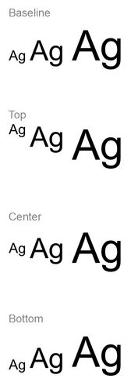

## **نمای کلی**

این مقاله نشان می‌دهد که چگونه متن را در ارائه‌های PowerPoint و OpenDocument با استفاده از Aspose.Slides برای Android از طریق Java فرمت‌بندی کنید. این مقاله شامل رنگ‌های پس‌زمینه، شفافیت، فاصلهٔ کاراکترها، خصوصیات قلم، چرخش، فاصلهٔ پاراگراف، رفتار autofit، لنگر متن، توقف‌های تب و تنظیمات زبان می‌شود.

مگر اینکه به‌طور دیگری ذکر شده باشد، مثال‌ها از [sample.pptx](sample.pptx) استفاده می‌کنند. اولین شکل در اسلاید اول آن یک جعبهٔ متن است و اولین پاراگراف آن حاوی متنی است که در زیر نشان داده شده است. هر دو اندیس اسلاید و شکل به‌صورت صفر‑محور هستند. مثال‌هایی که قسمت‌های بولد را انتخاب می‌کنند، از قالب‌بندی مؤثر استفاده می‌کنند، شامل قالب‌بندی بولد ارث‌بری:


برای یافتن و برجسته‌سازی متن دقیق یا تطبیق‌های عبارت منظم، ببینید [جستجو و جایگزینی متن](/slides/fa/androidjava/search-and-replace-text/).

## **تنظیم رنگ پس‌زمینهٔ متن**

از [IParagraphFormat.getDefaultPortionFormat](https://reference.aspose.com/slides/androidjava/com.aspose.slides/iparagraphformat/#getDefaultPortionFormat--) برای تنظیم رنگ برجستهٔ پیش‌فرض یک پاراگراف استفاده کنید، یا از [IBasePortionFormat.getHighlightColor](https://reference.aspose.com/slides/androidjava/com.aspose.slides/ibaseportionformat/#getHighlightColor--) برای قسمت‌های متنی جداگانه استفاده کنید.

مثال زیر یک برجستهٔ خاکستری روشن را به‌عنوان پیش‌فرض برای اولین پاراگراف تنظیم می‌کند. رنگ‌های برجستهٔ صریح روی قسمت‌های جداگانه نسبت به این پیش‌فرض ارجحیت دارند:

```java
import com.aspose.slides.*;
import android.graphics.Color;

Presentation presentation = new Presentation("sample.pptx");
try {
    ISlide slide = presentation.getSlides().get_Item(0);

    IAutoShape autoShape = (IAutoShape)slide.getShapes().get_Item(0);
    IParagraph paragraph = autoShape.getTextFrame().getParagraphs().get_Item(0);

    // رنگ برجسته را برای تمام پاراگراف تنظیم کنید.
    paragraph.getParagraphFormat().getDefaultPortionFormat().getHighlightColor().setColor(Color.LTGRAY);

    presentation.save("gray_paragraph.pptx", SaveFormat.Pptx);
} finally {
    presentation.dispose();
}
```

نتیجه:


مثال کد زیر نشان می‌دهد چگونه رنگ پس‌زمینه را برای **قسمت‌های متنی با قلم بولد** تنظیم کنید:

```java
import com.aspose.slides.*;
import android.graphics.Color;

Presentation presentation = new Presentation("sample.pptx");
try {
    ISlide slide = presentation.getSlides().get_Item(0);

    IAutoShape autoShape = (IAutoShape)slide.getShapes().get_Item(0);
    IParagraph paragraph = autoShape.getTextFrame().getParagraphs().get_Item(0);

    for (IPortion portion : paragraph.getPortions()) {
        if (portion.getPortionFormat().getEffective().getFontBold()) {
            // رنگ برجسته را برای قسمت متن تنظیم کنید.
            portion.getPortionFormat().getHighlightColor().setColor(Color.LTGRAY);
        }
    }

    presentation.save("gray_text_portions.pptx", SaveFormat.Pptx);
} finally {
    presentation.dispose();
}
```

نتیجه:


## **هم‌ترازی پاراگراف‌های متن**

از [IParagraphFormat.setAlignment](https://reference.aspose.com/slides/androidjava/com.aspose.slides/iparagraphformat/#setAlignment-int-) برای تنظیم هم‌ترازی پاراگراف درون یک فریم متن استفاده کنید. مقدار می‌تواند centered، left‑aligned، right‑aligned، justified و ... باشد.

مثال کد زیر نشان می‌دهد چگونه پاراگراف را به **مرکز** تراز کنید:

```java
import com.aspose.slides.*;

Presentation presentation = new Presentation("sample.pptx");
try {
    ISlide slide = presentation.getSlides().get_Item(0);

    IAutoShape autoShape = (IAutoShape)slide.getShapes().get_Item(0);
    IParagraph paragraph = autoShape.getTextFrame().getParagraphs().get_Item(0);

    // هم‌ترازی پاراگراف را به مرکز تنظیم کنید.
    paragraph.getParagraphFormat().setAlignment(TextAlignment.Center);

    presentation.save("aligned_paragraph.pptx", SaveFormat.Pptx);
} finally {
    presentation.dispose();
}
```

نتیجه:


## **هم‌ترازی قلم‌ها در یک خط**

از [IParagraphFormat.setFontAlignment](https://reference.aspose.com/slides/androidjava/com.aspose.slides/iparagraphformat/#setFontAlignment-int-) برای هم‌ترازی عمودی قسمت‌های متنی با اندازه‌های قلم متفاوت در یک خط استفاده کنید. این تنظیم برای تمام پاراگراف اعمال می‌شود و هم‌ترازی خطوط آن را کنترل می‌کند.

مثال خود‑محافظ زیر چهار جعبهٔ متن برچسب‌دار روی یک اسلاید ایجاد می‌کند. هر پاراگراف متنی یکسان در اندازه‌های 18، 36 و 54 پوینت دارد که هم‌ترازی قلم متفاوتی دارند. از Arial استفاده می‌کند، autofit و wrapping را غیرفعال می‌کند و فریم‌های متن را به اندازه کافی بزرگ نگه می‌دارد تا یک خط بگنجند.

```java
import com.aspose.slides.*;
import android.graphics.Color;

Presentation presentation = new Presentation();
try {
    ISlide slide = presentation.getSlides().get_Item(0);

    int[] alignments = { FontAlignment.Baseline, FontAlignment.Top, FontAlignment.Center, FontAlignment.Bottom };
    String[] alignmentNames = { "Baseline", "Top", "Center", "Bottom" };
    float[] fontSizes = { 18f, 36f, 54f };

    for (int i = 0; i < alignments.length; i++) {
        IAutoShape shape = slide.getShapes().addAutoShape(ShapeType.Rectangle, 30, 20 + i * 130, 660, 120);
        shape.getFillFormat().setFillType(FillType.NoFill);
        shape.getLineFormat().getFillFormat().setFillType(FillType.NoFill);

        ITextFrame textFrame = shape.getTextFrame();
        textFrame.getTextFrameFormat().setAnchoringType(TextAnchorType.Top);
        textFrame.getTextFrameFormat().setAutofitType(TextAutofitType.None);
        textFrame.getTextFrameFormat().setWrapText(NullableBool.False);

        IParagraph label = textFrame.getParagraphs().get_Item(0);
        label.setText(alignmentNames[i]);
        label.getParagraphFormat().setAlignment(TextAlignment.Left);
        label.getParagraphFormat().getDefaultPortionFormat().setFontHeight(14);
        label.getParagraphFormat().getDefaultPortionFormat().setLatinFont(new FontData("Arial"));
        label.getParagraphFormat().getDefaultPortionFormat().getFillFormat().setFillType(FillType.Solid);
        label.getParagraphFormat().getDefaultPortionFormat().getFillFormat().getSolidFillColor().setColor(Color.GRAY);

        Paragraph paragraph = new Paragraph();
        paragraph.getParagraphFormat().setFontAlignment(alignments[i]);
        paragraph.getParagraphFormat().setAlignment(TextAlignment.Left);
        paragraph.getParagraphFormat().getDefaultPortionFormat().setLatinFont(new FontData("Arial"));
        paragraph.getParagraphFormat().getDefaultPortionFormat().getFillFormat().setFillType(FillType.Solid);
        paragraph.getParagraphFormat().getDefaultPortionFormat().getFillFormat().getSolidFillColor().setColor(Color.BLACK);

        for (float fontSize : fontSizes) {
            Portion portion = new Portion("Ag ");
            portion.getPortionFormat().setFontHeight(fontSize);
            paragraph.getPortions().add(portion);
        }

        textFrame.getParagraphs().add(paragraph);
    }

    presentation.save("font_alignment.pptx", SaveFormat.Pptx);
} finally {
    presentation.dispose();
}
```

نتیجه:



هم‌ترازی قلم از معیارهای متریک قلم استفاده می‌کند، بنابراین لبه‌های قابل رؤیت حروف لزوماً دقیقاً هم‌راستا نیستند. مثال شامل یک حرف بزرگ و یک descender است تا تفاوت بین baseline و bottom alignment واضح شود. در دسترس بودن قلم و جایگزینی، کاراکترهای استفاده‌شده و اختلاف اندازه‌های قلم بر نتیجه تأثیر می‌گذارند. ابعاد فریم، حاشیه‌ها، فاصلهٔ خط، wrapping و autofit نیز بر چیدمان تأثیر دارند؛ برای مقایسهٔ حالت‌ها از همان قلم‌ها و تنظیمات چیدمان استفاده کنید.

این تنظیم متفاوت از [IParagraphFormat.setAlignment](https://reference.aspose.com/slides/androidjava/com.aspose.slides/iparagraphformat/#setAlignment-int-) است که هم‌ترازی افقی پاراگراف را کنترل می‌کند و از [ITextFrameFormat.setAnchoringType](https://reference.aspose.com/slides/androidjava/com.aspose.slides/itextframeformat/#setAnchoringType-byte-) که موقعیت بلوک متن را به صورت عمودی داخل شکل تنظیم می‌کند. قالب‌بندی superscript و subscript از طریق [IBasePortionFormat.setEscapement](https://reference.aspose.com/slides/androidjava/com.aspose.slides/ibaseportionformat/#setEscapement-float-) بخش‌های جداگانه را نسبت به baseline جابه‌جا می‌کند نه اینکه هم‌ترازی قلم خطوط پاراگراف را تنظیم کند.

## **تنظیم شفافیت متن**

شفافیت متن از طریق مؤلفهٔ آلفای رنگی که به [IBasePortionFormat.getFillFormat](https://reference.aspose.com/slides/androidjava/com.aspose.slides/ibaseportionformat/#getFillFormat--) اختصاص داده می‌شود، کنترل می‌شود. در مثال‌های زیر، `alpha = 50` مقدار آلفای ARGB در مقیاس 0‑255 است، نه درصد شفافیت.

مثال کد زیر نشان می‌دهد چگونه شفافیت را برای **تمام پاراگراف** اعمال کنید:

```java
import com.aspose.slides.*;
import android.graphics.Color;

int alpha = 50;

Presentation presentation = new Presentation("sample.pptx");
try {
    ISlide slide = presentation.getSlides().get_Item(0);

    IAutoShape autoShape = (IAutoShape)slide.getShapes().get_Item(0);
    IParagraph paragraph = autoShape.getTextFrame().getParagraphs().get_Item(0);

    // رنگ پر کردن متن را به رنگ شفاف تنظیم کنید.
    paragraph.getParagraphFormat().getDefaultPortionFormat().getFillFormat().setFillType(FillType.Solid);
    paragraph.getParagraphFormat().getDefaultPortionFormat().getFillFormat().getSolidFillColor().setColor(Color.argb(alpha, 0, 0, 0));

    presentation.save("transparent_paragraph.pptx", SaveFormat.Pptx);
} finally {
    presentation.dispose();
}
```

نتیجه:


مثال کد زیر نشان می‌دهد چگونه شفافیت را برای **قسمت‌های متنی با قلم بولد** اعمال کنید:

```java
import com.aspose.slides.*;
import android.graphics.Color;

int alpha = 50;

Presentation presentation = new Presentation("sample.pptx");
try {
    ISlide slide = presentation.getSlides().get_Item(0);

    IAutoShape autoShape = (IAutoShape)slide.getShapes().get_Item(0);
    IParagraph paragraph = autoShape.getTextFrame().getParagraphs().get_Item(0);

    for (IPortion portion : paragraph.getPortions()) {
        if (portion.getPortionFormat().getEffective().getFontBold()) {
            // شفافیت قسمت متن را تنظیم کنید.
            portion.getPortionFormat().getFillFormat().setFillType(FillType.Solid);
            portion.getPortionFormat().getFillFormat().getSolidFillColor().setColor(Color.argb(alpha, 0, 0, 0));
        }
    }

    presentation.save("transparent_text_portions.pptx", SaveFormat.Pptx);
} finally {
    presentation.dispose();
}
```

نتیجه:


## **تنظیم فاصلهٔ کاراکترهای متن**

از [IBasePortionFormat.setSpacing](https://reference.aspose.com/slides/androidjava/com.aspose.slides/ibaseportionformat/#setSpacing-float-) برای گسترش یا فشردن فاصلهٔ کاراکترها در یک جعبهٔ متن استفاده کنید. مثال‌ها 3 پوینت فاصله اضافه می‌کنند؛ مقادیر منفی متن را فشرده می‌سازند.

کد Java زیر نشان می‌دهد چگونه فاصلهٔ کاراکترها را در **تمام پاراگراف** گسترش دهید:

```java
import com.aspose.slides.*;

Presentation presentation = new Presentation("sample.pptx");
try {
    ISlide slide = presentation.getSlides().get_Item(0);

    IAutoShape autoShape = (IAutoShape)slide.getShapes().get_Item(0);
    IParagraph paragraph = autoShape.getTextFrame().getParagraphs().get_Item(0);

    // نکته: برای فشرده‌سازی فاصله کاراکتر از مقادیر منفی استفاده کنید.
    paragraph.getParagraphFormat().getDefaultPortionFormat().setSpacing(3); // گسترش فاصله کاراکتر.

    presentation.save("character_spacing_in_paragraph.pptx", SaveFormat.Pptx);
} finally {
    presentation.dispose();
}
```

نتیجه:


مثال کد زیر نشان می‌دهد چگونه فاصلهٔ کاراکترها را در **قسمت‌های متنی با قلم بولد** گسترش دهید:

```java
import com.aspose.slides.*;

Presentation presentation = new Presentation("sample.pptx");
try {
    ISlide slide = presentation.getSlides().get_Item(0);

    IAutoShape autoShape = (IAutoShape)slide.getShapes().get_Item(0);
    IParagraph paragraph = autoShape.getTextFrame().getParagraphs().get_Item(0);

    for (IPortion portion : paragraph.getPortions()) {
        if (portion.getPortionFormat().getEffective().getFontBold()) {
            // نکته: برای فشرده‌سازی فاصله کاراکتر از مقادیر منفی استفاده کنید.
            portion.getPortionFormat().setSpacing(3); // گسترش فاصله کاراکتر.
        }
    }

    presentation.save("character_spacing_in_text_portions.pptx", SaveFormat.Pptx);
} finally {
    presentation.dispose();
}
```

نتیجه:


### **غیرفعال‌سازی کرنینگ برای قلم‌های خاص**

در برخی موارد، متنی که توسط Aspose.Slides رندر می‌شود، ممکن است کمی فشرده‌تر از همان متن در PowerPoint به‌نظر برسد. این می‌تواند به این دلیل باشد که PowerPoint ممکن است داده‌های کرنینگ برخی قلم‌ها را نادیده بگیرد، حتی اگر قلم دارای اطلاعات کرنینگ معتبر باشد و کرنینگ در تنظیمات PowerPoint فعال باشد.

برای نزدیک‌تر کردن خروجی رندر شده به PowerPoint در چنین مواردی، می‌توانید کرنینگ را برای قسمت‌های متنی که از قلم تحت تأثیر استفاده می‌کنند، غیرفعال کنید. مقدار [IBasePortionFormat.setKerningMinimalSize](https://reference.aspose.com/slides/androidjava/com.aspose.slides/ibaseportionformat/#setKerningMinimalSize-float-) را بزرگ‌تر از اندازهٔ واقعی قلم تنظیم کنید. این مثال به «presentation.pptx» با یک جعبهٔ متن به‌عنوان اولین شکل در اسلاید اول نیاز دارد. نام‌های قلم مؤثر، شامل قلم‌های ارث‌بری، بررسی می‌شوند و آستانهٔ 100 پوینت برای قسمت‌هایی که از Roboto استفاده می‌کنند تنظیم می‌شود؛ این کار کرنینگ را برای قسمت‌های مطابقتی با اندازهٔ قلم زیر 100 پوینت غیرفعال می‌کند:

```java
import com.aspose.slides.*;

Presentation presentation = new Presentation("presentation.pptx");
try {
    ISlide slide = presentation.getSlides().get_Item(0);

    IAutoShape autoShape = (IAutoShape)slide.getShapes().get_Item(0);
    String targetFont = "Roboto";

    for (IParagraph paragraph : autoShape.getTextFrame().getParagraphs()) {
        for (IPortion portion : paragraph.getPortions()) {
            IPortionFormatEffectiveData portionFormat = portion.getPortionFormat().getEffective();

            if ((portionFormat.getLatinFont() != null &&
                 portionFormat.getLatinFont().getFontName().equals(targetFont)) ||
                (portionFormat.getEastAsianFont() != null &&
                 portionFormat.getEastAsianFont().getFontName().equals(targetFont)) ||
                (portionFormat.getComplexScriptFont() != null &&
                 portionFormat.getComplexScriptFont().getFontName().equals(targetFont))) {
                portion.getPortionFormat().setKerningMinimalSize(100);
            }
        }
    }

    presentation.save("output.pptx", SaveFormat.Pptx);
} finally {
    presentation.dispose();
}
```

برای متن‌های مطابقتی زیر آستانه، این تنظیم از کرنینگ جلوگیری می‌کند و می‌تواند به هم‌راستایی رندر Aspose.Slides با خروجی بصری PowerPoint برای قلم‌هایی که تحت این رفتار خاص PowerPoint هستند، کمک کند.

## **مدیریت خصوصیات قلم متن**

خصوصیات قلم می‌توانند از طریق [IParagraphFormat.getDefaultPortionFormat](https://reference.aspose.com/slides/androidjava/com.aspose.slides/iparagraphformat/#getDefaultPortionFormat--) در سطح پاراگراف یا از طریق [IPortionFormat](https://reference.aspose.com/slides/androidjava/com.aspose.slides/iportionformat/) در قسمت‌های جداگانه تنظیم شوند.

مثال زیر قلم پیش‌فرض اولین پاراگراف را به 12 پوینت Times New Roman با قالب بولد، ایتالیک و زیرخط نقطه‌دار تنظیم می‌کند. قالب‌بندی صریح روی قسمت‌های جداگانه نسبت به این پیش‌فرض ارجحیت دارد:

```java
import com.aspose.slides.*;

Presentation presentation = new Presentation("sample.pptx");
try {
    ISlide slide = presentation.getSlides().get_Item(0);

    IAutoShape autoShape = (IAutoShape)slide.getShapes().get_Item(0);
    IParagraph paragraph = autoShape.getTextFrame().getParagraphs().get_Item(0);

    // تنظیم ویژگی‌های قلم برای پاراگراف.
    paragraph.getParagraphFormat().getDefaultPortionFormat().setFontHeight(12);
    paragraph.getParagraphFormat().getDefaultPortionFormat().setFontBold(NullableBool.True);
    paragraph.getParagraphFormat().getDefaultPortionFormat().setFontItalic(NullableBool.True);
    paragraph.getParagraphFormat().getDefaultPortionFormat().setFontUnderline(TextUnderlineType.Dotted);
    paragraph.getParagraphFormat().getDefaultPortionFormat().setLatinFont(new FontData("Times New Roman"));

    presentation.save("font_properties_for_paragraph.pptx", SaveFormat.Pptx);
} finally {
    presentation.dispose();
}
```

نتیجه:


مثال زیر 13 پوینت Times New Roman، قالب ایتالیک و زیرخط نقطه‌دار را به قسمت‌هایی که قالب مؤثرشان بولد است اعمال می‌کند:

```java
import com.aspose.slides.*;

Presentation presentation = new Presentation("sample.pptx");
try {
    ISlide slide = presentation.getSlides().get_Item(0);

    IAutoShape autoShape = (IAutoShape)slide.getShapes().get_Item(0);
    IParagraph paragraph = autoShape.getTextFrame().getParagraphs().get_Item(0);

    for (IPortion portion : paragraph.getPortions()) {
        if (portion.getPortionFormat().getEffective().getFontBold()) {
            // تنظیم ویژگی‌های قلم برای قسمت متن.
            portion.getPortionFormat().setFontHeight(13);
            portion.getPortionFormat().setFontItalic(NullableBool.True);
            portion.getPortionFormat().setFontUnderline(TextUnderlineType.Dotted);
            portion.getPortionFormat().setLatinFont(new FontData("Times New Roman"));
        }
    }

    presentation.save("font_properties_for_text_portions.pptx", SaveFormat.Pptx);
} finally {
    presentation.dispose();
}
```

نتیجه:


## **کنترل نرمال‌سازی ارتفاع متن**

از [IBasePortionFormat.setNormaliseHeight](https://reference.aspose.com/slides/androidjava/com.aspose.slides/ibaseportionformat/#setNormaliseHeight-byte-) زمانی که به بازآفرینی تایپوگرافی قالب یا بررسی اختلافات ارتفاع کاراکتر می‌پردازید، استفاده کنید. در PowerPoint، فعال کردن نرمال‌سازی کاراکترهای فردی را به‌صورت عمودی کشیده یا فشرده می‌کند تا ارتفاع قابل رؤیت یکسانی درون قسمت متن داشته باشند. این تضمین نمی‌کند که ارتفاع متن بین قلم‌های مختلف برابر باشد.

مقدار ویژگی را به [NullableBool.True یا False](https://reference.aspose.com/slides/androidjava/com.aspose.slides/nullablebool/) تنظیم کنید تا به‌صورت صریح نرمال‌سازی را فعال یا غیرفعال کنید. `NullableBool.NotDefined` تنظیم محلی را خالی می‌گذارد تا قسمت مقدار را از مثالاً از [getDefaultPortionFormat](https://reference.aspose.com/slides/androidjava/com.aspose.slides/iparagraphformat/#getDefaultPortionFormat--) پاراگراف به ارث ببرد. این به معنای `False` نیست. برای دریافت مقدار Boolean حل‑شده از [IPortionFormat.getEffective](https://reference.aspose.com/slides/androidjava/com.aspose.slides/iportionformat/#getEffective--) و [IBasePortionFormatEffectiveData.getNormaliseHeight](https://reference.aspose.com/slides/androidjava/com.aspose.slides/ibaseportionformateffectivedata/#getNormaliseHeight--) استفاده کنید.

مثال خود‑محافظ زیر نیاز به نصب **Arial** دارد. دو بلوک متن شامل حروف بزرگ و کوچک، descenderها و کاراکترهای لهجه‌دار در اندازهٔ 54 پوینت ایجاد می‌کند. هر دو پاراگراف به‌صورت پیش‌فرض نرمال‌سازی را فعال می‌کنند. قسمت بالایی آن را صریحاً غیرفعال می‌کند؛ قسمت پایینی آن را ارث می‌برد. ابعاد فریم، حاشیه‌ها و فاصلهٔ پاراگراف یکسان هستند و wrapping و autofit برای حفظ مقایسه ثابت غیرفعال هستند. مثال `False: false` و `NotDefined: true` چاپ می‌کند و سپس «text_height_normalization.pptx» را ذخیره می‌کند.

```java
import com.aspose.slides.*;
import android.graphics.Color;

Presentation presentation = new Presentation();
try {
    ISlide slide = presentation.getSlides().get_Item(0);

    byte[] settings = { NullableBool.False, NullableBool.NotDefined };
    String[] settingNames = { "False", "NotDefined" };

    for (int i = 0; i < settings.length; i++) {
        IAutoShape shape = slide.getShapes().addAutoShape(ShapeType.Rectangle, 30, 60 + i * 200, 660, 150);
        shape.getFillFormat().setFillType(FillType.NoFill);
        shape.getLineFormat().getFillFormat().setFillType(FillType.NoFill);

        ITextFrame textFrame = shape.getTextFrame();
        textFrame.setText("Hxgjpq ÅÉ 0123");
        textFrame.getTextFrameFormat().setAutofitType(TextAutofitType.None);
        textFrame.getTextFrameFormat().setWrapText(NullableBool.False);
        textFrame.getTextFrameFormat().setAnchoringType(TextAnchorType.Top);
        textFrame.getTextFrameFormat().setMarginTop(0);
        textFrame.getTextFrameFormat().setMarginLeft(0);

        IParagraph paragraph = textFrame.getParagraphs().get_Item(0);
        paragraph.getParagraphFormat().setAlignment(TextAlignment.Left);
        paragraph.getParagraphFormat().setSpaceBefore(0);
        paragraph.getParagraphFormat().setSpaceAfter(0);
        paragraph.getParagraphFormat().setSpaceWithin(100);
        paragraph.getParagraphFormat().getDefaultPortionFormat().setNormaliseHeight(NullableBool.True);

        IPortion portion = paragraph.getPortions().get_Item(0);
        FontData font = new FontData("Arial");
        portion.getPortionFormat().setLatinFont(font);
        portion.getPortionFormat().setFontHeight(54);
        portion.getPortionFormat().getFillFormat().setFillType(FillType.Solid);
        portion.getPortionFormat().getFillFormat().getSolidFillColor().setColor(Color.BLACK);
        portion.getPortionFormat().setNormaliseHeight(settings[i]);

        System.out.println(settingNames[i] + ": " + portion.getPortionFormat().getEffective().getNormaliseHeight());
    }

    presentation.save("text_height_normalization.pptx", SaveFormat.Pptx);
} finally {
    presentation.dispose();
}
```

مقایسهٔ زیر از ارائهٔ ذخیره‌شده استخراج شده است. ردیف بالایی نرمال‌سازی غیرفعال (`False`) دارد؛ ردیف پایینی مقدار ارث‑بردهٔ فعال (`NotDefined` → `True`) را نشان می‌دهد. برای بازآفرینی این ظاهر، Arial نصب باشد.


نرمال‌سازی ارتفاع کاراکتر را بدون تغییر مقدار [getFontHeight](https://reference.aspose.com/slides/androidjava/com.aspose.slides/ibaseportionformat/#getFontHeight--) که اندازهٔ قلم بر حسب پوینت را مشخص می‌کند، تغییر می‌دهد. [setSpaceWithin](https://reference.aspose.com/slides/androidjava/com.aspose.slides/iparagraphformat/#setSpaceWithin-float-) پاراگراف فاصلهٔ خط را کنترل می‌کند، در حالی که [setAutofitType](https://reference.aspose.com/slides/androidjava/com.aspose.slides/itextframeformat/#setAutofitType-byte-) فریم‑متن نحوهٔ تنظیم اندازه متن یا کانتینر را برای تطبیق تعیین می‌کند. این تنظیمات اهداف متفاوتی دارند و می‌توانند به‌صورت مستقل بر چیدمان کلی تأثیر بگذارند. برای اطلاعات بیشتر درباره قالب‌بندی پاراگراف و وراثت، به [Manage Paragraph](/slides/fa/androidjava/manage-paragraph/) مراجعه کنید.

## **اعمال و حذف خط‌خورده**

از [IBasePortionFormat.setStrikethroughType](https://reference.aspose.com/slides/androidjava/com.aspose.slides/ibaseportionformat/#setStrikethroughType-byte-) بر روی یک قسمت متن استفاده کنید تا اصلاحات، عبارات لغو شده یا قیمت‌های قبلی را بدون حذف متن اصلی نشان دهید. برای یک یا دو خط عبور از متن، مقدار را به [TextStrikethroughType.Single یا Double](https://reference.aspose.com/slides/androidjava/com.aspose.slides/textstrikethroughtype/) تنظیم کنید.

برای حذف خط‌خورده، [TextStrikethroughType.None](https://reference.aspose.com/slides/androidjava/com.aspose.slides/textstrikethroughtype/#None) را عبور دهید. این به‌صورت صریح اثر را غیرفعال می‌کند، حتی اگر قالب‌بندی پیرامونی خط‌خورده باشد. در مقابل، [TextStrikethroughType.NotDefined](https://reference.aspose.com/slides/androidjava/com.aspose.slides/textstrikethroughtype/#NotDefined) تنظیم محلی را تعریف‑نشده می‌گذارد تا قسمت قالب‌بندی را از مثالاً از پاراگراف به ارث ببرد. این تضمین نمی‌کند که خط‌خورده حذف شود. برای خواندن قالب‌بندی نهایی، از [IPortionFormat.getEffective](https://reference.aspose.com/slides/androidjava/com.aspose.slides/iportionformat/#getEffective--) استفاده کنید تا مقادیر ارث‌بری‌شده نیز در دسترس باشد.

مثال خود‑محافظ زیر سه مقایسه قیمت ایجاد می‌کند. هر پاراگراف دارای قسمت‌های جداگانه برای برچسب، قیمت قبلی و قیمت فعلی است، بنابراین فقط قیمت قبلی تحت تأثیر قرار می‌گیرد. ردیف اول خط‌خورده را اعمال سپس حذف می‌کند؛ سایر ردیف‌ها به ترتیب خط‌خوردهٔ تک و دوگانه را حفظ می‌کنند. تغییر این تنظیم متن و سایر قالب‌بندی‌های آن، از جمله بولد بودن قیمت قبلی را حفظ می‌کند.

```java
import com.aspose.slides.*;
import android.graphics.Color;

Presentation presentation = new Presentation();
try {
    ISlide slide = presentation.getSlides().get_Item(0);

    IAutoShape shape = slide.getShapes().addAutoShape(ShapeType.Rectangle, 50, 50, 620, 220);
    shape.getFillFormat().setFillType(FillType.NoFill);
    shape.getLineFormat().getFillFormat().setFillType(FillType.NoFill);
    shape.getTextFrame().getParagraphs().clear();

    String[] labels = { "None: ", "Single: ", "Double: " };

    for (String label : labels) {
        Paragraph paragraph = new Paragraph();
        paragraph.getParagraphFormat().setAlignment(TextAlignment.Left);
        paragraph.getParagraphFormat().setSpaceAfter(20);

        IPortionFormat format = paragraph.getParagraphFormat().getDefaultPortionFormat();
        format.setFontHeight(28);
        FontData font = new FontData("Arial");
        format.setLatinFont(font);
        format.getFillFormat().setFillType(FillType.Solid);
        format.getFillFormat().getSolidFillColor().setColor(Color.BLACK);

        Portion labelPortion = new Portion(label);
        paragraph.getPortions().add(labelPortion);

        Portion previousPrice = new Portion("$100");
        previousPrice.getPortionFormat().setFontBold(NullableBool.True);
        paragraph.getPortions().add(previousPrice);
        Portion currentPrice = new Portion(" → $80");
        paragraph.getPortions().add(currentPrice);

        shape.getTextFrame().getParagraphs().add(paragraph);
    }

    IParagraphCollection paragraphs = shape.getTextFrame().getParagraphs();

    // خط‌خورده اعمال کنید، سپس به‌صورت صریح آن را از اولین قیمت قبلی حذف کنید.
    paragraphs.get_Item(0).getPortions().get_Item(1).getPortionFormat().setStrikethroughType(TextStrikethroughType.Single);
    paragraphs.get_Item(0).getPortions().get_Item(1).getPortionFormat().setStrikethroughType(TextStrikethroughType.None);

    paragraphs.get_Item(1).getPortions().get_Item(1).getPortionFormat().setStrikethroughType(TextStrikethroughType.Single);
    paragraphs.get_Item(2).getPortions().get_Item(1).getPortionFormat().setStrikethroughType(TextStrikethroughType.Double);

    presentation.save("strikethrough.pptx", SaveFormat.Pptx);
} finally {
    presentation.dispose();
}
```

نتیجه، از بالا به پایین: بدون خط‌خورده، خط‌خوردهٔ تک و خط‌خوردهٔ دوگانه.


## **تنظیم چرخش متن**

از [ITextFrameFormat.setTextVerticalType](https://reference.aspose.com/slides/androidjava/com.aspose.slides/itextframeformat/#setTextVerticalType-byte-) برای تنظیم جهت از پیش تعریف‌شدهٔ متن درون یک شکل استفاده کنید.

کد زیر جهت متن در شکل را به [TextVerticalType.Vertical270](https://reference.aspose.com/slides/androidjava/com.aspose.slides/textverticaltype/) تنظیم می‌کند که متن را **90 درجه به سمت ضد ساعت‌گرد** می‌چرخاند:

```java
import com.aspose.slides.*;

Presentation presentation = new Presentation("sample.pptx");
try {
    ISlide slide = presentation.getSlides().get_Item(0);

    IAutoShape autoShape = (IAutoShape)slide.getShapes().get_Item(0);
    autoShape.getTextFrame().getTextFrameFormat().setTextVerticalType(TextVerticalType.Vertical270);

    presentation.save("text_rotation.pptx", SaveFormat.Pptx);
} finally {
    presentation.dispose();
}
```

نتیجه:


## **تنظیم چرخش سفارشی برای فریم‌های متن**

از [ITextFrameFormat.setRotationAngle](https://reference.aspose.com/slides/androidjava/com.aspose.slides/itextframeformat/#setRotationAngle-float-) برای تنظیم زاویهٔ چرخش سفارشی یک [ITextFrame](https://reference.aspose.com/slides/androidjava/com.aspose.slides/itextframe/) استفاده کنید.

کد زیر فریم متن را داخل شکل 3 درجه به‌سوی ساعت‌گرد می‌چرخاند:

```java
import com.aspose.slides.*;

Presentation presentation = new Presentation("sample.pptx");
try {
    ISlide slide = presentation.getSlides().get_Item(0);

    IAutoShape autoShape = (IAutoShape)slide.getShapes().get_Item(0);
    autoShape.getTextFrame().getTextFrameFormat().setRotationAngle(3);

    presentation.save("custom_text_rotation.pptx", SaveFormat.Pptx);
} finally {
    presentation.dispose();
}
```

نتیجه:


## **تنظیم فاصلهٔ خط پاراگراف‌ها**

Aspose.Slides متدهای [IParagraphFormat.setSpaceAfter](https://reference.aspose.com/slides/androidjava/com.aspose.slides/iparagraphformat/#setSpaceAfter-float-)، [IParagraphFormat.setSpaceBefore](https://reference.aspose.com/slides/androidjava/com.aspose.slides/iparagraphformat/#setSpaceBefore-float-) و [IParagraphFormat.setSpaceWithin](https://reference.aspose.com/slides/androidjava/com.aspose.slides/iparagraphformat/#setSpaceWithin-float-) را برای کنترل فاصلهٔ پاراگراف فراهم می‌کند. این ویژگی‌ها به صورت زیر استفاده می‌شوند:

* برای تعیین فاصلهٔ خط به‌صورت درصدی از ارتفاع خط، مقدار مثبت استفاده کنید.
* برای تعیین فاصلهٔ خط به پوینت، مقدار منفی استفاده کنید.

مثال زیر فاصلهٔ داخلی اولین پاراگراف را برابر 200٪ از ارتفاع خط (دو برابر کردن) تنظیم می‌کند:

```java
import com.aspose.slides.*;

Presentation presentation = new Presentation("sample.pptx");
try {
    ISlide slide = presentation.getSlides().get_Item(0);

    IAutoShape autoShape = (IAutoShape)slide.getShapes().get_Item(0);

    IParagraph paragraph = autoShape.getTextFrame().getParagraphs().get_Item(0);
    paragraph.getParagraphFormat().setSpaceWithin(200);

    presentation.save("line_spacing.pptx", SaveFormat.Pptx);
} finally {
    presentation.dispose();
}
```

نتیجه:


## **کنترل شکستن خط**

قواعد شکستن خط پاراگراف در بلوک‌های متنی باریک و ارائه‌هایی که ترکیب متن لاتین و شرق‑آسیایی دارند، مفید هستند. متدهای زیر متعلق به [IParagraphFormat](https://reference.aspose.com/slides/androidjava/com.aspose.slides/iparagraphformat/) هستند، بنابراین برای کل پاراگراف اعمال می‌شوند:

- [setLatinLineBreak](https://reference.aspose.com/slides/androidjava/com.aspose.slides/iparagraphformat/#setLatinLineBreak-byte-) قوانین شکستن خط لاتین را کنترل می‌کند. در متن ترکیبی، تغییر این مقدار می‌تواند نحوهٔ پیچیدن متن و نقطه‌گذاری مرتبط با متن شرق‑آسیایی را نیز تغییر دهد.
- [setEastAsianLineBreak](https://reference.aspose.com/slides/androidjava/com.aspose.slides/iparagraphformat/#setEastAsianLineBreak-byte-) قوانین شکستن خط شرق‑آسیایی را کنترل می‌کند، از جمله محدودیت‌های کاراکتر در ابتدای و انتهای خط.

این قوانین جایگزین [ITextFrameFormat.setWrapText](https://reference.aspose.com/slides/androidjava/com.aspose.slides/itextframeformat/#setWrapText-byte-) که wrapping خودکار درون فریم متن را فعال می‌کند، نمی‌شوند. آن‌ها هنگام وقوع wrapping بر چیدمان تأثیر می‌گذارند؛ کاراکترهای قطع خط را وارد نمی‌کنند. یک شکست خط صریح یک خط جدید درون پاراگراف ایجاد می‌کند مستقل از عرض موجود.

مثال خود‑محافظ زیر یک بلوک متنی باریک شامل متن‌های چینی و لاتین ایجاد می‌کند. هر دو گزینهٔ شکستن خط به‌صورت صریح تنظیم شده و «line_breaking.pptx» ذخیره می‌شود. برای آزمایش هر قانون مقدار مربوطه را تغییر دهید در حالی که تنظیمات دیگر ثابت می‌مانند. مثال از Arial 24 پوینت و SimSun با عرض فریم 160 پوینت و حاشیه‌های افقی صفر استفاده می‌کند. [ITextFrameFormat.setAutofitType](https://reference.aspose.com/slides/androidjava/com.aspose.slides/itextframeformat/#setAutofitType-byte-) با [TextAutofitType.None](https://reference.aspose.com/slides/androidjava/com.aspose.slides/textautofittype/) فراخوانی می‌شود تا اندازهٔ متن و ابعاد فریم ثابت بمانند.

```java
import com.aspose.slides.*;
import android.graphics.Color;

Presentation presentation = new Presentation();
try {
    ISlide slide = presentation.getSlides().get_Item(0);

    IAutoShape shape = slide.getShapes().addAutoShape(ShapeType.Rectangle, 50, 50, 160, 300);
    shape.getFillFormat().setFillType(FillType.NoFill);

    ITextFrame textFrame = shape.getTextFrame();
    textFrame.getTextFrameFormat().setWrapText(NullableBool.True);
    textFrame.getTextFrameFormat().setAutofitType(TextAutofitType.None);
    textFrame.getTextFrameFormat().setMarginLeft(0);
    textFrame.getTextFrameFormat().setMarginRight(0);

    IParagraph paragraph = textFrame.getParagraphs().get_Item(0);
    paragraph.setText("中文排版测试，PowerPoint 中文演示。");

    IParagraphFormat format = paragraph.getParagraphFormat();
    format.setAlignment(TextAlignment.Left);
    format.getDefaultPortionFormat().setFontHeight(24);
    FontData latinFont = new FontData("Arial");
    format.getDefaultPortionFormat().setLatinFont(latinFont);
    FontData eastAsianFont = new FontData("SimSun");
    format.getDefaultPortionFormat().setEastAsianFont(eastAsianFont);
    format.getDefaultPortionFormat().getFillFormat().setFillType(FillType.Solid);
    format.getDefaultPortionFormat().getFillFormat().getSolidFillColor().setColor(Color.BLACK);
    format.setLatinLineBreak(NullableBool.False);
    format.setEastAsianLineBreak(NullableBool.True);

    presentation.save("line_breaking.pptx", SaveFormat.Pptx);
} finally {
    presentation.dispose();
}
```

## **کنترل علامت‌های نگهدارندهٔ انتهای خط**

[IParagraphFormat.setHangingPunctuation](https://reference.aspose.com/slides/androidjava/com.aspose.slides/iparagraphformat/#setHangingPunctuation-byte-) به علامت‌های شناخته‌شده اجازه می‌دهد تا فراتر از لبهٔ راست خط متن امتداد یابند به جای این که در خط بعدی قرار گیرند. این تنظیم برای تمام پاراگراف اعمال می‌شود و متفاوت از یک تورفتگی معلق است.

مثال خود‑محافظ زیر علامت نگهدارندهٔ انتهای خط را در فریم متنی 100 پوینت عریض فعال می‌کند و «hanging_punctuation.pptx» را ذخیره می‌کند. با Arial 24 پوینت و حاشیه‌های افقی صفر، نقطهٔ نهایی پس از «sentence» می‌ماند و فراتر از لبهٔ راست متن امتداد می‌یابد. برای مقایسه مقدار را به [NullableBool.False](https://reference.aspose.com/slides/androidjava/com.aspose.slides/nullablebool/) تنظیم کنید: با این تنظیمات، نقطه در خط جداگانه‌ای قرار می‌گیرد. wrapping فعال و autofit غیرفعال است تا عرض ثابت بماند.

```java
import com.aspose.slides.*;
import android.graphics.Color;

Presentation presentation = new Presentation();
try {
    ISlide slide = presentation.getSlides().get_Item(0);

    IAutoShape shape = slide.getShapes().addAutoShape(ShapeType.Rectangle, 50, 50, 100, 200);
    shape.getFillFormat().setFillType(FillType.NoFill);

    ITextFrame textFrame = shape.getTextFrame();
    textFrame.getTextFrameFormat().setWrapText(NullableBool.True);
    textFrame.getTextFrameFormat().setAutofitType(TextAutofitType.None);
    textFrame.getTextFrameFormat().setMarginLeft(0);
    textFrame.getTextFrameFormat().setMarginRight(0);

    IParagraph paragraph = textFrame.getParagraphs().get_Item(0);
    paragraph.setText("Simple text, next sentence.");

    IParagraphFormat format = paragraph.getParagraphFormat();
    format.setAlignment(TextAlignment.Left);
    format.getDefaultPortionFormat().setFontHeight(24);
    FontData latinFont = new FontData("Arial");
    format.getDefaultPortionFormat().setLatinFont(latinFont);
    format.getDefaultPortionFormat().getFillFormat().setFillType(FillType.Solid);
    format.getDefaultPortionFormat().getFillFormat().getSolidFillColor().setColor(Color.BLACK);
    format.setHangingPunctuation(NullableBool.True);

    presentation.save("hanging_punctuation.pptx", SaveFormat.Pptx);
} finally {
    presentation.dispose();
}
```

هر علامت نقطه‌گذاری‌ای امکان نگهداری ندارد. شرایط قلم و چیدمان توضیح‑داده‌شده در بخش [کنترل شکستن خط](#control-line-breaking) نیز بر این مقایسه اعمال می‌شود: تغییر قلم، عرض موجود، حاشیه‌ها یا تنظیمات autofit می‌تواند تفاوت قابل مشاهده را از بین ببرد.

## **تنظیم نوع Autofit برای فریم‌های متن**

[ITextFrameFormat.setAutofitType](https://reference.aspose.com/slides/androidjava/com.aspose.slides/itextframeformat/#setAutofitType-byte-) تعیین می‌کند وقتی متن از مرزهای کانتینر خود فراتر می‌رود، چگونه رفتار کند. از آن برای کنترل اینکه آیا متن کوچک شود، سرریز کند یا شکل به‌صورت خودکار اندازه‌اش را تغییر دهد استفاده کنید. مثال زیر شکل را طوری پیکربندی می‌کند که برای متن خود اندازه‌اش را تغییر دهد و نتیجه را در «autofit_type.pptx» ذخیره می‌کند.

```java
import com.aspose.slides.*;

Presentation presentation = new Presentation("sample.pptx");
try {
    ISlide slide = presentation.getSlides().get_Item(0);

    IAutoShape autoShape = (IAutoShape)slide.getShapes().get_Item(0);
    autoShape.getTextFrame().getTextFrameFormat().setAutofitType(TextAutofitType.Shape);

    presentation.save("autofit_type.pptx", SaveFormat.Pptx);
} finally {
    presentation.dispose();
}
```

برای شمارش خطوط پس از wrapping خودکار و مشاهدهٔ نحوهٔ تغییر عرض متن یا شکل، به [Count Rendered Lines](/slides/fa/androidjava/manage-paragraph/) مراجعه کنید. شمارش خطوط به تنهایی نشانگر سرریز متن نیست.

## **تنظیم لنگر فریم‌های متن**

[ITextFrameFormat.setAnchoringType](https://reference.aspose.com/slides/androidjava/com.aspose.slides/itextframeformat/#setAnchoringType-byte-) تعیین می‌کند متن داخل شکل به صورت عمودی در کجا قرار گیرد، مثلاً در بالا، وسط یا پایین. مثال زیر متن را به پایین اولین شکل لنگر می‌دهد و نتیجه را در «text_anchor.pptx» ذخیره می‌کند.

```java
import com.aspose.slides.*;

Presentation presentation = new Presentation("sample.pptx");
try {
    ISlide slide = presentation.getSlides().get_Item(0);

    IAutoShape autoShape = (IAutoShape)slide.getShapes().get_Item(0);
    autoShape.getTextFrame().getTextFrameFormat().setAnchoringType(TextAnchorType.Bottom);

    presentation.save("text_anchor.pptx", SaveFormat.Pptx);
} finally {
    presentation.dispose();
}
```

## **تنظیم تب‌های متن**

از [IParagraphFormat.setDefaultTabSize](https://reference.aspose.com/slides/androidjava/com.aspose.slides/iparagraphformat/#setDefaultTabSize-float-) و [IParagraphFormat.getTabs](https://reference.aspose.com/slides/androidjava/com.aspose.slides/iparagraphformat/#getTabs--) برای پیکربندی توقف‌های تب در یک پاراگراف استفاده کنید. مثال زیر فاصلهٔ پیش‌فرض تب را به 100 پوینت تنظیم می‌کند و یک توقف تب چپ‌تراز در 30 پوینت اضافه می‌کند. این تنظیمات بر متنی که شامل کاراکترهای تب است تأثیر می‌گذارد.

```java
import com.aspose.slides.*;

Presentation presentation = new Presentation("sample.pptx");
try {
    ISlide slide = presentation.getSlides().get_Item(0);

    IAutoShape autoShape = (IAutoShape)slide.getShapes().get_Item(0);

    IParagraph paragraph = autoShape.getTextFrame().getParagraphs().get_Item(0);
    paragraph.getParagraphFormat().setDefaultTabSize(100);
    paragraph.getParagraphFormat().getTabs().add(30, TabAlignment.Left);

    presentation.save("paragraph_tabs.pptx", SaveFormat.Pptx);
} finally {
    presentation.dispose();
}
```

نتیجه:


## **تنظیم زبان تصحیح املایی**

Aspose.Slides متد [IBasePortionFormat.setLanguageId](https://reference.aspose.com/slides/androidjava/com.aspose.slides/ibaseportionformat/#setLanguageId-java.lang.String-) را فراهم می‌کند که به شما اجازه می‌دهد زبان تصحیح املایی یک بخش متن را تنظیم کنید. زبان تصحیح املایی تعیین می‌کند PowerPoint برای بررسی املا و گرامر از کدام زبان استفاده می‌کند.

مثال زیر به «presentation.pptx» با جعبهٔ متن به‌عنوان اولین شکل در اسلاید اول و حداقل یک پاراگراف نیاز دارد. محتوای اولین پاراگراف را به «1。» تغییر می‌دهد، SimSun را به‌عنوان قلم آن تنظیم می‌کند و زبان تصحیح Simplified Chinese (`zh-CN`) را اختصاص می‌دهد. نتیجه در «proofing_language.pptx» ذخیره می‌شود:

```java
import com.aspose.slides.*;

Presentation presentation = new Presentation("presentation.pptx");
try {
    ISlide slide = presentation.getSlides().get_Item(0);

    IAutoShape autoShape = (IAutoShape)slide.getShapes().get_Item(0);

    IParagraph paragraph = autoShape.getTextFrame().getParagraphs().get_Item(0);
    paragraph.getPortions().clear();

    FontData font = new FontData("SimSun");

    Portion textPortion = new Portion();
    textPortion.getPortionFormat().setComplexScriptFont(font);
    textPortion.getPortionFormat().setEastAsianFont(font);
    textPortion.getPortionFormat().setLatinFont(font);

    // شناسهٔ زبان تصحیح املایی را تنظیم کنید.
    textPortion.getPortionFormat().setLanguageId("zh-CN");

    textPortion.setText("1。");
    paragraph.getPortions().add(textPortion);

    presentation.save("proofing_language.pptx", SaveFormat.Pptx);
} finally {
    presentation.dispose();
}
```

### **کپی کردن فرادادهٔ زبان**

زمانی که متن چندزبانه را از یک قالب کپی می‌کنید، هم [IBasePortionFormat.getLanguageId](https://reference.aspose.com/slides/androidjava/com.aspose.slides/ibaseportionformat/#getLanguageId--) و هم [IBasePortionFormat.getAlternativeLanguageId](https://reference.aspose.com/slides/androidjava/com.aspose.slides/ibaseportionformat/#getAlternativeLanguageId--) را حفظ کنید. مثال خود‑محافظ زیر یک بخش منبع با زبان US English و زبان جایگزین فرانسوی ایجاد می‌کند و متن و شناسه‌ها را به یک بخش در ارائهٔ جدید کپی می‌گیرد.

```java
import com.aspose.slides.*;

Portion source = new Portion("Hello! Bonjour!");
source.getPortionFormat().setLanguageId("en-US");
source.getPortionFormat().setAlternativeLanguageId("fr-FR");

Presentation presentation = new Presentation();
try {
    ISlide slide = presentation.getSlides().get_Item(0);

    IAutoShape shape = slide.getShapes().addAutoShape(ShapeType.Rectangle, 20, 20, 400, 80);
    IParagraph paragraph = shape.getTextFrame().getParagraphs().get_Item(0);
    paragraph.getPortions().clear();

    Portion destination = new Portion();
    destination.setText(source.getText());
    destination.getPortionFormat().setLanguageId(source.getPortionFormat().getLanguageId());
    // اگر منبع زبان جایگزینی نداشته باشد، null مقدار مقصد را پاک می‌کند.
    destination.getPortionFormat().setAlternativeLanguageId(source.getPortionFormat().getAlternativeLanguageId());
    paragraph.getPortions().add(destination);

    presentation.save("copied_language_metadata.pptx", SaveFormat.Pptx);
} finally {
    presentation.dispose();
}
```

برای امتحان منبع بدون زبان جایگزین، اختصاص «fr-FR» را حذف کنید. در این صورت شناسهٔ جایگزین `null` خواهد بود و همان عبارت copy آن را بدون اضافه کردن مقدار پیش‌فرض حفظ می‌کند، حتی اگر مقصد قبلاً زبان جایگزین داشته باشد.

این شناسه‌ها متادیتای زبانی را ذخیره می‌کنند. حفظ آن‌ها تعیین نمی‌کند که PowerPoint کدام واژه‌نامه را برای بررسی املا یا گرامر انتخاب می‌کند.

## **تنظیم زبان پیش‌فرض**

از [LoadOptions.setDefaultTextLanguage](https://reference.aspose.com/slides/androidjava/com.aspose.slides/loadoptions/#setDefaultTextLanguage-java.lang.String-) برای تعریف زبان پیش‌فرض متنی که هنگام بارگذاری یا ایجاد یک ارائه ایجاد می‌شود، استفاده کنید. مثال زیر یک ارائه با زبان پیش‌فرض US English ایجاد می‌کند، جعبهٔ متنی اضافه می‌کند و برای اولین بخش متن `en-US` را چاپ می‌کند.

```java
import com.aspose.slides.*;

LoadOptions loadOptions = new LoadOptions();
loadOptions.setDefaultTextLanguage("en-US");

Presentation presentation = new Presentation(loadOptions);
try {
    ISlide slide = presentation.getSlides().get_Item(0);

    // افزودن یک شکل مستطیل جدید با متن.
    IAutoShape shape = slide.getShapes().addAutoShape(ShapeType.Rectangle, 20, 20, 150, 50);
    shape.getTextFrame().setText("Sample text");

    // بررسی زبان اولین قسمت.
    IPortion portion = shape.getTextFrame().getParagraphs().get_Item(0).getPortions().get_Item(0);
    System.out.println(portion.getPortionFormat().getLanguageId());
} finally {
    presentation.dispose();
}
```

## **تنظیم سبک پیش‌فرض متن**

برای اعمال قالب‌بندی پیش‌فرض متن در سطح ارائه، از [IPresentation.getDefaultTextStyle](https://reference.aspose.com/slides/androidjava/com.aspose.slides/ipresentation/#getDefaultTextStyle--) استفاده کنید.

مثال زیر قلم 14 پوینت بولد را به‌عنوان پیش‌فرض برای پاراگراف‌های سطح‑بالا در یک ارائهٔ جدید تنظیم می‌کند و آن را در «default_text_style.pptx» ذخیره می‌کند. متن می‌تواند این پیش‌فرض‌ها را ارث ببرد مگر این‌که قالب‌بندی خاص‌تری آن‌ها را بازنویسی کند.

```java
import com.aspose.slides.*;

Presentation presentation = new Presentation();
try {
    // دریافت قالب پاراگراف سطح بالایی.
    IParagraphFormat paragraphFormat = presentation.getDefaultTextStyle().getLevel(0);

    if (paragraphFormat != null) {
        paragraphFormat.getDefaultPortionFormat().setFontHeight(14);
        paragraphFormat.getDefaultPortionFormat().setFontBold(NullableBool.True);
    }

    presentation.save("default_text_style.pptx", SaveFormat.Pptx);
} finally {
    presentation.dispose();
}
```

## **استخراج متن با اثر تمام حروف بزرگ**

در PowerPoint، اعمال اثر **All Caps** باعث می‌شود متن در اسلاید بزرگ به‌نظر برسد حتی اگر در اصل با حروف کوچک وارد شده باشد. وقتی چنین بخشی را با Aspose.Slides دریافت می‌کنید، کتابخانه دقیقاً همان متنی را برمی‌گرداند که وارد شده است. برای هم‌خوانی با متن نمایش داده‌شده، [TextCapType](https://reference.aspose.com/slides/androidjava/com.aspose.slides/textcaptype/) را بررسی کنید و وقتی مقدار `All` باشد، رشتهٔ بازگشتی را به حروف بزرگ تبدیل کنید.

این مثال به «sample2.pptx» با جعبهٔ متن به‌عنوان اولین شکل در اسلاید اول نیاز دارد. اولین بخش اولین پاراگراف حاوی «Hello, Aspose!» با اثر All Caps است، همان‌طور که در زیر نشان داده شده است.


مثال کد زیر نشان می‌دهد چگونه متن را با اثر **All Caps** استخراج کنید:

```java
import com.aspose.slides.*;

Presentation presentation = new Presentation("sample2.pptx");
try {
    ISlide slide = presentation.getSlides().get_Item(0);
    
    IAutoShape autoShape = (IAutoShape)slide.getShapes().get_Item(0);
    IPortion textPortion = autoShape.getTextFrame().getParagraphs().get_Item(0).getPortions().get_Item(0);

    System.out.println("Original text: " + textPortion.getText());

    IPortionFormatEffectiveData textFormat = textPortion.getPortionFormat().getEffective();
    if (textFormat.getTextCapType() == TextCapType.All) {
        String text = textPortion.getText().toUpperCase();
        System.out.println("All-Caps effect: " + text);
    }
} finally {
    presentation.dispose();
}
```

خروجی:

```text
Original text: Hello, Aspose!
All-Caps effect: HELLO, ASPOSE!
```

## **سوالات متداول**

**چگونه متن در یک جدول در اسلاید را اصلاح کنم؟**

برای اصلاح متن در یک جدول در اسلاید، از [ITable](https://reference.aspose.com/slides/androidjava/com.aspose.slides/itable/) استفاده کنید. سلول‌ها را مرور کنید و هر سلول را از طریق [ICell.getTextFrame](https://reference.aspose.com/slides/androidjava/com.aspose.slides/icell/#getTextFrame--) به‌روز کنید و قالب‌بندی پاراگراف را از طریق [IParagraph.getParagraphFormat](https://reference.aspose.com/slides/androidjava/com.aspose.slides/iparagraph/#getParagraphFormat--) تنظیم کنید.

**چگونه رنگ گرادیان را به متن در یک اسلاید PowerPoint اعمال کنم؟**

برای اعمال رنگ گرادیان به متن، از [IBasePortionFormat.getFillFormat](https://reference.aspose.com/slides/androidjava/com.aspose.slides/ibaseportionformat/#getFillFormat--) استفاده کنید. مقدار [IFillFormat.setFillType](https://reference.aspose.com/slides/androidjava/com.aspose.slides/ifillformat/#setFillType-byte-) را به [FillType.Gradient](https://reference.aspose.com/slides/androidjava/com.aspose.slides/filltype/) تنظیم کنید و نقاط توقف گرادیان، جهت و شفافیت را پیکربندی کنید.