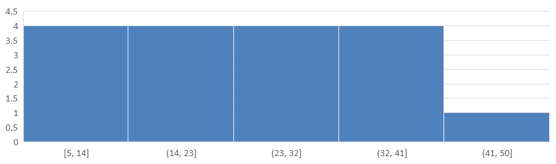

## **نمای کلی**

این مقاله راهنمای جامعی برای ایجاد و سفارشی‌سازی نمودارها با استفاده از Aspose.Slides برای Java ارائه می‌دهد. شماLearn how to programmatically add a chart to a slide, populate it with data, and apply various formatting options to match your specific design requirements. Throughout the article, detailed code examples illustrate each step, from initializing the presentation and chart object to configuring series, axes, and legends. By following this guide, you'll gain a solid understanding of how to integrate dynamic chart generation into your Java applications, streamlining the process of creating data-driven presentations.

## **Create a Chart**

نمودارها به افراد کمک می‌کنند تا داده‌ها را به سرعت به‌صورت تصویری درک کنند و بینش‌هایی به دست آورند که ممکن است از یک جدول یا صفحه‌گسترده به‌راحتی قابل مشاهده نباشند.

**چرا ایجاد نمودار؟**

با استفاده از نمودارها می‌توانید:

* مقادیر بزرگ داده را در یک اسلاید جمع‌آوری، فشرده یا خلاصه کنید؛
* الگوها و روندهای داده را آشکار کنید؛
* جهت و شتاب داده را در طول زمان یا نسبت به یک واحد اندازه‌گیری خاص تشخیص دهید؛
* نقاط دورافتاده، انحرافات، خطاها و داده‌های نامعقول را شناسایی کنید؛
* داده‌های پیچیده را ارتباط برقرار یا ارائه کنید.

در PowerPoint می‌توانید با استفاده از عملکرد *Insert* نمودارها را ایجاد کنید که الگوهایی برای طراحی انواع مختلف نمودارها فراهم می‌کند. با Aspose.Slides می‌توانید هم نمودارهای معمولی (بر پایه انواع نمودارهای محبوب) و هم نمودارهای سفارشی ایجاد کنید.

{}
از شمارش‌گر [ChartType](https://reference.aspose.com/slides/java/com.aspose.slides/charttype/) در بستهٔ [com.aspose.slides](https://reference.aspose.com/slides/java/com.aspose.slides/) استفاده کنید. مقادیر این شمارش‌گر به انواع مختلف نمودارها مربوط می‌شوند.
{}

### **Create Clustered Column Charts**

این مثال از [addChart](https://reference.aspose.com/slides/java/com.aspose.slides/ishapecollection/#addChart-int-float-float-float-float-) برای ایجاد یک نمودار ستون خوشه‌ای استفاده می‌کند که دو سری را در سه دسته مقایسه می‌کند. سری‌ها از پر کردن‌های قرمز و سبز استفاده می‌کنند و برچسب‌های جداگانه نام دسته، نام سری و مقادیر را نشان می‌دهند. شاخص ورک‌شیت 0 به اولین شیت در کتاب‌کارنامهٔ جاسازی‌شدهٔ نمودار اشاره دارد.

```java
import com.aspose.slides.*;
import java.awt.Color;

Presentation presentation = new Presentation();
try
{
    ISlide slide = presentation.getSlides().get_Item(0);

    IChart chart = slide.getShapes().addChart(ChartType.ClusteredColumn, 20, 20, 500, 300);

    chart.getChartTitle().addTextFrameForOverriding("Sample Title");
    chart.getChartTitle().getTextFrameForOverriding().getTextFrameFormat().setCenterText(NullableBool.True);
    chart.getChartTitle().setHeight(20);
    chart.setTitle(true);

    IChartDataWorkbook workbook = chart.getChartData().getChartDataWorkbook();
    int worksheetIndex = 0;

    chart.getChartData().getSeries().clear();
    chart.getChartData().getCategories().clear();

    IChartDataCell seriesNameCell = workbook.getCell(worksheetIndex, 0, 1, "Series 1");
    chart.getChartData().getSeries().add(seriesNameCell, chart.getType());
    seriesNameCell = workbook.getCell(worksheetIndex, 0, 2, "Series 2");
    chart.getChartData().getSeries().add(seriesNameCell, chart.getType());

    IChartDataCell categoryCell = workbook.getCell(worksheetIndex, 1, 0, "Category 1");
    chart.getChartData().getCategories().add(categoryCell);
    categoryCell = workbook.getCell(worksheetIndex, 2, 0, "Category 2");
    chart.getChartData().getCategories().add(categoryCell);
    categoryCell = workbook.getCell(worksheetIndex, 3, 0, "Category 3");
    chart.getChartData().getCategories().add(categoryCell);

    IChartSeries series = chart.getChartData().getSeries().get_Item(0);

    IChartDataCell valueCell = workbook.getCell(worksheetIndex, 1, 1, 20);
    series.getDataPoints().addDataPointForBarSeries(valueCell);
    valueCell = workbook.getCell(worksheetIndex, 2, 1, 50);
    series.getDataPoints().addDataPointForBarSeries(valueCell);
    valueCell = workbook.getCell(worksheetIndex, 3, 1, 30);
    series.getDataPoints().addDataPointForBarSeries(valueCell);

    series.getFormat().getFill().setFillType(FillType.Solid);
    series.getFormat().getFill().getSolidFillColor().setColor(Color.RED);

    series = chart.getChartData().getSeries().get_Item(1);

    valueCell = workbook.getCell(worksheetIndex, 1, 2, 30);
    series.getDataPoints().addDataPointForBarSeries(valueCell);
    valueCell = workbook.getCell(worksheetIndex, 2, 2, 10);
    series.getDataPoints().addDataPointForBarSeries(valueCell);
    valueCell = workbook.getCell(worksheetIndex, 3, 2, 60);
    series.getDataPoints().addDataPointForBarSeries(valueCell);

    series.getFormat().getFill().setFillType(FillType.Solid);
    series.getFormat().getFill().getSolidFillColor().setColor(new Color(0, 128, 0));

    IDataLabel label = series.getDataPoints().get_Item(0).getLabel();
    label.getDataLabelFormat().setShowCategoryName(true);

    label = series.getDataPoints().get_Item(1).getLabel();
    label.getDataLabelFormat().setShowSeriesName(true);

    label = series.getDataPoints().get_Item(2).getLabel();
    label.getDataLabelFormat().setShowValue(true);
    label.getDataLabelFormat().setShowSeriesName(true);
    label.getDataLabelFormat().setSeparator("/");

    presentation.save("AsposeChart.pptx", SaveFormat.Pptx);
}
finally
{
    presentation.dispose();
}
```

نتیجه:


### **Create Scatter Charts**

نمودارهای پراکنش (که به‌عنوان نمودارهای نقطه‌ای یا گراف x‑y نیز شناخته می‌شوند) اغلب برای بررسی الگوها یا نشان دادن همبستگی بین دو متغیر استفاده می‌شوند.

از نمودار پراکنش زمانی استفاده کنید که:

* داده‌های عددی جفت‌دار داشته باشید؛
* دو متغیر داشته باشید که به‌خوبی با هم جفت می‌شوند؛
* بخواهید تعیین کنید آیا دو متغیر به‌هم مرتبط هستند یا خیر؛
* یک متغیر مستقل داشته باشید که برای یک متغیر وابسته مقادیر متعددی داشته باشد.

این مثال دو مجموعه مقادیر x‑y را رسم می‌کند. سری اول خطوط مستقیم با نشانگرهای ستاره‌ای استفاده می‌کند، در حالی که سری دوم خطوط صاف با نشانگرهای دایره‌ای؛ هر دو از اندازهٔ نشانگر 10 استفاده می‌کنند که با [setSize](https://reference.aspose.com/slides/java/com.aspose.slides/imarker/#setSize-int-) تنظیم شده است. متد [setSymbol](https://reference.aspose.com/slides/java/com.aspose.slides/imarker/#setSymbol-int-) شکل نشانگر را کنترل می‌کند.

```java
import com.aspose.slides.*;

Presentation presentation = new Presentation();
try
{
    ISlide slide = presentation.getSlides().get_Item(0);

    IChart chart = slide.getShapes().addChart(ChartType.ScatterWithSmoothLines, 20, 20, 500, 300);

    IChartDataWorkbook workbook = chart.getChartData().getChartDataWorkbook();
    int worksheetIndex = 0;

    chart.getChartData().getSeries().clear();

    IChartDataCell seriesNameCell = workbook.getCell(worksheetIndex, 1, 1, "Series 1");
    chart.getChartData().getSeries().add(seriesNameCell, chart.getType());
    seriesNameCell = workbook.getCell(worksheetIndex, 1, 3, "Series 2");
    chart.getChartData().getSeries().add(seriesNameCell, chart.getType());

    IChartSeries series = chart.getChartData().getSeries().get_Item(0);

    IChartDataCell xValueCell = workbook.getCell(worksheetIndex, 2, 1, 1);
    IChartDataCell yValueCell = workbook.getCell(worksheetIndex, 2, 2, 3);
    series.getDataPoints().addDataPointForScatterSeries(xValueCell, yValueCell);

    xValueCell = workbook.getCell(worksheetIndex, 3, 1, 2);
    yValueCell = workbook.getCell(worksheetIndex, 3, 2, 10);
    series.getDataPoints().addDataPointForScatterSeries(xValueCell, yValueCell);

    series.setType(ChartType.ScatterWithStraightLinesAndMarkers);

    series.getMarker().setSize(10);
    series.getMarker().setSymbol(MarkerStyleType.Star);

    series = chart.getChartData().getSeries().get_Item(1);

    xValueCell = workbook.getCell(worksheetIndex, 2, 3, 5);
    yValueCell = workbook.getCell(worksheetIndex, 2, 4, 2);
    series.getDataPoints().addDataPointForScatterSeries(xValueCell, yValueCell);

    xValueCell = workbook.getCell(worksheetIndex, 3, 3, 3);
    yValueCell = workbook.getCell(worksheetIndex, 3, 4, 1);
    series.getDataPoints().addDataPointForScatterSeries(xValueCell, yValueCell);

    xValueCell = workbook.getCell(worksheetIndex, 4, 3, 2);
    yValueCell = workbook.getCell(worksheetIndex, 4, 4, 2);
    series.getDataPoints().addDataPointForScatterSeries(xValueCell, yValueCell);

    xValueCell = workbook.getCell(worksheetIndex, 5, 3, 5);
    yValueCell = workbook.getCell(worksheetIndex, 5, 4, 1);
    series.getDataPoints().addDataPointForScatterSeries(xValueCell, yValueCell);

    series.getMarker().setSize(10);
    series.getMarker().setSymbol(MarkerStyleType.Circle);

    presentation.save("AsposeChart.pptx", SaveFormat.Pptx);
}
finally
{
    presentation.dispose();
}
```

نتیجه:


### **Create Pie Charts**

نمودارهای دایره‌ای بهترین گزینه برای نشان دادن رابطهٔ بخش به کل در داده‌ها هستند، به‌ویژه زمانی که داده‌ها شامل برچسب‌های دسته‌ای با مقادیر عددی باشند. اما اگر داده‌های شما شامل بخش‌ها یا برچسب‌های زیادی باشد، ممکن است بهتر باشد به جای آن از نمودار میله‌ای استفاده کنید.

این مثال یک نمودار دایره‌ای با سه مقدار فصلی ایجاد می‌کند. هر برش پرکننده و حاشیهٔ سفارشی دارد و برچسب‌ها ترکیبی متفاوت از مقادیر، درصدها و اطلاعات سری را نمایش می‌دهند. متد [setFirstSliceAngle](https://reference.aspose.com/slides/java/com.aspose.slides/ichartseriesgroup/#setFirstSliceAngle-int-) اولین برش را در زاویهٔ 180 درجه قرار می‌دهد.

```java
import com.aspose.slides.*;
import java.awt.Color;

Presentation presentation = new Presentation();
try
{
    ISlide slide = presentation.getSlides().get_Item(0);

    IChart chart = slide.getShapes().addChart(ChartType.Pie, 20, 20, 500, 300);

    chart.getChartTitle().addTextFrameForOverriding("Sample Title");
    chart.getChartTitle().getTextFrameForOverriding().getTextFrameFormat().setCenterText(NullableBool.True);
    chart.getChartTitle().setHeight(20);
    chart.setTitle(true);

    chart.getChartData().getSeries().get_Item(0).getLabels().getDefaultDataLabelFormat().setShowValue(true);

    IChartDataWorkbook workbook = chart.getChartData().getChartDataWorkbook();
    int worksheetIndex = 0;

    chart.getChartData().getSeries().clear();
    chart.getChartData().getCategories().clear();

    IChartDataCell categoryCell = workbook.getCell(0, 1, 0, "1st Qtr");
    chart.getChartData().getCategories().add(categoryCell);
    categoryCell = workbook.getCell(0, 2, 0, "2nd Qtr");
    chart.getChartData().getCategories().add(categoryCell);
    categoryCell = workbook.getCell(0, 3, 0, "3rd Qtr");
    chart.getChartData().getCategories().add(categoryCell);

    IChartDataCell seriesNameCell = workbook.getCell(0, 0, 1, "Series 1");
    IChartSeries series = chart.getChartData().getSeries().add(seriesNameCell, chart.getType());

    IChartDataCell valueCell = workbook.getCell(worksheetIndex, 1, 1, 20);
    series.getDataPoints().addDataPointForPieSeries(valueCell);
    valueCell = workbook.getCell(worksheetIndex, 2, 1, 50);
    series.getDataPoints().addDataPointForPieSeries(valueCell);
    valueCell = workbook.getCell(worksheetIndex, 3, 1, 30);
    series.getDataPoints().addDataPointForPieSeries(valueCell);

    chart.getChartData().getSeriesGroups().get_Item(0).setColorVaried(true);

    IChartDataPoint firstSlice = series.getDataPoints().get_Item(0);
    firstSlice.getFormat().getFill().setFillType(FillType.Solid);
    firstSlice.getFormat().getFill().getSolidFillColor().setColor(Color.CYAN);

    firstSlice.getFormat().getLine().getFillFormat().setFillType(FillType.Solid);
    firstSlice.getFormat().getLine().getFillFormat().getSolidFillColor().setColor(Color.GRAY);
    firstSlice.getFormat().getLine().setWidth(3.0);
    firstSlice.getFormat().getLine().setStyle(LineStyle.ThinThick);
    firstSlice.getFormat().getLine().setDashStyle(LineDashStyle.LargeDash);

    IChartDataPoint secondSlice = series.getDataPoints().get_Item(1);
    secondSlice.getFormat().getFill().setFillType(FillType.Solid);
    secondSlice.getFormat().getFill().getSolidFillColor().setColor(new Color(165, 42, 42));

    secondSlice.getFormat().getLine().getFillFormat().setFillType(FillType.Solid);
    secondSlice.getFormat().getLine().getFillFormat().getSolidFillColor().setColor(Color.BLUE);
    secondSlice.getFormat().getLine().setWidth(3.0);
    secondSlice.getFormat().getLine().setStyle(LineStyle.Single);
    secondSlice.getFormat().getLine().setDashStyle(LineDashStyle.LargeDashDot);

    IChartDataPoint thirdSlice = series.getDataPoints().get_Item(2);
    thirdSlice.getFormat().getFill().setFillType(FillType.Solid);
    thirdSlice.getFormat().getFill().getSolidFillColor().setColor(new Color(255, 127, 80));

    thirdSlice.getFormat().getLine().getFillFormat().setFillType(FillType.Solid);
    thirdSlice.getFormat().getLine().getFillFormat().getSolidFillColor().setColor(Color.RED);
    thirdSlice.getFormat().getLine().setWidth(2.0);
    thirdSlice.getFormat().getLine().setStyle(LineStyle.ThinThin);
    thirdSlice.getFormat().getLine().setDashStyle(LineDashStyle.LargeDashDotDot);

    IDataLabel firstLabel = series.getDataPoints().get_Item(0).getLabel();
    firstLabel.getDataLabelFormat().setShowValue(true);

    IDataLabel secondLabel = series.getDataPoints().get_Item(1).getLabel();
    secondLabel.getDataLabelFormat().setShowValue(true);
    secondLabel.getDataLabelFormat().setShowLegendKey(true);
    secondLabel.getDataLabelFormat().setShowPercentage(true);

    IDataLabel thirdLabel = series.getDataPoints().get_Item(2).getLabel();
    thirdLabel.getDataLabelFormat().setShowSeriesName(true);
    thirdLabel.getDataLabelFormat().setShowPercentage(true);

    series.getLabels().getDefaultDataLabelFormat().setShowLeaderLines(true);

    chart.getChartData().getSeriesGroups().get_Item(0).setFirstSliceAngle(180);

    presentation.save("PieChart.pptx", SaveFormat.Pptx);
}
finally
{
    presentation.dispose();
}
```

نتیجه:


برای بهبود خوانایی برچسب‌های خارج از دایره، به مثال [Format Leader Lines](/slides/fa/java/chart-data-label/#format-leader-lines) برای موقعیت‌یابی برچسب‌ها و سفارشی‌سازی رنگ، عرض، شفافیت و سبک خط نگاه کنید.

### **Create Line Charts**

نمودارهای خطی (که به عنوان گراف‌های خطی نیز شناخته می‌شوند) بهترین گزینه برای موقعیت‌هایی هستند که می‌خواهید تغییرات مقدار را در طول زمان نشان دهید. با استفاده از نمودار خطی می‌توانید مقدار زیادی داده را همزمان مقایسه کنید، تغییرات و روندها را در زمان دنبال کنید، ناهنجاری‌ها در سری‌های داده را برجسته کنید و غیره.

این مثال از [addChart](https://reference.aspose.com/slides/java/com.aspose.slides/ishapecollection/#addChart-int-float-float-float-float-) برای ایجاد یک نمودار خطی با سری‌ها و دسته‌های پیش‌فرض استفاده می‌کند و سپس ارائه را به‌صورت PPTX ذخیره می‌کند.

```java
import com.aspose.slides.*;

Presentation presentation = new Presentation();
try
{
    ISlide slide = presentation.getSlides().get_Item(0);

    IChart lineChart = slide.getShapes().addChart(ChartType.Line, 20, 20, 500, 300);

    presentation.save("lineChart.pptx", SaveFormat.Pptx);
}
finally
{
    presentation.dispose();
}
```

به‌صورت پیش‌فرض نقاط در یک نمودار خطی توسط خطوط پیوستهٔ مستقیم به‌هم متصل می‌شوند. اگر می‌خواهید نقاط به‌جای خطوط پیوسته با خط تیره متصل شوند، متد [setDashStyle](https://reference.aspose.com/slides/java/com.aspose.slides/ilineformat/#setDashStyle-byte-) را با مقدار از [LineDashStyle](https://reference.aspose.com/slides/java/com.aspose.slides/linedashstyle/) صدا بزنید:

```java
import com.aspose.slides.*;

Presentation presentation = new Presentation();
try
{
    ISlide slide = presentation.getSlides().get_Item(0);

    IChart lineChart = slide.getShapes().addChart(ChartType.Line, 20, 20, 500, 300);

    for (IChartSeries series : lineChart.getChartData().getSeries())
    {
        series.getFormat().getLine().setDashStyle(LineDashStyle.Dash);
    }
}
finally
{
    presentation.dispose();
}
```

نتیجه:


### **Create Tree Map Charts**

نمودارهای درخت‌نقشه بهترین گزینه برای داده‌های فروش هستند که می‌خواهید اندازهٔ نسبی دسته‌های داده را نشان دهید و به‌سرعت توجه را به آیتم‌های بزرگ‌سهم در هر دسته جلب کنید.

این مثال یک درخت‌نقشه با هشت برگ که به چهار ساقه و دو شاخه گروه‌بندی شده‌اند، ایجاد می‌کند. متد [setGroupingItem](https://reference.aspose.com/slides/java/com.aspose.slides/ichartcategorylevelsmanager/#setGroupingItem-int-java.lang.Object-) ساقه‌ها را در سطح گروه‌بندی 1 و شاخه‌ها را در سطح 2 اختصاص می‌دهد. مقادیر اندازهٔ مستطیل‌های نسبی را تعیین می‌کنند، در حالی که برچسب‌های دسته و برچسب‌های والد همپوشانی‌دار سلسله‌مراتب را شناسایی می‌کنند.

```java
import com.aspose.slides.*;

Presentation presentation = new Presentation();
try
{
    ISlide slide = presentation.getSlides().get_Item(0);

    IChart chart = slide.getShapes().addChart(ChartType.Treemap, 20, 20, 500, 300);

    chart.getChartData().getCategories().clear();
    chart.getChartData().getSeries().clear();

    IChartDataWorkbook workbook = chart.getChartData().getChartDataWorkbook();
    workbook.clear(0);

    // شاخه 1
    IChartDataCell categoryCell = workbook.getCell(0, "C1", "Leaf1");
    IChartCategory leaf = chart.getChartData().getCategories().add(categoryCell);
    leaf.getGroupingLevels().setGroupingItem(1, "Stem1");
    leaf.getGroupingLevels().setGroupingItem(2, "Branch1");

    categoryCell = workbook.getCell(0, "C2", "Leaf2");
    chart.getChartData().getCategories().add(categoryCell);

    categoryCell = workbook.getCell(0, "C3", "Leaf3");
    leaf = chart.getChartData().getCategories().add(categoryCell);
    leaf.getGroupingLevels().setGroupingItem(1, "Stem2");

    categoryCell = workbook.getCell(0, "C4", "Leaf4");
    chart.getChartData().getCategories().add(categoryCell);

    // شاخه 2
    categoryCell = workbook.getCell(0, "C5", "Leaf5");
    leaf = chart.getChartData().getCategories().add(categoryCell);
    leaf.getGroupingLevels().setGroupingItem(1, "Stem3");
    leaf.getGroupingLevels().setGroupingItem(2, "Branch2");

    categoryCell = workbook.getCell(0, "C6", "Leaf6");
    chart.getChartData().getCategories().add(categoryCell);

    categoryCell = workbook.getCell(0, "C7", "Leaf7");
    leaf = chart.getChartData().getCategories().add(categoryCell);
    leaf.getGroupingLevels().setGroupingItem(1, "Stem4");

    categoryCell = workbook.getCell(0, "C8", "Leaf8");
    chart.getChartData().getCategories().add(categoryCell);

    IChartSeries series = chart.getChartData().getSeries().add(ChartType.Treemap);
    series.getLabels().getDefaultDataLabelFormat().setShowCategoryName(true);
    IChartDataCell valueCell = workbook.getCell(0, "D1", 4);
    series.getDataPoints().addDataPointForTreemapSeries(valueCell);
    valueCell = workbook.getCell(0, "D2", 5);
    series.getDataPoints().addDataPointForTreemapSeries(valueCell);
    valueCell = workbook.getCell(0, "D3", 3);
    series.getDataPoints().addDataPointForTreemapSeries(valueCell);
    valueCell = workbook.getCell(0, "D4", 6);
    series.getDataPoints().addDataPointForTreemapSeries(valueCell);
    valueCell = workbook.getCell(0, "D5", 9);
    series.getDataPoints().addDataPointForTreemapSeries(valueCell);
    valueCell = workbook.getCell(0, "D6", 9);
    series.getDataPoints().addDataPointForTreemapSeries(valueCell);
    valueCell = workbook.getCell(0, "D7", 4);
    series.getDataPoints().addDataPointForTreemapSeries(valueCell);
    valueCell = workbook.getCell(0, "D8", 3);
    series.getDataPoints().addDataPointForTreemapSeries(valueCell);

    series.setParentLabelLayout(ParentLabelLayoutType.Overlapping);

    presentation.save("Treemap.pptx", SaveFormat.Pptx);
}
finally
{
    presentation.dispose();
}
```

نتیجه:


### **Create Waterfall Charts**

نمودار آبشاری نشان می‌دهد چگونه تغییرات مثبت و منفی به مقدار نهایی کمک می‌کنند. برای مثال، یک تجزیهٔ سود می‌تواند با درآمد شروع شود، هزینه‌ها را کم کند و سایر درآمدها را اضافه کند. ستون‌های تغییر بین مقادیر قبلی و جدید شناور می‌شوند، در حالی که ستون‌های کل از صفر تا مقدار انباشته‌شده گسترش می‌یابند.

مثال زیر از مقادیر به‌هزار دلار آمریکا استفاده می‌کند:

| Category | Workbook value | Column type |
| --- | ---: | --- |
| Revenue | 1000 | Increase |
| Cost of sales | -400 | Decrease |
| Gross profit | 600 | Intermediate total |
| Operating expenses | -200 | Decrease |
| Other income | 50 | Increase |
| Net profit | 450 | Final total |

برای علامت‌گذاری یک نقطه به‌عنوان مجموع میانی یا نهایی، متد [setSetAsTotal](https://reference.aspose.com/slides/java/com.aspose.slides/chartdatapoint/#setSetAsTotal-boolean-) آن را با `true` صدا بزنید. مقدار انباشتهٔ واقعی را در سلول کتاب‌کار همان نقطه وارد کنید: `600` برای سود ناخالص (`1000 - 400`) و `450` برای سود خالص (`600 - 200 + 50`). این متد ستون را به‌عنوان مجموع علامت‌گذاری می‌کند؛ محاسبه یا پر کردن مقدار سلول را انجام نمی‌دهد. از صفر به‌عنوان نگهدارنده استفاده نکنید یا مقدار دیگری برای نقطهٔ مجموع فراهم نکنید. یک ستون مجموع مقدار انباشته‌شده را بدون افزودن دوباره به مقدار جاری نمایش می‌دهد.

این مثال کامل Java یک نمودار را با استفاده از عضو `Waterfall` در [ChartType](https://reference.aspose.com/slides/java/com.aspose.slides/charttype/) ایجاد می‌کند، داده‌های پیش‌فرض را پاک می‌کند و کتاب‌کار جاسازی‌شده را پر می‌کند. شاخص ورک‌شیت `0` اولین ورک‌شییت را انتخاب می‌کند؛ ستون A شامل نام‌های دسته و ستون B شامل مقادیر است. هر سلول مقدار با [addDataPointForWaterfallSeries](https://reference.aspose.com/slides/java/com.aspose.slides/ichartdatapointcollection/#addDataPointForWaterfallSeries-com.aspose.slides.IChartDataCell-) اضافه می‌شود. اندیس‌های نقطهٔ صفر‑مبنا `2` و `5` مجموع‌های میانی و نهایی را شناسایی می‌کنند. صدا زدن [setShowValue](https://reference.aspose.com/slides/java/com.aspose.slides/idatalabelformat/#setShowValue-boolean-) با `true` مقادیر را روی ستون‌ها نمایش می‌دهد. ارائهٔ ورودی یا کتاب‌کار موردنیاز نیست.

```java
import com.aspose.slides.*;

Presentation presentation = new Presentation();
try
{
    ISlide slide = presentation.getSlides().get_Item(0);

    IChart chart = slide.getShapes().addChart(ChartType.Waterfall, 20, 20, 680, 200);

    chart.setTitle(true);
    chart.getChartTitle().addTextFrameForOverriding("Profit breakdown (USD thousands)");
    chart.getChartTitle().setOverlay(false);
    chart.setLegend(false);

    chart.getChartData().getSeries().clear();
    chart.getChartData().getCategories().clear();

    IChartDataWorkbook workbook = chart.getChartData().getChartDataWorkbook();
    int worksheetIndex = 0;

    workbook.clear(worksheetIndex);

    IChartDataCell seriesNameCell = workbook.getCell(worksheetIndex, 0, 1, "Profit");
    IChartSeries series = chart.getChartData().getSeries().add(seriesNameCell, ChartType.Waterfall);
    String[] categories = new String[] { "Revenue", "Cost of sales", "Gross profit", "Operating expenses", "Other income", "Net profit" };
    double[] values = new double[] { 1000, -400, 600, -200, 50, 450 };

    for (int i = 0; i < categories.length; i++)
    {
        IChartDataCell categoryCell = workbook.getCell(worksheetIndex, i + 1, 0, categories[i]);
        chart.getChartData().getCategories().add(categoryCell);
        IChartDataCell valueCell = workbook.getCell(worksheetIndex, i + 1, 1, values[i]);
        series.getDataPoints().addDataPointForWaterfallSeries(valueCell);
    }

    // نقطه‌های سوم و ششم نمایانگر مجموع‌ها هستند، نه تغییرات اضافی.
    series.getDataPoints().get_Item(2).setSetAsTotal(true);
    series.getDataPoints().get_Item(5).setSetAsTotal(true);
    series.setShowConnectorLines(true);
    series.getLabels().getDefaultDataLabelFormat().setShowValue(true);

    presentation.save("WaterfallChart.pptx", SaveFormat.Pptx);
}
finally
{
    presentation.dispose();
}
```

متد سطح‑سری [setShowConnectorLines](https://reference.aspose.com/slides/java/com.aspose.slides/chartseries/#setShowConnectorLines-boolean-) را با `true` صدا بزنید تا خطوطی که ستون‌های متوالی را به‌هم متصل می‌کنند نمایش داده شوند و مقدار جاری راحت‌تر دنبال شود. برای مخفی کردن این خطوط، فراخوانی متد را در مثال با `series.setShowConnectorLines(false);` قبل از ذخیره‌سازی جایگزین کنید. این فقط نمایان بودن خط را تغییر می‌دهد، نه داده یا مجموع‌ها.

ارائهٔ ذخیره‌شده سود ناخالص 600 و سود خالص 450 را نشان می‌دهد، به‌طوری‌که هر دو مجموع از صفر شروع می‌شوند:


### **Create Stock Charts**

نمودارهای سهام برای نمایش داده‌های مالی مانند قیمت‌های open، high، low و close استفاده می‌شوند و به تحلیل روندهای بازار و نوسانات کمک می‌کنند. این نمودارها بینش‌های اساسی دربارهٔ عملکرد سهام فراهم می‌آورند و به سرمایه‌گذاران و تحلیل‌گران در اتخاذ تصمیم‌های آگاهانه کمک می‌کنند.

این مثال یک نمودار open‑high‑low‑close با چهار سری به همان ترتیب و سه دسته ایجاد می‌کند. متد [setUpDownBars](https://reference.aspose.com/slides/java/com.aspose.slides/iupdownbarsmanager/#setUpDownBars-boolean-) نوارهای بالا/پایین را فعال می‌کند و [getHiLowLinesFormat](https://reference.aspose.com/slides/java/com.aspose.slides/ichartseriesgroup/#getHiLowLinesFormat--) خطوط high‑low را کنترل می‌کند که بازهٔ قیمتی را نشان می‌دهند، در حالی که خطوط سری‌های منفرد و خطوط شبکه افقی جزئی مخفی هستند.

مدیری که توسط [getUpDownBars](https://reference.aspose.com/slides/java/com.aspose.slides/ichartseriesgroup/#getUpDownBars--) بازگردانده می‌شود، اشیای فرمت‌بندی جداگانه‌ای را از طریق [getUpBarsFormat](https://reference.aspose.com/slides/java/com.aspose.slides/iupdownbarsmanager/#getUpBarsFormat--) و [getDownBarsFormat](https://reference.aspose.com/slides/java/com.aspose.slides/iupdownbarsmanager/#getDownBarsFormat--) در دسترس می‌گذارد. برای هر شیء از متدهای [getFill](https://reference.aspose.com/slides/java/com.aspose.slides/iformat/#getFill--) و [getLine](https://reference.aspose.com/slides/java/com.aspose.slides/iformat/#getLine--) برای تنظیم پرکننده و حاشیه به‌صورت مستقل استفاده کنید. این مثال از نوارهای سبز با حاشیهٔ سبز تیره برای بازه‌های صعودی و نوارهای نارنجی‑قرمز با حاشیهٔ قرمز تیره برای بازه‌های نزولی استفاده می‌کند.

مقدارهای عددی برای هر چهار سری در هر دسته ارائه کنید، به‌طوری‌که High و Low بازهٔ Low‑High را در بر بگیرند. نوارها Close را با Open **در همان دسته** مقایسه می‌کنند، نه با دستهٔ قبلی: A از 72 به 25 کاهش می‌یابد، در حالی که B از 25 به 38 صعود می‌کند و C از 38 به 50 صعود می‌کند. مقادیر Open و Close برابر، بازهٔ پر شده‌ای نشان نمی‌دهند. نوارهای بالا/پایین بازهٔ Open‑Close را پوشش می‌دهند؛ خطوط high‑low بازهٔ Low‑High را پوشش می‌دهند. این نوارها به گروه سری تعلق دارند و سری‌های معمولی نمودار میله‌ای نیستند.

این فرمت‌بندی همچنین برای نمودارهای [Line and LineWithMarkers](https://reference.aspose.com/slides/java/com.aspose.slides/charttype/) که حداقل دو سری در همان گروه داشته و مقادیر عددی متناظر برای هر دسته دارند، کار می‌کند. برای این نمودارهای خطی غیر‑پشته‌ای، نوارهای بالا/پایین اولین و آخرین سری را مقایسه می‌کند: مقدار نهایی بالاتر یک نوار بالا ایجاد می‌کند و مقدار نهایی پایین‌تر یک نوار پایین. معکوس کردن این سری‌ها طبقه‌بندی را معکوس می‌کند. مثال زیر از [OpenHighLowClose](https://reference.aspose.com/slides/java/com.aspose.slides/charttype/) استفاده می‌کند؛ فرض نکنید سایر انواع سهام، خط‑پشته یا 3D از همان ترتیب داده یا تعبیر بازه استفاده می‌کنند.

```java
import com.aspose.slides.*;
import java.awt.Color;

Presentation presentation = new Presentation();
try
{
    ISlide slide = presentation.getSlides().get_Item(0);

    IChart chart = slide.getShapes().addChart(ChartType.OpenHighLowClose, 20, 20, 500, 150, false);

    IChartDataWorkbook workbook = chart.getChartData().getChartDataWorkbook();

    IChartDataCell categoryCell = workbook.getCell(0, 1, 0, "A");
    chart.getChartData().getCategories().add(categoryCell);
    categoryCell = workbook.getCell(0, 2, 0, "B");
    chart.getChartData().getCategories().add(categoryCell);
    categoryCell = workbook.getCell(0, 3, 0, "C");
    chart.getChartData().getCategories().add(categoryCell);

    IChartDataCell seriesNameCell = workbook.getCell(0, 0, 1, "Open");
    chart.getChartData().getSeries().add(seriesNameCell, ChartType.OpenHighLowClose);
    seriesNameCell = workbook.getCell(0, 0, 2, "High");
    chart.getChartData().getSeries().add(seriesNameCell, ChartType.OpenHighLowClose);
    seriesNameCell = workbook.getCell(0, 0, 3, "Low");
    chart.getChartData().getSeries().add(seriesNameCell, ChartType.OpenHighLowClose);
    seriesNameCell = workbook.getCell(0, 0, 4, "Close");
    chart.getChartData().getSeries().add(seriesNameCell, ChartType.OpenHighLowClose);

    IChartSeries series = chart.getChartData().getSeries().get_Item(0);
    IChartDataCell valueCell = workbook.getCell(0, 1, 1, 72);
    series.getDataPoints().addDataPointForStockSeries(valueCell);
    valueCell = workbook.getCell(0, 2, 1, 25);
    series.getDataPoints().addDataPointForStockSeries(valueCell);
    valueCell = workbook.getCell(0, 3, 1, 38);
    series.getDataPoints().addDataPointForStockSeries(valueCell);

    series = chart.getChartData().getSeries().get_Item(1);
    valueCell = workbook.getCell(0, 1, 2, 172);
    series.getDataPoints().addDataPointForStockSeries(valueCell);
    valueCell = workbook.getCell(0, 2, 2, 57);
    series.getDataPoints().addDataPointForStockSeries(valueCell);
    valueCell = workbook.getCell(0, 3, 2, 57);
    series.getDataPoints().addDataPointForStockSeries(valueCell);

    series = chart.getChartData().getSeries().get_Item(2);
    valueCell = workbook.getCell(0, 1, 3, 12);
    series.getDataPoints().addDataPointForStockSeries(valueCell);
    valueCell = workbook.getCell(0, 2, 3, 12);
    series.getDataPoints().addDataPointForStockSeries(valueCell);
    valueCell = workbook.getCell(0, 3, 3, 13);
    series.getDataPoints().addDataPointForStockSeries(valueCell);

    series = chart.getChartData().getSeries().get_Item(3);
    valueCell = workbook.getCell(0, 1, 4, 25);
    series.getDataPoints().addDataPointForStockSeries(valueCell);
    valueCell = workbook.getCell(0, 2, 4, 38);
    series.getDataPoints().addDataPointForStockSeries(valueCell);
    valueCell = workbook.getCell(0, 3, 4, 50);
    series.getDataPoints().addDataPointForStockSeries(valueCell);

    IUpDownBarsManager upDownBars = chart.getChartData().getSeriesGroups().get_Item(0).getUpDownBars();
    upDownBars.setUpDownBars(true);

    upDownBars.getUpBarsFormat().getFill().setFillType(FillType.Solid);
    upDownBars.getUpBarsFormat().getFill().getSolidFillColor().setColor(new Color(50, 205, 50));
    upDownBars.getUpBarsFormat().getLine().getFillFormat().setFillType(FillType.Solid);
    upDownBars.getUpBarsFormat().getLine().getFillFormat().getSolidFillColor().setColor(new Color(0, 100, 0));
    upDownBars.getUpBarsFormat().getLine().setWidth(2);

    upDownBars.getDownBarsFormat().getFill().setFillType(FillType.Solid);
    upDownBars.getDownBarsFormat().getFill().getSolidFillColor().setColor(new Color(255, 69, 0));
    upDownBars.getDownBarsFormat().getLine().getFillFormat().setFillType(FillType.Solid);
    upDownBars.getDownBarsFormat().getLine().getFillFormat().getSolidFillColor().setColor(new Color(139, 0, 0));
    upDownBars.getDownBarsFormat().getLine().setWidth(2);
    chart.getChartData().getSeriesGroups().get_Item(0).getHiLowLinesFormat().getLine().getFillFormat().setFillType(FillType.Solid);

    for (IChartSeries stockSeries : chart.getChartData().getSeries())
    {
        stockSeries.getFormat().getLine().getFillFormat().setFillType(FillType.NoFill);
    }

    chart.getAxes().getVerticalAxis().getMinorGridLinesFormat().getLine().getFillFormat().setFillType(FillType.NoFill);

    presentation.save("Stock-chart.pptx", SaveFormat.Pptx);
}
finally
{
    presentation.dispose();
}
```

نتیجه، صادرشده از PowerPoint:


### **Create Box and Whisker Charts**

نمودارهای box and whisker برای نمایش توزیع داده‌ها با خلاصه‌سازی معیارهای آماری کلیدی مانند میانه، چارک‌ها و نقاط دورافتاده استفاده می‌شوند. این نمودارها در تجزیه و تحلیل اکتشافی داده‌ها و مطالعات آماری برای درک سریع تغییرپذیری داده و شناسایی ناهنجاری‌ها مفید هستند.

این مثال یک نمودار box and whisker از شش مقدار ایجاد می‌کند. متد [setQuartileMethod](https://reference.aspose.com/slides/java/com.aspose.slides/ichartseries/#setQuartileMethod-int-) روش محاسبهٔ چارک انحصاری را انتخاب می‌کند. مثال همچنین خطوط میانگین، نشانگرهای میانگین، نقاط داخلی و نقاط دورافتاده را فعال می‌کند.

```java
import com.aspose.slides.*;

Presentation presentation = new Presentation();
try
{
    ISlide slide = presentation.getSlides().get_Item(0);

    IChart chart = slide.getShapes().addChart(ChartType.BoxAndWhisker, 20, 20, 500, 300);

    chart.getChartData().getCategories().clear();
    chart.getChartData().getSeries().clear();

    IChartDataWorkbook workbook = chart.getChartData().getChartDataWorkbook();
    workbook.clear(0);

    IChartDataCell categoryCell = workbook.getCell(0, "A1", "Category 1");
    chart.getChartData().getCategories().add(categoryCell);
    categoryCell = workbook.getCell(0, "A2", "Category 2");
    chart.getChartData().getCategories().add(categoryCell);
    categoryCell = workbook.getCell(0, "A3", "Category 3");
    chart.getChartData().getCategories().add(categoryCell);
    categoryCell = workbook.getCell(0, "A4", "Category 4");
    chart.getChartData().getCategories().add(categoryCell);
    categoryCell = workbook.getCell(0, "A5", "Category 5");
    chart.getChartData().getCategories().add(categoryCell);
    categoryCell = workbook.getCell(0, "A6", "Category 6");
    chart.getChartData().getCategories().add(categoryCell);

    IChartSeries series = chart.getChartData().getSeries().add(ChartType.BoxAndWhisker);

    series.setQuartileMethod(QuartileMethodType.Exclusive);
    series.setShowMeanLine(true);
    series.setShowMeanMarkers(true);
    series.setShowInnerPoints(true);
    series.setShowOutlierPoints(true);

    IChartDataCell valueCell = workbook.getCell(0, "B1", 15);
    series.getDataPoints().addDataPointForBoxAndWhiskerSeries(valueCell);
    valueCell = workbook.getCell(0, "B2", 41);
    series.getDataPoints().addDataPointForBoxAndWhiskerSeries(valueCell);
    valueCell = workbook.getCell(0, "B3", 16);
    series.getDataPoints().addDataPointForBoxAndWhiskerSeries(valueCell);
    valueCell = workbook.getCell(0, "B4", 10);
    series.getDataPoints().addDataPointForBoxAndWhiskerSeries(valueCell);
    valueCell = workbook.getCell(0, "B5", 23);
    series.getDataPoints().addDataPointForBoxAndWhiskerSeries(valueCell);
    valueCell = workbook.getCell(0, "B6", 16);
    series.getDataPoints().addDataPointForBoxAndWhiskerSeries(valueCell);

    presentation.save("BoxAndWhisker.pptx", SaveFormat.Pptx);
}
finally
{
    presentation.dispose();
}
```

### **Create Funnel Charts**

نمودارهای قیفی برای تجسم فرآیندهای دارای مراحل متوالی استفاده می‌شوند، جایی که حجم داده‌ها با پیشروی از یک گام به گام بعدی کاهش می‌یابد. این نمودارها برای تجزیه و تحلیل نرخ تبدیل، شناسایی گلوگاه‌ها و پیگیری کارایی فرآیندهای فروش یا بازاریابی بسیار مفید هستند.

این مثال از [addChart](https://reference.aspose.com/slides/java/com.aspose.slides/ishapecollection/#addChart-int-float-float-float-float-) برای افزودن یک نمودار قیفی به اولین اسلاید یک ارائهٔ موجود استفاده می‌کند. داده‌های پیش‌فرض را با شش دسته و مقادیر بین 50 تا 500 جایگزین می‌کند و سپس ارائه به‌روز شده را ذخیره می‌کند. ارائه ورودی باید حداقل یک اسلاید داشته باشد.

```java
import com.aspose.slides.*;

Presentation presentation = new Presentation("test.pptx");
try
{
    ISlide slide = presentation.getSlides().get_Item(0);

    IChart chart = slide.getShapes().addChart(ChartType.Funnel, 50, 50, 500, 400);

    chart.getChartData().getCategories().clear();
    chart.getChartData().getSeries().clear();

    IChartDataWorkbook workbook = chart.getChartData().getChartDataWorkbook();
    workbook.clear(0);

    IChartDataCell categoryCell = workbook.getCell(0, "A1", "Category 1");
    chart.getChartData().getCategories().add(categoryCell);
    categoryCell = workbook.getCell(0, "A2", "Category 2");
    chart.getChartData().getCategories().add(categoryCell);
    categoryCell = workbook.getCell(0, "A3", "Category 3");
    chart.getChartData().getCategories().add(categoryCell);
    categoryCell = workbook.getCell(0, "A4", "Category 4");
    chart.getChartData().getCategories().add(categoryCell);
    categoryCell = workbook.getCell(0, "A5", "Category 5");
    chart.getChartData().getCategories().add(categoryCell);
    categoryCell = workbook.getCell(0, "A6", "Category 6");
    chart.getChartData().getCategories().add(categoryCell);

    IChartSeries series = chart.getChartData().getSeries().add(ChartType.Funnel);

    IChartDataCell valueCell = workbook.getCell(0, "B1", 50);
    series.getDataPoints().addDataPointForFunnelSeries(valueCell);
    valueCell = workbook.getCell(0, "B2", 100);
    series.getDataPoints().addDataPointForFunnelSeries(valueCell);
    valueCell = workbook.getCell(0, "B3", 200);
    series.getDataPoints().addDataPointForFunnelSeries(valueCell);
    valueCell = workbook.getCell(0, "B4", 300);
    series.getDataPoints().addDataPointForFunnelSeries(valueCell);
    valueCell = workbook.getCell(0, "B5", 400);
    series.getDataPoints().addDataPointForFunnelSeries(valueCell);
    valueCell = workbook.getCell(0, "B6", 500);
    series.getDataPoints().addDataPointForFunnelSeries(valueCell);

    presentation.save("Funnel.pptx", SaveFormat.Pptx);
}
finally
{
    presentation.dispose();
}
```

نتیجه:


### **Create Sunburst Charts**

نمودارهای sunburst برای تجسم داده‌های سلسله‌مراتبی استفاده می‌شوند و سطوح را به‌صورت حلقه‌های هم‌کشی نمایش می‌دهند. این نمودارها به نمایش روابط بخش به کل کمک می‌کنند و برای نمایش دسته‌ها و زیردسته‌های تو در تو به‌صورت واضح و فشرده مناسب هستند.

این مثال یک نمودار sunburst با هشت برگ که به چهار ساقه و دو شاخه گروه‌بندی شده‌اند، ایجاد می‌کند. متد [setGroupingItem](https://reference.aspose.com/slides/java/com.aspose.slides/ichartcategorylevelsmanager/#setGroupingItem-int-java.lang.Object-) ساقه‌ها را در سطح گروه‌بندی 1 و شاخه‌ها را در سطح 2 اختصاص می‌دهد. برچسب‌های دسته بخش‌ها را شناسایی می‌کنند و مقادیر اندازهٔ نسبی آن‌ها را تعیین می‌کند.

```java
import com.aspose.slides.*;

Presentation presentation = new Presentation();
try
{
    ISlide slide = presentation.getSlides().get_Item(0);

    IChart chart = slide.getShapes().addChart(ChartType.Sunburst, 20, 20, 500, 300);

    chart.getChartData().getCategories().clear();
    chart.getChartData().getSeries().clear();

    IChartDataWorkbook workbook = chart.getChartData().getChartDataWorkbook();
    workbook.clear(0);

    // شاخه 1
    IChartDataCell categoryCell = workbook.getCell(0, "C1", "Leaf1");
    IChartCategory leaf = chart.getChartData().getCategories().add(categoryCell);
    leaf.getGroupingLevels().setGroupingItem(1, "Stem1");
    leaf.getGroupingLevels().setGroupingItem(2, "Branch1");

    categoryCell = workbook.getCell(0, "C2", "Leaf2");
    chart.getChartData().getCategories().add(categoryCell);

    categoryCell = workbook.getCell(0, "C3", "Leaf3");
    leaf = chart.getChartData().getCategories().add(categoryCell);
    leaf.getGroupingLevels().setGroupingItem(1, "Stem2");

    categoryCell = workbook.getCell(0, "C4", "Leaf4");
    chart.getChartData().getCategories().add(categoryCell);

    // شاخه 2
    categoryCell = workbook.getCell(0, "C5", "Leaf5");
    leaf = chart.getChartData().getCategories().add(categoryCell);
    leaf.getGroupingLevels().setGroupingItem(1, "Stem3");
    leaf.getGroupingLevels().setGroupingItem(2, "Branch2");

    categoryCell = workbook.getCell(0, "C6", "Leaf6");
    chart.getChartData().getCategories().add(categoryCell);

    categoryCell = workbook.getCell(0, "C7", "Leaf7");
    leaf = chart.getChartData().getCategories().add(categoryCell);
    leaf.getGroupingLevels().setGroupingItem(1, "Stem4");

    categoryCell = workbook.getCell(0, "C8", "Leaf8");
    chart.getChartData().getCategories().add(categoryCell);

    IChartSeries series = chart.getChartData().getSeries().add(ChartType.Sunburst);
    series.getLabels().getDefaultDataLabelFormat().setShowCategoryName(true);
    IChartDataCell valueCell = workbook.getCell(0, "D1", 4);
    series.getDataPoints().addDataPointForSunburstSeries(valueCell);
    valueCell = workbook.getCell(0, "D2", 5);
    series.getDataPoints().addDataPointForSunburstSeries(valueCell);
    valueCell = workbook.getCell(0, "D3", 3);
    series.getDataPoints().addDataPointForSunburstSeries(valueCell);
    valueCell = workbook.getCell(0, "D4", 6);
    series.getDataPoints().addDataPointForSunburstSeries(valueCell);
    valueCell = workbook.getCell(0, "D5", 9);
    series.getDataPoints().addDataPointForSunburstSeries(valueCell);
    valueCell = workbook.getCell(0, "D6", 9);
    series.getDataPoints().addDataPointForSunburstSeries(valueCell);
    valueCell = workbook.getCell(0, "D7", 4);
    series.getDataPoints().addDataPointForSunburstSeries(valueCell);
    valueCell = workbook.getCell(0, "D8", 3);
    series.getDataPoints().addDataPointForSunburstSeries(valueCell);

    presentation.save("Sunburst.pptx", SaveFormat.Pptx);
}
finally
{
    presentation.dispose();
}
```

نتیجه:


### **Create Histogram Charts**

نمودارهای هیستوگرام نشان می‌دهند چگونه مقادیر عددی در بازه‌ها (bins) توزیع می‌شوند. برای گزارش‌های ماهانه دربارهٔ زمان پردازش سفارشات، از عرض باین ثابت و آستانه‌های ثابت استفاده کنید تا بازه‌ها یکنواخت بمانند و مقایسه توزیع‌ها آسان‌تر شود.

روی محور افقی [setAggregationType](https://reference.aspose.com/slides/java/com.aspose.slides/iaxis/#setAggregationType-int-) را با یک حالت از [AxisAggregationType](https://reference.aspose.com/slides/java/com.aspose.slides/axisaggregationtype/) صدا بزنید. [setBinWidth](https://reference.aspose.com/slides/java/com.aspose.slides/iaxis/#setBinWidth-double-) فقط برای `ByBinWidth` اعمال می‌شود؛ [setNumberOfBins](https://reference.aspose.com/slides/java/com.aspose.slides/iaxis/#setNumberOfBins-long-) فقط برای `ByNumberOfBins` اعمال می‌شود. برای اجازه دادن به نمودار جهت انتخاب باین‌ها، از `Automatic` استفاده کنید.

#### **Use a Fixed Bin Width**

این مثال زمان‌های پردازش را به بازه‌های 10 دقیقه‌ای گروه‌بندی می‌کند، با باین‌های جداگانه برای زمان‌های برابر یا کمتر از 10 دقیقه و بالای 40 دقیقه. این باین‌ها را با [setUnderflowBin](https://reference.aspose.com/slides/java/com.aspose.slides/iaxis/#setUnderflowBin-boolean-) و [setOverflowBin](https://reference.aspose.com/slides/java/com.aspose.slides/iaxis/#setOverflowBin-boolean-) فعال کنید. زمانی که آستانه‌های صریح را از طریق [setUnderflowBin](https://reference.aspose.com/slides/java/com.aspose.slides/iaxis/#setUnderflowBin-double-) و [setOverflowBin](https://reference.aspose.com/slides/java/com.aspose.slides/iaxis/#setOverflowBin-double-) فراهم می‌کنید، با `false` متدهای [setAutomaticUnderflowBin](https://reference.aspose.com/slides/java/com.aspose.slides/iaxis/#setAutomaticUnderflowBin-boolean-) و [setAutomaticOverflowBin](https://reference.aspose.com/slides/java/com.aspose.slides/iaxis/#setAutomaticOverflowBin-boolean-) را صدا بزنید.

```java
import com.aspose.slides.*;

Presentation presentation = new Presentation();
try
{
    ISlide slide = presentation.getSlides().get_Item(0);

    IChart chart = slide.getShapes().addChart(ChartType.Histogram, 20, 20, 680, 200);

    chart.setLegend(false);
    chart.setTitle(false);

    chart.getChartData().getCategories().clear();
    chart.getChartData().getSeries().clear();

    IChartDataWorkbook workbook = chart.getChartData().getChartDataWorkbook();
    workbook.clear(0);

    IChartSeries series = chart.getChartData().getSeries().add(ChartType.Histogram);
    double[] values = { 5, 10, 10, 11, 15, 20, 20, 21, 25, 30, 30, 31, 35, 40, 40, 41, 50 };
    for (int i = 0; i < values.length; i++)
    {
        IChartDataCell valueCell = workbook.getCell(0, i, 0, values[i]);
        series.getDataPoints().addDataPointForHistogramSeries(valueCell);
    }

    IAxis axis = chart.getAxes().getHorizontalAxis();
    axis.setAggregationType(AxisAggregationType.ByBinWidth);
    axis.setBinWidth(10);
    axis.setUnderflowBin(true);
    axis.setAutomaticUnderflowBin(false);
    axis.setUnderflowBin(10);
    axis.setOverflowBin(true);
    axis.setAutomaticOverflowBin(false);
    axis.setOverflowBin(40);

    presentation.save("Histogram-bin-width.pptx", SaveFormat.Pptx);
}
finally
{
    presentation.dispose();
}
```

ارائه در PowerPoint شمارش باین‌ها را به‌صورت **3, 4, 4, 4, و 2** نشان می‌دهد. باین تحت‌جریان شامل `5, 10, 10` است، بنابراین آستانهٔ آن شامل است. باین سرریز仅 شامل `41, 50` است، بنابراین آستانهٔ آن استثناست؛ هر دو مقدار برابر `40` در بازهٔ قبلی می‌مانند. باین‌های داخلی شامل مقادیری بزرگ‌تر از حد پایین و کمتر یا مساوی حد بالای خود هستند.


#### **Specify the Number of Bins**

برای سطوح ثابت جزئیات به‌جای بازه‌های ثابت، پنج باین برای همان داده درخواست کنید. این مثال باین‌های تحت‌جریان و سرریز را غیرفعال می‌کند. نمودار عرض را از بازهٔ داده استخراج می‌کند، بنابراین مرزها می‌توانند بین گزارش‌ها تغییر کنند.

```java
import com.aspose.slides.*;

Presentation presentation = new Presentation();
try
{
    ISlide slide = presentation.getSlides().get_Item(0);

    IChart chart = slide.getShapes().addChart(ChartType.Histogram, 20, 20, 680, 200);

    chart.setLegend(false);
    chart.setTitle(false);

    chart.getChartData().getCategories().clear();
    chart.getChartData().getSeries().clear();

    IChartDataWorkbook workbook = chart.getChartData().getChartDataWorkbook();
    workbook.clear(0);

    IChartSeries series = chart.getChartData().getSeries().add(ChartType.Histogram);
    double[] values = { 5, 10, 10, 11, 15, 20, 20, 21, 25, 30, 30, 31, 35, 40, 40, 41, 50 };
    for (int i = 0; i < values.length; i++)
    {
        IChartDataCell valueCell = workbook.getCell(0, i, 0, values[i]);
        series.getDataPoints().addDataPointForHistogramSeries(valueCell);
    }

    IAxis axis = chart.getAxes().getHorizontalAxis();
    axis.setAggregationType(AxisAggregationType.ByNumberOfBins);
    axis.setNumberOfBins(5);

    presentation.save("Histogram-bin-count.pptx", SaveFormat.Pptx);
}
finally
{
    presentation.dispose();
}
```

پنج باین شمارش **4, 4, 4, 4, و 1** دارند. این توزیع را با نتایج عرض ثابت بالا مقایسه کنید: مقادیر ورودی یکسان هستند، اما مرزها متفاوتند.



### **Create Radar Charts**

نمودارهای رادار برای نمایش داده‌های چندمتغیره در قالب دو‑بعدی استفاده می‌شوند و امکان مقایسهٔ چندین متغیر به‌صورت همزمان را فراهم می‌کنند. این نمودارها برای شناسایی الگوها، قوت‌ها و ضعف‌ها در میان چندین معیار عملکرد یا ویژگی به‌ویژه مفید هستند.

این مثال از [addChart](https://reference.aspose.com/slides/java/com.aspose.slides/ishapecollection/#addChart-int-float-float-float-float-) برای ایجاد یک نمودار رادار با سری‌ها و دسته‌های پیش‌فرض استفاده می‌کند و سپس ارائه را به‌صورت PPTX ذخیره می‌کند.

```java
import com.aspose.slides.*;

Presentation presentation = new Presentation();
try
{
    ISlide slide = presentation.getSlides().get_Item(0);

    slide.getShapes().addChart(ChartType.Radar, 20, 20, 500, 300);

    presentation.save("Radar-chart.pptx", SaveFormat.Pptx);
}
finally
{
    presentation.dispose();
}
```

نتیجه:


### **Create Multi-Category Charts**

نمودارهای چنددسته برای نمایش داده‌هایی استفاده می‌شوند که شامل بیش از یک گروه‌بندی دسته‌ای هستند و به شما اجازه می‌دهند مقادیر را در چند بُعد به‌صورت همزمان مقایسه کنید. این نمودارها به‌ویژه هنگام تحلیل روندها و روابط در مجموعه‌داده‌های چندسطحی پیچیده مفید هستند.

این مثال یک نمودار ستون خوشه‌ای با هشت دسته که در چهار جفت مرتب شده‌اند، ایجاد می‌کند. متد [setGroupingItem](https://reference.aspose.com/slides/java/com.aspose.slides/ichartcategorylevelsmanager/#setGroupingItem-int-java.lang.Object-) به هر جفت یک برچسب مشترک در سطح گروه‌بندی 1 می‌دهد و محور دسته را با برچسب‌های فردی و گروهی تولید می‌کند.

```java
import com.aspose.slides.*;

Presentation presentation = new Presentation();
try
{
    ISlide slide = presentation.getSlides().get_Item(0);

    IChart chart = slide.getShapes().addChart(ChartType.ClusteredColumn, 20, 20, 500, 300);

    chart.getChartData().getSeries().clear();
    chart.getChartData().getCategories().clear();

    IChartDataWorkbook workbook = chart.getChartData().getChartDataWorkbook();
    workbook.clear(0);

    int worksheetIndex = 0;

    IChartDataCell categoryCell = workbook.getCell(0, "c2", "A");
    IChartCategory category = chart.getChartData().getCategories().add(categoryCell);
    category.getGroupingLevels().setGroupingItem(1, "Group1");
    categoryCell = workbook.getCell(0, "c3", "B");
    category = chart.getChartData().getCategories().add(categoryCell);

    categoryCell = workbook.getCell(0, "c4", "C");
    category = chart.getChartData().getCategories().add(categoryCell);
    category.getGroupingLevels().setGroupingItem(1, "Group2");
    categoryCell = workbook.getCell(0, "c5", "D");
    category = chart.getChartData().getCategories().add(categoryCell);

    categoryCell = workbook.getCell(0, "c6", "E");
    category = chart.getChartData().getCategories().add(categoryCell);
    category.getGroupingLevels().setGroupingItem(1, "Group3");
    categoryCell = workbook.getCell(0, "c7", "F");
    category = chart.getChartData().getCategories().add(categoryCell);

    categoryCell = workbook.getCell(0, "c8", "G");
    category = chart.getChartData().getCategories().add(categoryCell);
    category.getGroupingLevels().setGroupingItem(1, "Group4");
    categoryCell = workbook.getCell(0, "c9", "H");
    category = chart.getChartData().getCategories().add(categoryCell);

    IChartDataCell seriesNameCell = workbook.getCell(0, "D1", "Series 1");
    IChartSeries series = chart.getChartData().getSeries().add(seriesNameCell, ChartType.ClusteredColumn);

    IChartDataCell valueCell = workbook.getCell(worksheetIndex, "D2", 10);
    series.getDataPoints().addDataPointForBarSeries(valueCell);
    valueCell = workbook.getCell(worksheetIndex, "D3", 20);
    series.getDataPoints().addDataPointForBarSeries(valueCell);
    valueCell = workbook.getCell(worksheetIndex, "D4", 30);
    series.getDataPoints().addDataPointForBarSeries(valueCell);
    valueCell = workbook.getCell(worksheetIndex, "D5", 40);
    series.getDataPoints().addDataPointForBarSeries(valueCell);
    valueCell = workbook.getCell(worksheetIndex, "D6", 50);
    series.getDataPoints().addDataPointForBarSeries(valueCell);
    valueCell = workbook.getCell(worksheetIndex, "D7", 60);
    series.getDataPoints().addDataPointForBarSeries(valueCell);
    valueCell = workbook.getCell(worksheetIndex, "D8", 70);
    series.getDataPoints().addDataPointForBarSeries(valueCell);
    valueCell = workbook.getCell(worksheetIndex, "D9", 80);
    series.getDataPoints().addDataPointForBarSeries(valueCell);

    presentation.save("AsposeChart.pptx", SaveFormat.Pptx);
}
finally
{
    presentation.dispose();
}
```

نتیجه:


#### **Remove a Quarter Label**

فایل [quarters.pptx](quarters.pptx) را دانلود کنید و در دایرکتوری کاری قرار دهید. نمودار آن نه ماه و یک سری فروش با مقادیر 10 تا 18 را نشان می‌دهد. در محور دسته، Q1 از ژانویه تا مارس، Q2 از آوریل تا ژوئن و Q3 از جولای تا سپتامبر گسترش دارد.

آوریل، دستهٔ چهارم (اندیس 3) است و برچسب Q2 را دارد. از متد [getGroupingLevels](https://reference.aspose.com/slides/java/com.aspose.slides/ichartcategory/#getGroupingLevels--) برای دسترسی به سطوح گروه‌بندی آوریل استفاده کنید، سپس متد [deleteGroupingItem](https://reference.aspose.com/slides/java/com.aspose.slides/ichartcategorylevelsmanager/#deleteGroupingItem-int-) را با سطح 1 صدا بزنید تا برچسب فصل حذف شود. سطح 0 خود ماه است و نمی‌توان آن را با این متد حذف کرد.

```java
import com.aspose.slides.*;
import java.util.StringJoiner;

Presentation presentation = new Presentation("quarters.pptx");
try {
    IChart chart = (IChart) presentation.getSlides().get_Item(0).getShapes().get_Item(0);
    IChartCategory april = chart.getChartData().getCategories().get_Item(3);
    april.getGroupingLevels().deleteGroupingItem(1);

    presentation.save("quarters-updated.pptx", SaveFormat.Pptx);
} finally {
    presentation.dispose();
}

Presentation reopened = new Presentation("quarters-updated.pptx");
try {
    IChart updatedChart = (IChart) reopened.getSlides().get_Item(0).getShapes().get_Item(0);
    IChartData data = updatedChart.getChartData();
    
    StringJoiner months = new StringJoiner(", ");
    for (IChartCategory month : data.getCategories()) {
        months.add(String.valueOf(month.getAsCell().getValue()));
    }
    StringJoiner sales = new StringJoiner(", ");
    for (IChartDataPoint point : data.getSeries().get_Item(0).getDataPoints()) {
        sales.add(String.valueOf(point.getValue().getData()));
    }
    System.out.println(months);
    System.out.println(sales);
} finally {
    reopened.dispose();
}
```

پس از باز کردن دوبارهٔ نمودار، مثال ماه‌های اصلی (`Jan, Feb, Mar, Apr, May, Jun, Jul, Aug, Sep`) و مقادیر فروش (`10, 11, 12, 13, 14, 15, 16, 17, 18`) را به همان ترتیب چاپ می‌کند. فایل `quarters-updated.pptx` را در PowerPoint باز کنید تا برچسب‌های محور را مقایسه کنید. برچسب Q2 و مرز گروه قبل از آوریل ناپدید می‌شوند، بنابراین Q1 از ژانویه تا ژوئن گسترش می‌یابد. Q3 همچنان از جولای شروع می‌شود.


### **Create Map Charts**

نمودارهای نقشه برای تجسم داده‌های جغرافیایی با نگاشت اطلاعات به مکان‌های خاص مانند کشورها، ایالت‌ها یا شهرها استفاده می‌شوند. این نمودارها برای تحلیل روندهای منطقه‌ای، داده‌های جمعیتی و توزیع‌های فضایی به‌صورت واضح و بصری مفید هستند.

این مثال از [addChart](https://reference.aspose.com/slides/java/com.aspose.slides/ishapecollection/#addChart-int-float-float-float-float-) برای ایجاد یک نمودار نقشه با داده‌های جغرافیایی پیش‌فرض استفاده می‌کند و آن را برای مشاهده در PowerPoint ذخیره می‌نماید.

```java
import com.aspose.slides.*;

Presentation presentation = new Presentation();
...
```

نتیجه:


{}
عکس بالا ارائهٔ ذخیره‌شده را که در PowerPoint باز می‌شود نشان می‌دهد. Aspose.Slides نمودار نقشه و داده‌های آن را به‌درستی می‌نویسد، اما خود نمودارهای نقشه را رسم نمی‌کند: وقتی اسلاید حاوی یک نمودار نقشه به تصویر تبدیل یا به PDF یا SVG تبدیل می‌شود، ناحیهٔ نمودار خالی می‌ماند. سایر اشکال در همان اسلاید تحت‌تأثیر قرار نمی‌گیرند.
{}

### **Create Combination Charts**

یک نمودار ترکیبی (یا combo chart) دو یا چند نوع نمودار را در یک گراف ترکیب می‌کند. این نمودار به شما امکان می‌دهد تا تفاوت‌ها یا شباهت‌های بین دو یا چند مجموعه داده را برجسته، مقایسه یا بررسی کنید و روابط بین آن‌ها را شناسایی نمایید.


این مثال دو سری ستون خوشه‌ای را با یک سری خط در چهار دسته ترکیب می‌کند. ستون‌ها از محور عمودی اصلی استفاده می‌کنند، در حالی که [setPlotOnSecondAxis](https://reference.aspose.com/slides/java/com.aspose.slides/ichartseries/#setPlotOnSecondAxis-boolean-) خط را بر روی محور عمودی ثانویه سمت راست قرار می‌دهد. توابع کمکی عنوان، لگند، برچسب‌های محور و خطوط شبکه را پیکربندی می‌کنند.

```java
import com.aspose.slides.*;
import java.awt.Color;

class ComboChartExample
{
    void createComboChart()
    {
        Presentation presentation = new Presentation();
        try
        {
            IChart chart = createChartWithFirstSeries(presentation.getSlides().get_Item(0));

            addSecondSeriesToChart(chart);
            addThirdSeriesToChart(chart);

            setPrimaryAxesFormat(chart);
            setSecondaryAxesFormat(chart);

            presentation.save("combo-chart.pptx", SaveFormat.Pptx);
        }
        finally
        {
            presentation.dispose();
        }
    }

    IChart createChartWithFirstSeries(ISlide slide)
    {
        IChart chart = slide.getShapes().addChart(ChartType.ClusteredColumn, 50, 50, 600, 400);

        chart.setTitle(true);
        chart.getChartTitle().addTextFrameForOverriding("Chart Title");
        chart.getChartTitle().setOverlay(false);
        IPortionFormat portionFormat = chart.getChartTitle().getTextFrameForOverriding().getParagraphs().get_Item(0).getParagraphFormat().getDefaultPortionFormat();
        portionFormat.setFontBold(NullableBool.False);
        portionFormat.setFontHeight(18f);

        chart.getLegend().setPosition(LegendPositionType.Bottom);
        chart.getLegend().getTextFormat().getPortionFormat().setFontHeight(12f);

        chart.getChartData().getSeries().clear();
        chart.getChartData().getCategories().clear();

        IChartDataWorkbook workbook = chart.getChartData().getChartDataWorkbook();
        int worksheetIndex = 0;

        IChartDataCell categoryCell = workbook.getCell(worksheetIndex, 1, 0, "Category 1");
        chart.getChartData().getCategories().add(categoryCell);
        categoryCell = workbook.getCell(worksheetIndex, 2, 0, "Category 2");
        chart.getChartData().getCategories().add(categoryCell);
        categoryCell = workbook.getCell(worksheetIndex, 3, 0, "Category 3");
        chart.getChartData().getCategories().add(categoryCell);
        categoryCell = workbook.getCell(worksheetIndex, 4, 0, "Category 4");
        chart.getChartData().getCategories().add(categoryCell);

        IChartDataCell seriesNameCell = workbook.getCell(worksheetIndex, 0, 1, "Series 1");
        IChartSeries series = chart.getChartData().getSeries().add(seriesNameCell, chart.getType());

        series.getParentSeriesGroup().setOverlap((byte) -25);
        series.getParentSeriesGroup().setGapWidth(220);

        IChartDataCell valueCell = workbook.getCell(worksheetIndex, 1, 1, 4.3);
        series.getDataPoints().addDataPointForBarSeries(valueCell);
        valueCell = workbook.getCell(worksheetIndex, 2, 1, 2.5);
        series.getDataPoints().addDataPointForBarSeries(valueCell);
        valueCell = workbook.getCell(worksheetIndex, 3, 1, 3.5);
        series.getDataPoints().addDataPointForBarSeries(valueCell);
        valueCell = workbook.getCell(worksheetIndex, 4, 1, 4.5);
        series.getDataPoints().addDataPointForBarSeries(valueCell);

        return chart;
    }

    void addSecondSeriesToChart(IChart chart)
    {
        IChartDataWorkbook workbook = chart.getChartData().getChartDataWorkbook();
        final int worksheetIndex = 0;

        IChartDataCell seriesNameCell = workbook.getCell(worksheetIndex, 0, 2, "Series 2");
        IChartSeries series = chart.getChartData().getSeries().add(seriesNameCell, ChartType.ClusteredColumn);

        series.getParentSeriesGroup().setOverlap((byte) -25);
        series.getParentSeriesGroup().setGapWidth(220);

        IChartDataCell valueCell = workbook.getCell(worksheetIndex, 1, 2, 2.4);
        series.getDataPoints().addDataPointForBarSeries(valueCell);
        valueCell = workbook.getCell(worksheetIndex, 2, 2, 4.4);
        series.getDataPoints().addDataPointForBarSeries(valueCell);
        valueCell = workbook.getCell(worksheetIndex, 3, 2, 1.8);
        series.getDataPoints().addDataPointForBarSeries(valueCell);
        valueCell = workbook.getCell(worksheetIndex, 4, 2, 2.8);
        series.getDataPoints().addDataPointForBarSeries(valueCell);
    }

    void addThirdSeriesToChart(IChart chart)
    {
        IChartDataWorkbook workbook = chart.getChartData().getChartDataWorkbook();
        final int worksheetIndex = 0;

        IChartDataCell seriesNameCell = workbook.getCell(worksheetIndex, 0, 3, "Series 3");
        IChartSeries series = chart.getChartData().getSeries().add(seriesNameCell, ChartType.Line);

        IChartDataCell valueCell = workbook.getCell(worksheetIndex, 1, 3, 2.0);
        series.getDataPoints().addDataPointForLineSeries(valueCell);
        valueCell = workbook.getCell(worksheetIndex, 2, 3, 2.0);
        series.getDataPoints().addDataPointForLineSeries(valueCell);
        valueCell = workbook.getCell(worksheetIndex, 3, 3, 3.0);
        series.getDataPoints().addDataPointForLineSeries(valueCell);
        valueCell = workbook.getCell(worksheetIndex, 4, 3, 5.0);
        series.getDataPoints().addDataPointForLineSeries(valueCell);

        series.setPlotOnSecondAxis(true);
    }

    void setPrimaryAxesFormat(IChart chart)
    {
        IAxis horizontalAxis = chart.getAxes().getHorizontalAxis();
        horizontalAxis.getTextFormat().getPortionFormat().setFontHeight(12f);
        horizontalAxis.getFormat().getLine().getFillFormat().setFillType(FillType.NoFill);

        setAxisTitle(horizontalAxis, "X Axis");

        IAxis verticalAxis = chart.getAxes().getVerticalAxis();
        verticalAxis.getTextFormat().getPortionFormat().setFontHeight(12f);
        verticalAxis.getFormat().getLine().getFillFormat().setFillType(FillType.NoFill);

        setAxisTitle(verticalAxis, "Y Axis 1");

        ILineFillFormat majorGridLinesFormat = verticalAxis.getMajorGridLinesFormat().getLine().getFillFormat();
        majorGridLinesFormat.setFillType(FillType.Solid);
        majorGridLinesFormat.getSolidFillColor().setColor(new Color(217, 217, 217));
    }

    void setSecondaryAxesFormat(IChart chart)
    {
        IAxis secondaryHorizontalAxis = chart.getAxes().getSecondaryHorizontalAxis();
        secondaryHorizontalAxis.setPosition(AxisPositionType.Bottom);
        secondaryHorizontalAxis.setCrossType(CrossesType.Maximum);
        secondaryHorizontalAxis.setVisible(false);
        secondaryHorizontalAxis.getMajorGridLinesFormat().getLine().getFillFormat().setFillType(FillType.NoFill);
        secondaryHorizontalAxis.getMinorGridLinesFormat().getLine().getFillFormat().setFillType(FillType.NoFill);

        IAxis secondaryVerticalAxis = chart.getAxes().getSecondaryVerticalAxis();
        secondaryVerticalAxis.setPosition(AxisPositionType.Right);
        secondaryVerticalAxis.getTextFormat().getPortionFormat().setFontHeight(12f);
        secondaryVerticalAxis.getFormat().getLine().getFillFormat().setFillType(FillType.NoFill);
        secondaryVerticalAxis.getMajorGridLinesFormat().getLine().getFillFormat().setFillType(FillType.NoFill);
        secondaryVerticalAxis.getMinorGridLinesFormat().getLine().getFillFormat().setFillType(FillType.NoFill);

        setAxisTitle(secondaryVerticalAxis, "Y Axis 2");
    }

    void setAxisTitle(IAxis axis, String axisTitle)
    {
        axis.setTitle(true);
        axis.getTitle().setOverlay(false);
        IPortionFormat titlePortionFormat = axis.getTitle().addTextFrameForOverriding(axisTitle).getParagraphs().get_Item(0).getParagraphFormat().getDefaultPortionFormat();
        titlePortionFormat.setFontBold(NullableBool.False);
        titlePortionFormat.setFontHeight(12f);
    }
}

ComboChartExample example = new ComboChartExample();
example.createComboChart();
```

## **Update Charts**

Aspose.Slides برای Java امکان به‌روزرسانی نمودارهای PowerPoint را با تغییر داده‌های نمودار، قالب‌بندی و استایل فراهم می‌کند. این قابلیت فرآیند نگه‌داشتن ارائه‌ها به‌روز با محتوای پویا را ساده می‌کند و اطمینان می‌دهد نمودارها به‌درستی داده‌ها و استانداردهای بصری فعلی را بازتاب می‌دهند.

این مثال نمودار به نام «My chart» را در اولین اسلاید یک ارائهٔ موجود به‌روزرسانی می‌کند. این مثال به دو سری ستونی با هر سه نقطه داده نیاز دارد، به‌طوری‌که برچسب‌های دسته در ستون A و نام‌های سری در ردیف اول اولین ورک‌شیت قرار دارند. این مثال از [getCell](https://reference.aspose.com/slides/java/com.aspose.slides/ichartdataworkbook/#getCell-int-int-int-java.lang.Object-) برای تغییر سلول‌های کتاب‌کار استفاده می‌کند، مقادیر سری‌ها را به‌روز می‌کند، یک سری سوم اضافه می‌کند و نوع نمودار را با [setType](https://reference.aspose.com/slides/java/com.aspose.slides/ichart/#setType-int-) به سیلندرهای خوشه‌ای تغییر می‌دهد.

```java
import com.aspose.slides.*;

final String chartName = "My chart";

Presentation presentation = new Presentation("ExistingChart.pptx");
try
{
    ISlide slide = presentation.getSlides().get_Item(0);

    for (IShape shape : slide.getShapes())
    {
        if (shape instanceof IChart && chartName.equals(shape.getName()))
        {
            IChart chart = (IChart) shape;
            int worksheetIndex = 0;

            IChartDataWorkbook workbook = chart.getChartData().getChartDataWorkbook();

            workbook.getCell(worksheetIndex, 1, 0, "Modified Category 1");
            workbook.getCell(worksheetIndex, 2, 0, "Modified Category 2");

            IChartSeries series = chart.getChartData().getSeries().get_Item(0);

            workbook.getCell(worksheetIndex, 0, 1, "New_Series 1");
            series.getDataPoints().get_Item(0).getValue().setData(90);
            series.getDataPoints().get_Item(1).getValue().setData(123);
            series.getDataPoints().get_Item(2).getValue().setData(44);

            series = chart.getChartData().getSeries().get_Item(1);

            workbook.getCell(worksheetIndex, 0, 2, "New_Series 2");
            series.getDataPoints().get_Item(0).getValue().setData(23);
            series.getDataPoints().get_Item(1).getValue().setData(67);
            series.getDataPoints().get_Item(2).getValue().setData(99);

            IChartDataCell seriesNameCell = workbook.getCell(worksheetIndex, 0, 3, "Series 3");
            series = chart.getChartData().getSeries().add(seriesNameCell, chart.getType());

            IChartDataCell valueCell = workbook.getCell(worksheetIndex, 1, 3, 20);
            series.getDataPoints().addDataPointForBarSeries(valueCell);
            valueCell = workbook.getCell(worksheetIndex, 2, 3, 50);
            series.getDataPoints().addDataPointForBarSeries(valueCell);
            valueCell = workbook.getCell(worksheetIndex, 3, 3, 30);
            series.getDataPoints().addDataPointForBarSeries(valueCell);

            chart.setType(ChartType.ClusteredCylinder);
        }
    }

    presentation.save("AsposeChartModified.pptx", SaveFormat.Pptx);
}
finally
{
    presentation.dispose();
}
```

## **Set Data Range for a Chart**

برای بررسی بازه‌ای که قبلاً توسط یک نمودار موجود استفاده شده است، به [Retrieve a Chart's Data Range](/slides/fa/java/chart-workbook/#retrieve-a-charts-data-range) مراجعه کنید.

Aspose.Slides برای Java انعطاف‌پذیری تعریف یک بازه دادهٔ خاص از یک ورک‌شیت به‌عنوان منبع دادهٔ نمودار شما را فراهم می‌کند. این به این معناست که می‌توانید به‌صورت مستقیم بخشی از ورک‌شیت خود را به نمودار نگاشت کنید و کنترل کنید که کدام سلول‌ها به سری‌ها و دسته‌های نمودار کمک می‌کنند. در نتیجه، می‌توانید به‌راحتی نمودارهای خود را با آخرین تغییرات داده در ورک‌شیت همگام‌سازی کنید و اطمینان حاصل کنید ارائه‌های PowerPoint شما اطلاعات دقیق و به‌روز را نشان می‌دهند.

این مثال از [setRange](https://reference.aspose.com/slides/java/com.aspose.slides/ichartdata/#setRange-java.lang.String-) برای تنظیم منبع دادهٔ نمودار به نام «My chart» در اولین اسلاید یک ارائهٔ موجود به `Sheet1!A1:B4` استفاده می‌کند. کتاب‌کار نمودار باید آن شیت را داشته باشد و بازه‌ای پر‑محتوا با سرآیند سری در ردیف اول، برچسب‌های دسته در ستون A و سه مقدار در ستون B داشته باشد.

```java
import com.aspose.slides.*;

final String chartName = "My chart";

Presentation presentation = new Presentation("ExistingChart.pptx");
try
{
    ISlide slide = presentation.getSlides().get_Item(0);

    for (IShape shape : slide.getShapes())
    {
        if (shape instanceof IChart && chartName.equals(shape.getName()))
        {
            IChart chart = (IChart) shape;
            chart.getChartData().setRange("Sheet1!A1:B4");
        }
    }

    presentation.save("SetDataRange.pptx", SaveFormat.Pptx);
}
finally
{
    presentation.dispose();
}
```

## **Use Default Markers in Charts**

زمانی که از نشانگرهای پیش‌فرض در نمودارها استفاده می‌کنید، هر سری نمودار به‌صورت خودکار یک نماد نشانگر پیش‌فرض متفاوت دریافت می‌کند.

این مثال از [addChart](https://reference.aspose.com/slides/java/com.aspose.slides/ishapecollection/#addChart-int-float-float-float-float-) برای ایجاد یک نمودار با دو سری خطی و یک لگند استفاده می‌کند. تنظیمات نشانگر که از طریق [getMarker](https://reference.aspose.com/slides/java/com.aspose.slides/ichartseries/#getMarker--) دسترسی پیدا می‌شود، نمادهای نشانگر به‌صورت خودکار اختصاص داده شده را حفظ می‌کند. سری اول شامل یک مقدار منفی و یک مقدار گمشده که با `null` نمایش داده می‌شود، در حالی که سری دوم برای هر دسته یک مقدار دارد.

```java
import com.aspose.slides.*;

Presentation presentation = new Presentation();
try
{
    ISlide slide = presentation.getSlides().get_Item(0);

    IChart chart = slide.getShapes().addChart(ChartType.LineWithMarkers, 10, 10, 400, 400);

    chart.getChartData().getSeries().clear();
    chart.getChartData().getCategories().clear();

    IChartDataWorkbook workbook = chart.getChartData().getChartDataWorkbook();

    IChartDataCell seriesNameCell = workbook.getCell(0, 0, 1, "Series 1");
    IChartSeries series = chart.getChartData().getSeries().add(seriesNameCell, chart.getType());

    IChartDataCell categoryCell = workbook.getCell(0, 1, 0, "C1");
    chart.getChartData().getCategories().add(categoryCell);
    IChartDataCell valueCell = workbook.getCell(0, 1, 1, 24);
    series.getDataPoints().addDataPointForLineSeries(valueCell);

    categoryCell = workbook.getCell(0, 2, 0, "C2");
    chart.getChartData().getCategories().add(categoryCell);
    valueCell = workbook.getCell(0, 2, 1, 23);
    series.getDataPoints().addDataPointForLineSeries(valueCell);

    categoryCell = workbook.getCell(0, 3, 0, "C3");
    chart.getChartData().getCategories().add(categoryCell);
    valueCell = workbook.getCell(0, 3, 1, -10);
    series.getDataPoints().addDataPointForLineSeries(valueCell);

    categoryCell = workbook.getCell(0, 4, 0, "C4");
    chart.getChartData().getCategories().add(categoryCell);
    valueCell = workbook.getCell(0, 4, 1, null);
    series.getDataPoints().addDataPointForLineSeries(valueCell);

    seriesNameCell = workbook.getCell(0, 0, 2, "Series 2");
    IChartSeries secondSeries = chart.getChartData().getSeries().add(seriesNameCell, chart.getType());

    valueCell = workbook.getCell(0, 1, 2, 30);
    secondSeries.getDataPoints().addDataPointForLineSeries(valueCell);
    valueCell = workbook.getCell(0, 2, 2, 10);
    secondSeries.getDataPoints().addDataPointForLineSeries(valueCell);
    valueCell = workbook.getCell(0, 3, 2, 60);
    secondSeries.getDataPoints().addDataPointForLineSeries(valueCell);
    valueCell = workbook.getCell(0, 4, 2, 40);
    secondSeries.getDataPoints().addDataPointForLineSeries(valueCell);

    chart.setLegend(true);
    chart.getLegend().setOverlay(false);

    presentation.save("DefaultMarkersInChart.pptx", SaveFormat.Pptx);
}
finally
{
    presentation.dispose();
}
```

## **FAQ**

**چه انواع نمودارهایی توسط Aspose.Slides برای Java پشتیبانی می‌شوند؟**

Aspose.Slides برای Java دامنهٔ وسیعی از انواع نمودارها را پشتیبانی می‌کند، از جمله bar، line، pie، area، scatter، histogram، radar و بسیاری دیگر. این انعطاف‌پذیری به شما اجازه می‌دهد مناسب‌ترین نوع نمودار را برای نیازهای تجسم دادهٔ خود انتخاب کنید.

**چگونه یک نمودار جدید به اسلاید اضافه کنم؟**

برای افزودن یک نمودار، ابتدا یک نمونه از کلاس [Presentation](https://reference.aspose.com/slides/java/com.aspose.slides/presentation/) ایجاد کنید، اسلاید موردنظر را با اندیس آن بازیابی کنید و سپس متد افزودن نمودار را صدا بزنید که نوع نمودار و داده‌های اولیه را مشخص می‌کند. این فرآیند نمودار را مستقیماً به ارائهٔ شما یکپارچه می‌نماید.

**چگونه می‌توان داده‌های نمایش‌داده‌شده در یک نمودار را به‌روزرسانی کرد؟**

می‌توانید دادهٔ یک نمودار را با دسترسی به کتاب‌کار دادهٔ آن ([IChartDataWorkbook](https://reference.aspose.com/slides/java/com.aspose.slides/ichartdataworkbook/))، پاک‌کردن هر سری و دسته پیش‌فرض، و سپس افزودن داده‌های سفارشی خود به‌روزرسانی کنید. این امکان را می‌دهد که برنامه‌نویسی نمودار را برای بازتاب جدیدترین داده‌ها تازه‌سازی کنید.

**آیا امکان سفارشی‌سازی ظاهر نمودار وجود دارد؟**

بله، Aspose.Slides برای Java گزینه‌های سفارشی‌سازی گسترده‌ای ارائه می‌دهد. می‌توانید رنگ‌ها، قلم‌ها، برچسب‌ها، لگندها و سایر عناصر قالب‌بندی را تغییر دهید تا ظاهر نمودار را با نیازهای طراحی خاص خود سازگار کنید.

ویژگی مرتبط: [Create editable charts](/slides/fa/features/create-charts/).