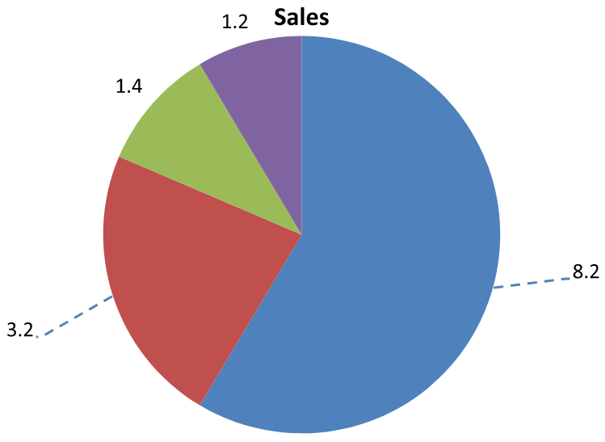

## **مقدمه**

برچسب‌های داده اطلاعاتی دربارهٔ سری‌های نمودار و نقاط دادهٔ فردی نشان می‌دهند و به خوانندگان کمک می‌کنند مقادیر را شناسایی و نمودار را درک کنند. این مقاله توضیح می‌دهد چگونه مقادیر را قالب‌بندی کنیم، درصدها را نمایش دهیم، متن برچسب را بخوانیم، برچسب‌ها را فراتر از حداکثر محور کنترل کنیم، فاصله‌گذاری برچسب‌های محور دسته‌بندی را تنظیم کنیم، و موقعیت برچسب‌های نمودار دایره‌ای را تعیین کنیم.

## **شمارش برچسب‌های دادهٔ قابل مشاهده**

از [CountOfVisibleDataLabels](https://reference.aspose.com/slides/net/aspose.slides.charts/idatalabelcollection/countofvisibledatalabels/) برای بررسی تعداد برچسب‌های داده‌ای که برای نمایش فعال شده‌اند پیش از انتشار ارائه استفاده کنید. برخلاف [Count](https://reference.aspose.com/slides/net/aspose.slides.charts/idatalabelcollection/count/)، که تعداد کل برچسب‌ها در مجموعه را برمی‌گرداند، این متد تنظیمات پیش‌فرض سری و تنظیمات برچسب‌های فردی را در نظر می‌گیرد.

این مثال یک نمودار ستونی با یک سری و سه نقطهٔ داده ایجاد می‌کند. به مجموعهٔ [Labels](https://reference.aspose.com/slides/net/aspose.slides.charts/ichartseries/labels/) سری دسترسی پیدا می‌کند و تعداد قابل مشاهده را هنگام تغییر تنظیمات چاپ می‌کند: **0, 3, 2, 3**. تعداد کل همچنان **3** می‌ماند.

```csharp
using System;
using Aspose.Slides;
using Aspose.Slides.Charts;

using var presentation = new Presentation();
var slide = presentation.Slides[0];

var chart = slide.Shapes.AddChart(ChartType.ClusteredColumn, 50, 50, 500, 300);

chart.ChartData.Series.Clear();
chart.ChartData.Categories.Clear();

var workbook = chart.ChartData.ChartDataWorkbook;
var seriesCell = workbook.GetCell(0, 0, 1, "Values");
var series = chart.ChartData.Series.Add(seriesCell, chart.Type);

for (int i = 0; i < 3; i++)
{
    var categoryCell = workbook.GetCell(0, i + 1, 0, $"Category {i + 1}");
    chart.ChartData.Categories.Add(categoryCell);
    var valueCell = workbook.GetCell(0, i + 1, 1, (i + 1) * 10);
    series.DataPoints.AddDataPointForBarSeries(valueCell);
}

var labels = series.Labels;
Console.WriteLine($"Total: {labels.Count}; visible: {labels.CountOfVisibleDataLabels}"); // کل: 3؛ قابل مشاهده: 0

labels.DefaultDataLabelFormat.ShowValue = true;
Console.WriteLine($"Visible: {labels.CountOfVisibleDataLabels}"); // قابل مشاهده: 3

labels[1].DataLabelFormat.ShowValue = false;
Console.WriteLine($"Visible: {labels.CountOfVisibleDataLabels}"); // قابل مشاهده: 2

labels[1].DataLabelFormat.ShowLegendKey = true;
Console.WriteLine($"Visible: {labels.CountOfVisibleDataLabels}"); // قابل مشاهده: 3
```

[DefaultDataLabelFormat](https://reference.aspose.com/slides/net/aspose.slides.charts/idatalabelcollection/defaultdatalabelformat/) سری تنظیمات پیش‌فرض را فراهم می‌کند. فعال‌سازی [ShowValue](https://reference.aspose.com/slides/net/aspose.slides.charts/idatalabelformat/showvalue/) در آن مقادیر را برای هر سه برچسب نمایش می‌دهد. تنظیم آن به `false` از طریق [DataLabelFormat](https://reference.aspose.com/slides/net/aspose.slides.charts/idatalabel/datalabelformat/) یک برچسب، آن تنظیم را برای برچسب انتخاب‌شده بازنویسی می‌کند. فعال‌سازی [ShowLegendKey](https://reference.aspose.com/slides/net/aspose.slides.charts/idatalabelformat/showlegendkey/) باعث می‌شود آن برچسب دوباره به عنوان قابل مشاهده حساب شود، حتی اگر مقدار آن همچنان مخفی بماند.

تعداد قابل مشاهده تنظیمات نمایش را منعکس می‌کند. این عدد اندازه‌گیری نمی‌کند که آیا برچسب‌ها همپوشانی دارند، برش خورده‌اند یا در نمودار رندر شده قابل خواندن هستند یا خیر.

## **تنظیم دقت داده‌ها در برچسب‌های نمودار**

از [NumberFormatOfValues](https://reference.aspose.com/slides/net/aspose.slides.charts/ichartseries/numberformatofvalues/) برای قالب‌بندی مقادیر سری استفاده کنید. این مثال یک نمودار خطی با داده‌های پیش‌فرض ایجاد می‌کند، جدول داده‌ها را نمایش می‌دهد و برای سری اول برچسب‌های مقدار را فعال می‌کند. قالب `#,##0.00` جداکنندهٔ هزارگان و دو رقم اعشار را بدون تغییر مقادیر زیرین نمایش می‌دهد.

```csharp
using Aspose.Slides;
using Aspose.Slides.Charts;
using Aspose.Slides.Export;

using var presentation = new Presentation();
var slide = presentation.Slides[0];

var chart = slide.Shapes.AddChart(ChartType.Line, 50, 50, 450, 300);
chart.HasDataTable = true;

var series = chart.ChartData.Series[0];
series.NumberFormatOfValues = "#,##0.00";
series.Labels.DefaultDataLabelFormat.ShowValue = true;

presentation.Save("PrecisionOfDatalabels_out.pptx", SaveFormat.Pptx);
```

برای قالب‌بندی سلول‌های عددی در کتاب‌کار جاسازی‌شدهٔ نمودار، به [Set Custom Number Formats for Workbook Cells](/slides/fa/net/chart-workbook/#set-custom-number-formats-for-workbook-cells) مراجعه کنید. آن مثال همچنین نشان می‌دهد برچسب‌های مقدار فرمت‌های سلول منبع خود را دنبال می‌کنند در حالی که مقادیر عددی ذخیره‌شده حفظ می‌شوند.

## **نمایش درصد به عنوان برچسب‌ها**

برای یک نمودار ستونی انباشته، هر مقدار را به‌عنوان درصدی از مجموع دستهٔ مربوطه محاسبه کنید و متن را به [TextFrameForOverriding](https://reference.aspose.com/slides/net/aspose.slides.charts/ioverridabletext/textframeforoverriding/) اختصاص دهید. این مثال از داده‌های پیش‌فرض نمودار استفاده می‌کند و درصدها را با دو رقم اعشار در قلم ۸ پوینتی نمایش می‌دهد. دسته‌هایی که مجموعشان صفر است برای جلوگیری از تقسیم بر صفر نادیده گرفته می‌شوند. اگر داده‌های نمودار تغییر کند، متن برچسب سفارشی را مجدداً محاسبه کنید.

```csharp
using System;
using Aspose.Slides;
using Aspose.Slides.Charts;
using Aspose.Slides.Export;

using var presentation = new Presentation();
var slide = presentation.Slides[0];

var chart = slide.Shapes.AddChart(ChartType.StackedColumn, 20, 20, 400, 400);

var categoryTotals = new double[chart.ChartData.Categories.Count];
for (int k = 0; k < chart.ChartData.Categories.Count; k++)
{
    for (int i = 0; i < chart.ChartData.Series.Count; i++)
    {
        var series = chart.ChartData.Series[i];
        var pointValue = Convert.ToDouble(series.DataPoints[k].Value.Data);
        categoryTotals[k] += pointValue;
    }
}

for (int x = 0; x < chart.ChartData.Series.Count; x++)
{
    var series = chart.ChartData.Series[x];
    series.Labels.DefaultDataLabelFormat.ShowLegendKey = false;

    for (int j = 0; j < series.DataPoints.Count; j++)
    {
        var label = series.DataPoints[j].Label;
        if (categoryTotals[j] == 0)
        {
            continue;
        }

        var pointValue = Convert.ToDouble(series.DataPoints[j].Value.Data);
        var dataPointPercent = (pointValue / categoryTotals[j]) * 100;

        var portion = new Portion();
        portion.Text = string.Format("{0:F2} %", dataPointPercent);
        portion.PortionFormat.FontHeight = 8f;

        label.TextFrameForOverriding.Text = "";

        var paragraph = label.TextFrameForOverriding.Paragraphs[0];
        paragraph.Portions.Add(portion);

        label.DataLabelFormat.ShowValue = true;
        label.DataLabelFormat.ShowSeriesName = false;
        label.DataLabelFormat.ShowPercentage = false;
        label.DataLabelFormat.ShowLegendKey = false;
        label.DataLabelFormat.ShowCategoryName = false;
        label.DataLabelFormat.ShowBubbleSize = false;
    }
}

presentation.Save("DisplayPercentageAsLabels_out.pptx", SaveFormat.Pptx);
```

## **تنظیم علامت درصد با برچسب‌های نمودار**

وقتی مقادیر به‌صورت کسر ذخیره می‌شوند، از [NumberFormat](https://reference.aspose.com/slides/net/aspose.slides.charts/idatalabelformat/numberformat/) برای نمایش درصدها استفاده کنید. برای اعمال قالب برچسب مستقل از سلول‌های منبع، [IsNumberFormatLinkedToSource](https://reference.aspose.com/slides/net/aspose.slides.charts/idatalabelformat/isnumberformatlinkedtosource/) را به `false` تنظیم کنید.

این مثال یک نمودار ستونی 100% انباشته با سری‌های قرمز و آبی در چهار دسته ایجاد می‌کند. هر جفت مقدار به مجموع 1 می‌رسد. قالب برچسب `0.0%` مقدار 0.30 را به‌صورت 30.0% نمایش می‌دهد، در حالی که محور عمودی دو رقم اعشار دارد. هر دو سری از متن برچسب سفید با اندازه 10 پوینت استفاده می‌کنند.

```csharp
using System.Drawing;
using Aspose.Slides;
using Aspose.Slides.Charts;
using Aspose.Slides.Export;

using var presentation = new Presentation();
var slide = presentation.Slides[0];

var chart = slide.Shapes.AddChart(ChartType.PercentsStackedColumn, 20, 20, 500, 400);

chart.Axes.VerticalAxis.IsNumberFormatLinkedToSource = false;
chart.Axes.VerticalAxis.NumberFormat = "0.00%";

chart.ChartData.Series.Clear();
chart.ChartData.Categories.Clear();

var workbook = chart.ChartData.ChartDataWorkbook;
int worksheetIndex = 0;
for (int i = 0; i < 4; i++)
{
    var categoryCell = workbook.GetCell(worksheetIndex, i + 1, 0, $"Category {i + 1}");
    chart.ChartData.Categories.Add(categoryCell);
}

string[] seriesNames = { "Reds", "Blues" };
Color[] seriesColors = { Color.Red, Color.Blue };
double[,] values = { { 0.30, 0.50, 0.80, 0.65 }, { 0.70, 0.50, 0.20, 0.35 } };

for (int i = 0; i < seriesNames.Length; i++)
{
    var seriesCell = workbook.GetCell(worksheetIndex, 0, i + 1, seriesNames[i]);
    var series = chart.ChartData.Series.Add(seriesCell, chart.Type);
    for (int j = 0; j < 4; j++)
    {
        var valueCell = workbook.GetCell(worksheetIndex, j + 1, i + 1, values[i, j]);
        series.DataPoints.AddDataPointForBarSeries(valueCell);
    }

    series.Format.Fill.FillType = FillType.Solid;
    series.Format.Fill.SolidFillColor.Color = seriesColors[i];

    var labelFormat = series.Labels.DefaultDataLabelFormat;
    labelFormat.ShowValue = true;
    labelFormat.IsNumberFormatLinkedToSource = false;
    labelFormat.NumberFormat = "0.0%";
    labelFormat.TextFormat.PortionFormat.FontHeight = 10;
    labelFormat.TextFormat.PortionFormat.FillFormat.FillType = FillType.Solid;
    labelFormat.TextFormat.PortionFormat.FillFormat.SolidFillColor.Color = Color.White;
}

presentation.Save("SetDataLabelsPercentageSign_out.pptx", SaveFormat.Pptx);
```

## **خواندن متن واقعی برچسب‌های داده**

از [GetActualLabelText](https://reference.aspose.com/slides/net/aspose.slides.charts/idatalabel/getactuallabeltext/) برای بازیابی متنی که تنظیمات یک برچسب داده تولید می‌کند استفاده کنید. این کار هنگام استخراج برچسب‌ها برای گزارش‌ها، جستجوی محتوای ارائه یا اعتبارسنجی نمودارهای تولید‌شده مفید است. در مثال زیر، قالب پیش‌فرض [data label format](https://reference.aspose.com/slides/net/aspose.slides.charts/idatalabelformat/) نام هر دسته، نام سری و مقدار را ترکیب می‌کند. یک نقطه مقدار خود را به‌صورت درصد قالب‌بندی می‌کند و دیگری از متن سفارشی [TextFrameForOverriding](https://reference.aspose.com/slides/net/aspose.slides.charts/ioverridabletext/textframeforoverriding/) استفاده می‌کند.

```csharp
using System;
using Aspose.Slides;
using Aspose.Slides.Charts;

using var presentation = new Presentation();
var slide = presentation.Slides[0];

var chart = slide.Shapes.AddChart(ChartType.ClusteredColumn, 20, 20, 500, 300);

chart.ChartData.Series.Clear();
chart.ChartData.Categories.Clear();

var workbook = chart.ChartData.ChartDataWorkbook;
chart.ChartData.Categories.Add(workbook.GetCell(0, 1, 0, "Q1"));
chart.ChartData.Categories.Add(workbook.GetCell(0, 2, 0, "Q2"));

var north = chart.ChartData.Series.Add(workbook.GetCell(0, 0, 1, "North"), chart.Type);
north.DataPoints.AddDataPointForBarSeries(workbook.GetCell(0, 1, 1, 0.25));
north.DataPoints.AddDataPointForBarSeries(workbook.GetCell(0, 2, 1, 0.75));

var south = chart.ChartData.Series.Add(workbook.GetCell(0, 0, 2, "South"), chart.Type);
south.DataPoints.AddDataPointForBarSeries(workbook.GetCell(0, 1, 2, 0.40));
south.DataPoints.AddDataPointForBarSeries(workbook.GetCell(0, 2, 2, 0.60));

foreach (var series in chart.ChartData.Series)
{
    var format = series.Labels.DefaultDataLabelFormat;
    format.ShowCategoryName = true;
    format.ShowSeriesName = true;
    format.ShowValue = true;
}

north.Labels[1].DataLabelFormat.IsNumberFormatLinkedToSource = false;
north.Labels[1].DataLabelFormat.NumberFormat = "0%";
south.Labels[0].TextFrameForOverriding.Text = "Reviewed";

foreach (var series in chart.ChartData.Series)
{
    foreach (var point in series.DataPoints)
    {
        var label = point.Label;
        if (!label.IsVisible)
        {
            continue;
        }

        Console.WriteLine($"Value: {point.Value.Data}; label: {label.GetActualLabelText()}");
    }
}
```

عدد ذخیره‌شده در یک نقطهٔ داده همچنان `0.75` می‌ماند، حتی اگر برچسب آن `75%` را همراه با نام دسته و سری نشان دهد. متن سفارشی متن تولید شدهٔ برچسب را جایگزین می‌کند. [GetActualLabelText](https://reference.aspose.com/slides/net/aspose.slides.charts/idatalabel/getactuallabeltext/) در هر دو حالت رشتهٔ برچسب نهایی را بازمی‌گرداند. همان‌طور که در بالا نشان داده شد، برای استخراج فقط برچسب‌های قابل مشاهده، [IsVisible](https://reference.aspose.com/slides/net/aspose.slides.charts/idatalabel/isvisible/) را به‌صورت جداگانه بررسی کنید.

## **کنترل برچسب‌های داده فراتر از حداکثر محور**

وقتی بازهٔ محوری را به‌صورت دستی محدود می‌کنید، برخی نقاط داده ممکن است از حداکثر آن فراتر روند. از [ShowDataLabelsOverMaximum](https://reference.aspose.com/slides/net/aspose.slides.charts/ichart/showdatalabelsovermaximum/) برای کنترل اینکه آیا برچسب‌های دادهٔ آن‌ها نشان داده شوند یا نه استفاده کنید. این تنظیم نمایش برچسب را تغییر می‌دهد؛ بازهٔ محور یا مقادیر داده‌های زیرین را تغییر نمی‌دهد.

مثال زیر یک نمودار ستونی خوشه‌ای 2D با مقادیر 60 و 120 ایجاد می‌کند. برای محور عمودی [IsAutomaticMaxValue](https://reference.aspose.com/slides/net/aspose.slides.charts/iaxis/isautomaticmaxvalue/) را به `false` و [MaxValue](https://reference.aspose.com/slides/net/aspose.slides.charts/iaxis/maxvalue/) را به 100 تنظیم می‌کند. اسلاید اول اجازهٔ برچسب‌های فراتر از حداکثر را می‌دهد؛ یک کپی از آن اسلاید این برچسب‌ها را غیرفعال می‌کند. هر دو اسلاید در `DataLabelsOverMaximum.pptx` ذخیره می‌شوند.

برای فعال‌سازی برچسب‌های مقدار از [ShowValue](https://reference.aspose.com/slides/net/aspose.slides.charts/idatalabelformat/showvalue/) استفاده کنید. تنظیم سطح نمودار به تنهایی نمایش مقدار را فعال نمی‌کند و نمایش مقدار غیرفعال‌شدهٔ یک برچسب فردی را بازنویسی نمی‌کند. این مثال مقادیر را برای تمام سری فعال می‌کند و از [Position](https://reference.aspose.com/slides/net/aspose.slides.charts/idatalabelformat/position/) برای قرار دادن برچسب‌ها در انتهای بیرونی هر ستون استفاده می‌کند.

```csharp
using Aspose.Slides;
using Aspose.Slides.Charts;
using Aspose.Slides.Export;

using var presentation = new Presentation();
var slide = presentation.Slides[0];

var chart = slide.Shapes.AddChart(ChartType.ClusteredColumn, 50, 50, 600, 400);
chart.HasLegend = false;

chart.ChartData.Series.Clear();
chart.ChartData.Categories.Clear();

var workbook = chart.ChartData.ChartDataWorkbook;

var firstCategory = workbook.GetCell(0, 1, 0, "Within range");
var secondCategory = workbook.GetCell(0, 2, 0, "Above maximum");

chart.ChartData.Categories.Add(firstCategory);
chart.ChartData.Categories.Add(secondCategory);

var seriesName = workbook.GetCell(0, 0, 1, "Values");
var series = chart.ChartData.Series.Add(seriesName, chart.Type);

var firstValue = workbook.GetCell(0, 1, 1, 60);
var secondValue = workbook.GetCell(0, 2, 1, 120);

series.DataPoints.AddDataPointForBarSeries(firstValue);
series.DataPoints.AddDataPointForBarSeries(secondValue);

series.Labels.DefaultDataLabelFormat.ShowValue = true;
series.Labels.DefaultDataLabelFormat.Position = LegendDataLabelPosition.OutsideEnd;

chart.Axes.VerticalAxis.IsAutomaticMaxValue = false;
chart.Axes.VerticalAxis.MaxValue = 100;
chart.ShowDataLabelsOverMaximum = true;

var secondSlide = presentation.Slides.AddClone(slide);
var secondChart = (IChart)secondSlide.Shapes[0];
secondChart.ShowDataLabelsOverMaximum = false;

presentation.Save("DataLabelsOverMaximum.pptx", SaveFormat.Pptx);
```

تصاویر زیر اسلایدهای ذخیره‌شده را که توسط Microsoft PowerPoint رندر شده‌اند نشان می‌دهند. با `true`، برچسب **120** در مرز بالایی قابل مشاهده است؛ با `false` مخفی می‌شود. برچسب **60** همچنان قابل مشاهده است، حداکثر محور در **100** باقی می‌ماند و نقطهٔ دادهٔ دوم در هر دو حالت **120** است.

| ShowDataLabelsOverMaximum = true | ShowDataLabelsOverMaximum = false |
| --- | --- |
|  |  |

{}
این مثال از یک نمودار ستونی 2D با محور مقدار استفاده می‌کند. نمودارهایی که محور مقدار ندارند، مانند نمودارهای دایره‌ای و دونات، حداکثر محوری برای محدود کردن به این شکل ندارند.
{}

## **تنظیم فاصله برچسب از محور**

از [LabelOffset](https://reference.aspose.com/slides/net/aspose.slides.charts/iaxis/labeloffset/) برای کنترل فاصله بین برچسب‌های محور دسته‌بندی و محور استفاده کنید. مقدار درصدی از حداکثر اندازهٔ قلم برچسب‌های محور است. این مثال یک نمودار ستونی خوشه‌ای ایجاد می‌کند و مقدار جابجایی برچسب محور افقی را به 500 تنظیم می‌کند. این تنظیم برچسب‌های محور دسته‌بندی را تحت تأثیر قرار می‌دهد نه برچسب‌های پیوست به نقاط دادهٔ فردی.

```csharp
using Aspose.Slides;
using Aspose.Slides.Charts;
using Aspose.Slides.Export;

using var presentation = new Presentation();
var slide = presentation.Slides[0];

var chart = slide.Shapes.AddChart(ChartType.ClusteredColumn, 20, 20, 500, 300);
chart.Axes.HorizontalAxis.LabelOffset = 500;

presentation.Save("SetCategoryAxisLabelDistance_out.pptx", SaveFormat.Pptx);
```

## **تنظیم موقعیت برچسب**

در یک نمودار دایره‌ای، موقعیت برچسب‌های داده را تنظیم کنید تا فاصله بهبود یابد و فضای کافی برای خطوط راهنما فراهم شود.

این مثال مقدار اولین نقطهٔ داده را نمایش می‌دهد، برچسب آن را خارج از برش قرار می‌دهد و جابجایی‌های [X](https://reference.aspose.com/slides/net/aspose.slides.charts/ilayoutable/x/) و [Y](https://reference.aspose.com/slides/net/aspose.slides.charts/ilayoutable/y/) آن را تنظیم می‌کند. این جابجایی‌ها به ترتیب نسبت به عرض و ارتفاع نمودار هستند.

```csharp
using Aspose.Slides;
using Aspose.Slides.Charts;
using Aspose.Slides.Export;

using var presentation = new Presentation();
var slide = presentation.Slides[0];

var chart = slide.Shapes.AddChart(ChartType.Pie, 50, 50, 200, 200);
var series = chart.ChartData.Series;

var label = series[0].Labels[0];
label.DataLabelFormat.ShowValue = true;
label.DataLabelFormat.Position = LegendDataLabelPosition.OutsideEnd;
label.X = 0.71f;
label.Y = 0.04f;

presentation.Save("presentation.pptx", SaveFormat.Pptx);
```


## **قالب‌بندی خطوط راهنما**

وقتی برچسب‌های نمودار دایره‌ای خارج از برش‌های خود قرار می‌گیرند، خطوط راهنما به خوانندگان کمک می‌کند هر مقدار را به برش صحیح مرتبط کنند. یک رنگ متضاد و خطی کمی ضخیم‌تر می‌تواند این ارتباطات را قابل پیگیری‌تر کند، در حالی که شفافیت و سبک خط نقطه‌دار خطوط را بصری کم‌اهمیت نگه می‌دارد.

از [LeaderLinesFormat](https://reference.aspose.com/slides/net/aspose.slides.charts/datalabelcollection/leaderlinesformat/) برای قالب‌بندی خطوط راهنما در سطح مجموعهٔ برچسب‌های دادهٔ سری استفاده کنید. تنظیمات در `series.Labels.LeaderLinesFormat.Line` بر کل مجموعه اعمال می‌شود، نه بر یک برچسب جداگانه.

این مثال یک نمودار دایره‌ای با داده‌های پیش‌فرض ایجاد می‌کند، مقادیر را خارج از برش‌ها نمایش می‌دهد و [ShowLeaderLines](https://reference.aspose.com/slides/net/aspose.slides.charts/idatalabelformat/showleaderlines/) را فعال می‌کند. دو برچسب را با استفاده از جابجایی‌های [X](https://reference.aspose.com/slides/net/aspose.slides.charts/ilayoutable/x/) و [Y](https://reference.aspose.com/slides/net/aspose.slides.charts/ilayoutable/y/) که به صورت کسر از عرض و ارتفاع نمودار بیان شده‌اند، بیشتر از برش‌های خود دور می‌برد. نیازی به ارائهٔ ورودی نیست.

رنگ پر [FillFormat](https://reference.aspose.com/slides/net/aspose.slides/ilineformat/fillformat/) خط را به آبی ثابت با مقدار آلفای 191 از 255 تنظیم می‌کند که تقریباً 25٪ شفافیت می‌دهد. [Width](https://reference.aspose.com/slides/net/aspose.slides/ilineformat/width/) ضخامت را به ۲ پوینت تنظیم می‌کند و [DashStyle](https://reference.aspose.com/slides/net/aspose.slides/ilineformat/dashstyle/) خط را نقطه‌دار می‌سازد.

```csharp
using System.Drawing;
using Aspose.Slides;
using Aspose.Slides.Charts;
using Aspose.Slides.Export;

using var presentation = new Presentation();
var slide = presentation.Slides[0];

var chart = slide.Shapes.AddChart(ChartType.Pie, 80, 50, 560, 400);
chart.HasLegend = false;

var series = chart.ChartData.Series[0];

var labelFormat = series.Labels.DefaultDataLabelFormat;
labelFormat.ShowValue = true;
labelFormat.Position = LegendDataLabelPosition.OutsideEnd;
labelFormat.ShowLeaderLines = true;

// دو برچسب را از برش‌های خود دورتر ببرید.
series.Labels[0].X = 0.10f;
series.Labels[0].Y = -0.05f;
series.Labels[1].X = -0.10f;
series.Labels[1].Y = 0.05f;

var line = series.Labels.LeaderLinesFormat.Line;
line.FillFormat.FillType = FillType.Solid;
line.FillFormat.SolidFillColor.Color = Color.FromArgb(191, 30, 90, 160);
line.Width = 2;
line.DashStyle = LineDashStyle.Dash;

presentation.Save("FormattedLeaderLines.pptx", SaveFormat.Pptx);
```

فعال‌سازی خطوط راهنما تضمین نمی‌کند که برای هر برچسب خطی ظاهر شود. قابل مشاهده بودن بستگی به موقعیت برچسب و رفتار چیدمان نمودار دارد. در این مثال، دو برچسب جابجا شده خطوط راهنمای قابل مشاهده دارند؛ برچسب‌هایی که نزدیک برش‌های خود می‌مانند به این خطوط نیازی ندارند.

تصویر زیر فایل `FormattedLeaderLines.pptx` ذخیره‌شده را که با Aspose.Slides رندر شده است نشان می‌دهد:



## **افزودن چند ردیف برچسب داده بالای نمودار ستونی**

این مثال یک نمودار ستونی با دو ردیف برچسب داده بالای ناحیهٔ رسم ایجاد می‌کند. سری A ستون‌های قابل مشاهده را نشان می‌دهد، در حالی که سری‌های B و C برچسب‌های اضافی را فراهم می‌کنند. ستون‌های آن‌ها با حذف پر و خط مرزی مخفی می‌شوند. ویژگی [Overlap](https://reference.aspose.com/slides/net/aspose.slides.charts/ichartseriesgroup/overlap/) همهٔ سه سری را با مرکزهای دستهٔ یکسان هم‌راستا می‌کند.

تنظیمات [PlotArea](https://reference.aspose.com/slides/net/aspose.slides.charts/ichart/plotarea/) فضای لازم برای ردیف‌های برچسب را رزرو می‌کنند. پس از اینکه [ValidateChartLayout](https://reference.aspose.com/slides/net/aspose.slides.charts/ichart/validatechartlayout/) موقعیت‌های پیش‌فرض را محاسبه کرد، [X](https://reference.aspose.com/slides/net/aspose.slides.charts/ilayoutable/x/) و [Y](https://reference.aspose.com/slides/net/aspose.slides.charts/ilayoutable/y/) ترازبندی افقی را حفظ کرده و جابجایی‌های عمودی را اعمال می‌کنند تا برچسب‌ها در دو ردیف چیده شوند. اعداد همچنان برچسب‌های داده‌ای مرتبط با مقادیر سری‌ها هستند؛ تنها عنوان‌های ردیف به‌صورت شکل‌های متنی جداگانه هستند.

```csharp
using System.Drawing;
using Aspose.Slides;
using Aspose.Slides.Charts;
using Aspose.Slides.Export;

using var presentation = new Presentation();
var slide = presentation.Slides[0];

var chart = slide.Shapes.AddChart(ChartType.ClusteredColumn, 40, 40, 640, 200);
chart.HasTitle = false;
chart.HasLegend = false;
chart.TextFormat.PortionFormat.FontHeight = 12;

chart.ChartData.Series.Clear();
chart.ChartData.Categories.Clear();

var workbook = chart.ChartData.ChartDataWorkbook;
workbook.Clear(0);

string[] categories = { "North", "South", "East", "West" };
string[] seriesNames = { "Series A", "Series B", "Series C" };
double[,] seriesValues = {
    { 35, 42, 28, 47 },
    { 22, 31, 19, 26 },
    { 12, 16, 14, 18 }
};

for (int categoryIndex = 0; categoryIndex < categories.Length; categoryIndex++)
{
    var categoryCell = workbook.GetCell(0, categoryIndex + 1, 0, categories[categoryIndex]);
    chart.ChartData.Categories.Add(categoryCell);
}

for (int seriesIndex = 0; seriesIndex < seriesNames.Length; seriesIndex++)
{
    var seriesCell = workbook.GetCell(0, 0, seriesIndex + 1, seriesNames[seriesIndex]);
    var series = chart.ChartData.Series.Add(seriesCell, ChartType.ClusteredColumn);

    for (int categoryIndex = 0; categoryIndex < categories.Length; categoryIndex++)
    {
        var valueCell = workbook.GetCell(0, categoryIndex + 1, seriesIndex + 1, seriesValues[seriesIndex, categoryIndex]);
        series.DataPoints.AddDataPointForBarSeries(valueCell);
    }

    if (seriesIndex > 0)
    {
        // ستون‌های B و C را مخفی کنید، اما برچسب‌های دادهٔ آن‌ها را نگه دارید.
        series.Format.Fill.FillType = FillType.NoFill;
        series.Format.Line.FillFormat.FillType = FillType.NoFill;
        var labelFormat = series.Labels.DefaultDataLabelFormat;
        labelFormat.ShowValue = true;
        labelFormat.TextFormat.PortionFormat.FontHeight = 12;
        var labelFill = labelFormat.TextFormat.PortionFormat.FillFormat;
        labelFill.FillType = FillType.Solid;
        labelFill.SolidFillColor.Color = Color.Black;
        labelFormat.Position = LegendDataLabelPosition.InsideBase;
    }
}

// تمام سه سری را با مراکز دستهٔ یکسان هم‌راستا کنید.
chart.ChartData.Series[0].ParentSeriesGroup.Overlap = 100;

// برای این مثال فشرده از خطوط شبکهٔ کمتر استفاده کنید.
chart.Axes.VerticalAxis.IsAutomaticMajorUnit = false;
chart.Axes.VerticalAxis.MajorUnit = 10;

// فضای بالای ناحیهٔ رسم را برای دو ردیف برچسب داده رزرو کنید.
chart.PlotArea.LayoutTargetType = LayoutTargetType.Inner;
chart.PlotArea.X = 0.15f;
chart.PlotArea.Y = 0.32f;
chart.PlotArea.Width = 0.80f;
chart.PlotArea.Height = 0.48f;
chart.ValidateChartLayout();

for (int seriesIndex = 1; seriesIndex < seriesNames.Length; seriesIndex++)
{
    var series = chart.ChartData.Series[seriesIndex];
    float rowTop = seriesIndex == 1 ? 0.15f : 0.03f;

    for (int categoryIndex = 0; categoryIndex < categories.Length; categoryIndex++)
    {
        var dataLabel = series.DataPoints[categoryIndex].Label;
        // موقعیت افقی پیش‌فرض را حفظ کنید. Y یک جابجایی از
        // موقعیت پیش‌فرض برچسب است، که به صورت کسری از ارتفاع نمودار بیان شده است.
        dataLabel.X = 0;
        dataLabel.Y = rowTop - dataLabel.ActualY / chart.Height;
    }

    // فقط عنوان ردیف یک شکل متنی جداگانه است.
    var rowHeading = slide.Shapes.AddAutoShape(ShapeType.Rectangle, chart.X, chart.Y + rowTop * chart.Height, 85, 18);
    rowHeading.FillFormat.FillType = FillType.NoFill;
    rowHeading.LineFormat.FillFormat.FillType = FillType.NoFill;
    rowHeading.AddTextFrame(seriesNames[seriesIndex]);
    rowHeading.TextFrame.TextFrameFormat.MarginTop = 0;
    rowHeading.TextFrame.TextFrameFormat.MarginBottom = 0;
    var headingFormat = rowHeading.TextFrame.Paragraphs[0].Portions[0].PortionFormat;
    headingFormat.FontHeight = 12;
    headingFormat.FillFormat.FillType = FillType.Solid;
    headingFormat.FillFormat.SolidFillColor.Color = Color.Black;
}

presentation.Save("multiple-rows-of-labels.pptx", SaveFormat.Pptx);
```


## **تغییر شکل برچسب‌های داده**

Aspose.Slides for .NET 26.11 متدهای [IDataLabel.LabelShapeType](https://reference.aspose.com/slides/net/aspose.slides.charts/idatalabel/labelshapetype/) برای یک برچسب و [IDataLabelCollection.DefaultLabelShapeType](https://reference.aspose.com/slides/net/aspose.slides.charts/idatalabelcollection/defaultlabelshapetype/) برای همهٔ برچسب‌های جاری در یک سری را اضافه می‌کند. این‌ها شکل برچسب را تغییر می‌دهند، نه علامت نقطهٔ داده. برای تنظیمات جداگانهٔ حاشیه‌نویسی، به [Data Label Callouts](/slides/fa/net/callout/) مراجعه کنید.

تخصیص مجموعه برچسب‌های موجود را به‌روز می‌کند، بنابراین بازنویسی‌های فردی را **پس از** تنظیم مجموعه اعمال کنید. این مثال کامل نیاز به [Aspose.Slides for .NET](/slides/fa/net/installation/) نسخهٔ 26.11 یا بالاتر دارد. برچسب‌های مقدار قابل مشاهده ایجاد می‌کند، بیضی‌ها را برای سری اول انتخاب می‌کند و سپس اولین برچسب آن را مستطیلی می‌کند.

```csharp
using System.Drawing;
using Aspose.Slides;
using Aspose.Slides.Charts;
using Aspose.Slides.Export;

using var presentation = new Presentation();
var chart = presentation.Slides[0].Shapes.AddChart(ChartType.ClusteredColumn, 50, 50, 600, 350);
var labels = chart.ChartData.Series[0].Labels;
labels.DefaultDataLabelFormat.ShowValue = true;
labels.DefaultLabelShapeType = ShapeType.Ellipse;
labels[0].LabelShapeType = ShapeType.Rectangle;

foreach (var label in labels)
{
    var format = label.DataLabelFormat.Format;
    format.Fill.FillType = FillType.Solid;
    format.Fill.SolidFillColor.Color = Color.LightYellow;
    format.Line.FillFormat.FillType = FillType.Solid;
    format.Line.FillFormat.SolidFillColor.Color = Color.DarkBlue;
}

presentation.Save("label-shapes.pptx", SaveFormat.Pptx);

// بازنشانی انتخاب‌های صریح شکل برای تمام برچسب‌های جاری.
labels.DefaultLabelShapeType = ShapeType.NotDefined;
presentation.Save("label-shapes-reset.pptx", SaveFormat.Pptx);
```

تخصیص دوبارهٔ شکل مجموعه همچنین انتخاب‌های شکل فردی قبلی را جایگزین می‌کند. [NotDefined](https://reference.aspose.com/slides/net/aspose.slides/shapetype/) انتخاب صریح شکل را پاک می‌کند؛ برچسب‌ها را مخفی یا قالب‌بندی‌های دیگرشان را حذف نمی‌کند. شکل‌های مطلوب را پس از پر کردن سری تنظیم کنید تا فرض نکنید نقاطی که بعداً اضافه می‌شوند، تخصیص قبلی را به ارث می‌برند. در اینجا مستطیل و بیضی استفاده شده‌اند؛ هنگام انتخاب انواع شکل دیگر نتیجهٔ رندر شده را بررسی کنید.

## **سوالات متداول**

**چگونه می‌توانم از همپوشانی برچسب‌های داده در نمودارهای شلوغ جلوگیری کنم؟**

از ترکیب قراردهی خودکار برچسب، خطوط راهنما و کاهش اندازه قلم استفاده کنید؛ در صورت لزوم برخی فیلدها (مثلاً دسته) را مخفی کنید یا تنها برای مقادیر شدید یا نقاط کلیدی برچسب نشان دهید.

**چگونه می‌توانم برچسب‌ها را فقط برای مقادیر صفر، منفی یا خالی غیرفعال کنم؟**

قبل از فعال‌سازی برچسب‌ها نقاط داده را فیلتر کنید و نمایش را برای مقادیر 0، مقادیر منفی یا مقادیر گمشده بر اساس قاعده‌ای تعریف‌شده خاموش کنید.

**چگونه می‌توانم سبک برچسب را به‌صورت ثابت هنگام خروجی به PDF/تصاویر حفظ کنم؟**

به‌صورت صریح خانواده و اندازه قلم را تنظیم کنید و اطمینان حاصل کنید که قلم در محیط رندر موجود است تا از جایگزینی ناخواسته جلوگیری شود.