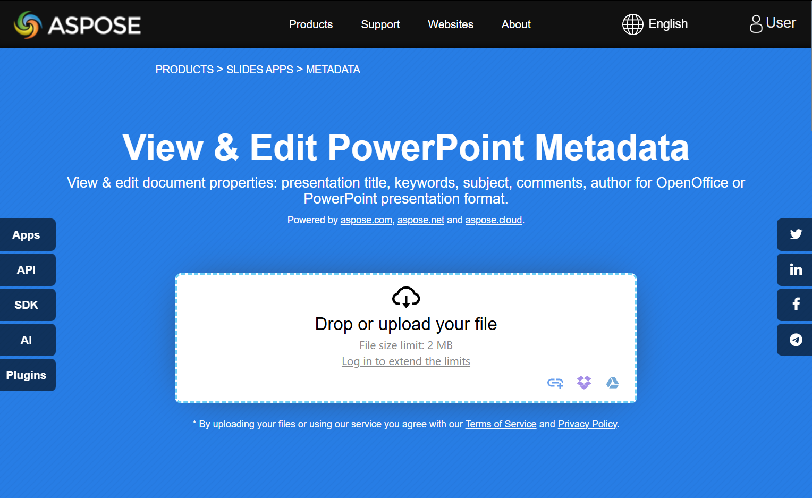

## **مقدمه**

Aspose.Slides for .NET از ویژگی‌های سند **درونی** و **سفارشی** پشتیبانی می‌کند. از این ویژگی‌ها برای خواندن و به‌روزرسانی فراداده‌های ارائه، مانند نویسنده، عنوان و مقادیر تعریف‌شده توسط کاربر استفاده کنید.

Aspose.Slides به شما امکان می‌دهد تا با ویژگی‌های سند ارائه از طریق رابط [IDocumentProperties](https://reference.aspose.com/slides/net/aspose.slides/idocumentproperties/) کار کنید. یک نمونه از این رابط توسط [IPresentation.DocumentProperties](https://reference.aspose.com/slides/net/aspose.slides/ipresentation/documentproperties/) برگردانده می‌شود. مثال‌های زیر نشان می‌دهند چگونه این ویژگی‌ها را بخوانید، تغییر دهید و مدیریت کنید.

{}
Aspose.Slides متادیتاهای برنامه و تولید‌کننده را هنگام ذخیره‌سازی ارائه‌ها مدیریت می‌کند؛ این فیلدها نرم‌افزاری را که خروجی را ایجاد کرده است شناسایی می‌کنند.
{}

## **مدیریت ویژگی‌های ارائه**

ویژگی‌های سند اطلاعات توصیفی را در کنار محتوای ارائه ذخیره می‌کنند. آن‌ها به دو دسته تقسیم می‌شوند:

- **ویژگی‌های درونی** شامل متادیتای استاندارد مانند عنوان، نویسنده و آمارهای سند هستند.
- **ویژگی‌های سفارشی** جفت‌های نام/مقدار تعریف‌شده توسط کاربر را ذخیره می‌کنند.

Aspose.Slides for .NET دسترسی به هر دو دسته را فراهم می‌کند. در PowerPoint، برای بررسی متادیتای سند، **File → Info → Properties → Advanced Properties** را انتخاب کنید. این گفت‌وگو اطلاعات را در برگه‌هایی مانند **Summary**, **Statistics**, **Contents**, و **Custom** گروه‌بندی می‌کند. از برگه **Custom** برای مدیریت ویژگی‌های تعریف‌شده توسط کاربر استفاده کنید.

## **خواندن ویژگی‌های عمومی از یک ارائه رمزگذاری‌شده**

یک رمز عبور باز کردن معمولاً هر دو محتوای ارائه و ویژگی‌های سند را محافظت می‌کند. وقتی ارائه‌ای با [IProtectionManager.EncryptDocumentProperties](https://reference.aspose.com/slides/net/aspose.slides/iprotectionmanager/encryptdocumentproperties/) برابر `false` رمزگذاری شود، ویژگی‌های سند آن عمومی می‌مانند. سپس یک برنامه می‌تواند [LoadOptions.OnlyLoadDocumentProperties](https://reference.aspose.com/slides/net/aspose.slides/loadoptions/onlyloaddocumentproperties/) را به `true` تنظیم کند و متادیتای عمومی را بدون ارائه رمز عبور باز کردن بخواند.

[LoadOptions.OnlyLoadDocumentProperties](https://reference.aspose.com/slides/net/aspose.slides/loadoptions/onlyloaddocumentproperties/) کنترل می‌کند که Aspose.Slides چه چیزی را بارگذاری می‌کند؛ هیچ چیزی رمزگشایی نمی‌شود. اگر ویژگی‌ها در رمزگذاری گنجانده شده باشند، بارگذاری آن‌ها بدون رمز عبور ناموفق خواهد بود. اگر ارائه رمزگذاری نشده باشد، گزینه نادیده گرفته می‌شود و ارائه کامل بارگذاری می‌شود.

این مثال به یک ارائه رمزگذاری‌شده نیاز دارد که ویژگی‌های سند آن به صورت عمومی باقی مانده‌اند. حالت بارگذاری را از طریق [IProtectionManager.IsOnlyDocumentPropertiesLoaded](https://reference.aspose.com/slides/net/aspose.slides/iprotectionmanager/isonlydocumentpropertiesloaded/) تأیید می‌کند و سپس ویژگی‌های درونی را از طریق [IPresentation.DocumentProperties](https://reference.aspose.com/slides/net/aspose.slides/ipresentation/documentproperties/) می‌خواند:

```csharp
using System;
using Aspose.Slides;

var loadOptions = new LoadOptions { OnlyLoadDocumentProperties = true };
using var presentation = new Presentation("public-properties-encrypted.pptx", loadOptions);

if (presentation.ProtectionManager.IsOnlyDocumentPropertiesLoaded)
{
    var documentProperties = presentation.DocumentProperties;

    Console.WriteLine("Author: " + documentProperties.Author);
    Console.WriteLine("Title: " + documentProperties.Title);
    Console.WriteLine("Keywords: " + documentProperties.Keywords);
}
else
{
    Console.WriteLine("The presentation was not loaded in document-properties-only mode.");
}
```

در این حالت، محتوای اسلاید بارگذاری نمی‌شود. اسلایدها، صفحه‌های اصلی، چیدمان‌ها، اشکال، رسانه‌ها و سایر اشیای ارائه در دسترس نیستند. برنامه‌ها باید همیشه قبل از انجام عملیاتی که به مدل شیء کامل ارائه نیاز دارد، [IProtectionManager.IsOnlyDocumentPropertiesLoaded](https://reference.aspose.com/slides/net/aspose.slides/iprotectionmanager/isonlydocumentpropertiesloaded/) را بررسی کنند.

{}
متادیتای عمومی ممکن است نام‌های نویسنده، عناوین، موضوعات، کلمات کلیدی، اطلاعات شرکت، نظرات و مقادیر سفارشی را فاش کند. ویژگی‌های حساس را همراه با ارائه رمزگذاری کنید. فقط در زمانی که سیستم‌های فهرست‌بندی، طبقه‌بندی، جستجو یا مدیریت سند نیاز خاصی برای دسترسی به آنها بدون رمز عبور دارند، آن‌ها را عمومی بگذارید.
{}

## **به‌روزرسانی ویژگی‌های یک ارائه رمزگذاری‌شده**

برای یک فایل PPTX رمزگذاری‌شده، ارائه‌ای که با [LoadOptions.OnlyLoadDocumentProperties](https://reference.aspose.com/slides/net/aspose.slides/loadoptions/onlyloaddocumentproperties/) بارگذاری می‌شود، برای خواندن متادیتای عمومی در نظر گرفته شده است. Aspose.Slides نمی‌تواند ویژگی‌های تغییر یافته را از این شیء فقط‑متادیتا ذخیره کند زیرا ویژگی‌های عمومی باید با داده‌های متناظر درون ارائه رمزگذاری‌شده سازگار بمانند. بنابراین به‌روزرسانی آن‌ها نیاز به رمز عبور باز کردن صحیح و یک بارگذاری کامل دارد.

این مثال به یک ارائه PPTX رمزگذاری‌شده با ویژگی‌های سند عمومی و رمز عبور باز کردن شناخته‌شده نیاز دارد. آن ارائه کامل را با [LoadOptions.Password](https://reference.aspose.com/slides/net/aspose.slides/loadoptions/password/) باز می‌کند، ویژگی‌های درونی عمومی را به‌روزرسانی می‌کند و نتیجه را ذخیره می‌سازد. سپس با استفاده از [IPresentationInfo.IsEncrypted](https://reference.aspose.com/slides/net/aspose.slides/ipresentationinfo/isencrypted/) تأیید می‌کند که رمزگذاری حفظ شده است و متادیتای عمومی را بدون رمز عبور باز می‌کند تا مقادیر جدید را بررسی کند:

```csharp
using System;
using Aspose.Slides;
using Aspose.Slides.Export;

const string inputPath = "public-properties-encrypted.pptx";
const string outputPath = "updated-public-properties-encrypted.pptx";

var loadOptions = new LoadOptions { Password = "open_password" };
using var presentation = new Presentation(inputPath, loadOptions);

var documentProperties = presentation.DocumentProperties;
documentProperties.Title = "Updated Product Roadmap";
documentProperties.Keywords = "roadmap, planning, indexed";

presentation.Save(outputPath, SaveFormat.Pptx);

var presentationInfo = PresentationFactory.Instance.GetPresentationInfo(outputPath);
Console.WriteLine("The presentation is encrypted: " + presentationInfo.IsEncrypted);

var metadataLoadOptions = new LoadOptions { OnlyLoadDocumentProperties = true };
using var metadataPresentation = new Presentation(outputPath, metadataLoadOptions);

if (metadataPresentation.ProtectionManager.IsOnlyDocumentPropertiesLoaded)
{
    Console.WriteLine("Title: " + metadataPresentation.DocumentProperties.Title);
    Console.WriteLine("Keywords: " + metadataPresentation.DocumentProperties.Keywords);
}
else
{
    Console.WriteLine("The presentation was not loaded in document-properties-only mode.");
}
```

اگر برنامه اجازه‌ی رمزگشایی یا بارگذاری محتوای ارائه را نداشته باشد، باید ویژگی‌های عمومی یک فایل PPTX رمزگذاری‌شده را به‌عنوان فقط‑خواندنی در نظر بگیرد.

## **دسترسی به ویژگی‌های درونی**

رابط [IDocumentProperties](https://reference.aspose.com/slides/net/aspose.slides/idocumentproperties/) متادیتای درونی را از طریق ویژگی‌های تایپی، از جمله [Author](https://reference.aspose.com/slides/net/aspose.slides/idocumentproperties/author/), [Title](https://reference.aspose.com/slides/net/aspose.slides/idocumentproperties/title/), و [CreatedTime](https://reference.aspose.com/slides/net/aspose.slides/idocumentproperties/createdtime/) در دسترس می‌گذارد. این مثال یک ارائه موجود را باز می‌کند و متادیتای ذخیره‌شده آن را در کنسول چاپ می‌کند. مقادیر وابسته به ارائه ورودی هستند؛ برخی فیلدها ممکن است خالی باشند.

```csharp
using System;
using Aspose.Slides;

using var presentation = new Presentation("AccessBuiltInProperties.pptx");

var documentProperties = presentation.DocumentProperties;

Console.WriteLine("Category: " + documentProperties.Category);
Console.WriteLine("Content status: " + documentProperties.ContentStatus);
Console.WriteLine("Creation date: " + documentProperties.CreatedTime);
Console.WriteLine("Author: " + documentProperties.Author);
Console.WriteLine("Comments: " + documentProperties.Comments);
Console.WriteLine("Keywords: " + documentProperties.Keywords);
Console.WriteLine("Last modified by: " + documentProperties.LastSavedBy);
Console.WriteLine("Manager: " + documentProperties.Manager);
Console.WriteLine("Modified date: " + documentProperties.LastSavedTime);
Console.WriteLine("Presentation format: " + documentProperties.PresentationFormat);
Console.WriteLine("Last print date: " + documentProperties.LastPrinted);
Console.WriteLine("Is shared between producers: " + documentProperties.SharedDoc);
Console.WriteLine("Subject: " + documentProperties.Subject);
Console.WriteLine("Title: " + documentProperties.Title);
```

## **تغییر ویژگی‌های درونی**

برای به‌روزرسانی متادیتای درونی، مقادیر را به ویژگی‌های قابل نوشتنی که توسط [IPresentation.DocumentProperties](https://reference.aspose.com/slides/net/aspose.slides/ipresentation/documentproperties/) در دسترس هستند اختصاص دهید. این مثال یک ارائه موجود را باز می‌کند، [Author](https://reference.aspose.com/slides/net/aspose.slides/idocumentproperties/author/), [Title](https://reference.aspose.com/slides/net/aspose.slides/idocumentproperties/title/), [Subject](https://reference.aspose.com/slides/net/aspose.slides/idocumentproperties/subject/), [Comments](https://reference.aspose.com/slides/net/aspose.slides/idocumentproperties/comments/), و [Manager](https://reference.aspose.com/slides/net/aspose.slides/idocumentproperties/manager/) را تنظیم می‌کند، سپس ارائه به‌روزشده را با [Presentation.Save](https://reference.aspose.com/slides/net/aspose.slides/presentation/save/) ذخیره می‌نماید. فایل PPTX ذخیره‌شده شامل متادیتای جدید است.

```csharp
using Aspose.Slides;
using Aspose.Slides.Export;

using var presentation = new Presentation("ModifyBuiltInProperties.pptx");

var documentProperties = presentation.DocumentProperties;

documentProperties.Author = "Aspose.Slides for .NET";
documentProperties.Title = "Manage PowerPoint Presentation Properties";
documentProperties.Subject = "Modify Built-in Properties";
documentProperties.Comments = "Aspose description";
documentProperties.Manager = "Aspose manager";

presentation.Save("DocumentProperties_output.pptx", SaveFormat.Pptx);
```

## **مدیریت پایهٔ ابرپیوند**

[IDocumentProperties.HyperlinkBase](https://reference.aspose.com/slides/net/aspose.slides/idocumentproperties/hyperlinkbase/) پایهٔ سطح سند برای ابرپیوندهای نسبی را ذخیره می‌کند. این زمانی مفید است که یک ارائه و پرونده‌های مرتبط آن را به مکان دیگری منتقل می‌کنید. این پایه جدا از [IHyperlink.ExternalUrl](https://reference.aspose.com/slides/net/aspose.slides/ihyperlink/externalurl/) ابرپیوند فردی است: تغییر پایه، آدرس‌های ذخیره‌شده‌ی پیوند را بازنویسی نمی‌کند و مقصدهای مطلق را تغییر نمی‌دهد.

این مثال به یک ارائه‌ای نیاز دارد که هم یک پیوند نسبی مانند `target.html` و هم یک پیوند مطلق مانند `https://example.org/absolute.html` داشته باشد. پایهٔ موجود را می‌خواند، آدرس پایهٔ جدیدی اختصاص می‌دهد و برای بررسی مقدار، ارائه را ذخیره و دوباره باز می‌کند. سپس پایه را با `string.Empty` پاک می‌کند و مقدار خالی را در یک فایل ذخیره‌شدهٔ جداگانه تأیید می‌کند. آدرس پایهٔ مثال را با مکان فایل‌های مرتبط خود جایگزین کنید.

```csharp
using System;
using Aspose.Slides;
using Aspose.Slides.Export;

using var presentation = new Presentation("hyperlinks.pptx");
Console.WriteLine("Original base: " + presentation.DocumentProperties.HyperlinkBase);

const string newBase = "https://example.com/new/";
presentation.DocumentProperties.HyperlinkBase = newBase;
presentation.Save("hyperlinks-updated.pptx", SaveFormat.Pptx);

using var updatedPresentation = new Presentation("hyperlinks-updated.pptx");
Console.WriteLine("Base preserved: " + (updatedPresentation.DocumentProperties.HyperlinkBase == newBase));

updatedPresentation.DocumentProperties.HyperlinkBase = string.Empty;
updatedPresentation.Save("hyperlinks-cleared.pptx", SaveFormat.Pptx);

using var clearedPresentation = new Presentation("hyperlinks-cleared.pptx");
Console.WriteLine("Base cleared: " + (clearedPresentation.DocumentProperties.HyperlinkBase == string.Empty));
```

دو پیام تأیید باید `True` چاپ کنند. حذف پایه، آدرس‌های ابرپیوندهای فردی را دست نخورده می‌گذارد.

یک پیوند نسبی به `target.pptx` زمانی که پایه به پوشهٔ `old` اشاره می‌کرد، `old/target.pptx` را باز می‌کرد. پس از تغییر پایه به پوشهٔ `new`، ذخیره و باز کردن مجدد ارائه، همان پیوند `new/target.pptx` را باز کرد. یک پیوند مطلق همچنان همان فایل را باز می‌کرد. پیوندهای نسبی خود را در PowerPoint قبل و بعد از جابجایی ارائه یا تغییر پایه تست کنید.

## **افزودن ویژگی‌های سفارشی به ارائه**

ویژگی‌های سفارشی متادیتایی را ذخیره می‌کنند که فیلد درونی متناظر ندارند. [IDocumentProperties indexer](https://reference.aspose.com/slides/net/aspose.slides/idocumentproperties/item/) به شما امکان می‌دهد مقدار را با نام ویژگی اختصاص دهید. این مثال یک ارائه ایجاد می‌کند، دو مقدار متنی و یک مقدار نسخه عددی اضافه می‌کند و ارائه را با [Presentation.Save](https://reference.aspose.com/slides/net/aspose.slides/presentation/save/) ذخیره می‌نماید. اختصاص مقدار به یک نام موجود، مقدار آن ویژگی را جایگزین می‌کند.

```csharp
using Aspose.Slides;
using Aspose.Slides.Export;

using var presentation = new Presentation();

var documentProperties = presentation.DocumentProperties;

documentProperties["Reviewed by"] = "John Smith";
documentProperties["Confidentiality level"] = "Internal";
documentProperties["Document version"] = 2;

presentation.Save("CustomDocumentProperties_output.pptx", SaveFormat.Pptx);
```

## **دسترسی و تغییر ویژگی‌های سفارشی**

این مثال یک ارائه حاوی ویژگی‌های سفارشی را باز می‌کند و با استفاده از [CountOfCustomProperties](https://reference.aspose.com/slides/net/aspose.slides/idocumentproperties/countofcustomproperties/) بر روی آن‌ها تکرار می‌کند. [GetCustomPropertyName](https://reference.aspose.com/slides/net/aspose.slides/idocumentproperties/getcustompropertyname/) یک ایندکس صفر‑محور می‌گیرد و نامی را برمی‌گرداند که توسط [IDocumentProperties indexer](https://reference.aspose.com/slides/net/aspose.slides/idocumentproperties/item/) استفاده می‌شود. مثال هر نام و مقدار اصلی را چاپ می‌کند، هر مقدار را با یک رشته شماره‌دار صرف‌نظر از نوع اصلی آن جایگزین می‌کند و تغییرات را ذخیره می‌نماید. اگر ویژگی سفارشی‌ای وجود نداشته باشد، حلقه هیچ تغییری اعمال نمی‌کند.

```csharp
using System;
using Aspose.Slides;
using Aspose.Slides.Export;

using var presentation = new Presentation("AccessAndModifyProperties.pptx");

var documentProperties = presentation.DocumentProperties;

for (var i = 0; i < documentProperties.CountOfCustomProperties; i++)
{
    var propertyName = documentProperties.GetCustomPropertyName(i);
    var propertyValue = documentProperties[propertyName];

    Console.WriteLine("Custom property name: " + propertyName);
    Console.WriteLine("Custom property value: " + propertyValue);

    documentProperties[propertyName] = "New Value " + (i + 1);
}

presentation.Save("CustomProperties_output.pptx", SaveFormat.Pptx);
```

## **مثال زنده**

سعی کنید برنامهٔ آنلاین [**View & Edit PowerPoint Metadata**](https://products.aspose.app/slides/metadata) را امتحان کنید تا ببینید چگونه با استفاده از API Aspose.Slides با ویژگی‌های سند کار می‌کنید:

[](https://products.aspose.app/slides/metadata)

## **سوالات متداول**

**چگونه می‌توانم یک ویژگی درونی را از یک ارائه حذف کنم؟**

ویژگی‌های درونی جزء جدایی‌ناپذیر ارائه هستند و نمی‌توان آن‌ها را به‌ طور کامل حذف کرد. با این حال، می‌توانید مقادیر آن‌ها را تغییر دهید یا در صورت اجازه ویژگی خاص، به مقدار خالی تنظیم کنید.

**چه اتفاقی می‌افتد اگر یک ویژگی سفارشی که قبلاً وجود دارد را اضافه کنم؟**

اگر یک ویژگی سفارشی که قبلاً وجود دارد را اضافه کنید، مقدار موجود آن با مقدار جدید جایگزین می‌شود. نیازی به حذف یا بررسی ویژگی پیشاپیش نیست، زیرا Aspose.Slides به‌ طور خودکار مقدار ویژگی را به‌روز می‌کند.

**آیا می‌توانم ویژگی‌های ارائه را بدون بارگذاری کامل ارائه دسترسی داشته باشم؟**

بله. از [PresentationFactory.GetPresentationInfo](https://reference.aspose.com/slides/net/aspose.slides/presentationfactory/getpresentationinfo/) و سپس [IPresentationInfo.ReadDocumentProperties](https://reference.aspose.com/slides/net/aspose.slides/ipresentationinfo/readdocumentproperties/) استفاده کنید تا متادیتای ذخیره‌شده سند را بدون ایجاد یک نمونهٔ [Presentation](https://reference.aspose.com/slides/net/aspose.slides/presentation/) بخوانید. برای مثال کامل گزارش‌دهی و محدودیت‌های قالب‑خاص، به [Build a Lightweight Presentation Inventory](/slides/fa/net/examine-presentation/) مراجعه کنید.

**آیا می‌توانم ویژگی‌های عمومی یک ارائهٔ رمزگذاری‌شده را بدون رمز عبور باز کردن آن بخوانم؟**

بله. ارائه باید با [IProtectionManager.EncryptDocumentProperties](https://reference.aspose.com/slides/net/aspose.slides/iprotectionmanager/encryptdocumentproperties/) برابر `false` رمزگذاری شده باشد و باید با [LoadOptions.OnlyLoadDocumentProperties](https://reference.aspose.com/slides/net/aspose.slides/loadoptions/onlyloaddocumentproperties/) برابر `true` بارگذاری شود.

**آیا می‌توانم یک فایل PPTX رمزگذاری‌شده را در حالت فقط‑ویژگی‌های‑سند به‌روزرسانی کنم؟**

خیر. داده‌های ویژگی‌های عمومی و رمزگذاری‌شده باید سازگار بمانند، بنابراین به‌روزرسانی یک فایل PPTX رمزگذاری‌شده نیاز به بارگذاری کامل ارائه با رمز عبور باز کردن صحیح دارد.