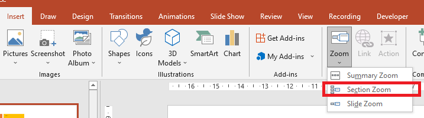

## **مقدمه**

PowerPoint زوم‌ها به شما امکان می‌دهند در حین نمایش اسلاید بین اسلایدها و بخش‌های خاص حرکت کنید. با Aspose.Slides برای Node.js از طریق Java می‌توانید زوم‌های اسلاید، بخش و خلاصه را ایجاد کرده و پیش‌نمایش‌ها، حاشیه‌ها و انتقال‌های آنها را سفارشی کنید.


* برای خلاصه‌سازی کل ارائه در یک اسلاید، از یک [زوم خلاصه](#summary-zoom) استفاده کنید.
* برای نمایش فقط اسلایدهای انتخابی، از یک [زوم اسلاید](#slide-zoom) استفاده کنید.
* برای نمایش فقط یک بخش، از یک [زوم بخش](#section-zoom) استفاده کنید.

## **زوم اسلاید**

زوم اسلاید می‌تواند ارائه شما را پویا‌تر کند و به شما اجازه دهد به‌صورت آزادانه بین اسلایدها به هر ترتیبی که می‌خواهید حرکت کنید بدون اینکه جریان ارائه‌تان مختل شود. زوم‌های اسلاید برای ارائه‌های کوتاه بدون بخش‌های زیاد مناسب هستند، اما همچنان می‌توانید آنها را در سناریوهای مختلف ارائه به کار ببرید.

زوم‌های اسلاید به شما امکان می‌دهند اطلاعات مربوطه را از یک اسلاید نمای کلی بررسی کنید.


برای اشیای زوم اسلاید، Aspose.Slides enumeration [ZoomImageType](https://reference.aspose.com/slides/nodejs-java/aspose.slides/zoomimagetype/) ، کلاس [ZoomFrame](https://reference.aspose.com/slides/nodejs-java/aspose.slides/zoomframe/) و روش‌های موجود در کلاس [ShapeCollection](https://reference.aspose.com/slides/nodejs-java/aspose.slides/shapecollection/) را فراهم می‌کند.

### **ایجاد فریم‌های زوم**

از [ShapeCollection.addZoomFrame](https://reference.aspose.com/slides/nodejs-java/aspose.slides/shapecollection/#addZoomFrame) برای قرار دادن پیوندها به اسلایدهای تک تک روی یک اسلاید نمای کلی استفاده کنید. این مثال دو اسلاید هدف با پس‌زمینه‌ها و برچسب‌های متفاوت ایجاد می‌کند، سپس پیش‌نمایشی از هر کدام را به اسلاید اول اضافه کرده و ارائه را به‌صورت PPTX ذخیره می‌کند. موقعیت و ابعاد فریم‌ها بر حسب پوینت تعیین می‌شوند.

```javascript
const aspose = { slides: require("aspose.slides.via.java") };
const java = require("java");

let presentation = new aspose.slides.Presentation();
try {
    let overviewSlide = presentation.getSlides().get_Item(0);

    let secondSlide = presentation.getSlides().addEmptySlide(overviewSlide.getLayoutSlide());
    let thirdSlide = presentation.getSlides().addEmptySlide(overviewSlide.getLayoutSlide());

    secondSlide.getBackground().setType(java.newByte(aspose.slides.BackgroundType.OwnBackground));
    secondSlide.getBackground().getFillFormat().setFillType(java.newByte(aspose.slides.FillType.Solid));
    secondSlide.getBackground().getFillFormat().getSolidFillColor().setColor(java.getStaticFieldValue("java.awt.Color", "CYAN"));

    let textBox = secondSlide.getShapes().addAutoShape(aspose.slides.ShapeType.Rectangle, 100, 200, 500, 200);
    textBox.getTextFrame().setText("Second Slide");

    thirdSlide.getBackground().setType(java.newByte(aspose.slides.BackgroundType.OwnBackground));
    thirdSlide.getBackground().getFillFormat().setFillType(java.newByte(aspose.slides.FillType.Solid));
    thirdSlide.getBackground().getFillFormat().getSolidFillColor().setColor(java.newInstanceSync("java.awt.Color", 189, 183, 107));

    textBox = thirdSlide.getShapes().addAutoShape(aspose.slides.ShapeType.Rectangle, 100, 200, 500, 200);
    textBox.getTextFrame().setText("Third Slide");

    overviewSlide.getShapes().addZoomFrame(20, 20, 250, 200, secondSlide);
    overviewSlide.getShapes().addZoomFrame(200, 250, 250, 200, thirdSlide);

    presentation.save("presentation.pptx", aspose.slides.SaveFormat.Pptx);
} finally {
    presentation.dispose();
}
```

### **ایجاد فریم‌های زوم با تصاویر سفارشی**

برای جایگزینی پیش‌نمایش پیش‌فرض اسلاید هدف، یک تصویر سفارشی را به [ShapeCollection.addZoomFrame](https://reference.aspose.com/slides/nodejs-java/aspose.slides/shapecollection/#addZoomFrame) پاس دهید. این مثال به یک تصویر محلی نیاز دارد، آن را با [Images.fromFile](https://reference.aspose.com/slides/nodejs-java/aspose.slides/images/#fromFile) بارگیری می‌کند و با استفاده از [ImageCollection.addImage](https://reference.aspose.com/slides/nodejs-java/aspose.slides/imagecollection/#addImage) به ارائه اضافه می‌کند. فریم حاصل آن تصویر را نمایش می‌دهد در حالی که همچنان به اسلاید دوم پیوند دارد.

```javascript
const aspose = { slides: require("aspose.slides.via.java") };
const java = require("java");

let presentation = new aspose.slides.Presentation();
try {
    let overviewSlide = presentation.getSlides().get_Item(0);

    let slide = presentation.getSlides().addEmptySlide(overviewSlide.getLayoutSlide());
    slide.getBackground().setType(java.newByte(aspose.slides.BackgroundType.OwnBackground));
    slide.getBackground().getFillFormat().setFillType(java.newByte(aspose.slides.FillType.Solid));
    slide.getBackground().getFillFormat().getSolidFillColor().setColor(java.getStaticFieldValue("java.awt.Color", "CYAN"));

    let textBox = slide.getShapes().addAutoShape(aspose.slides.ShapeType.Rectangle, 100, 200, 500, 200);
    textBox.getTextFrame().setText("Second Slide");

    let previewImage;
    let image = aspose.slides.Images.fromFile("image.png");
    try {
        previewImage = presentation.getImages().addImage(image);
    } finally {
        image.dispose();
    }

    overviewSlide.getShapes().addZoomFrame(20, 20, 300, 200, slide, previewImage);

    presentation.save("presentation.pptx", aspose.slides.SaveFormat.Pptx);
} finally {
    presentation.dispose();
}
```

### **قالب‌بندی فریم‌های زوم**

این مثال دو فریم زوم اسلاید را سفارشی می‌کند. یک تصویر محلی را از طریق [ZoomObject.setZoomImage](https://reference.aspose.com/slides/nodejs-java/aspose.slides/zoomobject/#setZoomImage) به فریم اول اختصاص می‌دهد و به فریم دوم یک حاشیه پنج پوینتی، خط‌نقطه‌ای صورتی می‌دهد با استفاده از [Shape.getLineFormat](https://reference.aspose.com/slides/nodejs-java/aspose.slides/shape/#getLineFormat). مقدار `false` به [ZoomObject.setShowBackground](https://reference.aspose.com/slides/nodejs-java/aspose.slides/zoomobject/#setShowBackground) پس‌زمینه فریم دوم را مخفی می‌کند. برای پیش‌نمایش سفارشی به یک تصویر محلی نیاز است؛ هر دو فریم هدف اسلایدهای خود را در فایل PPTX ذخیره‌شده حفظ می‌کنند.

```javascript
const aspose = { slides: require("aspose.slides.via.java") };
const java = require("java");

let presentation = new aspose.slides.Presentation();
try {
    let overviewSlide = presentation.getSlides().get_Item(0);

    let secondSlide = presentation.getSlides().addEmptySlide(overviewSlide.getLayoutSlide());
    let thirdSlide = presentation.getSlides().addEmptySlide(overviewSlide.getLayoutSlide());

    secondSlide.getBackground().setType(java.newByte(aspose.slides.BackgroundType.OwnBackground));
    secondSlide.getBackground().getFillFormat().setFillType(java.newByte(aspose.slides.FillType.Solid));
    secondSlide.getBackground().getFillFormat().getSolidFillColor().setColor(java.getStaticFieldValue("java.awt.Color", "CYAN"));

    let textBox = secondSlide.getShapes().addAutoShape(aspose.slides.ShapeType.Rectangle, 100, 200, 500, 200);
    textBox.getTextFrame().setText("Second Slide");

    thirdSlide.getBackground().setType(java.newByte(aspose.slides.BackgroundType.OwnBackground));
    thirdSlide.getBackground().getFillFormat().setFillType(java.newByte(aspose.slides.FillType.Solid));
    thirdSlide.getBackground().getFillFormat().getSolidFillColor().setColor(java.newInstanceSync("java.awt.Color", 189, 183, 107));

    textBox = thirdSlide.getShapes().addAutoShape(aspose.slides.ShapeType.Rectangle, 100, 200, 500, 200);
    textBox.getTextFrame().setText("Third Slide");

    let firstZoomFrame = overviewSlide.getShapes().addZoomFrame(20, 20, 250, 200, secondSlide);
    let secondZoomFrame = overviewSlide.getShapes().addZoomFrame(200, 250, 250, 200, thirdSlide);

    let previewImage;
    let image = aspose.slides.Images.fromFile("image.png");
    try {
        previewImage = presentation.getImages().addImage(image);
    } finally {
        image.dispose();
    }

    firstZoomFrame.setZoomImage(previewImage);

    secondZoomFrame.getLineFormat().setWidth(5);
    secondZoomFrame.getLineFormat().getFillFormat().setFillType(java.newByte(aspose.slides.FillType.Solid));
    secondZoomFrame.getLineFormat().getFillFormat().getSolidFillColor().setColor(java.newInstanceSync("java.awt.Color", 255, 105, 180));
    secondZoomFrame.getLineFormat().setDashStyle(java.newByte(aspose.slides.LineDashStyle.DashDot));

    secondZoomFrame.setShowBackground(false);

    presentation.save("presentation.pptx", aspose.slides.SaveFormat.Pptx);
} finally {
    presentation.dispose();
}
```

## **زوم بخش**

یک زوم بخش به بخشی از ارائه شما پیوند می‌دهد. از آن برای بازدید مجدد از یک موضوع یا نمایش نحوه ارتباط بخش‌های مختلف ارائه استفاده کنید.



برای اشیای زوم بخش، Aspose.Slides کلاس [SectionZoomFrame](https://reference.aspose.com/slides/nodejs-java/aspose.slides/sectionzoomframe/) و روش‌های موجود در کلاس [ShapeCollection](https://reference.aspose.com/slides/nodejs-java/aspose.slides/shapecollection/) را ارائه می‌دهد.

### **ایجاد فریم‌های زوم بخش**

یک بخش را با [SectionCollection.addSection](https://reference.aspose.com/slides/nodejs-java/aspose.slides/sectioncollection/#addSection) ایجاد کنید، سپس بخش بازگردانده‌شده را به [ShapeCollection.addSectionZoomFrame](https://reference.aspose.com/slides/nodejs-java/aspose.slides/shapecollection/#addSectionZoomFrame) پاس دهید. این مثال یک زوم بخش را بر روی اسلاید اول قرار می‌دهد و آن را به بخشی که با یک اسلاید رنگی شروع می‌شود پیوند می‌دهد. موقعیت و ابعاد فریم بر حسب پوینت مشخص می‌شوند و ارائه به‌صورت PPTX ذخیره می‌شود.

```javascript
const aspose = { slides: require("aspose.slides.via.java") };
const java = require("java");

let presentation = new aspose.slides.Presentation();
try {
    let overviewSlide = presentation.getSlides().get_Item(0);

    let slide = presentation.getSlides().addEmptySlide(overviewSlide.getLayoutSlide());
    slide.getBackground().getFillFormat().setFillType(java.newByte(aspose.slides.FillType.Solid));
    slide.getBackground().getFillFormat().getSolidFillColor().setColor(java.newInstanceSync("java.awt.Color", 154, 205, 50));
    slide.getBackground().setType(java.newByte(aspose.slides.BackgroundType.OwnBackground));

    let section = presentation.getSections().addSection("Section 1", slide);
    let sectionZoomFrame = overviewSlide.getShapes().addSectionZoomFrame(20, 20, 300, 200, section);

    presentation.save("presentation.pptx", aspose.slides.SaveFormat.Pptx);
} finally {
    presentation.dispose();
}
```

### **ایجاد فریم‌های زوم بخش با تصاویر سفارشی**

بارگذاری تصویر در [ShapeCollection.addSectionZoomFrame](https://reference.aspose.com/slides/nodejs-java/aspose.slides/shapecollection/#addSectionZoomFrame) به شما امکان می‌دهد پیش‌نمایش سفارشی را بدون تغییر بخش مقصد نمایش دهید. این مثال به یک تصویر محلی نیاز دارد که با [Images.fromFile](https://reference.aspose.com/slides/nodejs-java/aspose.slides/images/#fromFile) بارگیری شده و با استفاده از [ImageCollection.addImage](https://reference.aspose.com/slides/nodejs-java/aspose.slides/imagecollection/#addImage) به ارائه اضافه شود. ارائه ذخیره‌شده شامل یک زوم بخش در اسلاید اول است که به بخش تازه ایجاد شده پیوند دارد.

```javascript
const aspose = { slides: require("aspose.slides.via.java") };
const java = require("java");

let presentation = new aspose.slides.Presentation();
try {
    let overviewSlide = presentation.getSlides().get_Item(0);

    let slide = presentation.getSlides().addEmptySlide(overviewSlide.getLayoutSlide());
    slide.getBackground().getFillFormat().setFillType(java.newByte(aspose.slides.FillType.Solid));
    slide.getBackground().getFillFormat().getSolidFillColor().setColor(java.newInstanceSync("java.awt.Color", 154, 205, 50));
    slide.getBackground().setType(java.newByte(aspose.slides.BackgroundType.OwnBackground));

    let previewImage;
    let image = aspose.slides.Images.fromFile("image.png");
    try {
        previewImage = presentation.getImages().addImage(image);
    } finally {
        image.dispose();
    }

    let section = presentation.getSections().addSection("Section 1", slide);
    let sectionZoomFrame = overviewSlide.getShapes().addSectionZoomFrame(20, 20, 300, 200, section, previewImage);

    presentation.save("presentation.pptx", aspose.slides.SaveFormat.Pptx);
} finally {
    presentation.dispose();
}
```

### **تغییر بخش هدف زوم بخش**

از [SectionZoomFrame.setTargetSection](https://reference.aspose.com/slides/nodejs-java/aspose.slides/sectionzoomframe/#setTargetSection) برای تغییر مسیر یک زوم بخش موجود بدون ایجاد مجدد آن استفاده کنید. یک بخش پرشده را از مجموعه [Presentation.getSections](https://reference.aspose.com/slides/nodejs-java/aspose.slides/presentation/#getSections) همان ارائه انتخاب کنید. اختصاص یک بخش خالی هدف فعلی را تغییر نمی‌دهد، بنابراین قبل از اختصاص آن، [Section.getSlidesListOfSection](https://reference.aspose.com/slides/nodejs-java/aspose.slides/section/#getSlidesListOfSection) را بررسی کنید. برای اطلاعات بیشتر درباره بخش‌ها، به [Manage Slide Sections](/slides/fa/nodejs-java/slide-section/) مراجعه کنید.

مثال زیر یک فایل ارائه را بارگیری می‌کند که باید شامل چندین بخش پرشده، یک زوم بخش موجود با نام `Section navigation` و بخشی با نام منحصر به‌فرد `Results` باشد. این مثال تمام اسلایدها را برای زوم جستجو کرده و مقصد را بر اساس نام پیدا می‌کند نه بر اساس اندیس مجموعه‌ای که ممکن است هنگام جابجایی بخش‌ها تغییر کند. اگر نام‌ها منحصر به‌فرد نیستند، به جای آن از [Section.getSectionId](https://reference.aspose.com/slides/nodejs-java/aspose.slides/section/#getSectionId) برای شناسایی مقصد استفاده کنید.

```javascript
const aspose = { slides: require("aspose.slides.via.java") };
const java = require("java");

let presentation = new aspose.slides.Presentation("section-zoom.pptx");
try {
    let zoom = null;
    for (let i = 0; i < presentation.getSlides().size(); i++) {
        const slide = presentation.getSlides().get_Item(i);
        for (let j = 0; j < slide.getShapes().size(); j++) {
            const shape = slide.getShapes().get_Item(j);
            if (java.instanceOf(shape, "com.aspose.slides.ISectionZoomFrame") && shape.getName() === "Section navigation") {
                zoom = shape;
                break;
            }
        }
        if (zoom != null) {
            break;
        }
    }

    let targetSection = null;
    for (let i = 0; i < presentation.getSections().size(); i++) {
        const section = presentation.getSections().get_Item(i);
        if (section.getName() === "Results") {
            targetSection = section;
            break;
        }
    }

    if (zoom == null || targetSection == null) {
        console.log("The section zoom or destination section was not found.");
    } else if (targetSection.getSlidesListOfSection().size() == 0) {
        console.log("The destination section is empty.");
    } else {
        let currentSection = zoom.getTargetSection();
        console.log("Current section: " + (currentSection == null ? "" : currentSection.getName()));
        zoom.setTargetSection(targetSection);
        presentation.save("section-zoom-updated.pptx", aspose.slides.SaveFormat.Pptx);
    }
} finally {
    presentation.dispose();
}
```

### **قالب‌بندی فریم‌های زوم بخش**

این مثال زوم بخش را به اندازه 100 در 75 پوینت منتقل و تغییر اندازه می‌دهد، یک تصویر محلی را از طریق [ZoomObject.setZoomImage](https://reference.aspose.com/slides/nodejs-java/aspose.slides/zoomobject/#setZoomImage) اختصاص می‌دهد و حاشیه قهوه‌ای، 2.5 پوینت، خط‌نقطه‌ای اعمال می‌کند. با فعال‌سازی [ZoomObject.setReturnToParent](https://reference.aspose.com/slides/nodejs-java/aspose.slides/zoomobject/#setReturnToParent) پس از بخش، به اسلاید مبداء باز می‌گردد، [ZoomObject.setShowBackground](https://reference.aspose.com/slides/nodejs-java/aspose.slides/zoomobject/#setShowBackground) را غیرفعال می‌کند و [ZoomObject.setTransitionDuration](https://reference.aspose.com/slides/nodejs-java/aspose.slides/zoomobject/#setTransitionDuration) را روی 1.5 ثانیه تنظیم می‌کند. برای پیش‌نمایش سفارشی به یک تصویر محلی نیاز است.

```javascript
const aspose = { slides: require("aspose.slides.via.java") };
const java = require("java");

let presentation = new aspose.slides.Presentation();
try {
    let overviewSlide = presentation.getSlides().get_Item(0);

    let slide = presentation.getSlides().addEmptySlide(overviewSlide.getLayoutSlide());
    slide.getBackground().getFillFormat().setFillType(java.newByte(aspose.slides.FillType.Solid));
    slide.getBackground().getFillFormat().getSolidFillColor().setColor(java.newInstanceSync("java.awt.Color", 154, 205, 50));
    slide.getBackground().setType(java.newByte(aspose.slides.BackgroundType.OwnBackground));

    let section = presentation.getSections().addSection("Section 1", slide);

    let sectionZoomFrame = overviewSlide.getShapes().addSectionZoomFrame(20, 20, 300, 200, section);
    sectionZoomFrame.setX(100);
    sectionZoomFrame.setY(300);
    sectionZoomFrame.setWidth(100);
    sectionZoomFrame.setHeight(75);

    let previewImage;
    let image = aspose.slides.Images.fromFile("image.png");
    try {
        previewImage = presentation.getImages().addImage(image);
    } finally {
        image.dispose();
    }

    sectionZoomFrame.setZoomImage(previewImage);

    sectionZoomFrame.setReturnToParent(true);
    sectionZoomFrame.setShowBackground(false);

    sectionZoomFrame.getLineFormat().getFillFormat().setFillType(java.newByte(aspose.slides.FillType.Solid));
    sectionZoomFrame.getLineFormat().getFillFormat().getSolidFillColor().setColor(java.newInstanceSync("java.awt.Color", 165, 42, 42));
    sectionZoomFrame.getLineFormat().setDashStyle(java.newByte(aspose.slides.LineDashStyle.DashDot));
    sectionZoomFrame.getLineFormat().setWidth(2.5);

    sectionZoomFrame.setTransitionDuration(java.newFloat(1.5));

    presentation.save("presentation.pptx", aspose.slides.SaveFormat.Pptx);
} finally {
    presentation.dispose();
}
```

## **زوم خلاصه**

زوم خلاصه نمای کلی از بخش‌های ارائه را فراهم می‌کند. در طول نمایش اسلاید، می‌توانید از آن برای پرش به یک بخش، جلو رفتن یا بازدید مجدد از یک موضوع بدون پیروی از ترتیب اسلایدها استفاده کنید.


برای اشیای زوم خلاصه، Aspose.Slides کلاس‌های [SummaryZoomFrame](https://reference.aspose.com/slides/nodejs-java/aspose.slides/summaryzoomframe/)، [SummaryZoomSection](https://reference.aspose.com/slides/nodejs-java/aspose.slides/summaryzoomsection/)، و [SummaryZoomSectionCollection](https://reference.aspose.com/slides/nodejs-java/aspose.slides/summaryzoomsectioncollection/) و روش‌های موجود در کلاس [ShapeCollection](https://reference.aspose.com/slides/nodejs-java/aspose.slides/shapecollection/) را فراهم می‌کند.

### **ایجاد زوم خلاصه**

از [ShapeCollection.addSummaryZoomFrame](https://reference.aspose.com/slides/nodejs-java/aspose.slides/shapecollection/#addSummaryZoomFrame) برای ایجاد نمای کلی از بخش‌های ارائه استفاده کنید. این مثال چهار بخش با پس‌زمینه‌های اسلاید متفاوت ایجاد می‌کند و یک زوم خلاصه را به اسلاید اول اضافه می‌کند. موقعیت و اندازه فریم بر حسب پوینت مشخص می‌شود و نمای کلی حاصل در یک ارائه PPTX ذخیره می‌شود.

```javascript
const aspose = { slides: require("aspose.slides.via.java") };
const java = require("java");

let presentation = new aspose.slides.Presentation();
try {
    let overviewSlide = presentation.getSlides().get_Item(0);

    let slide = presentation.getSlides().addEmptySlide(overviewSlide.getLayoutSlide());
    slide.getBackground().getFillFormat().setFillType(java.newByte(aspose.slides.FillType.Solid));
    slide.getBackground().getFillFormat().getSolidFillColor().setColor(java.newInstanceSync("java.awt.Color", 165, 42, 42));
    slide.getBackground().setType(java.newByte(aspose.slides.BackgroundType.OwnBackground));

    presentation.getSections().addSection("Section 1", slide);

    slide = presentation.getSlides().addEmptySlide(overviewSlide.getLayoutSlide());
    slide.getBackground().getFillFormat().setFillType(java.newByte(aspose.slides.FillType.Solid));
    slide.getBackground().getFillFormat().getSolidFillColor().setColor(java.getStaticFieldValue("java.awt.Color", "CYAN"));
    slide.getBackground().setType(java.newByte(aspose.slides.BackgroundType.OwnBackground));

    presentation.getSections().addSection("Section 2", slide);

    slide = presentation.getSlides().addEmptySlide(overviewSlide.getLayoutSlide());
    slide.getBackground().getFillFormat().setFillType(java.newByte(aspose.slides.FillType.Solid));
    slide.getBackground().getFillFormat().getSolidFillColor().setColor(java.newInstanceSync("java.awt.Color", 127, 255, 0));
    slide.getBackground().setType(java.newByte(aspose.slides.BackgroundType.OwnBackground));

    presentation.getSections().addSection("Section 3", slide);

    slide = presentation.getSlides().addEmptySlide(overviewSlide.getLayoutSlide());
    slide.getBackground().getFillFormat().setFillType(java.newByte(aspose.slides.FillType.Solid));
    slide.getBackground().getFillFormat().getSolidFillColor().setColor(java.newInstanceSync("java.awt.Color", 0, 100, 0));
    slide.getBackground().setType(java.newByte(aspose.slides.BackgroundType.OwnBackground));

    presentation.getSections().addSection("Section 4", slide);

    let summaryZoomFrame = overviewSlide.getShapes().addSummaryZoomFrame(150, 50, 300, 200);

    presentation.save("presentation.pptx", aspose.slides.SaveFormat.Pptx);
} finally {
    presentation.dispose();
}
```

### **افزودن و حذف یک بخش زوم خلاصه**

یک زوم خلاصه اشیای [SummaryZoomSection](https://reference.aspose.com/slides/nodejs-java/aspose.slides/summaryzoomsection/) خود را در [SummaryZoomFrame.getSummaryZoomCollection](https://reference.aspose.com/slides/nodejs-java/aspose.slides/summaryzoomframe/#getSummaryZoomCollection) ذخیره می‌کند. این مثال نمای کلی دو بخش را ایجاد می‌کند، با استفاده از [SummaryZoomSectionCollection.addSummaryZoomSection](https://reference.aspose.com/slides/nodejs-java/aspose.slides/summaryzoomsectioncollection/#addSummaryZoomSection) بخش سوم را اضافه می‌کند و ورودی اولین بخش را با [SummaryZoomSectionCollection.removeSummaryZoomSection](https://reference.aspose.com/slides/nodejs-java/aspose.slides/summaryzoomsectioncollection/#removeSummaryZoomSection) حذف می‌کند. حذف ورودی بخش و اسلایدهای آن را دست‌نخورده می‌گذارد.

```javascript
const aspose = { slides: require("aspose.slides.via.java") };
const java = require("java");

let presentation = new aspose.slides.Presentation();
try {
    let overviewSlide = presentation.getSlides().get_Item(0);

    let slide = presentation.getSlides().addEmptySlide(overviewSlide.getLayoutSlide());
    slide.getBackground().getFillFormat().setFillType(java.newByte(aspose.slides.FillType.Solid));
    slide.getBackground().getFillFormat().getSolidFillColor().setColor(java.newInstanceSync("java.awt.Color", 165, 42, 42));
    slide.getBackground().setType(java.newByte(aspose.slides.BackgroundType.OwnBackground));

    let firstSection = presentation.getSections().addSection("Section 1", slide);

    slide = presentation.getSlides().addEmptySlide(overviewSlide.getLayoutSlide());
    slide.getBackground().getFillFormat().setFillType(java.newByte(aspose.slides.FillType.Solid));
    slide.getBackground().getFillFormat().getSolidFillColor().setColor(java.getStaticFieldValue("java.awt.Color", "CYAN"));
    slide.getBackground().setType(java.newByte(aspose.slides.BackgroundType.OwnBackground));

    presentation.getSections().addSection("Section 2", slide);

    let summaryZoomFrame = overviewSlide.getShapes().addSummaryZoomFrame(150, 50, 300, 200);

    slide = presentation.getSlides().addEmptySlide(overviewSlide.getLayoutSlide());
    slide.getBackground().getFillFormat().setFillType(java.newByte(aspose.slides.FillType.Solid));
    slide.getBackground().getFillFormat().getSolidFillColor().setColor(java.newInstanceSync("java.awt.Color", 127, 255, 0));
    slide.getBackground().setType(java.newByte(aspose.slides.BackgroundType.OwnBackground));

    let thirdSection = presentation.getSections().addSection("Section 3", slide);

    summaryZoomFrame.getSummaryZoomCollection().addSummaryZoomSection(thirdSection);

    summaryZoomFrame.getSummaryZoomCollection().removeSummaryZoomSection(firstSection);

    presentation.save("presentation.pptx", aspose.slides.SaveFormat.Pptx);
} finally {
    presentation.dispose();
}
```

### **قالب‌بندی بخش‌های زوم خلاصه**

این مثال اولین ورودی در [SummaryZoomFrame.getSummaryZoomCollection](https://reference.aspose.com/slides/nodejs-java/aspose.slides/summaryzoomframe/#getSummaryZoomCollection) را با استفاده از اندیس صفر مبنا `0` قالب‌بندی می‌کند. برای [ZoomObject.setZoomImage](https://reference.aspose.com/slides/nodejs-java/aspose.slides/zoomobject/#setZoomImage) به یک تصویر محلی نیاز دارد، حاشیه مشکی، 1.5 پوینت، خط‌نقطه‌ای اعمال می‌کند و [ZoomObject.setTransitionDuration](https://reference.aspose.com/slides/nodejs-java/aspose.slides/zoomobject/#setTransitionDuration) را روی 1.5 ثانیه تنظیم می‌کند. مقدار `false` به [ZoomObject.setReturnToParent](https://reference.aspose.com/slides/nodejs-java/aspose.slides/zoomobject/#setReturnToParent) بازگشت خودکار به اسلاید خلاصه برای این ورودی را غیرفعال می‌کند.

```javascript
const aspose = { slides: require("aspose.slides.via.java") };
const java = require("java");

let presentation = new aspose.slides.Presentation();
try {
    let overviewSlide = presentation.getSlides().get_Item(0);

    let slide = presentation.getSlides().addEmptySlide(overviewSlide.getLayoutSlide());
    slide.getBackground().getFillFormat().setFillType(java.newByte(aspose.slides.FillType.Solid));
    slide.getBackground().getFillFormat().getSolidFillColor().setColor(java.newInstanceSync("java.awt.Color", 165, 42, 42));
    slide.getBackground().setType(java.newByte(aspose.slides.BackgroundType.OwnBackground));

    presentation.getSections().addSection("Section 1", slide);

    slide = presentation.getSlides().addEmptySlide(overviewSlide.getLayoutSlide());
    slide.getBackground().getFillFormat().setFillType(java.newByte(aspose.slides.FillType.Solid));
    slide.getBackground().getFillFormat().getSolidFillColor().setColor(java.getStaticFieldValue("java.awt.Color", "CYAN"));
    slide.getBackground().setType(java.newByte(aspose.slides.BackgroundType.OwnBackground));

    presentation.getSections().addSection("Section 2", slide);

    let summaryZoomFrame = overviewSlide.getShapes().addSummaryZoomFrame(150, 50, 300, 200);

    let summarySection = summaryZoomFrame.getSummaryZoomCollection().get_Item(0);

    let previewImage;
    let image = aspose.slides.Images.fromFile("image.png");
    try {
        previewImage = presentation.getImages().addImage(image);
    } finally {
        image.dispose();
    }

    summarySection.setZoomImage(previewImage);
    summarySection.setReturnToParent(false);

    summarySection.getLineFormat().getFillFormat().setFillType(java.newByte(aspose.slides.FillType.Solid));
    summarySection.getLineFormat().getFillFormat().getSolidFillColor().setColor(java.getStaticFieldValue("java.awt.Color", "BLACK"));
    summarySection.getLineFormat().setDashStyle(java.newByte(aspose.slides.LineDashStyle.DashDot));
    summarySection.getLineFormat().setWidth(1.5);

    summarySection.setTransitionDuration(java.newFloat(1.5));

    presentation.save("presentation.pptx", aspose.slides.SaveFormat.Pptx);
} finally {
    presentation.dispose();
}
```

## **سوالات متداول**

**آیا می‌توانم بازگشت به اسلاید 'والد' پس از نمایش هدف را کنترل کنم؟**

بله. با مقدار `true` به [ZoomObject.setReturnToParent](https://reference.aspose.com/slides/nodejs-java/aspose.slides/zoomobject/#setReturnToParent) فراخوانی کنید تا پس از نمایش محتوای هدف، به اسلاید مبدأ بازگردید.

**آیا می‌توانم سرعت یا مدت زمان انتقال زوم را تنظیم کنم؟**

بله. از [ZoomObject.setTransitionDuration](https://reference.aspose.com/slides/nodejs-java/aspose.slides/zoomobject/#setTransitionDuration) برای کنترل مدت زمان انتقال بر حسب ثانیه استفاده کنید.

**آیا محدودیتی در تعداد اشیای زوم که یک ارائه می‌تواند داشته باشد وجود دارد؟**

مرزی برای تعداد اشیای زوم در API مستند نشده است. محدودیت‌های عملی به پیچیدگی کلی ارائه و عملکرد نمایشگر بستگی دارد. می‌توانید فریم‌های زوم زیادی اضافه کنید، اما به حجم فایل و زمان رندرینگ توجه کنید.