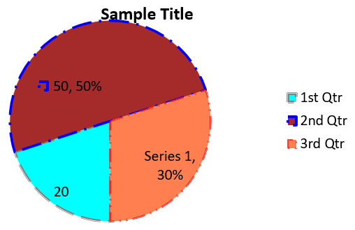

## **بررسی کلی**

این مقاله راهنمای کاملی برای ایجاد و سفارشی‌سازی نمودارها با استفاده از Aspose.Slides برای Node.js عبر Java ارائه می‌دهد. شما یاد خواهید گرفت چگونه به‌صورت برنامه‌نویسی یک نمودار به اسلاید اضافه کنید، آن را با داده‌ها پر کنید و گزینه‌های قالب‌بندی مختلفی را اعمال کنید تا متناسب با نیازهای طراحی شما باشد. در طول مقاله، مثال‌های کد تفصیلی هر گام را نشان می‌دهند؛ از مقداردهی اولیه ارائه و شیء نمودار تا پیکربندی سری‌ها، محورها و افسانه‌ها. با دنبال کردن این راهنما، درک جامعی از ادغام تولید دینامیک نمودار در برنامه‌های Node.js خود به دست می‌آورید و فرآیند ایجاد ارائه‌های مبتنی بر داده را ساده می‌کنید.

## **ایجاد یک نمودار**

نمودارها به افراد کمک می‌کنند تا داده‌ها را به‌سرعت تجسم کنند و بینش‌هایی به‌دست آورند که ممکن است از یک جدول یا صفحه‌گسترده به‌سرعت قابل تشخیص نباشد.

**چرا نمودار ایجاد کنیم؟**

با استفاده از نمودارها می‌توانید:

* مقادیر زیاد داده‌ها را در یک اسلاید جمع‌آوری، فشرده یا خلاصه کنید؛
* الگوها و روندهای داده‌ای را نشان دهید؛
* جهت و شتاب داده‌ها را در طول زمان یا نسبت به یک واحد اندازه‌گیری خاص استنتاج کنید؛
* نقاط دورافتاده، انحرافات، خطاها و داده‌های نامعقول را شناسایی کنید؛
* داده‌های پیچیده را ارتباط برقرار کنید یا ارائه دهید.

در PowerPoint می‌توانید از طریق عملکرد *Insert* نمودارها را ایجاد کنید که قالب‌های متنوعی برای طراحی انواع نمودارها فراهم می‌کند. با Aspose.Slides می‌توانید هر دو نوع نمودارهای معمولی (بر پایه انواع محبوب) و نمودارهای سفارشی را ایجاد کنید.

{}
از شمارش‌گر [ChartType](https://reference.aspose.com/slides/nodejs-java/aspose.slides/charttype/) در ماژول [aspose.slides](https://reference.aspose.com/slides/nodejs-java/aspose.slides/) استفاده کنید. مقادیر این شمارش‌گر با انواع مختلف نمودار مطابقت دارند.
{}

### **ایجاد نمودارهای ستونی خوشه‌ای**

این مثال از [addChart](https://reference.aspose.com/slides/nodejs-java/aspose.slides/shapecollection/#addChart) برای ایجاد یک نمودار ستونی خوشه‌ای که دو سری را در سه دسته مقایسه می‌کند، استفاده می‌کند. سری‌ها از پرهای قرمز و سبز استفاده می‌کنند و برچسب‌های جداگانه نام دسته‌ها، نام سری‌ها و مقادیر را نشان می‌دهند. شاخص کاربرگ 0 به اولین شیت در کاربرگ توکار نمودار اشاره دارد.

```javascript
const aspose = { slides: require("aspose.slides.via.java") };
const java = require("java");

let presentation = new aspose.slides.Presentation();
try
{
    let slide = presentation.getSlides().get_Item(0);

    let chart = slide.getShapes().addChart(aspose.slides.ChartType.ClusteredColumn, 20, 20, 500, 300);

    chart.getChartTitle().addTextFrameForOverriding("Sample Title");
    chart.getChartTitle().getTextFrameForOverriding().getTextFrameFormat().setCenterText(java.newByte(aspose.slides.NullableBool.True));
    chart.getChartTitle().setHeight(20);
    chart.setTitle(true);

    let workbook = chart.getChartData().getChartDataWorkbook();
    let worksheetIndex = 0;

    chart.getChartData().getSeries().clear();
    chart.getChartData().getCategories().clear();

    let seriesNameCell = workbook.getCell(worksheetIndex, 0, 1, "Series 1");
    chart.getChartData().getSeries().add(seriesNameCell, chart.getType());
    seriesNameCell = workbook.getCell(worksheetIndex, 0, 2, "Series 2");
    chart.getChartData().getSeries().add(seriesNameCell, chart.getType());

    let categoryCell = workbook.getCell(worksheetIndex, 1, 0, "Category 1");
    chart.getChartData().getCategories().add(categoryCell);
    categoryCell = workbook.getCell(worksheetIndex, 2, 0, "Category 2");
    chart.getChartData().getCategories().add(categoryCell);
    categoryCell = workbook.getCell(worksheetIndex, 3, 0, "Category 3");
    chart.getChartData().getCategories().add(categoryCell);

    let series = chart.getChartData().getSeries().get_Item(0);

    let valueCell = workbook.getCell(worksheetIndex, 1, 1, 20);
    series.getDataPoints().addDataPointForBarSeries(valueCell);
    valueCell = workbook.getCell(worksheetIndex, 2, 1, 50);
    series.getDataPoints().addDataPointForBarSeries(valueCell);
    valueCell = workbook.getCell(worksheetIndex, 3, 1, 30);
    series.getDataPoints().addDataPointForBarSeries(valueCell);

    series.getFormat().getFill().setFillType(java.newByte(aspose.slides.FillType.Solid));
    series.getFormat().getFill().getSolidFillColor().setColor(java.getStaticFieldValue("java.awt.Color", "RED"));

    series = chart.getChartData().getSeries().get_Item(1);

    valueCell = workbook.getCell(worksheetIndex, 1, 2, 30);
    series.getDataPoints().addDataPointForBarSeries(valueCell);
    valueCell = workbook.getCell(worksheetIndex, 2, 2, 10);
    series.getDataPoints().addDataPointForBarSeries(valueCell);
    valueCell = workbook.getCell(worksheetIndex, 3, 2, 60);
    series.getDataPoints().addDataPointForBarSeries(valueCell);

    series.getFormat().getFill().setFillType(java.newByte(aspose.slides.FillType.Solid));
    series.getFormat().getFill().getSolidFillColor().setColor(java.newInstanceSync("java.awt.Color", 0, 128, 0));

    let label = series.getDataPoints().get_Item(0).getLabel();
    label.getDataLabelFormat().setShowCategoryName(true);

    label = series.getDataPoints().get_Item(1).getLabel();
    label.getDataLabelFormat().setShowSeriesName(true);

    label = series.getDataPoints().get_Item(2).getLabel();
    label.getDataLabelFormat().setShowValue(true);
    label.getDataLabelFormat().setShowSeriesName(true);
    label.getDataLabelFormat().setSeparator("/");

    presentation.save("AsposeChart.pptx", aspose.slides.SaveFormat.Pptx);
}
finally
{
    presentation.dispose();
}
```

نتیجه:


### **ایجاد نمودارهای پراکندگی**

نمودارهای پراکندگی (همچنین به‌عنوان scatter plot یا نمودار x‑y شناخته می‌شوند) اغلب برای بررسی الگوها یا نشان دادن همبستگی بین دو متغیر استفاده می‌شوند.

از یک نمودار پراکندگی زمانی استفاده کنید که:

* داده‌های عددی زوج‌گذاری شده داشته باشید؛
* دو متغیر داشته باشید که به‌خوبی با هم جفت می‌شوند؛
* بخواهید تعیین کنید آیا دو متغیر مرتبط هستند یا نه؛
* یک متغیر مستقل داشته باشید که برای یک متغیر وابسته مقادیر متعدد دارد.

این مثال دو مجموعه مقدار x‑y را رسم می‌کند. سری اول از خطوط مستقیم با مارکرهای ستاره‌ای استفاده می‌کند، در حالی که سری دوم از خطوط صاف با مارکرهای دایره‌ای استفاده می‌کند؛ هر دو از اندازه مارکر 10 استفاده می‌کنند که با [setSize](https://reference.aspose.com/slides/nodejs-java/aspose.slides/marker/#setSize) تنظیم می‌شود. روش [setSymbol](https://reference.aspose.com/slides/nodejs-java/aspose.slides/marker/#setSymbol) شکل مارکر را کنترل می‌کند.

```javascript
const aspose = { slides: require("aspose.slides.via.java") };

let presentation = new aspose.slides.Presentation();
try
{
    let slide = presentation.getSlides().get_Item(0);

    let chart = slide.getShapes().addChart(aspose.slides.ChartType.ScatterWithSmoothLines, 20, 20, 500, 300);

    let workbook = chart.getChartData().getChartDataWorkbook();
    let worksheetIndex = 0;

    chart.getChartData().getSeries().clear();

    let seriesNameCell = workbook.getCell(worksheetIndex, 1, 1, "Series 1");
    chart.getChartData().getSeries().add(seriesNameCell, chart.getType());
    seriesNameCell = workbook.getCell(worksheetIndex, 1, 3, "Series 2");
    chart.getChartData().getSeries().add(seriesNameCell, chart.getType());

    let series = chart.getChartData().getSeries().get_Item(0);

    let xValueCell = workbook.getCell(worksheetIndex, 2, 1, 1);
    let yValueCell = workbook.getCell(worksheetIndex, 2, 2, 3);
    series.getDataPoints().addDataPointForScatterSeries(xValueCell, yValueCell);

    xValueCell = workbook.getCell(worksheetIndex, 3, 1, 2);
    yValueCell = workbook.getCell(worksheetIndex, 3, 2, 10);
    series.getDataPoints().addDataPointForScatterSeries(xValueCell, yValueCell);

    series.setType(aspose.slides.ChartType.ScatterWithStraightLinesAndMarkers);

    series.getMarker().setSize(10);
    series.getMarker().setSymbol(aspose.slides.MarkerStyleType.Star);

    series = chart.getChartData().getSeries().get_Item(1);

    xValueCell = workbook.getCell(worksheetIndex, 2, 3, 5);
    yValueCell = workbook.getCell(worksheetIndex, 2, 4, 2);
    series.getDataPoints().addDataPointForScatterSeries(xValueCell, yValueCell);

    xValueCell = workbook.getCell(worksheetIndex, 3, 3, 3);
    yValueCell = workbook.getCell(worksheetIndex, 3, 4, 1);
    series.getDataPoints().addDataPointForScatterSeries(xValueCell, yValueCell);

    xValueCell = workbook.getCell(worksheetIndex, 4, 3, 2);
    yValueCell = workbook.getCell(worksheetIndex, 4, 4, 2);
    series.getDataPoints().addDataPointForScatterSeries(xValueCell, yValueCell);

    xValueCell = workbook.getCell(worksheetIndex, 5, 3, 5);
    yValueCell = workbook.getCell(worksheetIndex, 5, 4, 1);
    series.getDataPoints().addDataPointForScatterSeries(xValueCell, yValueCell);

    series.getMarker().setSize(10);
    series.getMarker().setSymbol(aspose.slides.MarkerStyleType.Circle);

    presentation.save("AsposeChart.pptx", aspose.slides.SaveFormat.Pptx);
}
finally
{
    presentation.dispose();
}
```

نتیجه:


### **ایجاد نمودارهای دایره‌ای**

نمودارهای دایره‌ای بهترین استفاده را برای نشان دادن رابطه بخش‑به‑کل در داده‌ها دارند، به‌ویژه زمانی که داده‌ها شامل برچسب‌های دسته‌ای با مقادیر عددی باشند. با این حال، اگر داده‌های شما شامل بخش‌ها یا برچسب‌های زیادی باشد، ممکن است بهتر باشد از نمودار میله‌ای استفاده کنید.

این مثال یک نمودار دایره‌ای با سه مقدار سه ماهه ایجاد می‌کند. هر برش دارای پر و حاشیه سفارشی است و برچسب‌ها ترکیبی متفاوتی از مقادیر، درصدها و اطلاعات سری را نشان می‌دهند. روش [setFirstSliceAngle](https://reference.aspose.com/slides/nodejs-java/aspose.slides/chartseriesgroup/#setFirstSliceAngle) اولین برش را در زاویه 180 درجه شروع می‌کند.

```javascript
const aspose = { slides: require("aspose.slides.via.java") };
const java = require("java");

let presentation = new aspose.slides.Presentation();
try
{
    let slide = presentation.getSlides().get_Item(0);

    let chart = slide.getShapes().addChart(aspose.slides.ChartType.Pie, 20, 20, 500, 300);

    chart.getChartTitle().addTextFrameForOverriding("Sample Title");
    chart.getChartTitle().getTextFrameForOverriding().getTextFrameFormat().setCenterText(java.newByte(aspose.slides.NullableBool.True));
    chart.getChartTitle().setHeight(20);
    chart.setTitle(true);

    chart.getChartData().getSeries().get_Item(0).getLabels().getDefaultDataLabelFormat().setShowValue(true);

    let workbook = chart.getChartData().getChartDataWorkbook();
    let worksheetIndex = 0;

    chart.getChartData().getSeries().clear();
    chart.getChartData().getCategories().clear();

    let categoryCell = workbook.getCell(0, 1, 0, "1st Qtr");
    chart.getChartData().getCategories().add(categoryCell);
    categoryCell = workbook.getCell(0, 2, 0, "2nd Qtr");
    chart.getChartData().getCategories().add(categoryCell);
    categoryCell = workbook.getCell(0, 3, 0, "3rd Qtr");
    chart.getChartData().getCategories().add(categoryCell);

    let seriesNameCell = workbook.getCell(0, 0, 1, "Series 1");
    let series = chart.getChartData().getSeries().add(seriesNameCell, chart.getType());

    let valueCell = workbook.getCell(worksheetIndex, 1, 1, 20);
    series.getDataPoints().addDataPointForPieSeries(valueCell);
    valueCell = workbook.getCell(worksheetIndex, 2, 1, 50);
    series.getDataPoints().addDataPointForPieSeries(valueCell);
    valueCell = workbook.getCell(worksheetIndex, 3, 1, 30);
    series.getDataPoints().addDataPointForPieSeries(valueCell);

    chart.getChartData().getSeriesGroups().get_Item(0).setColorVaried(true);

    let firstSlice = series.getDataPoints().get_Item(0);
    firstSlice.getFormat().getFill().setFillType(java.newByte(aspose.slides.FillType.Solid));
    firstSlice.getFormat().getFill().getSolidFillColor().setColor(java.getStaticFieldValue("java.awt.Color", "CYAN"));

    firstSlice.getFormat().getLine().getFillFormat().setFillType(java.newByte(aspose.slides.FillType.Solid));
    firstSlice.getFormat().getLine().getFillFormat().getSolidFillColor().setColor(java.getStaticFieldValue("java.awt.Color", "GRAY"));
    firstSlice.getFormat().getLine().setWidth(3.0);
    firstSlice.getFormat().getLine().setStyle(java.newByte(aspose.slides.LineStyle.ThinThick));
    firstSlice.getFormat().getLine().setDashStyle(java.newByte(aspose.slides.LineDashStyle.LargeDash));

    let secondSlice = series.getDataPoints().get_Item(1);
    secondSlice.getFormat().getFill().setFillType(java.newByte(aspose.slides.FillType.Solid));
    secondSlice.getFormat().getFill().getSolidFillColor().setColor(java.newInstanceSync("java.awt.Color", 165, 42, 42));

    secondSlice.getFormat().getLine().getFillFormat().setFillType(java.newByte(aspose.slides.FillType.Solid));
    secondSlice.getFormat().getLine().getFillFormat().getSolidFillColor().setColor(java.getStaticFieldValue("java.awt.Color", "BLUE"));
    secondSlice.getFormat().getLine().setWidth(3.0);
    secondSlice.getFormat().getLine().setStyle(java.newByte(aspose.slides.LineStyle.Single));
    secondSlice.getFormat().getLine().setDashStyle(java.newByte(aspose.slides.LineDashStyle.LargeDashDot));

    let thirdSlice = series.getDataPoints().get_Item(2);
    thirdSlice.getFormat().getFill().setFillType(java.newByte(aspose.slides.FillType.Solid));
    thirdSlice.getFormat().getFill().getSolidFillColor().setColor(java.newInstanceSync("java.awt.Color", 255, 127, 80));

    thirdSlice.getFormat().getLine().getFillFormat().setFillType(java.newByte(aspose.slides.FillType.Solid));
    thirdSlice.getFormat().getLine().getFillFormat().getSolidFillColor().setColor(java.getStaticFieldValue("java.awt.Color", "RED"));
    thirdSlice.getFormat().getLine().setWidth(2.0);
    thirdSlice.getFormat().getLine().setStyle(java.newByte(aspose.slides.LineStyle.ThinThin));
    thirdSlice.getFormat().getLine().setDashStyle(java.newByte(aspose.slides.LineDashStyle.LargeDashDotDot));

    let firstLabel = series.getDataPoints().get_Item(0).getLabel();
    firstLabel.getDataLabelFormat().setShowValue(true);

    let secondLabel = series.getDataPoints().get_Item(1).getLabel();
    secondLabel.getDataLabelFormat().setShowValue(true);
    secondLabel.getDataLabelFormat().setShowLegendKey(true);
    secondLabel.getDataLabelFormat().setShowPercentage(true);

    let thirdLabel = series.getDataPoints().get_Item(2).getLabel();
    thirdLabel.getDataLabelFormat().setShowSeriesName(true);
    thirdLabel.getDataLabelFormat().setShowPercentage(true);

    series.getLabels().getDefaultDataLabelFormat().setShowLeaderLines(true);

    chart.getChartData().getSeriesGroups().get_Item(0).setFirstSliceAngle(180);

    presentation.save("PieChart.pptx", aspose.slides.SaveFormat.Pptx);
}
finally
{
    presentation.dispose();
}
```

نتیجه:



### **ایجاد نمودارهای خطی**

نمودارهای خطی (همچنین به‌عنوان line graph شناخته می‌شوند) بهترین استفاده را در موقعیت‌هایی دارند که می‌خواهید تغییرات مقدار در طول زمان را نشان دهید. با استفاده از نمودار خطی می‌توانید مقدار زیادی داده را به‌طور همزمان مقایسه کنید، تغییرات و روندها را در طول زمان پیگیری کنید، ناهنجاری‌های سری داده را برجسته کنید و موارد دیگر.

این مثال از [addChart](https://reference.aspose.com/slides/nodejs-java/aspose.slides/shapecollection/#addChart) برای ایجاد یک نمودار خطی با سری‌ها و دسته‌بندی‌های پیش‌فرض استفاده می‌کند و سپس ارائه را به صورت PPTX ذخیره می‌کند.

```javascript
const aspose = { slides: require("aspose.slides.via.java") };

let presentation = new aspose.slides.Presentation();
try
{
    let slide = presentation.getSlides().get_Item(0);

    let lineChart = slide.getShapes().addChart(aspose.slides.ChartType.Line, 20, 20, 500, 300);

    presentation.save("lineChart.pptx", aspose.slides.SaveFormat.Pptx);
}
finally
{
    presentation.dispose();
}
```

به‌طور پیش‌فرض، نقاط در یک نمودار خطی توسط خطوط پیوسته مستقیم به‌هم وصل می‌شوند. اگر بخواهید نقاط به‌جای خط پیوسته با خط تیره وصل شوند، [setDashStyle](https://reference.aspose.com/slides/nodejs-java/aspose.slides/lineformat/#setDashStyle) را با مقداری از [LineDashStyle](https://reference.aspose.com/slides/nodejs-java/aspose.slides/linedashstyle/) صدا بزنید:

```javascript
const aspose = { slides: require("aspose.slides.via.java") };
const java = require("java");

let presentation = new aspose.slides.Presentation();
try
{
    let slide = presentation.getSlides().get_Item(0);

    let lineChart = slide.getShapes().addChart(aspose.slides.ChartType.Line, 20, 20, 500, 300);

    for (let i = 0; i < lineChart.getChartData().getSeries().size(); i++)
    {
        let series = lineChart.getChartData().getSeries().get_Item(i);
        series.getFormat().getLine().setDashStyle(java.newByte(aspose.slides.LineDashStyle.Dash));
    }
}
finally
{
    presentation.dispose();
}
```

نتیجه:


### **ایجاد نمودارهای درختی (Tree Map)**

نمودارهای درختی بهترین استفاده را برای داده‌های فروش دارند که می‌خواهید اندازه نسبی دسته‌های داده را نشان دهید و به‌سرعت توجه را به آیتم‌های بزرگ‌سهم در هر دسته جلب کنید.

این مثال یک درخت‌نقشه با هشت برگ گروه‌بندی شده در چهار ساقه و دو شاخه ایجاد می‌کند. روش [setGroupingItem](https://reference.aspose.com/slides/nodejs-java/aspose.slides/chartcategorylevelsmanager/#setGroupingItem) ساقه‌ها را در سطح گروه‌بندی 1 و شاخه‌ها را در سطح 2 اختصاص می‌دهد. مقادیر اندازه نسبی مستطیل‌ها را تعیین می‌کنند، در حالی که برچسب‌های دسته و برچسب‌های والد همپوشانی‌دار سلسله‌مراتب را شناسایی می‌کنند.

```javascript
const aspose = { slides: require("aspose.slides.via.java") };

let presentation = new aspose.slides.Presentation();
try
{
    let slide = presentation.getSlides().get_Item(0);

    let chart = slide.getShapes().addChart(aspose.slides.ChartType.Treemap, 20, 20, 500, 300);

    chart.getChartData().getCategories().clear();
    chart.getChartData().getSeries().clear();

    let workbook = chart.getChartData().getChartDataWorkbook();
    workbook.clear(0);

    // شاخه 1
    let categoryCell = workbook.getCell(0, "C1", "Leaf1");
    let leaf = chart.getChartData().getCategories().add(categoryCell);
    leaf.getGroupingLevels().setGroupingItem(1, "Stem1");
    leaf.getGroupingLevels().setGroupingItem(2, "Branch1");

    categoryCell = workbook.getCell(0, "C2", "Leaf2");
    chart.getChartData().getCategories().add(categoryCell);

    categoryCell = workbook.getCell(0, "C3", "Leaf3");
    leaf = chart.getChartData().getCategories().add(categoryCell);
    leaf.getGroupingLevels().setGroupingItem(1, "Stem2");

    categoryCell = workbook.getCell(0, "C4", "Leaf4");
    chart.getChartData().getCategories().add(categoryCell);

    // شاخه 2
    categoryCell = workbook.getCell(0, "C5", "Leaf5");
    leaf = chart.getChartData().getCategories().add(categoryCell);
    leaf.getGroupingLevels().setGroupingItem(1, "Stem3");
    leaf.getGroupingLevels().setGroupingItem(2, "Branch2");

    categoryCell = workbook.getCell(0, "C6", "Leaf6");
    chart.getChartData().getCategories().add(categoryCell);

    categoryCell = workbook.getCell(0, "C7", "Leaf7");
    leaf = chart.getChartData().getCategories().add(categoryCell);
    leaf.getGroupingLevels().setGroupingItem(1, "Stem4");

    categoryCell = workbook.getCell(0, "C8", "Leaf8");
    chart.getChartData().getCategories().add(categoryCell);

    let series = chart.getChartData().getSeries().add(aspose.slides.ChartType.Treemap);
    series.getLabels().getDefaultDataLabelFormat().setShowCategoryName(true);
    let valueCell = workbook.getCell(0, "D1", 4);
    series.getDataPoints().addDataPointForTreemapSeries(valueCell);
    valueCell = workbook.getCell(0, "D2", 5);
    series.getDataPoints().addDataPointForTreemapSeries(valueCell);
    valueCell = workbook.getCell(0, "D3", 3);
    series.getDataPoints().addDataPointForTreemapSeries(valueCell);
    valueCell = workbook.getCell(0, "D4", 6);
    series.getDataPoints().addDataPointForTreemapSeries(valueCell);
    valueCell = workbook.getCell(0, "D5", 9);
    series.getDataPoints().addDataPointForTreemapSeries(valueCell);
    valueCell = workbook.getCell(0, "D6", 9);
    series.getDataPoints().addDataPointForTreemapSeries(valueCell);
    valueCell = workbook.getCell(0, "D7", 4);
    series.getDataPoints().addDataPointForTreemapSeries(valueCell);
    valueCell = workbook.getCell(0, "D8", 3);
    series.getDataPoints().addDataPointForTreemapSeries(valueCell);

    series.setParentLabelLayout(aspose.slides.ParentLabelLayoutType.Overlapping);

    presentation.save("Treemap.pptx", aspose.slides.SaveFormat.Pptx);
}
finally
{
    presentation.dispose();
}
```

نتیجه:


### **ایجاد نمودارهای آبشار (Waterfall)**

نمودار آبشار نشان می‌دهد که تغییرات مثبت و منفی چگونه به مقدار نهایی کمک می‌کنند. به‌عنوان مثال، یک تجزیه سود می‌تواند با درآمد شروع شود، هزینه‌ها را کم کند و سایر درآمدها را اضافه کند. ستون‌های تغییر بین مقدار قبلی و مقدار جدید جاری شناور می‌شوند، در حالی که ستون‌های مجموع از صفر تا مقدار انباشته‌شده امتداد می‌یابند.

مثال زیر از مبلغ‌ها به‌واحد هزار دلار آمریکا استفاده می‌کند:

| Category | Workbook value | Column type |
| --- | ---: | --- |
| Revenue | 1000 | Increase |
| Cost of sales | -400 | Decrease |
| Gross profit | 600 | Intermediate total |
| Operating expenses | -200 | Decrease |
| Other income | 50 | Increase |
| Net profit | 450 | Final total |

برای علامت‌گذاری یک نقطه به‌عنوان مجموع میانی یا نهایی، متد [setSetAsTotal](https://reference.aspose.com/slides/nodejs-java/aspose.slides/chartdatapoint/#setSetAsTotal) آن را با `true` صدا بزنید. مقدار انباشته واقعی را در سلول کاربرگ آن نقطه قرار دهید: `600` برای سود ناخالص (`1000 - 400`) و `450` برای سود خالص (`600 - 200 + 50`). این متد ستون را به‌عنوان مجموع علامت‌گذاری می‌کند؛ مقدار سلول را محاسبه یا پر نمی‌کند. از صفر به‌عنوان جای‌گیر استفاده نکنید یا مقدار تغییر دیگری برای نقطه مجموع فراهم نکنید. یک ستون مجموع مقدار انباشته را بدون اضافه کردن دوباره به مقدار جاری نشان می‌دهد.

این مثال کامل JavaScript یک نمودار ایجاد می‌کند که از عضو `Waterfall` شمارش‌گر [ChartType](https://reference.aspose.com/slides/nodejs-java/aspose.slides/charttype/) استفاده می‌کند، داده پیش‌فرض را پاک می‌کند و کاربرگ توکار را پر می‌کند. شاخص کاربرگ `0` اولین کاربرگ را انتخاب می‌کند؛ ستون A شامل نام‌های دسته و ستون B شامل مقادیر است. هر سلول مقدار با [addDataPointForWaterfallSeries](https://reference.aspose.com/slides/nodejs-java/aspose.slides/chartdatapointcollection/#addDataPointForWaterfallSeries) اضافه می‌شود. اندیس‌های نقطه‌ صفر‑محور `2` و `5` مجموع میانی و نهایی را شناسایی می‌کنند. فراخوانی [setShowValue](https://reference.aspose.com/slides/nodejs-java/aspose.slides/datalabelformat/#setShowValue) با `true` مقادیر را روی ستون‌ها نمایش می‌دهد. هیچ ارائه یا کاربرگ ورودی لازم نیست.

```javascript
const aspose = { slides: require("aspose.slides.via.java") };

let presentation = new aspose.slides.Presentation();
try
{
    let slide = presentation.getSlides().get_Item(0);

    let chart = slide.getShapes().addChart(aspose.slides.ChartType.Waterfall, 20, 20, 680, 200);

    chart.setTitle(true);
    chart.getChartTitle().addTextFrameForOverriding("Profit breakdown (USD thousands)");
    chart.getChartTitle().setOverlay(false);
    chart.setLegend(false);

    chart.getChartData().getSeries().clear();
    chart.getChartData().getCategories().clear();

    let workbook = chart.getChartData().getChartDataWorkbook();
    let worksheetIndex = 0;

    workbook.clear(worksheetIndex);

    let seriesNameCell = workbook.getCell(worksheetIndex, 0, 1, "Profit");
    let series = chart.getChartData().getSeries().add(seriesNameCell, aspose.slides.ChartType.Waterfall);
    let categories = [ "Revenue", "Cost of sales", "Gross profit", "Operating expenses", "Other income", "Net profit" ];
    let values = [ 1000, -400, 600, -200, 50, 450 ];

    for (let i = 0; i < categories.length; i++)
    {
        let categoryCell = workbook.getCell(worksheetIndex, i + 1, 0, categories[i]);
        chart.getChartData().getCategories().add(categoryCell);
        let valueCell = workbook.getCell(worksheetIndex, i + 1, 1, values[i]);
        series.getDataPoints().addDataPointForWaterfallSeries(valueCell);
    }

    // نقاط سوم و ششم مجموع‌ها را نشان می‌دهند، نه تغییرات اضافی.
    series.getDataPoints().get_Item(2).setSetAsTotal(true);
    series.getDataPoints().get_Item(5).setSetAsTotal(true);
    series.setShowConnectorLines(true);
    series.getLabels().getDefaultDataLabelFormat().setShowValue(true);

    presentation.save("WaterfallChart.pptx", aspose.slides.SaveFormat.Pptx);
}
finally
{
    presentation.dispose();
}
```

متد سطح‑سری [setShowConnectorLines](https://reference.aspose.com/slides/nodejs-java/aspose.slides/chartseries/#setShowConnectorLines) را با `true` صدا بزنید تا خطوطی که ستون‌های پشت‌سرهم را به‌هم وصل می‌کند نشان داده شوند و مقدار جاری راحت‌تر دنبال شود. برای مخفی کردن این خطوط، فراخوانی متد را در مثال با `series.setShowConnectorLines(false);` قبل از ذخیره جایگزین کنید. این فقط نمایش خط را تغییر می‌دهد، نه داده یا مجموع‌ها.

ارائه ذخیره‌شده نشان‌دهنده سود ناخالص 600 و سود خالص 450 است، که هر دو مجموع از صفر کشیده شده‌اند:


### **ایجاد نمودارهای سهام (Stock)**

نمودارهای سهام برای نمایش داده‌های مالی مانند قیمت‌های باز، بالا، پایین و بسته استفاده می‌شوند و به تحلیل روندهای بازار و نوسان‌ها کمک می‌کنند. این نمودارها بینش‌های مهمی درباره عملکرد سهام فراهم می‌کنند و به سرمایه‌گذاران و تحلیل‌گران در اتخاذ تصمیمات آگاهانه یاری می‌رسانند.

این مثال یک نمودار open‑high‑low‑close با چهار سری به ترتیب و سه دسته ایجاد می‌کند. متد [setUpDownBars](https://reference.aspose.com/slides/nodejs-java/aspose.slides/updownbarsmanager/#setUpDownBars) نوارهای بالا/پایین را فعال می‌کند و [getHiLowLinesFormat](https://reference.aspose.com/slides/nodejs-java/aspose.slides/chartseriesgroup/#getHiLowLinesFormat) خطوط بالا‑پایین را که بازه‌های قیمتی را نشان می‌دهند، کنترل می‌کند؛ در حالی که خطوط سری‌های منفرد و خطوط شبکه افقی جزئی مخفی می‌شوند.

```javascript
const aspose = { slides: require("aspose.slides.via.java") };
const java = require("java");

let presentation = new aspose.slides.Presentation();
try
{
    let slide = presentation.getSlides().get_Item(0);

    let chart = slide.getShapes().addChart(aspose.slides.ChartType.OpenHighLowClose, 20, 20, 500, 300, false);

    let workbook = chart.getChartData().getChartDataWorkbook();

    let categoryCell = workbook.getCell(0, 1, 0, "A");
    chart.getChartData().getCategories().add(categoryCell);
    categoryCell = workbook.getCell(0, 2, 0, "B");
    chart.getChartData().getCategories().add(categoryCell);
    categoryCell = workbook.getCell(0, 3, 0, "C");
    chart.getChartData().getCategories().add(categoryCell);

    let seriesNameCell = workbook.getCell(0, 0, 1, "Open");
    chart.getChartData().getSeries().add(seriesNameCell, aspose.slides.ChartType.OpenHighLowClose);
    seriesNameCell = workbook.getCell(0, 0, 2, "High");
    chart.getChartData().getSeries().add(seriesNameCell, aspose.slides.ChartType.OpenHighLowClose);
    seriesNameCell = workbook.getCell(0, 0, 3, "Low");
    chart.getChartData().getSeries().add(seriesNameCell, aspose.slides.ChartType.OpenHighLowClose);
    seriesNameCell = workbook.getCell(0, 0, 4, "Close");
    chart.getChartData().getSeries().add(seriesNameCell, aspose.slides.ChartType.OpenHighLowClose);

    let series = chart.getChartData().getSeries().get_Item(0);
    let valueCell = workbook.getCell(0, 1, 1, 72);
    series.getDataPoints().addDataPointForStockSeries(valueCell);
    valueCell = workbook.getCell(0, 2, 1, 25);
    series.getDataPoints().addDataPointForStockSeries(valueCell);
    valueCell = workbook.getCell(0, 3, 1, 38);
    series.getDataPoints().addDataPointForStockSeries(valueCell);

    series = chart.getChartData().getSeries().get_Item(1);
    valueCell = workbook.getCell(0, 1, 2, 172);
    series.getDataPoints().addDataPointForStockSeries(valueCell);
    valueCell = workbook.getCell(0, 2, 2, 57);
    series.getDataPoints().addDataPointForStockSeries(valueCell);
    valueCell = workbook.getCell(0, 3, 2, 57);
    series.getDataPoints().addDataPointForStockSeries(valueCell);

    series = chart.getChartData().getSeries().get_Item(2);
    valueCell = workbook.getCell(0, 1, 3, 12);
    series.getDataPoints().addDataPointForStockSeries(valueCell);
    valueCell = workbook.getCell(0, 2, 3, 12);
    series.getDataPoints().addDataPointForStockSeries(valueCell);
    valueCell = workbook.getCell(0, 3, 3, 13);
    series.getDataPoints().addDataPointForStockSeries(valueCell);

    series = chart.getChartData().getSeries().get_Item(3);
    valueCell = workbook.getCell(0, 1, 4, 25);
    series.getDataPoints().addDataPointForStockSeries(valueCell);
    valueCell = workbook.getCell(0, 2, 4, 38);
    series.getDataPoints().addDataPointForStockSeries(valueCell);
    valueCell = workbook.getCell(0, 3, 4, 50);
    series.getDataPoints().addDataPointForStockSeries(valueCell);

    chart.getChartData().getSeriesGroups().get_Item(0).getUpDownBars().setUpDownBars(true);
    chart.getChartData().getSeriesGroups().get_Item(0).getHiLowLinesFormat().getLine().getFillFormat().setFillType(java.newByte(aspose.slides.FillType.Solid));

    for (let i = 0; i < chart.getChartData().getSeries().size(); i++)
    {
        let stockSeries = chart.getChartData().getSeries().get_Item(i);
        stockSeries.getFormat().getLine().getFillFormat().setFillType(java.newByte(aspose.slides.FillType.NoFill));
    }

    chart.getAxes().getVerticalAxis().getMinorGridLinesFormat().getLine().getFillFormat().setFillType(java.newByte(aspose.slides.FillType.NoFill));

    presentation.save("Stock-chart.pptx", aspose.slides.SaveFormat.Pptx);
}
finally
{
    presentation.dispose();
}
```

نتیجه:


### **ایجاد نمودارهای جعبه‌ای و ویسکر (Box and Whisker)**

نمودارهای جعبه‌ای و ویسکر برای نمایش توزیع داده‌ها با خلاصه‌کردن معیارهای آماری کلیدی مانند میانه، چهارک‌ها و مقادیر پرت استفاده می‌شوند. این نمودارها به‌ویژه در تجزیه و تحلیل اکتشافی داده‌ها و مطالعات آماری برای درک سریع تغییرپذیری داده‌ها و شناسایی ناهنجاری‌ها مفید هستند.

این مثال یک نمودار جعبه‌ای و ویسکر از شش مقدار ایجاد می‌کند. متد [setQuartileMethod](https://reference.aspose.com/slides/nodejs-java/aspose.slides/chartseries/#setQuartileMethod) محاسبه چارک‌های انحصاری را انتخاب می‌کند. مثال همچنین خطوط میانگین، مارکرهای میانگین، نقاط داخلی و نقاط پرت را فعال می‌کند.

```javascript
const aspose = { slides: require("aspose.slides.via.java") };

let presentation = new aspose.slides.Presentation();
try
{
    let slide = presentation.getSlides().get_Item(0);

    let chart = slide.getShapes().addChart(aspose.slides.ChartType.BoxAndWhisker, 20, 20, 500, 300);

    chart.getChartData().getCategories().clear();
    chart.getChartData().getSeries().clear();

    let workbook = chart.getChartData().getChartDataWorkbook();
    workbook.clear(0);

    let categoryCell = workbook.getCell(0, "A1", "Category 1");
    chart.getChartData().getCategories().add(categoryCell);
    categoryCell = workbook.getCell(0, "A2", "Category 2");
    chart.getChartData().getCategories().add(categoryCell);
    categoryCell = workbook.getCell(0, "A3", "Category 3");
    chart.getChartData().getCategories().add(categoryCell);
    categoryCell = workbook.getCell(0, "A4", "Category 4");
    chart.getChartData().getCategories().add(categoryCell);
    categoryCell = workbook.getCell(0, "A5", "Category 5");
    chart.getChartData().getCategories().add(categoryCell);
    categoryCell = workbook.getCell(0, "A6", "Category 6");
    chart.getChartData().getCategories().add(categoryCell);

    let series = chart.getChartData().getSeries().add(aspose.slides.ChartType.BoxAndWhisker);

    series.setQuartileMethod(aspose.slides.QuartileMethodType.Exclusive);
    series.setShowMeanLine(true);
    series.setShowMeanMarkers(true);
    series.setShowInnerPoints(true);
    series.setShowOutlierPoints(true);

    let valueCell = workbook.getCell(0, "B1", 15);
    series.getDataPoints().addDataPointForBoxAndWhiskerSeries(valueCell);
    valueCell = workbook.getCell(0, "B2", 41);
    series.getDataPoints().addDataPointForBoxAndWhiskerSeries(valueCell);
    valueCell = workbook.getCell(0, "B3", 16);
    series.getDataPoints().addDataPointForBoxAndWhiskerSeries(valueCell);
    valueCell = workbook.getCell(0, "B4", 10);
    series.getDataPoints().addDataPointForBoxAndWhiskerSeries(valueCell);
    valueCell = workbook.getCell(0, "B5", 23);
    series.getDataPoints().addDataPointForBoxAndWhiskerSeries(valueCell);
    valueCell = workbook.getCell(0, "B6", 16);
    series.getDataPoints().addDataPointForBoxAndWhiskerSeries(valueCell);

    presentation.save("BoxAndWhisker.pptx", aspose.slides.SaveFormat.Pptx);
}
finally
{
    presentation.dispose();
}
```

### **ایجاد نمودارهای قیفی (Funnel)**

نمودارهای قیفی برای تجسم فرآیندهایی که شامل مراحل متوالی هستند استفاده می‌شوند، به‌طوری که حجم داده‌ها با پیشرفت از یک مرحله به مرحله بعدی کاهش می‌یابد. این نمودارها برای تحلیل نرخ تبدیل، شناسایی گلوگاه‌ها و ردیابی کارایی فرآیندهای فروش یا بازاریابی بسیار مفیدند.

این مثال از [addChart](https://reference.aspose.com/slides/nodejs-java/aspose.slides/shapecollection/#addChart) برای افزودن یک نمودار قیفی به اسلاید اول یک ارائه موجود استفاده می‌کند. داده‌های پیش‌فرض را با شش دسته و مقادیری بین 50 تا 500 جایگزین می‌کند و سپس ارائه به‌روزرسانی‌شده را ذخیره می‌کند. ارائه ورودی باید حداقل یک اسلاید داشته باشد.

```javascript
const aspose = { slides: require("aspose.slides.via.java") };

let presentation = new aspose.slides.Presentation("test.pptx");
try
{
    let slide = presentation.getSlides().get_Item(0);

    let chart = slide.getShapes().addChart(aspose.slides.ChartType.Funnel, 50, 50, 500, 400);

    chart.getChartData().getCategories().clear();
    chart.getChartData().getSeries().clear();

    let workbook = chart.getChartData().getChartDataWorkbook();
    workbook.clear(0);

    let categoryCell = workbook.getCell(0, "A1", "Category 1");
    chart.getChartData().getCategories().add(categoryCell);
    categoryCell = workbook.getCell(0, "A2", "Category 2");
    chart.getChartData().getCategories().add(categoryCell);
    categoryCell = workbook.getCell(0, "A3", "Category 3");
    chart.getChartData().getCategories().add(categoryCell);
    categoryCell = workbook.getCell(0, "A4", "Category 4");
    chart.getChartData().getCategories().add(categoryCell);
    categoryCell = workbook.getCell(0, "A5", "Category 5");
    chart.getChartData().getCategories().add(categoryCell);
    categoryCell = workbook.getCell(0, "A6", "Category 6");
    chart.getChartData().getCategories().add(categoryCell);

    let series = chart.getChartData().getSeries().add(aspose.slides.ChartType.Funnel);

    let valueCell = workbook.getCell(0, "B1", 50);
    series.getDataPoints().addDataPointForFunnelSeries(valueCell);
    valueCell = workbook.getCell(0, "B2", 100);
    series.getDataPoints().addDataPointForFunnelSeries(valueCell);
    valueCell = workbook.getCell(0, "B3", 200);
    series.getDataPoints().addDataPointForFunnelSeries(valueCell);
    valueCell = workbook.getCell(0, "B4", 300);
    series.getDataPoints().addDataPointForFunnelSeries(valueCell);
    valueCell = workbook.getCell(0, "B5", 400);
    series.getDataPoints().addDataPointForFunnelSeries(valueCell);
    valueCell = workbook.getCell(0, "B6", 500);
    series.getDataPoints().addDataPointForFunnelSeries(valueCell);

    presentation.save("Funnel.pptx", aspose.slides.SaveFormat.Pptx);
}
finally
{
    presentation.dispose();
}
```

نتیجه:


### **ایجاد نمودارهای خورشید (Sunburst)**

نمودارهای خورشید برای تجسم داده‌های سلسله‌مراتبی استفاده می‌شوند؛ سطوح به‌صورت حلقه‌های متحد‌المرکز نمایش داده می‌شوند. این نمودارها روابط بخش‑به‑کل را نشان می‌دهند و برای نمایاندن دسته‌ها و زیردسته‌های تودرتو به‌صورت واضح و فشرده ایده‌آل‌اند.

این مثال یک نمودار خورشید با هشت برگ گروه‌بندی شده در چهار ساقه و دو شاخه ایجاد می‌کند. متد [setGroupingItem](https://reference.aspose.com/slides/nodejs-java/aspose.slides/chartcategorylevelsmanager/#setGroupingItem) ساقه‌ها را در سطح گروه‌بندی 1 و شاخه‌ها را در سطح 2 اختصاص می‌دهد. برچسب‌های دسته‌بندی بخش‌ها را شناسایی می‌کنند و مقادیر اندازه نسبی آن‌ها را تعیین می‌کنند.

```javascript
const aspose = { slides: require("aspose.slides.via.java") };

let presentation = new aspose.slides.Presentation();
try
{
    let slide = presentation.getSlides().get_Item(0);

    let chart = slide.getShapes().addChart(aspose.slides.ChartType.Sunburst, 20, 20, 500, 300);

    chart.getChartData().getCategories().clear();
    chart.getChartData().getSeries().clear();

    let workbook = chart.getChartData().getChartDataWorkbook();
    workbook.clear(0);

    // شاخه 1
    let categoryCell = workbook.getCell(0, "C1", "Leaf1");
    let leaf = chart.getChartData().getCategories().add(categoryCell);
    leaf.getGroupingLevels().setGroupingItem(1, "Stem1");
    leaf.getGroupingLevels().setGroupingItem(2, "Branch1");

    categoryCell = workbook.getCell(0, "C2", "Leaf2");
    chart.getChartData().getCategories().add(categoryCell);

    categoryCell = workbook.getCell(0, "C3", "Leaf3");
    leaf = chart.getChartData().getCategories().add(categoryCell);
    leaf.getGroupingLevels().setGroupingItem(1, "Stem2");

    categoryCell = workbook.getCell(0, "C4", "Leaf4");
    chart.getChartData().getCategories().add(categoryCell);

    // شاخه 2
    categoryCell = workbook.getCell(0, "C5", "Leaf5");
    leaf = chart.getChartData().getCategories().add(categoryCell);
    leaf.getGroupingLevels().setGroupingItem(1, "Stem3");
    leaf.getGroupingLevels().setGroupingItem(2, "Branch2");

    categoryCell = workbook.getCell(0, "C6", "Leaf6");
    chart.getChartData().getCategories().add(categoryCell);

    categoryCell = workbook.getCell(0, "C7", "Leaf7");
    leaf = chart.getChartData().getCategories().add(categoryCell);
    leaf.getGroupingLevels().setGroupingItem(1, "Stem4");

    categoryCell = workbook.getCell(0, "C8", "Leaf8");
    chart.getChartData().getCategories().add(categoryCell);

    let series = chart.getChartData().getSeries().add(aspose.slides.ChartType.Sunburst);
    series.getLabels().getDefaultDataLabelFormat().setShowCategoryName(true);
    let valueCell = workbook.getCell(0, "D1", 4);
    series.getDataPoints().addDataPointForSunburstSeries(valueCell);
    valueCell = workbook.getCell(0, "D2", 5);
    series.getDataPoints().addDataPointForSunburstSeries(valueCell);
    valueCell = workbook.getCell(0, "D3", 3);
    series.getDataPoints().addDataPointForSunburstSeries(valueCell);
    valueCell = workbook.getCell(0, "D4", 6);
    series.getDataPoints().addDataPointForSunburstSeries(valueCell);
    valueCell = workbook.getCell(0, "D5", 9);
    series.getDataPoints().addDataPointForSunburstSeries(valueCell);
    valueCell = workbook.getCell(0, "D6", 9);
    series.getDataPoints().addDataPointForSunburstSeries(valueCell);
    valueCell = workbook.getCell(0, "D7", 4);
    series.getDataPoints().addDataPointForSunburstSeries(valueCell);
    valueCell = workbook.getCell(0, "D8", 3);
    series.getDataPoints().addDataPointForSunburstSeries(valueCell);

    presentation.save("Sunburst.pptx", aspose.slides.SaveFormat.Pptx);
}
finally
{
    presentation.dispose();
}
```

نتیجه:


### **ایجاد نمودارهای هیستوگرام (Histogram)**

نمودارهای هیستوگرام برای نمایش توزیع داده‌های عددی با گروه‌بندی مقادیر در بازه‌ها یا سطل‌ها استفاده می‌شوند. این نمودارها برای شناسایی الگوهای داده مانند فراوانی، کج‌نمایی و پراکندگی و همچنین برای یافتن مقادیر پرت در یک مجموعه داده بسیار مفیدند.

این مثال یک هیستوگرام از شش مقدار عددی، شامل مقادیر منفی، ایجاد می‌کند. صدا زدن [setAggregationType](https://reference.aspose.com/slides/nodejs-java/aspose.slides/axis/#setAggregationType) با نوع تجمیع خودکار به نمودار اجازه می‌دهد تا سطل‌های مناسب برای نمایش توزیع را تعیین کند.

```javascript
const aspose = { slides: require("aspose.slides.via.java") };

let presentation = new aspose.slides.Presentation();
try
{
    let slide = presentation.getSlides().get_Item(0);

    let chart = slide.getShapes().addChart(aspose.slides.ChartType.Histogram, 20, 20, 500, 300);

    chart.getChartData().getCategories().clear();
    chart.getChartData().getSeries().clear();

    let workbook = chart.getChartData().getChartDataWorkbook();
    workbook.clear(0);

    let series = chart.getChartData().getSeries().add(aspose.slides.ChartType.Histogram);
    let valueCell = workbook.getCell(0, "A1", 15);
    series.getDataPoints().addDataPointForHistogramSeries(valueCell);
    valueCell = workbook.getCell(0, "A2", -41);
    series.getDataPoints().addDataPointForHistogramSeries(valueCell);
    valueCell = workbook.getCell(0, "A3", 16);
    series.getDataPoints().addDataPointForHistogramSeries(valueCell);
    valueCell = workbook.getCell(0, "A4", 10);
    series.getDataPoints().addDataPointForHistogramSeries(valueCell);
    valueCell = workbook.getCell(0, "A5", -23);
    series.getDataPoints().addDataPointForHistogramSeries(valueCell);
    valueCell = workbook.getCell(0, "A6", 16);
    series.getDataPoints().addDataPointForHistogramSeries(valueCell);

    chart.getAxes().getHorizontalAxis().setAggregationType(aspose.slides.AxisAggregationType.Automatic);

    presentation.save("Histogram.pptx", aspose.slides.SaveFormat.Pptx);
}
finally
{
    presentation.dispose();
}
```

نتیجه:


### **ایجاد نمودارهای رادار (Radar)**

نمودارهای رادار برای نمایش داده‌های چندمتغیره در قالب دو‌بعدی استفاده می‌شوند و امکان مقایسه آسان چندین متغیر به‌صورت همزمان را فراهم می‌کنند. این نمودارها برای شناسایی الگوها، نقاط قوت و ضعف در میان متریک‌ها یا ویژگی‌های مختلف بسیار مفیدند.

این مثال از [addChart](https://reference.aspose.com/slides/nodejs-java/aspose.slides/shapecollection/#addChart) برای ایجاد یک نمودار رادار با سری‌ها و دسته‌بندی‌های پیش‌فرض استفاده می‌کند و سپس ارائه را به صورت PPTX ذخیره می‌کند.

```javascript
const aspose = { slides: require("aspose.slides.via.java") };

let presentation = new aspose.slides.Presentation();
try
{
    let slide = presentation.getSlides().get_Item(0);

    slide.getShapes().addChart(aspose.slides.ChartType.Radar, 20, 20, 500, 300);

    presentation.save("Radar-chart.pptx", aspose.slides.SaveFormat.Pptx);
}
finally
{
    presentation.dispose();
}
```

نتیجه:


### **ایجاد نمودارهای چنددسته‌ای (Multi-Category)**

نمودارهای چنددسته‌ای برای نمایش داده‌هایی که شامل بیش از یک گروه‌بندی دسته‌ای هستند استفاده می‌شوند و به شما امکان می‌دهند مقادیر را در چندین بُعد به‌طور همزمان مقایسه کنید. این نمودارها زمانی مفیدند که لازم باشد روندها و روابط را در مجموعه داده‌های پیچیده و چندلایه تحلیل کنید.

این مثال یک نمودار ستونی خوشه‌ای با هشت دسته که در چهار جفت گروه‌بندی شده‌اند ایجاد می‌کند. متد [setGroupingItem](https://reference.aspose.com/slides/nodejs-java/aspose.slides/chartcategorylevelsmanager/#setGroupingItem) به هر جفت یک برچسب مشترک در سطح گروه‌بندی 1 می‌دهد و محور دسته‌بندی را هم با برچسب‌های تک‌نفره و هم گروهی تولید می‌کند.

```javascript
const aspose = { slides: require("aspose.slides.via.java") };

let presentation = new aspose.slides.Presentation();
try
{
    let slide = presentation.getSlides().get_Item(0);

    let chart = slide.getShapes().addChart(aspose.slides.ChartType.ClusteredColumn, 20, 20, 500, 300);

    chart.getChartData().getSeries().clear();
    chart.getChartData().getCategories().clear();

    let workbook = chart.getChartData().getChartDataWorkbook();
    workbook.clear(0);

    let worksheetIndex = 0;

    let categoryCell = workbook.getCell(0, "c2", "A");
    let category = chart.getChartData().getCategories().add(categoryCell);
    category.getGroupingLevels().setGroupingItem(1, "Group1");
    categoryCell = workbook.getCell(0, "c3", "B");
    category = chart.getChartData().getCategories().add(categoryCell);

    categoryCell = workbook.getCell(0, "c4", "C");
    category = chart.getChartData().getCategories().add(categoryCell);
    category.getGroupingLevels().setGroupingItem(1, "Group2");
    categoryCell = workbook.getCell(0, "c5", "D");
    category = chart.getChartData().getCategories().add(categoryCell);

    categoryCell = workbook.getCell(0, "c6", "E");
    category = chart.getChartData().getCategories().add(categoryCell);
    category.getGroupingLevels().setGroupingItem(1, "Group3");
    categoryCell = workbook.getCell(0, "c7", "F");
    category = chart.getChartData().getCategories().add(categoryCell);

    categoryCell = workbook.getCell(0, "c8", "G");
    category = chart.getChartData().getCategories().add(categoryCell);
    category.getGroupingLevels().setGroupingItem(1, "Group4");
    categoryCell = workbook.getCell(0, "c9", "H");
    category = chart.getChartData().getCategories().add(categoryCell);

    let seriesNameCell = workbook.getCell(0, "D1", "Series 1");
    let series = chart.getChartData().getSeries().add(seriesNameCell, aspose.slides.ChartType.ClusteredColumn);

    let valueCell = workbook.getCell(worksheetIndex, "D2", 10);
    series.getDataPoints().addDataPointForBarSeries(valueCell);
    valueCell = workbook.getCell(worksheetIndex, "D3", 20);
    series.getDataPoints().addDataPointForBarSeries(valueCell);
    valueCell = workbook.getCell(worksheetIndex, "D4", 30);
    series.getDataPoints().addDataPointForBarSeries(valueCell);
    valueCell = workbook.getCell(worksheetIndex, "D5", 40);
    series.getDataPoints().addDataPointForBarSeries(valueCell);
    valueCell = workbook.getCell(worksheetIndex, "D6", 50);
    series.getDataPoints().addDataPointForBarSeries(valueCell);
    valueCell = workbook.getCell(worksheetIndex, "D7", 60);
    series.getDataPoints().addDataPointForBarSeries(valueCell);
    valueCell = workbook.getCell(worksheetIndex, "D8", 70);
    series.getDataPoints().addDataPointForBarSeries(valueCell);
    valueCell = workbook.getCell(worksheetIndex, "D9", 80);
    series.getDataPoints().addDataPointForBarSeries(valueCell);

    presentation.save("AsposeChart.pptx", aspose.slides.SaveFormat.Pptx);
}
finally
{
    presentation.dispose();
}
```

نتیجه:


### **ایجاد نمودارهای نقشه (Map)**

نمودارهای نقشه برای تجسم داده‌های جغرافیایی با نگاشت اطلاعات به مکان‌های خاصی مانند کشورها، ایالت‌ها یا شهرها استفاده می‌شوند. این نمودارها برای تحلیل روندهای منطقه‌ای، داده‌های جمعیتی و توزیع‌های فضایی به‌صورت واضح و جذاب بصری بسیار مفیدند.

این مثال از [addChart](https://reference.aspose.com/slides/nodejs-java/aspose.slides/shapecollection/#addChart) برای ایجاد یک نمودار نقشه با داده‌های جغرافیایی پیش‌فرض استفاده می‌کند و آن را برای مشاهده در PowerPoint ذخیره می‌کند.

```javascript
const aspose = { slides: require("aspose.slides.via.java") };

let presentation = new aspose.slides.Presentation();
try
{
    let slide = presentation.getSlides().get_Item(0);

    let chart = slide.getShapes().addChart(aspose.slides.ChartType.Map, 20, 20, 500, 300);

    presentation.save("mapChart.pptx", aspose.slides.SaveFormat.Pptx);
}
finally
{
    presentation.dispose();
}
```

نتیجه:


{}
تصویر بالا نمایش‌دهنده ارائه ذخیره‌شده‌ای است که در PowerPoint باز شده است. Aspose.Slides نمودار نقشه و داده‌های آن را به‌درستی می‌نویسد، اما خود نمودار نقشه را رسم نمی‌کند: وقتی اسلایدی که شامل یک نمودار نقشه است به تصویر رندر می‌شود یا به PDF یا SVG تبدیل می‌شود، ناحیه نمودار خالی می‌ماند. سایر اشکال موجود در همان اسلاید تحت تأثیر قرار نمی‌گیرند.
{}

### **ایجاد نمودارهای ترکیبی (Combination)**

نمودار ترکیبی (یا combo chart) دو یا چند نوع نمودار را در یک گراف ترکیب می‌کند. این نمودار به شما امکان می‌دهد تا تفاوت‌ها بین دو یا چند مجموعه داده را برجسته، مقایسه یا بررسی کنید و رابطه بین آن‌ها را شناسایی کنید.


این مثال دو سری ستونی خوشه‌ای را با یک سری خط در چهار دسته ترکیب می‌کند. ستون‌ها از محور عمودی اصلی استفاده می‌کنند، در حالی که [setPlotOnSecondAxis](https://reference.aspose.com/slides/nodejs-java/aspose.slides/chartseries/#setPlotOnSecondAxis) خط را بر روی محور عمودی ثانویه سمت راست قرار می‌دهد. توابع کمکی عنوان، افسانه، برچسب‌های محور و خطوط شبکه را پیکربندی می‌کنند.

```javascript
const aspose = { slides: require("aspose.slides.via.java") };
const java = require("java");

function createComboChart()
{
    let presentation = new aspose.slides.Presentation();
    try
    {
        let chart = createChartWithFirstSeries(presentation.getSlides().get_Item(0));

        addSecondSeriesToChart(chart);
        addThirdSeriesToChart(chart);

        setPrimaryAxesFormat(chart);
        setSecondaryAxesFormat(chart);

        presentation.save("combo-chart.pptx", aspose.slides.SaveFormat.Pptx);
    }
    finally
    {
        presentation.dispose();
    }
}

function createChartWithFirstSeries(slide)
{
    let chart = slide.getShapes().addChart(aspose.slides.ChartType.ClusteredColumn, 50, 50, 600, 400);

    chart.setTitle(true);
    chart.getChartTitle().addTextFrameForOverriding("Chart Title");
    chart.getChartTitle().setOverlay(false);
    let portionFormat = chart.getChartTitle().getTextFrameForOverriding().getParagraphs().get_Item(0).getParagraphFormat().getDefaultPortionFormat();
    portionFormat.setFontBold(java.newByte(aspose.slides.NullableBool.False));
    portionFormat.setFontHeight(18);

    chart.getLegend().setPosition(aspose.slides.LegendPositionType.Bottom);
    chart.getLegend().getTextFormat().getPortionFormat().setFontHeight(12);

    chart.getChartData().getSeries().clear();
    chart.getChartData().getCategories().clear();

    let workbook = chart.getChartData().getChartDataWorkbook();
    let worksheetIndex = 0;

    let categoryCell = workbook.getCell(worksheetIndex, 1, 0, "Category 1");
    chart.getChartData().getCategories().add(categoryCell);
    categoryCell = workbook.getCell(worksheetIndex, 2, 0, "Category 2");
    chart.getChartData().getCategories().add(categoryCell);
    categoryCell = workbook.getCell(worksheetIndex, 3, 0, "Category 3");
    chart.getChartData().getCategories().add(categoryCell);
    categoryCell = workbook.getCell(worksheetIndex, 4, 0, "Category 4");
    chart.getChartData().getCategories().add(categoryCell);

    let seriesNameCell = workbook.getCell(worksheetIndex, 0, 1, "Series 1");
    let series = chart.getChartData().getSeries().add(seriesNameCell, chart.getType());

    series.getParentSeriesGroup().setOverlap(java.newByte(-25));
    series.getParentSeriesGroup().setGapWidth(220);

    let valueCell = workbook.getCell(worksheetIndex, 1, 1, 4.3);
    series.getDataPoints().addDataPointForBarSeries(valueCell);
    valueCell = workbook.getCell(worksheetIndex, 2, 1, 2.5);
    series.getDataPoints().addDataPointForBarSeries(valueCell);
    valueCell = workbook.getCell(worksheetIndex, 3, 1, 3.5);
    series.getDataPoints().addDataPointForBarSeries(valueCell);
    valueCell = workbook.getCell(worksheetIndex, 4, 1, 4.5);
    series.getDataPoints().addDataPointForBarSeries(valueCell);

    return chart;
}

function addSecondSeriesToChart(chart)
{
    let workbook = chart.getChartData().getChartDataWorkbook();
    let worksheetIndex = 0;

    let seriesNameCell = workbook.getCell(worksheetIndex, 0, 2, "Series 2");
    let series = chart.getChartData().getSeries().add(seriesNameCell, aspose.slides.ChartType.ClusteredColumn);

    series.getParentSeriesGroup().setOverlap(java.newByte(-25));
    series.getParentSeriesGroup().setGapWidth(220);

    let valueCell = workbook.getCell(worksheetIndex, 1, 2, 2.4);
    series.getDataPoints().addDataPointForBarSeries(valueCell);
    valueCell = workbook.getCell(worksheetIndex, 2, 2, 4.4);
    series.getDataPoints().addDataPointForBarSeries(valueCell);
    valueCell = workbook.getCell(worksheetIndex, 3, 2, 1.8);
    series.getDataPoints().addDataPointForBarSeries(valueCell);
    valueCell = workbook.getCell(worksheetIndex, 4, 2, 2.8);
    series.getDataPoints().addDataPointForBarSeries(valueCell);
}

function addThirdSeriesToChart(chart)
{
    let workbook = chart.getChartData().getChartDataWorkbook();
    let worksheetIndex = 0;

    let seriesNameCell = workbook.getCell(worksheetIndex, 0, 3, "Series 3");
    let series = chart.getChartData().getSeries().add(seriesNameCell, aspose.slides.ChartType.Line);

    let valueCell = workbook.getCell(worksheetIndex, 1, 3, 2.0);
    series.getDataPoints().addDataPointForLineSeries(valueCell);
    valueCell = workbook.getCell(worksheetIndex, 2, 3, 2.0);
    series.getDataPoints().addDataPointForLineSeries(valueCell);
    valueCell = workbook.getCell(worksheetIndex, 3, 3, 3.0);
    series.getDataPoints().addDataPointForLineSeries(valueCell);
    valueCell = workbook.getCell(worksheetIndex, 4, 3, 5.0);
    series.getDataPoints().addDataPointForLineSeries(valueCell);

    series.setPlotOnSecondAxis(true);
}

function setPrimaryAxesFormat(chart)
{
    let horizontalAxis = chart.getAxes().getHorizontalAxis();
    horizontalAxis.getTextFormat().getPortionFormat().setFontHeight(12);
    horizontalAxis.getFormat().getLine().getFillFormat().setFillType(java.newByte(aspose.slides.FillType.NoFill));

    setAxisTitle(horizontalAxis, "X Axis");

    let verticalAxis = chart.getAxes().getVerticalAxis();
    verticalAxis.getTextFormat().getPortionFormat().setFontHeight(12);
    verticalAxis.getFormat().getLine().getFillFormat().setFillType(java.newByte(aspose.slides.FillType.NoFill));

    setAxisTitle(verticalAxis, "Y Axis 1");

    let majorGridLinesFormat = verticalAxis.getMajorGridLinesFormat().getLine().getFillFormat();
    majorGridLinesFormat.setFillType(java.newByte(aspose.slides.FillType.Solid));
    majorGridLinesFormat.getSolidFillColor().setColor(java.newInstanceSync("java.awt.Color", 217, 217, 217));
}

function setSecondaryAxesFormat(chart)
{
    let secondaryHorizontalAxis = chart.getAxes().getSecondaryHorizontalAxis();
    secondaryHorizontalAxis.setPosition(aspose.slides.AxisPositionType.Bottom);
    secondaryHorizontalAxis.setCrossType(aspose.slides.CrossesType.Maximum);
    secondaryHorizontalAxis.setVisible(false);
    secondaryHorizontalAxis.getMajorGridLinesFormat().getLine().getFillFormat().setFillType(java.newByte(aspose.slides.FillType.NoFill));
    secondaryHorizontalAxis.getMinorGridLinesFormat().getLine().getFillFormat().setFillType(java.newByte(aspose.slides.FillType.NoFill));

    let secondaryVerticalAxis = chart.getAxes().getSecondaryVerticalAxis();
    secondaryVerticalAxis.setPosition(aspose.slides.AxisPositionType.Right);
    secondaryVerticalAxis.getTextFormat().getPortionFormat().setFontHeight(12);
    secondaryVerticalAxis.getFormat().getLine().getFillFormat().setFillType(java.newByte(aspose.slides.FillType.NoFill));
    secondaryVerticalAxis.getMajorGridLinesFormat().getLine().getFillFormat().setFillType(java.newByte(aspose.slides.FillType.NoFill));
    secondaryVerticalAxis.getMinorGridLinesFormat().getLine().getFillFormat().setFillType(java.newByte(aspose.slides.FillType.NoFill));

    setAxisTitle(secondaryVerticalAxis, "Y Axis 2");
}

function setAxisTitle(axis, axisTitle)
{
    axis.setTitle(true);
    axis.getTitle().setOverlay(false);
    let titlePortionFormat = axis.getTitle().addTextFrameForOverriding(axisTitle).getParagraphs().get_Item(0).getParagraphFormat().getDefaultPortionFormat();
    titlePortionFormat.setFontBold(java.newByte(aspose.slides.NullableBool.False));
    titlePortionFormat.setFontHeight(12);
}

createComboChart();
```

## **به‌روزرسانی نمودارها**

Aspose.Slides برای Node.js عبر Java به شما امکان می‌دهد نمودارهای PowerPoint را با تغییر داده‌های نمودار، قالب‌بندی و استایل به‌روزرسانی کنید. این قابلیت فرآیند نگه‌داشتن ارائه‌ها را با محتوای پویا ساده می‌کند و اطمینان می‌دهد که نمودارها به‌درستی داده‌ها و استانداردهای تصویری جاری را بازتاب می‌دهند.

این مثال نمودار به نام "My chart" را در اسلاید اول یک ارائه موجود به‌روزرسانی می‌کند. این مثال نیاز به دو سری ستونی دارد که هر کدام سه نقطه داده داشته باشند، با برچسب‌های دسته در ستون A و نام‌های سری در ردیف اول اولین کاربرگ. مثال از [getCell](https://reference.aspose.com/slides/nodejs-java/aspose.slides/chartdataworkbook/#getCell) برای تغییر سلول‌های کاربرگی استفاده می‌کند، مقادیر سری‌ها را به‌روزرسانی می‌کند، سری سوم را اضافه می‌کند و نمودار را از طریق [setType](https://reference.aspose.com/slides/nodejs-java/aspose.slides/chart/#setType) به استوانه‌های خوشه‌ای تغییر می‌دهد.

```javascript
const aspose = { slides: require("aspose.slides.via.java") };
const java = require("java");

let chartName = "My chart";

let presentation = new aspose.slides.Presentation("ExistingChart.pptx");
try
{
    let slide = presentation.getSlides().get_Item(0);

    for (let i = 0; i < slide.getShapes().size(); i++)
    {
        let shape = slide.getShapes().get_Item(i);
        if (java.instanceOf(shape, "com.aspose.slides.IChart") && chartName === shape.getName())
        {
            let chart = shape;
            let worksheetIndex = 0;

            let workbook = chart.getChartData().getChartDataWorkbook();

            workbook.getCell(worksheetIndex, 1, 0, "Modified Category 1");
            workbook.getCell(worksheetIndex, 2, 0, "Modified Category 2");

            let series = chart.getChartData().getSeries().get_Item(0);

            workbook.getCell(worksheetIndex, 0, 1, "New_Series 1");
            series.getDataPoints().get_Item(0).getValue().setData(90);
            series.getDataPoints().get_Item(1).getValue().setData(123);
            series.getDataPoints().get_Item(2).getValue().setData(44);

            series = chart.getChartData().getSeries().get_Item(1);

            workbook.getCell(worksheetIndex, 0, 2, "New_Series 2");
            series.getDataPoints().get_Item(0).getValue().setData(23);
            series.getDataPoints().get_Item(1).getValue().setData(67);
            series.getDataPoints().get_Item(2).getValue().setData(99);

            let seriesNameCell = workbook.getCell(worksheetIndex, 0, 3, "Series 3");
            series = chart.getChartData().getSeries().add(seriesNameCell, chart.getType());

            let valueCell = workbook.getCell(worksheetIndex, 1, 3, 20);
            series.getDataPoints().addDataPointForBarSeries(valueCell);
            valueCell = workbook.getCell(worksheetIndex, 2, 3, 50);
            series.getDataPoints().addDataPointForBarSeries(valueCell);
            valueCell = workbook.getCell(worksheetIndex, 3, 3, 30);
            series.getDataPoints().addDataPointForBarSeries(valueCell);

            chart.setType(aspose.slides.ChartType.ClusteredCylinder);
        }
    }

    presentation.save("AsposeChartModified.pptx", aspose.slides.SaveFormat.Pptx);
}
finally
{
    presentation.dispose();
}
```

## **تنظیم محدوده داده برای یک نمودار**

برای بررسی محدوده‌ای که قبلاً توسط یک نمودار موجود استفاده شده است، به [Retrieve a Chart's Data Range](/slides/fa/nodejs-java/chart-workbook/#retrieve-a-charts-data-range) مراجعه کنید.

Aspose.Slides برای Node.js عبر Java انعطاف‌پذیری تعریف محدوده داده‌ای خاص از یک کاربرگ را به‌عنوان منبع داده‌های نمودار شما فراهم می‌کند. این بدین معناست که می‌توانید بخشی از کاربرگ خود را مستقیماً به نمودار نگاشت کنید و کنترل کنید که کدام سلول‌ها به سری‌ها و دسته‌ها کمک می‌کنند. در نتیجه، می‌توانید نمودارهای خود را به‌راحتی با آخرین تغییرات داده در کاربرگ همگام‌سازی کنید و اطمینان حاصل کنید که ارائه‌های PowerPoint شما اطلاعات جاری و دقیقی را منعکس می‌کنند.

این مثال از [setRange](https://reference.aspose.com/slides/nodejs-java/aspose.slides/chartdata/#setRange) برای تنظیم منبع داده نمودار به نام "My chart" در اسلاید اول یک ارائه موجود به `Sheet1!A1:B4` استفاده می‌کند. کاربرگ نمودار باید آن کاربرگ و یک محدوده پر شده با عنوان سری در ردیف اول، برچسب‌های دسته در ستون A و سه مقدار در ستون B داشته باشد.

```javascript
const aspose = { slides: require("aspose.slides.via.java") };
const java = require("java");

let chartName = "My chart";

let presentation = new aspose.slides.Presentation("ExistingChart.pptx");
try
{
    let slide = presentation.getSlides().get_Item(0);

    for (let i = 0; i < slide.getShapes().size(); i++)
    {
        let shape = slide.getShapes().get_Item(i);
        if (java.instanceOf(shape, "com.aspose.slides.IChart") && chartName === shape.getName())
        {
            let chart = shape;
            chart.getChartData().setRange("Sheet1!A1:B4");
        }
    }

    presentation.save("SetDataRange.pptx", aspose.slides.SaveFormat.Pptx);
}
finally
{
    presentation.dispose();
}
```

## **استفاده از مارکرهای پیش‌فرض در نمودارها**

هنگامی که از مارکرهای پیش‌فرض در نمودارها استفاده می‌کنید، هر سری نمودار به‌طور خودکار یک نماد مارکر پیش‌فرض متفاوت دریافت می‌کند.

این مثال از [addChart](https://reference.aspose.com/slides/nodejs-java/aspose.slides/shapecollection/#addChart) برای ایجاد یک نمودار با دو سری خطی و یک افسانه استفاده می‌کند. تنظیمات مارکر که از طریق [getMarker](https://reference.aspose.com/slides/nodejs-java/aspose.slides/chartseries/#getMarker) دسترسی پیدا می‌شود، نمادهای مارکر اختصاص‌یافته خودکار را حفظ می‌کند. سری اول شامل مقدار منفی و مقدار مفقود (`null`) است، در حالی که سری دوم برای هر دسته یک مقدار دارد.

```javascript
const aspose = { slides: require("aspose.slides.via.java") };

let presentation = new aspose.slides.Presentation();
try
{
    let slide = presentation.getSlides().get_Item(0);

    let chart = slide.getShapes().addChart(aspose.slides.ChartType.LineWithMarkers, 10, 10, 400, 400);

    chart.getChartData().getSeries().clear();
    chart.getChartData().getCategories().clear();

    let workbook = chart.getChartData().getChartDataWorkbook();

    let seriesNameCell = workbook.getCell(0, 0, 1, "Series 1");
    let series = chart.getChartData().getSeries().add(seriesNameCell, chart.getType());

    let categoryCell = workbook.getCell(0, 1, 0, "C1");
    chart.getChartData().getCategories().add(categoryCell);
    let valueCell = workbook.getCell(0, 1, 1, 24);
    series.getDataPoints().addDataPointForLineSeries(valueCell);

    categoryCell = workbook.getCell(0, 2, 0, "C2");
    chart.getChartData().getCategories().add(categoryCell);
    valueCell = workbook.getCell(0, 2, 1, 23);
    series.getDataPoints().addDataPointForLineSeries(valueCell);

    categoryCell = workbook.getCell(0, 3, 0, "C3");
    chart.getChartData().getCategories().add(categoryCell);
    valueCell = workbook.getCell(0, 3, 1, -10);
    series.getDataPoints().addDataPointForLineSeries(valueCell);

    categoryCell = workbook.getCell(0, 4, 0, "C4");
    chart.getChartData().getCategories().add(categoryCell);
    valueCell = workbook.getCell(0, 4, 1, null);
    series.getDataPoints().addDataPointForLineSeries(valueCell);

    seriesNameCell = workbook.getCell(0, 0, 2, "Series 2");
    let secondSeries = chart.getChartData().getSeries().add(seriesNameCell, chart.getType());

    valueCell = workbook.getCell(0, 1, 2, 30);
    secondSeries.getDataPoints().addDataPointForLineSeries(valueCell);
    valueCell = workbook.getCell(0, 2, 2, 10);
    secondSeries.getDataPoints().addDataPointForLineSeries(valueCell);
    valueCell = workbook.getCell(0, 3, 2, 60);
    secondSeries.getDataPoints().addDataPointForLineSeries(valueCell);
    valueCell = workbook.getCell(0, 4, 2, 40);
    secondSeries.getDataPoints().addDataPointForLineSeries(valueCell);

    chart.setLegend(true);
    chart.getLegend().setOverlay(false);

    presentation.save("DefaultMarkersInChart.pptx", aspose.slides.SaveFormat.Pptx);
}
finally
{
    presentation.dispose();
}
```

## **پرسش‌های متداول**

**کدام انواع نمودارها توسط Aspose.Slides برای Node.js عبر Java پشتیبانی می‌شود؟**

Aspose.Slides برای Node.js عبر Java انواع گسترده‌ای از نمودارها از جمله bar، line، pie، area، scatter، histogram، radar و بسیاری دیگر را پشتیبانی می‌کند. این انعطاف‌پذیری به شما اجازه می‌دهد مناسب‌ترین نوع نمودار را برای نیازهای تجسم داده خود انتخاب کنید.

**چگونه یک نمودار جدید به اسلاید اضافه کنم؟**

برای افزودن یک نمودار ابتدا یک نمونه از کلاس [Presentation](https://reference.aspose.com/slides/nodejs-java/aspose.slides/presentation/) ایجاد می‌کنید، اسلاید دلخواه را با استفاده از اندیس آن بازیابی می‌کنید و سپس متد افزودن نمودار را صدا می‌زنید، نوع نمودار و داده‌های اولیه را مشخص می‌کنید. این فرآیند نمودار را مستقیماً در ارائه شما ادغام می‌کند.

**چگونه می‌توان داده‌های نمایش‌داده‌شده در یک نمودار را به‌روزرسانی کرد؟**

شما می‌توانید داده‌های یک نمودار را با دسترسی به کاربرگ داده‌های آن ([ChartDataWorkbook](https://reference.aspose.com/slides/nodejs-java/aspose.slides/chartdataworkbook/))، پاک کردن هر سری و دسته پیش‌فرض، و سپس افزودن داده‌های سفارشی خود به‌روزرسانی کنید. این امکان را می‌دهد که برنامه‌نویسی نمودار را برای نمایش جدیدترین داده‌ها تازه‌سازی کنید.

**آیا امکان سفارشی‌سازی ظاهر نمودار وجود دارد؟**

بله، Aspose.Slides برای Node.js عبر Java گزینه‌های سفارشی‌سازی گسترده‌ای ارائه می‌دهد. می‌توانید رنگ‌ها، قلم‌ها، برچسب‌ها، افسانه‌ها و سایر عناصر قالب‌بندی را برای تطبیق ظاهر نمودار با نیازهای طراحی خاص خود تغییر دهید.