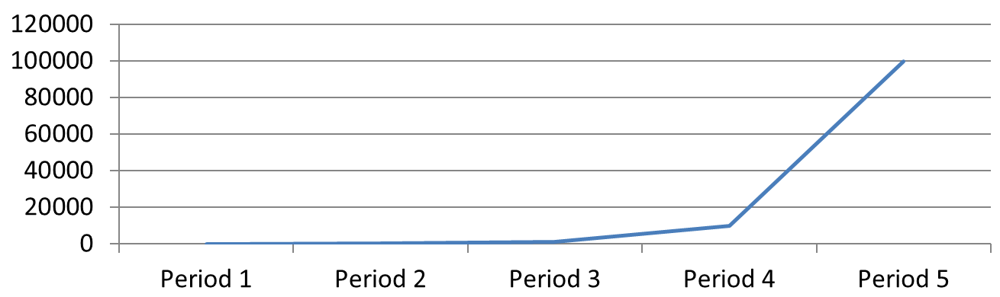

## **بررسی کلی**

این مقاله نحوهٔ سفارشی‌سازی محورهای نمودار را با Aspose.Slides برای PHP از طریق Java توضیح می‌دهد. موضوعات شامل مقادیر محاسبه‌شدهٔ محور، جابجایی ردیف‌ها و ستون‌های نمودار، نمایش یا عدم نمایش محور، فواصل برچسب‌های دسته و علائم‌تیک، دسته‌های تاریخ و قالب‌بندی، چرخش عنوان، موقعیت‌گذاری محور، واحدهای نمایش و مقیاس لگاریتمی را پوشش می‌دهد.

## **دریافت حداکثر مقادیر در محور عمودی نمودارها**

یک [Presentation](https://reference.aspose.com/slides/php-java/aspose.slides/presentation/) ایجاد کنید و یک نمودار مساحتی با داده‌های پیش‌فرض اضافه کنید. پیش از خواندن مقادیر محاسبه‌شدهٔ محور، برای به‌روز بودن چیدمان نمودار، متد [validateChartLayout](https://reference.aspose.com/slides/php-java/aspose.slides/chart/validatechartlayout/) را صدا بزنید.

متدهای [getActualMaxValue](https://reference.aspose.com/slides/php-java/aspose.slides/axis/getactualmaxvalue/) و [getActualMinValue](https://reference.aspose.com/slides/php-java/aspose.slides/axis/getactualminvalue/) را برای حدود محور، و [getActualMajorUnit](https://reference.aspose.com/slides/php-java/aspose.slides/axis/getactualmajorunit/) و [getActualMinorUnit](https://reference.aspose.com/slides/php-java/aspose.slides/axis/getactualminorunit/) را برای فواصل تیک‌ها بخوانید. متدهای [getActualMajorUnitScale](https://reference.aspose.com/slides/php-java/aspose.slides/axis/getactualmajorunitscale/) و [getActualMinorUnitScale](https://reference.aspose.com/slides/php-java/aspose.slides/axis/getactualminorunitscale/) مقیاس‌های زمان‑واحد را فراهم می‌کنند که برای محورهای تاریخ مرتبط هستند. مثال این مقادیر را در متغیرهای محلی ذخیره کرده و نمودار را ذخیره می‌کند.

```php
use aspose\slides\ChartType;
use aspose\slides\Presentation;
use aspose\slides\SaveFormat;

$presentation = new Presentation();
try {
    $slide = $presentation->getSlides()->get_Item(0);

    $chart = $slide->getShapes()->addChart(ChartType::Area, 100, 100, 500, 350);
    $chart->validateChartLayout();

    $maxValue = $chart->getAxes()->getVerticalAxis()->getActualMaxValue();
    $minValue = $chart->getAxes()->getVerticalAxis()->getActualMinValue();

    $majorUnit = $chart->getAxes()->getVerticalAxis()->getActualMajorUnit();
    $minorUnit = $chart->getAxes()->getVerticalAxis()->getActualMinorUnit();

    $majorUnitScale = $chart->getAxes()->getVerticalAxis()->getActualMajorUnitScale();
    $minorUnitScale = $chart->getAxes()->getVerticalAxis()->getActualMinorUnitScale();

    $presentation->save("AxisValues_out.pptx", SaveFormat::Pptx);
} finally {
    $presentation->dispose();
}
```

## **جابجایی داده‌ها بین محورها**

از [switchRowColumn](https://reference.aspose.com/slides/php-java/aspose.slides/chartdata/switchrowcolumn/) برای تعویض نقش سری‌ها و دسته‌ها در داده‌های نمودار استفاده کنید. هر دستهٔ قبلی تبدیل به یک سری می‌شود و هر سری قبلی تبدیل به یک دسته می‌شود. این تغییر نحوهٔ گروه‌بندی داده‌ها را تغییر می‌دهد؛ محورهای افقی و عمودی را جابجا نمی‌کند. مثال از متد [setRange](https://reference.aspose.com/slides/php-java/aspose.slides/chartdata/setrange/) برای بستن داده‌های پیش‌فرض به `Sheet1!A1:D5` شامل ردیف سرصفحه و ستون دسته استفاده می‌کند، سپس ردیف‌ها و ستون‌ها را جابجا می‌کند. یک نمودار با چهار سری و سه دسته ذخیره می‌شود.

```php
use aspose\slides\ChartType;
use aspose\slides\Presentation;
use aspose\slides\SaveFormat;

$presentation = new Presentation();
try {
    $slide = $presentation->getSlides()->get_Item(0);

    $chart = $slide->getShapes()->addChart(ChartType::ClusteredColumn, 100, 100, 400, 300);
    $chart->getChartData()->setRange("Sheet1!A1:D5");
    $chart->getChartData()->switchRowColumn();

    $presentation->save("SwitchChartRowColumns_out.pptx", SaveFormat::Pptx);
} finally {
    $presentation->dispose();
}
```

## **معکوس کردن ترتیب ترسیم یک محور**

از [setPlotOrderReversed](https://reference.aspose.com/slides/php-java/aspose.slides/axis/setplotorderreversed/) برای معکوس کردن یک محور دسته یا مقدار استفاده کنید. برای مثال، یک نمودار میله‌ای افقی می‌تواند مراحل پروژه را از بالا به پایین به همان ترتیبی که در صفحه‌کار وجود دارد نمایش دهد: برنامه‌ریزی، توسعه، تست. معکوس کردن یک محور جهت ترسیم را تغییر می‌دهد؛ داده‌های صفحه‌کار را مرتب یا بازچینش نمی‌کند. بطور مقایسه‌ای، متد [switchRowColumn](https://reference.aspose.com/slides/php-java/aspose.slides/chartdata/switchrowcolumn/) نقش سری‌ها و دسته‌ها را تعویض می‌کند.

مثال زیر یک نمودار میله‌ای افقی با سه مرحله و یک سری ایجاد می‌کند. یک ارائه با سه اسلاید ذخیره می‌شود: ترتیب معمول، دسته‌های معکوس و مقادیر معکوس. هر کپی از همان مجموعه داده استفاده می‌کند و فقط یک محور در هر کپی معکوس می‌شود.

```php
use aspose\slides\ChartType;
use aspose\slides\CrossesType;
use aspose\slides\Presentation;
use aspose\slides\SaveFormat;

$presentation = new Presentation();
try {
    $slide = $presentation->getSlides()->get_Item(0);

    $chart = $slide->getShapes()->addChart(ChartType::ClusteredBar, 50, 40, 620, 320);
    $chart->setLegend(false);

    $chart->getChartData()->getCategories()->clear();
    $chart->getChartData()->getSeries()->clear();

    $workbook = $chart->getChartData()->getChartDataWorkbook();
    $workbook->clear(0);

    $series = $chart->getChartData()->getSeries()->add(ChartType::ClusteredBar);
    $stages = ["Planning", "Development", "Testing"];
    $values = [10, 30, 20];
    for ($i = 0; $i < count($stages); $i++) {
        $categoryCell = $workbook->getCell(0, $i + 1, 0, $stages[$i]);
        $chart->getChartData()->getCategories()->add($categoryCell);
        $valueCell = $workbook->getCell(0, $i + 1, 1, $values[$i]);
        $series->getDataPoints()->addDataPointForBarSeries($valueCell);
    }

    // اسلاید ۲: نمایش اولین دسته در بالا.
    $categorySlide = $presentation->getSlides()->addClone($slide);
    $categoryChart = $categorySlide->getShapes()->get_Item(0);
    $categoryChart->getAxes()->getVerticalAxis()->setPlotOrderReversed(true);
    // محور مقدار افقی را در پایین نگه دارید.
    $categoryChart->getAxes()->getVerticalAxis()->setCrossType(CrossesType::Maximum);

    // اسلاید ۳: فقط مقیاس عددی افقی را معکوس کنید.
    $valueSlide = $presentation->getSlides()->addClone($slide);
    $valueChart = $valueSlide->getShapes()->get_Item(0);
    $valueChart->getAxes()->getHorizontalAxis()->setPlotOrderReversed(true);

    $presentation->save("ReversedAxes.pptx", SaveFormat::Pptx);
} finally {
    $presentation->dispose();
}
```

معکوس کردن یک محور می‌تواند محور عمود را به سمت مخالف نمودار نیز منتقل کند. متد [setCrossType](https://reference.aspose.com/slides/php-java/aspose.slides/axis/setcrosstype/) تعیین می‌کند که محور دیگر در کجا محور مورد تنظیم را قطع می‌کند. در اسلاید ۲، صدا زدن آن با `CrossesType::Maximum` روی محور دستهٔ معکوس، محور مقدار افقی را در پایین نگه می‌دارد. برای نقطهٔ تقاطع خاص، از [setCrossAt](https://reference.aspose.com/slides/php-java/aspose.slides/axis/setcrossat/) استفاده کنید. هنگام تغییر جهت، تنظیمات تقاطع را بررسی کنید، به‌ویژه اگر نمودار قبلاً نقطهٔ تقاطع سفارشی داشته باشد. برای بازگرداندن جهت ترسیم عادی، `setPlotOrderReversed` را با `false` صدا بزنید؛ تنظیمات تقاطع مستقل از این هستند.

| ترتیب معمول (اسلاید 1) | دسته‌های معکوس (اسلاید 2) | مقادیر معکوس (اسلاید 3) |
| --- | --- | --- |
|  |  |  |
| دسته‌ها از پایین به بالا حرکت می‌کنند؛ مقادیر از چپ به راست افزایش می‌یابند. | برنامه‌ریزی، توسعه و تست از بالا به پایین نمایش داده می‌شوند. مقادیر و ترتیب ردیف‌های صفحه‌کار تغییر نمی‌کند. | دسته‌ها ترتیب معمول خود را حفظ می‌کنند؛ مقادیر از راست به چپ افزایش می‌یابند. محور دسته در صفر سمت راست عبور می‌کند. |

## **غیرفعال کردن محور عمودی برای نمودارهای خطی**

متد [setVisible](https://reference.aspose.com/slides/php-java/aspose.slides/axis/setvisible/) را با مقدار `false` روی محور عمودی صدا بزنید تا مخفی شود. مثال یک نمودار خطی با داده‌های پیش‌فرض ایجاد می‌کند و آن را با مخفی بودن محور عمودی ذخیره می‌کند.

```php
use aspose\slides\ChartType;
use aspose\slides\Presentation;
use aspose\slides\SaveFormat;

$presentation = new Presentation();
try {
    $slide = $presentation->getSlides()->get_Item(0);

    $chart = $slide->getShapes()->addChart(ChartType::Line, 100, 100, 400, 300);
    $chart->getAxes()->getVerticalAxis()->setVisible(false);

    $presentation->save("HiddenVerticalAxis.pptx", SaveFormat::Pptx);
} finally {
    $presentation->dispose();
}
```

## **غیرفعال کردن محور افقی برای نمودارهای خطی**

متد [setVisible](https://reference.aspose.com/slides/php-java/aspose.slides/axis/setvisible/) را با مقدار `false` روی محور افقی صدا بزنید تا مخفی شود. مثال یک نمودار خطی با داده‌های پیش‌فرض ایجاد می‌کند و آن را با مخفی بودن محور افقی ذخیره می‌کند.

```php
use aspose\slides\ChartType;
use aspose\slides\Presentation;
use aspose\slides\SaveFormat;

$presentation = new Presentation();
try {
    $slide = $presentation->getSlides()->get_Item(0);

    $chart = $slide->getShapes()->addChart(ChartType::Line, 100, 100, 400, 300);
    $chart->getAxes()->getHorizontalAxis()->setVisible(false);

    $presentation->save("HiddenHorizontalAxis.pptx", SaveFormat::Pptx);
} finally {
    $presentation->dispose();
}
```

## **تغییر یک محور دسته**

از [setCategoryAxisType](https://reference.aspose.com/slides/php-java/aspose.slides/axis/setcategoryaxistype/) برای انتخاب یک محور دستهٔ تاریخ یا متن استفاده کنید. این مثال به فایل `ExistingChart.pptx` نیاز دارد که در اولین اسلاید اولین شکل یک نمودار است و سلول‌های دسته شامل مقادیر عددی تاریخ Excel هستند. محور افقی به محور تاریخ تغییر می‌کند. با صدا زدن [setAutomaticMajorUnit](https://reference.aspose.com/slides/php-java/aspose.slides/axis/setautomaticmajorunit/) با مقدار `false`، [setMajorUnit](https://reference.aspose.com/slides/php-java/aspose.slides/axis/setmajorunit/) با مقدار `1` و [setMajorUnitScale](https://reference.aspose.com/slides/php-java/aspose.slides/axis/setmajorunitscale/) با `TimeUnitType::Months`، تیک‌های اصلی هر یک ماه یک‌بار قرار می‌گیرند.

```php
use aspose\slides\CategoryAxisType;
use aspose\slides\Presentation;
use aspose\slides\SaveFormat;
use aspose\slides\TimeUnitType;

$presentation = new Presentation("ExistingChart.pptx");
try {
    $slide = $presentation->getSlides()->get_Item(0);

    $chart = $slide->getShapes()->get_Item(0);
    $chart->getAxes()->getHorizontalAxis()->setCategoryAxisType(CategoryAxisType::Date);
    $chart->getAxes()->getHorizontalAxis()->setAutomaticMajorUnit(false);
    $chart->getAxes()->getHorizontalAxis()->setMajorUnit(1);
    $chart->getAxes()->getHorizontalAxis()->setMajorUnitScale(TimeUnitType::Months);

    $presentation->save("ChangeChartCategoryAxis_out.pptx", SaveFormat::Pptx);
} finally {
    $presentation->dispose();
}
```

## **کنترل فواصل برچسب‌های محور دسته**

هنگامی که یک نمودار دسته‌های زیادی دارد، می‌توانید تعداد برچسب‌های محور قابل مشاهده را بدون حذف دسته‌ها یا نقاط داده کاهش دهید. متد [setAutomaticTickLabelSpacing](https://reference.aspose.com/slides/php-java/aspose.slides/axis/setautomaticticklabelspacing/) را با `false` صدا بزنید، سپس فاصلهٔ دستهٔ موردنظر را به [setTickLabelSpacing](https://reference.aspose.com/slides/php-java/aspose.slides/axis/setticklabelspacing/) پاس دهید. برای دسته‌های متنی در ترتیب معمول، شمارش از اولین دسته آغاز می‌شود:

| فاصله | برچسب‌های نشان داده‌شده در مثال |
| --- | --- |
| `1` | Category 1, Category 2, Category 3, ... Category 24 |
| `2` | Category 1, Category 3, Category 5, ... Category 23 |
| `3` | Category 1, Category 4, Category 7, ... Category 22 |

فاصلهٔ `3` هر سومین برچسب را نمایش می‌دهد و دو برچسب بین آن‌ها پنهان می‌مانند. این کار ستون‌های مربوطه را حذف نمی‌کند. فاصله خودکار بر اساس فضای موجود انتخاب می‌شود؛ لزوماً همه برچسب‌ها را نشان نمی‌دهد.

علائم تیک دارای کنترل‌های جداگانه‌ای هستند. متد [setAutomaticTickMarksSpacing](https://reference.aspose.com/slides/php-java/aspose.slides/axis/setautomatictickmarksspacing/) را با `false` صدا بزنید و با استفاده از [setTickMarksSpacing](https://reference.aspose.com/slides/php-java/aspose.slides/axis/settickmarksspacing/) فاصلهٔ آن‌ها را تنظیم کنید. برای مثال، مقدار `1` یک علامت تیک را در هر فاصلهٔ دسته حفظ می‌کند در حالی که برچسب‌ها فقط هر سومین دسته ظاهر می‌شوند. با استفاده از [setMajorTickMark](https://reference.aspose.com/slides/php-java/aspose.slides/axis/setmajortickmark/) یک سبک قابل مشاهده انتخاب کنید تا نتیجه را ببینید. صدا زدن هر یک از تنظیم‌کننده‌های فاصلهٔ خودکار با `true` مجدداً اجازه می‌دهد نمودار همان فاصله را انتخاب کند.

مثال خودکفا زیر ۲۴ دسته و یک سری ایجاد می‌کند، سپس سه اسلاید در `CategoryAxisIntervals.pptx` ذخیره می‌کند: فاصلهٔ خودکار، فاصلهٔ دستی برچسب‌ها با علائم تیک مستقل، و بازگرداندن فاصلهٔ خودکار. دو نسخه کپی، داده‌های اصلی نمودار را حفظ می‌کنند. هیچ ارائهٔ ورودی لازم نیست. متن برچسب افقی تمایز چگالی را به‌وضوح نشان می‌دهد.

```php
use aspose\slides\CategoryAxisType;
use aspose\slides\ChartType;
use aspose\slides\Presentation;
use aspose\slides\SaveFormat;
use aspose\slides\TickMarkType;

$presentation = new Presentation();
try {
    $slide = $presentation->getSlides()->get_Item(0);

    $chart = $slide->getShapes()->addChart(ChartType::ClusteredColumn, 30, 40, 660, 320);

    $chart->setLegend(false);
    $chart->getChartData()->getCategories()->clear();
    $chart->getChartData()->getSeries()->clear();

    $workbook = $chart->getChartData()->getChartDataWorkbook();
    $workbook->clear(0);

    $series = $chart->getChartData()->getSeries()->add(ChartType::ClusteredColumn);
    for ($i = 0; $i < 24; $i++) {
        $categoryCell = $workbook->getCell(0, $i + 1, 0, "Category " . ($i + 1));
        $chart->getChartData()->getCategories()->add($categoryCell);
        $valueCell = $workbook->getCell(0, $i + 1, 1, 10 + $i % 6 * 5);
        $series->getDataPoints()->addDataPointForBarSeries($valueCell);
    }

    $axis = $chart->getAxes()->getHorizontalAxis();
    $axis->setCategoryAxisType(CategoryAxisType::Text);
    $axis->getTextFormat()->getTextBlockFormat()->setRotationAngle(0);
    $axis->getTextFormat()->getPortionFormat()->setFontHeight(12);
    $axis->setMajorTickMark(TickMarkType::Outside);
    $axis->setAutomaticTickLabelSpacing(true);
    $axis->setAutomaticTickMarksSpacing(true);

    // اسلاید ۲: هر سومین برچسب را نشان می‌دهد، اما برای هر دسته یک علامت تیک را نگه می‌دارد.
    $manualSlide = $presentation->getSlides()->addClone($slide);
    $manualChart = $manualSlide->getShapes()->get_Item(0);
    $manualAxis = $manualChart->getAxes()->getHorizontalAxis();
    $manualAxis->setAutomaticTickLabelSpacing(false);
    $manualAxis->setTickLabelSpacing(3);
    $manualAxis->setAutomaticTickMarksSpacing(false);
    $manualAxis->setTickMarksSpacing(1);

    // اسلاید ۳: بگذارید نمودار دوباره هر دو فاصله را انتخاب کند.
    $restoredSlide = $presentation->getSlides()->addClone($manualSlide);
    $restoredChart = $restoredSlide->getShapes()->get_Item(0);
    $restoredChart->getAxes()->getHorizontalAxis()->setAutomaticTickLabelSpacing(true);
    $restoredChart->getAxes()->getHorizontalAxis()->setAutomaticTickMarksSpacing(true);

    $presentation->save("CategoryAxisIntervals.pptx", SaveFormat::Pptx);
} finally {
    $presentation->dispose();
}
```

**فاصلهٔ خودکار (اسلاید 1):** در این رندر، هر دومین برچسب دسته نمایش داده می‌شود و به دو خط می‌پیچد. نتیجهٔ خودکار می‌تواند بسته به اندازه نمودار، قلم‌ها و رندر کننده متفاوت باشد.


**فاصلهٔ دستی (اسلاید 2):** هر سومین برچسب در یک خط نمایش داده می‌شود، در حالی که علامت‌های تیک در هر فاصلهٔ دسته باقی می‌مانند. تمام ۲۴ ستون، حتی آن‌هایی که برچسب ندارند، با همان مقادیر قابل رؤیت هستند. اسلاید ۳ ظاهر خودکار نشان داده شده در بالا را باز می‌گرداند.


### **انتخاب محور و فاصلهٔ صحیح**

این فاصلهٔ شمارش دسته را برای یک محور دستهٔ متنی، مانند محور دستهٔ یک نمودار ستونی، خطی، مساحتی یا میله‌ای استفاده کنید. در یک نمودار ستونی، این محور افقی است. در یک نمودار میله‌ای افقی، محور دسته عمودی است، بنابراین این تنظیمات را به محوری که توسط [getVerticalAxis](https://reference.aspose.com/slides/php-java/aspose.slides/axesmanager/getverticalaxis/) برگردانده می‌شود اعمال کنید. فاصلهٔ علائم تیک همچنین برای محور سری در نمودارهایی که یک محور سری دارند اعمال می‌شود.

از فاصلهٔ برچسب دسته برای تنظیم مقیاس عددی یک محور مقدار استفاده نکنید. در یک محور مقدار، متد [setMajorUnit](https://reference.aspose.com/slides/php-java/aspose.slides/axis/setmajorunit/) اختلاف مقادیر را مشخص می‌کند: برای مثال، یک واحد اصلی `10` تیک‌ها را در 0، 10، 20 و … زمانی که محور از صفر شروع شود، تولید می‌کند. یک فاصلهٔ برچسب دستهٔ `3` به جای مقادیر عددی، موقعیت‌های دسته را می‌شمارد. نمودارهای پراکندگی و حباب از محورهای مقدار استفاده می‌کنند نه از محور دستهٔ متنی. برای یک محور تاریخ، از واحدهای اصلی مبتنی بر زمان و مقیاس‌ها همان‌طور که در [تغییر یک محور دسته](#change-a-category-axis) توصیف شد استفاده کنید.

## **تنظیم قالب تاریخ برای مقادیر محور دسته**

مثال داده‌های پیش‌فرض نمودار را با چهار مقدار سالانه جایگزین می‌کند. تاریخ‌ها به عنوان شماره‌های سریال OLE Automation در کاربرگ اول (اندیس `0`) ذخیره می‌شوند که به عنوان تعداد روزهای گذشته از 30 دسامبر 1899 محاسبه می‌شود. از [setCategoryAxisType](https://reference.aspose.com/slides/php-java/aspose.slides/axis/setcategoryaxistype/) با مقدار `CategoryAxisType::Date` استفاده کنید، سپس [setNumberFormatLinkedToSource](https://reference.aspose.com/slides/php-java/aspose.slides/axis/setnumberformatlinkedtosource/) را با `false` صدا بزنید و `yyyy` را به [setNumberFormat](https://reference.aspose.com/slides/php-java/aspose.slides/axis/setnumberformat/) پاس دهید تا برچسب‌های دسته سال‌های چهاررقمی را بصورت مستقل از قالب‌بندی سلول نمایش دهند.

```php
use aspose\slides\CategoryAxisType;
use aspose\slides\ChartType;
use aspose\slides\Presentation;
use aspose\slides\SaveFormat;

$presentation = new Presentation();
try {
    $slide = $presentation->getSlides()->get_Item(0);

    $chart = $slide->getShapes()->addChart(ChartType::Line, 50, 50, 450, 300);

    $chart->getChartData()->getCategories()->clear();
    $chart->getChartData()->getSeries()->clear();

    $workbook = $chart->getChartData()->getChartDataWorkbook();
    $workbook->clear(0);

    $baseDate = gmmktime(0, 0, 0, 12, 30, 1899);

    $series = $chart->getChartData()->getSeries()->add(ChartType::Line);
    for ($i = 0; $i < 4; $i++) {
        $date = gmmktime(0, 0, 0, 1, 1, 2015 + $i);
        $serialDate = ($date - $baseDate) / 86400;
        $categoryCell = $workbook->getCell(0, $i + 1, 0, $serialDate);
        $chart->getChartData()->getCategories()->add($categoryCell);

        $valueCell = $workbook->getCell(0, $i + 1, 1, $i + 1);
        $series->getDataPoints()->addDataPointForLineSeries($valueCell);
    }

    $chart->getAxes()->getHorizontalAxis()->setCategoryAxisType(CategoryAxisType::Date);
    $chart->getAxes()->getHorizontalAxis()->setNumberFormatLinkedToSource(false);
    $chart->getAxes()->getHorizontalAxis()->setNumberFormat("yyyy");

    $presentation->save("DateAxisFormat.pptx", SaveFormat::Pptx);
} finally {
    $presentation->dispose();
}
```

## **تنظیم زاویه چرخش برای عنوان محور نمودار**

متد [setTitle](https://reference.aspose.com/slides/php-java/aspose.slides/axis/settitle/) را با مقدار `true` روی محور عمودی صدا بزنید، متن عنوان را فراهم کنید و از [setRotationAngle](https://reference.aspose.com/slides/java/com.aspose.slides/icharttextblockformat/#setRotationAngle-float-) برای چرخاندن عنوان استفاده کنید. زاویه بر حسب درجه است؛ این مثال یک نمودار ستونی را با عنوان محور مقدار که به اندازه 90 درجه چرخیده ذخیره می‌کند.

```php
use aspose\slides\ChartType;
use aspose\slides\Presentation;
use aspose\slides\SaveFormat;

$presentation = new Presentation();
try {
    $slide = $presentation->getSlides()->get_Item(0);

    $chart = $slide->getShapes()->addChart(ChartType::ClusteredColumn, 50, 50, 450, 300);
    $chart->getAxes()->getVerticalAxis()->setTitle(true);
    $chart->getAxes()->getVerticalAxis()->getTitle()->addTextFrameForOverriding("Value");
    $chart->getAxes()->getVerticalAxis()->getTitle()->getTextFormat()->getTextBlockFormat()->setRotationAngle(90);

    $presentation->save("RotatedAxisTitle.pptx", SaveFormat::Pptx);
} finally {
    $presentation->dispose();
}
```

## **تنظیم موقعیت محور در یک محور دسته یا مقدار**

از [setAxisBetweenCategories](https://reference.aspose.com/slides/php-java/aspose.slides/axis/setaxisbetweencategories/) برای کنترل این که آیا محور مقدار در بین دسته‌ها یا روی علائم تیک دسته محور قطع می‌شود استفاده کنید. این تنظیم برای محورهای دسته اعمال می‌شود. مثال این مقدار را روی محور دسته افقی یک نمودار ستونی به `true` تنظیم می‌کند و نتیجه را ذخیره می‌نماید.

```php
use aspose\slides\ChartType;
use aspose\slides\Presentation;
use aspose\slides\SaveFormat;

$presentation = new Presentation();
try {
    $slide = $presentation->getSlides()->get_Item(0);

    $chart = $slide->getShapes()->addChart(ChartType::ClusteredColumn, 50, 50, 450, 300);
    $chart->getAxes()->getHorizontalAxis()->setAxisBetweenCategories(true);

    $presentation->save("AxisBetweenCategories.pptx", SaveFormat::Pptx);
} finally {
    $presentation->dispose();
}
```

## **تنظیم واحد نمایش بر روی محور مقدار نمودار**

از [setDisplayUnit](https://reference.aspose.com/slides/php-java/aspose.slides/axis/setdisplayunit/) برای مقیاس‌گذاری برچسب‌های محور مقدار بدون تغییر داده‌های زیرین استفاده کنید. با تنظیم [DisplayUnitType](https://reference.aspose.com/slides/php-java/aspose.slides/displayunittype/) به `Millions`، مقدار 60,000,000 به صورت 60 نمایش داده می‌شود. مثال یک نمودار ستونی ایجاد می‌کند و واحد نمایش میلیون‌ها را به محور عمودی آن اعمال می‌نماید.

```php
use aspose\slides\ChartType;
use aspose\slides\DisplayUnitType;
use aspose\slides\Presentation;
use aspose\slides\SaveFormat;

$presentation = new Presentation();
try {
    $slide = $presentation->getSlides()->get_Item(0);

    $chart = $slide->getShapes()->addChart(ChartType::ClusteredColumn, 50, 50, 450, 300);
    $chart->getAxes()->getVerticalAxis()->setDisplayUnit(DisplayUnitType::Millions);

    $presentation->save("Result.pptx", SaveFormat::Pptx);
} finally {
    $presentation->dispose();
}
```

## **پیکربندی یک محور مقدار لگاریتمی**

یک محور مقدار لگاریتمی زمانی مفید است که مقادیر مثبت در چندین مرتبهٔ بزرگ‌تری قرار بگیرند. برای مثال، یک سرویس ممکن است 10، 100، 1,000، 10,000 و 100,000 درخواست در پنج دوره دریافت کند. در مقیاس خطی، مقادیر کوچکتر نزدیک به صفر به نظر می‌رسند. مقیاس لگاریتمی رشد نسبی آن‌ها را آسان‌تر مقایسه می‌کند: فواصل برابر نشان‌دهنده نسبت‌های برابر هستند، نه اختلاف‌های برابر.

متد [setLogarithmic](https://reference.aspose.com/slides/php-java/aspose.slides/axis/setlogarithmic/) را با مقدار `true` روی محور مقدار صدا بزنید و با [setLogBase](https://reference.aspose.com/slides/php-java/aspose.slides/axis/setlogbase/) پایه را انتخاب کنید. این تغییر نحوهٔ نمایش مقادیر موجود را تغییر می‌دهد؛ داده‌ها را تغییر یا خط روند لگاریتمی اضافه نمی‌کند. خط روند یک ویژگی جداگانه است.

### **انتخاب محور مقدار و پایه**

برای یک نمودار خطی یا ستونی، محور مقدار توسط [getVerticalAxis](https://reference.aspose.com/slides/php-java/aspose.slides/axesmanager/getverticalaxis/) بازگردانده می‌شود. برای یک نمودار میله‌ای افقی، توسط [getHorizontalAxis](https://reference.aspose.com/slides/php-java/aspose.slides/axesmanager/gethorizontalaxis/) بازگردانده می‌شود. نمودارهای پراکندگی و حباب دو محور مقدار دارند؛ بنابراین برای مقادیر X محور افقی، برای مقادیر Y محور عمودی یا هر دو را انتخاب کنید. مقیاس لگاریتمی را روی محور دسته اعمال نکنید.

پایهٔ پیش‌فرض لگاریتمی `10` است. برای نمودارهای PPTX می‌توانید پایه‌ای بین `2` تا `1000` (شامل) استفاده کنید؛ پایه‌های کسری مانند `2.5` نیز پشتیبانی می‌شوند. با پایهٔ `10` توان‌های متوالی مانند 10، 100، 1,000 و 10,000 به صورت مساوی فاصله دارند.

### **مقایسه مقیاس خطی و لگاریتمی**

مثال خودکفا زیر یک نمودار خطی با پنج شمارش درخواست در اسلاید اول ایجاد می‌کند، سپس آن اسلاید را کپی می‌کند و در اسلاید دوم محور مقدار لگاریتمی با پایهٔ 10 را فعال می‌کند. هر دو اسلاید همان داده‌ها را نگه می‌دارند.

```php
use aspose\slides\ChartType;
use aspose\slides\Presentation;
use aspose\slides\SaveFormat;

$presentation = new Presentation();
try {
    $slide = $presentation->getSlides()->get_Item(0);

    $chart = $slide->getShapes()->addChart(ChartType::Line, 30, 40, 660, 200);

    $chart->setLegend(false);

    $chart->getChartData()->getCategories()->clear();
    $chart->getChartData()->getSeries()->clear();

    $workbook = $chart->getChartData()->getChartDataWorkbook();
    $workbook->clear(0);

    $series = $chart->getChartData()->getSeries()->add(ChartType::Line);
    $values = [10, 100, 1000, 10000, 100000];

    for ($i = 0; $i < count($values); $i++) {
        $categoryCell = $workbook->getCell(0, $i + 1, 0, "Period " . ($i + 1));
        $chart->getChartData()->getCategories()->add($categoryCell);

        $valueCell = $workbook->getCell(0, $i + 1, 1, $values[$i]);
        $series->getDataPoints()->addDataPointForLineSeries($valueCell);
    }

    // اسلاید اول را خطی نگه دارید و فقط مقیاس محور مقدار نسخه کپی را تغییر دهید.
    $logarithmicSlide = $presentation->getSlides()->addClone($slide);
    $logarithmicChart = $logarithmicSlide->getShapes()->get_Item(0);
    $valueAxis = $logarithmicChart->getAxes()->getVerticalAxis();
    $valueAxis->setLogarithmic(true);
    $valueAxis->setLogBase(10);

    $presentation->save("LogarithmicAxis.pptx", SaveFormat::Pptx);
} finally {
    $presentation->dispose();
}
```

**مقیاس خطی (اسلاید 1):** فواصل عمودی برابر نشان‌دهندهٔ اختلاف‌های مساوی در شمارش درخواست‌ها هستند. بزرگ‌ترین مقدار بر نمودار تسلط دارد و مقادیر کوچکتر دشوار به‌نظر می‌رسند.



**مقیاس لگاریتمی (اسلاید 2):** فواصل عمودی برابر نشان‌دهندهٔ نسبت‌های مساوی هستند. هر دوره ده برابر دورهٔ قبلی درخواست دارد، بنابراین نقاط روی مقیاس لگاریتمی پایهٔ 10 به‌صورت یک خط مستقیم صعودی ظاهر می‌شوند. برچسب‌های محور هنوز شمارش اصلی درخواست‌ها را نشان می‌دهند.


### **برخورد با مقادیر صفر و منفی**

مقیاس لگاریتمی فقط می‌تواند مقادیر مثبت را نمایش دهد. قبل از فعال‌سازی آن داده‌ها را بررسی کنید. اگر مقادیر صفر یا منفی معنا دارند، مقیاس خطی را حفظ کنید یا آن‌ها را جداگانه نمایش دهید. اگر حذف این مقادیر برای تحلیل مناسب است، دلیل حذف را توضیح دهید. به‌صورت ساکت آن‌ها را با اعداد مثبت کوچک جایگزین نکنید، زیرا معنای داده را تغییر می‌دهد. هر حداقل یا حداکثر به‌صورت دستی تنظیم‌شده برای محور لگاریتمی نیز باید مثبت باشد.

## **سوالات متداول**

**چگونه مقدار تقاطع یک محور با محور دیگر را تنظیم کنم؟**

از [setCrossType](https://reference.aspose.com/slides/php-java/aspose.slides/axis/setcrosstype/) برای انتخاب رفتار تقاطع استفاده کنید. برای تعیین مقدار عددی تقاطع، از [setCrossAt](https://reference.aspose.com/slides/php-java/aspose.slides/axis/setcrossat/) استفاده کنید. این تنظیمات به شما اجازه می‌دهند تقاطع محور را به پایهٔ مناسب منتقل کنید.

**چگونه می‌توانم برچسب‌های تیک را نسبت به محور موقعیت‌گذاری کنم؟**

متد [setTickLabelPosition](https://reference.aspose.com/slides/php-java/aspose.slides/axis/setticklabelposition/) را با استفاده از [TickLabelPositionType](https://reference.aspose.com/slides/php-java/aspose.slides/ticklabelpositiontype/) صدا بزنید: `Low`، `High`، `NextTo` یا `None`. برای کنترل خود علامت‌های تیک، از [setMajorTickMark](https://reference.aspose.com/slides/php-java/aspose.slides/axis/setmajortickmark/) یا [setMinorTickMark](https://reference.aspose.com/slides/php-java/aspose.slides/axis/setminortickmark/) استفاده کنید؛ این‌ها جدا از موقعیت برچسب‌ها هستند.