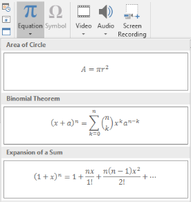

## **مروری کلی**

PowerPoint معادلات را به صورت Office Math Markup Language (OMML) ذخیره می‌کند. با Aspose.Slides برای PHP از طریق Java می‌توانید همان نوع محتوای ریاضی را به صورت برنامه‌نویسی ایجاد کنید: کسرها، رادیکال‌ها، توابع، حدها، عملگرهای n‑ary، ماتریس‌ها، آرایه‌ها و بلوک‌های ریاضی قالب‌بندی‌شده.

در PowerPoint، کاربران معمولاً معادلات را از **Insert > Equation** اضافه می‌کنند:



نتیجه متن ریاضی قابل ویرایش روی اسلاید است:


Aspose.Slides این متن ریاضی را از طریق سه شی اصلی می‌سازد:

- یک شکل ریاضی که با [addMathShape](https://reference.aspose.com/slides/php-java/aspose.slides/shapecollection/#addMathShape) ایجاد می‌شود، شکلی است که معادله را در خود دارد.
- [MathPortion](https://reference.aspose.com/slides/php-java/aspose.slides/mathportion/) محتوای ریاضی را در داخل قاب متن شکل ذخیره می‌کند.
- [MathParagraph](https://reference.aspose.com/slides/php-java/aspose.slides/mathparagraph/) یک یا چند شیء [MathBlock](https://reference.aspose.com/slides/php-java/aspose.slides/mathblock/) را شامل می‌شود.

بخش‌های زیر عمدتاً از [MathematicalText](https://reference.aspose.com/slides/php-java/aspose.slides/mathematicaltext/) و متدهای fluent از [MathElementBase](https://reference.aspose.com/slides/php-java/aspose.slides/mathelementbase/) استفاده می‌کنند تا کد کوتاه و قابل خواندن بماند.

برای سناریوهای خروجی MathML، به [Export Math Equations from Presentations in PHP via Java](/slides/fa/php-java/exporting-math-equations/) مراجعه کنید.

## **ایجاد یک معادله**

این مثال از [addMathShape](https://reference.aspose.com/slides/php-java/aspose.slides/shapecollection/#addMathShape) برای ساخت یک شکل ریاضی استفاده می‌کند و قضیه فیثاغورث را اضافه می‌نماید:


```php
$presentation = new Presentation();
try {
    $slide = $presentation->getSlides()->get_Item(0);

    $mathShape = $slide->getShapes()->addMathShape(20, 20, 700, 120);
    $mathParagraph = $mathShape->getTextFrame()->getParagraphs()
        - >get_Item(0)->getPortions()->get_Item(0)->getMathParagraph();

    $equation = (new MathematicalText("c"))
        - >setSuperscript("2")
        - >join("=")
        - >join((new MathematicalText("a"))->setSuperscript("2"))
        - >join("+")
        - >join((new MathematicalText("b"))->setSuperscript("2"));

    $mathParagraph->add($equation);

    $presentation->save("pythagorean-theorem.pptx", SaveFormat::Pptx);
} finally {
    if (!java_is_null($presentation)) {
        $presentation->dispose();
    }
}
```

{}
[addMathShape](https://reference.aspose.com/slides/php-java/aspose.slides/shapecollection/#addMathShape) شکلی را ایجاد می‌کند که از پیش شامل یک MathParagraph است. اولین [MathPortion](https://reference.aspose.com/slides/php-java/aspose.slides/mathportion/) را دریافت کنید، [getMathParagraph](https://reference.aspose.com/slides/php-java/aspose.slides/mathportion/#getMathParagraph) را فراخوانی کنید و بلوک‌ها یا عناصر ریاضی را به آن اضافه کنید.
{}

### **ترکیب بلوک‌های ریاضی**

هنگامی که بخش‌های یک معادله به‌صورت جداگانه به عنوان شیءهای [MathBlock](https://reference.aspose.com/slides/php-java/aspose.slides/mathblock/) ساخته می‌شوند، از [joinBlock](https://reference.aspose.com/slides/php-java/aspose.slides/mathblock/#joinBlock) برای ترکیب آنها استفاده کنید. این مثال `c² =` را در بلوک چپ و `a² + b²` را در بلوک راست می‌سازد. [setSuperscript](https://reference.aspose.com/slides/php-java/aspose.slides/mathelementbase/#setSuperscript) برای هر سه توان، سوپرسکریپت‌های ریاضی قابل ویرایش ایجاد می‌کند.

```php
use aspose\slides\MathBlock;
use aspose\slides\MathematicalText;
use aspose\slides\Presentation;
use aspose\slides\SaveFormat;

$presentation = new Presentation();
try {
    $slide = $presentation->getSlides()->get_Item(0);

    $shape = $slide->getShapes()->addMathShape(20, 20, 600, 100);
    $mathPortion = $shape->getTextFrame()->getParagraphs()->get_Item(0)->getPortions()->get_Item(0);
    $mathParagraph = $mathPortion->getMathParagraph();

    $leftBlock = new MathBlock();
    $leftBlock->add((new MathematicalText("c"))->setSuperscript("2"));
    $leftBlock->add(new MathematicalText("="));

    $rightBlock = new MathBlock();
    $rightBlock->add((new MathematicalText("a"))->setSuperscript("2"));
    $rightBlock->add(new MathematicalText("+"));
    $rightBlock->add((new MathematicalText("b"))->setSuperscript("2"));

    $combinedBlock = $leftBlock->joinBlock($rightBlock);
    $mathParagraph->add($combinedBlock);

    $presentation->save("equation.pptx", SaveFormat::Pptx);
} finally {
    $presentation->dispose();
}
```

[joinBlock](https://reference.aspose.com/slides/php-java/aspose.slides/mathblock/#joinBlock) `$leftBlock` را خود خودش برمی‌گرداند، که اکنون هر دو بخش را به ترتیب در خود دارد و `$rightBlock` را خالی می‌گذارد. بلوک ترکیبی را تنها یک‌بار به [MathParagraph](https://reference.aspose.com/slides/php-java/aspose.slides/mathparagraph/) اضافه کنید. پس از بازکردن مجدد `equation.pptx`، پاراگراف شامل یک بلوک است که `c² = a² + b²` را نشان می‌دهد و هر سه توان به عنوان سوپرسکریپت‌های ریاضی حفظ می‌شوند.

فراخوانی [add](https://reference.aspose.com/slides/php-java/aspose.slides/mathblock/#add) به شکل `$leftBlock->add($rightBlock)` سعی می‌کند یک بلوک را مستقیماً داخل بلوک دیگر تو در تو کند و باعث پرتاب `InvalidOperationException` می‌شود.

## **اضافه کردن کسرها**

از [divide](https://reference.aspose.com/slides/php-java/aspose.slides/mathelementbase/#divide) برای ساخت یک کسر استفاده کنید. می‌توانید استایل کسری را با [MathFractionTypes](https://reference.aspose.com/slides/php-java/aspose.slides/mathfractiontypes/) انتخاب کنید.


```php
$presentation = new Presentation();
try {
    $slide = $presentation->getSlides()->get_Item(0);

    $mathShape = $slide->getShapes()->addMathShape(20, 20, 700, 100);
    $mathParagraph = $mathShape->getTextFrame()->getParagraphs()
        - >get_Item(0)->getPortions()->get_Item(0)->getMathParagraph();

    $fraction = (new MathematicalText("1"))
        - >divide("x", MathFractionTypes::Skewed);

    $mathParagraph->add(new MathBlock($fraction));

    $presentation->save("fraction.pptx", SaveFormat::Pptx);
} finally {
    if (!java_is_null($presentation)) {
        $presentation->dispose();
    }
}
```

برای یک کسر ستکی، از [MathFractionTypes::Bar](https://reference.aspose.com/slides/php-java/aspose.slides/mathfractiontypes/#Bar) استفاده کنید:

```php
$stackedFraction = (new MathematicalText("x + 1"))->divide("y - 1", MathFractionTypes::Bar);
```

## **اضافه کردن رادیکال‌ها**

از [radical](https://reference.aspose.com/slides/php-java/aspose.slides/mathelementbase/#radical) برای ساخت رادیکال درجه دوم، سوم یا دیگر رادیکال‌ها استفاده کنید. عنصر جاری به عنوان پایه و آرگومان به عنوان درجه در نظر گرفته می‌شود.


```php
$presentation = new Presentation();
try {
    $slide = $presentation->getSlides()->get_Item(0);

    $mathShape = $slide->getShapes()->addMathShape(20, 20, 700, 100);
    $mathParagraph = $mathShape->getTextFrame()->getParagraphs()
        - >get_Item(0)->getPortions()->get_Item(0)->getMathParagraph();

    $radical = (new MathematicalText("x"))
        - >radical("n");

    $mathParagraph->add(new MathBlock($radical));

    $presentation->save("radical.pptx", SaveFormat::Pptx);
} finally {
    if (!java_is_null($presentation)) {
        $presentation->dispose();
    }
}
```

### **نمایش یا مخفی کردن درجه رادیکال درجه دوم**

یک رادیکال درجه دوم می‌تواند عدد ۲ را به‌صورت صریح نشان دهد یا از نماد معمولی √x استفاده کند. متد [setHideDegree](https://reference.aspose.com/slides/php-java/aspose.slides/mathradical/#setHideDegree) از [MathRadical](https://reference.aspose.com/slides/php-java/aspose.slides/mathradical/) کنترل می‌کند که کدام فرم ظاهر شود. هر دو فرم درجه ۲ و رادیکاند x را در معادله قابل ویرایش حفظ می‌کنند.


مثال همان رادیکال را دو بار ذخیره می‌کند. در `visible-degree.pptx` عدد ۲ قابل مشاهده است. در `hidden-degree.pptx` عدد مخفی است.

```php
use aspose\slides\MathBlock;
use aspose\slides\MathematicalText;
use aspose\slides\Presentation;
use aspose\slides\SaveFormat;

$presentation = new Presentation();
try {
    $slide = $presentation->getSlides()->get_Item(0);
    
    $radical = (new MathematicalText("x"))->radical("2");

    $shape = $slide->getShapes()->addMathShape(20, 20, 200, 100);
    $portion = $shape->getTextFrame()->getParagraphs()->get_Item(0)->getPortions()->get_Item(0);
    $portion->getMathParagraph()->add(new MathBlock($radical));

    $radical->setHideDegree(false);
    $presentation->save("visible-degree.pptx", SaveFormat::Pptx);

    $radical->setHideDegree(true);
    $presentation->save("hidden-degree.pptx", SaveFormat::Pptx);
} finally {
    $presentation->dispose();
}
```

## **اضافه کردن توابع و حدها**

از [asArgumentOfFunction](https://reference.aspose.com/slides/php-java/aspose.slides/mathelementbase/#asArgumentOfFunction) یا [function](https://reference.aspose.com/slides/php-java/aspose.slides/mathelementbase/#function) برای توابعی مانند `sin(x)`, `log(x)` یا نام‌های سفارشی توابع استفاده کنید. برای حدها، `lim` را در یک [MathLimit](https://reference.aspose.com/slides/php-java/aspose.slides/mathlimit/) قرار دهید یا از [setLowerLimit](https://reference.aspose.com/slides/php-java/aspose.slides/mathelementbase/#setLowerLimit) استفاده کنید.


```php
$presentation = new Presentation();
try {
    $slide = $presentation->getSlides()->get_Item(0);

    $mathShape = $slide->getShapes()->addMathShape(20, 20, 700, 100);
    $mathParagraph = $mathShape->getTextFrame()->getParagraphs()
        - >get_Item(0)->getPortions()->get_Item(0)->getMathParagraph();

    $limit = (new MathematicalText("lim"))
        - >setLowerLimit("x\u{2192}\u{221E}")
        - >function("x");

    $mathParagraph->add(new MathBlock($limit));

    $presentation->save("functions-and-limits.pptx", SaveFormat::Pptx);
} finally {
    if (!java_is_null($presentation)) {
        $presentation->dispose();
    }
}
```

برای نام تابع سفارشی، نام تابع را به‌عنوان عنصر جاری قرار داده و با آرگومان‌اش [function](https://reference.aspose.com/slides/php-java/aspose.slides/mathelementbase/#function) را فراخوانی کنید:

```php
$customFunction = (new MathematicalText("f"))->function("x + 1");
```

## **اضافه کردن عملگرهای N‑ary و انتگرال‌ها**

از [nary](https://reference.aspose.com/slides/php-java/aspose.slides/mathelementbase/#nary) برای جمع‌ها، اتحادها، اشتراک‌ها و سایر عملگرهای بزرگ استفاده کنید. برای انتگرال‌ها از [integral](https://reference.aspose.com/slides/php-java/aspose.slides/mathelementbase/#integral) بهره بگیرید. هر دو متد امکان تنظیم حد پایین و بالا را می‌دهند.


```php
$presentation = new Presentation();
try {
    $slide = $presentation->getSlides()->get_Item(0);

    $mathShape = $slide->getShapes()->addMathShape(20, 20, 700, 120);
    $mathParagraph = $mathShape->getTextFrame()->getParagraphs()
        - >get_Item(0)->getPortions()->get_Item(0)->getMathParagraph();

    $summationBase = (new MathematicalText("x"))
        - >setSuperscript("k")
        - >join((new MathematicalText("a"))->setSuperscript("n-k"));

    $summation = $summationBase->nary(MathNaryOperatorTypes::Summation, "k=0", "n");

    $mathParagraph->add(new MathBlock($summation));

    $presentation->save("nary-operators.pptx", SaveFormat::Pptx);
} finally {
    if (!java_is_null($presentation)) {
        $presentation->dispose();
    }
}
```

عملگرهای N‑ary برای عملگرهای بزرگ با حدهای اختیاری هستند. عملگرهای ساده مانند `+`, `-`, `=` معمولاً به‌صورت [MathematicalText](https://reference.aspose.com/slides/php-java/aspose.slides/mathematicaltext/) اضافه شده و به عبارت می‌پیوندند.

برای یک انتگرال، از [integral](https://reference.aspose.com/slides/php-java/aspose.slides/mathelementbase/#integral) استفاده کنید:

```php
$integralBase = (new MathematicalText("x"))->join((new MathematicalText("dx"))->toBox());
$integral = $integralBase->integral(MathIntegralTypes::Simple, "0", "1");
```

## **اضافه کردن ماتریس‌ها**

از [MathMatrix](https://reference.aspose.com/slides/php-java/aspose.slides/mathmatrix/) برای ردیف‌ها و ستون‌ها استفاده کنید. به طور پیش‌فرض ماتریس‌ها پرانتز ندارند، بنابراین هنگام نیاز به پرانتز، کروشه یا آکولاد، خود ماتریس را درون این علائم بپیچید.


```php
$presentation = new Presentation();
try {
    $slide = $presentation->getSlides()->get_Item(0);

    $mathShape = $slide->getShapes()->addMathShape(20, 20, 700, 120);
    $mathParagraph = $mathShape->getTextFrame()->getParagraphs()
        - >get_Item(0)->getPortions()->get_Item(0)->getMathParagraph();

    $matrix = new MathMatrix(2, 3);
    $matrix->set_Item(0, 0, new MathematicalText("1"));
    $matrix->set_Item(0, 1, new MathematicalText("x"));
    $matrix->set_Item(1, 0, new MathematicalText("x"));
    $matrix->set_Item(1, 1, new MathematicalText("2"));
    $matrix->set_Item(1, 2, new MathematicalText("y"));

    $mathParagraph->add(new MathBlock($matrix));

    $presentation->save("matrix.pptx", SaveFormat::Pptx);
} finally {
    if (!java_is_null($presentation)) {
        $presentation->dispose();
    }
}
```

### **ویرایش یک ماتریس موجود**

فرض کنید یک درس جبر خطی با ماتریس ضرایب در `matrix.pptx` که توسط مثال قبلی ذخیره شده، آغاز می‌شود. برای تمرین بعدی، معادله اول را نگه داشته، معادله دوم را با دو معادله جدید جایگزین کرده و مجموعه متغیرها را بازنگری کنید. برای حفظ ضرایبی که هنوز معتبرند، ماتریس موجود را از طریق [MathMatrix](https://reference.aspose.com/slides/php-java/aspose.slides/mathmatrix/) باز کنید.


اندیس‌های ردیف و ستون از صفر شروع می‌شوند و به ماتریس در لحظهٔ هر فراخوانی اشاره می‌کنند. درج یک ردیف پیش از ایندکس 1، ردیف دوم اصلی را به ایندکس 2 منتقل می‌کند. درج پس از ایندکس 2 سپس یک ردیف اضافه می‌کند. حذف ردیف 2 ردیف دوم اصلی را حذف کرده و ردیف افزوده شده را یک موقعیت بالا می‌برد. ستون‌ها به همان شیوه جابه‌جا می‌شوند.

```php
use aspose\slides\MathematicalText;
use aspose\slides\MathHorizontalAlignment;
use aspose\slides\Presentation;
use aspose\slides\SaveFormat;

$presentation = new Presentation("matrix.pptx");
try {
    $shape = $presentation->getSlides()->get_Item(0)->getShapes()->get_Item(0);
    $portion = $shape->getTextFrame()->getParagraphs()->get_Item(0)->getPortions()->get_Item(0);
    $block = $portion->getMathParagraph()->get_Item(0);
    $matrix = $block->get_Item(0);

    $matrix->insertRowBefore(1);
    $matrix->insertRowAfter(2);
    $matrix->deleteRow(2);

    $matrix->insertColumnBefore(1);
    $matrix->insertColumnAfter(3);
    $matrix->deleteColumn(3);

    // سلول‌های جدید در ابتدا خالی هستند. ابتدا ضرایب غیر صفر را تنظیم کنید.
    $matrix->set_Item(1, 0, new MathematicalText("12"));
    $matrix->set_Item(1, 1, new MathematicalText("1"));
    $matrix->set_Item(2, 2, new MathematicalText("10"));
    $matrix->set_Item(2, 3, new MathematicalText("1"));
    $rowCount = java_values($matrix->getRowCount());
    $columnCount = java_values($matrix->getColumnCount());
    for ($row = 0; $row < $rowCount; $row++) {
        for ($column = 0; $column < $columnCount; $column++) {
            $coefficient = $matrix->get_Item($row, $column);
            if (java_is_null($coefficient)) {
                $matrix->set_Item($row, $column, new MathematicalText("0"));
            }
        }
    }

    $matrix->setColumnAlignment(0, MathHorizontalAlignment::Left);
    $matrix->setColumnsAlignment(1, 3, MathHorizontalAlignment::Right);

    $presentation->save("updated-matrix.pptx", SaveFormat::Pptx);
} finally {
    $presentation->dispose();
}
```

[setColumnAlignment](https://reference.aspose.com/slides/php-java/aspose.slides/mathmatrix/#setColumnAlignment) ستون اول را به سمت چپ تراز می‌کند. [setColumnsAlignment](https://reference.aspose.com/slides/php-java/aspose.slides/mathmatrix/#setColumnsAlignment) سه ستون پی در پی را از ایندکس 1 به سمت راست تراز می‌کند. در `updated-matrix.pptx`، ماتریس دارای سه معادله و چهار متغیر است. ضرایب اولیه ردیف اول `1` و `x` اکنون در ستون‌های اول و سوم ظاهر می‌شوند.


## **اضافه کردن آرایه‌های معادله**

هنگامی که به معادلات هم‌راستا یا یک پشتهٔ عمودی از عبارات نیاز دارید، از [toMathArray](https://reference.aspose.com/slides/php-java/aspose.slides/mathelementbase/#toMathArray) استفاده کنید.


```php
$presentation = new Presentation();
try {
    $slide = $presentation->getSlides()->get_Item(0);

    $mathShape = $slide->getShapes()->addMathShape(20, 20, 700, 140);
    $mathParagraph = $mathShape->getTextFrame()->getParagraphs()
        - >get_Item(0)->getPortions()->get_Item(0)->getMathParagraph();

    $equationArray = (new MathematicalText("x"))
        - >join("y")
        - >toMathArray();

    $mathParagraph->add(new MathBlock($equationArray));

    $presentation->save("equation-array.pptx", SaveFormat::Pptx);
} finally {
    if (!java_is_null($presentation)) {
        $presentation->dispose();
    }
}
```

### **هم‌راستا کردن آرایه با عناصر اطراف**

[setBaseJustification](https://reference.aspose.com/slides/php-java/aspose.slides/matharray/#setBaseJustification) تراز عمودی آرایه نسبت به عناصر ریاضی کناری را کنترل می‌کند. مثال زیر تراز را با ردیف اول، مرکز آرایه و ردیف آخر مقایسه می‌کند.

مثال زیر سه آرایهٔ یکسان تولید می‌کند؛ هر کدام سه ردیف دارند و عناصری همسایهٔ `A=` و `=B` دارند. تمام متن‌های ریاضی از Cambria Math با اندازهٔ ۲۴ پوینت استفاده می‌کنند. فقط تراز آرایه تغییر می‌کند.

```php
use aspose\slides\FillType;
use aspose\slides\FontData;
use aspose\slides\MathArray;
use aspose\slides\MathBlock;
use aspose\slides\MathJustification;
use aspose\slides\MathVerticalAlignment;
use aspose\slides\MathematicalText;
use aspose\slides\Presentation;
use aspose\slides\SaveFormat;
use aspose\slides\ShapeType;
use aspose\slides\SlideSizeScaleType;
use aspose\slides\TextAnchorType;

$createText = static function (string $value) {
    $text = new MathematicalText($value);
    $text->getFormat()->setFontHeight(24);
    $text->getFormat()->setLatinFont(new FontData("Cambria Math"));
    return $text;
};

$alignments = ["Top" => MathVerticalAlignment::Top, "Center" => MathVerticalAlignment::Center, "Bottom" => MathVerticalAlignment::Bottom];
$presentation = new Presentation();
try {
    $presentation->getSlideSize()->setSize(780, 200, SlideSizeScaleType::DoNotScale);
    $slide = $presentation->getSlides()->get_Item(0);
    $x = 20;
    foreach ($alignments as $name => $alignment) {
        $label = $slide->getShapes()->addAutoShape(ShapeType::Rectangle, $x, 10, 240, 30);
        $label->getFillFormat()->setFillType(FillType::NoFill);
        $label->getLineFormat()->getFillFormat()->setFillType(FillType::NoFill);
        $label->getTextFrame()->setText($name);
        $labelFormat = $label->getTextFrame()->getParagraphs()->get_Item(0)->getPortions()->get_Item(0)->getPortionFormat();
        $labelFormat->setFontHeight(16);
        $labelFormat->getFillFormat()->setFillType(FillType::Solid);
        $labelFormat->getFillFormat()->getSolidFillColor()->setColor(java("java.awt.Color")->BLACK);

        $mathShape = $slide->getShapes()->addMathShape($x, 60, 240, 130);
        $mathShape->getTextFrame()->getTextFrameFormat()->setAnchoringType(TextAnchorType::Top);
        $paragraph = $mathShape->getTextFrame()->getParagraphs()->get_Item(0);
        $mathParagraph = $paragraph->getPortions()->get_Item(0)->getMathParagraph();
        $mathParagraph->setJustification(MathJustification::LeftJustified);

        $firstRow = $createText("x+y=3");
        $equationArray = new MathArray($firstRow);
        foreach (["x-y=1", "x=2"] as $value) {
            $row = $createText($value);
            $equationArray->getArguments()->add($row);
        }
        $equationArray->setBaseJustification($alignment);
        $leftText = $createText("A=");
        $rightText = $createText("=B");
        $equation = (new MathBlock($leftText))->join($equationArray)->join($rightText);
        $mathParagraph->add($equation);
        $x += 260;
    }
    $presentation->save("equation-array-alignment.pptx", SaveFormat::Pptx);
} finally {
    $presentation->dispose();
}
```

مقایسهٔ زیر ارائهٔ ذخیره‌شده در PowerPoint را نشان می‌دهد. به موقعیت `A=` و `=B` کنار هر آرایه توجه کنید.


### **پیکربندی فاصلهٔ ردیف‌ها**

[setRowSpacingRule](https://reference.aspose.com/slides/php-java/aspose.slides/matharray/#setRowSpacingRule) قاعدهٔ فاصلهٔ ردیف‌ها درون آرایه را انتخاب می‌کند. [setRowSpacing](https://reference.aspose.com/slides/php-java/aspose.slides/matharray/#setRowSpacing) مقداری عددی برای یک قاعدهٔ فاصلهٔ صریح فراهم می‌کند و توسط قواعد پیش‌تنظیم نادیده گرفته می‌شود.

برای فاصلهٔ دقیق، مقدار بر حسب نقطه‌اندازه‌ها محاسبه می‌شود. برای فاصلهٔ نسبی، بر حسب نیم‌خط اندازه‌گیری می‌شود: مقدار `3` در مثال برابر است با ۱٫۵ خط. هنگام تعیین یک مقدار صریح، هر دو خاصیت باید تنظیم شوند؛ تغییر فقط مقدار عددی قانون فاصله را تعیین نمی‌کند.

مثال زیر پنج ارائه با معادلات، تراز و تنظیمات قلم یکسان ذخیره می‌کند. سه مورد اول از پیش‌تنظیم‌ها استفاده می‌کنند؛ دو مورد آخر مقادیر صریح را نشان می‌دهند.

```php
use aspose\slides\FontData;
use aspose\slides\MathArray;
use aspose\slides\MathBlock;
use aspose\slides\MathJustification;
use aspose\slides\MathRowSpacingRule;
use aspose\slides\MathVerticalAlignment;
use aspose\slides\MathematicalText;
use aspose\slides\Presentation;
use aspose\slides\SaveFormat;

$createText = static function (string $value) {
    $text = new MathematicalText($value);
    $text->getFormat()->setFontHeight(24);
    $text->getFormat()->setLatinFont(new FontData("Cambria Math"));
    return $text;
};

$settings = [
    "SingleLineGap" => [MathRowSpacingRule::SingleLineGap, 0],
    "OneAndAHalfLineGap" => [MathRowSpacingRule::OneAndAHalfLineGap, 0],
    "TwoLineGap" => [MathRowSpacingRule::TwoLineGap, 0],
    "Exactly" => [MathRowSpacingRule::Exactly, 20],
    "Multiple" => [MathRowSpacingRule::Multiple, 3],
];

foreach ($settings as $name => [$rule, $spacing]) {
    $presentation = new Presentation();
    try {
        $mathShape = $presentation->getSlides()->get_Item(0)->getShapes()->addMathShape(20, 20, 600, 300);
        $paragraph = $mathShape->getTextFrame()->getParagraphs()->get_Item(0);
        $paragraph->getParagraphFormat()->setSpaceBefore(0);
        $paragraph->getParagraphFormat()->setSpaceAfter(0);
        $mathParagraph = $paragraph->getPortions()->get_Item(0)->getMathParagraph();
        $mathParagraph->setJustification(MathJustification::LeftJustified);

        $firstRow = $createText("x+y=3");
        $equationArray = new MathArray($firstRow);
        foreach (["x-y=1", "x=2"] as $value) {
            $row = $createText($value);
            $equationArray->getArguments()->add($row);
        }
        $equationArray->setBaseJustification(MathVerticalAlignment::Center);
        $equationArray->setRowSpacingRule($rule);
        $equationArray->setRowSpacing($spacing);
        $leftText = $createText("A=");
        $rightText = $createText("=B");
        $equation = (new MathBlock($leftText))->join($equationArray)->join($rightText);
        $mathParagraph->add($equation);
        $presentation->save("equation-array-$name.pptx", SaveFormat::Pptx);
    } finally {
        $presentation->dispose();
    }
}
```

فاصلهٔ ردیف آرایه با فاصلهٔ پاراگراف جدا است. [setSpaceBefore](https://reference.aspose.com/slides/php-java/aspose.slides/paragraphformat/#setSpaceBefore) و [setSpaceAfter](https://reference.aspose.com/slides/php-java/aspose.slides/paragraphformat/#setSpaceAfter) فضای اطراف پاراگراف حاوی را اضافه می‌کند، نه بین ردیف‌های آرایه. به همین ترتیب، [MathParagraph::setJustification](https://reference.aspose.com/slides/php-java/aspose.slides/mathparagraph/#setJustification) کل پاراگراف ریاضی را به‌صورت افقی موقعیت می‌دهد؛ تنظیم عمودی آرایه را جایگزین نمی‌کند.

## **اضافه کردن توابع مثلثاتی**

هنگامی که آرگومان عنصر جاری است و نام تابع شناخته‌شده، از [asArgumentOfFunction](https://reference.aspose.com/slides/php-java/aspose.slides/mathelementbase/#asArgumentOfFunction) استفاده کنید.


```php
$presentation = new Presentation();
try {
    $slide = $presentation->getSlides()->get_Item(0);

    $mathShape = $slide->getShapes()->addMathShape(20, 20, 700, 100);
    $mathParagraph = $mathShape->getTextFrame()->getParagraphs()
        - >get_Item(0)->getPortions()->get_Item(0)->getMathParagraph();

    $cosine = (new MathematicalText("2x"))
        - >asArgumentOfFunction(MathFunctionsOfOneArgument::Cos);

    $mathParagraph->add(new MathBlock($cosine));

    $presentation->save("trigonometric-function.pptx", SaveFormat::Pptx);
} finally {
    if (!java_is_null($presentation)) {
        $presentation->dispose();
    }
}
```

## **اضافه کردن زیرنویس‌ها و فوق‌نویس‌ها**

برای ایندکس‌ها و توان‌ها از کمک‌کننده‌های زیرنویس و فوق‌نویس استفاده کنید. هنگامی که ایندکس‌ها باید در سمت چپ پایه ظاهر شوند، از [setSubSuperscriptOnTheLeft](https://reference.aspose.com/slides/php-java/aspose.slides/mathelementbase/#setSubSuperscriptOnTheLeft) استفاده کنید.


```php
$presentation = new Presentation();
try {
    $slide = $presentation->getSlides()->get_Item(0);

    $mathShape = $slide->getShapes()->addMathShape(20, 20, 700, 100);
    $mathParagraph = $mathShape->getTextFrame()->getParagraphs()
        - >get_Item(0)->getPortions()->get_Item(0)->getMathParagraph();

    $scripts = (new MathematicalText("Y"))
        - >setSubSuperscriptOnTheLeft("1", "n");

    $mathParagraph->add(new MathBlock($scripts));

    $presentation->save("subscript-superscript.pptx", SaveFormat::Pptx);
} finally {
    if (!java_is_null($presentation)) {
        $presentation->dispose();
    }
}
```

### **تراز کردن زیرنویس و فوق‌نویس‌های سمت راست**

هنگامی که هر دو اسکریپت به یک پایه تعلق دارند، از [MathRightSubSuperscriptElement](https://reference.aspose.com/slides/php-java/aspose.slides/mathrightsubsuperscriptelement/) استفاده کنید. متد [setAlignScripts](https://reference.aspose.com/slides/php-java/aspose.slides/mathrightsubsuperscriptelement/#setAlignScripts) موقعیت افقی آنها را کنترل می‌کند: `false` (پیش‌فرض) آن‌ها را مطابق با کانتور پایه می‌گذارد، در حالی که `true` آنها را به صورت افقی هم‌تراز می‌کند.

این مثال دو نسخهٔ یکسان از عبارت قابل ویرایش را کنار هم قرار می‌دهد. هر دو از حرف ایتالیک ریاضی f (U+1D453)، زیرنویس ۱، فوق‌نویس ۲ و Cambria Math با اندازهٔ ۷۲ پوینت استفاده می‌کنند. پایهٔ مایل تفاوت را در PowerPoint نمایان می‌کند. پیش از اجرای مثال Cambria Math را نصب کنید.

```php
use aspose\slides\FontData;
use aspose\slides\MathBlock;
use aspose\slides\MathematicalText;
use aspose\slides\MathRightSubSuperscriptElement;
use aspose\slides\PortionFormat;
use aspose\slides\Presentation;
use aspose\slides\SaveFormat;
use aspose\slides\SlideSizeScaleType;

$presentation = new Presentation();
try {
    $presentation->getSlideSize()->setSize(900, 250, SlideSizeScaleType::DoNotScale);
    $slide = $presentation->getSlides()->get_Item(0);

    $format = new PortionFormat();
    $format->setFontHeight(72);
    $font = new FontData("Cambria Math");
    $format->setLatinFont($font);

    for ($i = 0; $i < 2; $i++) {
        $left = 40 + $i * 440;
        $shape = $slide->getShapes()->addMathShape($left, 75, 380, 150);

        $baseText = new MathematicalText("\u{1D453}", $format);
        $subscript = new MathematicalText("1", $format);
        $superscript = new MathematicalText("2", $format);
        $scripts = new MathRightSubSuperscriptElement($baseText, $subscript, $superscript);
        $scripts->setAlignScripts($i === 1);

        $portion = $shape->getTextFrame()->getParagraphs()->get_Item(0)->getPortions()->get_Item(0);
        $portion->getPortionFormat()->setFontHeight($format->getFontHeight());
        $portion->getPortionFormat()->setLatinFont($format->getLatinFont());
        $mathBlock = new MathBlock($scripts);
        $portion->getMathParagraph()->add($mathBlock);
    }

    $presentation->save("aligned-scripts.pptx", SaveFormat::Pptx);
} finally {
    $presentation->dispose();
}
```


در سمت چپ، زیرنویس کمتر به سمت چپ شروع می‌شود تا فوق‌نویس، مطابق با کانتور پایه. در سمت راست، هر دو اسکریپت به‌صورت افقی هم‌تراز هستند.

## **اضافه کردن محدوده‌کننده‌ها**

از [enclose](https://reference.aspose.com/slides/php-java/aspose.slides/mathelementbase/#enclose) برای قرار دادن یک عبارت درون محدوده‌کننده‌ها استفاده کنید. می‌توانید کاراکتر جدای‌کننده‌ای برای عبارات دارای چند عنصر تنظیم کنید.


```php
$presentation = new Presentation();
try {
    $slide = $presentation->getSlides()->get_Item(0);

    $mathShape = $slide->getShapes()->addMathShape(20, 20, 700, 100);
    $mathParagraph = $mathShape->getTextFrame()->getParagraphs()
        - >get_Item(0)->getPortions()->get_Item(0)->getMathParagraph();

    $delimiter = (new MathematicalText("x"))
        - >join("y")
        - >join("z")
        - >enclose(new Java("java.lang.Character", "<"), new Java("java.lang.Character", ">"));
    $delimiter->setSeparatorCharacter(new Java("java.lang.Character", "|"));

    $mathParagraph->add(new MathBlock($delimiter));

    $presentation->save("delimiters.pptx", SaveFormat::Pptx);
} finally {
    if (!java_is_null($presentation)) {
        $presentation->dispose();
    }
}
```

### **اندازه و تراز محدوده‌کننده‌ها**

`true` را به [setGrowToMatchOperandHeight](https://reference.aspose.com/slides/php-java/aspose.slides/mathdelimiter/#setGrowToMatchOperandHeight) پاس دهید تا پرانتزها در اطراف عملوند بلند رشد کنند، یا `false` پاس دهید تا اندازهٔ معمولی آنها حفظ شود. از [setDelimiterShape](https://reference.aspose.com/slides/php-java/aspose.slides/mathdelimiter/#setDelimiterShape) همراه با یکی از مقادیر [MathDelimiterShape](https://reference.aspose.com/slides/php-java/aspose.slides/mathdelimitershape/) استفاده کنید. `Centered` پرانتزها را بر محور ریاضی (که از وسط علامت مساوی عبور می‌کند) مرکز می‌کند. `Match` آنها را با محتویات محصور هم‌تراز می‌کند. هر دو تنظیم فقط بر محدوده‌کننده‌ها تأثیر می‌گذارند؛ عبارت داخلی بدون تغییری می‌ماند.

مثال یک کسر را در توان `x` می‌گذارد تا عبارت بالاتر از خط پایه باشد تا زیرخط کمتر. همهٔ چهار معادله همان پرانتزها و تنظیمات قلم را به‌کار می‌برند.

```php
use aspose\slides\MathDelimiterShape;
use aspose\slides\MathematicalText;
use aspose\slides\Presentation;
use aspose\slides\SaveFormat;

$presentation = new Presentation();
try {
    $slide = $presentation->getSlides()->get_Item(0);
    $opening = new Java("java.lang.Character", "(");
    $closing = new Java("java.lang.Character", ")");
    for ($row = 0; $row < 2; $row++) {
        for ($column = 0; $column < 2; $column++) {
            $fraction = (new MathematicalText("a + b"))->divide("c + d");
            $power = (new MathematicalText("x"))->setSuperscript($fraction);
            $delimiter = $power->enclose($opening, $closing);
            $delimiter->setGrowToMatchOperandHeight($row === 0);
            $delimiter->setDelimiterShape($column === 0 ? MathDelimiterShape::Centered : MathDelimiterShape::Match);

            $mathShape = $slide->getShapes()->addMathShape(20 + 330 * $column, 20 + 120 * $row, 300, 100);
            $portion = $mathShape->getTextFrame()->getParagraphs()->get_Item(0)->getPortions()->get_Item(0);
            $portion->getPortionFormat()->setFontHeight(32);
            $equation = (new MathematicalText("y = "))->join($delimiter);
            $portion->getMathParagraph()->add($equation);
        }
    }
    $presentation->save("delimiter-sizing.pptx", SaveFormat::Pptx);
} finally {
    $presentation->dispose();
}
```

در PowerPoint، ردیف‌ها را مقایسه کنید تا اثر رشد را ببینید. در ردیف بالا، پرانتزها برای محصور کردن توان رشد می‌کنند و برای هر دو شکل یکسان به‌نظر می‌رسند. در ردیف پایین، رشد خاموش است. پرانتزهای کوچکتر در سمت چپ (`Centered`) با علامت مساوی هم‌تراز هستند، در حالی که پرانتزهای سمت راست (`Match`) بالاتر دور عبارت قرار می‌گیرند.


## **اضافه کردن جعبه حاشیه‌ای**

متد [toBorderBox](https://reference.aspose.com/slides/php-java/aspose.slides/mathelementbase/#toBorderBox) را روی یک کسر صدا بزنید تا کل عبارت در چارچوب قرار گیرد. [MathBorderBox](https://reference.aspose.com/slides/php-java/aspose.slides/mathborderbox/) به‌طور پیش‌فرض چهار طرف را نشان می‌دهد. از [setHideTop](https://reference.aspose.com/slides/php-java/aspose.slides/mathborderbox/#setHideTop)، [setHideBottom](https://reference.aspose.com/slides/php-java/aspose.slides/mathborderbox/#setHideBottom)، [setHideLeft](https://reference.aspose.com/slides/php-java/aspose.slides/mathborderbox/#setHideLeft) و [setHideRight](https://reference.aspose.com/slides/php-java/aspose.slides/mathborderbox/#setHideRight) برای حذف طرف‌های جداگانه استفاده کنید.

مثال شش نسخهٔ یکسان از همان کسر را روی یک اسلاید می‌گذارد. برای نشان دادن حذف، همهٔ چهار طرف را مخفی می‌کند و `true` را به [setStrikethroughBottomLeftToTopRight](https://reference.aspose.com/slides/php-java/aspose.slides/mathborderbox/#setStrikethroughBottomLeftToTopRight) برای یک خط قطری صعودی (↗) یا به [setStrikethroughTopLeftToBottomRight](https://reference.aspose.com/slides/php-java/aspose.slides/mathborderbox/#setStrikethroughTopLeftToBottomRight) برای یک خط قطری نزولی (↘) می‌دهد. همچنین می‌توانید از [setStrikethroughHorizontal](https://reference.aspose.com/slides/php-java/aspose.slides/mathborderbox/#setStrikethroughHorizontal) یا [setStrikethroughVertical](https://reference.aspose.com/slides/php-java/aspose.slides/mathborderbox/#setStrikethroughVertical) به همراه ترکیبی از طرف‌های قابل مشاهده استفاده کنید.

```php
use aspose\slides\MathBlock;
use aspose\slides\MathematicalText;
use aspose\slides\Presentation;
use aspose\slides\SaveFormat;
use aspose\slides\SlideSizeScaleType;

$presentation = new Presentation();
try {
    $presentation->getSlideSize()->setSize(540, 220, SlideSizeScaleType::DoNotScale);
    $slide = $presentation->getSlides()->get_Item(0);

    $addFraction = function ($x, $y, $hideBorder) use ($slide) {
        $fraction = (new MathematicalText("x+1"))->divide("y+2");
        $box = $fraction->toBorderBox();
        $box->setHideTop($hideBorder);
        $box->setHideBottom($hideBorder);
        $box->setHideLeft($hideBorder);
        $box->setHideRight($hideBorder);

        $shape = $slide->getShapes()->addMathShape($x, $y, 160, 90);
        $portion = $shape->getTextFrame()->getParagraphs()->get_Item(0)->getPortions()->get_Item(0);
        $portion->getPortionFormat()->setFontHeight(28);
        $mathBlock = new MathBlock($box);
        $portion->getMathParagraph()->add($mathBlock);
        return $box;
    };

    $addFraction(10, 10, false);

    $partial = $addFraction(190, 10, false);
    $partial->setHideTop(true);
    $partial->setHideRight(true);

    $addFraction(370, 10, true)->setStrikethroughBottomLeftToTopRight(true);
    $addFraction(10, 120, true)->setStrikethroughTopLeftToBottomRight(true);
    $addFraction(190, 120, true)->setStrikethroughHorizontal(true);
    $addFraction(370, 120, false)->setStrikethroughVertical(true);

    $presentation->save("border-box.pptx", SaveFormat::Pptx);
} finally {
    $presentation->dispose();
}
```


در این کسر، خط افقی بر نوار کسر می‌چسبد. خط عمودی هر دو صورت و مخرج را قطع می‌کند در حالی که حاشیهٔ اطراف همچنان قابل مشاهده است. این خطوط کل عبارت را تزئین می‌کنند. خط ضربه‌دار معمولی فقط بر کاراکترهای یک بازهٔ متنی اعمال می‌شود. پس از باز کردن دوبارهٔ ارائه در PowerPoint، هنوز می‌توانید صورت و مخرج را به‌صورت مستقل ویرایش کنید.

## **کنترل دید‌پذیری و چینش با عناصر شبحی (Phantom)**

یک عبارت را با [MathPhantom](https://reference.aspose.com/slides/php-java/aspose.slides/mathphantom/) بپیچید تا دید‌پذیری آن و فضایی که به معادله اضافه می‌کند، به‌صورت مستقل کنترل شود. متدهای [MathPhantom](https://reference.aspose.com/slides/php-java/aspose.slides/mathphantom/) موارد زیر را تنظیم می‌کنند:

| Method | Effect |
| --- | --- |
| [setShow](https://reference.aspose.com/slides/php-java/aspose.slides/mathphantom/#setShow) | `false` را پاس کنید تا عبارت مخفی شود. ابعاد آن همچنان در چینش مشارکت می‌کند مگر آنکه متدهای زیر `true` دریافت کنند. |
| [setZeroWidth](https://reference.aspose.com/slides/php-java/aspose.slides/mathphantom/#setZeroWidth) | عرض افقی عبارت را صفر در نظر بگیرد تا عناصر همسایه نزدیک‌تر شوند. |
| [setZeroAsc](https://reference.aspose.com/slides/php-java/aspose.slides/mathphantom/#setZeroAsc) | ارتفاع بالای خط پایه (ascender) را صفر در نظر بگیرد؛ این می‌تواند فضای بالای عناصر همسایه را کاهش دهد. |
| [setZeroDesc](https://reference.aspose.com/slides/php-java/aspose.slides/mathphantom/#setZeroDesc) | ارتفاع زیر خط پایه (descender) را صفر در نظر بگیرد؛ این می‌تواند نوار کسر یا محتوای دیگر زیر عبارت را به همسایه‌هایش نزدیک‌تر کند. |

خط پایه مرجع خطی است که حروف ریاضی معمولی بر روی آن قرار می‌گیرند. مخفی کردن محتوا ابعاد آن را حذف نمی‌کند و تنظیم یک بعد به صفر محتوا را حذف نمی‌کند. عبارت پایه از طریق [getBase](https://reference.aspose.com/slides/php-java/aspose.slides/mathphantom/#getBase) در دسترس می‌ماند. برای نمایش دوبارهٔ آن، `true` را به [setShow](https://reference.aspose.com/slides/php-java/aspose.slides/mathphantom/#setShow) بدهید؛ تنظیمات ابعاد بدون تغییر می‌مانند.

مثال زیر پنج گونهٔ کنار هم تولید می‌کند: یک کسر قابل مشاهده، یک کسر مخفی که فضای خود را حفظ می‌کند و سه کسر مخفی که یکی از ابعاد آنها به صفر تنظیم شده است. هر گونه همان عبارت اطراف و Cambria Math با اندازهٔ ۲۴ پوینت را به‌کار می‌برد. تمام شکل‌های معادله موقعیت بالا یکسانی دارند که با راهنمای خاکستری مشخص شده است. قرار دادن Phantom در صورت یک کسر خارجی، تغییرات چینش عمودی را واضح‌تر می‌سازد.

```php
use aspose\slides\FillType;
use aspose\slides\FontData;
use aspose\slides\MathBlock;
use aspose\slides\MathFraction;
use aspose\slides\MathPhantom;
use aspose\slides\MathematicalText;
use aspose\slides\Presentation;
use aspose\slides\SaveFormat;
use aspose\slides\ShapeType;
use aspose\slides\SlideSizeScaleType;
use aspose\slides\TextAnchorType;

$createText = static function (string $value) {
    $text = new MathematicalText($value);
    $text->getFormat()->setFontHeight(24);
    $text->getFormat()->setLatinFont(new FontData("Cambria Math"));
    return $text;
};

$presentation = new Presentation();
try {
    $presentation->getSlideSize()->setSize(1000, 180, SlideSizeScaleType::DoNotScale);
    $slide = $presentation->getSlides()->get_Item(0);

    $labels = ["Visible", "Hidden: reserves space", "Hidden: ZeroWidth", "Hidden: ZeroAsc", "Hidden: ZeroDesc"];

    $guide = $slide->getShapes()->addAutoShape(ShapeType::Line, 10, 60, 980, 0);
    $guide->getLineFormat()->getFillFormat()->setFillType(FillType::Solid);
    $guide->getLineFormat()->getFillFormat()->getSolidFillColor()->setColor(java("java.awt.Color")->LIGHT_GRAY);

    foreach ($labels as $i => $labelText) {
        $left = 10 + $i * 200;

        $label = $slide->getShapes()->addAutoShape(ShapeType::Rectangle, $left, 10, 190, 30);
        $label->getFillFormat()->setFillType(FillType::NoFill);
        $label->getLineFormat()->getFillFormat()->setFillType(FillType::NoFill);
        $label->getTextFrame()->setText($labelText);

        $labelFormat = $label->getTextFrame()->getParagraphs()->get_Item(0)->getPortions()->get_Item(0)->getPortionFormat();
        $labelFormat->setFontHeight(14);
        $labelFormat->getFillFormat()->setFillType(FillType::Solid);
        $labelFormat->getFillFormat()->getSolidFillColor()->setColor(java("java.awt.Color")->BLACK);

        $fractionNumerator = $createText("a+b");
        $fractionDenominator = $createText("c+d");
        $fraction = new MathFraction($fractionNumerator, $fractionDenominator);
        $phantom = new MathPhantom($fraction);
        $phantom->setShow($i === 0);
        $phantom->setZeroWidth($i === 2);
        $phantom->setZeroAsc($i === 3);
        $phantom->setZeroDesc($i === 4);

        $leftText = $createText("x+");
        $rightText = $createText("+y");
        $numerator = (new MathBlock($leftText))->join($phantom)->join($rightText);
        $denominator = $createText("z");
        $equation = new MathFraction($numerator, $denominator);

        $shape = $slide->getShapes()->addMathShape($left, 60, 190, 100);
        $shape->getTextFrame()->getTextFrameFormat()->setAnchoringType(TextAnchorType::Top);

        $mathPortion = $shape->getTextFrame()->getParagraphs()->get_Item(0)->getPortions()->get_Item(0);
        $mathParagraph = $mathPortion->getMathParagraph();
        $mathBlock = new MathBlock($equation);
        $mathParagraph->add($mathBlock);
    }

    $presentation->save("math-phantom.pptx", SaveFormat::Pptx);
} finally {
    $presentation->dispose();
}
```


## **گروه‌بندی عبارات**

از [group](https://reference.aspose.com/slides/php-java/aspose.slides/mathelementbase/#group) برای قرار دادن یک کاراکتر گروه‌بندی بالا یا پایین یک عبارت استفاده کنید. برای برچسب‌گذاری عبارات گروه‌بندی‌شده یک حد اضافه کنید.


```php
$presentation = new Presentation();
try {
    $slide = $presentation->getSlides()->get_Item(0);

    $mathShape = $slide->getShapes()->addMathShape(20, 20, 700, 120);
    $mathParagraph = $mathShape->getTextFrame()->getParagraphs()
        - >get_Item(0)->getPortions()->get_Item(0)->getMathParagraph();

    $grouped = (new MathematicalText("x + y"))
        - >group(new Java("java.lang.Character", "\u{23DF}"), MathTopBotPositions::Bottom, MathTopBotPositions::Top)
        - >setLowerLimit("any text");

    $mathParagraph->add(new MathBlock($grouped));

    $presentation->save("grouped-terms.pptx", SaveFormat::Pptx);
} finally {
    if (!java_is_null($presentation)) {
        $presentation->dispose();
    }
}
```

## **قالب‌بندی عناصر ریاضی**

از کمک‌کننده‌های قالب‌بندی فقط در مواقعی که فرمول را واضح‌تر می‌کنند، استفاده کنید. برای مثال، [overbar](https://reference.aspose.com/slides/php-java/aspose.slides/mathelementbase/#overbar) نوار بالای یک عنصر ریاضی می‌گذارد.


```php
$presentation = new Presentation();
try {
    $slide = $presentation->getSlides()->get_Item(0);

    $mathShape = $slide->getShapes()->addMathShape(20, 20, 700, 100);
    $mathParagraph = $mathShape->getTextFrame()->getParagraphs()
        - >get_Item(0)->getPortions()->get_Item(0)->getMathParagraph();

    $overbar = (new MathematicalText("ABC"))->overbar();

    $mathParagraph->add(new MathBlock($overbar));

    $presentation->save("overbar.pptx", SaveFormat::Pptx);
} finally {
    if (!java_is_null($presentation)) {
        $presentation->dispose();
    }
}
```

### **قالب‌بندی متن در یک معادلهٔ موجود**

برای قالب‌بندی متن در تمام معادلهٔ موجود، درخت عنصر هر بلوک ریاضی را پیمایش کنید. [MathElementBase::getChildren](https://reference.aspose.com/slides/php-java/aspose.slides/mathelementbase/#getChildren) تنها فرزندان مستقیم را برمی‌گرداند، بنابراین برای دسترسی به متن داخل کسرها، اسکریپت‌ها، رادیکال‌ها و ساختارهای تو در تو دیگر باید به‌صورت بازگشتی فراخوانی شود. عنصر جاری و فرزندانش را بررسی کنید تا زمانی که عنصر [MathematicalText](https://reference.aspose.com/slides/php-java/aspose.slides/mathematicaltext/) باشد، شامل شود.

این مثال فرض می‌کند `input.pptx` شامل معادله‌ای مانند `z = xᵢ / ∛y` است که داخل آن یک کسر با زیرنویس در صورت و یک رادیکال در مخرج وجود دارد. پردازش تنها عناصر سطح‑بالایی بلوک، متن داخل کسر را از دست می‌دهد. مثال بخش‌های ریاضی موجود در قاب‌های متن اسلاید را پیدا می‌کند، بلوک‌ها را از طریق [MathPortion::getMathParagraph](https://reference.aspose.com/slides/php-java/aspose.slides/mathportion/#getMathParagraph) می‌گیرد و با استفاده از [setFontHeight](https://reference.aspose.com/slides/php-java/aspose.slides/baseportionformat/#setFontHeight) اندازهٔ قلم را به ۲۸ پوینت برای هر عنصر متنی از طریق متد [getFormat](https://reference.aspose.com/slides/php-java/aspose.slides/mathematicaltext/#getFormat) تنظیم می‌کند.

```php
use aspose\slides\Presentation;
use aspose\slides\SaveFormat;

function formatMathText($element, $mathematicalTextClass) {
    if (java_instanceof($element, $mathematicalTextClass)) {
        $element->getFormat()->setFontHeight(28);
    }

    foreach ($element->getChildren() as $child) {
        formatMathText($child, $mathematicalTextClass);
    }
}

$mathematicalTextClass = new JavaClass("com.aspose.slides.MathematicalText");
$autoShapeClass = new JavaClass("com.aspose.slides.IAutoShape");
$mathPortionClass = new JavaClass("com.aspose.slides.IMathPortion");

$presentation = new Presentation("input.pptx");
try {
    for ($slideIndex = 0; $slideIndex < java_values($presentation->getSlides()->size()); $slideIndex++) {
        $slide = $presentation->getSlides()->get_Item($slideIndex);
        for ($shapeIndex = 0; $shapeIndex < java_values($slide->getShapes()->size()); $shapeIndex++) {
            $shape = $slide->getShapes()->get_Item($shapeIndex);
            if (!java_instanceof($shape, $autoShapeClass)) {
                continue;
            }

            $textFrame = $shape->getTextFrame();
            if (java_is_null($textFrame)) {
                continue;
            }

            for ($paragraphIndex = 0; $paragraphIndex < java_values($textFrame->getParagraphs()->getCount()); $paragraphIndex++) {
                $paragraph = $textFrame->getParagraphs()->get_Item($paragraphIndex);
                for ($portionIndex = 0; $portionIndex < java_values($paragraph->getPortions()->getCount()); $portionIndex++) {
                    $portion = $paragraph->getPortions()->get_Item($portionIndex);
                    if (java_instanceof($portion, $mathPortionClass)) {
                        for ($blockIndex = 0; $blockIndex < java_values($portion->getMathParagraph()->getCount()); $blockIndex++) {
                            $block = $portion->getMathParagraph()->get_Item($blockIndex);
                            formatMathText($block, $mathematicalTextClass);
                        }
                    }
                }
            }
        }
    }

    $presentation->save("formatted-equations.pptx", SaveFormat::Pptx);
} finally {
    $presentation->dispose();
}
```

ارائهٔ ذخیره‌شده متن قالب‌بندی‌شده را در هر سطح از هر معادلهٔ پردازش‌شده حفظ می‌کند، در حالی که محتوا و ساختار ریاضی آن بدون تغییر می‌ماند.

## **مرجع سریع**

| وظیفه | API اصلی |
| --- | --- |
| ایجاد متن ریاضی | [MathematicalText](https://reference.aspose.com/slides/php-java/aspose.slides/mathematicaltext/) |
| ترکیب عناصر | [join](https://reference.aspose.com/slides/php-java/aspose.slides/mathelementbase/) |
| ایجاد کسرها | [divide](https://reference.aspose.com/slides/php-java/aspose.slides/mathelementbase/) |
| افزودن فوق‌نویس یا زیرنویس | [setSuperscript](https://reference.aspose.com/slides/php-java/aspose.slides/mathelementbase/), [setSubscript](https://reference.aspose.com/slides/php-java/aspose.slides/mathelementbase/) |
| افزودن توابع | [function](https://reference.aspose.com/slides/php-java/aspose.slides/mathelementbase/), [asArgumentOfFunction](https://reference.aspose.com/slides/php-java/aspose.slides/mathelementbase/) |
| افزودن رادیکال‌ها | [radical](https://reference.aspose.com/slides/php-java/aspose.slides/mathelementbase/) |
| افزودن حدها | [setLowerLimit](https://reference.aspose.com/slides/php-java/aspose.slides/mathelementbase/), [setUpperLimit](https://reference.aspose.com/slides/php-java/aspose.slides/mathelementbase/) |
| افزودن اسکریپت‌های سمت چپ | [setSubSuperscriptOnTheLeft](https://reference.aspose.com/slides/php-java/aspose.slides/mathelementbase/) |
| افزودن جمع‌ها و انتگرال‌ها | [nary](https://reference.aspose.com/slides/php-java/aspose.slides/mathelementbase/), [integral](https://reference.aspose.com/slides/php-java/aspose.slides/mathelementbase/) |
| افزودن ماتریس‌ها | [MathMatrix](https://reference.aspose.com/slides/php-java/aspose.slides/mathmatrix/) |
| افزودن آرایه‌های معادله | [toMathArray](https://reference.aspose.com/slides/php-java/aspose.slides/mathelementbase/) |
| افزودن محدوده‌کننده‌ها | [enclose](https://reference.aspose.com/slides/php-java/aspose.slides/mathelementbase/) |
| افزودن نوارها و حاشیه‌ها | [overbar](https://reference.aspose.com/slides/php-java/aspose.slides/mathelementbase/), [toBorderBox](https://reference.aspose.com/slides/php-java/aspose.slides/mathelementbase/) |
| گروه‌بندی عبارات | [group](https://reference.aspose.com/slides/php-java/aspose.slides/mathelementbase/) |

## **پرسش‌های متداول**

**آیا می‌توان معادلهٔ موجود در PowerPoint را ویرایش کرد؟**

بله. ارائه را باز کنید، شکل حاوی یک [MathPortion](https://reference.aspose.com/slides/php-java/aspose.slides/mathportion/) را پیدا کنید، [getMathParagraph](https://reference.aspose.com/slides/php-java/aspose.slides/mathportion/#getMathParagraph) را فراخوانی کنید و بلوک‌های ریاضی در آن پاراگراف را به‌روزرسانی نمایید.

**آیا معادلات به‌صورت ریاضی قابل ویرایش در PowerPoint ذخیره می‌شوند؟**

بله. هنگام ذخیره به PPTX، Aspose.Slides معادله را به‌عنوان محتوای Office Math قابل ویرایش می‌نویسد.

**آیا می‌توان معادلات را به LaTeX صادر کرد؟**

بله. [MathParagraph](https://reference.aspose.com/slides/php-java/aspose.slides/mathparagraph/) معادله را از [MathPortion](https://reference.aspose.com/slides/php-java/aspose.slides/mathportion/) بگیرید و متد [MathParagraph::toLatex](https://reference.aspose.com/slides/php-java/aspose.slides/mathparagraph/#toLatex) را صدا بزنید تا مستقیماً صادر شود. برای مثال کامل، به [Export Math Equations from Presentations in PHP via Java](/slides/fa/php-java/exporting-math-equations/#export-math-equations-to-latex) مراجعه کنید.