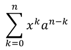
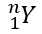

## **مرور کلی**

PowerPoint معادلات را به عنوان Office Math Markup Language (OMML) ذخیره می‌کند. با Aspose.Slides برای PHP از طریق Java می‌توانید همان نوع محتوای ریاضی را به‌صورت برنامه‌نویسی ایجاد کنید: کسرها، رادیکال‌ها، توابع، حدها، عملگرهای N‑ary، ماتریس‌ها، آرایه‌ها و بلوک‌های ریاضی قالب‌بندی شده.

در PowerPoint، کاربران معمولاً معادلات را از **Insert > Equation** اضافه می‌کنند:


نتیجه متن ریاضی قابل ویرایش بر روی اسلاید است:


Aspose.Slides این متن ریاضی را از طریق سه شیء اصلی می‌سازد:

- یک شکل ریاضی، که با [addMathShape](https://reference.aspose.com/slides/php-java/aspose.slides/shapecollection/#addMathShape) ایجاد می‌شود، شکلی است که معادله را در خود دارد.
- [MathPortion](https://reference.aspose.com/slides/php-java/aspose.slides/mathportion/) محتوای ریاضی را داخل فریم متن شکل ذخیره می‌کند.
- [MathParagraph](https://reference.aspose.com/slides/php-java/aspose.slides/mathparagraph/) شامل یک یا چند شیء [MathBlock](https://reference.aspose.com/slides/php-java/aspose.slides/mathblock/) است.

بیشتر مثال‌های زیر از [MathematicalText](https://reference.aspose.com/slides/php-java/aspose.slides/mathematicaltext/) و متدهای زنجیره‌ای [MathElementBase](https://reference.aspose.com/slides/php-java/aspose.slides/mathelementbase/) برای کوتاه و قابل خواندن نگه داشتن کد استفاده می‌کنند.

برای صحنه‌های خروجی MathML، به [Export Math Equations from Presentations in PHP via Java](/slides/fa/php-java/exporting-math-equations/) مراجعه کنید.

## **ایجاد یک معادله**

این مثال از [addMathShape](https://reference.aspose.com/slides/php-java/aspose.slides/shapecollection/#addMathShape) برای ایجاد یک شکل ریاضی استفاده می‌کند و قضیه فیثاغورث را اضافه می‌کند:


```php
$presentation = new Presentation();
try {
    $slide = $presentation->getSlides()->get_Item(0);

    $mathShape = $slide->getShapes()->addMathShape(20, 20, 700, 120);
    $mathParagraph = $mathShape->getTextFrame()->getParagraphs()
        - >get_Item(0)->getPortions()->get_Item(0)->getMathParagraph();

    $equation = (new MathematicalText("c"))
        - >setSuperscript("2")
        - >join("=")
        - >join((new MathematicalText("a"))->setSuperscript("2"))
        - >join("+")
        - >join((new MathematicalText("b"))->setSuperscript("2"));

    $mathParagraph->add($equation);

    $presentation->save("pythagorean-theorem.pptx", SaveFormat::Pptx);
} finally {
    if (!java_is_null($presentation)) {
        $presentation->dispose();
    }
}
```

{}
[addMathShape](https://reference.aspose.com/slides/php-java/aspose.slides/shapecollection/#addMathShape) یک شکل ایجاد می‌کند که از پیش شامل یک پاراگراف ریاضی است. اولین [MathPortion](https://reference.aspose.com/slides/php-java/aspose.slides/mathportion/) را دسترسی کنید، [getMathParagraph](https://reference.aspose.com/slides/php-java/aspose.slides/mathportion/#getMathParagraph) را فراخوانی کنید و بلوک‌ها یا عناصر ریاضی را به آن اضافه کنید.
{}

## **افزودن کسرها**

از [divide](https://reference.aspose.com/slides/php-java/aspose.slides/mathelementbase/#divide) برای ایجاد یک کسر استفاده کنید. می‌توانید سبک کسر را با [MathFractionTypes](https://reference.aspose.com/slides/php-java/aspose.slides/mathfractiontypes/) انتخاب کنید.


```php
$presentation = new Presentation();
try {
    $slide = $presentation->getSlides()->get_Item(0);

    $mathShape = $slide->getShapes()->addMathShape(20, 20, 700, 100);
    $mathParagraph = $mathShape->getTextFrame()->getParagraphs()
        - >get_Item(0)->getPortions()->get_Item(0)->getMathParagraph();

    $fraction = (new MathematicalText("1"))
        - >divide("x", MathFractionTypes::Skewed);

    $mathParagraph->add(new MathBlock($fraction));

    $presentation->save("fraction.pptx", SaveFormat::Pptx);
} finally {
    if (!java_is_null($presentation)) {
        $presentation->dispose();
    }
}
```

برای یک کسر انباشته، از [MathFractionTypes::Bar](https://reference.aspose.com/slides/php-java/aspose.slides/mathfractiontypes/#Bar) استفاده کنید:

```php
$stackedFraction = (new MathematicalText("x + 1"))->divide("y - 1", MathFractionTypes::Bar);
```

## **افزودن رادیکال‌ها**

از [radical](https://reference.aspose.com/slides/php-java/aspose.slides/mathelementbase/#radical) برای ایجاد رادیکال درجه دوم، سوم یا سایر رادیکال‌ها استفاده کنید. عنصر فعلی به عنوان پایه در می‌آید و آرگومان به عنوان درجه.


```php
$presentation = new Presentation();
try {
    $slide = $presentation->getSlides()->get_Item(0);

    $mathShape = $slide->getShapes()->addMathShape(20, 20, 700, 100);
    $mathParagraph = $mathShape->getTextFrame()->getParagraphs()
        - >get_Item(0)->getPortions()->get_Item(0)->getMathParagraph();

    $radical = (new MathematicalText("x"))
        - >radical("n");

    $mathParagraph->add(new MathBlock($radical));

    $presentation->save("radical.pptx", SaveFormat::Pptx);
} finally {
    if (!java_is_null($presentation)) {
        $presentation->dispose();
    }
}
```

### **نمایش یا مخفی کردن درجه رادیکال مربعی**

یک رادیکال مربعی می‌تواند عدد ۲ صریح را نمایش دهد یا از نماد معمولی √x استفاده کند. متد [setHideDegree](https://reference.aspose.com/slides/php-java/aspose.slides/mathradical/#setHideDegree) از [MathRadical](https://reference.aspose.com/slides/php-java/aspose.slides/mathradical/) تعیین می‌کند که کدام فرم ظاهر شود. هر دو فرم درجه ۲ و radicand x را در معادله قابل ویرایش حفظ می‌کنند.


این مثال همان رادیکال مربعی را دو بار ذخیره می‌کند. در `visible-degree.pptx` عدد ۲ قابل رؤیت است. در `hidden-degree.pptx` مخفی است.

```php
use aspose\slides\MathBlock;
use aspose\slides\MathematicalText;
use aspose\slides\Presentation;
use aspose\slides\SaveFormat;

$presentation = new Presentation();
try {
    $slide = $presentation->getSlides()->get_Item(0);
    
    $radical = (new MathematicalText("x"))->radical("2");

    $shape = $slide->getShapes()->addMathShape(20, 20, 200, 100);
    $portion = $shape->getTextFrame()->getParagraphs()->get_Item(0)->getPortions()->get_Item(0);
    $portion->getMathParagraph()->add(new MathBlock($radical));

    $radical->setHideDegree(false);
    $presentation->save("visible-degree.pptx", SaveFormat::Pptx);

    $radical->setHideDegree(true);
    $presentation->save("hidden-degree.pptx", SaveFormat::Pptx);
} finally {
    $presentation->dispose();
}
```

## **افزودن توابع و حدها**

برای توابعی مانند `sin(x)`, `log(x)` یا نام‌های توابع سفارشی از [asArgumentOfFunction](https://reference.aspose.com/slides/php-java/aspose.slides/mathelementbase/#asArgumentOfFunction) یا [function](https://reference.aspose.com/slides/php-java/aspose.slides/mathelementbase/#function) استفاده کنید. برای حدها، `lim` را در یک [MathLimit](https://reference.aspose.com/slides/php-java/aspose.slides/mathlimit/) قرار دهید یا از [setLowerLimit](https://reference.aspose.com/slides/php-java/aspose.slides/mathelementbase/#setLowerLimit) استفاده کنید.


```php
$presentation = new Presentation();
try {
    $slide = $presentation->getSlides()->get_Item(0);

    $mathShape = $slide->getShapes()->addMathShape(20, 20, 700, 100);
    $mathParagraph = $mathShape->getTextFrame()->getParagraphs()
        - >get_Item(0)->getPortions()->get_Item(0)->getMathParagraph();

    $limit = (new MathematicalText("lim"))
        - >setLowerLimit("x\u{2192}\u{221E}")
        - >function("x");

    $mathParagraph->add(new MathBlock($limit));

    $presentation->save("functions-and-limits.pptx", SaveFormat::Pptx);
} finally {
    if (!java_is_null($presentation)) {
        $presentation->dispose();
    }
}
```

برای یک نام تابع سفارشی، نام تابع را عنصر فعلی کنید و [function](https://reference.aspose.com/slides/php-java/aspose.slides/mathelementbase/#function) را با آرگومان آن فراخوانی کنید:

```php
$customFunction = (new MathematicalText("f"))->function("x + 1");
```

## **افزودن عملگرهای N‑ary و انتگرال‌ها**

برای جمع‌ها، اجتماع‌ها، اشتراک‌ها و سایر عملگرهای بزرگ از [nary](https://reference.aspose.com/slides/php-java/aspose.slides/mathelementbase/#nary) استفاده کنید. برای انتگرال‌ها از [integral](https://reference.aspose.com/slides/php-java/aspose.slides/mathelementbase/#integral) استفاده کنید. هر دو متد امکان تنظیم حدود پایین و بالا را می‌دهند.



```php
$presentation = new Presentation();
try {
    $slide = $presentation->getSlides()->get_Item(0);

    $mathShape = $slide->getShapes()->addMathShape(20, 20, 700, 120);
    $mathParagraph = $mathShape->getTextFrame()->getParagraphs()
        - >get_Item(0)->getPortions()->get_Item(0)->getMathParagraph();

    $summationBase = (new MathematicalText("x"))
        - >setSuperscript("k")
        - >join((new MathematicalText("a"))->setSuperscript("n-k"));

    $summation = $summationBase->nary(MathNaryOperatorTypes::Summation, "k=0", "n");

    $mathParagraph->add(new MathBlock($summation));

    $presentation->save("nary-operators.pptx", SaveFormat::Pptx);
} finally {
    if (!java_is_null($presentation)) {
        $presentation->dispose();
    }
}
```

عملگرهای N‑ary برای عملگرهای بزرگ با حدود اختیاری هستند. عملگرهای ساده مانند `+`, `-`, `=` معمولاً به‌عنوان [MathematicalText](https://reference.aspose.com/slides/php-java/aspose.slides/mathematicaltext/) افزوده می‌شوند و به عبارت می‌پیوندند.

برای یک انتگرال، از [integral](https://reference.aspose.com/slides/php-java/aspose.slides/mathelementbase/#integral) استفاده کنید:

```php
$integralBase = (new MathematicalText("x"))->join((new MathematicalText("dx"))->toBox());
$integral = $integralBase->integral(MathIntegralTypes::Simple, "0", "1");
```

## **افزودن ماتریس‌ها**

از [MathMatrix](https://reference.aspose.com/slides/php-java/aspose.slides/mathmatrix/) برای ردیف‌ها و ستون‌ها استفاده کنید. به‌طور پیش‌فرض ماتریس‌ها پرانتز ندارند، بنابراین هنگام نیاز به پرانتز، کروشه یا آکولاد، ماتریس را درون این نمادها بگذارید.


```php
$presentation = new Presentation();
try {
    $slide = $presentation->getSlides()->get_Item(0);

    $mathShape = $slide->getShapes()->addMathShape(20, 20, 700, 120);
    $mathParagraph = $mathShape->getTextFrame()->getParagraphs()
        - >get_Item(0)->getPortions()->get_Item(0)->getMathParagraph();

    $matrix = new MathMatrix(2, 3);
    $matrix->set_Item(0, 0, new MathematicalText("1"));
    $matrix->set_Item(0, 1, new MathematicalText("x"));
    $matrix->set_Item(1, 0, new MathematicalText("x"));
    $matrix->set_Item(1, 1, new MathematicalText("2"));
    $matrix->set_Item(1, 2, new MathematicalText("y"));

    $mathParagraph->add(new MathBlock($matrix));

    $presentation->save("matrix.pptx", SaveFormat::Pptx);
} finally {
    if (!java_is_null($presentation)) {
        $presentation->dispose();
    }
}
```

## **افزودن آرایه‌های معادله**

زمانی که به معادلات هم‌تراز یا یک پشتهٔ عمودی از عبارات نیاز دارید، از [toMathArray](https://reference.aspose.com/slides/php-java/aspose.slides/mathelementbase/#toMathArray) استفاده کنید.


```php
$presentation = new Presentation();
try {
    $slide = $presentation->getSlides()->get_Item(0);

    $mathShape = $slide->getShapes()->addMathShape(20, 20, 700, 140);
    $mathParagraph = $mathShape->getTextFrame()->getParagraphs()
        - >get_Item(0)->getPortions()->get_Item(0)->getMathParagraph();

    $equationArray = (new MathematicalText("x"))
        - >join("y")
        - >toMathArray();

    $mathParagraph->add(new MathBlock($equationArray));

    $presentation->save("equation-array.pptx", SaveFormat::Pptx);
} finally {
    if (!java_is_null($presentation)) {
        $presentation->dispose();
    }
}
```

### **هم‌تراز کردن آرایه با عناصر اطراف**

[setBaseJustification](https://reference.aspose.com/slides/php-java/aspose.slides/matharray/#setBaseJustification) تراز عمودی آرایه نسبت به عناصر ریاضی مجاور را کنترل می‌کند. مثال زیر تراز را با ردیف اول، مرکز آرایه و ردیف آخر مقایسه می‌کند.

مثال زیر سه آرایهٔ یکسان با سه ردیف و عناصر همسایهٔ `A=` و `=B` ایجاد می‌کند. تمام متن‌های ریاضی از Cambria Math با اندازهٔ ۲۴ پوینت استفاده می‌کنند. فقط تراز آرایه تغییر می‌کند.

```php
use aspose\slides\FillType;
use aspose\slides\FontData;
use aspose\slides\MathArray;
use aspose\slides\MathBlock;
use aspose\slides\MathJustification;
use aspose\slides\MathVerticalAlignment;
use aspose\slides\MathematicalText;
use aspose\slides\Presentation;
use aspose\slides\SaveFormat;
use aspose\slides\ShapeType;
use aspose\slides\SlideSizeScaleType;
use aspose\slides\TextAnchorType;

$createText = static function (string $value) {
    $text = new MathematicalText($value);
    $text->getFormat()->setFontHeight(24);
    $text->getFormat()->setLatinFont(new FontData("Cambria Math"));
    return $text;
};

$alignments = ["Top" => MathVerticalAlignment::Top, "Center" => MathVerticalAlignment::Center, "Bottom" => MathVerticalAlignment::Bottom];
$presentation = new Presentation();
try {
    $presentation->getSlideSize()->setSize(780, 200, SlideSizeScaleType::DoNotScale);
    $slide = $presentation->getSlides()->get_Item(0);
    $x = 20;
    foreach ($alignments as $name => $alignment) {
        $label = $slide->getShapes()->addAutoShape(ShapeType::Rectangle, $x, 10, 240, 30);
        $label->getFillFormat()->setFillType(FillType::NoFill);
        $label->getLineFormat()->getFillFormat()->setFillType(FillType::NoFill);
        $label->getTextFrame()->setText($name);
        $labelFormat = $label->getTextFrame()->getParagraphs()->get_Item(0)->getPortions()->get_Item(0)->getPortionFormat();
        $labelFormat->setFontHeight(16);
        $labelFormat->getFillFormat()->setFillType(FillType::Solid);
        $labelFormat->getFillFormat()->getSolidFillColor()->setColor(java("java.awt.Color")->BLACK);

        $mathShape = $slide->getShapes()->addMathShape($x, 60, 240, 130);
        $mathShape->getTextFrame()->getTextFrameFormat()->setAnchoringType(TextAnchorType::Top);
        $paragraph = $mathShape->getTextFrame()->getParagraphs()->get_Item(0);
        $mathParagraph = $paragraph->getPortions()->get_Item(0)->getMathParagraph();
        $mathParagraph->setJustification(MathJustification::LeftJustified);

        $firstRow = $createText("x+y=3");
        $equationArray = new MathArray($firstRow);
        foreach (["x-y=1", "x=2"] as $value) {
            $row = $createText($value);
            $equationArray->getArguments()->add($row);
        }
        $equationArray->setBaseJustification($alignment);
        $leftText = $createText("A=");
        $rightText = $createText("=B");
        $equation = (new MathBlock($leftText))->join($equationArray)->join($rightText);
        $mathParagraph->add($equation);
        $x += 260;
    }
    $presentation->save("equation-array-alignment.pptx", SaveFormat::Pptx);
} finally {
    $presentation->dispose();
}
```

مقایسهٔ زیر ارائهٔ ذخیره‌شده را در PowerPoint نشان می‌دهد. به موقعیت `A=` و `=B` در کنار هر آرایه توجه کنید.


### **پیکربندی فاصلهٔ ردیف‌ها**

[setRowSpacingRule](https://reference.aspose.com/slides/php-java/aspose.slides/matharray/#setRowSpacingRule) قاعدهٔ فاصلهٔ ردیف‌ها را درون آرایه انتخاب می‌کند. [setRowSpacing](https://reference.aspose.com/slides/php-java/aspose.slides/matharray/#setRowSpacing) مقدار عددی برای یک قاعدهٔ فاصلهٔ صریح فراهم می‌کند و توسط قواعد پیش‌ تنظیم نادیده گرفته می‌شود.

برای فاصلهٔ دقیق، مقدار بر حسب پوینت اندازه‌گیری می‌شود. برای فاصلهٔ نسبی، بر حسب نیم‌خط اندازه‌گیری می‌شود: مقدار `3` در مثال برابر ۱٫۵ خط است. هنگام تعیین مقدار صریح هر دو ویژگی را تنظیم کنید؛ فقط تغییر مقدار عددی قواعد فاصله را انتخاب نمی‌کند.

مثال زیر پنج ارائه با معادلات، تراز و تنظیمات قلم یکسان ذخیره می‌کند. سه مورد اول از پیش‌تنظیم‌ها استفاده می‌کنند؛ دو مورد آخر مقادیر صریح را نشان می‌دهند.

```php
use aspose\slides\FontData;
use aspose\slides\MathArray;
use aspose\slides\MathBlock;
use aspose\slides\MathJustification;
use aspose\slides\MathRowSpacingRule;
use aspose\slides\MathVerticalAlignment;
use aspose\slides\MathematicalText;
use aspose\slides\Presentation;
use aspose\slides\SaveFormat;

$createText = static function (string $value) {
    $text = new MathematicalText($value);
    $text->getFormat()->setFontHeight(24);
    $text->getFormat()->setLatinFont(new FontData("Cambria Math"));
    return $text;
};

$settings = [
    "SingleLineGap" => [MathRowSpacingRule::SingleLineGap, 0],
    "OneAndAHalfLineGap" => [MathRowSpacingRule::OneAndAHalfLineGap, 0],
    "TwoLineGap" => [MathRowSpacingRule::TwoLineGap, 0],
    "Exactly" => [MathRowSpacingRule::Exactly, 20],
    "Multiple" => [MathRowSpacingRule::Multiple, 3],
];

foreach ($settings as $name => [$rule, $spacing]) {
    $presentation = new Presentation();
    try {
        $mathShape = $presentation->getSlides()->get_Item(0)->getShapes()->addMathShape(20, 20, 600, 300);
        $paragraph = $mathShape->getTextFrame()->getParagraphs()->get_Item(0);
        $paragraph->getParagraphFormat()->setSpaceBefore(0);
        $paragraph->getParagraphFormat()->setSpaceAfter(0);
        $mathParagraph = $paragraph->getPortions()->get_Item(0)->getMathParagraph();
        $mathParagraph->setJustification(MathJustification::LeftJustified);

        $firstRow = $createText("x+y=3");
        $equationArray = new MathArray($firstRow);
        foreach (["x-y=1", "x=2"] as $value) {
            $row = $createText($value);
            $equationArray->getArguments()->add($row);
        }
        $equationArray->setBaseJustification(MathVerticalAlignment::Center);
        $equationArray->setRowSpacingRule($rule);
        $equationArray->setRowSpacing($spacing);
        $leftText = $createText("A=");
        $rightText = $createText("=B");
        $equation = (new MathBlock($leftText))->join($equationArray)->join($rightText);
        $mathParagraph->add($equation);
        $presentation->save("equation-array-$name.pptx", SaveFormat::Pptx);
    } finally {
        $presentation->dispose();
    }
}
```

فاصلهٔ ردیف آرایه مستقل از فاصلهٔ پاراگراف است. [setSpaceBefore](https://reference.aspose.com/slides/php-java/aspose.slides/paragraphformat/#setSpaceBefore) و [setSpaceAfter](https://reference.aspose.com/slides/php-java/aspose.slides/paragraphformat/#setSpaceAfter) فضا را در اطراف پاراگراف حاوی اضافه می‌کنند، نه بین ردیف‌های آرایه. به‌علاوه، [MathParagraph::setJustification](https://reference.aspose.com/slides/php-java/aspose.slides/mathparagraph/#setJustification) پاراگراف ریاضی را به‌صورت افقی موقعیت می‌دهد؛ تنظیم عمودی آرایه را جایگزین نمی‌کند.

## **افزودن توابع مثلثاتی**

زمانی که آرگومان عنصر فعلی است و نام تابع شناخته شده، از [asArgumentOfFunction](https://reference.aspose.com/slides/php-java/aspose.slides/mathelementbase/#asArgumentOfFunction) استفاده کنید.


```php
$presentation = new Presentation();
try {
    $slide = $presentation->getSlides()->get_Item(0);

    $mathShape = $slide->getShapes()->addMathShape(20, 20, 700, 100);
    $mathParagraph = $mathShape->getTextFrame()->getParagraphs()
        - >get_Item(0)->getPortions()->get_Item(0)->getMathParagraph();

    $cosine = (new MathematicalText("2x"))
        - >asArgumentOfFunction(MathFunctionsOfOneArgument::Cos);

    $mathParagraph->add(new MathBlock($cosine));

    $presentation->save("trigonometric-function.pptx", SaveFormat::Pptx);
} finally {
    if (!java_is_null($presentation)) {
        $presentation->dispose();
    }
}
```

## **افزودن زیرنویس و بالانویس**

از کمکی‌های زیرنویس و بالانویس برای اندیس‌ها و توان‌ها استفاده کنید. هنگامی که اندیس‌ها باید در سمت چپ پایه نمایش داده شوند، از [setSubSuperscriptOnTheLeft](https://reference.aspose.com/slides/php-java/aspose.slides/mathelementbase/#setSubSuperscriptOnTheLeft) استفاده کنید.



```php
$presentation = new Presentation();
try {
    $slide = $presentation->getSlides()->get_Item(0);

    $mathShape = $slide->getShapes()->addMathShape(20, 20, 700, 100);
    $mathParagraph = $mathShape->getTextFrame()->getParagraphs()
        - >get_Item(0)->getPortions()->get_Item(0)->getMathParagraph();

    $scripts = (new MathematicalText("Y"))
        - >setSubSuperscriptOnTheLeft("1", "n");

    $mathParagraph->add(new MathBlock($scripts));

    $presentation->save("subscript-superscript.pptx", SaveFormat::Pptx);
} finally {
    if (!java_is_null($presentation)) {
        $presentation->dispose();
    }
}
```

## **افزودن جداکننده‌ها**

از [enclose](https://reference.aspose.com/slides/php-java/aspose.slides/mathelementbase/#enclose) برای گذاشتن یک عبارت درون جداکننده‌ها استفاده کنید. می‌توانید کاراکتر جداساز را برای عبارات دارای چند عنصر تنظیم کنید.


```php
$presentation = new Presentation();
try {
    $slide = $presentation->getSlides()->get_Item(0);

    $mathShape = $slide->getShapes()->addMathShape(20, 20, 700, 100);
    $mathParagraph = $mathShape->getTextFrame()->getParagraphs()
        - >get_Item(0)->getPortions()->get_Item(0)->getMathParagraph();

    $delimiter = (new MathematicalText("x"))
        - >join("y")
        - >join("z")
        - >enclose(new Java("java.lang.Character", "<"), new Java("java.lang.Character", ">"));
    $delimiter->setSeparatorCharacter(new Java("java.lang.Character", "|"));

    $mathParagraph->add(new MathBlock($delimiter));

    $presentation->save("delimiters.pptx", SaveFormat::Pptx);
} finally {
    if (!java_is_null($presentation)) {
        $presentation->dispose();
    }
}
```

### **اندازه و تراز جداکننده‌ها**

برای این‌که پرانتزها به ارتفاع عملوند بزرگتر شوند، `true` را به [setGrowToMatchOperandHeight](https://reference.aspose.com/slides/php-java/aspose.slides/mathdelimiter/#setGrowToMatchOperandHeight) بدهید؛ یا `false` بدهید تا اندازهٔ معمولی خود را حفظ کنند. با استفاده از [setDelimiterShape](https://reference.aspose.com/slides/php-java/aspose.slides/mathdelimiter/#setDelimiterShape) و یکی از دو مقدار [MathDelimiterShape](https://reference.aspose.com/slides/php-java/aspose.slides/mathdelimitershape/) می‌توانید نوع شکل را تنظیم کنید. `Centered` پرانتزها را روی محور ریاضی که از وسط علامت مساوی می‌گذرد، مرکز می‌کند. `Match` آن‌ها را با محتوای درون‌ enclosed هم‌تراز می‌کند. هر دو تنظیم فقط بر جداکننده‌ها تأثیر می‌گذارند؛ عبارت داخلی بدون تغییر می‌ماند.

مثال یک کسر را در توان `x` قرار می‌دهد تا عبارت بالاتر از خط پایه بسط یابد. چهار معادله از یک پرانتز و تنظیمات قلم یکسان استفاده می‌کنند.

```php
use aspose\slides\MathDelimiterShape;
use aspose\slides\MathematicalText;
use aspose\slides\Presentation;
use aspose\slides\SaveFormat;

$presentation = new Presentation();
try {
    $slide = $presentation->getSlides()->get_Item(0);
    $opening = new Java("java.lang.Character", "(");
    $closing = new Java("java.lang.Character", ")");
    for ($row = 0; $row < 2; $row++) {
        for ($column = 0; $column < 2; $column++) {
            $fraction = (new MathematicalText("a + b"))->divide("c + d");
            $power = (new MathematicalText("x"))->setSuperscript($fraction);
            $delimiter = $power->enclose($opening, $closing);
            $delimiter->setGrowToMatchOperandHeight($row === 0);
            $delimiter->setDelimiterShape($column === 0 ? MathDelimiterShape::Centered : MathDelimiterShape::Match);

            $mathShape = $slide->getShapes()->addMathShape(20 + 330 * $column, 20 + 120 * $row, 300, 100);
            $portion = $mathShape->getTextFrame()->getParagraphs()->get_Item(0)->getPortions()->get_Item(0);
            $portion->getPortionFormat()->setFontHeight(32);
            $equation = (new MathematicalText("y = "))->join($delimiter);
            $portion->getMathParagraph()->add($equation);
        }
    }
    $presentation->save("delimiter-sizing.pptx", SaveFormat::Pptx);
} finally {
    $presentation->dispose();
}
```

در PowerPoint، ردیف‌ها را برای مشاهدهٔ اثر رشد مقایسه کنید. در ردیف بالا، پرانتزها برای محصور کردن توان رشد می‌یابند و برای هر دو شکل مشابه به‌نظر می‌رسند. در ردیف پایین، رشد غیرفعال است. پرانتزهای کوچکتر در سمت چپ (`Centered`) با علامت مساوی هم‌ترازند، در حالی که آن‌های سمت راست (`Match`) بالاتر اطراف عبارت قرار گرفته‌اند.


## **افزودن جعبهٔ حاشیه‌ای**

برای فریم‌کردن کل عبارت، بر یک کسر متد [toBorderBox](https://reference.aspose.com/slides/php-java/aspose.slides/mathelementbase/#toBorderBox) را صدا بزنید. [MathBorderBox](https://reference.aspose.com/slides/php-java/aspose.slides/mathborderbox/) به‌طور پیش‌فرض چهار طرف را نشان می‌دهد. برای حذف طرف‌های منفرد از [setHideTop](https://reference.aspose.com/slides/php-java/aspose.slides/mathborderbox/#setHideTop)، [setHideBottom](https://reference.aspose.com/slides/php-java/aspose.slides/mathborderbox/#setHideBottom)، [setHideLeft](https://reference.aspose.com/slides/php-java/aspose.slides/mathborderbox/#setHideLeft) و [setHideRight](https://reference.aspose.com/slides/php-java/aspose.slides/mathborderbox/#setHideRight) استفاده کنید.

مثال شش کپی یک کسر یکسان را بر روی یک اسلاید قرار می‌دهد. برای نشان دادن حذف، تمام چهار طرف را مخفی کنید و `true` را به [setStrikethroughBottomLeftToTopRight](https://reference.aspose.com/slides/php-java/aspose.slides/mathborderbox/#setStrikethroughBottomLeftToTopRight) برای یک قطعهٔ مورب صعودی (↗) یا به [setStrikethroughTopLeftToBottomRight](https://reference.aspose.com/slides/php-java/aspose.slides/mathborderbox/#setStrikethroughTopLeftToBottomRight) برای یک قطعهٔ مورب نزولی (↘) بدهید. همچنین می‌توانید از [setStrikethroughHorizontal](https://reference.aspose.com/slides/php-java/aspose.slides/mathborderbox/#setStrikethroughHorizontal) یا [setStrikethroughVertical](https://reference.aspose.com/slides/php-java/aspose.slides/mathborderbox/#setStrikethroughVertical) با هر ترکیبی از طرف‌های قابل رؤیت استفاده کنید.

```php
use aspose\slides\MathBlock;
use aspose\slides\MathematicalText;
use aspose\slides\Presentation;
use aspose\slides\SaveFormat;
use aspose\slides\SlideSizeScaleType;

$presentation = new Presentation();
try {
    $presentation->getSlideSize()->setSize(540, 220, SlideSizeScaleType::DoNotScale);
    $slide = $presentation->getSlides()->get_Item(0);

    $addFraction = function ($x, $y, $hideBorder) use ($slide) {
        $fraction = (new MathematicalText("x+1"))->divide("y+2");
        $box = $fraction->toBorderBox();
        $box->setHideTop($hideBorder);
        $box->setHideBottom($hideBorder);
        $box->setHideLeft($hideBorder);
        $box->setHideRight($hideBorder);

        $shape = $slide->getShapes()->addMathShape($x, $y, 160, 90);
        $portion = $shape->getTextFrame()->getParagraphs()->get_Item(0)->getPortions()->get_Item(0);
        $portion->getPortionFormat()->setFontHeight(28);
        $mathBlock = new MathBlock($box);
        $portion->getMathParagraph()->add($mathBlock);
        return $box;
    };

    $addFraction(10, 10, false);

    $partial = $addFraction(190, 10, false);
    $partial->setHideTop(true);
    $partial->setHideRight(true);

    $addFraction(370, 10, true)->setStrikethroughBottomLeftToTopRight(true);
    $addFraction(10, 120, true)->setStrikethroughTopLeftToBottomRight(true);
    $addFraction(190, 120, true)->setStrikethroughHorizontal(true);
    $addFraction(370, 120, false)->setStrikethroughVertical(true);

    $presentation->save("border-box.pptx", SaveFormat::Pptx);
} finally {
    $presentation->dispose();
}
```


در این کسر، خط افقی بر روی نوار کسر هم‌پوشانی دارد. خط عمودی هر دو صورت و مخرج را قطع می‌کند در حالی که حاشیهٔ اطراف قابل رؤیت می‌ماند. این خطوط کل عبارت را تزئین می‌کنند. Strikethrough متنی معمولی فقط به کاراکترهای یک ران متن اعمال می‌شود. پس از بازگشایی ارائه در PowerPoint، می‌توانید صورت و مخرج را به‌صورت مستقل ویرایش کنید.

## **کنترل نمایش و چیدمان با عناصر فانتوم**

یک عبارت را در [MathPhantom](https://reference.aspose.com/slides/php-java/aspose.slides/mathphantom/) بپیچید تا نمایش آن و فضایی که به معادله اضافه می‌کند را به‌صورت مستقل کنترل کنید. متدهای [MathPhantom](https://reference.aspose.com/slides/php-java/aspose.slides/mathphantom/) موارد زیر را تنظیم می‌کنند:

| متد | اثر |
| --- | --- |
| [setShow](https://reference.aspose.com/slides/php-java/aspose.slides/mathphantom/#setShow) | `false` بدهید تا عبارت مخفی شود. ابعاد آن همچنان در چیدمان مشارکت می‌کند مگر اینکه متدهای زیر `true` دریافت کنند. |
| [setZeroWidth](https://reference.aspose.com/slides/php-java/aspose.slides/mathphantom/#setZeroWidth) | عرض افقی عبارت را صفر در نظر بگیرید تا عناصر همسایه نزدیک‌تر شوند. |
| [setZeroAsc](https://reference.aspose.com/slides/php-java/aspose.slides/mathphantom/#setZeroAsc) | ارتفاع بالای خط پایه (ascender) را صفر در نظر بگیرید؛ این می‌تواند فضای رزرو شده بالای عناصر همسایه را کاهش دهد. |
| [setZeroDesc](https://reference.aspose.com/slides/php-java/aspose.slides/mathphantom/#setZeroDesc) | عمق زیر خط پایه (descender) را صفر در نظر بگیرید؛ این می‌تواند نوار کسر یا محتوای دیگر زیر عبارت را به همسایه‌هایش نزدیک‌تر کند. |

خط پایه خط مرجع است که حروف ریاضی معمولی روی آن قرار می‌گیرد. مخفی کردن محتوا ابعاد آن را حذف نمی‌کند، و در نظر گرفتن یک بعد به‌عنوان صفر نیز عبارت را حذف نمی‌نماید. عبارت زیرین از طریق [getBase](https://reference.aspose.com/slides/php-java/aspose.slides/mathphantom/#getBase) در دسترس است. `true` را به [setShow](https://reference.aspose.com/slides/php-java/aspose.slides/mathphantom/#setShow) بدهید تا دوباره نمایش داده شود؛ تنظیمات بعدی دست نخورده می‌مانند.

مثال زیر پنج گونهٔ کنار هم تولید می‌کند: یک کسر قابل رؤیت، یک کسر مخفی که فضا را رزرو می‌کند، و سه کسر مخفی که یک بعد آن صفر در نظر گرفته شده است. هر گونه از همان عبارت اطراف و Cambria Math با اندازهٔ ۲۴ پوینت استفاده می‌کند. تمام شکل‌های معادله موقعیت بالا یکسانی دارند که توسط راهنمای خاکستری نشان داده شده است. قرار دادن فانتوم در صورت یک کسر بیرونی تغییرات چیدمان عمودی را آسان‌تر قابل مشاهده می‌کند.

```php
use aspose\slides\FillType;
use aspose\slides\FontData;
use aspose\slides\MathBlock;
use aspose\slides\MathFraction;
use aspose\slides\MathPhantom;
use aspose\slides\MathematicalText;
use aspose\slides\Presentation;
use aspose\slides\SaveFormat;
use aspose\slides\ShapeType;
use aspose\slides\SlideSizeScaleType;
use aspose\slides\TextAnchorType;

$createText = static function (string $value) {
    $text = new MathematicalText($value);
    $text->getFormat()->setFontHeight(24);
    $text->getFormat()->setLatinFont(new FontData("Cambria Math"));
    return $text;
};

$presentation = new Presentation();
try {
    $presentation->getSlideSize()->setSize(1000, 180, SlideSizeScaleType::DoNotScale);
    $slide = $presentation->getSlides()->get_Item(0);

    $labels = ["Visible", "Hidden: reserves space", "Hidden: ZeroWidth", "Hidden: ZeroAsc", "Hidden: ZeroDesc"];

    $guide = $slide->getShapes()->addAutoShape(ShapeType::Line, 10, 60, 980, 0);
    $guide->getLineFormat()->getFillFormat()->setFillType(FillType::Solid);
    $guide->getLineFormat()->getFillFormat()->getSolidFillColor()->setColor(java("java.awt.Color")->LIGHT_GRAY);

    foreach ($labels as $i => $labelText) {
        $left = 10 + $i * 200;

        $label = $slide->getShapes()->addAutoShape(ShapeType::Rectangle, $left, 10, 190, 30);
        $label->getFillFormat()->setFillType(FillType::NoFill);
        $label->getLineFormat()->getFillFormat()->setFillType(FillType::NoFill);
        $label->getTextFrame()->setText($labelText);

        $labelFormat = $label->getTextFrame()->getParagraphs()->get_Item(0)->getPortions()->get_Item(0)->getPortionFormat();
        $labelFormat->setFontHeight(14);
        $labelFormat->getFillFormat()->setFillType(FillType::Solid);
        $labelFormat->getFillFormat()->getSolidFillColor()->setColor(java("java.awt.Color")->BLACK);

        $fractionNumerator = $createText("a+b");
        $fractionDenominator = $createText("c+d");
        $fraction = new MathFraction($fractionNumerator, $fractionDenominator);
        $phantom = new MathPhantom($fraction);
        $phantom->setShow($i === 0);
        $phantom->setZeroWidth($i === 2);
        $phantom->setZeroAsc($i === 3);
        $phantom->setZeroDesc($i === 4);

        $leftText = $createText("x+");
        $rightText = $createText("+y");
        $numerator = (new MathBlock($leftText))->join($phantom)->join($rightText);
        $denominator = $createText("z");
        $equation = new MathFraction($numerator, $denominator);

        $shape = $slide->getShapes()->addMathShape($left, 60, 190, 100);
        $shape->getTextFrame()->getTextFrameFormat()->setAnchoringType(TextAnchorType::Top);

        $mathPortion = $shape->getTextFrame()->getParagraphs()->get_Item(0)->getPortions()->get_Item(0);
        $mathParagraph = $mathPortion->getMathParagraph();
        $mathBlock = new MathBlock($equation);
        $mathParagraph->add($mathBlock);
    }

    $presentation->save("math-phantom.pptx", SaveFormat::Pptx);
} finally {
    $presentation->dispose();
}
```


## **گروه‌بندی عبارات**

از [group](https://reference.aspose.com/slides/php-java/aspose.slides/mathelementbase/#group) برای قرار دادن یک نویسهٔ گروه‌بندی بالا یا پایین یک عبارت استفاده کنید. برای برچسب‌گذاری عبارات گروه‌بندی شده، یک حد اضافه کنید.


```php
$presentation = new Presentation();
try {
    $slide = $presentation->getSlides()->get_Item(0);

    $mathShape = $slide->getShapes()->addMathShape(20, 20, 700, 120);
    $mathParagraph = $mathShape->getTextFrame()->getParagraphs()
        - >get_Item(0)->getPortions()->get_Item(0)->getMathParagraph();

    $grouped = (new MathematicalText("x + y"))
        - >group(new Java("java.lang.Character", "\u{23DF}"), MathTopBotPositions::Bottom, MathTopBotPositions::Top)
        - >setLowerLimit("any text");

    $mathParagraph->add(new MathBlock($grouped));

    $presentation->save("grouped-terms.pptx", SaveFormat::Pptx);
} finally {
    if (!java_is_null($presentation)) {
        $presentation->dispose();
    }
}
```

## **قالب‌بندی عناصر ریاضی**

از کمکی‌های قالب‌بندی فقط در جایی استفاده کنید که فرمول را واضح‌تر می‌کند. برای مثال، [overbar](https://reference.aspose.com/slides/php-java/aspose.slides/mathelementbase/#overbar) یک نوار بالای یک عنصر ریاضی می‌گذارد.


```php
$presentation = new Presentation();
try {
    $slide = $presentation->getSlides()->get_Item(0);

    $mathShape = $slide->getShapes()->addMathShape(20, 20, 700, 100);
    $mathParagraph = $mathShape->getTextFrame()->getParagraphs()
        - >get_Item(0)->getPortions()->get_Item(0)->getMathParagraph();

    $overbar = (new MathematicalText("ABC"))->overbar();

    $mathParagraph->add(new MathBlock($overbar));

    $presentation->save("overbar.pptx", SaveFormat::Pptx);
} finally {
    if (!java_is_null($presentation)) {
        $presentation->dispose();
    }
}
```

### **قالب‌بندی متن در یک معادلهٔ موجود**

برای قالب‌بندی متن در سرتاسر یک معادله موجود، درخت عناصر هر بلوک ریاضی را پیمایش کنید. [MathElementBase::getChildren](https://reference.aspose.com/slides/php-java/aspose.slides/mathelementbase/#getChildren) تنها فرزندان مستقیم را برمی‌گرداند، بنابراین برای رسیدن به متن داخل کسرها، اسکریپت‌ها، رادیکال‌ها و سایر ساختارهای تو در تو به‌صورت بازگشتی فراخوانی کنید. هم عنصر فعلی و هم فرزندان آن را بررسی کنید تا وقتی عنصر [MathematicalText](https://reference.aspose.com/slides/php-java/aspose.slides/mathematicaltext/) باشد، آن را نیز شامل شوید.

این مثال فرض می‌کند `input.pptx` شامل معادله‌ای مانند `z = xᵢ / ∛y` است که یک کسر با زیرنویس در صورت و رادیکال در مخرج دارد. پردازش فقط عناصر سطح بالا بلوک متن را از دست می‌دهد. این مثال قسمت‌های ریاضی را در فریم‌های متن اسلاید پیدا می‌کند، بلوک‌های آن‌ها را از طریق [MathPortion::getMathParagraph](https://reference.aspose.com/slides/php-java/aspose.slides/mathportion/#getMathParagraph) دسترسی می‌یابد و از [setFontHeight](https://reference.aspose.com/slides/php-java/aspose.slides/baseportionformat/#setFontHeight) برای تنظیم اندازهٔ قلم به ۲۸ پوینت از طریق متد [getFormat](https://reference.aspose.com/slides/php-java/aspose.slides/mathematicaltext/#getFormat) هر عنصر متنی استفاده می‌کند.

```php
use aspose\slides\Presentation;
use aspose\slides\SaveFormat;

function formatMathText($element, $mathematicalTextClass) {
    if (java_instanceof($element, $mathematicalTextClass)) {
        $element->getFormat()->setFontHeight(28);
    }

    foreach ($element->getChildren() as $child) {
        formatMathText($child, $mathematicalTextClass);
    }
}

$mathematicalTextClass = new JavaClass("com.aspose.slides.MathematicalText");
$autoShapeClass = new JavaClass("com.aspose.slides.IAutoShape");
$mathPortionClass = new JavaClass("com.aspose.slides.IMathPortion");

$presentation = new Presentation("input.pptx");
try {
    for ($slideIndex = 0; $slideIndex < java_values($presentation->getSlides()->size()); $slideIndex++) {
        $slide = $presentation->getSlides()->get_Item($slideIndex);
        for ($shapeIndex = 0; $shapeIndex < java_values($slide->getShapes()->size()); $shapeIndex++) {
            $shape = $slide->getShapes()->get_Item($shapeIndex);
            if (!java_instanceof($shape, $autoShapeClass)) {
                continue;
            }

            $textFrame = $shape->getTextFrame();
            if (java_is_null($textFrame)) {
                continue;
            }

            for ($paragraphIndex = 0; $paragraphIndex < java_values($textFrame->getParagraphs()->getCount()); $paragraphIndex++) {
                $paragraph = $textFrame->getParagraphs()->get_Item($paragraphIndex);
                for ($portionIndex = 0; $portionIndex < java_values($paragraph->getPortions()->getCount()); $portionIndex++) {
                    $portion = $paragraph->getPortions()->get_Item($portionIndex);
                    if (java_instanceof($portion, $mathPortionClass)) {
                        for ($blockIndex = 0; $blockIndex < java_values($portion->getMathParagraph()->getCount()); $blockIndex++) {
                            $block = $portion->getMathParagraph()->get_Item($blockIndex);
                            formatMathText($block, $mathematicalTextClass);
                        }
                    }
                }
            }
        }
    }

    $presentation->save("formatted-equations.pptx", SaveFormat::Pptx);
} finally {
    $presentation->dispose();
}
```

ارائهٔ ذخیره‌شده متن قالب‌بندی‌شده به‌روزشده را در هر سطح از هر معادلهٔ پردازش‌شده شامل می‌شود، در حالی که محتوای متنی و ساختار ریاضی آن حفظ می‌شود.

## **مرجع سریع**

| کار | API اصلی |
| --- | --- |
| ایجاد متن ریاضی | [MathematicalText](https://reference.aspose.com/slides/php-java/aspose.slides/mathematicaltext/) |
| ترکیب عناصر | [join](https://reference.aspose.com/slides/php-java/aspose.slides/mathelementbase/) |
| ایجاد کسرها | [divide](https://reference.aspose.com/slides/php-java/aspose.slides/mathelementbase/) |
| افزودن بالانویس یا زیرنویس | [setSuperscript](https://reference.aspose.com/slides/php-java/aspose.slides/mathelementbase/), [setSubscript](https://reference.aspose.com/slides/php-java/aspose.slides/mathelementbase/) |
| افزودن توابع | [function](https://reference.aspose.com/slides/php-java/aspose.slides/mathelementbase/), [asArgumentOfFunction](https://reference.aspose.com/slides/php-java/aspose.slides/mathelementbase/) |
| افزودن رادیکال‌ها | [radical](https://reference.aspose.com/slides/php-java/aspose.slides/mathelementbase/) |
| افزودن حدها | [setLowerLimit](https://reference.aspose.com/slides/php-java/aspose.slides/mathelementbase/), [setUpperLimit](https://reference.aspose.com/slides/php-java/aspose.slides/mathelementbase/) |
| افزودن اسکریپت‌های سمت چپ | [setSubSuperscriptOnTheLeft](https://reference.aspose.com/slides/php-java/aspose.slides/mathelementbase/) |
| افزودن جمع‌ها و انتگرال‌ها | [nary](https://reference.aspose.com/slides/php-java/aspose.slides/mathelementbase/), [integral](https://reference.aspose.com/slides/php-java/aspose.slides/mathelementbase/) |
| افزودن ماتریس‌ها | [MathMatrix](https://reference.aspose.com/slides/php-java/aspose.slides/mathmatrix/) |
| افزودن آرایه‌های معادله | [toMathArray](https://reference.aspose.com/slides/php-java/aspose.slides/mathelementbase/) |
| افزودن جداکننده‌ها | [enclose](https://reference.aspose.com/slides/php-java/aspose.slides/mathelementbase/) |
| افزودن میله‌ها و حاشیه‌ها | [overbar](https://reference.aspose.com/slides/php-java/aspose.slides/mathelementbase/), [toBorderBox](https://reference.aspose.com/slides/php-java/aspose.slides/mathelementbase/) |
| گروه‌بندی عبارات | [group](https://reference.aspose.com/slides/php-java/aspose.slides/mathelementbase/) |

## **سوالات متداول**

**آیا می‌توانم معادلهٔ موجود در PowerPoint را ویرایش کنم؟**

بله. ارائه را باز کنید، شکل حاوی یک [MathPortion](https://reference.aspose.com/slides/php-java/aspose.slides/mathportion/) را پیدا کنید، [getMathParagraph](https://reference.aspose.com/slides/php-java/aspose.slides/mathportion/#getMathParagraph) را صدا بزنید و بلوک‌های ریاضی در آن پاراگراف را به‌روزرسانی کنید.

**آیا معادلات به‌عنوان ریاضی قابل ویرایش PowerPoint ذخیره می‌شوند؟**

بله. هنگام ذخیره به PPTX، Aspose.Slides معادله را به‌صورت محتوای ریاضی Office قابل ویرایش می‌نویسد.

**آیا می‌توانم معادلات را به LaTeX صادر کنم؟**

بله. [MathParagraph](https://reference.aspose.com/slides/php-java/aspose.slides/mathparagraph/) معادله را از [MathPortion](https://reference.aspose.com/slides/php-java/aspose.slides/mathportion/) دریافت کنید و [MathParagraph::toLatex](https://reference.aspose.com/slides/php-java/aspose.slides/mathparagraph/#toLatex) را فراخوانی کنید تا مستقیماً صادر شود. برای یک مثال کامل، به [Export Math Equations from Presentations in PHP via Java](/slides/fa/php-java/exporting-math-equations/#export-math-equations-to-latex) مراجعه کنید.