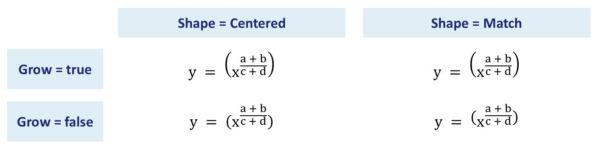

## **Aperçu**

PowerPoint stocke les équations au format Office Math Markup Language (OMML). Avec Aspose.Slides for PHP via Java, vous pouvez créer le même type de contenu mathématique de façon programmatique : fractions, radicaux, fonctions, limites, opérateurs N‑aire, matrices, tableaux et blocs mathématiques formatés.

Dans PowerPoint, les utilisateurs ajoutent généralement des équations depuis **Insérer > Équation** :


Le résultat est du texte mathématique modifiable sur la diapositive :


Aspose.Slides construit ce texte mathématique à l’aide de trois objets principaux :

- Une forme mathématique, créée avec [addMathShape](https://reference.aspose.com/slides/php-java/aspose.slides/shapecollection/#addMathShape), est la forme qui contient l’équation.
- [MathPortion](https://reference.aspose.com/slides/php-java/aspose.slides/mathportion/) stocke le contenu mathématique dans le cadre de texte de la forme.
- [MathParagraph](https://reference.aspose.com/slides/php-java/aspose.slides/mathparagraph/) contient un ou plusieurs objets [MathBlock](https://reference.aspose.com/slides/php-java/aspose.slides/mathblock/).

La plupart des exemples ci‑dessous utilisent [MathematicalText](https://reference.aspose.com/slides/php-java/aspose.slides/mathematicaltext/) et les méthodes fluides de [MathElementBase](https://reference.aspose.com/slides/php-java/aspose.slides/mathelementbase/) pour garder le code court et lisible.

Pour les scénarios d’exportation MathML, voir [Exporter les équations mathématiques depuis les présentations en PHP via Java](/slides/fr/php-java/exporting-math-equations/).

## **Créer une équation**

Cet exemple utilise [addMathShape](https://reference.aspose.com/slides/php-java/aspose.slides/shapecollection/#addMathShape) pour créer une forme mathématique et ajoute le théorème de Pythagore :


```php
$presentation = new Presentation();
try {
    $slide = $presentation->getSlides()->get_Item(0);

    $mathShape = $slide->getShapes()->addMathShape(20, 20, 700, 120);
    $mathParagraph = $mathShape->getTextFrame()->getParagraphs()
        - >get_Item(0)->getPortions()->get_Item(0)->getMathParagraph();

    $equation = (new MathematicalText("c"))
        - >setSuperscript("2")
        - >join("=")
        - >join((new MathematicalText("a"))->setSuperscript("2"))
        - >join("+")
        - >join((new MathematicalText("b"))->setSuperscript("2"));

    $mathParagraph->add($equation);

    $presentation->save("pythagorean-theorem.pptx", SaveFormat::Pptx);
} finally {
    if (!java_is_null($presentation)) {
        $presentation->dispose();
    }
}
```

{}
[addMathShape](https://reference.aspose.com/slides/php-java/aspose.slides/shapecollection/#addMathShape) crée une forme qui contient déjà un paragraphe mathématique. Accédez au premier [MathPortion](https://reference.aspose.com/slides/php-java/aspose.slides/mathportion/), appelez [getMathParagraph](https://reference.aspose.com/slides/php-java/aspose.slides/mathportion/#getMathParagraph), et ajoutez des blocs mathématiques ou des éléments mathématiques.
{}

### **Combiner des blocs mathématiques**

Lorsque des parties d’une équation sont construites indépendamment en tant qu’objets [MathBlock](https://reference.aspose.com/slides/php-java/aspose.slides/mathblock/) , utilisez [joinBlock](https://reference.aspose.com/slides/php-java/aspose.slides/mathblock/#joinBlock) pour les combiner. L’exemple construit `c² =` dans le bloc gauche et `a² + b²` dans le bloc droit. [setSuperscript](https://reference.aspose.com/slides/php-java/aspose.slides/mathelementbase/#setSuperscript) crée des exposants mathématiques modifiables pour les trois puissances.

```php
use aspose\slides\MathBlock;
use aspose\slides\MathematicalText;
use aspose\slides\Presentation;
use aspose\slides\SaveFormat;

$presentation = new Presentation();
try {
    $slide = $presentation->getSlides()->get_Item(0);

    $shape = $slide->getShapes()->addMathShape(20, 20, 600, 100);
    $mathPortion = $shape->getTextFrame()->getParagraphs()->get_Item(0)->getPortions()->get_Item(0);
    $mathParagraph = $mathPortion->getMathParagraph();

    $leftBlock = new MathBlock();
    $leftBlock->add((new MathematicalText("c"))->setSuperscript("2"));
    $leftBlock->add(new MathematicalText("="));

    $rightBlock = new MathBlock();
    $rightBlock->add((new MathematicalText("a"))->setSuperscript("2"));
    $rightBlock->add(new MathematicalText("+"));
    $rightBlock->add((new MathematicalText("b"))->setSuperscript("2"));

    $combinedBlock = $leftBlock->joinBlock($rightBlock);
    $mathParagraph->add($combinedBlock);

    $presentation->save("equation.pptx", SaveFormat::Pptx);
} finally {
    $presentation->dispose();
}
```

[joinBlock](https://reference.aspose.com/slides/php-java/aspose.slides/mathblock/#joinBlock) renvoie `$leftBlock` lui‑même, contenant maintenant les deux parties dans l’ordre, et laisse `$rightBlock` vide. Ajoutez le bloc combiné au [MathParagraph](https://reference.aspose.com/slides/php-java/aspose.slides/mathparagraph/) une seule fois. Après avoir rouvert `equation.pptx`, le paragraphe contient un seul bloc représentant `c² = a² + b²`, les trois puissances étant conservées en tant qu’exposants mathématiques.

Appeler [add](https://reference.aspose.com/slides/php-java/aspose.slides/mathblock/#add) sous la forme `$leftBlock->add($rightBlock)` tente à la place d’imprégner un bloc directement dans un autre et génère une `InvalidOperationException`.

## **Ajouter des fractions**

Utilisez [divide](https://reference.aspose.com/slides/php-java/aspose.slides/mathelementbase/#divide) pour créer une fraction. Vous pouvez choisir un style de fraction avec [MathFractionTypes](https://reference.aspose.com/slides/php-java/aspose.slides/mathfractiontypes/).


```php
$presentation = new Presentation();
try {
    $slide = $presentation->getSlides()->get_Item(0);

    $mathShape = $slide->getShapes()->addMathShape(20, 20, 700, 100);
    $mathParagraph = $mathShape->getTextFrame()->getParagraphs()
        - >get_Item(0)->getPortions()->get_Item(0)->getMathParagraph();

    $fraction = (new MathematicalText("1"))
        - >divide("x", MathFractionTypes::Skewed);

    $mathParagraph->add(new MathBlock($fraction));

    $presentation->save("fraction.pptx", SaveFormat::Pptx);
} finally {
    if (!java_is_null($presentation)) {
        $presentation->dispose();
    }
}
```

Pour une fraction empilée, utilisez [MathFractionTypes::Bar](https://reference.aspose.com/slides/php-java/aspose.slides/mathfractiontypes/#Bar) :

```php
$stackedFraction = (new MathematicalText("x + 1"))->divide("y - 1", MathFractionTypes::Bar);
```

## **Ajouter des radicaux**

Utilisez [radical](https://reference.aspose.com/slides/php-java/aspose.slides/mathelementbase/#radical) pour créer une racine carrée, une racine cubique ou toute autre racine. L’élément actuel devient la base, et l’argument devient le degré.


```php
$presentation = new Presentation();
try {
    $slide = $presentation->getSlides()->get_Item(0);

    $mathShape = $slide->getShapes()->addMathShape(20, 20, 700, 100);
    $mathParagraph = $mathShape->getTextFrame()->getParagraphs()
        - >get_Item(0)->getPortions()->get_Item(0)->getMathParagraph();

    $radical = (new MathematicalText("x"))
        - >radical("n");

    $mathParagraph->add(new MathBlock($radical));

    $presentation->save("radical.pptx", SaveFormat::Pptx);
} finally {
    if (!java_is_null($presentation)) {
        $presentation->dispose();
    }
}
```

### **Afficher ou masquer le degré d’une racine carrée**

Une racine carrée peut afficher un 2 explicite ou utiliser la notation conventionnelle √x. La méthode [setHideDegree](https://reference.aspose.com/slides/php-java/aspose.slides/mathradical/#setHideDegree) de [MathRadical](https://reference.aspose.com/slides/php-java/aspose.slides/mathradical/) contrôle la forme affichée. Les deux formes conservent le degré 2 et le radicand x dans l’équation modifiable.


L’exemple enregistre la même racine carrée deux fois. Dans `visible-degree.pptx`, le 2 est visible. Dans `hidden-degree.pptx`, il est masqué.

```php
use aspose\slides\MathBlock;
use aspose\slides\MathematicalText;
use aspose\slides\Presentation;
use aspose\slides\SaveFormat;

$presentation = new Presentation();
try {
    $slide = $presentation->getSlides()->get_Item(0);
    
    $radical = (new MathematicalText("x"))->radical("2");

    $shape = $slide->getShapes()->addMathShape(20, 20, 200, 100);
    $portion = $shape->getTextFrame()->getParagraphs()->get_Item(0)->getPortions()->get_Item(0);
    $portion->getMathParagraph()->add(new MathBlock($radical));

    $radical->setHideDegree(false);
    $presentation->save("visible-degree.pptx", SaveFormat::Pptx);

    $radical->setHideDegree(true);
    $presentation->save("hidden-degree.pptx", SaveFormat::Pptx);
} finally {
    $presentation->dispose();
}
```

## **Ajouter des fonctions et des limites**

Utilisez [asArgumentOfFunction](https://reference.aspose.com/slides/php-java/aspose.slides/mathelementbase/#asArgumentOfFunction) ou [function](https://reference.aspose.com/slides/php-java/aspose.slides/mathelementbase/#function) pour des fonctions telles que `sin(x)`, `log(x)`, ou des noms de fonctions personnalisés. Pour les limites, placez `lim` dans un [MathLimit](https://reference.aspose.com/slides/php-java/aspose.slides/mathlimit/) ou utilisez [setLowerLimit](https://reference.aspose.com/slides/php-java/aspose.slides/mathelementbase/#setLowerLimit).


```php
$presentation = new Presentation();
try {
    $slide = $presentation->getSlides()->get_Item(0);

    $mathShape = $slide->getShapes()->addMathShape(20, 20, 700, 100);
    $mathParagraph = $mathShape->getTextFrame()->getParagraphs()
        - >get_Item(0)->getPortions()->get_Item(0)->getMathParagraph();

    $limit = (new MathematicalText("lim"))
        - >setLowerLimit("x\u{2192}\u{221E}")
        - >function("x");

    $mathParagraph->add(new MathBlock($limit));

    $presentation->save("functions-and-limits.pptx", SaveFormat::Pptx);
} finally {
    if (!java_is_null($presentation)) {
        $presentation->dispose();
    }
}
```

Pour un nom de fonction personnalisé, faites du nom de fonction l’élément actuel et appelez [function](https://reference.aspose.com/slides/php-java/aspose.slides/mathelementbase/#function) avec son argument :

```php
$customFunction = (new MathematicalText("f"))->function("x + 1");
```

## **Ajouter des opérateurs N‑aire et des intégrales**

Utilisez [nary](https://reference.aspose.com/slides/php-java/aspose.slides/mathelementbase/#nary) pour les sommes, unions, intersections et autres grands opérateurs. Utilisez [integral](https://reference.aspose.com/slides/php-java/aspose.slides/mathelementbase/#integral) pour les intégrales. Les deux méthodes permettent de définir les limites inférieure et supérieure.


```php
$presentation = new Presentation();
try {
    $slide = $presentation->getSlides()->get_Item(0);

    $mathShape = $slide->getShapes()->addMathShape(20, 20, 700, 120);
    $mathParagraph = $mathShape->getTextFrame()->getParagraphs()
        - >get_Item(0)->getPortions()->get_Item(0)->getMathParagraph();

    $summationBase = (new MathematicalText("x"))
        - >setSuperscript("k")
        - >join((new MathematicalText("a"))->setSuperscript("n-k"));

    $summation = $summationBase->nary(MathNaryOperatorTypes::Summation, "k=0", "n");

    $mathParagraph->add(new MathBlock($summation));

    $presentation->save("nary-operators.pptx", SaveFormat::Pptx);
} finally {
    if (!java_is_null($presentation)) {
        $presentation->dispose();
    }
}
```

Les opérateurs N‑aire servent aux grands opérateurs avec des limites optionnelles. Les opérateurs simples tels que `+`, `-`, et `=` sont généralement ajoutés comme [MathematicalText](https://reference.aspose.com/slides/php-java/aspose.slides/mathematicaltext/) et joints à l’expression.

Pour une intégrale, utilisez [integral](https://reference.aspose.com/slides/php-java/aspose.slides/mathelementbase/#integral) :

```php
$integralBase = (new MathematicalText("x"))->join((new MathematicalText("dx"))->toBox());
$integral = $integralBase->integral(MathIntegralTypes::Simple, "0", "1");
```

## **Ajouter des matrices**

Utilisez [MathMatrix](https://reference.aspose.com/slides/php-java/aspose.slides/mathmatrix/) pour les lignes et colonnes. Les matrices n’incluent pas de crochets par défaut, il faut donc entourer la matrice lorsqu’il faut des parenthèses, crochets ou accolades.


```php
$presentation = new Presentation();
try {
    $slide = $presentation->getSlides()->get_Item(0);

    $mathShape = $slide->getShapes()->addMathShape(20, 20, 700, 120);
    $mathParagraph = $mathShape->getTextFrame()->getParagraphs()
        - >get_Item(0)->getPortions()->get_Item(0)->getMathParagraph();

    $matrix = new MathMatrix(2, 3);
    $matrix->set_Item(0, 0, new MathematicalText("1"));
    $matrix->set_Item(0, 1, new MathematicalText("x"));
    $matrix->set_Item(1, 0, new MathematicalText("x"));
    $matrix->set_Item(1, 1, new MathematicalText("2"));
    $matrix->set_Item(1, 2, new MathematicalText("y"));

    $mathParagraph->add(new MathBlock($matrix));

    $presentation->save("matrix.pptx", SaveFormat::Pptx);
} finally {
    if (!java_is_null($presentation)) {
        $presentation->dispose();
    }
}
```

### **Modifier une matrice existante**

Supposons qu’une leçon d’algèbre linéaire commence avec la matrice des coefficients dans `matrix.pptx`, enregistrée par l’exemple précédent. Pour l’exercice suivant, conservez la première équation, remplacez la deuxième par deux nouvelles équations, et modifiez l’ensemble des variables. Ouvrez la matrice existante via [MathMatrix](https://reference.aspose.com/slides/php-java/aspose.slides/mathmatrix/) pour garder les coefficients qui sont encore valables.


Les indices de lignes et de colonnes commencent à zéro et se réfèrent à la matrice telle qu’elle existe à chaque appel. Insérer une ligne avant l’indice 1 déplace la deuxième ligne originale à l’indice 2. Insérer après l’indice 2 ajoute alors une ligne. Supprimer la ligne 2 supprime l’équation originale de la deuxième ligne et fait remonter la ligne ajoutée d’une position. Les colonnes se décalent de la même façon.

```php
use aspose\slides\MathematicalText;
use aspose\slides\MathHorizontalAlignment;
use aspose\slides\Presentation;
use aspose\slides\SaveFormat;

$presentation = new Presentation("matrix.pptx");
try {
    $shape = $presentation->getSlides()->get_Item(0)->getShapes()->get_Item(0);
    $portion = $shape->getTextFrame()->getParagraphs()->get_Item(0)->getPortions()->get_Item(0);
    $block = $portion->getMathParagraph()->get_Item(0);
    $matrix = $block->get_Item(0);

    $matrix->insertRowBefore(1);
    $matrix->insertRowAfter(2);
    $matrix->deleteRow(2);

    $matrix->insertColumnBefore(1);
    $matrix->insertColumnAfter(3);
    $matrix->deleteColumn(3);

    // Les nouvelles cellules sont initialement nulles. Définissez d'abord les coefficients non nuls.
    $matrix->set_Item(1, 0, new MathematicalText("12"));
    $matrix->set_Item(1, 1, new MathematicalText("1"));
    $matrix->set_Item(2, 2, new MathematicalText("10"));
    $matrix->set_Item(2, 3, new MathematicalText("1"));
    $rowCount = java_values($matrix->getRowCount());
    $columnCount = java_values($matrix->getColumnCount());
    for ($row = 0; $row < $rowCount; $row++) {
        for ($column = 0; $column < $columnCount; $column++) {
            $coefficient = $matrix->get_Item($row, $column);
            if (java_is_null($coefficient)) {
                $matrix->set_Item($row, $column, new MathematicalText("0"));
            }
        }
    }

    $matrix->setColumnAlignment(0, MathHorizontalAlignment::Left);
    $matrix->setColumnsAlignment(1, 3, MathHorizontalAlignment::Right);

    $presentation->save("updated-matrix.pptx", SaveFormat::Pptx);
} finally {
    $presentation->dispose();
}
```

- [setColumnAlignment](https://reference.aspose.com/slides/php-java/aspose.slides/mathmatrix/#setColumnAlignment) aligne la première colonne à gauche. [setColumnsAlignment](https://reference.aspose.com/slides/php-java/aspose.slides/mathmatrix/#setColumnsAlignment) aligne trois colonnes consécutives à droite, à partir de l’indice 1. Dans `updated-matrix.pptx`, la matrice possède trois équations et quatre variables. Les coefficients de la première ligne originale `1` et `x` apparaissent maintenant dans les première et troisième colonnes.


## **Ajouter des tableaux d’équations**

Utilisez [toMathArray](https://reference.aspose.com/slides/php-java/aspose.slides/mathelementbase/#toMathArray) lorsque vous avez besoin d’équations alignées ou d’une pile verticale d’expressions.


```php
$presentation = new Presentation();
try {
    $slide = $presentation->getSlides()->get_Item(0);

    $mathShape = $slide->getShapes()->addMathShape(20, 20, 700, 140);
    $mathParagraph = $mathShape->getTextFrame()->getParagraphs()
        - >get_Item(0)->getPortions()->get_Item(0)->getMathParagraph();

    $equationArray = (new MathematicalText("x"))
        - >join("y")
        - >toMathArray();

    $mathParagraph->add(new MathBlock($equationArray));

    $presentation->save("equation-array.pptx", SaveFormat::Pptx);
} finally {
    if (!java_is_null($presentation)) {
        $presentation->dispose();
    }
}
```

### **Aligner un tableau avec les éléments environnants**

[setBaseJustification](https://reference.aspose.com/slides/php-java/aspose.slides/matharray/#setBaseJustification) contrôle l’alignement vertical d’un tableau par rapport aux éléments mathématiques qui l’entourent. L’exemple ci‑dessous compare l’alignement avec la première ligne, le centre du tableau, et la dernière ligne.

L’exemple suivant crée trois tableaux identiques, chacun avec trois lignes et les éléments voisins `A=` et `=B`. Tout le texte mathématique utilise Cambria Math en 24 points. Seul l’alignement du tableau change.

```php
use aspose\slides\FillType;
use aspose\slides\FontData;
use aspose\slides\MathArray;
use aspose\slides\MathBlock;
use aspose\slides\MathJustification;
use aspose\slides\MathVerticalAlignment;
use aspose\slides\MathematicalText;
use aspose\slides\Presentation;
use aspose\slides\SaveFormat;
use aspose\slides\ShapeType;
use aspose\slides\SlideSizeScaleType;
use aspose\slides\TextAnchorType;

$createText = static function (string $value) {
    $text = new MathematicalText($value);
    $text->getFormat()->setFontHeight(24);
    $text->getFormat()->setLatinFont(new FontData("Cambria Math"));
    return $text;
};

$alignments = ["Top" => MathVerticalAlignment::Top, "Center" => MathVerticalAlignment::Center, "Bottom" => MathVerticalAlignment::Bottom];
$presentation = new Presentation();
try {
    $presentation->getSlideSize()->setSize(780, 200, SlideSizeScaleType::DoNotScale);
    $slide = $presentation->getSlides()->get_Item(0);
    $x = 20;
    foreach ($alignments as $name => $alignment) {
        $label = $slide->getShapes()->addAutoShape(ShapeType::Rectangle, $x, 10, 240, 30);
        $label->getFillFormat()->setFillType(FillType::NoFill);
        $label->getLineFormat()->getFillFormat()->setFillType(FillType::NoFill);
        $label->getTextFrame()->setText($name);
        $labelFormat = $label->getTextFrame()->getParagraphs()->get_Item(0)->getPortions()->get_Item(0)->getPortionFormat();
        $labelFormat->setFontHeight(16);
        $labelFormat->getFillFormat()->setFillType(FillType::Solid);
        $labelFormat->getFillFormat()->getSolidFillColor()->setColor(java("java.awt.Color")->BLACK);

        $mathShape = $slide->getShapes()->addMathShape($x, 60, 240, 130);
        $mathShape->getTextFrame()->getTextFrameFormat()->setAnchoringType(TextAnchorType::Top);
        $paragraph = $mathShape->getTextFrame()->getParagraphs()->get_Item(0);
        $mathParagraph = $paragraph->getPortions()->get_Item(0)->getMathParagraph();
        $mathParagraph->setJustification(MathJustification::LeftJustified);

        $firstRow = $createText("x+y=3");
        $equationArray = new MathArray($firstRow);
        foreach (["x-y=1", "x=2"] as $value) {
            $row = $createText($value);
            $equationArray->getArguments()->add($row);
        }
        $equationArray->setBaseJustification($alignment);
        $leftText = $createText("A=");
        $rightText = $createText("=B");
        $equation = (new MathBlock($leftText))->join($equationArray)->join($rightText);
        $mathParagraph->add($equation);
        $x += 260;
    }
    $presentation->save("equation-array-alignment.pptx", SaveFormat::Pptx);
} finally {
    $presentation->dispose();
}
```

La comparaison suivante montre la présentation enregistrée dans PowerPoint. Remarquez la position de `A=` et `=B` à côté de chaque tableau.


### **Configurer l’espacement des lignes**

[setRowSpacingRule](https://reference.aspose.com/slides/php-java/aspose.slides/matharray/#setRowSpacingRule) sélectionne la règle d’espacement pour les lignes du tableau. [setRowSpacing](https://reference.aspose.com/slides/php-java/aspose.slides/matharray/#setRowSpacing) fournit une valeur numérique pour une règle d’espacement explicite et est ignorée par les règles prédéfinies.

Pour un espacement précis, la valeur est mesurée en points. Pour un espacement proportionnel, elle est mesurée en demi‑lignes : la valeur `3` dans l’exemple indique 1,5 ligne. Définissez les deux propriétés lorsqu’une valeur explicite est spécifiée ; modifier uniquement la valeur numérique ne sélectionne pas de règle d’espacement.

Pour un espacement précis, la valeur est mesurée en points. Pour un espacement proportionnel, elle est mesurée en demi‑lignes : la valeur `3` dans l’exemple indique 1,5 ligne. Définissez les deux propriétés lorsqu’une valeur explicite est spécifiée ; modifier uniquement la valeur numérique ne sélectionne pas de règle d’espacement.

L’exemple ci‑dessous enregistre cinq présentations avec les mêmes équations, alignement et paramètres de police. Les trois premières utilisent les préréglages ; les deux dernières montrent des valeurs explicites.

```php
use aspose\slides\FontData;
use aspose\slides\MathArray;
use aspose\slides\MathBlock;
use aspose\slides\MathJustification;
use aspose\slides\MathRowSpacingRule;
use aspose\slides\MathVerticalAlignment;
use aspose\slides\MathematicalText;
use aspose\slides\Presentation;
use aspose\slides\SaveFormat;

$createText = static function (string $value) {
    $text = new MathematicalText($value);
    $text->getFormat()->setFontHeight(24);
    $text->getFormat()->setLatinFont(new FontData("Cambria Math"));
    return $text;
};

$settings = [
    "SingleLineGap" => [MathRowSpacingRule::SingleLineGap, 0],
    "OneAndAHalfLineGap" => [MathRowSpacingRule::OneAndAHalfLineGap, 0],
    "TwoLineGap" => [MathRowSpacingRule::TwoLineGap, 0],
    "Exactly" => [MathRowSpacingRule::Exactly, 20],
    "Multiple" => [MathRowSpacingRule::Multiple, 3],
];

foreach ($settings as $name => [$rule, $spacing]) {
    $presentation = new Presentation();
    try {
        $mathShape = $presentation->getSlides()->get_Item(0)->getShapes()->addMathShape(20, 20, 600, 300);
        $paragraph = $mathShape->getTextFrame()->getParagraphs()->get_Item(0);
        $paragraph->getParagraphFormat()->setSpaceBefore(0);
        $paragraph->getParagraphFormat()->setSpaceAfter(0);
        $mathParagraph = $paragraph->getPortions()->get_Item(0)->getMathParagraph();
        $mathParagraph->setJustification(MathJustification::LeftJustified);

        $firstRow = $createText("x+y=3");
        $equationArray = new MathArray($firstRow);
        foreach (["x-y=1", "x=2"] as $value) {
            $row = $createText($value);
            $equationArray->getArguments()->add($row);
        }
        $equationArray->setBaseJustification(MathVerticalAlignment::Center);
        $equationArray->setRowSpacingRule($rule);
        $equationArray->setRowSpacing($spacing);
        $leftText = $createText("A=");
        $rightText = $createText("=B");
        $equation = (new MathBlock($leftText))->join($equationArray)->join($rightText);
        $mathParagraph->add($equation);
        $presentation->save("equation-array-$name.pptx", SaveFormat::Pptx);
    } finally {
        $presentation->dispose();
    }
}
```

L’espacement des lignes du tableau est séparé de l’espacement des paragraphes. [setSpaceBefore](https://reference.aspose.com/slides/php-java/aspose.slides/paragraphformat/#setSpaceBefore) et [setSpaceAfter](https://reference.aspose.com/slides/php-java/aspose.slides/paragraphformat/#setSpaceAfter) ajoutent de l’espace autour du paragraphe contenant, pas entre les lignes du tableau. De même, [MathParagraph::setJustification](https://reference.aspose.com/slides/php-java/aspose.slides/mathparagraph/#setJustification) positionne le paragraphe mathématique complet horizontalement ; il ne remplace pas le paramètre d’alignement vertical du tableau.

## **Ajouter des fonctions trigonométriques**

Utilisez [asArgumentOfFunction](https://reference.aspose.com/slides/php-java/aspose.slides/mathelementbase/#asArgumentOfFunction) lorsque l’argument est l’élément actuel et que le nom de la fonction est connu.


```php
$presentation = new Presentation();
try {
    $slide = $presentation->getSlides()->get_Item(0);

    $mathShape = $slide->getShapes()->addMathShape(20, 20, 700, 100);
    $mathParagraph = $mathShape->getTextFrame()->getParagraphs()
        - >get_Item(0)->getPortions()->get_Item(0)->getMathParagraph();

    $cosine = (new MathematicalText("2x"))
        - >asArgumentOfFunction(MathFunctionsOfOneArgument::Cos);

    $mathParagraph->add(new MathBlock($cosine));

    $presentation->save("trigonometric-function.pptx", SaveFormat::Pptx);
} finally {
    if (!java_is_null($presentation)) {
        $presentation->dispose();
    }
}
```

## **Ajouter des indices et des exposants**

Utilisez les assistants d’indice et d’exposant pour les index et les puissances. Lorsque les index doivent apparaître du côté gauche de la base, utilisez [setSubSuperscriptOnTheLeft](https://reference.aspose.com/slides/php-java/aspose.slides/mathelementbase/#setSubSuperscriptOnTheLeft).


```php
$presentation = new Presentation();
try {
    $slide = $presentation->getSlides()->get_Item(0);

    $mathShape = $slide->getShapes()->addMathShape(20, 20, 700, 100);
    $mathParagraph = $mathShape->getTextFrame()->getParagraphs()
        - >get_Item(0)->getPortions()->get_Item(0)->getMathParagraph();

    $scripts = (new MathematicalText("Y"))
        - >setSubSuperscriptOnTheLeft("1", "n");

    $mathParagraph->add(new MathBlock($scripts));

    $presentation->save("subscript-superscript.pptx", SaveFormat::Pptx);
} finally {
    if (!java_is_null($presentation)) {
        $presentation->dispose();
    }
}
```

### **Aligner les indices et exposants droits**

Lorsque les deux scripts appartiennent à la même base, utilisez [MathRightSubSuperscriptElement](https://reference.aspose.com/slides/php-java/aspose.slides/mathrightsubsuperscriptelement/). Sa méthode [setAlignScripts](https://reference.aspose.com/slides/php-java/aspose.slides/mathrightsubsuperscriptelement/#setAlignScripts) contrôle leurs positions horizontales : `false` (par défaut) les laisse suivre le contour de la base, tandis que `true` aligne les scripts horizontalement les uns avec les autres.

Cet exemple place deux copies de la même expression modifiable côte à côte. Les deux utilisent le f italique mathématique (U+1D453), un indice inférieur de 1, un exposant supérieur de 2, et Cambria Math en 72 points. La base inclinée rend la différence visible dans PowerPoint. Installez Cambria Math avant d’exécuter l’exemple.

```php
use aspose\slides\FontData;
use aspose\slides\MathBlock;
use aspose\slides\MathematicalText;
use aspose\slides\MathRightSubSuperscriptElement;
use aspose\slides\PortionFormat;
use aspose\slides\Presentation;
use aspose\slides\SaveFormat;
use aspose\slides\SlideSizeScaleType;

$presentation = new Presentation();
try {
    $presentation->getSlideSize()->setSize(900, 250, SlideSizeScaleType::DoNotScale);
    $slide = $presentation->getSlides()->get_Item(0);

    $format = new PortionFormat();
    $format->setFontHeight(72);
    $font = new FontData("Cambria Math");
    $format->setLatinFont($font);

    for ($i = 0; $i < 2; $i++) {
        $left = 40 + $i * 440;
        $shape = $slide->getShapes()->addMathShape($left, 75, 380, 150);

        $baseText = new MathematicalText("\u{1D453}", $format);
        $subscript = new MathematicalText("1", $format);
        $superscript = new MathematicalText("2", $format);
        $scripts = new MathRightSubSuperscriptElement($baseText, $subscript, $superscript);
        $scripts->setAlignScripts($i === 1);

        $portion = $shape->getTextFrame()->getParagraphs()->get_Item(0)->getPortions()->get_Item(0);
        $portion->getPortionFormat()->setFontHeight($format->getFontHeight());
        $portion->getPortionFormat()->setLatinFont($format->getLatinFont());
        $mathBlock = new MathBlock($scripts);
        $portion->getMathParagraph()->add($mathBlock);
    }

    $presentation->save("aligned-scripts.pptx", SaveFormat::Pptx);
} finally {
    $presentation->dispose();
}
```


À gauche, l’indice inférieur commence plus à gauche que l’exposant, suivant le contour de la base. À droite, les deux scripts s’alignent horizontalement l’un avec l’autre.

## **Ajouter des délimiteurs**

Utilisez [enclose](https://reference.aspose.com/slides/php-java/aspose.slides/mathelementbase/#enclose) pour placer une expression entre délimiteurs. Vous pouvez aussi définir un caractère séparateur pour les expressions délimitées contenant plusieurs éléments.


```php
$presentation = new Presentation();
try {
    $slide = $presentation->getSlides()->get_Item(0);

    $mathShape = $slide->getShapes()->addMathShape(20, 20, 700, 100);
    $mathParagraph = $mathShape->getTextFrame()->getParagraphs()
        - >get_Item(0)->getPortions()->get_Item(0)->getMathParagraph();

    $delimiter = (new MathematicalText("x"))
        - >join("y")
        - >join("z")
        - >enclose(new Java("java.lang.Character", "<"), new Java("java.lang.Character", ">"));
    $delimiter->setSeparatorCharacter(new Java("java.lang.Character", "|"));

    $mathParagraph->add(new MathBlock($delimiter));

    $presentation->save("delimiters.pptx", SaveFormat::Pptx);
} finally {
    if (!java_is_null($presentation)) {
        $presentation->dispose();
    }
}
```

### **Taille et alignement des délimiteurs**

Passez `true` à [setGrowToMatchOperandHeight](https://reference.aspose.com/slides/php-java/aspose.slides/mathdelimiter/#setGrowToMatchOperandHeight) pour laisser les parenthèses s’agrandir autour d’un opérande haut, ou `false` pour les garder à leur taille normale. Utilisez [setDelimiterShape](https://reference.aspose.com/slides/php-java/aspose.slides/mathdelimiter/#setDelimiterShape) avec l’une des deux valeurs [MathDelimiterShape](https://reference.aspose.com/slides/php-java/aspose.slides/mathdelimitershape/). `Centered` centre les parenthèses sur l’axe mathématique, qui traverse le milieu du signe égal. `Match` les aligne avec le contenu enfermé. Les deux réglages n’affectent que les délimiteurs. L’expression intérieure reste la même.

L’exemple place une fraction dans l’exposant de `x` de sorte que l’expression s’étende davantage au‑dessus de la ligne de base que dessous. Les quatre équations utilisent les mêmes parenthèses et paramètres de police.

```php
use aspose\slides\MathDelimiterShape;
use aspose\slides\MathematicalText;
use aspose\slides\Presentation;
use aspose\slides\SaveFormat;

$presentation = new Presentation();
try {
    $slide = $presentation->getSlides()->get_Item(0);
    $opening = new Java("java.lang.Character", "(");
    $closing = new Java("java.lang.Character", ")");
    for ($row = 0; $row < 2; $row++) {
        for ($column = 0; $column < 2; $column++) {
            $fraction = (new MathematicalText("a + b"))->divide("c + d");
            $power = (new MathematicalText("x"))->setSuperscript($fraction);
            $delimiter = $power->enclose($opening, $closing);
            $delimiter->setGrowToMatchOperandHeight($row === 0);
            $delimiter->setDelimiterShape($column === 0 ? MathDelimiterShape::Centered : MathDelimiterShape::Match);

            $mathShape = $slide->getShapes()->addMathShape(20 + 330 * $column, 20 + 120 * $row, 300, 100);
            $portion = $mathShape->getTextFrame()->getParagraphs()->get_Item(0)->getPortions()->get_Item(0);
            $portion->getPortionFormat()->setFontHeight(32);
            $equation = (new MathematicalText("y = "))->join($delimiter);
            $portion->getMathParagraph()->add($equation);
        }
    }
    $presentation->save("delimiter-sizing.pptx", SaveFormat::Pptx);
} finally {
    $presentation->dispose();
}
```

Dans PowerPoint, comparez les lignes pour voir l’effet de l’agrandissement. Dans la ligne supérieure, les parenthèses s’agrandissent pour entourer l’exposant et sont identiques pour les deux formes. Dans la ligne inférieure, l’agrandissement est désactivé. Les petites parenthèses à gauche (`Centered`) s’alignent avec le signe égal, tandis que celles à droite (`Match`) se placent plus haut autour de l’expression.



## **Ajouter une bordure**

Appelez [toBorderBox](https://reference.aspose.com/slides/php-java/aspose.slides/mathelementbase/#toBorderBox) sur une fraction pour encadrer l’ensemble de l’expression. Le [MathBorderBox](https://reference.aspose.com/slides/php-java/aspose.slides/mathborderbox/) renvoyé montre les quatre côtés par défaut. Utilisez [setHideTop](https://reference.aspose.com/slides/php-java/aspose.slides/mathborderbox/#setHideTop), [setHideBottom](https://reference.aspose.com/slides/php-java/aspose.slides/mathborderbox/#setHideBottom), [setHideLeft](https://reference.aspose.com/slides/php-java/aspose.slides/mathborderbox/#setHideLeft) et [setHideRight](https://reference.aspose.com/slides/php-java/aspose.slides/mathborderbox/#setHideRight) pour supprimer des côtés individuels.

L’exemple place six copies de la même fraction sur une diapositive. Pour montrer l’annulation, masquez les quatre côtés et passez `true` à [setStrikethroughBottomLeftToTopRight](https://reference.aspose.com/slides/php-java/aspose.slides/mathborderbox/#setStrikethroughBottomLeftToTopRight) pour une diagonale ascendante (↗) ou à [setStrikethroughTopLeftToBottomRight](https://reference.aspose.com/slides/php-java/aspose.slides/mathborderbox/#setStrikethroughTopLeftToBottomRight) pour une diagonale descendante (↘). Vous pouvez également utiliser [setStrikethroughHorizontal](https://reference.aspose.com/slides/php-java/aspose.slides/mathborderbox/#setStrikethroughHorizontal) ou [setStrikethroughVertical](https://reference.aspose.com/slides/php-java/aspose.slides/mathborderbox/#setStrikethroughVertical) avec n’importe quelle combinaison de côtés visibles.

```php
use aspose\slides\MathBlock;
use aspose\slides\MathematicalText;
use aspose\slides\Presentation;
use aspose\slides\SaveFormat;
use aspose\slides\SlideSizeScaleType;

$presentation = new Presentation();
try {
    $presentation->getSlideSize()->setSize(540, 220, SlideSizeScaleType::DoNotScale);
    $slide = $presentation->getSlides()->get_Item(0);

    $addFraction = function ($x, $y, $hideBorder) use ($slide) {
        $fraction = (new MathematicalText("x+1"))->divide("y+2");
        $box = $fraction->toBorderBox();
        $box->setHideTop($hideBorder);
        $box->setHideBottom($hideBorder);
        $box->setHideLeft($hideBorder);
        $box->setHideRight($hideBorder);

        $shape = $slide->getShapes()->addMathShape($x, $y, 160, 90);
        $portion = $shape->getTextFrame()->getParagraphs()->get_Item(0)->getPortions()->get_Item(0);
        $portion->getPortionFormat()->setFontHeight(28);
        $mathBlock = new MathBlock($box);
        $portion->getMathParagraph()->add($mathBlock);
        return $box;
    };

    $addFraction(10, 10, false);

    $partial = $addFraction(190, 10, false);
    $partial->setHideTop(true);
    $partial->setHideRight(true);

    $addFraction(370, 10, true)->setStrikethroughBottomLeftToTopRight(true);
    $addFraction(10, 120, true)->setStrikethroughTopLeftToBottomRight(true);
    $addFraction(190, 120, true)->setStrikethroughHorizontal(true);
    $addFraction(370, 120, false)->setStrikethroughVertical(true);

    $presentation->save("border-box.pptx", SaveFormat::Pptx);
} finally {
    $presentation->dispose();
}
```


Sur cette fraction, la barre horizontale traverse la barre de fraction. La barre verticale traverse à la fois le numérateur et le dénominateur tandis que la bordure environnante reste visible. Ces traits décorent l’ensemble de l’expression. Le texte barré ordinaire s’applique aux caractères d’une séquence de texte. Après avoir rouvert la présentation dans PowerPoint, vous pouvez encore modifier le numérateur et le dénominateur indépendamment.

## **Contrôler la visibilité et la disposition avec les éléments fantômes**

Encapsulez une expression dans [MathPhantom](https://reference.aspose.com/slides/php-java/aspose.slides/mathphantom/) pour contrôler indépendamment sa visibilité et l’espace qu’elle contribue à une équation. Les méthodes de [MathPhantom](https://reference.aspose.com/slides/php-java/aspose.slides/mathphantom/) contrôlent les éléments suivants :

| Méthode | Effet |
| --- | --- |
| [setShow](https://reference.aspose.com/slides/php-java/aspose.slides/mathphantom/#setShow) | Passez `false` pour masquer l’expression. Ses dimensions contribuent toujours à la mise en page sauf si les méthodes correspondantes ci‑dessous reçoivent `true`. |
| [setZeroWidth](https://reference.aspose.com/slides/php-java/aspose.slides/mathphantom/#setZeroWidth) | Considérez la largeur horizontale de l’expression comme zéro, permettant aux éléments voisins de se rapprocher. |
| [setZeroAsc](https://reference.aspose.com/slides/php-java/aspose.slides/mathphantom/#setZeroAsc) | Considérez son ascendant (hauteur au‑dessus de la ligne de base) comme zéro. Cela peut réduire l’espace réservé au‑dessus des éléments voisins. |
| [setZeroDesc](https://reference.aspose.com/slides/php-java/aspose.slides/mathphantom/#setZeroDesc) | Considérez sa descente (profondeur sous la ligne de base) comme zéro. Cela peut rapprocher la barre de fraction ou autre contenu placé sous l’expression des éléments voisins. |

La ligne de base est la ligne de référence sur laquelle les lettres mathématiques ordinaires reposent. Masquer le contenu ne supprime pas ses dimensions, et considérer une dimension comme zéro ne supprime pas l’expression. L’expression sous‑jacente reste accessible via [getBase](https://reference.aspose.com/slides/php-java/aspose.slides/mathphantom/#getBase). Passez `true` à [setShow](https://reference.aspose.com/slides/php-java/aspose.slides/mathphantom/#setShow) pour l’afficher à nouveau ; les réglages de dimension restent inchangés.

L’exemple ci‑dessus crée cinq variantes côte à côte : une fraction visible, une fraction masquée qui réserve de l’espace, et trois fractions masquées avec une dimension traitée comme zéro. Chaque variante utilise la même expression environnante et Cambria Math en 24 points. Toutes les formes d’équation ont la même position supérieure, indiquée par le guide gris. Placer le fantôme dans le numérateur d’une fraction externe facilite la visualisation des changements de disposition verticale.

```php
use aspose\slides\FillType;
use aspose\slides\FontData;
use aspose\slides\MathBlock;
use aspose\slides\MathFraction;
use aspose\slides\MathPhantom;
use aspose\slides\MathematicalText;
use aspose\slides\Presentation;
use aspose\slides\SaveFormat;
use aspose\slides\ShapeType;
use aspose\slides\SlideSizeScaleType;
use aspose\slides\TextAnchorType;

$createText = static function (string $value) {
    $text = new MathematicalText($value);
    $text->getFormat()->setFontHeight(24);
    $text->getFormat()->setLatinFont(new FontData("Cambria Math"));
    return $text;
};

$presentation = new Presentation();
try {
    $presentation->getSlideSize()->setSize(1000, 180, SlideSizeScaleType::DoNotScale);
    $slide = $presentation->getSlides()->get_Item(0);

    $labels = ["Visible", "Hidden: reserves space", "Hidden: ZeroWidth", "Hidden: ZeroAsc", "Hidden: ZeroDesc"];

    $guide = $slide->getShapes()->addAutoShape(ShapeType::Line, 10, 60, 980, 0);
    $guide->getLineFormat()->getFillFormat()->setFillType(FillType::Solid);
    $guide->getLineFormat()->getFillFormat()->getSolidFillColor()->setColor(java("java.awt.Color")->LIGHT_GRAY);

    foreach ($labels as $i => $labelText) {
        $left = 10 + $i * 200;

        $label = $slide->getShapes()->addAutoShape(ShapeType::Rectangle, $left, 10, 190, 30);
        $label->getFillFormat()->setFillType(FillType::NoFill);
        $label->getLineFormat()->getFillFormat()->setFillType(FillType::NoFill);
        $label->getTextFrame()->setText($labelText);

        $labelFormat = $label->getTextFrame()->getParagraphs()->get_Item(0)->getPortions()->get_Item(0)->getPortionFormat();
        $labelFormat->setFontHeight(14);
        $labelFormat->getFillFormat()->setFillType(FillType::Solid);
        $labelFormat->getFillFormat()->getSolidFillColor()->setColor(java("java.awt.Color")->BLACK);

        $fractionNumerator = $createText("a+b");
        $fractionDenominator = $createText("c+d");
        $fraction = new MathFraction($fractionNumerator, $fractionDenominator);
        $phantom = new MathPhantom($fraction);
        $phantom->setShow($i === 0);
        $phantom->setZeroWidth($i === 2);
        $phantom->setZeroAsc($i === 3);
        $phantom->setZeroDesc($i === 4);

        $leftText = $createText("x+");
        $rightText = $createText("+y");
        $numerator = (new MathBlock($leftText))->join($phantom)->join($rightText);
        $denominator = $createText("z");
        $equation = new MathFraction($numerator, $denominator);

        $shape = $slide->getShapes()->addMathShape($left, 60, 190, 100);
        $shape->getTextFrame()->getTextFrameFormat()->setAnchoringType(TextAnchorType::Top);

        $mathPortion = $shape->getTextFrame()->getParagraphs()->get_Item(0)->getPortions()->get_Item(0);
        $mathParagraph = $mathPortion->getMathParagraph();
        $mathBlock = new MathBlock($equation);
        $mathParagraph->add($mathBlock);
    }

    $presentation->save("math-phantom.pptx", SaveFormat::Pptx);
} finally {
    $presentation->dispose();
}
```


## **Regrouper des termes**

Utilisez [group](https://reference.aspose.com/slides/php-java/aspose.slides/mathelementbase/#group) pour placer un caractère de regroupement au‑dessus ou au‑bas d’une expression. Ajoutez une limite pour étiqueter les termes regroupés.


```php
$presentation = new Presentation();
try {
    $slide = $presentation->getSlides()->get_Item(0);

    $mathShape = $slide->getShapes()->addMathShape(20, 20, 700, 120);
    $mathParagraph = $mathShape->getTextFrame()->getParagraphs()
        - >get_Item(0)->getPortions()->get_Item(0)->getMathParagraph();

    $grouped = (new MathematicalText("x + y"))
        - >group(new Java("java.lang.Character", "\u{23DF}"), MathTopBotPositions::Bottom, MathTopBotPositions::Top)
        - >setLowerLimit("any text");

    $mathParagraph->add(new MathBlock($grouped));

    $presentation->save("grouped-terms.pptx", SaveFormat::Pptx);
} finally {
    if (!java_is_null($presentation)) {
        $presentation->dispose();
    }
}
```

## **Formater les éléments mathématiques**

Utilisez les assistants de formatage uniquement lorsqu’ils clarifient la formule. Par exemple, [overbar](https://reference.aspose.com/slides/php-java/aspose.slides/mathelementbase/#overbar) place une barre au-dessus d’un élément mathématique.


```php
$presentation = new Presentation();
try {
    $slide = $presentation->getSlides()->get_Item(0);

    $mathShape = $slide->getShapes()->addMathShape(20, 20, 700, 100);
    $mathParagraph = $mathShape->getTextFrame()->getParagraphs()
        - >get_Item(0)->getPortions()->get_Item(0)->getMathParagraph();

    $overbar = (new MathematicalText("ABC"))->overbar();

    $mathParagraph->add(new MathBlock($overbar));

    $presentation->save("overbar.pptx", SaveFormat::Pptx);
} finally {
    if (!java_is_null($presentation)) {
        $presentation->dispose();
    }
}
```

### **Formater le texte dans une équation existante**

Pour formater le texte dans une équation existante, parcourez l’arbre des éléments de chaque bloc mathématique. [MathElementBase::getChildren](https://reference.aspose.com/slides/php-java/aspose.slides/mathelementbase/#getChildren) ne renvoie que les enfants immédiats, il faut donc l’appeler de façon récursive pour atteindre le texte à l’intérieur des fractions, scripts, radicaux et autres structures imbriquées. Vérifiez l’élément actuel ainsi que ses enfants afin d’inclure l’élément de départ lorsqu’il s’agit d’un [MathematicalText](https://reference.aspose.com/slides/php-java/aspose.slides/mathematicaltext/).

Cet exemple suppose que `input.pptx` contient une équation telle que `z = xᵢ / ∛y`, avec une fraction contenant un indice dans son numérateur et un radical dans son dénominateur. Traiter uniquement les éléments de niveau supérieur du bloc manquerait le texte à l’intérieur de la fraction. L’exemple trouve les portions mathématiques dans les cadres de texte des diapositives, accède à leurs blocs via [MathPortion::getMathParagraph](https://reference.aspose.com/slides/php-java/aspose.slides/mathportion/#getMathParagraph), et utilise [setFontHeight](https://reference.aspose.com/slides/php-java/aspose.slides/baseportionformat/#setFontHeight) pour régler la taille de police à 28 points via la méthode [getFormat](https://reference.aspose.com/slides/php-java/aspose.slides/mathematicaltext/#getFormat) de chaque élément de texte.

```php
use aspose\slides\Presentation;
use aspose\slides\SaveFormat;

function formatMathText($element, $mathematicalTextClass) {
    if (java_instanceof($element, $mathematicalTextClass)) {
        $element->getFormat()->setFontHeight(28);
    }

    foreach ($element->getChildren() as $child) {
        formatMathText($child, $mathematicalTextClass);
    }
}

$mathematicalTextClass = new JavaClass("com.aspose.slides.MathematicalText");
$autoShapeClass = new JavaClass("com.aspose.slides.IAutoShape");
$mathPortionClass = new JavaClass("com.aspose.slides.IMathPortion");

$presentation = new Presentation("input.pptx");
try {
    for ($slideIndex = 0; $slideIndex < java_values($presentation->getSlides()->size()); $slideIndex++) {
        $slide = $presentation->getSlides()->get_Item($slideIndex);
        for ($shapeIndex = 0; $shapeIndex < java_values($slide->getShapes()->size()); $shapeIndex++) {
            $shape = $slide->getShapes()->get_Item($shapeIndex);
            if (!java_instanceof($shape, $autoShapeClass)) {
                continue;
            }

            $textFrame = $shape->getTextFrame();
            if (java_is_null($textFrame)) {
                continue;
            }

            for ($paragraphIndex = 0; $paragraphIndex < java_values($textFrame->getParagraphs()->getCount()); $paragraphIndex++) {
                $paragraph = $textFrame->getParagraphs()->get_Item($paragraphIndex);
                for ($portionIndex = 0; $portionIndex < java_values($paragraph->getPortions()->getCount()); $portionIndex++) {
                    $portion = $paragraph->getPortions()->get_Item($portionIndex);
                    if (java_instanceof($portion, $mathPortionClass)) {
                        for ($blockIndex = 0; $blockIndex < java_values($portion->getMathParagraph()->getCount()); $blockIndex++) {
                            $block = $portion->getMathParagraph()->get_Item($blockIndex);
                            formatMathText($block, $mathematicalTextClass);
                        }
                    }
                }
            }
        }
    }

    $presentation->save("formatted-equations.pptx", SaveFormat::Pptx);
} finally {
    $presentation->dispose();
}
```

La présentation enregistrée contient le formatage de texte mis à jour à chaque niveau de chaque équation traitée, tout en préservant son contenu textuel et sa structure mathématique.

## **Référence rapide**

| Tâche | API principale |
| --- | --- |
| Créer du texte mathématique | [MathematicalText](https://reference.aspose.com/slides/php-java/aspose.slides/mathematicaltext/) |
| Combiner des éléments | [join](https://reference.aspose.com/slides/php-java/aspose.slides/mathelementbase/) |
| Créer des fractions | [divide](https://reference.aspose.com/slides/php-java/aspose.slides/mathelementbase/) |
| Ajouter un exposant ou un indice | [setSuperscript](https://reference.aspose.com/slides/php-java/aspose.slides/mathelementbase/), [setSubscript](https://reference.aspose.com/slides/php-java/aspose.slides/mathelementbase/) |
| Ajouter des fonctions | [function](https://reference.aspose.com/slides/php-java/aspose.slides/mathelementbase/), [asArgumentOfFunction](https://reference.aspose.com/slides/php-java/aspose.slides/mathelementbase/) |
| Ajouter des radicaux | [radical](https://reference.aspose.com/slides/php-java/aspose.slides/mathelementbase/) |
| Ajouter des limites | [setLowerLimit](https://reference.aspose.com/slides/php-java/aspose.slides/mathelementbase/), [setUpperLimit](https://reference.aspose.com/slides/php-java/aspose.slides/mathelementbase/) |
| Ajouter des scripts du côté gauche | [setSubSuperscriptOnTheLeft](https://reference.aspose.com/slides/php-java/aspose.slides/mathelementbase/) |
| Ajouter des sommes et des intégrales | [nary](https://reference.aspose.com/slides/php-java/aspose.slides/mathelementbase/), [integral](https://reference.aspose.com/slides/php-java/aspose.slides/mathelementbase/) |
| Ajouter des matrices | [MathMatrix](https://reference.aspose.com/slides/php-java/aspose.slides/mathmatrix/) |
| Ajouter des tableaux d’équations | [toMathArray](https://reference.aspose.com/slides/php-java/aspose.slides/mathelementbase/) |
| Ajouter des délimiteurs | [enclose](https://reference.aspose.com/slides/php-java/aspose.slides/mathelementbase/) |
| Ajouter des barres et des bordures | [overbar](https://reference.aspose.com/slides/php-java/aspose.slides/mathelementbase/), [toBorderBox](https://reference.aspose.com/slides/php-java/aspose.slides/mathelementbase/) |
| Grouper des termes | [group](https://reference.aspose.com/slides/php-java/aspose.slides/mathelementbase/) |

## **FAQ**

**Puis‑je modifier une équation PowerPoint existante ?**

Oui. Ouvrez la présentation, trouvez la forme contenant un [MathPortion](https://reference.aspose.com/slides/php-java/aspose.slides/mathportion/), appelez [getMathParagraph](https://reference.aspose.com/slides/php-java/aspose.slides/mathportion/#getMathParagraph), et mettez à jour les blocs mathématiques dans ce paragraphe.

**Les équations sont‑elles enregistrées comme du math PowerPoint modifiable ?**

Oui. Lorsque vous enregistrez au format PPTX, Aspose.Slides écrit l’équation sous forme de contenu Office Math modifiable.

**Puis‑je exporter des équations vers LaTeX ?**

Oui. Récupérez le [MathParagraph](https://reference.aspose.com/slides/php-java/aspose.slides/mathparagraph/) de l’équation à partir de son [MathPortion](https://reference.aspose.com/slides/php-java/aspose.slides/mathportion/), puis appelez [MathParagraph::toLatex](https://reference.aspose.com/slides/php-java/aspose.slides/mathparagraph/#toLatex) pour l’exporter directement. Pour un exemple complet, voir [Exporter les équations mathématiques depuis les présentations en PHP via Java](/slides/fr/php-java/exporting-math-equations/#export-math-equations-to-latex).