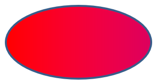

## **Introduction**

Dans PowerPoint, vous pouvez ajouter des formes aux diapositives. Puisque les formes sont composées de lignes, vous pouvez les mettre en forme en modifiant ou en appliquant des effets à leurs contours. De plus, vous pouvez mettre en forme les formes en spécifiant des paramètres qui contrôlent la façon dont leurs intérieurs sont remplis.


Aspose.Slides for Python via Java fournit des classes et des méthodes qui vous permettent de mettre en forme des formes en utilisant les mêmes options disponibles dans PowerPoint.

## **Format des lignes**

En utilisant Aspose.Slides, vous pouvez spécifier un style de ligne personnalisé pour une forme. Les étapes suivantes décrivent la procédure :

1. Créer une instance de la classe [Presentation](https://reference.aspose.com/slides/python-java/aspose.slides/presentation/).
1. Obtenir une référence à une diapositive par son index.
1. Ajouter une [AutoShape](https://reference.aspose.com/slides/python-java/aspose.slides/autoshape/) à la diapositive.
1. Définir le [style de ligne](https://reference.aspose.com/slides/python-java/aspose.slides/linestyle/) de la forme.
1. Définir la largeur de la ligne.
1. Définir le [style de tiret](https://reference.aspose.com/slides/python-java/aspose.slides/linedashstyle/) de la ligne.
1. Définir la couleur de la ligne pour la forme.
1. Enregistrer la présentation modifiée en tant que fichier PPTX.

Le code suivant montre comment mettre en forme un rectangle [AutoShape](https://reference.aspose.com/slides/python-java/aspose.slides/autoshape/) :

```python
import jpype
import asposeslides

if not jpype.isJVMStarted():
    jpype.startJVM()

from asposeslides.api import FillType, LineDashStyle, LineStyle, Presentation, SaveFormat, ShapeType
from java.awt import Color

# Instancier la classe Presentation qui représente un fichier de présentation.
presentation = Presentation()
try:
    # Obtenir la première diapositive.
    slide = presentation.getSlides().get_Item(0)

    # Ajouter une forme automatique de type Rectangle.
    shape = slide.getShapes().addAutoShape(ShapeType.Rectangle, 50, 150, 150, 75)

    # Définir la couleur de remplissage pour la forme rectangle.
    shape.getFillFormat().setFillType(FillType.NoFill)

    # Appliquer le formatage aux lignes du rectangle.
    shape.getLineFormat().setStyle(LineStyle.ThickThin)
    shape.getLineFormat().setWidth(7)
    shape.getLineFormat().setDashStyle(LineDashStyle.Dash)

    # Définir la couleur de la ligne du rectangle.
    shape.getLineFormat().getFillFormat().setFillType(FillType.Solid)
    shape.getLineFormat().getFillFormat().getSolidFillColor().setColor(Color.BLUE)

    # Enregistrer le fichier PPTX sur le disque.
    presentation.save("formatted_lines.pptx", SaveFormat.Pptx)
finally:
    presentation.dispose()
```


## **Appliquer des effets de croquis aux lignes de forme**

Un effet de croquis donne à la ligne d’une forme un aspect dessiné à la main. Utilisez [Shape.getLineFormat](https://reference.aspose.com/slides/python-java/aspose.slides/shape/#getLineFormat) pour accéder aux paramètres de la ligne, [LineFormat.getSketchFormat](https://reference.aspose.com/slides/python-java/aspose.slides/lineformat/#getSketchFormat) pour accéder aux paramètres du croquis, et [SketchFormat.setSketchType](https://reference.aspose.com/slides/python-java/aspose.slides/sketchformat/#setSketchType) pour sélectionner une valeur dans l’énumération [LineSketchType](https://reference.aspose.com/slides/python-java/aspose.slides/linesketchtype/).

Le code Python suivant montre comment appliquer un effet [LineSketchType.Curved](https://reference.aspose.com/slides/python-java/aspose.slides/linesketchtype/#Curved), lire la valeur assignée explicitement, et supprimer l’effet avec [LineSketchType.None_](https://reference.aspose.com/slides/python-java/aspose.slides/linesketchtype/#None) :

```python
import jpype
import asposeslides

if not jpype.isJVMStarted():
    jpype.startJVM()

from asposeslides.api import LineSketchType, Presentation, ShapeType

presentation = Presentation()
try:
    slide = presentation.getSlides().get_Item(0)
    shape = slide.getShapes().addAutoShape(ShapeType.Rectangle, 50, 50, 200, 100)

    # Accéder au format de ligne de la forme et à son format de croquis.
    sketch_format = shape.getLineFormat().getSketchFormat()

    # Appliquer un effet de croquis.
    sketch_format.setSketchType(LineSketchType.Curved)

    # Lire l'effet de croquis assigné directement à la forme.
    explicit_sketch_type = sketch_format.getSketchType()
    print(f"Explicit sketch type: {explicit_sketch_type}")

    # Supprimer l'effet de croquis.
    sketch_format.setSketchType(LineSketchType.None_)
finally:
    presentation.dispose()
```

La valeur retournée par [SketchFormat.getSketchType](https://reference.aspose.com/slides/python-java/aspose.slides/sketchformat/#getSketchType) représente le paramètre assigné directement à la forme. Si le formatage de la ligne peut être hérité d’un thème, d’une diapositive maître ou d’une diapositive de mise en page, utilisez [LineFormat.getEffective](https://reference.aspose.com/slides/python-java/aspose.slides/lineformat/#getEffective), accédez à `LineFormatEffectiveData.getSketchFormat`, et lisez `SketchFormatEffectiveData.getSketchType`. La valeur effective reflète le formatage réellement appliqué après la résolution de l’héritage :

```python
import jpype
import asposeslides

if not jpype.isJVMStarted():
    jpype.startJVM()

from asposeslides.api import Presentation

presentation = Presentation("presentation.pptx")
try:
    shape = presentation.getSlides().get_Item(0).getShapes().get_Item(0)
    line_format = shape.getLineFormat()

    explicit_sketch_type = line_format.getSketchFormat().getSketchType()
    effective_line_format = line_format.getEffective()
    effective_sketch_type = effective_line_format.getSketchFormat().getSketchType()

    print(f"Explicit sketch type: {explicit_sketch_type}")
    print(f"Effective sketch type: {effective_sketch_type}")
finally:
    presentation.dispose()
```

## **Format des styles de jointure**

Voici les trois options de type de jointure :

* Arrondi
* Onglet
* Biseau

Par défaut, lorsque PowerPoint joint deux lignes à un angle (par exemple au coin d’une forme), il utilise le paramètre **Arrondi**. Cependant, si vous dessinez une forme avec des angles aigus, vous pouvez préférer l’option **Onglet**.


Le code Python suivant montre comment trois rectangles (comme indiqué sur l’image ci‑dessus) ont été créés en utilisant les paramètres de type de jointure Onglet, Biseau et Arrondi :

```python
import jpype
import asposeslides

if not jpype.isJVMStarted():
    jpype.startJVM()

from asposeslides.api import FillType, LineJoinStyle, Presentation, SaveFormat, ShapeType
from java.awt import Color

# Instancier la classe Presentation qui représente un fichier de présentation.
presentation = Presentation()
try:
    # Obtenir la première diapositive.
    slide = presentation.getSlides().get_Item(0)

    # Ajouter trois formes automatiques de type Rectangle.
    miter_shape = slide.getShapes().addAutoShape(ShapeType.Rectangle, 20, 20, 150, 75)
    bevel_shape = slide.getShapes().addAutoShape(ShapeType.Rectangle, 210, 20, 150, 75)
    round_shape = slide.getShapes().addAutoShape(ShapeType.Rectangle, 20, 135, 150, 75)

    # Définir la couleur de remplissage pour chaque forme rectangle.
    miter_shape.getFillFormat().setFillType(FillType.Solid)
    miter_shape.getFillFormat().getSolidFillColor().setColor(Color.BLACK)
    bevel_shape.getFillFormat().setFillType(FillType.Solid)
    bevel_shape.getFillFormat().getSolidFillColor().setColor(Color.BLACK)
    round_shape.getFillFormat().setFillType(FillType.Solid)
    round_shape.getFillFormat().getSolidFillColor().setColor(Color.BLACK)

    # Définir la largeur de la ligne.
    miter_shape.getLineFormat().setWidth(15)
    bevel_shape.getLineFormat().setWidth(15)
    round_shape.getLineFormat().setWidth(15)

    # Définir la couleur de la ligne de chaque rectangle.
    miter_shape.getLineFormat().getFillFormat().setFillType(FillType.Solid)
    miter_shape.getLineFormat().getFillFormat().getSolidFillColor().setColor(Color.BLUE)
    bevel_shape.getLineFormat().getFillFormat().setFillType(FillType.Solid)
    bevel_shape.getLineFormat().getFillFormat().getSolidFillColor().setColor(Color.BLUE)
    round_shape.getLineFormat().getFillFormat().setFillType(FillType.Solid)
    round_shape.getLineFormat().getFillFormat().getSolidFillColor().setColor(Color.BLUE)

    # Définir le style de jointure.
    miter_shape.getLineFormat().setJoinStyle(LineJoinStyle.Miter)
    bevel_shape.getLineFormat().setJoinStyle(LineJoinStyle.Bevel)
    round_shape.getLineFormat().setJoinStyle(LineJoinStyle.Round)

    # Ajouter du texte à chaque rectangle.
    miter_shape.getTextFrame().setText("Miter Join Style")
    bevel_shape.getTextFrame().setText("Bevel Join Style")
    round_shape.getTextFrame().setText("Round Join Style")

    # Enregistrer le fichier PPTX sur le disque.
    presentation.save("join_styles.pptx", SaveFormat.Pptx)
finally:
    presentation.dispose()
```

## **Remplissage en dégradé**

Dans PowerPoint, le remplissage en dégradé est une option de mise en forme qui vous permet d’appliquer un mélange continu de couleurs à une forme. Par exemple, vous pouvez appliquer deux couleurs ou plus de manière à ce que l’une s’estompe progressivement dans l’autre.

Voici comment appliquer un remplissage en dégradé à une forme à l’aide d’Aspose.Slides :

1. Créer une instance de la classe [Presentation](https://reference.aspose.com/slides/python-java/aspose.slides/presentation/).
1. Obtenir une référence à une diapositive par son index.
1. Ajouter une [AutoShape](https://reference.aspose.com/slides/python-java/aspose.slides/autoshape/) à la diapositive.
1. Définir le [FillType](https://reference.aspose.com/slides/python-java/aspose.slides/filltype/) de la forme sur `Gradient`.
1. Ajouter vos deux couleurs préférées avec des positions définies en utilisant la méthode [addPresetColor](https://reference.aspose.com/slides/python-java/aspose.slides/gradientstopcollection/#addPresetColor) de la collection d’arrêts de dégradé exposée par la classe [GradientFormat](https://reference.aspose.com/slides/python-java/aspose.slides/gradientformat/).
1. Enregistrer la présentation modifiée en tant que fichier PPTX.

Le code Python suivant montre comment appliquer un effet de remplissage en dégradé à une ellipse :

```python
import jpype
import asposeslides

if not jpype.isJVMStarted():
    jpype.startJVM()

from asposeslides.api import FillType, GradientDirection, GradientShape, Presentation, PresetColor, SaveFormat, ShapeType
from java.awt import Color

# Instancier la classe Presentation qui représente un fichier de présentation.
presentation = Presentation()
try:
    # Obtenir la première diapositive.
    slide = presentation.getSlides().get_Item(0)

    # Ajouter une forme automatique de type Ellipse.
    shape = slide.getShapes().addAutoShape(ShapeType.Ellipse, 50, 50, 150, 75)

    # Appliquer le formatage de dégradé à l'ellipse.
    shape.getFillFormat().setFillType(FillType.Gradient)
    shape.getFillFormat().getGradientFormat().setGradientShape(GradientShape.Linear)

    # Définir la direction du dégradé.
    shape.getFillFormat().getGradientFormat().setGradientDirection(GradientDirection.FromCorner2)

    # Ajouter deux arrêts de dégradé.
    shape.getFillFormat().getGradientFormat().getGradientStops().addPresetColor(1.0, PresetColor.Purple)
    shape.getFillFormat().getGradientFormat().getGradientStops().addPresetColor(0.0, PresetColor.Red)

    # Enregistrer le fichier PPTX sur le disque.
    presentation.save("gradient_fill.pptx", SaveFormat.Pptx)
finally:
    presentation.dispose()
```



Si un dégradé apparaît différemment dans une image exportée que dans PowerPoint, consultez [Choose a Gradient Rendering Style](/slides/fr/python-java/convert-powerpoint-to-png/#choose-a-gradient-rendering-style). Vous pouvez sélectionner un style de rendu sans modifier le remplissage en dégradé stocké dans la présentation.

## **Remplissage par motif**

Dans PowerPoint, le remplissage par motif est une option de mise en forme qui vous permet d’appliquer un motif à deux couleurs—comme des points, des rayures, des hachures croisées ou des damiers—à une forme. Vous pouvez choisir des couleurs personnalisées pour le premier plan et l’arrière‑plan du motif.

Aspose.Slides fournit plus de 45 styles de motif prédéfinis que vous pouvez appliquer aux formes pour améliorer l’attrait visuel de vos présentations. Même après avoir sélectionné un motif prédéfini, vous pouvez toujours spécifier les couleurs exactes à utiliser.

Voici comment appliquer un remplissage par motif à une forme à l’aide d’Aspose.Slides :

1. Créer une instance de la classe [Presentation](https://reference.aspose.com/slides/python-java/aspose.slides/presentation/).
1. Obtenir une référence à une diapositive par son index.
1. Ajouter une [AutoShape](https://reference.aspose.com/slides/python-java/aspose.slides/autoshape/) à la diapositive.
1. Définir le [FillType](https://reference.aspose.com/slides/python-java/aspose.slides/filltype/) de la forme sur `Pattern`.
1. Choisir un style de motif parmi les options prédéfinies.
1. Définir la [Background Color](https://reference.aspose.com/slides/python-java/aspose.slides/patternformat/#getBackColor) du motif.
1. Définir la [Foreground Color](https://reference.aspose.com/slides/python-java/aspose.slides/patternformat/#getForeColor) du motif.
1. Enregistrer la présentation modifiée en tant que fichier PPTX.

```python
import jpype
import asposeslides

if not jpype.isJVMStarted():
    jpype.startJVM()

from asposeslides.api import FillType, PatternStyle, Presentation, SaveFormat, ShapeType
from java.awt import Color

# Instancier la classe Presentation qui représente un fichier de présentation.
presentation = Presentation()
try:
    # Obtenir la première diapositive.
    slide = presentation.getSlides().get_Item(0)

    # Ajouter une forme automatique de type Rectangle.
    shape = slide.getShapes().addAutoShape(ShapeType.Rectangle, 50, 50, 150, 75)

    # Définir le type de remplissage sur Pattern.
    shape.getFillFormat().setFillType(FillType.Pattern)

    # Définir le style de motif.
    shape.getFillFormat().getPatternFormat().setPatternStyle(PatternStyle.Trellis)

    # Définir les couleurs d'arrière‑plan et de premier plan du motif.
    shape.getFillFormat().getPatternFormat().getBackColor().setColor(Color.LIGHT_GRAY)
    shape.getFillFormat().getPatternFormat().getForeColor().setColor(Color.YELLOW)

    # Enregistrer le fichier PPTX sur le disque.
    presentation.save("pattern_fill.pptx", SaveFormat.Pptx)
finally:
    presentation.dispose()
```


## **Remplissage image**

Dans PowerPoint, le remplissage image est une option de mise en forme qui vous permet d’insérer une image à l’intérieur d’une forme—utilisant effectivement l’image comme arrière‑plan de la forme.

Voici comment utiliser Aspose.Slides pour appliquer un remplissage image à une forme :

1. Créer une instance de la classe [Presentation](https://reference.aspose.com/slides/python-java/aspose.slides/presentation/).
1. Obtenir une référence à une diapositive par son index.
1. Ajouter une [AutoShape](https://reference.aspose.com/slides/python-java/aspose.slides/autoshape/) à la diapositive.
1. Définir le [FillType](https://reference.aspose.com/slides/python-java/aspose.slides/filltype/) de la forme sur `Picture`.
1. Définir le mode de remplissage image sur `Tile` (ou un autre mode préféré).
1. Créer un objet [PPImage](https://reference.aspose.com/slides/python-java/aspose.slides/ppimage/) à partir de l’image que vous souhaitez utiliser.
1. Passer l’image à la méthode `SlidesPicture.setImage`.
1. Enregistrer la présentation modifiée en tant que fichier PPTX.

Supposons que nous ayons un fichier "lotus.png" avec l’image suivante :


```python
import jpype
import asposeslides

if not jpype.isJVMStarted():
    jpype.startJVM()

from asposeslides.api import FillType, Images, PictureFillMode, Presentation, SaveFormat, ShapeType

# Instancier la classe Presentation qui représente un fichier de présentation.
presentation = Presentation()
try:
    # Obtenir la première diapositive.
    slide = presentation.getSlides().get_Item(0)

    # Ajouter une forme automatique de type Rectangle.
    shape = slide.getShapes().addAutoShape(ShapeType.Rectangle, 50, 50, 255, 130)
    
    # Définir le type de remplissage sur Picture.
    shape.getFillFormat().setFillType(FillType.Picture)

    # Définir le mode de remplissage image.
    shape.getFillFormat().getPictureFillFormat().setPictureFillMode(PictureFillMode.Tile)

    # Charger une image et l'ajouter aux ressources de la présentation.
    image = Images.fromFile("lotus.png")
    picture = presentation.getImages().addImage(image)
    image.dispose()

    # Définir l'image.
    shape.getFillFormat().getPictureFillFormat().getPicture().setImage(picture)

    # Enregistrer le fichier PPTX sur le disque.
    presentation.save("picture_fill.pptx", SaveFormat.Pptx)
finally:
    presentation.dispose()
```


### **Image en tuiles comme texture**

Si vous souhaitez définir une image en tuiles comme texture et personnaliser le comportement du carrelage, vous pouvez utiliser les méthodes suivantes de la classe [PictureFillFormat](https://reference.aspose.com/slides/python-java/aspose.slides/picturefillformat/) :

- [setPictureFillMode](https://reference.aspose.com/slides/python-java/aspose.slides/picturefillformat/#setPictureFillMode) : Définit le mode de remplissage image—soit `Tile`, soit `Stretch`.
- [setTileAlignment](https://reference.aspose.com/slides/python-java/aspose.slides/picturefillformat/#setTileAlignment) : Spécifie l’alignement des tuiles à l’intérieur de la forme.
- [setTileFlip](https://reference.aspose.com/slides/python-java/aspose.slides/picturefillformat/#setTileFlip) : Contrôle si la tuile est retournée horizontalement, verticalement, ou les deux.
- [setTileOffsetX](https://reference.aspose.com/slides/python-java/aspose.slides/picturefillformat/#setTileOffsetX) : Définit le décalage horizontal de la tuile (en points) par rapport à l’origine de la forme.
- [setTileOffsetY](https://reference.aspose.com/slides/python-java/aspose.slides/picturefillformat/#setTileOffsetY) : Définit le décalage vertical de la tuile (en points) par rapport à l’origine de la forme.
- [setTileScaleX](https://reference.aspose.com/slides/python-java/aspose.slides/picturefillformat/#setTileScaleX) : Définit l’échelle horizontale de la tuile en pourcentage.
- [setTileScaleY](https://reference.aspose.com/slides/python-java/aspose.slides/picturefillformat/#setTileScaleY) : Définit l’échelle verticale de la tuile en pourcentage.

Le morceau de code suivant montre comment ajouter une forme rectangle avec un remplissage image en tuiles et configurer les options de tuile :

```python
import jpype
import asposeslides

if not jpype.isJVMStarted():
    jpype.startJVM()

from asposeslides.api import FillType, Images, PictureFillMode, Presentation, RectangleAlignment, SaveFormat, ShapeType, TileFlip

# Instancier la classe Presentation qui représente un fichier de présentation.
presentation = Presentation()
try:
    # Obtenir la première diapositive.
    first_slide = presentation.getSlides().get_Item(0)

    # Ajouter une forme automatique rectangle.
    shape = first_slide.getShapes().addAutoShape(ShapeType.Rectangle, 50, 50, 190, 95)

    # Définir le type de remplissage de la forme sur Picture.
    shape.getFillFormat().setFillType(FillType.Picture)

    # Charger l'image et l'ajouter aux ressources de la présentation.
    source_image = Images.fromFile("lotus.png")
    presentation_image = presentation.getImages().addImage(source_image)
    source_image.dispose()

    # Assigner l'image à la forme.
    picture_fill_format = shape.getFillFormat().getPictureFillFormat()
    picture_fill_format.getPicture().setImage(presentation_image)

    # Configurer le mode de remplissage image et les propriétés de carrelage.
    picture_fill_format.setPictureFillMode(PictureFillMode.Tile)
    picture_fill_format.setTileOffsetX(-32)
    picture_fill_format.setTileOffsetY(-32)
    picture_fill_format.setTileScaleX(50)
    picture_fill_format.setTileScaleY(50)
    picture_fill_format.setTileAlignment(RectangleAlignment.BottomRight)
    picture_fill_format.setTileFlip(TileFlip.FlipBoth)

    # Enregistrer le fichier PPTX sur le disque.
    presentation.save("tile.pptx", SaveFormat.Pptx)
finally:
    presentation.dispose()
```


## **Remplissage couleur unie**

Dans PowerPoint, le remplissage couleur unie est une option de mise en forme qui remplit une forme avec une seule couleur uniforme. Cette couleur d’arrière‑plan simple est appliquée sans aucun dégradé, texture ou motif.

Pour appliquer un remplissage couleur unite à une forme à l’aide d’Aspose.Slides, suivez ces étapes :

1. Créer une instance de la classe [Presentation](https://reference.aspose.com/slides/python-java/aspose.slides/presentation/).
1. Obtenir une référence à une diapositive par son index.
1. Ajouter une [AutoShape](https://reference.aspose.com/slides/python-java/aspose.slides/autoshape/) à la diapositive.
1. Définir le [FillType](https://reference.aspose.com/slides/python-java/aspose.slides/filltype/) de la forme sur `Solid`.
1. Attribuer votre couleur de remplissage préférée à la forme.
1. Enregistrer la présentation modifiée en tant que fichier PPTX.

```python
import jpype
import asposeslides

if not jpype.isJVMStarted():
    jpype.startJVM()

from asposeslides.api import FillType, Presentation, SaveFormat, ShapeType
from java.awt import Color

# Instancier la classe Presentation qui représente un fichier de présentation.
presentation = Presentation()
try:
    # Obtenir la première diapositive.
    slide = presentation.getSlides().get_Item(0)

    # Ajouter une forme automatique de type Rectangle.
    shape = slide.getShapes().addAutoShape(ShapeType.Rectangle, 50, 50, 150, 75)

    # Définir le type de remplissage sur Solid.
    shape.getFillFormat().setFillType(FillType.Solid)

    # Définir la couleur de remplissage.
    shape.getFillFormat().getSolidFillColor().setColor(Color.YELLOW)

    # Enregistrer le fichier PPTX sur le disque.
    presentation.save("solid_color_fill.pptx", SaveFormat.Pptx)
finally:
    presentation.dispose()
```


## **Définir la transparence**

Dans PowerPoint, lorsque vous appliquez un remplissage couleur unie, dégradé, image ou texture à des formes, vous pouvez également définir un niveau de transparence pour contrôler l’opacité du remplissage. Une valeur de transparence plus élevée rend la forme plus translucide, permettant au fond ou aux objets sous‑jacent d’être partiellement visibles.

Aspose.Slides vous permet de définir le niveau de transparence en ajustant la valeur alpha de la couleur utilisée pour le remplissage. Voici comment procéder :

1. Créer une instance de la classe [Presentation](https://reference.aspose.com/slides/python-java/aspose.slides/presentation/).
1. Obtenir une référence à une diapositive par son index.
1. Ajouter une [AutoShape](https://reference.aspose.com/slides/python-java/aspose.slides/autoshape/) à la diapositive.
1. Définir le [FillType](https://reference.aspose.com/slides/python-java/aspose.slides/filltype/) sur `Solid`.
1. Utiliser [Color](https://docs.oracle.com/en/java/javase/17/docs/api/java.desktop/java/awt/Color.html) pour définir une couleur avec transparence (le composant `alpha` contrôle la transparence).
1. Enregistrer la présentation.

```python
import jpype
import asposeslides

if not jpype.isJVMStarted():
    jpype.startJVM()

from asposeslides.api import FillType, Presentation, SaveFormat, ShapeType
from java.awt import Color

# Instancier la classe Presentation qui représente un fichier de présentation.
presentation = Presentation()
try:
    # Obtenir la première diapositive.
    slide = presentation.getSlides().get_Item(0)

    # Ajouter une forme automatique rectangle solide.
    solid_shape = slide.getShapes().addAutoShape(ShapeType.Rectangle, 50, 50, 150, 75)

    # Ajouter une forme automatique rectangle transparente au-dessus de la forme solide.
    transparent_shape = slide.getShapes().addAutoShape(ShapeType.Rectangle, 80, 80, 150, 75)
    transparent_shape.getFillFormat().setFillType(FillType.Solid)
    transparent_color = Color(255, 255, 0, 204)
    transparent_shape.getFillFormat().getSolidFillColor().setColor(transparent_color)

    # Enregistrer le fichier PPTX sur le disque.
    presentation.save("shape_transparency.pptx", SaveFormat.Pptx)
finally:
    presentation.dispose()
```


## **Faire pivoter les formes**

Aspose.Slides vous permet de faire pivoter des formes dans les présentations PowerPoint. Cela peut être utile lors du positionnement d’éléments visuels avec des exigences d’alignement ou de conception spécifiques.

1. Créer une instance de la classe [Presentation](https://reference.aspose.com/slides/python-java/aspose.slides/presentation/).
1. Obtenir une référence à une diapositive par son index.
1. Ajouter une [AutoShape](https://reference.aspose.com/slides/python-java/aspose.slides/autoshape/) à la diapositive.
1. Définir la propriété de rotation de la forme à l’angle souhaité.
1. Enregistrer la présentation.

```python
import jpype
import asposeslides

if not jpype.isJVMStarted():
    jpype.startJVM()

from asposeslides.api import Presentation, SaveFormat, ShapeType

# Instancier la classe Presentation qui représente un fichier de présentation.
presentation = Presentation()
try:
    # Obtenir la première diapositive.
    slide = presentation.getSlides().get_Item(0)

    # Ajouter une forme automatique de type Rectangle.
    shape = slide.getShapes().addAutoShape(ShapeType.Rectangle, 50, 50, 150, 75)

    # Faire pivoter la forme de 5 degrés.
    shape.setRotation(5)

    # Enregistrer le fichier PPTX sur le disque.
    presentation.save("shape_rotation.pptx", SaveFormat.Pptx)
finally:
    presentation.dispose()
```


## **Ajouter des effets de biseau 3D**

Aspose.Slides vous permet d’appliquer des effets de biseau 3D aux formes en configurant leurs propriétés [ThreeDFormat](https://reference.aspose.com/slides/python-java/aspose.slides/threedformat/).

1. Instancier la classe [Presentation](https://reference.aspose.com/slides/python-java/aspose.slides/presentation/).
1. Obtenir une référence à une diapositive par son index.
1. Ajouter une [AutoShape](https://reference.aspose.com/slides/python-java/aspose.slides/autoshape/) à la diapositive.
1. Configurer le [ThreeDFormat](https://reference.aspose.com/slides/python-java/aspose.slides/threedformat/) de la forme pour définir les paramètres du biseau.
1. Enregistrer la présentation.

```python
import jpype
import asposeslides

if not jpype.isJVMStarted():
    jpype.startJVM()

from asposeslides.api import BevelPresetType, CameraPresetType, FillType, LightRigPresetType, LightingDirection, Presentation, SaveFormat, ShapeType
from java.awt import Color

# Créer une instance de la classe Presentation.
presentation = Presentation()
try:
    slide = presentation.getSlides().get_Item(0)

    # Ajouter une forme à la diapositive.
    shape = slide.getShapes().addAutoShape(ShapeType.Ellipse, 50, 50, 100, 100)
    shape.getFillFormat().setFillType(FillType.Solid)
    shape.getFillFormat().getSolidFillColor().setColor(Color.GREEN)
    shape.getLineFormat().getFillFormat().setFillType(FillType.Solid)
    shape.getLineFormat().getFillFormat().getSolidFillColor().setColor(Color.ORANGE)
    shape.getLineFormat().setWidth(2.0)

    # Définir les propriétés ThreeDFormat de la forme.
    shape.getThreeDFormat().setDepth(4)
    shape.getThreeDFormat().getBevelTop().setBevelType(BevelPresetType.Circle)
    shape.getThreeDFormat().getBevelTop().setHeight(6)
    shape.getThreeDFormat().getBevelTop().setWidth(6)
    shape.getThreeDFormat().getCamera().setCameraType(CameraPresetType.OrthographicFront)
    shape.getThreeDFormat().getLightRig().setLightType(LightRigPresetType.ThreePt)
    shape.getThreeDFormat().getLightRig().setDirection(LightingDirection.Top)

    # Enregistrer la présentation au format PPTX.
    presentation.save("3D_bevel_effect.pptx", SaveFormat.Pptx)
finally:
    presentation.dispose()
```


## **Ajouter des effets de rotation 3D**

Aspose.Slides vous permet d’appliquer des effets de rotation 3D aux formes en configurant leurs propriétés [ThreeDFormat](https://reference.aspose.com/slides/python-java/aspose.slides/threedformat/).

1. Créer une instance de la classe [Presentation](https://reference.aspose.com/slides/python-java/aspose.slides/presentation/).
1. Obtenir une référence à une diapositive par son index.
1. Ajouter une [AutoShape](https://reference.aspose.com/slides/python-java/aspose.slides/autoshape/) à la diapositive.
1. Utiliser les méthodes [setCameraType](https://reference.aspose.com/slides/python-java/aspose.slides/camera/#setCameraType) et [setLightType](https://reference.aspose.com/slides/python-java/aspose.slides/lightrig/#setLightType) pour définir la rotation 3D.
1. Enregistrer la présentation.

```python
import jpype
import asposeslides

if not jpype.isJVMStarted():
    jpype.startJVM()

from asposeslides.api import CameraPresetType, LightRigPresetType, Presentation, SaveFormat, ShapeType

# Créer une instance de la classe Presentation.
presentation = Presentation()
try:
    slide = presentation.getSlides().get_Item(0)

    auto_shape = slide.getShapes().addAutoShape(ShapeType.Rectangle, 50, 50, 150, 75)
    auto_shape.getTextFrame().setText("Hello, Aspose!")

    auto_shape.getThreeDFormat().setDepth(6)
    auto_shape.getThreeDFormat().getCamera().setRotation(40, 35, 20)
    auto_shape.getThreeDFormat().getCamera().setCameraType(CameraPresetType.IsometricLeftUp)
    auto_shape.getThreeDFormat().getLightRig().setLightType(LightRigPresetType.Balanced)

    # Enregistrer la présentation au format PPTX.
    presentation.save("3D_rotation_effect.pptx", SaveFormat.Pptx)
finally:
    presentation.dispose()
```


## **Contrôler le rendu noir et blanc pour les formes**

La méthode [Shape.setBlackWhiteMode](https://reference.aspose.com/slides/python-java/aspose.slides/shape/#setBlackWhiteMode) spécifie comment une forme individuelle est rendue lorsqu’une présentation est visualisée ou traitée en mode noir et blanc. Elle n’active pas l’affichage noir et blanc par elle‑même, et ne modifie pas le remplissage, la ligne ou tout autre formatage de la forme en mode couleur normal.

Utilisez une valeur de la classe [BlackWhiteMode](https://reference.aspose.com/slides/python-java/aspose.slides/blackwhitemode/) pour sélectionner le comportement souhaité. Par exemple, `Automatic` laisse l’application de rendu choisir la conversion, `Gray` et `LightGray` utilisent une coloration grise, `BlackWhite` n’utilise que le noir et le blanc, `Black` et `White` imposent une couleur unique, `Color` préserve la coloration normale, et `Hidden` masque la forme en mode noir et blanc. `NotDefined` signifie qu’aucun mode au niveau de la forme n’est attribué.

Le code Python suivant crée une forme colorée et la fait apparaître en gris en mode d’affichage noir et blanc :

```python
import jpype
import asposeslides

if not jpype.isJVMStarted():
    jpype.startJVM()

from asposeslides.api import BlackWhiteMode, FillType, Presentation, SaveFormat, ShapeType
from java.awt import Color

presentation = Presentation()
try:
    slide = presentation.getSlides().get_Item(0)

    shape = slide.getShapes().addAutoShape(ShapeType.Rectangle, 50, 50, 200, 100)
    shape.getFillFormat().setFillType(FillType.Solid)
    shape.getFillFormat().getSolidFillColor().setColor(Color.ORANGE)

    # Conserver le remplissage orange en mode couleur, mais rendre la forme avec une coloration grise en mode noir et blanc.
    shape.setBlackWhiteMode(BlackWhiteMode.Gray)

    presentation.save("shape_black_white_mode.pptx", SaveFormat.Pptx)
finally:
    presentation.dispose()
```

En mode couleur normal, le rectangle conserve son remplissage orange. Dans un flux de travail d’affichage noir et blanc, il utilise une coloration grise parce que son mode est réglé sur `Gray`. Cela vous permet de conserver une diapositive en couleur complète tout en définissant une apparence distincte pour l’impression, la prévisualisation ou d’autres flux de travail qui respectent les paramètres d’affichage noir et blanc de la présentation.

## **Réinitialiser le formatage**

Le code Python suivant montre comment réinitialiser le formatage d’une diapositive et rétablir la position, la taille et le formatage de toutes les formes avec des espaces réservés sur le [LayoutSlide](https://reference.aspose.com/slides/python-java/aspose.slides/layoutslide/) à leurs paramètres par défaut :

```python
import jpype
import asposeslides

if not jpype.isJVMStarted():
    jpype.startJVM()

from asposeslides.api import Presentation, SaveFormat

presentation = Presentation("sample.pptx")
try:
    for slide in presentation.getSlides():
        # Réinitialiser chaque forme de la diapositive qui a un espace réservé sur la mise en page.
        slide.reset()

    presentation.save("reset_formatting.pptx", SaveFormat.Pptx)
finally:
    presentation.dispose()
```

## **FAQ**

**Le formatage des formes affecte‑t‑il la taille finale du fichier de présentation ?**

Seulement très peu. Les images et médias incorporés occupent la majeure partie de l’espace du fichier, tandis que les paramètres de forme tels que les couleurs, les effets et les dégradés sont stockés comme métadonnées et n’ajoutent pratiquement aucune taille supplémentaire.

**Comment détecter les formes sur une diapositive qui partagent le même formatage afin de les regrouper ?**

Comparez les principales propriétés de formatage de chaque forme — remplissage, ligne et paramètres d’effet. Si toutes les valeurs correspondantes sont identiques, considérez leurs styles comme identiques et regroupez logiquement ces formes, ce qui simplifie la gestion ultérieure des styles.

**Puis‑je enregistrer un ensemble de styles de forme personnalisés dans un fichier séparé pour les réutiliser dans d’autres présentations ?**

Oui. Stockez des formes d’exemple avec les styles souhaités dans un diaporama modèle ou un fichier de modèle .POTX. Lors de la création d’une nouvelle présentation, ouvrez le modèle, clonez les formes stylisées dont vous avez besoin, et réappliquez leur formatage où cela est requis.