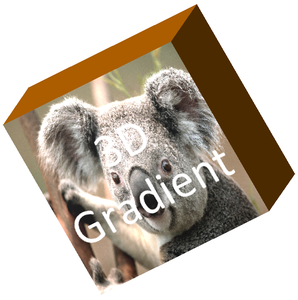

## **Overview**

Aspose.Slides for Android via Java शैप्स और टेक्स्ट के लिए PowerPoint‑स्टाइल 3D फॉर्मेटिंग बना, संशोधित, संरक्षित और रेंडर कर सकता है। इस लेख में घुमाव, एक्सट्रूज़न, बीवेल, लाइटिंग, मैटेरियल, ग्रेडिएंट या चित्र फ़िल, और 3D टेक्स्ट जैसी 3D प्रभावों को कवर किया गया है।

{}
यह लेख PowerPoint शैप्स और टेक्स्ट पर 3D फॉर्मेटिंग प्रभावों के बारे में है। यह अलग‑थलग 3D मॉडल फ़ाइलों के सम्मिलन या संपादन के बारे में नहीं है। जब आप स्लाइड को इमेज, PDF, या HTML में निर्यात करते हैं, तो Aspose.Slides उन 3D प्रभावों को निर्यातित 2D आउटपुट में रेंडर करता है।
{}

## **3D Formatting Concepts**

शैप पर 3D फॉर्मेटिंग लागू करने के लिए [IShape.getThreeDFormat](https://reference.aspose.com/slides/androidjava/com.aspose.slides/ishape/#getThreeDFormat--) मेथड का उपयोग करें। यह मेथड [IThreeDFormat](https://reference.aspose.com/slides/androidjava/com.aspose.slides/ithreedformat/) लौटाता है, जो उस शैप के लिए 3D सीन को नियंत्रित करता है।

टेक्स्ट के लिए, [ITextFrameFormat.getThreeDFormat](https://reference.aspose.com/slides/androidjava/com.aspose.slides/itextframeformat/#getThreeDFormat--) मेथड का उपयोग करें। यह टेक्स्ट फ्रेम पर 3D फॉर्मेटिंग लागू करता है, न कि शैप बॉडी पर।

सबसे महत्वपूर्ण API सदस्य हैं:

| API member | What it controls | When to use it |
|---|---|---|
| [getCamera](https://reference.aspose.com/slides/androidjava/com.aspose.slides/ithreedformat/#getCamera--) | दृश्य बिंदु, प्रीसेट कैमरा प्रकार, घुमाव, ज़ूम, और परिप्रेक्ष्य। | 3D स्पेस में ऑब्जेक्ट को घुमाने या PowerPoint के 3D घुमाव प्रीसेट से मिलाने के लिए। |
| [getLightRig](https://reference.aspose.com/slides/androidjava/com.aspose.slides/ithreedformat/#getLightRig--) | लाइट प्रीसेट, दिशा, और लाइट घुमाव। | 3D सतह पर हाइलाइट और शैडो की उपस्थिति बदलने के लिए। |
| [getMaterial](https://reference.aspose.com/slides/androidjava/com.aspose.slides/ithreedformat/#getMaterial--) और [setMaterial](https://reference.aspose.com/slides/androidjava/com.aspose.slides/ithreedformat/#setMaterial-int-) | सतह मैटेरियल, जैसे फ्लैट, मैट, प्लास्टिक, या मेटल। | समान ज्योमेट्री को सपाट, मुलायम, चमकदार, या धातु जैसा बनाने के लिए। |
| [getExtrusionHeight](https://reference.aspose.com/slides/androidjava/com.aspose.slides/ithreedformat/#getExtrusionHeight--) और [setExtrusionHeight](https://reference.aspose.com/slides/androidjava/com.aspose.slides/ithreedformat/#setExtrusionHeight-double-) | शैप अपने सामने वाले फेस से कितना पीछे तक विस्तारित होता है। | एक सपाट शैप को दिखने योग्य मोटी 3D वस्तु में बदलने के लिए। |
| [getExtrusionColor](https://reference.aspose.com/slides/androidjava/com.aspose.slides/ithreedformat/#getExtrusionColor--) | एक्सट्रुडेड पक्षों का रंग। | गहराई को दृश्यमान बनाने या साइड रंग को सामने के भरण के साथ समन्वयित करने के लिए। |
| [getDepth](https://reference.aspose.com/slides/androidjava/com.aspose.slides/ithreedformat/#getDepth--) और [setDepth](https://reference.aspose.com/slides/androidjava/com.aspose.slides/ithreedformat/#setDepth-double-) | PowerPoint 3D फॉर्मेटिंग द्वारा उपयोग किया गया अतिरिक्त 3D गहराई। | शैप या टेक्स्ट के लिए गहराई को बारीकी से ट्यून करने के लिए, विशेष रूप से बीवेल और मैटेरियल सेटिंग्स के साथ। |
| [getBevelTop](https://reference.aspose.com/slides/androidjava/com.aspose.slides/ithreedformat/#getBevelTop--) और [getBevelBottom](https://reference.aspose.com/slides/androidjava/com.aspose.slides/ithreedformat/#getBevelBottom--) | सामने और पीछे के चेहरों पर उभरे या गोल किनारे। | तेज़ सपाट फेस की बजाय मुलायम या आकारी किनारा जोड़ने के लिए। |
| [getContourColor](https://reference.aspose.com/slides/androidjava/com.aspose.slides/ithreedformat/#getContourColor--) और [getContourWidth](https://reference.aspose.com/slides/androidjava/com.aspose.slides/ithreedformat/#getContourWidth--) और [setContourWidth](https://reference.aspose.com/slides/androidjava/com.aspose.slides/ithreedformat/#setContourWidth-double-) | 3D ऑब्जेक्ट के चारों ओर रूपरेखा। | रेंडर किए गए आउटपुट में ऑब्जेक्ट की सीमा को उभारने के लिए। |

## **Create a 3D Shape**

एक शैप को विश्वसनीय 3D दिखाने से पहले आमतौर पर चार प्रकार की सेटिंग्स की जरूरत होती है:

- कैमरा सेटिंग्स, क्योंकि डिफ़ॉल्ट फ्रंट व्यू एक्सट्रूज़न को छिपा सकता है।
- लाइट सेटिंग्स, क्योंकि लाइटिंग चेहरे और साइड्स को पढ़ने योग्य बनाती है।
- मैटेरियल सेटिंग्स, क्योंकि सतह लाइट रेंडरिंग को प्रभावित करती है।
- एक्सट्रूज़न या डीप्थ सेटिंग्स, क्योंकि सपाट शैप को मोटाई चाहिए।

निम्न उदाहरण एक आयत बनाता है, उसके सामने वाले फेस में टेक्स्ट जोड़ता है, और 3D फॉर्मेटिंग लागू करता है। कैमरा घुमाव मान डिग्री में हैं, और एक्सट्रूज़न ऊँचाई 100 पॉइंट है। उदाहरण स्लाइड को PNG इमेज के रूप में दो गुना डिफ़ॉल्ट आकार में रेंडर करता है और प्रस्तुति को PPTX के रूप में सहेजता है।

```java
import com.aspose.slides.*;
import android.graphics.Color;

final float imageScale = 2;

Presentation presentation = new Presentation();
try {
    ISlide slide = presentation.getSlides().get_Item(0);

    IAutoShape shape = slide.getShapes().addAutoShape(ShapeType.Rectangle, 200, 150, 200, 200);

    shape.getTextFrame().setText("3D");
    shape.getTextFrame().getParagraphs().get_Item(0).getParagraphFormat().getDefaultPortionFormat().setFontHeight(64);

    shape.getFillFormat().setFillType(FillType.Solid);
    shape.getFillFormat().getSolidFillColor().setColor(Color.rgb(100, 149, 237));

    shape.getThreeDFormat().getCamera().setCameraType(CameraPresetType.OrthographicFront);
    shape.getThreeDFormat().getCamera().setRotation(20, 30, 40);
    shape.getThreeDFormat().getLightRig().setLightType(LightRigPresetType.Flat);
    shape.getThreeDFormat().getLightRig().setDirection(LightingDirection.Top);
    shape.getThreeDFormat().setMaterial(MaterialPresetType.Flat);
    shape.getThreeDFormat().setExtrusionHeight(100);
    shape.getThreeDFormat().getExtrusionColor().setColor(Color.BLUE);

    IImage thumbnail = slide.getImage(imageScale, imageScale);
    try {
        thumbnail.save("shape_3d.png", ImageFormat.Png);
    } finally {
        thumbnail.dispose();
    }

    presentation.save("shape_3d.pptx", SaveFormat.Pptx);
} finally {
    presentation.dispose();
}
```

रेंडर की गई स्लाइड इमेज आयत को एक मोटे 3D ब्लॉक के रूप में दिखाती है:


## **Rotate a Shape with the Camera**

PowerPoint में, 3D घुमाव को 3‑D Rotation पैन से कॉन्फ़िगर किया जाता है। X, Y, और Z घुमाव मान कैमरा API के माध्यम से सेट किए गए घुमाव से मेल खाते हैं।


Aspose.Slides में, कैमरा को [IThreeDFormat.getCamera](https://reference.aspose.com/slides/androidjava/com.aspose.slides/ithreedformat/#getCamera--) के माध्यम से एक्सेस करें। यह उदाहरण एक आयत बनाता है, ऑर्थोग्राफिक फ्रंट व्यू चुनता है, और उसके X, Y, Z घुमाव को क्रमशः 20, 30, और 40 डिग्री सेट करता है। यह शैप को मेमोरी में कॉन्फ़िगर करता है बिना फ़ाइल सहेजे:

```java
import com.aspose.slides.*;

Presentation presentation = new Presentation();
try {
    ISlide slide = presentation.getSlides().get_Item(0);

    IAutoShape shape = slide.getShapes().addAutoShape(ShapeType.Rectangle, 200, 150, 200, 200);

    shape.getThreeDFormat().getCamera().setCameraType(CameraPresetType.OrthographicFront);
    shape.getThreeDFormat().getCamera().setRotation(20, 30, 40);
} finally {
    presentation.dispose();
}
```

जब आपको दर्शक की ऑब्जेक्ट देखी जाने वाली दिशा बदलनी हो, तब कैमरा उपयोग करें। यह स्लाइड पर 2D शैप ज्योमेट्री को नहीं बदलता, बल्कि PowerPoint और Aspose.Slides द्वारा रेंडर किए गए 3D दृश्य बिंदु को बदलता है।

### **Copy Camera Orientation from a Template Shape**

टेम्प्लेट शैप की दिशा मिलाने के लिए, उसके कैमरा प्रीसेट को [getCameraType](https://reference.aspose.com/slides/androidjava/com.aspose.slides/icamera/#getCameraType--) से पढ़ें और घुमाव कोणों को [getRotation](https://reference.aspose.com/slides/androidjava/com.aspose.slides/icamera/#getRotation--) से पढ़ें। उदाहरण `template.pptx` खोलता है और प्रथम स्लाइड के पहले शैप से कैमरा ओरिएंटेशन को द्वितीय शैप पर कॉपी करता है। दोनों शैप में पहले से 3D लाइटिंग है, और द्वितीय शैप में कोई स्पष्ट कैमरा घुमाव नहीं है।

कोण डिग्री में हैं। इंडेक्स `0` लैटिट्यूड, `1` लॉन्गिट्यूड, `2` रिवॉल्यूशन दर्शाता है। उन्हें उसी क्रम में [setRotation](https://reference.aspose.com/slides/androidjava/com.aspose.slides/icamera/#setRotation-float-float-float-) को पास करें। यदि स्रोत `null` लौटाता है, तो इसका अर्थ है कोई स्पष्ट घुमाव नहीं, इसलिए द्वितीय शैप के कोण को अनसेट रखें। `(0, 0, 0)` का स्पष्ट घुमाव तीन शून्य लौटाता है और उसे कॉपी करना चाहिए।

```java
import com.aspose.slides.*;

Presentation presentation = new Presentation("template.pptx");
try {
    IShapeCollection shapes = presentation.getSlides().get_Item(0).getShapes();

    ICamera sourceCamera = shapes.get_Item(0).getThreeDFormat().getCamera();
    ICamera destinationCamera = shapes.get_Item(1).getThreeDFormat().getCamera();

    destinationCamera.setCameraType(sourceCamera.getCameraType());
    float[] angles = sourceCamera.getRotation();
    if (angles != null) {
        destinationCamera.setRotation(angles[0], angles[1], angles[2]);
    }

    presentation.save("camera-copy.pptx", SaveFormat.Pptx);
} finally {
    presentation.dispose();
}
```

जब आप `camera-copy.pptx` को PowerPoint में फिर से खोलेंगे, दाएँ ओर का तीर बाएँ की आयत के समान कैमरा प्रीसेट और घुमाव रखेगा। दोनों शैप समान लाइटिंग और एक्सट्रूज़न डीप्थ का उपयोग करते हैं।


## **Add Extrusion and Depth**

एक्सट्रूज़न शैप को सामने वाले फेस के पीछे तक विस्तारित करके मोटा बनाता है। PowerPoint में, डीप्थ कंट्रोल इस दृश्यमान मोटाई को सेट करता है, और कलर कंट्रोल साइड फेस का रंग निर्धारित करता है।


[ IThreeDFormat.setExtrusionHeight](https://reference.aspose.com/slides/androidjava/com.aspose.slides/ithreedformat/#setExtrusionHeight-double-) का उपयोग करके मोटाई सेट करें और [IThreeDFormat.getExtrusionColor](https://reference.aspose.com/slides/androidjava/com.aspose.slides/ithreedformat/#getExtrusionColor--) से साइड रंग प्राप्त करें। यह उदाहरण आयत को 100‑पॉइंट एक्सट्रूज़न, बैंगनी साइड्स देता है और कैमरा को घुमाता है ताकि उसकी मोटाई दिखाई दे। यह शैप को मेमोरी में कॉन्फ़िगर करता है बिना फ़ाइल सहेजे:

```java
import com.aspose.slides.*;
import android.graphics.Color;

Presentation presentation = new Presentation();
try {
    ISlide slide = presentation.getSlides().get_Item(0);

    IAutoShape shape = slide.getShapes().addAutoShape(ShapeType.Rectangle, 200, 150, 200, 200);

    int extrusionColor = Color.rgb(128, 0, 128);

    shape.getThreeDFormat().getCamera().setCameraType(CameraPresetType.OrthographicFront);
    shape.getThreeDFormat().getCamera().setRotation(20, 30, 40);
    shape.getThreeDFormat().getLightRig().setLightType(LightRigPresetType.Flat);
    shape.getThreeDFormat().getLightRig().setDirection(LightingDirection.Top);
    shape.getThreeDFormat().setMaterial(MaterialPresetType.Flat);
    shape.getThreeDFormat().setExtrusionHeight(100);
    shape.getThreeDFormat().getExtrusionColor().setColor(extrusionColor);
} finally {
    presentation.dispose();
}
```

[IThreeDFormat.setDepth](https://reference.aspose.com/slides/androidjava/com.aspose.slides/ithreedformat/#setDepth-double-) मेथड 3D शैप की डीप्थ सेट करता है। [setExtrusionHeight](https://reference.aspose.com/slides/androidjava/com.aspose.slides/ithreedformat/#setExtrusionHeight-double-) मेथड एक्सट्रूज़न प्रभाव की ऊँचाई को नियंत्रित करता है, जैसा कि इस उदाहरण में दिखाया गया है।

## **Use Gradient or Picture Fills with 3D Effects**

3D फॉर्मेटिंग शैप फ़िल से स्वतंत्र है। आप आगे के फेस पर सॉलिड रंग, ग्रेडिएंट, पैटर्न, या पिक्चर फ़िल लागू कर सकते हैं और वही कैमरा, लाइट, मैटेरियल, और एक्सट्रूज़न सेटिंग्स उपयोग कर सकते हैं।

यह उदाहरण फ्रंट फेस पर नीले‑से‑ऑरेंज ग्रेडिएंट लागू करता है और 150‑पॉइंट एक्सट्रूज़न पर डार्क ऑरेंज रंग देता है। ग्रेडिएंट स्टॉप 0 और 100 पर क्रमशः ग्रेडिएंट की शुरुआत और अंत को दर्शाते हैं। कैमरा घुमाव मान डिग्री में हैं। स्लाइड को दो गुना डिफ़ॉल्ट आकार में PNG इमेज के रूप में रेंडर किया जाता है:

```java
import com.aspose.slides.*;
import android.graphics.Color;

final float imageScale = 2;

Presentation presentation = new Presentation();
try {
    ISlide slide = presentation.getSlides().get_Item(0);

    IAutoShape shape = slide.getShapes().addAutoShape(ShapeType.Rectangle, 200, 150, 250, 250);

    shape.getTextFrame().setText("3D Gradient");
    shape.getTextFrame().getParagraphs().get_Item(0).getParagraphFormat().getDefaultPortionFormat().setFontHeight(64);

    shape.getFillFormat().setFillType(FillType.Gradient);
    shape.getFillFormat().getGradientFormat().getGradientStops().add(0, Color.BLUE);
    shape.getFillFormat().getGradientFormat().getGradientStops().add(100, Color.rgb(255, 165, 0));

    shape.getThreeDFormat().getCamera().setCameraType(CameraPresetType.OrthographicFront);
    shape.getThreeDFormat().getCamera().setRotation(10, 20, 30);
    shape.getThreeDFormat().getLightRig().setLightType(LightRigPresetType.Flat);
    shape.getThreeDFormat().getLightRig().setDirection(LightingDirection.Top);
    shape.getThreeDFormat().setMaterial(MaterialPresetType.Flat);
    int extrusionColor = Color.rgb(255, 140, 0);
    shape.getThreeDFormat().setExtrusionHeight(150);
    shape.getThreeDFormat().getExtrusionColor().setColor(extrusionColor);

    IImage thumbnail = slide.getImage(imageScale, imageScale);
    try {
        thumbnail.save("gradient_3d.png", ImageFormat.Png);
    } finally {
        thumbnail.dispose();
    }
} finally {
    presentation.dispose();
}
```

रेंडर किया गया आउटपुट फ्रंट फेस पर ग्रेडिएंट को बरकरार रखता है और एक्सट्रूज़न को अलग से रेंडर करता है:


पिक्चर फ़िल उपयोग करने के लिए, इमेज को प्रस्तुति में जोड़ें और शैप फ़िल को असाइन करें। यह उदाहरण कार्य डिरेक्टरी में मौजूद "image.jpg" फ़ाइल को मानता है। यह चित्र को आयत में भरने के लिए स्ट्रेच करता है, 150‑पॉइंट एक्सट्रूज़न लागू करता है, और कैमरा घुमाव को डिग्री में सेट करता है। यह शैप को मेमोरी में कॉन्फ़िगर करता है बिना फ़ाइल सहेजे या रेंडर किए:

```java
import com.aspose.slides.*;
import android.graphics.Color;
import java.io.FileInputStream;

Presentation presentation = new Presentation();
try {
    ISlide slide = presentation.getSlides().get_Item(0);

    IAutoShape shape = slide.getShapes().addAutoShape(ShapeType.Rectangle, 200, 150, 250, 250);

    IPPImage image;
    try (FileInputStream imageStream = new FileInputStream("image.jpg")) {
        image = presentation.getImages().addImage(imageStream);
    }

    shape.getFillFormat().setFillType(FillType.Picture);
    shape.getFillFormat().getPictureFillFormat().getPicture().setImage(image);
    shape.getFillFormat().getPictureFillFormat().setPictureFillMode(PictureFillMode.Stretch);

    int extrusionColor = Color.rgb(255, 140, 0);
    shape.getThreeDFormat().getCamera().setCameraType(CameraPresetType.OrthographicFront);
    shape.getThreeDFormat().getCamera().setRotation(10, 20, 30);
    shape.getThreeDFormat().getLightRig().setLightType(LightRigPresetType.Flat);
    shape.getThreeDFormat().getLightRig().setDirection(LightingDirection.Top);
    shape.getThreeDFormat().setMaterial(MaterialPresetType.Flat);
    shape.getThreeDFormat().setExtrusionHeight(150);
    shape.getThreeDFormat().getExtrusionColor().setColor(extrusionColor);
} finally {
    presentation.dispose();
}
```

चित्र फ्रंट फेस पर रेंडर होता है, जबकि एक्सट्रूज़न 3D साइड सतह के रूप में रेंडर होता है:



## **Apply 3D Formatting to Text**

शैप की 3D फॉर्मेटिंग शैप बॉडी पर प्रभाव डालती है। टेक्स्ट की 3D फॉर्मेटिंग टेक्स्ट फ्रेम पर प्रभाव डालती है। यह WordArt‑समान प्रभावों के लिए उपयोगी है जहाँ अक्षरों को स्वयं एक्सट्रूज़न, मैटेरियल, लाइटिंग और कैमरा सेटिंग्स की आवश्यकता होती है।

निम्न उदाहरण एक टेक्स्ट बनाता है जिसमें नारंगी‑सफ़ेद ग्रिड पैटर्न है, एक ऊपर की ओर आर्च लागू करता है, और [ITextFrameFormat.getThreeDFormat](https://reference.aspose.com/slides/androidjava/com.aspose.slides/itextframeformat/#getThreeDFormat--) के माध्यम से 3D सेटिंग्स कॉन्फ़िगर करता है। एक्सट्रूज़न ऊँचाई और डीप्थ पॉइंट में हैं, और लाइट घुमाव डिग्री में है। शैप फ़िल और आउटलाइन छिपी हुई हैं ताकि केवल टेक्स्ट दिखाई दे। उदाहरण PNG इमेज को दो गुना डिफ़ॉल्ट स्लाइड आकार में रेंडर करता है और प्रस्तुति को PPTX के रूप में सहेजता है:

```java
import com.aspose.slides.*;
import android.graphics.Color;

final float imageScale = 2;

Presentation presentation = new Presentation();
try {
    ISlide slide = presentation.getSlides().get_Item(0);

    IAutoShape shape = slide.getShapes().addAutoShape(ShapeType.Rectangle, 200, 150, 250, 250);

    shape.getFillFormat().setFillType(FillType.NoFill);
    shape.getLineFormat().getFillFormat().setFillType(FillType.NoFill);
    shape.getTextFrame().setText("3D Text");

    IPortion portion = shape.getTextFrame().getParagraphs().get_Item(0).getPortions().get_Item(0);
    portion.getPortionFormat().getFillFormat().setFillType(FillType.Pattern);
    int patternColor = Color.rgb(255, 140, 0);
    portion.getPortionFormat().getFillFormat().getPatternFormat().getForeColor().setColor(patternColor);
    portion.getPortionFormat().getFillFormat().getPatternFormat().getBackColor().setColor(Color.WHITE);
    portion.getPortionFormat().getFillFormat().getPatternFormat().setPatternStyle(PatternStyle.LargeGrid);

    shape.getTextFrame().getParagraphs().get_Item(0).getParagraphFormat().getDefaultPortionFormat().setFontHeight(128);

    ITextFrameFormat textFrameFormat = shape.getTextFrame().getTextFrameFormat();
    textFrameFormat.setTransform(TextShapeType.ArchUp);
    textFrameFormat.getThreeDFormat().setExtrusionHeight(3.5f);
    textFrameFormat.getThreeDFormat().setDepth(3);
    textFrameFormat.getThreeDFormat().setMaterial(MaterialPresetType.Plastic);
    textFrameFormat.getThreeDFormat().getLightRig().setDirection(LightingDirection.Top);
    textFrameFormat.getThreeDFormat().getLightRig().setLightType(LightRigPresetType.Balanced);
    textFrameFormat.getThreeDFormat().getLightRig().setRotation(0, 0, 40);
    textFrameFormat.getThreeDFormat().getCamera().setCameraType(CameraPresetType.PerspectiveContrastingRightFacing);

    IImage thumbnail = slide.getImage(imageScale, imageScale);
    try {
        thumbnail.save("text_3d.png", ImageFormat.Png);
    } finally {
        thumbnail.dispose();
    }

    presentation.save("text_3d.pptx", SaveFormat.Pptx);
} finally {
    presentation.dispose();
}
```

टेक्स्ट को वक्र, एक्सट्रूडेड 3D लेटरिंग के रूप में रेंडर किया गया है:


## **Keep Text Flat on a 3D Shape**

टेक्स्ट को पढ़ने योग्य रखने और शैप की 3D उपस्थिति को बनाए रखने के लिए, [ITextFrame.getTextFrameFormat](https://reference.aspose.com/slides/androidjava/com.aspose.slides/itextframe/#getTextFrameFormat--) के माध्यम से [ITextFrameFormat.setKeepTextFlat](https://reference.aspose.com/slides/androidjava/com.aspose.slides/itextframeformat/#setKeepTextFlat-boolean-) को `true` सेट करें। जब मान `true` हो, तो टेक्स्ट 3D सीन से बाहर रहता है। जब `false` हो, तो टेक्स्ट सीन में भाग लेता है और उसकी 3D अभिविन्यास का पालन करता है।

यह सेटिंग शैप की 3D फॉर्मेटिंग को नहीं हटाती: उसका कैमरा, लाइटिंग, मैटेरियल, और एक्सट्रूज़न अभी भी [IShape.getThreeDFormat](https://reference.aspose.com/slides/androidjava/com.aspose.slides/ishape/#getThreeDFormat--) के माध्यम से कॉन्फ़िगर रहता है। यह सामान्य घुमाव से भी अलग है। [IShape.setRotation](https://reference.aspose.com/slides/androidjava/com.aspose.slides/ishape/#setRotation-float-) स्लाइड प्लेन में शैप को घुमाता है, जबकि [ITextFrameFormat.setRotationAngle](https://reference.aspose.com/slides/androidjava/com.aspose.slides/itextframeformat/#setRotationAngle-float-) टेक्स्ट के बॉउंडिंग बॉक्स के भीतर कस्टम घुमाव को नियंत्रित करता है। टेक्स्ट को 3D सीन से बाहर रखना इन कोणों को रीसेट नहीं करता।

निम्न स्व-समाहित उदाहरण एक नीला आयत टेक्स्ट के साथ बनाता है और इसे मूल के बगल में क्लोन करता है। दोनों शैप में समान 3D फॉर्मेटिंग है; केवल टेक्स्ट सेटिंग अलग है: बाएँ पर `false` और दाएँ पर `true`। कैमरा कोण डिग्री में हैं, और एक्सट्रूज़न ऊँचाई 40 पॉइंट है। उदाहरण प्रस्तुति को PPTX के रूप में सहेजता है और तुलना स्लाइड को PNG में दो गुना डिफ़ॉल्ट आकार में रेंडर करता है।

```java
import com.aspose.slides.*;
import android.graphics.Color;

Presentation presentation = new Presentation();
try {
    ISlide slide = presentation.getSlides().get_Item(0);

    IAutoShape shape = slide.getShapes().addAutoShape(ShapeType.Rectangle, 70, 160, 240, 140);

    shape.getTextFrame().setText("Readable text");
    shape.getTextFrame().getParagraphs().get_Item(0).getParagraphFormat().getDefaultPortionFormat().setFontHeight(28);
    shape.getTextFrame().getParagraphs().get_Item(0).getParagraphFormat().setAlignment(TextAlignment.Center);
    shape.getTextFrame().getTextFrameFormat().setAnchoringType(TextAnchorType.Center);
    shape.getFillFormat().setFillType(FillType.Solid);
    shape.getFillFormat().getSolidFillColor().setColor(Color.rgb(100, 149, 237));

    shape.getThreeDFormat().getCamera().setCameraType(CameraPresetType.OrthographicFront);
    shape.getThreeDFormat().getCamera().setRotation(30, 30, 0);
    shape.getThreeDFormat().getLightRig().setLightType(LightRigPresetType.Flat);
    shape.getThreeDFormat().getLightRig().setDirection(LightingDirection.Top);
    shape.getThreeDFormat().setMaterial(MaterialPresetType.Flat);
    shape.getThreeDFormat().setExtrusionHeight(40);
    shape.getThreeDFormat().getExtrusionColor().setColor(Color.rgb(65, 105, 225));
    shape.getTextFrame().getTextFrameFormat().setKeepTextFlat(false);

    IAutoShape flatTextShape = (IAutoShape) slide.getShapes().addClone(shape, 400, 160);
    flatTextShape.getTextFrame().getTextFrameFormat().setKeepTextFlat(true);

    presentation.save("keep_text_flat.pptx", SaveFormat.Pptx);
    IImage image = slide.getImage(2, 2);
    try {
        image.save("keep_text_flat.png", ImageFormat.Png);
    } finally {
        image.dispose();
    }
} finally {
    presentation.dispose();
}
```

बाएँ पर टेक्स्ट 3D अभिविन्यास का पालन करता है। दाएँ पर टेक्स्ट सपाट रहता है और पढ़ने में आसान होता है। दोनों आयत समान दृश्य एक्सट्रूज़न और 3D अभिविन्यास बनाए रखते हैं।


## **Export and Rendering Behavior**

Aspose.Slides PPTX जैसी PowerPoint फ़ॉर्मेट में 3D फॉर्मेटिंग को संरक्षित रखता है। जब स्थिर‑लेआउट फ़ॉर्मेट में रेंडर या निर्यात किया जाता है, तो 3D सीन को रास्टराइज़ करके 2D परिणाम में खींचा जाता है। यह तब लागू होता है जब आप स्लाइड को [PNG](/slides/hi/androidjava/convert-powerpoint-to-png/), [PDF](/slides/hi/androidjava/convert-powerpoint-to-pdf/), [HTML](/slides/hi/androidjava/convert-powerpoint-to-html/) में रेंडर करते हैं, या [वीडियो कनवर्ज़न](/slides/hi/androidjava/convert-powerpoint-to-video/) के लिए फ्रेम जनरेट करते हैं।

इन बिंदुओं को याद रखें:

- निर्यातित इमेज और PDF इंटरैक्टिव नहीं होते। निर्यात के बाद उपयोगकर्ता वस्तु को घुमा नहीं सकता।
- अंतिम रूप कैमरा, लाइट रिग, मैटेरियल, एक्सट्रूज़न, फ़िल, और स्लाइड स्केलिंग के संयोजन पर निर्भर करता है।
- यदि आपको विरासत या थीम‑आधारित फॉर्मेटिंग मानों को देखना है, तो [effective shape properties](/slides/hi/androidjava/shape-effective-properties/) पढ़ें।
- कुछ आउटपुट फ़ॉर्मेट संपादनीय PowerPoint 3D फॉर्मेटिंग को संग्रहीत नहीं कर सकते। ऐसे फ़ॉर्मेट में दृश्य परिणाम रेंडर किया जाता है, न कि संपादन योग्य 3D सेटिंग्स के रूप में।

## **FAQ**

**क्या Aspose.Slides इंटरैक्टिव 3D प्रस्तुतियाँ बना सकता है?**

Aspose.Slides शैप्स और टेक्स्ट के लिए PowerPoint 3D प्रभाव बनाता और रेंडर करता है। यह निर्यातित इमेज, PDF, या HTML पेज़ को इंटरैक्टिव 3D सीन नहीं बनाता जिसे दर्शक घुमा सके। PPTX में, जहाँ फ़ॉर्मेट समर्थन करता है, 3D फॉर्मेटिंग PowerPoint में संपादनीय रहती है।

**3D मॉडल और 3D प्रभाव में क्या अंतर है?**

3D मॉडल एक अलग 3D ऑब्जेक्ट होता है जिसे प्रस्तुति में सम्मिलित किया जाता है। 3D प्रभाव नियमित PowerPoint शैप या टेक्स्ट पर लागू किया गया फॉर्मेटिंग है, जैसे घुमाव, एक्सट्रूज़न, बीवेल, लाइटिंग, और मैटेरियल। यह लेख 3D प्रभावों को कवर करता है।

**दिखने योग्य 3D शैप के लिए कौन सी सेटिंग्स आवश्यक हैं?**

कम से कम कैमरा घुमाव और एक्सट्रूज़न या डीप्थ सेट करनी होगी। व्यावहारिक रूप से लाइट रिग और मैटेरियल भी सेट करने चाहिए ताकि रेंडर किए गए चेहरे में स्पष्ट हाइलाइट और शैडो दिखें।

**क्या मैं शैप्स और टेक्स्ट दोनों पर 3D प्रभाव लागू कर सकता हूँ?**

हाँ। शैप बॉडी के लिए [IShape.getThreeDFormat](https://reference.aspose.com/slides/androidjava/com.aspose.slides/ishape/#getThreeDFormat--) और टेक्स्ट के लिए [ITextFrameFormat.getThreeDFormat](https://reference.aspose.com/slides/androidjava/com.aspose.slides/itextframeformat/#getThreeDFormat--) उपयोग करें।

**क्या 3D प्रभाव इमेज, PDF, HTML, या वीडियो फ्रेम में निर्यात करने पर दिखाई देंगे?**

हाँ। Aspose.Slides स्लाइड इमेज, PDF आउटपुट, HTML आउटपुट, और वीडियो कनवर्ज़न के लिए फ्रेम बनाते समय 3D प्रभाव रेंडर करता है। निर्यातित आउटपुट में रेंडर किया हुआ रूप दिखता है, संपादन योग्य 3D ऑब्जेक्ट नहीं।

**क्या मैं विरासत और थीम सेटिंग्स लागू होने के बाद अंतिम 3D मान पढ़ सकता हूँ?**

हाँ। अंतिम कैमरा, लाइट रिग, बीवेल, और संबंधित 3D मान पढ़ने के लिए [Shape Effective Properties](/slides/hi/androidjava/shape-effective-properties/) में वर्णित प्रभावी फ़ॉर्मेटिंग API उपयोग करें।