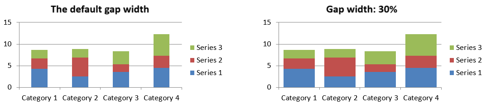

## **अवलोकन**

एक चार्ट अपने प्लॉटेड मानों को कार्यपुस्तिका कोशिकाओं में या सीधे संख्यात्मक लिटरल्स के रूप में संग्रहीत कर सकता है। एक [IChartSeries](https://reference.aspose.com/slides/androidjava/com.aspose.slides/ichartseries/) एक संबंधित मानों के सेट का प्रतिनिधित्व करता है, और प्रत्येक [IChartDataPoint](https://reference.aspose.com/slides/androidjava/com.aspose.slides/ichartdatapoint/) उस श्रृंखला में एक बिंदु को दर्शाता है। [IChartCategory](https://reference.aspose.com/slides/androidjava/com.aspose.slides/ichartcategory/) वस्तुएँ श्रृंखलाओं द्वारा साझा किए गए लेबल या समूह मान प्रदान करती हैं। डिफ़ॉल्ट डेटा के साथ बनाए गए चार्ट में, श्रृंखला नाम, श्रेणियाँ और बिंदु मान चार्ट कार्यपुस्तिका से [IChartDataCell](https://reference.aspose.com/slides/androidjava/com.aspose.slides/ichartdatacell/) वस्तुओं का उपयोग करते हैं।

एक सामान्य श्रेणी चार्ट के लिए, डिफ़ॉल्ट कार्यपुस्तिका में श्रृंखला नामों के लिए पंक्ति 0, श्रेणी नामों के लिए कॉलम 0, और शेष कोशिकाएँ श्रृंखला मानों के लिए उपयोग की जाती हैं। [IChartDataWorkbook.getCell](https://reference.aspose.com/slides/androidjava/com.aspose.slides/ichartdataworkbook/#getCell-int-int-int-) को पास किए जाने वाले कार्यपत्रक, पंक्ति और कॉलम सूचकांक शून्य‑आधारित हैं। यह लेआउट डिफ़ॉल्ट डेटा वाले चार्ट बनाने पर उपयोगी है, लेकिन यह अनुमान न करें कि प्रत्येक मौजूदा चार्ट इसे उपयोग करता है। लोड की गई प्रस्तुति के लिए, कार्यपुस्तिका मान बदलने से पहले श्रृंखला, श्रेणियों और डेटा बिंदुओं द्वारा संदर्भित कोशिकाओं का निरीक्षण करें।

चार्ट सेटिंग्स के तीन अलग-अलग स्कोप होते हैं:

- श्रृंखला‑स्तर की सेटिंग्स, जैसे कि [IChartSeries.getFormat](https://reference.aspose.com/slides/androidjava/com.aspose.slides/ichartseries/#getFormat--) सभी बिंदुओं के लिए डिफ़ॉल्ट रूप प्रदान करती हैं।
- डेटा‑बिंदु सेटिंग्स, जैसे कि [IChartDataPoint.getFormat](https://reference.aspose.com/slides/androidjava/com.aspose.slides/ichartdatapoint/#getFormat--) किसी एक बिंदु के लिए श्रृंखला रूप को ओवरराइड करती हैं।
- समूह सेटिंग्स उन संगत श्रृंखलाओं पर लागू होती हैं जो समान [IChartSeriesGroup](https://reference.aspose.com/slides/androidjava/com.aspose.slides/ichartseriesgroup/) से संबंधित होती हैं। जब आपको ओवरलैप या गैप चौड़ाई जैसी विकल्प सेट करने की जरूरत हो, तो [IChartSeries.getParentSeriesGroup](https://reference.aspose.com/slides/androidjava/com.aspose.slides/ichartseries/#getParentSeriesGroup--) के माध्यम से समूह तक पहुंचें।

जब स्पष्ट बिंदु या श्रृंखला भराव सेट नहीं किया गया हो, तो चार्ट शैली और थीम स्वचालित रूप से उपस्थिति निर्धारित करती है। जब दोनों, श्रृंखला और बिंदु स्वरूपण मौजूद हों, तो बिंदु स्वरूपण उस बिंदु के लिए प्राथमिकता लेता है।


## **संख्यात्मक लिटरल्स का उपयोग करके श्रृंखला मान सेट करें**

जब श्रृंखला मान एप्लिकेशन डेटा या गणनाओं से आते हों और कार्यपत्रक कोशिका संदर्भों की आवश्यकता न हो, तो संख्यात्मक लिटरल्स का उपयोग करें। प्रत्येक बिंदु के [getValue](https://reference.aspose.com/slides/androidjava/com.aspose.slides/ichartdatapoint/#getValue--) परिणाम को [setAsLiteralDouble](https://reference.aspose.com/slides/androidjava/com.aspose.slides/idoublechartvalue/#setAsLiteralDouble-double-) के माध्यम से असाइन करने से पहले, [setDataSourceTypeForValues](https://reference.aspose.com/slides/androidjava/com.aspose.slides/ichartdatapointcollection/#setDataSourceTypeForValues-int-) को [DataSourceType.DoubleLiterals](https://reference.aspose.com/slides/androidjava/com.aspose.slides/datasourcetype/#DoubleLiterals) के साथ कॉल करें।

कलेक्शन सेटिंग उस श्रृंखला में सभी बिंदु मानों के स्रोत प्रकार को नियंत्रित करती है। प्रत्येक बिंदु मान का [getDataSourceType](https://reference.aspose.com/slides/androidjava/com.aspose.slides/ibasechartvalue/#getDataSourceType--) मेथड चयनित प्रकार लौटाता है; कलेक्शन सेटिंग के माध्यम से इसे बदला जा सकता है। `Worksheet` के साथ, संदर्भित कोशिका तक पहुंचने हेतु [getAsCell](https://reference.aspose.com/slides/androidjava/com.aspose.slides/isinglecellchartvalue/#getAsCell--) का उपयोग करें। `DoubleLiterals` के साथ, संख्या को सीधे पढ़ने या लिखने के लिए [getAsLiteralDouble](https://reference.aspose.com/slides/androidjava/com.aspose.slides/idoublechartvalue/#getAsLiteralDouble--) या `setAsLiteralDouble` का उपयोग करें।

निम्न उदाहरण एक कॉलम चार्ट बनाता है जिसमें डिफ़ॉल्ट श्रृंखला और श्रेणियाँ होती हैं, फिर पहले श्रृंखला के मौजूदा बिंदुओं को क्रमबद्ध रूप से 10, 20, … मान असाइन करता है। यह प्रस्तुति को सहेजता है, फिर पुनः खोलता है और संग्रहीत मानों को प्रिंट करता है।

```java
import com.aspose.slides.*;

Presentation presentation = new Presentation();
try {
    ISlide slide = presentation.getSlides().get_Item(0);

    IChart chart = slide.getShapes().addChart(ChartType.ClusteredColumn, 20, 20, 500, 300);
    IChartSeries series = chart.getChartData().getSeries().get_Item(0);

    series.getDataPoints().setDataSourceTypeForValues(DataSourceType.DoubleLiterals);
    for (int i = 0; i < series.getDataPoints().size(); i++) {
        series.getDataPoints().get_Item(i).getValue().setAsLiteralDouble((i + 1) * 10);
    }

    presentation.save("numeric_literals.pptx", SaveFormat.Pptx);
} finally {
    presentation.dispose();
}

Presentation reopenedPresentation = new Presentation("numeric_literals.pptx");
try {
    ISlide reopenedSlide = reopenedPresentation.getSlides().get_Item(0);
    IChart reopenedChart = (IChart) reopenedSlide.getShapes().get_Item(0);
    IChartSeries reopenedSeries = reopenedChart.getChartData().getSeries().get_Item(0);
    for (IChartDataPoint point : reopenedSeries.getDataPoints()) {
        System.out.println(point.getValue().getAsLiteralDouble());
    }
} finally {
    reopenedPresentation.dispose();
}
```

बिंदु मान स्रोत प्रकार [IChartData.getDataSourceType](https://reference.aspose.com/slides/androidjava/com.aspose.slides/ichartdata/#getDataSourceType--) से अलग होता है, जो चार्ट के आंतरिक या बाह्य कार्यपुस्तिका कॉन्फ़िगरेशन की पहचान करता है। संख्यात्मक लिटरल्स का उपयोग करने से स्वयं एम्बेडेड कार्यपुस्तिका नहीं हटती। इस उदाहरण में, कार्यपुस्तिका श्रेणी लेबल, श्रृंखला नाम और अन्य श्रृंखलाओं के लिए उपलब्ध रहती है। कार्यपुस्तिका प्रबंधन के लिए देखें [Chart Workbook](/slides/hi/androidjava/chart-workbook/)।

स्कैटर और बबल चार्ट के लिए, क्रमशः [setDataSourceTypeForXValues](https://reference.aspose.com/slides/androidjava/com.aspose.slides/ichartdatapointcollection/#setDataSourceTypeForXValues-int-) और [setDataSourceTypeForYValues](https://reference.aspose.com/slides/androidjava/com.aspose.slides/ichartdatapointcollection/#setDataSourceTypeForYValues-int-) का उपयोग करके [getXValue](https://reference.aspose.com/slides/androidjava/com.aspose.slides/ichartdatapoint/#getXValue--) और [getYValue](https://reference.aspose.com/slides/androidjava/com.aspose.slides/ichartdatapoint/#getYValue--) के स्रोत चुनें। बबल चार्ट में [setDataSourceTypeForBubbleSizes](https://reference.aspose.com/slides/androidjava/com.aspose.slides/ichartdatapointcollection/#setDataSourceTypeForBubbleSizes-int-) का उपयोग करके [getBubbleSize](https://reference.aspose.com/slides/androidjava/com.aspose.slides/ichartdatapoint/#getBubbleSize--) का स्रोत निर्धारित किया जाता है। प्रत्येक लागू स्रोत को `DoubleLiterals` पर सेट करें और फिर उस मान के `setAsLiteralDouble` मेथड के माध्यम से संख्याएँ असाइन करें।

## **चार्ट श्रृंखला ओवरलैप सेट करें**

[IChartSeries.getOverlap](https://reference.aspose.com/slides/androidjava/com.aspose.slides/ichartseries/#getOverlap--) रिपोर्ट करता है कि 2D चार्ट में बार या कॉलम कितनी प्रतिशत ओवरलैप करते हैं, -100 से 100 पर आधारित। यह पैरेंट श्रृंखला समूह पर सेटिंग का केवल रीड‑ओनली प्रोजेक्शन है। सभी संगत श्रृंखलाओं को अपडेट करने के लिए [IChartSeriesGroup.setOverlap](https://reference.aspose.com/slides/androidjava/com.aspose.slides/ichartseriesgroup/#setOverlap-byte-) का उपयोग करें। यह विकल्प उन चार्ट प्रकारों पर लागू होता है जो समूहित बार या कॉलम दिखाते हैं; संयोजन चार्ट में असंबंधित श्रृंखला समूहों को यह प्रभावित नहीं करता।

निम्न उदाहरण पहले श्रृंखला को शामिल वाले समूह के लिए ओवरलैप सेट करता है:

```java
import com.aspose.slides.*;

final int firstSlideIndex = 0;
final int firstSeriesIndex = 0;
final byte overlapPercent = 30;

Presentation presentation = new Presentation();
try {
    ISlide slide = presentation.getSlides().get_Item(firstSlideIndex);

    // नया चार्ट नमूना श्रृंखलाएँ, श्रेणियाँ और मान शामिल करता है।
    IChart chart = slide.getShapes().addChart(ChartType.ClusteredColumn, 20, 20, 500, 200);

    IChartSeries series = chart.getChartData().getSeries().get_Item(firstSeriesIndex);
    series.getParentSeriesGroup().setOverlap(overlapPercent);

    presentation.save("series_overlap.pptx", SaveFormat.Pptx);
} finally {
    presentation.dispose();
}
```

परिणाम:


## **श्रृंखला भराव रंग बदलें**

पूरी श्रृंखला के लिए डिफ़ॉल्ट भराव सेट करने हेतु [IChartSeries.getFormat](https://reference.aspose.com/slides/androidjava/com.aspose.slides/ichartseries/#getFormat--) का प्रयोग करें। यदि किसी बिंदु का स्पष्ट भराव पहले से निर्धारित है, तो उसका [IChartDataPoint.getFormat](https://reference.aspose.com/slides/androidjava/com.aspose.slides/ichartdatapoint/#getFormat--) सेटिंग उस बिंदु के लिए श्रृंखला भराव को ओवरराइड कर देती है।

निम्न उदाहरण पहले श्रृंखला पर ठोस नीले रंग का भराव लागू करता है:

```java
import com.aspose.slides.*;
import android.graphics.Color;

final int firstSlideIndex = 0;
final int firstSeriesIndex = 0;

Presentation presentation = new Presentation();
try {
    ISlide slide = presentation.getSlides().get_Item(firstSlideIndex);

    IChart chart = slide.getShapes().addChart(ChartType.ClusteredColumn, 20, 20, 500, 200);

    IChartSeries series = chart.getChartData().getSeries().get_Item(firstSeriesIndex);
    series.getFormat().getFill().setFillType(FillType.Solid);
    series.getFormat().getFill().getSolidFillColor().setColor(Color.BLUE);

    presentation.save("series_color.pptx", SaveFormat.Pptx);
} finally {
    presentation.dispose();
}
```

परिणाम:


## **श्रृंखला का नाम बदलें**

श्रृंखला नाम चार्ट डेटा कार्यपुस्तिका में संग्रहीत होता है और सामान्यतः लेजेंड में प्रदर्शित होता है। क्लस्टर्ड कॉलम चार्ट के लिए निर्मित डिफ़ॉल्ट कार्यपुस्तिका में, कोशिका B1 (पंक्ति 0, कॉलम 1) में प्रथम श्रृंखला का नाम होता है। नीचे दिए गए उदाहरण में नामित स्थिरांक इस संरचना को स्पष्ट करते हैं:

```java
import com.aspose.slides.*;

final int firstSlideIndex = 0;
final int worksheetIndex = 0;
final int seriesNameRowIndex = 0;
final int firstSeriesColumnIndex = 1;

Presentation presentation = new Presentation();
try {
    ISlide slide = presentation.getSlides().get_Item(firstSlideIndex);

    IChart chart = slide.getShapes().addChart(ChartType.ClusteredColumn, 20, 20, 500, 200);

    IChartDataWorkbook workbook = chart.getChartData().getChartDataWorkbook();
    IChartDataCell seriesNameCell = workbook.getCell(worksheetIndex, seriesNameRowIndex, firstSeriesColumnIndex);
    seriesNameCell.setValue("Revenue");

    presentation.save("series_name.pptx", SaveFormat.Pptx);
} finally {
    presentation.dispose();
}
```

आप [IChartSeries.getName](https://reference.aspose.com/slides/androidjava/com.aspose.slides/ichartseries/#getName--) द्वारा पहले से संदर्भित कोशिका को भी अपडेट कर सकते हैं। यह तरीका मौजूदा चार्ट में किसी विशिष्ट पंक्ति या कॉलम को मानने से बचाता है:

```java
import com.aspose.slides.*;

final int firstSlideIndex = 0;
final int firstSeriesIndex = 0;
final int firstNameCellIndex = 0;

Presentation presentation = new Presentation();
try {
    ISlide slide = presentation.getSlides().get_Item(firstSlideIndex);

    IChart chart = slide.getShapes().addChart(ChartType.ClusteredColumn, 20, 20, 500, 200);

    IChartSeries series = chart.getChartData().getSeries().get_Item(firstSeriesIndex);
    IChartDataCell seriesNameCell = series.getName().getAsCells().get_Item(firstNameCellIndex);
    seriesNameCell.setValue("Revenue");

    presentation.save("series_name.pptx", SaveFormat.Pptx);
} finally {
    presentation.dispose();
}
```

परिणाम:


### **कई कोशिकाओं से नाम वाला श्रृंखला बनाएं**

जब उत्पाद नाम और रिपोर्टिंग अवधि अलग-अलग कार्यपुस्तिका कोशिकाओं में संग्रहीत हों, तो सम्मिलित श्रृंखला नाम उपयोगी होता है। उदाहरण के लिए, आप B1 में `Product A` और C1 में `2026` को जोड़कर एकल श्रृंखला नाम बना सकते हैं, जबकि दोनों भाग अपने स्रोत कोशिकाओं से जुड़े रहें।

[IChartDataWorkbook.getCellCollection](https://reference.aspose.com/slides/androidjava/com.aspose.slides/ichartdataworkbook/#getCellCollection-java.lang.String-boolean-) का उपयोग करके नाम रेंज प्राप्त करें, फिर उस संग्रह को [IChartSeriesCollection.add](https://reference.aspose.com/slides/androidjava/com.aspose.slides/ichartseriescollection/#add-com.aspose.slides.IChartCellCollection-int-) को पास करें। `skipHiddenCells` तर्क निर्धारित करता है कि छिपी हुई कोशिकाएँ शामिल हों या नहीं: `true` उन्हें बाहर रखता है, `false` उन्हें शामिल करता है। यह उदाहरण `false` का उपयोग करके नाम रेंज में सभी कोशिकाएँ शामिल करता है।

निम्न उदाहरण एक प्रस्तुति बनाता है जिसमें एक श्रृंखला और दो डेटा बिंदु होते हैं। कोशिकाएँ B1:C1 केवल श्रृंखला नाम प्रदान करती हैं; A2:A3 श्रेणी लेबल प्रदान करती हैं, और B2:B3 संख्यात्मक मान प्रदान करती हैं।

```java
import com.aspose.slides.*;

Presentation presentation = new Presentation();
try {
    ISlide slide = presentation.getSlides().get_Item(0);

    IChart chart = slide.getShapes().addChart(ChartType.ClusteredColumn, 50, 50, 620, 180);

    chart.getChartData().getSeries().clear();
    chart.getChartData().getCategories().clear();
    chart.setLegend(true);

    IChartDataWorkbook workbook = chart.getChartData().getChartDataWorkbook();
    workbook.clear(0);

    // यह दो कोशिकाएँ श्रृंखला नाम प्रदान करती हैं।
    workbook.getCell(0, 0, 1, "Product A");
    workbook.getCell(0, 0, 2, "2026");
    IChartCellCollection nameCells = workbook.getCellCollection("Sheet1!$B$1:$C$1", false);
    IChartSeries series = chart.getChartData().getSeries().add(nameCells, ChartType.ClusteredColumn);

    // अलग-अलग कोशिकाएँ श्रेणियाँ और संख्यात्मक डेटा बिंदु प्रदान करती हैं।
    IChartDataCell northCategory = workbook.getCell(0, 1, 0, "North");
    IChartDataCell southCategory = workbook.getCell(0, 2, 0, "South");
    chart.getChartData().getCategories().add(northCategory);
    chart.getChartData().getCategories().add(southCategory);
    IChartDataCell northValue = workbook.getCell(0, 1, 1, 120);
    IChartDataCell southValue = workbook.getCell(0, 2, 1, 150);
    series.getDataPoints().addDataPointForBarSeries(northValue);
    series.getDataPoints().addDataPointForBarSeries(southValue);

    presentation.save("composite_series_name.pptx", SaveFormat.Pptx);
} finally {
    presentation.dispose();
}
```

परिणामी श्रृंखला नाम `Product A 2026` है, दो कोशिका मानों के बीच स्पेस के साथ। लेजेंड इसे दोनों कॉलम के लिए एक एंट्री के रूप में दिखाता है। नीचे चित्र परिणाम दर्शाता है:


## **स्वचालित श्रृंखला भराव रंग प्राप्त करें**

[IChartSeries.getAutomaticSeriesColor](https://reference.aspose.com/slides/androidjava/com.aspose.slides/ichartseries/#getAutomaticSeriesColor--) श्रृंखला अनुक्रम और चार्ट शैली के आधार पर गणना किया गया Android ARGB रंग पूर्णांक लौटाता है। यह वह रंग है जो तब उपयोग होता है जब श्रृंखला भराव स्पष्ट रूप से परिभाषित नहीं है। मेथड को कॉल करने से केवल गणना किया गया रंग पढ़ा जाता है; यह नया भराव सेट नहीं करता।

निम्न उदाहरण प्रत्येक डिफ़ॉल्ट श्रृंखला के स्वचालित रंग पूर्णांक को प्रिंट करता है:

```java
import com.aspose.slides.*;

final int firstSlideIndex = 0;

Presentation presentation = new Presentation();
try {
    ISlide slide = presentation.getSlides().get_Item(firstSlideIndex);

    IChart chart = slide.getShapes().addChart(ChartType.ClusteredColumn, 20, 20, 500, 200);

    int seriesCount = chart.getChartData().getSeries().size();
    for (int seriesIndex = 0; seriesIndex < seriesCount; seriesIndex++) {
        IChartSeries series = chart.getChartData().getSeries().get_Item(seriesIndex);
        int automaticColor = series.getAutomaticSeriesColor();
        System.out.println("Series " + seriesIndex + ": " + automaticColor);
    }
} finally {
    presentation.dispose();
}
```

सटीक पूर्णांक मान चार्ट शैली और थीम पर निर्भर होते हैं।

## **एक चार्ट श्रृंखला के लिए इनवर्ट भराव रंग सेट करें**

बार, कॉलम और बबल श्रृंखलाओं के लिए, [IChartSeries.setInvertIfNegative](https://reference.aspose.com/slides/androidjava/com.aspose.slides/ichartseries/#setInvertIfNegative-boolean-) नकारात्मक मानों को अलग भराव के साथ प्रदर्शित कर सकता है। नियमित श्रृंखला भराव को ठोस सेट करें, इनवर्ज़न सक्रिय करें, और नकारात्मक‑मान रंग को [IChartSeries.getInvertedSolidFillColor](https://reference.aspose.com/slides/androidjava/com.aspose.slides/ichartseries/#getInvertedSolidFillColor--) के माध्यम से असाइन करें। नकारात्मक संख्याएँ कार्यपुस्तिका में अपरिवर्तित रहती हैं; केवल उनका डिस्प्ले रंग बदलता है।

निम्न उदाहरण डिफ़ॉल्ट चार्ट डेटा को एक श्रृंखला से बदलता है। कार्यपत्रक पंक्ति 0 में श्रृंखला नाम, कॉलम 0 में श्रेणी नाम, और कॉलम 1 में मान होते हैं:

```java
import com.aspose.slides.*;
import android.graphics.Color;

final int firstSlideIndex = 0;
final int worksheetIndex = 0;
final int headerRowIndex = 0;
final int categoryColumnIndex = 0;
final int firstSeriesColumnIndex = 1;
final int firstDataRowIndex = 1;

String[] categoryNames = { "Category 1", "Category 2", "Category 3" };
int[] seriesValues = { -20, 50, -30 };

Presentation presentation = new Presentation();
try {
    ISlide slide = presentation.getSlides().get_Item(firstSlideIndex);

    IChart chart = slide.getShapes().addChart(ChartType.ClusteredColumn, 20, 20, 500, 200);
    IChartData chartData = chart.getChartData();
    IChartDataWorkbook workbook = chartData.getChartDataWorkbook();

    chartData.getSeries().clear();
    chartData.getCategories().clear();

    IChartDataCell seriesNameCell = workbook.getCell(worksheetIndex, headerRowIndex, firstSeriesColumnIndex, "Series 1");
    int chartType = chart.getType();
    IChartSeries series = chartData.getSeries().add(seriesNameCell, chartType);

    for (int categoryIndex = 0; categoryIndex < categoryNames.length; categoryIndex++) {
        int dataRowIndex = firstDataRowIndex + categoryIndex;
        String categoryName = categoryNames[categoryIndex];
        int seriesValue = seriesValues[categoryIndex];

        IChartDataCell categoryCell = workbook.getCell(worksheetIndex, dataRowIndex, categoryColumnIndex, categoryName);
        chartData.getCategories().add(categoryCell);

        IChartDataCell valueCell = workbook.getCell(worksheetIndex, dataRowIndex, firstSeriesColumnIndex, seriesValue);
        series.getDataPoints().addDataPointForBarSeries(valueCell);
    }

    int automaticSeriesColor = series.getAutomaticSeriesColor();
    series.getFormat().getFill().setFillType(FillType.Solid);
    series.getFormat().getFill().getSolidFillColor().setColor(automaticSeriesColor);
    series.setInvertIfNegative(true);
    series.getInvertedSolidFillColor().setColor(Color.RED);

    presentation.save("inverted_solid_fill_color.pptx", SaveFormat.Pptx);
} finally {
    presentation.dispose();
}
```

परिणाम:


आप [IChartDataPoint.setInvertIfNegative](https://reference.aspose.com/slides/androidjava/com.aspose.slides/ichartdatapoint/#setInvertIfNegative-boolean-) के माध्यम से एक बिंदु के लिए इनवर्ज़न सक्षम कर सकते हैं। नीचे के उदाहरण में श्रृंखला के लिए इनवर्ज़न अक्षम है और केवल चयनित बिंदु के लिए सक्षम किया गया है। बिंदु को नकारात्मक मान भी असाइन किया गया है ताकि प्रभाव दिखाई दे:

```java
import com.aspose.slides.*;
import android.graphics.Color;

final int firstSlideIndex = 0;
final int firstSeriesIndex = 0;
final int targetDataPointIndex = 2;
final int negativeValue = -30;

Presentation presentation = new Presentation();
try {
    ISlide slide = presentation.getSlides().get_Item(firstSlideIndex);

    IChart chart = slide.getShapes().addChart(ChartType.ClusteredColumn, 20, 20, 500, 200);

    IChartSeries series = chart.getChartData().getSeries().get_Item(firstSeriesIndex);
    int automaticSeriesColor = series.getAutomaticSeriesColor();
    series.getFormat().getFill().setFillType(FillType.Solid);
    series.getFormat().getFill().getSolidFillColor().setColor(automaticSeriesColor);
    series.getInvertedSolidFillColor().setColor(Color.RED);
    series.setInvertIfNegative(false);

    IChartDataPoint dataPoint = series.getDataPoints().get_Item(targetDataPointIndex);
    dataPoint.getValue().getAsCell().setValue(negativeValue);
    dataPoint.setInvertIfNegative(true);

    presentation.save("data_point_invert_color_if_negative.pptx", SaveFormat.Pptx);
} finally {
    presentation.dispose();
}
```

## **एक विशिष्ट डेटा बिंदु मान साफ़ करें**

एक बिंदु को खाली करने के लिए, उसके बैकिंग कार्यपुस्तिका सेल को `null` सेट करें, जबकि अन्य बिंदुओं को न हटाएँ। कॉलम चार्ट के लिए, प्लॉटेड मान [IChartDataPoint.getValue](https://reference.aspose.com/slides/androidjava/com.aspose.slides/ichartdatapoint/#getValue--) से प्राप्त किया जा सकता है। डेटा बिंदु वही श्रेणी स्थिति बनाए रखता है, पर चार्ट इसे खाली मान के रूप में मानता है, जैसा कि चार्ट की खाली‑मान सेटिंग्स में निर्धारित है।

निम्न उदाहरण पहले श्रृंखला के केवल दूसरे बिंदु को साफ़ करता है:

```java
import com.aspose.slides.*;

final int firstSlideIndex = 0;
final int firstSeriesIndex = 0;
final int targetDataPointIndex = 1;

Presentation presentation = new Presentation();
try {
    ISlide slide = presentation.getSlides().get_Item(firstSlideIndex);

    IChart chart = slide.getShapes().addChart(ChartType.ClusteredColumn, 20, 20, 500, 200);

    IChartSeries series = chart.getChartData().getSeries().get_Item(firstSeriesIndex);
    IChartDataPoint dataPoint = series.getDataPoints().get_Item(targetDataPointIndex);
    dataPoint.getValue().getAsCell().setValue(null);

    presentation.save("clear_data_point_value.pptx", SaveFormat.Pptx);
} finally {
    presentation.dispose();
}
```

स्कैटर चार्ट अलग‑अलग X और Y कोशिकाओं का उपयोग करते हैं, तथा बबल चार्ट एक साइज कोशिका भी उपयोग करता है। केवल उस कोशिका को साफ़ करें जो आप हटाना चाहते हैं। जब आप अन्य बिंदुओं को रखना चाहते हैं, तो [IChartDataPointCollection.clear](https://reference.aspose.com/slides/androidjava/com.aspose.slides/ichartdatapointcollection/#clear--) को मत कॉल करें, क्योंकि यह संग्रह से सभी बिंदु हटा देता है।

## **खाली कोशिकाओं के प्रदर्शन को नियंत्रित करें**

छिपी हुई कोशिकाएँ जिनमें मान हैं, वे खाली कोशिकाओं से अलग होती हैं। छिपी हुई पंक्तियों या कॉलमों से डेटा को शामिल या बहिष्कृत करने के लिए देखें [Include Data from Hidden Rows and Columns](/slides/hi/androidjava/chart-workbook/#include-data-from-hidden-rows-and-columns)।

एक खाली कार्यपुस्तिका कोशिका अनुपलब्ध डेटा को दर्शाती है; `0` वाला कोशिका ज्ञात संख्यात्मक मान दर्शाता है। [IChartDataCell.setValue](https://reference.aspose.com/slides/androidjava/com.aspose.slides/ichartdatacell/#setValue-java.lang.Object-) को `null` पास करके कोशिका को खाली बनाएं। शून्य संख्यात्मक शून्य बना रहता है, चाहे खाली‑कोशिका सेटिंग कुछ भी हो।

खाली कोशिकाओं को चार्ट में कैसे दिखाना है, इसे चुनने के लिए [IChart.setDisplayBlanksAs](https://reference.aspose.com/slides/androidjava/com.aspose.slides/ichart/#setDisplayBlanksAs-int-) का उपयोग करें। यह सेटिंग पूरे चार्ट पर लागू होती है और खाली मानों को कैसे प्लॉट किया जाए, यह बदलती है, बिना कार्यपुस्तिका कोशिका को शून्य या इंटरपोलेटेड मान से भरने के।

निम्न स्वनिर्भर उदाहरण एक लाइन चार्ट बनाता है जिसमें एक श्रृंखला है, दिन 3 का मान साफ़ करता है, और प्रत्येक मोड के साथ वही चार्ट सहेजता है। कोई इनपुट फ़ाइल आवश्यक नहीं है। [IChartDataWorkbook](https://reference.aspose.com/slides/androidjava/com.aspose.slides/ichartdataworkbook/) कार्यपत्रक 0, कॉलम 0 को श्रेणी लेबल और कॉलम 1 को मान के लिए उपयोग करता है; पंक्ति 0 में श्रृंखला नाम होता है। अंतिम डेटा `10, 20, empty, 30, 40` है।

```java
import com.aspose.slides.*;

Presentation presentation = new Presentation();
try {
    ISlide slide = presentation.getSlides().get_Item(0);

    IChart chart = slide.getShapes().addChart(ChartType.LineWithMarkers, 40, 40, 640, 400);
    IChartData chartData = chart.getChartData();
    IChartDataWorkbook workbook = chartData.getChartDataWorkbook();

    chartData.getSeries().clear();
    chartData.getCategories().clear();

    IChartDataCell seriesNameCell = workbook.getCell(0, 0, 1, "Measurements");
    IChartSeries series = chartData.getSeries().add(seriesNameCell, chart.getType());
    int[] values = { 10, 20, 25, 30, 40 };

    for (int i = 0; i < values.length; i++) {
        IChartDataCell categoryCell = workbook.getCell(0, i + 1, 0, "Day " + (i + 1));
        chartData.getCategories().add(categoryCell);
        IChartDataCell valueCell = workbook.getCell(0, i + 1, 1, values[i]);
        series.getDataPoints().addDataPointForLineSeries(valueCell);
    }

    // Day 3 को वास्तविक रूप से खाली रखें, जबकि उसकी श्रेणी और डेटा बिंदु बनाए रखें।
    workbook.getCell(0, 3, 1).setValue(null);

    int[] modes = { DisplayBlanksAsType.Gap, DisplayBlanksAsType.Zero, DisplayBlanksAsType.Span };
    String[] modeNames = { "Gap", "Zero", "Span" };
    for (int i = 0; i < modes.length; i++) {
        chart.setDisplayBlanksAs(modes[i]);
        presentation.save("empty_cells_" + modeNames[i] + ".pptx", SaveFormat.Pptx);
    }
} finally {
    presentation.dispose();
}
```

प्रत्येक आउटपुट फ़ाइल सहेजने से पहले सेट किए गए मोड को दर्शाती है: `empty_cells_Gap.pptx`, `empty_cells_Zero.pptx`, और `empty_cells_Span.pptx`। केवल एक संस्करण सहेजना हो तो वांछित मोड असाइन करें और प्रस्तुति को एक बार सहेजें।

नीचे तुलना दर्शाती है कि सभी तीन फ़ाइलों में डेटा समान है। दिन 3 कार्यपुस्तिका में हर मामले में खाली है:


दिखावट चार्ट प्रकार पर निर्भर करती है। लाइन चार्ट सभी तीन मोड को आसानी से तुलना करने की सुविधा देता है। बार और कॉलम चार्ट में कोई लाइन नहीं होती जो अनुपलब्ध श्रेणी को जोड़ सके, इसलिए `Span` वह कनेक्टिंग सेगमेंट नहीं बना पाता; एक अनुपलब्ध कॉलम और शून्य‑ऊँचाई वाला कॉलम भी समान दिख सकता है। इसी प्रकार, स्कैटर चार्ट केवल मार्कर होने पर कोई कनेक्टिंग लाइन नहीं होती। सभी चार्ट प्रकारों के लिए तीन स्पष्ट परिणाम की उम्मीद न रखें; उपयोग किए गए प्रकार के लिए आउटपुट जांचें।

## **श्रृंखला गैप चौड़ाई सेट करें**

गैप चौड़ाई समानांतर बार या कॉलम क्लस्टर के बीच की जगह है, जो बार या कॉलम की चौड़ाई के प्रतिशत में व्यक्त की जाती है। ओवरलैप की तरह, यह पैरेंट श्रृंखला समूह का गुण है, न कि किसी एकल श्रृंखला का। समूह के लिए एक बार [IChartSeriesGroup.setGapWidth](https://reference.aspose.com/slides/androidjava/com.aspose.slides/ichartseriesgroup/#setGapWidth-int-) कॉल करें। बड़ा मान क्लस्टरों के बीच अधिक जगह बनाता है; छोटा मान उन्हें घना बनाता है।

निम्न उदाहरण गैप चौड़ाई बदलता है और केवल अंतिम प्रस्तुति को सहेजता है:

```java
import com.aspose.slides.*;

final int firstSlideIndex = 0;
final int firstSeriesIndex = 0;
final int gapWidthPercent = 30;

Presentation presentation = new Presentation();
try {
    ISlide slide = presentation.getSlides().get_Item(firstSlideIndex);

    IChart chart = slide.getShapes().addChart(ChartType.StackedColumn, 20, 20, 500, 200);

    IChartSeries series = chart.getChartData().getSeries().get_Item(firstSeriesIndex);
    series.getParentSeriesGroup().setGapWidth(gapWidthPercent);

    presentation.save("gap_width_30.pptx", SaveFormat.Pptx);
} finally {
    presentation.dispose();
}
```

परिणाम:



## **बार-बार पूछे जाने वाले प्रश्न**

**कौन से चार्ट प्रकार डेटा श्रृंखलाओं का समर्थन करते हैं?**

[ChartType](https://reference.aspose.com/slides/androidjava/com.aspose.slides/charttype/) enumeration द्वारा दर्शाए गए सभी चार्ट प्रकार डेटा का उपयोग करते हैं, लेकिन उनकी श्रृंखलाओं की संरचना या सेटिंग्स समान नहीं होती। उदाहरण के लिए, श्रेणी चार्ट में श्रेणियां और मान होते हैं, स्कैटर चार्ट में X और Y मान होते हैं, और बबल चार्ट में बबल साइज भी जोड़ी जाती है। श्रृंखला प्रकार से मेल खाती डेटा‑बिंदु निर्माण विधि का उपयोग करें। ओवरलैप और गैप चौड़ाई जैसे विकल्प केवल संगत बार या कॉलम समूहों पर लागू होते हैं।

**चार्ट श्रृंखला समूह क्या है?**

[IChartSeriesGroup](https://reference.aspose.com/slides/androidjava/com.aspose.slides/ichartseriesgroup/) संगत श्रृंखलाओं को शामिल करता है जो समूह‑स्तर की प्लॉटिंग सेटिंग्स साझा करती हैं। संयोजन चार्ट में एक से अधिक समूह हो सकते हैं, इसलिए एक श्रृंखला के माध्यम से पहुँचाए गए समूह को बदलने से आवश्यक नहीं कि चार्ट की सभी श्रृंखलाएँ प्रभावित हों।

**क्या नया बनाया गया चार्ट डिफ़ॉल्ट डेटा रखता है?**

हाँ। डिफ़ॉल्ट रूप से, [IShapeCollection.addChart](https://reference.aspose.com/slides/androidjava/com.aspose.slides/ishapecollection/#addChart-int-float-float-float-float-) नमूना श्रृंखलाएँ, श्रेणियाँ और मान बनाता है। आप उन कोशिकाओं को संपादित कर सकते हैं या पूरी कस्टम डेटा सेट जोड़ने से पहले श्रृंखला तथा श्रेणी संग्रह दोनों को साफ़ कर सकते हैं। एक ओवरलोड भी बिना डिफ़ॉल्ट डेटा के चार्ट बना सकता है।

**चार्ट ऑब्जेक्ट्स कार्यपुस्तिका कोशिकाओं से कैसे जुड़े होते हैं?**

श्रृंखला नाम, श्रेणी लेबल और डेटा‑बिंदु मान [IChartDataWorkbook](https://reference.aspose.com/slides/androidjava/com.aspose.slides/ichartdataworkbook/) की कोशिकाओं को संदर्भित करते हैं। संदर्भित कोशिका को बदलने से संबंधित चार्ट तत्व अपडेट हो जाता है। कस्टम डेटा बनाते समय, सुनिश्चित करें कि श्रेणी पंक्तियाँ और श्रृंखला‑मान पंक्तियाँ संरेखित रहें, ताकि प्रत्येक बिंदु इच्छित श्रेणी के तहत plotted हो।

**मैं पूरी श्रृंखला के बजाय एक बिंदु कैसे साफ़ करूँ?**

संबंधित मान कोशिका को `null` सेट करके बिंदु को खाली बनाएँ, जबकि उसकी श्रेणी स्थिति बनी रहे। केवल उस बिंदु को हटाने के लिए [IChartDataPointCollection.clear](https://reference.aspose.com/slides/androidjava/com.aspose.slides/ichartdatapointcollection/#clear--) का उपयोग न करें, क्योंकि यह श्रृंखला के सभी बिंदुओं को हटा देता है।

**खाली बिंदु कैसे दिखाए जाते हैं?**

परिणाम चार्ट प्रकार और [IChart.setDisplayBlanksAs](https://reference.aspose.com/slides/androidjava/com.aspose.slides/ichart/#setDisplayBlanksAs-int-) से कॉन्फ़िगर किए गए मान पर निर्भर करता है। समर्थित चार्ट खाली मान को गैप, शून्य, या पड़ोसी बिंदुओं को जोड़कर दिखा सकते हैं। अपनी प्रस्तुति में अनुपलब्ध डेटा के अर्थ के अनुरूप सेटिंग चुनें। पूरा उदाहरण और दृश्य तुलना के लिए देखें [Control the Display of Empty Cells](#control-the-display-of-empty-cells)।

**नकारात्मक मानों का स्वरूप क्या है?**

समर्थित बार, कॉलम और बबल श्रृंखलाओं के लिए, [IChartSeries.setInvertIfNegative](https://reference.aspose.com/slides/androidjava/com.aspose.slides/ichartseries/#setInvertIfNegative-boolean-) को कॉल करें और [IChartSeries.getInvertedSolidFillColor](https://reference.aspose.com/slides/androidjava/com.aspose.slides/ichartseries/#getInvertedSolidFillColor--) से प्राप्त रंग असाइन करें। आप [IChartDataPoint.setInvertIfNegative](https://reference.aspose.com/slides/androidjava/com.aspose.slides/ichartdatapoint/#setInvertIfNegative-boolean-) के साथ व्यक्तिगत बिंदु के लिए व्यवहार को ओवरराइड कर सकते हैं। ये मेथड स्वरूपण को बदलते हैं, न कि संग्रहीत संख्यात्मक मानों को।

**जब दोनों, श्रृंखला और बिंदु स्वरूपित हों, तो कौन जीतता है?**

स्पष्ट डेटा‑बिंदु स्वरूपण उस बिंदु के लिए प्राथमिकता लेता है। अन्य बिंदु स्पष्ट श्रृंखला स्वरूप या, यदि श्रृंखला स्वरूप परिभाषित नहीं है, तो स्वचालित चार्ट शैली और थीम का उपयोग जारी रखते हैं। समूह सेटिंग्स जैसे ओवरलैप और गैप चौड़ाई लेआउट नियंत्रित करती हैं और बिंदु‑स्तर के स्वरूपण को ओवरराइड नहीं करतीं।

**क्या किसी चार्ट में श्रृंखलाओं की संख्या पर कोई सीमा है?**

Aspose.Slides में कोई अलग स्थायी श्रृंखला‑संख्या सीमा नहीं है। व्यावहारिक रूप से, प्रस्तुति फ़ाइल सीमाएँ, उपलब्ध मेमोरी, रेंडरिंग समय और चार्ट पठनीयता उपयोगी सीमा निर्धारित करती हैं।

**जब कॉलम बहुत करीब या बहुत दूर हों तो क्या करना चाहिए?**

उचित पैरेंट श्रृंखला समूह पर [IChartSeriesGroup.setGapWidth](https://reference.aspose.com/slides/androidjava/com.aspose.slides/ichartseriesgroup/#setGapWidth-int-) कॉल करें। मान बढ़ाने से क्लस्टरों के बीच की जगह विस्तृत होगी, घटाने से क्लस्टर एक‑दूसरे के करीब आएँगे।