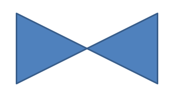
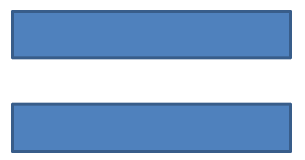

## **अवलोकन**

यह लेख Aspose.Slides में प्रस्तुति आकारों को अनुकूलित करने के लिए आकार ज्यामिति को संपादन बिंदुओं और ज्यामिति पाथ के माध्यम से संपादन करके समझाता है। यह दिखाता है कि कैसे [GeometryPath](https://reference.aspose.com/slides/androidjava/com.aspose.slides/geometrypath/) और [IGeometryPath](https://reference.aspose.com/slides/androidjava/com.aspose.slides/igeometrypath/) के साथ काम करके मौजूदा आकारों को संशोधित किया जाए, मूल पाथ संपादन संचालन किए जाएँ, बिंदु जोड़े या हटाए जाएँ, और अद्यतन ज्यामिति को फिर से आकार पर लागू किया जाए।  

यह भी दर्शाता है कि कैसे कस्टम और संयुक्त आकार बनाएँ, कर्व्ड कोर्नर वाले आकार बनाएँ, यह निर्धारित करें कि आकार ज्यामिति बंद है या नहीं, और Android पॉइंट ऐरे का उपयोग करके आकार तत्वों का निरीक्षण करें।

## **संपादन बिंदुओं का उपयोग करके आकार बदलें**

PowerPoint में, आप **Edit Points** का उपयोग करके एक वर्ग को संशोधित कर सकते हैं:

* कोने को अंदर या बाहर ले जाएँ।
* बिंदु पर वक्रता समायोजित करें।
* नए बिंदु जोड़ें।

बिंदुओं को संपादित करने से आप आकार की रूपरेखा को बदल सकते हैं या एक मौजूदा आकार को नई आकार की आधारशिला के रूप में उपयोग कर सकते हैं।

## **आकार संपादन टिप्स**


PowerPoint आकारों को संपादित करते समय, इन अवधारणाओं को याद रखें:

* कोई आकार (या उसका पाथ) बंद या खुला हो सकता है।
* आकार के पाथ में एंकर पॉइंट्स होते हैं जो सेगमेंट्स द्वारा जुड़े होते हैं।
* एक सेगमेंट सीधा या वक्र हो सकता है। एंकर पॉइंट्स और कंट्रोल हैंडल्स इसकी आकृति निर्धारित करते हैं।
* एंकर पॉइंट्स कोने के बिंदु, सीधे बिंदु, या स्मूद बिंदु के रूप में होते हैं:
  * कोने के बिंदु पर, जुड़े सेगमेंट्स एक कोण पर मिल सकते हैं।
  * स्मूद बिंदु पर, दो कंट्रोल हैंडल्स संरेखित होते हैं और एंकर पॉइंट से समान दूरी पर होते हैं।
  * सीधे बिंदु पर, दो कंट्रोल हैंडल्स संरेखित होते हैं लेकिन एंकर पॉइंट से अलग-अलग दूरी पर हो सकते हैं।
* एंकर पॉइंट्स को ले जाना या उनके हैंडल्स को समायोजित करना आकार की रूपरेखा को बदलता है।

PowerPoint आकारों को संपादन बिंदुओं के माध्यम से संपादित करने के लिए, **Aspose.Slides** [GeometryPath](https://reference.aspose.com/slides/androidjava/com.aspose.slides/geometrypath/) क्लास और [IGeometryPath](https://reference.aspose.com/slides/androidjava/com.aspose.slides/igeometrypath/) इंटरफ़ेस प्रदान करता है।

* एक [GeometryPath](https://reference.aspose.com/slides/androidjava/com.aspose.slides/geometrypath/) इंस्टेंस [IGeometryShape](https://reference.aspose.com/slides/androidjava/com.aspose.slides/igeometryshape/) ऑब्जेक्ट की ज्यामिति पाथ का प्रतिनिधित्व करता है।
* [IGeometryShape.getGeometryPaths](https://reference.aspose.com/slides/androidjava/com.aspose.slides/igeometryshape/#getGeometryPaths--) मेथड का उपयोग करके आप [IGeometryShape](https://reference.aspose.com/slides/androidjava/com.aspose.slides/igeometryshape/) इंस्टेंस से [GeometryPath](https://reference.aspose.com/slides/androidjava/com.aspose.slides/geometrypath/) प्राप्त कर सकते हैं।
* किसी आकार के लिए [GeometryPath](https://reference.aspose.com/slides/androidjava/com.aspose.slides/geometrypath/) सेट करने हेतु आप ये मेथड उपयोग कर सकते हैं: एकल पाथ वाले आकारों के लिए [IGeometryShape.setGeometryPath](https://reference.aspose.com/slides/androidjava/com.aspose.slides/igeometryshape/#setGeometryPath-com.aspose.slides.IGeometryPath-) और बहु‑पाथ वाले आकारों के लिए [IGeometryShape.setGeometryPaths](https://reference.aspose.com/slides/androidjava/com.aspose.slides/igeometryshape/#setGeometryPaths-com.aspose.slides.IGeometryPath---)।
* सेगमेंट जोड़ने हेतु आप [IGeometryPath](https://reference.aspose.com/slides/androidjava/com.aspose.slides/igeometrypath/) के अंतर्गत उपलब्ध मेथड का उपयोग कर सकते हैं।
* [IGeometryPath.setStroke](https://reference.aspose.com/slides/androidjava/com.aspose.slides/igeometrypath/#setStroke-boolean-) और [IGeometryPath.setFillMode](https://reference.aspose.com/slides/androidjava/com.aspose.slides/igeometrypath/#setFillMode-byte-) मेथड्स का उपयोग करके आप ज्यामिति पाथ की उपस्थिति सेट कर सकते हैं।
* [IGeometryPath.getPathData](https://reference.aspose.com/slides/androidjava/com.aspose.slides/igeometrypath/#getPathData--) मेथड का उपयोग करके आप एक [GeometryShape](https://reference.aspose.com/slides/androidjava/com.aspose.slides/geometryshape/) की ज्यामिति पाथ को पाथ सेगमेंट्स की एरे के रूप में प्राप्त कर सकते हैं।

## **सरल संपादन संचालन**

ज्यामिति पाथ को संपादित करने के लिए नीचे दिए गए मेथड्स का उपयोग करें। इंडेक्स स्वीकार करने वाले ओवरलोड पाथ के सेगमेंट एरे में उस शून्य‑आधारित स्थिति पर एक सेगमेंट डालते हैं।

| ऑपरेशन | विधि |
| --- | --- |
| सीधी रेखा जोड़ें या सम्मिलित करें। | [GeometryPath.lineTo](https://reference.aspose.com/slides/androidjava/com.aspose.slides/geometrypath/#lineTo-float-float-) |
| दो नियंत्रण बिंदुओं और अंत बिंदु के साथ क्यूबिक Bézier कर्व जोड़ें या सम्मिलित करें। | [GeometryPath.cubicBezierTo](https://reference.aspose.com/slides/androidjava/com.aspose.slides/geometrypath/#cubicBezierTo-float-float-float-float-float-float-) |
| एक नियंत्रण बिंदु और अंत बिंदु के साथ क्वाड्रैटिक Bézier कर्व जोड़ें या सम्मिलित करें। | [GeometryPath.quadraticBezierTo](https://reference.aspose.com/slides/androidjava/com.aspose.slides/geometrypath/#quadraticBezierTo-float-float-float-float-) |
| निर्दिष्ट आयामों और डिग्री में कोणों के साथ दीर्घवृत्तीय आर्क जोड़ें। | [GeometryPath.arcTo](https://reference.aspose.com/slides/androidjava/com.aspose.slides/geometrypath/#arcTo-float-float-float-float-) |
| वर्तमान आकृति को उसके अंत बिंदु को प्रारंभ बिंदु से जोड़कर बंद करें। | [GeometryPath.closeFigure](https://reference.aspose.com/slides/androidjava/com.aspose.slides/geometrypath/#closeFigure--) |
| आकृति के प्रारम्भ बिंदु को सेट करें। | [GeometryPath.moveTo](https://reference.aspose.com/slides/androidjava/com.aspose.slides/geometrypath/#moveTo-float-float-) |
| शून्य‑आधारित इंडेक्स पर एक सेगमेंट हटाएँ। | [GeometryPath.removeAt](https://reference.aspose.com/slides/androidjava/com.aspose.slides/geometrypath/#removeAt-int-) |

## **आकार में कस्टम बिंदु जोड़ें**

यह उदाहरण दो बिंदु एक आयताकार आकार में [GeometryPath.lineTo](https://reference.aspose.com/slides/androidjava/com.aspose.slides/geometrypath/#lineTo-float-float-) का उपयोग करके डालता है और संपादित पाथ को [IGeometryShape.setGeometryPath](https://reference.aspose.com/slides/androidjava/com.aspose.slides/igeometryshape/#setGeometryPath-com.aspose.slides.IGeometryPath-) द्वारा लागू करता है। निर्देशांक आकार के स्थानीय हैं: दोनों नए बिंदु उसके केन्द्र में, बाएँ से 100 पॉइंट और ऊपर से 50 पॉइंट पर स्थित हैं। सेगमेंट इंडेक्स 1 और 4 उन्हें क्रमशः शीर्ष और नीचे के किनारों पर रखते हैं, जिससे उन किनारों को अंदर की ओर खींचा जाता है।

```java
import com.aspose.slides.*;

Presentation presentation = new Presentation();
try {
    ISlide slide = presentation.getSlides().get_Item(0);

    IAutoShape shape = slide.getShapes().addAutoShape(ShapeType.Rectangle, 100, 100, 200, 100);

    IGeometryPath geometryPath = shape.getGeometryPaths()[0];
    geometryPath.lineTo(100, 50, 1);
    geometryPath.lineTo(100, 50, 4);

    shape.setGeometryPath(geometryPath);
} finally {
    presentation.dispose();
}
```



## **आकार से बिंदु हटाएँ**

यह उदाहरण एक दिल‑आकार की रूपरेखा को शून्य‑आधारित इंडेक्स 2 पर सेगमेंट हटाकर [GeometryPath.removeAt](https://reference.aspose.com/slides/androidjava/com.aspose.slides/geometrypath/#removeAt-int-) से बदलता है। संशोधित पाथ को [IGeometryShape.setGeometryPath](https://reference.aspose.com/slides/androidjava/com.aspose.slides/igeometryshape/#setGeometryPath-com.aspose.slides.IGeometryPath-) द्वारा लागू करने से आकार की रूपरेखा अपडेट हो जाती है।

```java
import com.aspose.slides.*;

Presentation presentation = new Presentation();
try {
    ISlide slide = presentation.getSlides().get_Item(0);

    IAutoShape shape = slide.getShapes().addAutoShape(ShapeType.Heart, 100, 100, 300, 300);

    IGeometryPath path = shape.getGeometryPaths()[0];
    path.removeAt(2);

    shape.setGeometryPath(path);
} finally {
    presentation.dispose();
}
```


## **कस्टम आकार बनाएं**

यह उदाहरण [GeometryPath](https://reference.aspose.com/slides/androidjava/com.aspose.slides/geometrypath/) का उपयोग करके पाँच‑कोणीय तारा बनाता है। बाहरी और आंतरिक त्रिज्या क्रमशः 100 और 50 पॉइंट के वैकल्पिक मान शीर्ष बिंदु और अंतरों को निर्धारित करते हैं; 72‑डिग्री कदम पाँचों टिप्स को समान रूप से अंतर देता है। पाथ को [GeometryPath.closeFigure](https://reference.aspose.com/slides/androidjava/com.aspose.slides/geometrypath/#closeFigure--) द्वारा बंद किया जाता है और आयताकार आकार पर [IGeometryShape.setGeometryPath](https://reference.aspose.com/slides/androidjava/com.aspose.slides/igeometryshape/#setGeometryPath-com.aspose.slides.IGeometryPath-) द्वारा लागू किया जाता है, जिससे उसकी रूपरेखा बदल दी जाती है।

```java
import com.aspose.slides.*;
import android.graphics.PointF;
import java.util.ArrayList;
import java.util.List;

List<PointF> points = new ArrayList<>();

float outerRadius = 100f;
float innerRadius = 50f;
int angleStep = 72;

for (int angle = -90; angle < 270; angle += angleStep)
{
    double radians = angle * (Math.PI / 180f);
    double x = outerRadius * Math.cos(radians);
    double y = outerRadius * Math.sin(radians);
    PointF point = new PointF((float)x + outerRadius, (float)y + outerRadius);
    points.add(point);

    radians = Math.PI * (angle + angleStep / 2) / 180.0;
    x = innerRadius * Math.cos(radians);
    y = innerRadius * Math.sin(radians);
    point = new PointF((float)x + outerRadius, (float)y + outerRadius);
    points.add(point);
}

GeometryPath starPath = new GeometryPath();
starPath.moveTo(points.get(0));

for (int i = 1; i < points.size(); i++)
{
    starPath.lineTo(points.get(i));
}

starPath.closeFigure();

Presentation presentation = new Presentation();
try {
    ISlide slide = presentation.getSlides().get_Item(0);

    IAutoShape shape = slide.getShapes().addAutoShape(ShapeType.Rectangle, 100, 100, outerRadius * 2, outerRadius * 2);
    shape.setGeometryPath(starPath);
} finally {
    presentation.dispose();
}
```


## **संयुक्त कस्टम आकार बनाएं**

यह उदाहरण आकार के ऊपर और नीचे के तिहाई भाग के लिए दो बंद [GeometryPath](https://reference.aspose.com/slides/androidjava/com.aspose.slides/geometrypath/) वस्तुएँ परिभाषित करता है। दोनों पाथ को साथ में [IGeometryShape.setGeometryPaths](https://reference.aspose.com/slides/androidjava/com.aspose.slides/igeometryshape/#setGeometryPaths-com.aspose.slides.IGeometryPath---) द्वारा लागू करने से मध्य तिहाई में एक अंतराल के साथ एकल संयुक्त आकार बनता है।

```java
import com.aspose.slides.*;

Presentation presentation = new Presentation();
try {
    ISlide slide = presentation.getSlides().get_Item(0);

    IAutoShape shape = slide.getShapes().addAutoShape(ShapeType.Rectangle, 100, 100, 200, 100);

    GeometryPath topPath = new GeometryPath();
    topPath.moveTo(0, 0);
    topPath.lineTo(shape.getWidth(), 0);
    topPath.lineTo(shape.getWidth(), shape.getHeight() / 3);
    topPath.lineTo(0, shape.getHeight() / 3);
    topPath.closeFigure();

    GeometryPath bottomPath = new GeometryPath();
    bottomPath.moveTo(0, shape.getHeight() / 3 * 2);
    bottomPath.lineTo(shape.getWidth(), shape.getHeight() / 3 * 2);
    bottomPath.lineTo(shape.getWidth(), shape.getHeight());
    bottomPath.lineTo(0, shape.getHeight());
    bottomPath.closeFigure();

    shape.setGeometryPaths(new GeometryPath[] { topPath, bottomPath });
} finally {
    presentation.dispose();
}
```


## **कर्व्ड कॉर्नर वाले कस्टम आकार बनाएं**

यह उदाहरण सीधी सेगमेंट को [GeometryPath.arcTo](https://reference.aspose.com/slides/androidjava/com.aspose.slides/geometrypath/#arcTo-float-float-float-float-) के साथ मिलाकर अंदर की ओर कर्व्ड कॉर्नर वाला आकार बनाता है। प्रत्येक कॉर्नर आकार आर्क की चौड़ाई और ऊँचाई को पॉइंट्स में सेट करता है, और -90‑डिग्री स्वीप एक विपरीत‑घड़ी दिशा के चौथाई दीर्घवृत्त को बनाता है। पूर्ण पाथ को [IGeometryShape.setGeometryPath](https://reference.aspose.com/slides/androidjava/com.aspose.slides/igeometryshape/#setGeometryPath-com.aspose.slides.IGeometryPath-) द्वारा लागू किया जाता है, और प्रस्तुति PPTX फ़ॉर्मेट में सहेजी जाती है।

```java
import com.aspose.slides.*;
import android.graphics.PointF;

float shapeX = 20f;
float shapeY = 20f;
float shapeWidth = 300f;
float shapeHeight = 200f;

float leftTopSize = 50f;
float rightTopSize = 20f;
float rightBottomSize = 40f;
float leftBottomSize = 10f;

Presentation presentation = new Presentation();
try {
    ISlide slide = presentation.getSlides().get_Item(0);

    IAutoShape shape = slide.getShapes().addAutoShape(ShapeType.Custom, shapeX, shapeY, shapeWidth, shapeHeight);

    PointF topLeft = new PointF(leftTopSize, 0);
    PointF topRight = new PointF(shapeWidth - rightTopSize, 0);
    PointF rightBottom = new PointF(shapeWidth, shapeHeight - rightBottomSize);
    PointF bottomLeft = new PointF(leftBottomSize, shapeHeight);
    PointF leftTop = new PointF(0, leftTopSize);

    GeometryPath geometryPath = new GeometryPath();
    geometryPath.moveTo(topLeft);
    geometryPath.lineTo(topRight);
    geometryPath.arcTo(rightTopSize, rightTopSize, 180, -90);
    geometryPath.lineTo(rightBottom);
    geometryPath.arcTo(rightBottomSize, rightBottomSize, -90, -90);
    geometryPath.lineTo(bottomLeft);
    geometryPath.arcTo(leftBottomSize, leftBottomSize, 0, -90);
    geometryPath.lineTo(leftTop);
    geometryPath.arcTo(leftTopSize, leftTopSize, 90, -90);
    geometryPath.closeFigure();

    shape.setGeometryPath(geometryPath);

    presentation.save("output.pptx", SaveFormat.Pptx);
} finally {
    presentation.dispose();
}
```

## **जाँचें कि क्या आकार ज्यामिति बंद है**

निम्नलिखित सहायक यह जांचता है कि प्रत्येक गैर‑खाली ज्यामिति पाथ एक बंद सेगमेंट के साथ समाप्त होता है या नहीं। यह [IGeometryPath.getPathData](https://reference.aspose.com/slides/androidjava/com.aspose.slides/igeometrypath/#getPathData--) को पढ़ता है और अंतिम सेगमेंट के [IPathSegment.getPathCommand](https://reference.aspose.com/slides/androidjava/com.aspose.slides/ipathsegment/#getPathCommand--) की तुलना [PathCommandType.Close](https://reference.aspose.com/slides/androidjava/com.aspose.slides/pathcommandtype/) से करता है। जब कोई गैर‑खाली पाथ नहीं होता तो यह false लौटाता है। यह प्रत्येक पाथ के अंतिम कमांड की जाँच करता है; यह पाथ के भीतर प्रत्येक उप‑आकृति का निरीक्षण नहीं करता। उदाहरण में आयत के लिये `true` मुद्रित होता है।

```java
import com.aspose.slides.*;

class GeometryInspector {
    boolean isGeometryClosed(IGeometryShape geometryShape) {
        boolean hasNonemptyPath = false;

        for (IGeometryPath geometryPath : geometryShape.getGeometryPaths()) {
            IPathSegment[] segments = geometryPath.getPathData();
            if (segments.length == 0) {
                continue;
            }

            hasNonemptyPath = true;
            IPathSegment lastSegment = segments[segments.length - 1];
            if (lastSegment.getPathCommand() != PathCommandType.Close) {
                return false;
            }
        }

        return hasNonemptyPath;
    }
}

Presentation presentation = new Presentation();
try {
    ISlide slide = presentation.getSlides().get_Item(0);

    IAutoShape shape = slide.getShapes().addAutoShape(ShapeType.Rectangle, 100, 100, 200, 100);

    GeometryInspector inspector = new GeometryInspector();
    boolean closed = inspector.isGeometryClosed(shape);
    System.out.println(closed);
} finally {
    presentation.dispose();
}
```

## **आकार तत्वों को निकालें और निरीक्षण करें**

[IGeometryShape.createShapeElements](https://reference.aspose.com/slides/androidjava/com.aspose.slides/igeometryshape/#createShapeElements--) का उपयोग करके आप मौजूदा आकार को पाथ पॉइंट्स और पॉइंट प्रकारों वाले तत्वों के रूप में निरीक्षण कर सकते हैं। प्रत्येक लौटाए गए [IShapeElement](https://reference.aspose.com/slides/androidjava/com.aspose.slides/ishapeelement/) को [ShapeElement](https://reference.aspose.com/slides/androidjava/com.aspose.slides/shapeelement/) में कास्ट करके आप [getPathPoints](https://reference.aspose.com/slides/androidjava/com.aspose.slides/shapeelement/#getPathPoints--) और [getPathTypes](https://reference.aspose.com/slides/androidjava/com.aspose.slides/shapeelement/#getPathTypes--) मेथड्स के माध्यम से पॉइंट और प्रकार एरे प्राप्त कर सकते हैं। यह प्रतिनिधित्व कंटूर विश्लेषण या कस्टम ड्रॉइंग टूल्स को ज्यामिति पास करने में उपयोगी है।

उदाहरण input.pptx खोलता है, पहले स्लाइड पर सीधे पहली ज्यामिति आकार को खोजता है, और उसके पाथ सेगमेंट्स को मुद्रित करता है। दोनों प्रकार के आउटपुट को देखने के लिये एक ऐसी प्रस्तुति का उपयोग करें जिसमें सीधी और वक्र सेगमेंट वाले आकार हों। यह समूहों के भीतर खोज नहीं करता।

```java
import com.aspose.slides.*;
import android.graphics.PointF;

Presentation presentation = new Presentation("input.pptx");
try {
    ISlide slide = presentation.getSlides().get_Item(0);

    IGeometryShape shape = null;
    for (IShape candidate : slide.getShapes()) {
        if (candidate instanceof IGeometryShape) {
            shape = (IGeometryShape) candidate;
            break;
        }
    }

    if (shape == null) {
        System.out.println("No geometry shape found on the first slide.");
    } else {
        for (IShapeElement element : shape.createShapeElements()) {
            ShapeElement shapeElement = (ShapeElement) element;
            PointF[] points = shapeElement.getPathPoints();
            byte[] types = shapeElement.getPathTypes();
            System.out.println("Shape element:");

            for (int i = 0; i < points.length; i++) {
                int pointType = types[i] & 0x07; // सेगमेंट प्रकार रखें, फ़्लैग को छोड़कर।
                switch (pointType) {
                    case 0:
                        System.out.println("Start figure at " + points[i]);
                        break;
                    case 1:
                        System.out.println("Line to " + points[i]);
                        break;
                    case 3:
                        System.out.println("Cubic Bezier: controls " + points[i] + ", " + points[i + 1] + "; end " + points[i + 2]);
                        i += 2; // Consume both control points and the endpoint.
                        break;
                }

                if ((types[i] & 0x80) != 0) {
                    System.out.println("Close subpath back to its starting point.");
                }
            }
        }
    }
} finally {
    presentation.dispose();
}
```

एरे इंडेक्स द्वारा मेल खाते हैं: `points[i]` एक बिंदु है और `types[i]` उसकी भूमिका का वर्णन करता है। प्रकार `0` एक आकृति शुरू करता है, और प्रकार `1` पिछले बिंदु से वर्तमान बिंदु तक एक रेखा खींचता है। एक क्यूबिक Bézier सेगमेंट पिछले अंत बिंदु से शुरू होता है और लगातार तीन प्रकार‑`3` प्रविष्टियों का उपयोग करता है: दो नियंत्रण बिंदु और फिर नया अंत बिंदु। लूप इन तीन प्रविष्टियों को साथ में उपभोग करता है और अंत बिंदु के बंद होने की जाँच करता है।

पॉइंट प्रकारों में फ्लैग भी होते हैं। सेगमेंट प्रकार पहचानने के लिये `0x07` से मास्क करें, और बंद उप‑पाथ का पता लगाने के लिये `0x80` को अलग से परीक्षण करें। उदाहरण के लिये, `129` (`0x81`) एक लाइन अंत बिंदु को दर्शाता है जो उप‑पाथ को बंद करता है, और `131` (`0x83`) एक Bézier अंत बिंदु को जो एक को बंद करता है। जावा इन फ्लैग को साइन किए हुए बाइट्स में संग्रहीत करता है; मास्किंग वांछित बिट मानों को संरक्षित करती है। केवल `1` या `3` के साथ कच्चे मान की तुलना करने से ये केस छूट जाते हैं। अन्य फ्लैग, जैसे डैश (`0x10`) और मार्कर (`0x20`), मूल सेगमेंट प्रकार को नहीं बदलते।

**निर्देशांक और परिवर्तन।** पॉइंट्स को पॉइंट्स (1/72 इंच) में मापा जाता है, जहाँ X दाएँ की ओर बढ़ता है और Y नीचे की ओर। एक अँग्रुप्ड न किए गये आकार के लिये, निकाले गये निर्देशांक पहले से ही [getX](https://reference.aspose.com/slides/androidjava/com.aspose.slides/shape/#getX--) और [getY](https://reference.aspose.com/slides/androidjava/com.aspose.slides/shape/#getY--) द्वारा लौटाए गए स्थान को शामिल करते हैं और उसकी वर्तमान चौड़ाई‑ऊँचाई को दर्शाते हैं। उदाहरण के लिये, `(100, 200)` पर  `120 × 80` आकार का बिना घुमा हुआ आयत कंटूर सीमाएँ `(100, 200)`–`(220, 280)` रखता है। आकार की स्थिति को पुनः न जोड़ें। उसके X और Y को घटाकर आप अँग्रुप्ड न किए गये फ्रेम के सापेक्ष निर्देशांक प्राप्त करते हैं।

निकाले गये पॉइंट्स आकार के रोटेशन, जो [getRotation](https://reference.aspose.com/slides/androidjava/com.aspose.slides/shape/#getRotation--) द्वारा लौटाया जाता है, या क्षैतिज‑उभी फ़्लिप को नहीं लागू करते। प्रदर्शित कंटूर को पुनः प्राप्त करने के लिये इन परिवर्तनों को आकार के केंद्र के चारों ओर लागू करें। समूहित आकारों के लिये, समूह कोऑर्डिनेट मैपिंग और परिवर्तन भी ध्यान में रखें; यह मानें कि निकाले गये पॉइंट्स अंतिम रेंडर स्लाइड निर्देशांक नहीं हैं और यदि यह पहले से ही बाल फ्रेम में परिलक्षित है तो अनुवाद या स्केल दो बार न लगाएँ।

**निरीक्षण बनाम संपादन।** निकाली गयी एरे कंटूर का वर्णन करती है; उन्हें बदलने से मूल आकार अपडेट नहीं होता। जब आपका विश्लेषण या ड्रॉइंग कोड पॉइंट/टाइप एरे की आवश्यकता रखता है तो इस दृष्टिकोण का चयन करें। जब आपको आकार के स्थानीय निर्देशांक प्रणाली में ज्यामिति कमांड चाहिए या उसकी ज्यामिति संपादित करनी हो तो [getGeometryPaths](https://reference.aspose.com/slides/androidjava/com.aspose.slides/igeometryshape/#getGeometryPaths--) का उपयोग करें। संपादित पाथ को [setGeometryPath](https://reference.aspose.com/slides/androidjava/com.aspose.slides/igeometryshape/#setGeometryPath-com.aspose.slides.IGeometryPath-) या [setGeometryPaths](https://reference.aspose.com/slides/androidjava/com.aspose.slides/igeometryshape/#setGeometryPaths-com.aspose.slides.IGeometryPath---) द्वारा लागू करें।

## **अक्सर पूछे जाने वाले प्रश्न**

**ज्यामिति को बदलने के बाद भराव और रूपरेखा पर क्या प्रभाव पड़ेगा?**

स्टाइल आकार के साथ ही रहता है; केवल कंटूर बदलता है। भराव और रूपरेखा स्वचालित रूप से नई ज्यामिति पर लागू हो जाती है।

**कस्टम आकार को उसकी ज्यामिति के साथ सही तरीके से कैसे घुमाऊँ?**

आकार की `[setRotation](https://reference.aspose.com/slides/androidjava/com.aspose.slides/shape/#setRotation-float-)` मेथड का प्रयोग करें; ज्यामिति आकार के साथ घुमती है क्योंकि वह आकार के अपने निर्देशांक प्रणाली से बंधी होती है।

**क्या मैं कस्टम आकार को एक छवि में बदल सकता हूँ ताकि परिणाम "लॉक इन" हो सके?**

हाँ। आवश्यक `[slide](/slides/hi/androidjava/convert-powerpoint-to-png/)` क्षेत्र या `[shape](/slides/hi/androidjava/create-shape-thumbnails/)` को रास्टर फॉर्मेट में निर्यात करें; इससे जटिल ज्यामितियों के साथ आगे काम सरल हो जाता है।