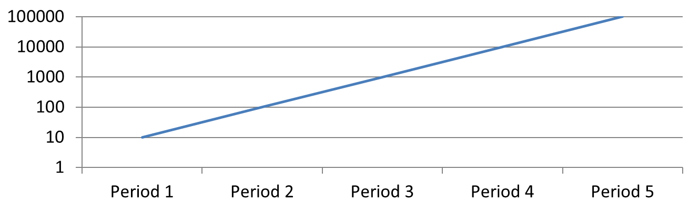

## **सारांश**

यह लेख Aspose.Slides for C++ के साथ चार्ट एक्सिस को अनुकूलित करने का तरीका बताता है। इसमें गणना किए गए एक्सिस मान, चार्ट पंक्तियों और स्तंभों की अदला‑बदली, एक्सिस की दृश्यता, श्रेणी लेबल और टिक‑मार्क अंतराल, तिथि श्रेणियाँ और स्वरूपण, शीर्षक का घूर्णन, एक्सिस का स्थान, प्रदर्शन इकाइयाँ, और लघुगणकीय स्केलिंग शामिल हैं।

## **चार्ट में लंबवत अक्ष पर अधिकतम मान प्राप्त करें**

एक [प्रस्तुति](https://reference.aspose.com/slides/cpp/aspose.slides/presentation/) बनाएं और डिफ़ॉल्ट डेटा के साथ एक एरिया चार्ट जोड़ें। गणना किए गए एक्सिस मान पढ़ने से पहले चार्ट लेआउट अद्यतन रखने के लिए [ValidateChartLayout](https://reference.aspose.com/slides/cpp/aspose.slides.charts/chart/validatechartlayout/) को कॉल करें।

एक्सिस सीमाओं के लिए [get_ActualMaxValue](https://reference.aspose.com/slides/cpp/aspose.slides.charts/axis/get_actualmaxvalue/) और [get_ActualMinValue](https://reference.aspose.com/slides/cpp/aspose.slides.charts/axis/get_actualminvalue/) पढ़ें, तथा टिक अंतराल के लिए [get_ActualMajorUnit](https://reference.aspose.com/slides/cpp/aspose.slides.charts/axis/get_actualmajorunit/) और [get_ActualMinorUnit](https://reference.aspose.com/slides/cpp/aspose.slides.charts/axis/get_actualminorunit/) पढ़ें। तिथि एक्सिस के लिए प्रासंगिक टाइम‑यूनिट स्केल प्रदान करने वाले [get_ActualMajorUnitScale](https://reference.aspose.com/slides/cpp/aspose.slides.charts/axis/get_actualmajorunitscale/) और [get_ActualMinorUnitScale](https://reference.aspose.com/slides/cpp/aspose.slides.charts/axis/get_actualminorunitscale/) हैं। उदाहरण इन मानों को स्थानीय चर में संग्रहीत करता है और चार्ट को सहेजता है।

```cpp
#include <DOM/Presentation.h>
#include <DOM/ISlide.h>
#include <DOM/IShapeCollection.h>
#include <DOM/IChart.h>
#include <DOM/Chart/ChartType.h>
#include <DOM/Chart/IAxesManager.h>
#include <DOM/Chart/IAxis.h>
#include <Export/SaveFormat.h>

using namespace Aspose::Slides;
using namespace Aspose::Slides::Charts;
using namespace Aspose::Slides::Export;

auto presentation = System::MakeObject<Presentation>();
auto slide = presentation->get_Slide(0);

auto chart = slide->get_Shapes()->AddChart(ChartType::Area, 100, 100, 500, 350);
chart->ValidateChartLayout();

auto maxValue = chart->get_Axes()->get_VerticalAxis()->get_ActualMaxValue();
auto minValue = chart->get_Axes()->get_VerticalAxis()->get_ActualMinValue();

auto majorUnit = chart->get_Axes()->get_VerticalAxis()->get_ActualMajorUnit();
auto minorUnit = chart->get_Axes()->get_VerticalAxis()->get_ActualMinorUnit();

auto majorUnitScale = chart->get_Axes()->get_VerticalAxis()->get_ActualMajorUnitScale();
auto minorUnitScale = chart->get_Axes()->get_VerticalAxis()->get_ActualMinorUnitScale();

presentation->Save(u"AxisValues_out.pptx", SaveFormat::Pptx);
```

## **डेटा को एक्सिस के बीच अदला‑बदली करें**

चार्ट डेटा में श्रेणियों और श्रृंखलाओं की भूमिकाओं को बदलने के लिए [SwitchRowColumn](https://reference.aspose.com/slides/cpp/aspose.slides.charts/chartdata/switchrowcolumn/) का उपयोग करें। प्रत्येक पूर्व श्रेणी एक श्रृंखला बन जाती है, और प्रत्येक पूर्व श्रृंखला एक श्रेणी बन जाती है। यह डेटा के समूहबद्ध तरीके को बदलता है; यह क्षैतिज और लंबवत अक्ष को नहीं बदलता। उदाहरण डिफ़ॉल्ट डेटा को `Sheet1!A1:D5` (हैडर पंक्ति और श्रेणी स्तंभ सहित) से बंधन करने के लिए [SetRange](https://reference.aspose.com/slides/cpp/aspose.slides.charts/chartdata/setrange/) का उपयोग करता है, फिर पंक्तियों और स्तंभों को बदलता है। यह चार श्रृंखलाओं और तीन श्रेणियों के साथ चार्ट को सहेजता है।

```cpp
#include <DOM/Presentation.h>
#include <DOM/ISlide.h>
#include <DOM/IShapeCollection.h>
#include <DOM/IChart.h>
#include <DOM/Chart/ChartType.h>
#include <DOM/Chart/IAxesManager.h>
#include <DOM/Chart/IAxis.h>
#include <Export/SaveFormat.h>
#include <DOM/Chart/IChartData.h>

using namespace Aspose::Slides;
using namespace Aspose::Slides::Charts;
using namespace Aspose::Slides::Export;

auto presentation = System::MakeObject<Presentation>();
auto slide = presentation->get_Slide(0);

auto chart = slide->get_Shapes()->AddChart(ChartType::ClusteredColumn, 100, 100, 400, 300);

chart->get_ChartData()->SetRange(u"Sheet1!A1:D5");
chart->get_ChartData()->SwitchRowColumn();

presentation->Save(u"SwitchChartRowColumns_out.pptx", SaveFormat::Pptx);
```

## **लाइन चार्ट के लिए लंबवत अक्ष को निष्क्रिय करें**

लंबवत अक्ष पर `false` के साथ [set_IsVisible](https://reference.aspose.com/slides/cpp/aspose.slides.charts/axis/set_isvisible/) का प्रयोग करके उसे छिपाएँ। उदाहरण डिफ़ॉल्ट डेटा के साथ एक लाइन चार्ट बनाता है और इसे लंबवत अक्ष छिपे हुए अवस्था में सहेजता है।

```cpp
#include <DOM/Presentation.h>
#include <DOM/ISlide.h>
#include <DOM/IShapeCollection.h>
#include <DOM/IChart.h>
#include <DOM/Chart/ChartType.h>
#include <DOM/Chart/IAxesManager.h>
#include <DOM/Chart/IAxis.h>
#include <Export/SaveFormat.h>

using namespace Aspose::Slides;
using namespace Aspose::Slides::Charts;
using namespace Aspose::Slides::Export;

auto presentation = System::MakeObject<Presentation>();
auto slide = presentation->get_Slide(0);

auto chart = slide->get_Shapes()->AddChart(ChartType::Line, 100, 100, 400, 300);
chart->get_Axes()->get_VerticalAxis()->set_IsVisible(false);

presentation->Save(u"HiddenVerticalAxis.pptx", SaveFormat::Pptx);
```

## **लाइन चार्ट के लिए क्षैतिज अक्ष को निष्क्रिय करें**

क्षैतिज अक्ष पर `false` के साथ [set_IsVisible](https://reference.aspose.com/slides/cpp/aspose.slides.charts/axis/set_isvisible/) का प्रयोग करके उसे छिपाएँ। उदाहरण डिफ़ॉल्ट डेटा के साथ एक लाइन चार्ट बनाता है और इसे क्षैतिज अक्ष छिपे हुए अवस्था में सहेजता है।

```cpp
#include <DOM/Presentation.h>
#include <DOM/ISlide.h>
#include <DOM/IShapeCollection.h>
#include <DOM/IChart.h>
#include <DOM/Chart/ChartType.h>
#include <DOM/Chart/IAxesManager.h>
#include <DOM/Chart/IAxis.h>
#include <Export/SaveFormat.h>

using namespace Aspose::Slides;
using namespace Aspose::Slides::Charts;
using namespace Aspose::Slides::Export;

auto presentation = System::MakeObject<Presentation>();
auto slide = presentation->get_Slide(0);

auto chart = slide->get_Shapes()->AddChart(ChartType::Line, 100, 100, 400, 300);
chart->get_Axes()->get_HorizontalAxis()->set_IsVisible(false);

presentation->Save(u"HiddenHorizontalAxis.pptx", SaveFormat::Pptx);
```

## **एक श्रेणी एक्सिस बदलें**

[set_CategoryAxisType](https://reference.aspose.com/slides/cpp/aspose.slides.charts/axis/set_categoryaxistype/) का उपयोग करके तिथि या पाठ श्रेणी एक्सिस चुनें। इस उदाहरण में `ExistingChart.pptx` की आवश्यकता है, जिसमें पहली स्लाइड पर पहला आकार चार्ट है और श्रेणी कोशिकाओं में संख्यात्मक Excel तिथि मान होते हैं। यह क्षैतिज एक्सिस को तिथि एक्सिस में बदलता है। [set_IsAutomaticMajorUnit](https://reference.aspose.com/slides/cpp/aspose.slides.charts/axis/set_isautomaticmajorunit/) को `false`, [set_MajorUnit](https://reference.aspose.com/slides/cpp/aspose.slides.charts/axis/set_majorunit/) को `1`, और [set_MajorUnitScale](https://reference.aspose.com/slides/cpp/aspose.slides.charts/axis/set_majorunitscale/) को महीने के साथ सेट करने से प्रमुख टिक एक‑महीने के अंतराल पर रखे जाते हैं।

```cpp
#include <DOM/Presentation.h>
#include <DOM/ISlide.h>
#include <DOM/IShapeCollection.h>
#include <DOM/IChart.h>
#include <DOM/Chart/ChartType.h>
#include <DOM/Chart/IAxesManager.h>
#include <DOM/Chart/IAxis.h>
#include <Export/SaveFormat.h>
#include <DOM/Chart/CategoryAxisType.h>
#include <DOM/Chart/TimeUnitType.h>
#include <system/object_ext.h>

using namespace Aspose::Slides;
using namespace Aspose::Slides::Charts;
using namespace Aspose::Slides::Export;

auto presentation = System::MakeObject<Presentation>(u"ExistingChart.pptx");
auto slide = presentation->get_Slide(0);

auto chart = System::ExplicitCast<IChart>(slide->get_Shape(0));
chart->get_Axes()->get_HorizontalAxis()->set_CategoryAxisType(CategoryAxisType::Date);
chart->get_Axes()->get_HorizontalAxis()->set_IsAutomaticMajorUnit(false);
chart->get_Axes()->get_HorizontalAxis()->set_MajorUnit(1);
chart->get_Axes()->get_HorizontalAxis()->set_MajorUnitScale(TimeUnitType::Months);

presentation->Save(u"ChangeChartCategoryAxis_out.pptx", SaveFormat::Pptx);
```

## **श्रेणी एक्सिस लेबल अंतराल नियंत्रित करें**

जब चार्ट में कई श्रेणियाँ हों, तो श्रेणियों या डेटा बिंदुओं को हटाए बिना दृश्य लेबलों की संख्या कम करें। इसके लिए [set_IsAutomaticTickLabelSpacing](https://reference.aspose.com/slides/cpp/aspose.slides.charts/iaxis/set_isautomaticticklabelspacing/) को `false` सेट करें, फिर इच्छित श्रेणी अंतराल के साथ [set_TickLabelSpacing](https://reference.aspose.com/slides/cpp/aspose.slides.charts/iaxis/set_ticklabelspacing/) का उपयोग करें। सामान्य क्रम में पाठ श्रेणियों के लिए, गणना पहली श्रेणी से शुरू होती है:

| अंतराल | उदाहरण में प्रदर्शित लेबल |
| --- | --- |
| `1` | Category 1, Category 2, Category 3, … Category 24 |
| `2` | Category 1, Category 3, Category 5, … Category 23 |
| `3` | Category 1, Category 4, Category 7, … Category 22 |

`3` का अंतराल हर तीसरा लेबल दिखाता है, दो लेबल छिपे रहते हैं। यह संबंधित स्तंभों को नहीं हटाता। स्वचालित अंतराल उपलब्ध स्थान के आधार पर निर्धारित करता है; यह आवश्यकतः हर लेबल को नहीं दिखाता।

टिक‑मार्क के लिये अलग नियंत्रण मौजूद हैं। [set_IsAutomaticTickMarksSpacing](https://reference.aspose.com/slides/cpp/aspose.slides.charts/iaxis/set_isautomatictickmarksspacing/) को `false` सेट करें और [set_TickMarksSpacing](https://reference.aspose.com/slides/cpp/aspose.slides.charts/iaxis/set_tickmarksspacing/) से उनका अंतराल निर्धारित करें। उदाहरण के लिये, `1` प्रत्येक श्रेणी अंतराल पर एक टिक रखता है जबकि लेबल केवल प्रत्येक तीसरी श्रेणी पर दिखते हैं। दृश्य शैली के साथ [set_MajorTickMark](https://reference.aspose.com/slides/cpp/aspose.slides.charts/iaxis/set_majortickmark/) सेट करें ताकि परिणाम दिखाई दे। किसी भी स्वचालित‑अंतराल गुण को फिर से `true` करने से चार्ट स्वयं अंतराल चुन लेगा।

निम्न स्व-समाहित उदाहरण 24 श्रेणियों और एक श्रृंखला बनाता है, फिर तीन स्लाइड को `CategoryAxisIntervals.pptx` में सहेजता है: स्वचालित अंतराल, स्वतंत्र टिक‑मार्क वाले मैन्युअल लेबल अंतराल, और पुनः प्राप्त स्वचालित अंतराल। दोनों प्रतियां मूल चार्ट डेटा को बरकरार रखती हैं। कोई इनपुट प्रस्तुति आवश्यक नहीं है। क्षैतिज लेबल टेक्स्ट घनत्व अंतर को स्पष्ट रूप से दिखाता है।

```cpp
#include <DOM/Presentation.h>
#include <DOM/ISlide.h>
#include <DOM/IShapeCollection.h>
#include <DOM/IChart.h>
#include <DOM/Chart/ChartType.h>
#include <DOM/Chart/IAxesManager.h>
#include <DOM/Chart/IAxis.h>
#include <Export/SaveFormat.h>
#include <DOM/Chart/IChartData.h>
#include <DOM/Chart/CategoryAxisType.h>
#include <DOM/Chart/TickMarkType.h>
#include <DOM/Chart/IChartTextFormat.h>
#include <DOM/Chart/IChartTextBlockFormat.h>
#include <DOM/Chart/IChartPortionFormat.h>
#include <DOM/Chart/IChartDataWorkbook.h>
#include <DOM/Chart/IChartDataCell.h>
#include <DOM/Chart/IChartCategoryCollection.h>
#include <DOM/Chart/IChartSeriesCollection.h>
#include <DOM/Chart/IChartSeries.h>
#include <DOM/Chart/IChartDataPointCollection.h>
#include <system/object_ext.h>
#include <DOM/ISlideCollection.h>

using namespace Aspose::Slides;
using namespace Aspose::Slides::Charts;
using namespace Aspose::Slides::Export;

auto presentation = System::MakeObject<Presentation>();
auto slide = presentation->get_Slide(0);

auto chart = slide->get_Shapes()->AddChart(ChartType::ClusteredColumn, 30, 40, 660, 320);

chart->set_HasLegend(false);
chart->get_ChartData()->get_Categories()->Clear();
chart->get_ChartData()->get_Series()->Clear();

auto workbook = chart->get_ChartData()->get_ChartDataWorkbook();
workbook->Clear(0);

auto series = chart->get_ChartData()->get_Series()->Add(ChartType::ClusteredColumn);
for (auto i = 0; i < 24; i++)
{
    auto categoryName = System::String::Format(u"Category {0}", i + 1);
    auto categoryCell = workbook->GetCell(0, i + 1, 0, System::ObjectExt::Box(categoryName));
    chart->get_ChartData()->get_Categories()->Add(categoryCell);
    auto valueCell = workbook->GetCell(0, i + 1, 1, System::ObjectExt::Box(10 + i % 6 * 5));
    series->get_DataPoints()->AddDataPointForBarSeries(valueCell);
}

auto axis = chart->get_Axes()->get_HorizontalAxis();
axis->set_CategoryAxisType(CategoryAxisType::Text);
axis->get_TextFormat()->get_TextBlockFormat()->set_RotationAngle(0);
axis->get_TextFormat()->get_PortionFormat()->set_FontHeight(12);
axis->set_MajorTickMark(TickMarkType::Outside);
axis->set_IsAutomaticTickLabelSpacing(true);
axis->set_IsAutomaticTickMarksSpacing(true);

// स्लाइड 2: हर तीसरे लेबल को दिखाएँ, लेकिन हर श्रेणी के लिए टिक‑मार्क रखें।
auto manualSlide = presentation->get_Slides()->AddClone(slide);
auto manualChart = System::ExplicitCast<IChart>(manualSlide->get_Shape(0));
auto manualAxis = manualChart->get_Axes()->get_HorizontalAxis();
manualAxis->set_IsAutomaticTickLabelSpacing(false);
manualAxis->set_TickLabelSpacing(3);
manualAxis->set_IsAutomaticTickMarksSpacing(false);
manualAxis->set_TickMarksSpacing(1);

// स्लाइड 3: चार्ट को फिर से दोनों अंतराल चुनने दें।
auto restoredSlide = presentation->get_Slides()->AddClone(manualSlide);
auto restoredChart = System::ExplicitCast<IChart>(restoredSlide->get_Shape(0));
restoredChart->get_Axes()->get_HorizontalAxis()->set_IsAutomaticTickLabelSpacing(true);
restoredChart->get_Axes()->get_HorizontalAxis()->set_IsAutomaticTickMarksSpacing(true);

presentation->Save(u"CategoryAxisIntervals.pptx", SaveFormat::Pptx);
```

**स्वचालित अंतराल (स्लाइड 1):** इस रेंडरिंग में प्रत्येक दूसरी श्रेणी लेबल प्रदर्शित होती है और दो पंक्तियों में लिपटी होती है। स्वचालित परिणाम चार्ट आकार, फॉन्ट और रेंडरर के आधार पर बदल सकता है।


**मैन्युअल अंतराल (स्लाइड 2):** प्रत्येक तीसरा लेबल एक पंक्ति में दिखता है, जबकि टिक‑मार्क प्रत्येक श्रेणी अंतराल पर बना रहता है। सभी 24 स्तंभ, लेबल के बिना वाले भी, समान मानों के साथ दृश्य रहते हैं। स्लाइड 3 ऊपर दिखाए गए स्वचालित स्वरूप को पुनः स्थापित करता है।


### **सही एक्सिस और अंतराल चुनें**

पाठ श्रेणी एक्सिस के लिए यह श्रेणी‑गणना अंतराल उपयोग करें, जैसे कॉलम, लाइन, एरिया या बार चार्ट का श्रेणी एक्सिस। कॉलम चार्ट में यह क्षैतिज एक्सिस होता है। क्षैतिज बार चार्ट में श्रेणी एक्सिस लंबवत होता है, इसलिए इन सेटिंग्स को [get_VerticalAxis](https://reference.aspose.com/slides/cpp/aspose.slides.charts/iaxesmanager/get_verticalaxis/) पर लागू करें। टिक‑मार्क अंतराल का उपयोग उन चार्ट्स में श्रृंखला एक्सिस पर भी किया जा सकता है जिनमें वह मौजूद हो।

मूल्य एक्सिस की संख्यात्मक स्केल सेट करने के लिये श्रेणी लेबल अंतराल का उपयोग न करें। मूल्य एक्सिस पर, [set_MajorUnit](https://reference.aspose.com/slides/cpp/aspose.slides.charts/iaxis/set_majorunit/) मानों के अंतर को निर्दिष्ट करता है: उदाहरण के लिये, `10` का प्रमुख इकाई 0, 10, 20 आदि पर टिक बनाता है जब अक्ष शून्य से शुरू होता है। `3` का श्रेणी लेबल अंतराल केवल श्रेणी स्थानों को गिनता है, उनके डेटा मानों की परवाह किए बिना। स्कैटर और बबल चार्ट मूल्य एक्सिस का उपयोग करते हैं, न कि पाठ श्रेणी एक्सिस। तिथि एक्सिस के लिये, [Change a Category Axis](#change-a-category-axis) में वर्णित समय‑आधारित प्रमुख इकाइयों और स्केल का उपयोग करें।

## **श्रेणी एक्सिस मानों के लिये तिथि स्वरूप सेट करें**

उदाहरण डिफ़ॉल्ट चार्ट डेटा को चार वार्षिक मानों से बदलता है। तिथियाँ पहली कार्यपत्रक (सूचकांक `0`) में OLE Automation क्रमांक के रूप में संग्रहीत होती हैं। तिथि एक्सिस चुनने के लिये [set_CategoryAxisType](https://reference.aspose.com/slides/cpp/aspose.slides.charts/axis/set_categoryaxistype/) का उपयोग करें, स्रोत‑लिंक्ड स्वरूपण को [set_IsNumberFormatLinkedToSource](https://reference.aspose.com/slides/cpp/aspose.slides.charts/axis/set_isnumberformatlinkedtosource/) से अक्षम करें, और श्रेणी लेबल को सेल स्वरूपण से स्वतंत्र रूप से चार-अंकीय वर्ष दिखाने के लिये `yyyy` को [set_NumberFormat](https://reference.aspose.com/slides/cpp/aspose.slides.charts/axis/set_numberformat/) से असाइन करें।

```cpp
#include <DOM/Presentation.h>
#include <DOM/ISlide.h>
#include <DOM/IShapeCollection.h>
#include <DOM/IChart.h>
#include <DOM/Chart/ChartType.h>
#include <DOM/Chart/IAxesManager.h>
#include <DOM/Chart/IAxis.h>
#include <Export/SaveFormat.h>
#include <DOM/Chart/IChartData.h>
#include <DOM/Chart/CategoryAxisType.h>
#include <DOM/Chart/IChartDataWorkbook.h>
#include <DOM/Chart/IChartDataCell.h>
#include <DOM/Chart/IChartCategoryCollection.h>
#include <DOM/Chart/IChartSeriesCollection.h>
#include <DOM/Chart/IChartSeries.h>
#include <DOM/Chart/IChartDataPointCollection.h>
#include <system/object_ext.h>
#include <system/date_time.h>

using namespace Aspose::Slides;
using namespace Aspose::Slides::Charts;
using namespace Aspose::Slides::Export;

auto presentation = System::MakeObject<Presentation>();
auto slide = presentation->get_Slide(0);

auto chart = slide->get_Shapes()->AddChart(ChartType::Line, 50, 50, 450, 300);

chart->get_ChartData()->get_Categories()->Clear();
chart->get_ChartData()->get_Series()->Clear();

auto workbook = chart->get_ChartData()->get_ChartDataWorkbook();
workbook->Clear(0);

auto series = chart->get_ChartData()->get_Series()->Add(ChartType::Line);
for (auto i = 0; i < 4; i++)
{
    auto date = System::DateTime(2015 + i, 1, 1);
    auto categoryCell = workbook->GetCell(0, i + 1, 0, System::ObjectExt::Box(date.ToOADate()));
    chart->get_ChartData()->get_Categories()->Add(categoryCell);

    auto valueCell = workbook->GetCell(0, i + 1, 1, System::ObjectExt::Box(i + 1));
    series->get_DataPoints()->AddDataPointForLineSeries(valueCell);
}

chart->get_Axes()->get_HorizontalAxis()->set_CategoryAxisType(CategoryAxisType::Date);
chart->get_Axes()->get_HorizontalAxis()->set_IsNumberFormatLinkedToSource(false);
chart->get_Axes()->get_HorizontalAxis()->set_NumberFormat(u"yyyy");

presentation->Save(u"DateAxisFormat.pptx", SaveFormat::Pptx);
```

## **चार्ट एक्सिस शीर्षक के लिये घूर्णन कोण सेट करें**

ऊर्ध्वाधर‑अक्ष शीर्षक को [set_HasTitle](https://reference.aspose.com/slides/cpp/aspose.slides.charts/axis/set_hastitle/) से सक्षम करें, शीर्षक टेक्स्ट प्रदान करें, और शीर्षक को घुमाने के लिये [set_RotationAngle](https://reference.aspose.com/slides/cpp/aspose.slides.charts/icharttextblockformat/set_rotationangle/) का प्रयोग करें। कोण डिग्री में मापा जाता है; यह उदाहरण एक कॉलम चार्ट को 90 डिग्री पर घुमाए गए मान‑अक्ष शीर्षक के साथ सहेजता है।

```cpp
#include <DOM/Presentation.h>
#include <DOM/ISlide.h>
#include <DOM/IShapeCollection.h>
#include <DOM/IChart.h>
#include <DOM/Chart/ChartType.h>
#include <DOM/Chart/IAxesManager.h>
#include <DOM/Chart/IAxis.h>
#include <Export/SaveFormat.h>
#include <DOM/Chart/IChartTextFormat.h>
#include <DOM/Chart/IChartTextBlockFormat.h>
#include <DOM/Chart/IChartTitle.h>

using namespace Aspose::Slides;
using namespace Aspose::Slides::Charts;
using namespace Aspose::Slides::Export;

auto presentation = System::MakeObject<Presentation>();
auto slide = presentation->get_Slide(0);

auto chart = slide->get_Shapes()->AddChart(ChartType::ClusteredColumn, 50, 50, 450, 300);
chart->get_Axes()->get_VerticalAxis()->set_HasTitle(true);
chart->get_Axes()->get_VerticalAxis()->get_Title()->AddTextFrameForOverriding(u"Value");
chart->get_Axes()->get_VerticalAxis()->get_Title()->get_TextFormat()->get_TextBlockFormat()->set_RotationAngle(90);

presentation->Save(u"RotatedAxisTitle.pptx", SaveFormat::Pptx);
```

## **श्रेणी या मूल्य एक्सिस पर एक्सिस स्थिति सेट करें**

[set_AxisBetweenCategories](https://reference.aspose.com/slides/cpp/aspose.slides.charts/axis/set_axisbetweencategories/) का उपयोग करके निर्धारित करें कि मूल्य एक्सिस श्रेणी एक्सिस को श्रेणियों के बीच या श्रेणी टिक‑मार्क पर पार करे। यह गुण केवल श्रेणी एक्सिस पर लागू होता है। उदाहरण इसे कॉलम चार्ट के क्षैतिज श्रेणी एक्सिस पर `true` सेट करता है और परिणाम सहेजता है।

```cpp
#include <DOM/Presentation.h>
#include <DOM/ISlide.h>
#include <DOM/IShapeCollection.h>
#include <DOM/IChart.h>
#include <DOM/Chart/ChartType.h>
#include <DOM/Chart/IAxesManager.h>
#include <DOM/Chart/IAxis.h>
#include <Export/SaveFormat.h>

using namespace Aspose::Slides;
using namespace Aspose::Slides::Charts;
using namespace Aspose::Slides::Export;

auto presentation = System::MakeObject<Presentation>();
auto slide = presentation->get_Slide(0);

auto chart = slide->get_Shapes()->AddChart(ChartType::ClusteredColumn, 50, 50, 450, 300);
chart->get_Axes()->get_HorizontalAxis()->set_AxisBetweenCategories(true);

presentation->Save(u"AxisBetweenCategories.pptx", SaveFormat::Pptx);
```

## **चार्ट मूल्य एक्सिस पर प्रदर्शन इकाई सेट करें**

[set_DisplayUnit](https://reference.aspose.com/slides/cpp/aspose.slides.charts/axis/set_displayunit/) का उपयोग करके मूल्य एक्सिस पर लेबलों को डेटा बदले बिना स्केल करें। यदि [DisplayUnitType](https://reference.aspose.com/slides/cpp/aspose.slides.charts/displayunittype/) `Millions` पर सेट किया गया है, तो 60,000,000 का मान 60 के रूप में प्रदर्शित होगा। उदाहरण एक कॉलम चार्ट बनाता है और उसकी लंबवत एक्सिस पर मिलियन प्रदर्शन इकाई लागू करता है।

```cpp
#include <DOM/Presentation.h>
#include <DOM/ISlide.h>
#include <DOM/IShapeCollection.h>
#include <DOM/IChart.h>
#include <DOM/Chart/ChartType.h>
#include <DOM/Chart/IAxesManager.h>
#include <DOM/Chart/IAxis.h>
#include <Export/SaveFormat.h>
#include <DOM/Chart/DisplayUnitType.h>

using namespace Aspose::Slides;
using namespace Aspose::Slides::Charts;
using namespace Aspose::Slides::Export;

auto presentation = System::MakeObject<Presentation>();
auto slide = presentation->get_Slide(0);

auto chart = slide->get_Shapes()->AddChart(ChartType::ClusteredColumn, 50, 50, 450, 300);
chart->get_Axes()->get_VerticalAxis()->set_DisplayUnit(DisplayUnitType::Millions);

presentation->Save(u"Result.pptx", SaveFormat::Pptx);
```

## **लघुगणकीय मूल्य अक्ष को कॉन्फ़िगर करें**

लघुगणकीय मूल्य एक्सिस तब उपयोगी होता है जब सकारात्मक मान कई क्रम वृद्धि में फैले हों। उदाहरण के लिये, एक सेवा पाँच अवधियों में क्रमशः 10, 100, 1,000, 10,000 और 100,000 अनुरोध प्राप्त कर सकती है। रैखिक स्केल पर छोटे मान शून्य के निकट बहुत करीब दिखते हैं। लघुगणकीय स्केल उनके सापेक्ष वृद्धि को तुलना करने में आसान बनाता है: समान दूरी समान अनुपात का प्रतिनिधित्व करती हैं, न कि समान अंतर का।

मूल्य एक्सिस पर `true` के साथ [set_IsLogarithmic](https://reference.aspose.com/slides/cpp/aspose.slides.charts/axis/set_islogarithmic/) कॉल करें और बेस चुनने के लिये [set_LogBase](https://reference.aspose.com/slides/cpp/aspose.slides.charts/axis/set_logbase/) का उपयोग करें। यह मौजूदा मानों के प्रदर्शित रूप को बदलता है; डेटा या लघुगणकीय ट्रेंड‑लाइन नहीं जोड़ता। ट्रेंड‑लाइन डेटा में फिटेड संबंध को दर्शाती है और एक अलग सुविधा है।

### **मूल्य एक्सिस और बेस चुनें**

लाइन या कॉलम चार्ट के लिये, मूल्य एक्सिस [get_VerticalAxis](https://reference.aspose.com/slides/cpp/aspose.slides.charts/iaxesmanager/get_verticalaxis/) होता है। क्षैतिज बार चार्ट के लिये, यह [get_HorizontalAxis](https://reference.aspose.com/slides/cpp/aspose.slides.charts/iaxesmanager/get_horizontalaxis/) होता है। स्कैटर और बबल चार्ट में दो मूल्य एक्सिस होते हैं, इसलिए X मानों के लिये क्षैतिज एक्सिस, Y मानों के लिये लंबवत एक्सिस, या दोनों चुनें। श्रेणी एक्सिस पर लघुगणकीय स्केलिंग लागू न करें।

डिफ़ॉल्ट लघुगणकीय बेस `10` है। PPTX चार्ट के लिये, `2` से `1000` तक का कोई भी बेस उपयोग किया जा सकता है; फ्राॅक्शनल बेस जैसे `2.5` भी समर्थित हैं। बेस `10` के साथ क्रमिक शक्ति‑मान 10, 100, 1,000, 10,000 समान अंतर पर स्थित होते हैं।

### **रैखिक और लघुगणकीय स्केल की तुलना**

निम्न स्व-समाहित उदाहरण पहले स्लाइड पर पाँच अनुरोध गणना के साथ एक लाइन चार्ट बनाता है, फिर उसी स्लाइड को क्लोन करके दूसरे पर बेस‑10 लघुगणकीय मूल्य एक्सिस सक्षम करता है। दोनों स्लाइड समान डेटा बनाए रखती हैं।

```cpp
#include <DOM/Presentation.h>
#include <DOM/ISlide.h>
#include <DOM/ISlideCollection.h>
#include <DOM/IShapeCollection.h>
#include <DOM/IChart.h>
#include <DOM/Chart/ChartType.h>
#include <DOM/Chart/IAxesManager.h>
#include <DOM/Chart/IAxis.h>
#include <DOM/Chart/IChartData.h>
#include <DOM/Chart/IChartDataWorkbook.h>
#include <DOM/Chart/IChartDataCell.h>
#include <DOM/Chart/IChartCategoryCollection.h>
#include <DOM/Chart/IChartSeriesCollection.h>
#include <DOM/Chart/IChartSeries.h>
#include <DOM/Chart/IChartDataPointCollection.h>
#include <Export/SaveFormat.h>
#include <system/object_ext.h>
#include <array>

using namespace Aspose::Slides;
using namespace Aspose::Slides::Charts;
using namespace Aspose::Slides::Export;

auto presentation = System::MakeObject<Presentation>();
auto slide = presentation->get_Slide(0);

auto chart = slide->get_Shapes()->AddChart(ChartType::Line, 30, 40, 660, 200);

chart->set_HasLegend(false);

chart->get_ChartData()->get_Categories()->Clear();
chart->get_ChartData()->get_Series()->Clear();

auto workbook = chart->get_ChartData()->get_ChartDataWorkbook();
workbook->Clear(0);

auto series = chart->get_ChartData()->get_Series()->Add(ChartType::Line);
auto values = std::array<double, 5>{10, 100, 1000, 10000, 100000};

for (auto i = 0; i < values.size(); i++)
{
    auto categoryName = System::String::Format(u"Period {0}", i + 1);
    auto categoryCell = workbook->GetCell(0, i + 1, 0, System::ObjectExt::Box(categoryName));
    chart->get_ChartData()->get_Categories()->Add(categoryCell);

    auto valueCell = workbook->GetCell(0, i + 1, 1, System::ObjectExt::Box(values[i]));
    series->get_DataPoints()->AddDataPointForLineSeries(valueCell);
}

// पहली स्लाइड को रैखिक रखें और केवल प्रतिलिपि के मूल्य-अक्ष स्केल को बदलें।
auto logarithmicSlide = presentation->get_Slides()->AddClone(slide);
auto logarithmicChart = System::ExplicitCast<IChart>(logarithmicSlide->get_Shape(0));
auto valueAxis = logarithmicChart->get_Axes()->get_VerticalAxis();
valueAxis->set_IsLogarithmic(true);
valueAxis->set_LogBase(10);

presentation->Save(u"LogarithmicAxis.pptx", SaveFormat::Pptx);
```

**रैखिक स्केल (स्लाइड 1):** समान लंबवत दूरी अनुरोध गणना में समान अंतर दर्शाती है। सबसे बड़ा मान चार्ट को प्रभुत्व देता है, जिससे छोटे मान पहचाने में कठिन होते हैं।


**लघुगणकीय स्केल (स्लाइड 2):** समान लंबवत दूरी समान अनुपात दर्शाती है। प्रत्येक अवधि में अनुरोध पिछले की तुलना में दस गुना अधिक होते हैं, इसलिए बिंदु बेस‑10 स्केल पर एक सीधी बढ़ती रेखा बनाते हैं। अक्ष लेबल अभी भी मूल अनुरोध गणना दिखाते हैं।



### **शून्य और नकारात्मक मानों को संभालें**

लघुगणकीय स्केल केवल शुद्ध सकारात्मक मानों को प्रदर्शित कर सकता है। इसे सक्षम करने से पहले डेटा जाँचें। यदि शून्य या नकारात्मक मान अर्थपूर्ण हैं, तो रैखिक स्केल रखें या उन्हें अलग से दिखाएँ। यदि विश्लेषण के लिये उन मानों को बाहर रखना उचित है, तो उनका बहिष्कार स्पष्ट रूप से बताएँ। उन्हें छोटे सकारात्मक संख्याओं से चुपचाप बदलें नहीं, क्योंकि इससे डेटा का अर्थ बदल जाता है। लघुगणकीय अक्ष के लिये मैन्युअल रूप से सेट किया गया न्यूनतम या अधिकतम भी सकारात्मक होना चाहिए।

## **अक्सर पूछे जाने वाले प्रश्न**

**एक अक्ष को दूसरे के ऊपर कहाँ प्रतिच्छेदित करना है (axis crossing) यह मान कैसे सेट करें?**

[set_CrossType](https://reference.aspose.com/slides/cpp/aspose.slides.charts/axis/set_crosstype/) का उपयोग करके प्रतिच्छेदन व्यवहार चुनें। संख्यात्मक प्रतिच्छेदन मान निर्दिष्ट करने के लिये [set_CrossAt](https://reference.aspose.com/slides/cpp/aspose.slides.charts/axis/set_crossat/) का प्रयोग करें। ये सेटिंग्स आपको अक्ष प्रतिच्छेदन को उपयुक्त आधार रेखा पर ले जाने देती हैं।

**टिक लेबल को अक्ष के सापेक्ष कैसे स्थित करें?**

[T​ickLabelPositionType](https://reference.aspose.com/slides/cpp/aspose.slides.charts/ticklabelpositiontype/) में से `Low`, `High`, `NextTo` या `None` मानों के साथ [set_TickLabelPosition](https://reference.aspose.com/slides/cpp/aspose.slides.charts/axis/set_ticklabelposition/) का प्रयोग करें। टिक‑मार्क को नियंत्रित करने के लिये, लेबल स्थिति से अलग, [set_MajorTickMark](https://reference.aspose.com/slides/cpp/aspose.slides.charts/axis/set_majortickmark/) या [set_MinorTickMark](https://reference.aspose.com/slides/cpp/aspose.slides.charts/axis/set_minortickmark/) का उपयोग करें।