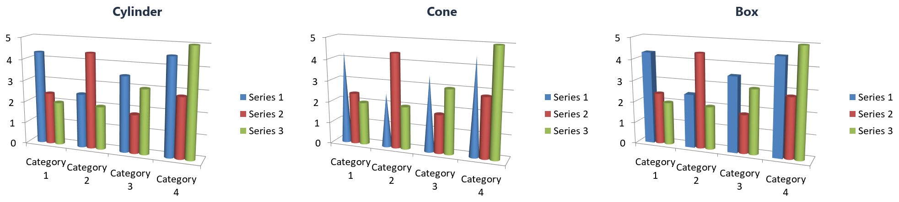

## **अवलोकन**

Aspose.Slides for C++ आपको 3D चार्ट का दृश्य कस्टमाइज़ करने की सुविधा देता है [IChart::get_Rotation3D](https://reference.aspose.com/slides/cpp/aspose.slides.charts/ichart/get_rotation3d/). यह लेख दिखाता है कि कैसे रोटेशन, ऊँचाई अनुपात, गहराई, समकोण अक्ष, और श्रृंखलाओं के बीच की दूरी को समायोजित किया जाए, फिर प्रस्तुति को PPTX फ़ॉर्मेट में सहेजा जाए।

## **3D चार्ट की घूर्णन और गहराई सेट करें**

नीचे दिया गया उदाहरण एक [Presentation](https://reference.aspose.com/slides/cpp/aspose.slides/presentation/) बनाता है और उसके पहले स्लाइड में एक स्टैक्ड 3D कॉलम चार्ट जोड़ने के लिए [IShapeCollection::AddChart](https://reference.aspose.com/slides/cpp/aspose.slides/ishapecollection/addchart/) का उपयोग करता है। यह डिफ़ॉल्ट श्रृंखला और श्रेणियों को दो श्रृंखलाओं से बदल देता है, प्रत्येक में तीन मान होते हैं। कार्यपत्रक सूचकांक `0` चार्ट की पहली डेटा कार्यपत्रक को दर्शाता है; पंक्ति `0` श्रृंखला नाम रखती है, और स्तंभ `0` श्रेणी लेबल रखता है।

[set_RotationX](https://reference.aspose.com/slides/cpp/aspose.slides.charts/irotation3d/set_rotationx/) और [set_RotationY](https://reference.aspose.com/slides/cpp/aspose.slides.charts/irotation3d/set_rotationy/) विधियां क्रमशः चार्ट की घूर्णन को 40 और 270 डिग्री पर सेट करती हैं। [set_DepthPercents](https://reference.aspose.com/slides/cpp/aspose.slides.charts/irotation3d/set_depthpercents/) इसकी गहराई को उसकी चौड़ाई के 150 % पर सेट करता है, जबकि [set_RightAngleAxes](https://reference.aspose.com/slides/cpp/aspose.slides.charts/irotation3d/set_rightangleaxes/) परिप्रेक्ष्य के बजाय समकोण अक्ष को सक्षम करता है। परिणामस्वरूप प्रस्तुति में इन 3D दृश्य सेटिंग्स के साथ भरा हुआ चार्ट शामिल है।

```cpp
#include <DOM/Chart/ChartType.h>
#include <DOM/Chart/IChartData.h>
#include <DOM/Chart/IChartSeries.h>
#include <DOM/Chart/IChartSeriesCollection.h>
#include <DOM/Chart/IRotation3D.h>
#include <DOM/IChart.h>
#include <DOM/IShapeCollection.h>
#include <DOM/ISlide.h>
#include <DOM/Presentation.h>
#include <Export/SaveFormat.h>
#include <system/shared_ptr.h>
#include <system/string.h>
#include <DOM/Chart/IChartCategoryCollection.h>
#include <DOM/Chart/IChartDataWorkbook.h>
#include <DOM/Chart/IChartDataPointCollection.h>
#include <system/object_ext.h>

using namespace Aspose::Slides;
using namespace Aspose::Slides::Charts;
using namespace Aspose::Slides::Export;
using namespace System;

auto presentation = MakeObject<Presentation>();
auto slide = presentation->get_Slide(0);

auto chart = slide->get_Shapes()->AddChart(ChartType::StackedColumn3D, 0, 0, 500, 500);

chart->get_ChartData()->get_Series()->Clear();
chart->get_ChartData()->get_Categories()->Clear();

auto workbook = chart->get_ChartData()->get_ChartDataWorkbook();
auto worksheetIndex = 0;

double values[2][3] = { { 20, 50, 30 }, { 30, 10, 60 } };

for (auto categoryIndex = 0; categoryIndex < 3; categoryIndex++)
{
    auto categoryName = String::Format(u"Category {0}", categoryIndex + 1);
    auto categoryCell = workbook->GetCell(worksheetIndex, categoryIndex + 1, 0, ObjectExt::Box(categoryName));
    chart->get_ChartData()->get_Categories()->Add(categoryCell);
}

for (auto seriesIndex = 0; seriesIndex < 2; seriesIndex++)
{
    auto seriesName = String::Format(u"Series {0}", seriesIndex + 1);
    auto seriesCell = workbook->GetCell(worksheetIndex, 0, seriesIndex + 1, ObjectExt::Box(seriesName));
    auto series = chart->get_ChartData()->get_Series()->Add(seriesCell, chart->get_Type());

    for (auto categoryIndex = 0; categoryIndex < 3; categoryIndex++)
    {
        auto valueCell = workbook->GetCell(worksheetIndex, categoryIndex + 1, seriesIndex + 1, ObjectExt::Box(values[seriesIndex][categoryIndex]));
        series->get_DataPoints()->AddDataPointForBarSeries(valueCell);
    }
}

chart->get_Rotation3D()->set_RightAngleAxes(true);
chart->get_Rotation3D()->set_RotationX(40);
chart->get_Rotation3D()->set_RotationY(270);
chart->get_Rotation3D()->set_DepthPercents(150);

presentation->Save(u"Rotation3D_out.pptx", SaveFormat::Pptx);
presentation->Dispose();
```

## **3D चार्ट सतह पर चित्र भराव लागू करें**

आप 3D चार्ट की [side wall](https://reference.aspose.com/slides/cpp/aspose.slides.charts/ichart/get_sidewall/), [back wall](https://reference.aspose.com/slides/cpp/aspose.slides.charts/ichart/get_backwall/), और [floor](https://reference.aspose.com/slides/cpp/aspose.slides.charts/ichart/get_floor/) को स्वतंत्र रूप से भर सकते हैं। सतह के [fill type](https://reference.aspose.com/slides/cpp/aspose.slides/ifillformat/set_filltype/) को `Picture` सेट करें और एक छवि असाइन करें। छवि की एक ही प्रति को सतह पर फिट करने के लिये, दोनों [picture fill mode](https://reference.aspose.com/slides/cpp/aspose.slides/ipicturefillformat/set_picturefillmode/) और सतह के [picture type](https://reference.aspose.com/slides/cpp/aspose.slides.charts/ichartwall/set_picturetype/) को `Stretch` सेट करें।

कार्य निर्देशिका में [arrow.png](arrow.png) सहेजें। उदाहरण चार्ट को घुमाता है और लंबवत अक्ष पर अधिकतम मान बढ़ाता है ताकि फ़्लोर कॉलम के बीच दिखाई दे। फिर यह स्लाइड को दो बार क्लोन करता है और प्रत्येक स्लाइड पर अलग सतह पर तीर लागू करता है। सभी तीन चार्ट समान डेटा, दृश्य कोण, और पृष्ठभूमि रखते हैं।

```cpp
#include <DOM/Chart/ChartType.h>
#include <DOM/Chart/IAxesManager.h>
#include <DOM/Chart/IAxis.h>
#include <DOM/Chart/IChartWall.h>
#include <DOM/Chart/IFormat.h>
#include <DOM/Chart/IRotation3D.h>
#include <DOM/Chart/PictureType.h>
#include <DOM/FillType.h>
#include <DOM/IChart.h>
#include <DOM/IFillFormat.h>
#include <DOM/IImageCollection.h>
#include <DOM/IPPImage.h>
#include <DOM/IPictureFillFormat.h>
#include <DOM/IShapeCollection.h>
#include <DOM/ISlide.h>
#include <DOM/ISlideCollection.h>
#include <DOM/ISlidesPicture.h>
#include <DOM/PictureFillMode.h>
#include <DOM/Presentation.h>
#include <Export/SaveFormat.h>
#include <system/io/file.h>
#include <system/shared_ptr.h>
#include <initializer_list>

using namespace Aspose::Slides;
using namespace Aspose::Slides::Charts;
using namespace Aspose::Slides::Export;
using namespace System;

auto presentation = MakeObject<Presentation>();
auto slide = presentation->get_Slide(0);

auto chart = slide->get_Shapes()->AddChart(ChartType::Column3D, 20, 30, 680, 480);
chart->get_Rotation3D()->set_RightAngleAxes(true);
chart->get_Rotation3D()->set_RotationX(40);
chart->get_Rotation3D()->set_RotationY(30);

auto verticalAxis = chart->get_Axes()->get_VerticalAxis();
verticalAxis->set_IsAutomaticMaxValue(false);
verticalAxis->set_MaxValue(24);

auto backSlide = presentation->get_Slides()->AddClone(slide);
auto floorSlide = presentation->get_Slides()->AddClone(slide);
auto backChart = ExplicitCast<IChart>(backSlide->get_Shape(0));
auto floorChart = ExplicitCast<IChart>(floorSlide->get_Shape(0));

auto imageBytes = IO::File::ReadAllBytes(u"arrow.png");
auto arrow = presentation->get_Images()->AddImage(imageBytes);

for (const auto& surface : { chart->get_SideWall(), backChart->get_BackWall(), floorChart->get_Floor() })
{
    auto fill = surface->get_Format()->get_Fill();
    fill->set_FillType(FillType::Picture);
    auto pictureFill = fill->get_PictureFillFormat();
    pictureFill->get_Picture()->set_Image(arrow);
    pictureFill->set_PictureFillMode(PictureFillMode::Stretch);
    surface->set_PictureType(PictureType::Stretch);
}

presentation->Save(u"chart-surfaces.pptx", SaveFormat::Pptx);
presentation->Dispose();
```

Microsoft PowerPoint तीन स्लाइड को इस प्रकार दिखाता है।

| साइड दीवार | पीछे की दीवार | फ़्लोर |
| --- | --- | --- |
|  |  |  |

## **3D चार्ट की ऊँचाई अनुपात समायोजित करें**

[IRotation3D::set_HeightPercents](https://reference.aspose.com/slides/cpp/aspose.slides.charts/irotation3d/set_heightpercents/) का उपयोग करके 3D चार्ट की ऊँचाई को उसकी चौड़ाई के प्रतिशत के रूप में सेट करें। यह स्लाइड पर चार्ट ऑब्जेक्ट को रिसाइज़ किए बिना 3D दृश्य के अनुपात बदलता है।

निम्न उदाहरण डिफ़ॉल्ट डेटा के साथ एक [Column3D](https://reference.aspose.com/slides/cpp/aspose.slides.charts/charttype/) चार्ट बनाता है: तीन श्रृंखलाएं और चार श्रेणियां। यह 50 %, 100 % और 200 % ऊँचाई अनुपात के साथ तीन प्रस्तुति सहेजता है। चार्ट की स्थिति, चौड़ाई, और ऊँचाई स्थिर रहती है। डेटा, घूर्णन, गहराई, श्रृंखला अंतर, और फॉर्मेटिंग सभी तीन फ़ाइलों में समान है; केवल ऊँचाई प्रतिशत बदलता है।

```cpp
#include <DOM/Chart/ChartType.h>
#include <DOM/Chart/IChartData.h>
#include <DOM/Chart/IChartSeries.h>
#include <DOM/Chart/IChartSeriesCollection.h>
#include <DOM/Chart/IChartSeriesGroup.h>
#include <DOM/Chart/IRotation3D.h>
#include <DOM/IChart.h>
#include <DOM/IShapeCollection.h>
#include <DOM/ISlide.h>
#include <DOM/Presentation.h>
#include <Export/SaveFormat.h>
#include <system/shared_ptr.h>
#include <system/string.h>
#include <cstdint>
#include <initializer_list>

using namespace Aspose::Slides;
using namespace Aspose::Slides::Charts;
using namespace Aspose::Slides::Export;
using namespace System;

auto presentation = MakeObject<Presentation>();
auto slide = presentation->get_Slide(0);

auto chart = slide->get_Shapes()->AddChart(ChartType::Column3D, 40, 30, 620, 460);
chart->get_Rotation3D()->set_RotationX(20);
chart->get_Rotation3D()->set_RotationY(30);
chart->get_Rotation3D()->set_RightAngleAxes(true);
chart->get_Rotation3D()->set_DepthPercents(100);
chart->get_ChartData()->get_Series()->idx_get(0)->get_ParentSeriesGroup()->set_GapDepth(150);

for (uint16_t heightPercent : { 50, 100, 200 })
{
    chart->get_Rotation3D()->set_HeightPercents(heightPercent);
    auto fileName = String::Format(u"chart_height_{0}.pptx", heightPercent);
    presentation->Save(fileName, SaveFormat::Pptx);
}
presentation->Dispose();
```

निम्न छवियां समकक्ष .NET उदाहरण से Microsoft PowerPoint द्वारा निर्यात की गई हैं और समान ऊँचाई सेटिंग्स को दर्शाती हैं। छोटी प्रतिशत एक सपाट दृश्य बनाती है, जबकि बड़ी प्रतिशत समान चार्ट ऑब्जेक्ट के भीतर एक ऊँचा दृश्य बनाती है। PowerPoint संभवतः अक्ष टिक अंतराल और लेबल प्लेसमेंट को भी दृश्य में फिट करने के लिये समायोजित करता है।

| ऊँचाई: 50 % | ऊँचाई: 100 % | ऊँचाई: 200 % |
| --- | --- | --- |
|  |  |  |

ये विधियां चार्ट के विभिन्न पहलुओं को नियंत्रित करती हैं:

| विधि | प्रभाव |
| --- | --- |
| [IRotation3D::set_HeightPercents](https://reference.aspose.com/slides/cpp/aspose.slides.charts/irotation3d/set_heightpercents/) | 3D दृश्य की ऊँचाई को उसकी चौड़ाई के प्रतिशत के रूप में। |
| [IShape::set_Height](https://reference.aspose.com/slides/cpp/aspose.slides/ishape/set_height/) | स्लाइड पर चार्ट ऑब्जेक्ट की ऊँचाई, पॉइंट में। |
| [IRotation3D::set_DepthPercents](https://reference.aspose.com/slides/cpp/aspose.slides.charts/irotation3d/set_depthpercents/) | 3D दृश्य की गहराई को उसकी चौड़ाई के प्रतिशत के रूप में। |
| [IChartSeriesGroup::set_GapDepth](https://reference.aspose.com/slides/cpp/aspose.slides.charts/ichartseriesgroup/set_gapdepth/) | गहराई अक्ष पर श्रृंखलाओं के बीच अंतर, मार्कर चौड़ाई के प्रतिशत में। |

ऊँचाई सेटिंग 3D कॉलम और बार चार्ट, जिसमें सिलेंडर, शंकु, और पिरामिड वेरिएंट शामिल हैं, साथ ही 3D लाइन, एरिया, पाई और सतह चार्ट को प्रभावित करती है। ऊपर दिया गया तुलना सत्यापित `Column3D` प्रकार का उपयोग करता है। यह सेटिंग 2D `ClusteredColumn` चार्ट या `BubbleWith3D` चार्ट की उपस्थिति को नहीं बदलती; ये नाम [ChartType](https://reference.aspose.com/slides/cpp/aspose.slides.charts/charttype/) एनेमरेशन के सदस्य हैं। अन्य चार्ट उपस्थिति सेटिंग्स के लिये देखें [Chart Formatting](/slides/hi/cpp/chart-formatting/)।

## **श्रृंखलाओं के बीच अंतराल समायोजित करें**

[IChartSeriesGroup::set_GapDepth](https://reference.aspose.com/slides/cpp/aspose.slides.charts/ichartseriesgroup/set_gapdepth/) का उपयोग करके 3D चार्ट में गहराई अक्ष के साथ डेटा श्रृंखलाओं के बीच की दूरी को नियंत्रित करें, जो मार्कर चौड़ाई के प्रतिशत में व्यक्त की जाती है। **0 से 500** तक के मान उपयोग करें, समावेशी: `0` अंतराल हटाता है, जबकि बड़े मान अंतराल बढ़ाते हैं। निश्चित चार्ट गहराई के साथ, अंतराल बढ़ाने से मार्कर गहराई अक्ष पर पतले हो जाते हैं।

समूह तक पहुंचने के लिये [IChartSeries::get_ParentSeriesGroup](https://reference.aspose.com/slides/cpp/aspose.slides.charts/ichartseries/get_parentseriesgroup/) का उपयोग करें। यह सेटिंग उस समूह की प्रत्येक श्रृंखला पर लागू होती है, न कि केवल उसी श्रृंखला पर जिस से इसे प्राप्त किया गया हो। [IChartSeries::get_GapDepth](https://reference.aspose.com/slides/cpp/aspose.slides.charts/ichartseries/get_gapdepth/) पैरेंट समूह की सेटिंग लौटाता है।

यह सेटिंग 3D कॉलम और बार चार्ट, उनके सिलेंडर, शंकु, और पिरामिड वेरिएंट, साथ ही 3D लाइन और एरिया चार्ट को प्रभावित करती है। उपस्थिति इस पर निर्भर करती है कि श्रृंखलाएं गहराई में व्यवस्थित हैं, क्लस्टर्ड हैं, या स्टैक्ड हैं। अलग-अलग श्रृंखलाओं के बीच अंतराल का स्पष्ट तुलना करने के लिये, [ChartType](https://reference.aspose.com/slides/cpp/aspose.slides.charts/charttype/) एनेमरेशन से `ChartType::Column3D` का उपयोग करें।

ये विधियां चार्ट के विभिन्न पहलुओं को नियंत्रित करती हैं:

| विधि | प्रभाव |
| --- | --- |
| [IChartSeriesGroup::set_GapDepth](https://reference.aspose.com/slides/cpp/aspose.slides.charts/ichartseriesgroup/set_gapdepth/) | गहराई अक्ष पर श्रृंखलाओं के बीच अंतर, मार्कर चौड़ाई के प्रतिशत में। |
| [IChartSeriesGroup::set_GapWidth](https://reference.aspose.com/slides/cpp/aspose.slides.charts/ichartseriesgroup/set_gapwidth/) | निकटस्थ बार या कॉलम क्लस्टर के बीच अंतर, बार या कॉलम चौड़ाई के प्रतिशत में। |
| [IRotation3D::set_DepthPercents](https://reference.aspose.com/slides/cpp/aspose.slides.charts/irotation3d/set_depthpercents/) | कुल चार्ट गहराई, चार्ट चौड़ाई के प्रतिशत में। |

नीचे दिया गया स्वयं-संकलित उदाहरण डिफ़ॉल्ट चार्ट डेटा (तीन श्रृंखलाएं, चार श्रेणियां) का उपयोग करता है। यह दो प्रस्तुति सहेजता है जिनमें डेटा, घूर्णन, अंतराल चौड़ाई, और चार्ट गहराई समान है; केवल अंतराल गहराई बदलती है।

```cpp
#include <DOM/Chart/ChartType.h>
#include <DOM/Chart/IChartData.h>
#include <DOM/Chart/IChartSeries.h>
#include <DOM/Chart/IChartSeriesCollection.h>
#include <DOM/Chart/IRotation3D.h>
#include <DOM/IChart.h>
#include <DOM/IShapeCollection.h>
#include <DOM/ISlide.h>
#include <DOM/Presentation.h>
#include <Export/SaveFormat.h>
#include <system/shared_ptr.h>
#include <system/string.h>
#include <DOM/Chart/IChartSeriesGroup.h>
#include <cstdint>
#include <initializer_list>

using namespace Aspose::Slides;
using namespace Aspose::Slides::Charts;
using namespace Aspose::Slides::Export;
using namespace System;

auto presentation = MakeObject<Presentation>();
auto slide = presentation->get_Slide(0);

auto chart = slide->get_Shapes()->AddChart(ChartType::Column3D, 40, 30, 620, 230);

chart->get_Rotation3D()->set_RotationX(20);
chart->get_Rotation3D()->set_RotationY(30);
chart->get_Rotation3D()->set_DepthPercents(100);

auto series = chart->get_ChartData()->get_Series()->idx_get(0);
auto group = series->get_ParentSeriesGroup();
group->set_GapWidth(150);

for (uint16_t gapDepth : { 0, 500 })
{
    group->set_GapDepth(gapDepth);

    auto fileName = String::Format(u"series_gap_depth_{0}.pptx", gapDepth);
    presentation->Save(fileName, SaveFormat::Pptx);
}
presentation->Dispose();
```

निम्न छवियां समकक्ष .NET उदाहरण से Microsoft PowerPoint द्वारा निर्यात की गई हैं और समान अंतराल गहराई सेटिंग्स को दर्शाती हैं।

| अंतराल गहराई: 0 % | अंतराल गहराई: 500 % |
| --- | --- |
|  |  |

## **3D श्रृंखला प्रकार और बार आकार बदलें**

क्लस्टर्ड सिलेंडर चार्ट में, पहली श्रृंखला सिलेंड्रिकल बार से शुरू होती है। उदाहरण प्रत्येक परिवर्तन से पहले और बाद में [IChartSeries::get_Type](https://reference.aspose.com/slides/cpp/aspose.slides.charts/ichartseries/get_type/) और [IChartSeries::get_Bar3DShape](https://reference.aspose.com/slides/cpp/aspose.slides.charts/ichartseries/get_bar3dshape/) को पढ़ता है।

```cpp
#include <DOM/Chart/ChartShapeType.h>
#include <DOM/Chart/ChartType.h>
#include <DOM/Chart/IChartData.h>
#include <DOM/Chart/IChartSeries.h>
#include <DOM/Chart/IChartSeriesCollection.h>
#include <DOM/IChart.h>
#include <DOM/IShapeCollection.h>
#include <DOM/ISlide.h>
#include <DOM/Presentation.h>
#include <Export/SaveFormat.h>
#include <system/console.h>
#include <system/enum.h>
#include <system/shared_ptr.h>

using namespace Aspose::Slides;
using namespace Aspose::Slides::Charts;
using namespace Aspose::Slides::Export;
using namespace System;

auto presentation = MakeObject<Presentation>();
auto slide = presentation->get_Slide(0);

auto chart = slide->get_Shapes()->AddChart(ChartType::ClusteredCylinder, 20, 20, 500, 300);
auto series = chart->get_ChartData()->get_Series()->idx_get(0);

auto printSeries = [&series]()
{
    auto type = Enum<ChartType>::GetName(series->get_Type());
    auto shape = Enum<ChartShapeType>::GetName(series->get_Bar3DShape());
    Console::WriteLine(u"{0} | {1}", type, shape);
};

printSeries();

series->set_Type(ChartType::ClusteredCone);
printSeries();

series->set_Bar3DShape(ChartShapeType::Box);
printSeries();

presentation->Save(u"series_shape.pptx", SaveFormat::Pptx);
presentation->Dispose();
```

| पहली श्रृंखला में परिवर्तन | `get_Type` | `get_Bar3DShape` |
| --- | --- | --- |
| चार्ट बनाएं | `ClusteredCylinder` | `Cylinder` |
| `ClusteredCone` के साथ [set_Type](https://reference.aspose.com/slides/cpp/aspose.slides.charts/ichartseries/set_type/) कॉल करें | `ClusteredCone` | `Cone` |
| `Box` के साथ [set_Bar3DShape](https://reference.aspose.com/slides/cpp/aspose.slides.charts/ichartseries/set_bar3dshape/) कॉल करें | `ClusteredColumn3D` | `Box` |

`Box` आकार सेट करने से श्रृंखला प्रकार भी `ClusteredColumn3D` में बदल जाता है। यदि आपका कोड श्रृंखला प्रकार पर शाखा बनाता है, तो आकार बदलने के बाद `series->get_Type()` को कॉल करें। परिवर्तन से पहले कैश किया गया मान अभी भी `ClusteredCone` शाखा का चयन करेगा।



## **अक्सर पूछे जाने वाले प्रश्न**

**Aspose.Slides में कौन से चार्ट प्रकार 3D मोड को सपोर्ट करते हैं?**

Aspose.Slides कॉलम चार्ट के 3D वेरिएंट को सपोर्ट करता है, जिसमें Column 3D, Clustered Column 3D, Stacked Column 3D, और 100 % Stacked Column 3D शामिल हैं, साथ ही समान रूप से एक्सपोज़ किए गए संबंधित 3D प्रकार [ChartType](https://reference.aspose.com/slides/cpp/aspose.slides.charts/charttype/) एनेमरेशन के माध्यम से। सटीक, नवीनतम सूची के लिये अपने स्थापित संस्करण की API रेफ़रेंस में [ChartType](https://reference.aspose.com/slides/cpp/aspose.slides.charts/charttype/) के सदस्यों को देखें।

**क्या मैं रिपोर्ट या वेब के लिए 3D चार्ट की रास्टर छवि प्राप्त कर सकता हूँ?**

हाँ। आप [Shape::GetImage](https://reference.aspose.com/slides/cpp/aspose.slides/shape/getimage/) या पूरे स्लाइड को [render the entire slide](/slides/hi/cpp/convert-powerpoint-to-png/) करके PNG या JPEG जैसे फ़ॉर्मेट में निर्यात कर सकते हैं। यह तब उपयोगी है जब आपको रास्टर प्रीव्यू चाहिए या चार्ट को दस्तावेज़, डैशबोर्ड या वेब पेज में एम्बेड करना है बिना PowerPoint की आवश्यकता के।

**बड़े 3D चार्ट बनाने और रेंडर करने का प्रदर्शन कितना है?**

प्रदर्शन डेटा मात्रा और दृश्य जटिलता पर निर्भर करता है। सर्वोत्तम परिणामों के लिये 3D प्रभाव को न्यूनतम रखें, दीवारों और प्लॉट क्षेत्रों पर भारी टेक्सचर से बचें, संभव हो तो प्रति श्रृंखला डेटा बिंदुओं की संख्या सीमित रखें, और लक्ष्य डिस्प्ले या प्रिंट आवश्यकताओं के अनुसार उपयुक्त रिज़ॉल्यूशन और आयामों के साथ आउटपुट रेंडर करें।