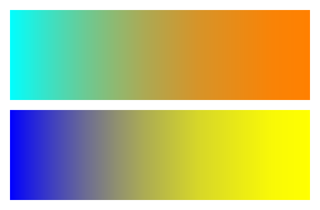

## **अवलोकन**

यह लेख समझाता है कि कैसे Aspose.Slides for PHP via Java का उपयोग करके प्रस्तुति स्लाइड्स को PNG छवियों में बदलें। आप PPT, PPTX और ODP जैसे प्रारूपों में प्रस्तुतियों को लोड कर सकते हैं, प्रत्येक स्लाइड को रेंडर कर सकते हैं, और इसे अलग-अलग PNG छवि के रूप में सहेज सकते हैं।

## **PowerPoint को PNG में बदलें**

आप [Presentation](https://reference.aspose.com/slides/php-java/aspose.slides/presentation/) क्लास का उपयोग करके प्रस्तुति लोड कर सकते हैं और उसकी स्लाइड्स को [Presentation::getSlides](https://reference.aspose.com/slides/php-java/aspose.slides/presentation/#getSlides) संग्रह के माध्यम से एक्सेस कर सकते हैं। उदाहरण प्रत्येक स्लाइड को बिना पैरामीटर के [Slide::getImage](https://reference.aspose.com/slides/php-java/aspose.slides/slide/#getImage) के साथ रेंडर करता है ताकि थंबनेल बनाया जा सके। फिर यह [IImage::save](https://reference.aspose.com/slides/php-java/aspose.slides/iimage/#save) को [ImageFormat::Png](https://reference.aspose.com/slides/php-java/aspose.slides/imageformat/#Png) के साथ कॉल करता है ताकि प्रत्येक रेंडर की गई स्लाइड को PNG छवि के रूप में सहेजा जा सके।

```php
use aspose\slides\ImageFormat;
use aspose\slides\Presentation;

$presentation = new Presentation("presentation.pptx");
try {
    $slideCount = java_values($presentation->getSlides()->size());
    for ($index = 0; $index < $slideCount; $index++) {
        $slide = $presentation->getSlides()->get_Item($index);
        $image = $slide->getImage();
        try {
            $image->save("slide_" . $index . ".png", ImageFormat::Png);
        } finally {
            $image->dispose();
        }
    }
} finally {
    $presentation->dispose();
}
```

{}
बिना पैरामीटर वाला [Slide::getImage](https://reference.aspose.com/slides/php-java/aspose.slides/slide/#getImage) ओवरलोड 0.2 स्केल पर रेंडर करता है। उदाहरण के लिए, 720 × 540 पॉइंट्स की स्लाइड 144 × 108 पिक्सेल थंबनेल बनाती है। आउटपुट आयाम नियंत्रित करने के लिए, नीचे दिखाए गए अनुसार स्केल फ़ैक्टर या स्पष्ट चित्र आकार वाले ओवरलोड का उपयोग करें।
{}

## **PowerPoint को कस्टम आयामों के साथ PNG में बदलें**

आडव्या और उभय स्केल फ़ैक्टर को [Slide::getImage](https://reference.aspose.com/slides/php-java/aspose.slides/slide/#getImage) में पास करके रेंडर किए गए आयाम नियंत्रित करें। इस उदाहरण में दोनों फ़ैक्टर 2 हैं, इसलिए 720 × 540 पॉइंट्स की स्लाइड 1440 × 1080 पिक्सेल चित्र बनाती है। समान स्केल फ़ैक्टर स्लाइड के अनुपात को बनाए रखते हैं। प्रत्येक चित्र को PNG फ़ॉर्मेट में [IImage::save](https://reference.aspose.com/slides/php-java/aspose.slides/iimage/#save) के साथ सहेजा जाता है।

```php
use aspose\slides\ImageFormat;
use aspose\slides\Presentation;

$presentation = new Presentation("presentation.pptx");
try {
    $scaleX = 2.0;
    $scaleY = $scaleX;

    $slideCount = java_values($presentation->getSlides()->size());
    for ($index = 0; $index < $slideCount; $index++) {
        $slide = $presentation->getSlides()->get_Item($index);
        $image = $slide->getImage($scaleX, $scaleY);
        try {
            $image->save("slide_" . $index . ".png", ImageFormat::Png);
        } finally {
            $image->dispose();
        }
    }
} finally {
    $presentation->dispose();
}
```

## **PowerPoint को कस्टम आकार के साथ PNG में बदलें**

आउटपुट आयाम पिक्सेल में निर्दिष्ट करने के लिए, स्केल फ़ैक्टर के बजाय [Slide::getImage](https://reference.aspose.com/slides/php-java/aspose.slides/slide/#getImage) में आकार पास करें। यह उदाहरण प्रत्येक स्लाइड को 960 × 720 पिक्सेल पर रेंडर करता है और परिणाम को [IImage::save](https://reference.aspose.com/slides/php-java/aspose.slides/iimage/#save) के साथ सहेजता है। स्लाइड के अनुपात से मेल खाने वाले आयाम चुनें ताकि चित्र खिंचा न जाए।

```php
use aspose\slides\ImageFormat;
use aspose\slides\Presentation;

$presentation = new Presentation("presentation.pptx");
try {
    $imageSize = new Java("java.awt.Dimension", 960, 720);

    $slideCount = java_values($presentation->getSlides()->size());
    for ($index = 0; $index < $slideCount; $index++) {
        $slide = $presentation->getSlides()->get_Item($index);
        $image = $slide->getImage($imageSize);
        try {
            $image->save("slide_" . $index . ".png", ImageFormat::Png);
        } finally {
            $image->dispose();
        }
    }
} finally {
    $presentation->dispose();
}
```

## **ग्रेडिएंट रेंडरिंग शैली चुनें**

मान लीजिए एक स्लाइड में ग्रेडिएंट भराव हैं, लेकिन निर्यातित PNG में ट्रांज़िशन PowerPoint में देखी गई तुलना में हल्के या अलग दिखते हैं। आप [SaveOptions::setGradientStyle](https://reference.aspose.com/slides/php-java/aspose.slides/saveoptions/#setGradientStyle) मेथड, जो [RenderingOptions](https://reference.aspose.com/slides/php-java/aspose.slides/renderingoptions/) द्वारा विरासत में मिला है, का उपयोग करके ग्रेडिएंट कैसे रेंडर किए जाएँ, चुन सकते हैं।

डाउनलोड करें [gradient-styles.pptx](gradient-styles.pptx) और इसे एप्लिकेशन की कार्य निर्देशिका में रखें। इसकी पहली स्लाइड में दो रैखिक ग्रेडिएंट हैं: ऊपर का स्यान से नारंगी और नीचे का नीला से पीला। प्रत्येक ग्रेडिएंट में दो स्टॉप हैं, 0% और 100% पर।

निम्न उदाहरण इस प्रस्तुति को लोड करता है और दोनों मोड में उसी पहली स्लाइड को [Slide::getImage](https://reference.aspose.com/slides/php-java/aspose.slides/slide/#getImage) के साथ रेंडर करता है।

```php
use aspose\slides\GradientStyle;
use aspose\slides\ImageFormat;
use aspose\slides\Presentation;
use aspose\slides\RenderingOptions;

$presentation = new Presentation("gradient-styles.pptx");
try {
    $slide = $presentation->getSlides()->get_Item(0);

    $gradientStyles = [GradientStyle::Default, GradientStyle::PowerPointUI];
    foreach ($gradientStyles as $style) {
        $options = new RenderingOptions();
        $options->setGradientStyle($style);

        $styleName = $style == GradientStyle::Default ? "Default" : "PowerPointUI";
        $image = $slide->getImage($options, 1.0, 1.0);
        try {
            $image->save("gradient-" . $styleName . ".png", ImageFormat::Png);
        } finally {
            $image->dispose();
        }
    }
} finally {
    $presentation->dispose();
}
```

नीचे की छवियाँ उसी स्लाइड का आउटपुट दिखाती हैं, जिसमें प्रत्येक छवि में दोनों ग्रेडिएंट हैं:

| Default | PowerPointUI |
| --- | --- |
|  |  |

इस उदाहरण में, `Default` हल्के मध्यवर्ती रंग उत्पन्न करता है, जबकि `PowerPointUI` गहरे मध्यवर्ती रंग उत्पन्न करता है। अंतर ग्रेडिएंट के रंगों और स्टॉप्स पर निर्भर करता है।

जब मानक Aspose.Slides आउटपुट आपकी आवश्यकताओं के अनुकूल हो, तो `Default` चुनें। जब आपका प्राथमिकता PowerPoint में दिखावट से मेल खाना हो, तो `PowerPointUI` आज़माएँ। दोनों आउटपुट की तुलना अपने इच्छित परिणाम से करें; कोई भी मोड सार्वभौमिक रूप से बेहतर नहीं है।

## **FAQ**

**मैं पूरे स्लाइड की बजाय एक विशिष्ट आकार, जैसे कि चार्ट या चित्र, को कैसे निर्यात कर सकता हूँ?**

Aspose.Slides व्यक्तिगत आकारों के लिए थंबनेल जनरेट करने का समर्थन करता है [generating thumbnails for individual shapes](/slides/hi/php-java/create-shape-thumbnails/), जिससे आप आकार को PNG चित्र के रूप में रेंडर कर सकते हैं।

**क्या सर्वर पर समानांतर परिवर्तन समर्थित है?**

हां। प्रत्येक थ्रेड या प्रक्रिया के लिए अलग प्रस्तुति इंस्टेंस उपयोग करें; [do not share a single instance across threads](/slides/hi/php-java/multithreading/)।

**PNG निर्यात करते समय मूल्यांकन सीमाएँ क्या हैं?**

मूल्यांकन मोड आउटपुट छवियों में वॉटरमार्क जोड़ता है और एक लाइसेंस लागू होने तक [other restrictions](/slides/hi/php-java/licensing/) लागू करता है।