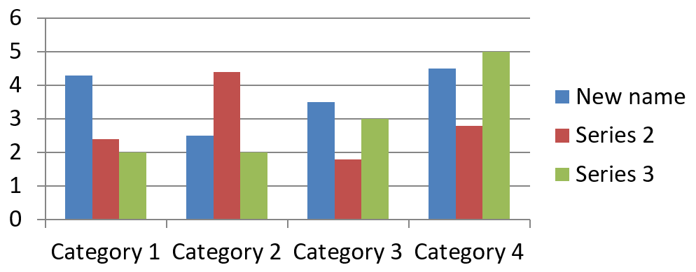

## **अवलोकन**

एक चार्ट अपने प्लॉटेड मानों को वर्कबुक सेल्स में या सीधे संख्यात्मक लिटेरल्स के रूप में संग्रहीत कर सकता है। एक [ChartSeries](https://reference.aspose.com/slides/php-java/aspose.slides/chartseries/) संबंधित मानों का एक सेट दर्शाता है, और प्रत्येक [ChartDataPoint](https://reference.aspose.com/slides/php-java/aspose.slides/chartdatapoint/) उस श्रृंखला में एक बिंदु दर्शाता है। [ChartCategory](https://reference.aspose.com/slides/php-java/aspose.slides/chartcategory/) ऑब्जेक्ट्स लेबल या समूह मान प्रदान करते हैं जो श्रृंखलाओं में साझा होते हैं। डिफ़ॉल्ट डेटा के साथ बनाए गए चार्ट्स में, श्रृंखला नाम, वर्गीकरण और बिंदु मान चार्ट वर्कबुक से [ChartDataCell](https://reference.aspose.com/slides/php-java/aspose.slides/chartdatacell/) ऑब्जेक्ट्स का उपयोग करते हैं।

एक सामान्य श्रेणी चार्ट के लिए, डिफ़ॉल्ट वर्कबुक पंक्ति 0 को श्रृंखला नामों के लिए, कॉलम 0 को श्रेणी नामों के लिए, और शेष सेल्स को श्रृंखला मानों के लिए उपयोग करता है। [ChartDataWorkbook::getCell](https://reference.aspose.com/slides/php-java/aspose.slides/chartdataworkbook/getcell/) को पास किए गए वर्कशीट, पंक्ति और कॉलम इंडेक्स शून्य‑आधारित होते हैं। यह लेआउट डिफ़ॉल्ट डेटा वाले चार्ट बनाने पर उपयोगी है, लेकिन यह मानना कि हर मौजूदा चार्ट इसे उपयोग करता है, सुरक्षित नहीं है। लोड किए गए प्रेजेंटेशन के लिए, वर्कबुक मान बदलने से पहले श्रृंखला, वर्गीकरण और डेटा पॉइंट्स द्वारा संदर्भित सेल्स की जाँच करें।

चार्ट सेटिंग्स के तीन अलग-अलग स्कोप होते हैं:

- श्रृंखला‑स्तर सेटिंग्स, जैसे कि [ChartSeries::getFormat](https://reference.aspose.com/slides/php-java/aspose.slides/chartseries/getformat/), सभी बिंदुओं के लिए डिफ़ॉल्ट स्वरूप प्रदान करती हैं।
- डेटा‑पॉइंट सेटिंग्स, जैसे कि [ChartDataPoint::getFormat](https://reference.aspose.com/slides/php-java/aspose.slides/chartdatapoint/getformat/), एक बिंदु के लिए श्रृंखला स्वरूप को ओवरराइड करती हैं।
- समूह सेटिंग्स समान [ChartSeriesGroup](https://reference.aspose.com/slides/php-java/aspose.slides/chartseriesgroup/) की संगत श्रृंखलाओं पर लागू होती हैं। जब आपको ओवरलैप या गैप चौड़ाई जैसे विकल्प सेट करने की आवश्यकता हो, तो [ChartSeries::getParentSeriesGroup](https://reference.aspose.com/slides/php-java/aspose.slides/chartseries/getparentseriesgroup/) के माध्यम से समूह एक्सेस करें।

जब कोई स्पष्ट बिंदु या श्रृंखला भराव सेट नहीं किया जाता, तो चार्ट शैली और थीम स्वचालित स्वरूप निर्धारित करती हैं। जब दोनों श्रृंखला और बिंदु फॉर्मेट मौजूद होते हैं, तो बिंदु फॉर्मेट उस बिंदु के लिए प्राथमिकता लेता है।


## **संख्या लिटेरल्स का उपयोग करके श्रृंखला मान सेट करें**

जब श्रृंखला मान एप्लिकेशन डेटा या गणनाओं से आते हैं और वर्कशीट सेल रेफ़रेंसेस की आवश्यकता नहीं होती, तो संख्या लिटेरल्स का उपयोग करें। प्रत्येक बिंदु के [getValue](https://reference.aspose.com/slides/php-java/aspose.slides/chartdatapoint/getvalue/) परिणाम को [setAsLiteralDouble](https://reference.aspose.com/slides/php-java/aspose.slides/doublechartvalue/setasliteraldouble/) के माध्यम से असाइन करने से पहले [setDataSourceTypeForValues](https://reference.aspose.com/slides/php-java/aspose.slides/chartdatapointcollection/setdatasourcetypeforvalues/) को [DataSourceType::DoubleLiterals](https://reference.aspose.com/slides/php-java/aspose.slides/datasourcetype/) के साथ कॉल करें।

कलेक्शन सेटिंग उस श्रृंखला में सभी बिंदु मानों के स्रोत प्रकार को नियंत्रित करती है। प्रत्येक बिंदु मान का [getDataSourceType](https://reference.aspose.com/slides/php-java/aspose.slides/basechartvalue/) मेथड चयनित प्रकार रिपोर्ट करता है; इसे कलेक्शन सेटिंग के माध्यम से बदलें। `Worksheet` के साथ, रेफ़रेंस्ड सेल तक पहुंचने के लिए [getAsCell](https://reference.aspose.com/slides/php-java/aspose.slides/doublechartvalue/getascell/) का उपयोग करें। `DoubleLiterals` के साथ, संख्या को सीधे पढ़ने या लिखने के लिए [getAsLiteralDouble](https://reference.aspose.com/slides/php-java/aspose.slides/doublechartvalue/getasliteraldouble/) या `setAsLiteralDouble` का उपयोग करें।

निम्न उदाहरण एक कॉलम चार्ट बनाता है जिसमें डिफ़ॉल्ट श्रृंखला और वर्गीकरण होते हैं, फिर पहली श्रृंखला के मौजूदा बिंदुओं को 10, 20 आदि के गणितीय मान असाइन करता है। यह प्रेज़ेंटेशन को सहेजता है, पुनः खोलता है, और संग्रहीत मानों को प्रिंट करता है।

```php
use aspose\slides\ChartType;
use aspose\slides\DataSourceType;
use aspose\slides\Presentation;
use aspose\slides\SaveFormat;

$presentation = new Presentation();
try {
    $slide = $presentation->getSlides()->get_Item(0);

    $chart = $slide->getShapes()->addChart(ChartType::ClusteredColumn, 20, 20, 500, 300);
    $series = $chart->getChartData()->getSeries()->get_Item(0);

    $series->getDataPoints()->setDataSourceTypeForValues(DataSourceType::DoubleLiterals);
    $pointCount = java_values($series->getDataPoints()->size());
    for ($i = 0; $i < $pointCount; $i++) {
        $series->getDataPoints()->get_Item($i)->getValue()->setAsLiteralDouble(($i + 1) * 10);
    }

    $presentation->save("numeric_literals.pptx", SaveFormat::Pptx);
} finally {
    $presentation->dispose();
}

$reopenedPresentation = new Presentation("numeric_literals.pptx");
try {
    $reopenedSlide = $reopenedPresentation->getSlides()->get_Item(0);
    $reopenedChart = $reopenedSlide->getShapes()->get_Item(0);
    $reopenedSeries = $reopenedChart->getChartData()->getSeries()->get_Item(0);
    $pointCount = java_values($reopenedSeries->getDataPoints()->size());
    for ($i = 0; $i < $pointCount; $i++) {
        $point = $reopenedSeries->getDataPoints()->get_Item($i);
        echo java_values($point->getValue()->getAsLiteralDouble()), PHP_EOL;
    }
} finally {
    $reopenedPresentation->dispose();
}
```

बिंदु मान स्रोत प्रकार [ChartData::getDataSourceType](https://reference.aspose.com/slides/php-java/aspose.slides/chartdata/getdatasourcetype/) से अलग है, जो चार्ट की आंतरिक या बाहरी वर्कबुक कॉन्फ़िगरेशन पहचानता है। संख्या लिटेरल्स का उपयोग करने से एंबेडेड वर्कबुक स्वचालित रूप से हटता नहीं है। इस उदाहरण में, वर्कबुक वर्गीकरण लेबल्स, श्रृंखला नामों और अन्य श्रृंखलाओं के लिए उपलब्ध रहता है। वर्कबुक प्रबंधन के लिए देखें [Chart Workbook](/slides/hi/php-java/chart-workbook/)।

स्कैटर और बबल चार्ट्स के लिए, [setDataSourceTypeForXValues](https://reference.aspose.com/slides/php-java/aspose.slides/chartdatapointcollection/setdatasourcetypeforxvalues/) और [setDataSourceTypeForYValues](https://reference.aspose.com/slides/php-java/aspose.slides/chartdatapointcollection/setdatasourcetypeforyvalues/) का उपयोग करके क्रमशः [getXValue](https://reference.aspose.com/slides/php-java/aspose.slides/chartdatapoint/getxvalue/) और [getYValue](https://reference.aspose.com/slides/php-java/aspose.slides/chartdatapoint/getyvalue/) के स्रोत चुनें। बबल चार्ट्स में [setDataSourceTypeForBubbleSizes](https://reference.aspose.com/slides/php-java/aspose.slides/chartdatapointcollection/setdatasourcetypeforbubblesizes/) का उपयोग करके [getBubbleSize](https://reference.aspose.com/slides/php-java/aspose.slides/chartdatapoint/getbubblesize/) का स्रोत चुनें। प्रत्येक लागू स्रोत को `DoubleLiterals` पर सेट करें और फिर `setAsLiteralDouble` मेथड के माध्यम से संख्याएँ असाइन करें।

## **चार्ट श्रृंखला ओवरलैप सेट करें**

[ChartSeries::getOverlap](https://reference.aspose.com/slides/php-java/aspose.slides/chartseries/getoverlap/) रिपोर्ट करता है कि 2D चार्ट में बार या कॉलम कितना ओवरलैप करते हैं, -100 से 100 प्रतिशत तक। यह पैरेंट श्रृंखला समूह पर सेटिंग का केवल रीड‑ओनली प्रस्तुतीकरण है। सभी संगत श्रृंखलाओं को अपडेट करने के लिए [ChartSeriesGroup::setOverlap](https://reference.aspose.com/slides/php-java/aspose.slides/chartseriesgroup/setoverlap/) का उपयोग करें। यह विकल्प ग्रुपेड बार या कॉलम वाले चार्ट प्रकारों पर लागू होता है; संयोजन चार्ट में असंबंधित श्रृंखला समूह इससे प्रभावित नहीं होते।

निम्न उदाहरण पहले श्रृंखला को शामिल करने वाले समूह के लिए ओवरलैप सेट करता है:

```php
$firstSlideIndex = 0;
$firstSeriesIndex = 0;
$overlapPercent = 30;

$presentation = new Presentation();
try {
    $slide = $presentation->getSlides()->get_Item($firstSlideIndex);

    // नया चार्ट नमूना श्रृंखलाएँ, श्रेणियाँ और मान शामिल करता है।
    $chart = $slide->getShapes()->addChart(ChartType::ClusteredColumn, 20, 20, 500, 200);

    $series = $chart->getChartData()->getSeries()->get_Item($firstSeriesIndex);
    $series->getParentSeriesGroup()->setOverlap($overlapPercent);

    $presentation->save("series_overlap.pptx", SaveFormat::Pptx);
} finally {
    if (!java_is_null($presentation)) {
        $presentation->dispose();
    }
}
```

परिणाम:


## **श्रृंखला भराव रंग बदलें**

पूरी श्रृंखला के लिए डिफ़ॉल्ट भराव सेट करने हेतु [ChartSeries::getFormat](https://reference.aspose.com/slides/php-java/aspose.slides/chartseries/getformat/) का उपयोग करें। यदि किसी बिंदु का पहले से स्पष्ट भराव है, तो उसका [ChartDataPoint::getFormat](https://reference.aspose.com/slides/php-java/aspose.slides/chartdatapoint/getformat/) सेटिंग उस बिंदु के लिए श्रृंखला भराव को ओवरराइड करती है।

निम्न उदाहरण पहली श्रृंखला पर ठोस नीला भराव लागू करता है:

```php
$firstSlideIndex = 0;
$firstSeriesIndex = 0;
$blueColor = java("java.awt.Color")->BLUE;

$presentation = new Presentation();
try {
    $slide = $presentation->getSlides()->get_Item($firstSlideIndex);

    $chart = $slide->getShapes()->addChart(ChartType::ClusteredColumn, 20, 20, 500, 200);

    $series = $chart->getChartData()->getSeries()->get_Item($firstSeriesIndex);
    $series->getFormat()->getFill()->setFillType(FillType::Solid);
    $series->getFormat()->getFill()->getSolidFillColor()->setColor($blueColor);

    $presentation->save("series_color.pptx", SaveFormat::Pptx);
} finally {
    if (!java_is_null($presentation)) {
        $presentation->dispose();
    }
}
```

परिणाम:


## **श्रृंखला नाम बदलें**

एक श्रृंखला नाम चार्ट डेटा वर्कबुक में संग्रहीत होता है और सामान्यतः लेजेंड में प्रदर्शित होता है। क्लस्टर्ड कॉलम चार्ट के लिए डिफ़ॉल्ट वर्कबुक में, सेल B1 पंक्ति 0, कॉलम 1 पर स्थित है और पहली श्रृंखला का नाम रखता है। नीचे दिए गए उदाहरण में नामित वैरिएबल्स इस संरचना को स्पष्ट करते हैं:

```php
$firstSlideIndex = 0;
$worksheetIndex = 0;
$seriesNameRowIndex = 0;
$firstSeriesColumnIndex = 1;

$presentation = new Presentation();
try {
    $slide = $presentation->getSlides()->get_Item($firstSlideIndex);

    $chart = $slide->getShapes()->addChart(ChartType::ClusteredColumn, 20, 20, 500, 200);

    $workbook = $chart->getChartData()->getChartDataWorkbook();
    $seriesNameCell = $workbook->getCell($worksheetIndex, $seriesNameRowIndex, $firstSeriesColumnIndex);
    $seriesNameCell->setValue("Revenue");

    $presentation->save("series_name.pptx", SaveFormat::Pptx);
} finally {
    if (!java_is_null($presentation)) {
        $presentation->dispose();
    }
}
```

आप [ChartSeries::getName](https://reference.aspose.com/slides/php-java/aspose.slides/chartseries/getname/) द्वारा पहले से संदर्भित सेल को भी अपडेट कर सकते हैं। यह तरीका मौजूदा चार्ट में किसी विशिष्ट पंक्ति और कॉलम को मानने से बचाता है:

```php
$firstSlideIndex = 0;
$firstSeriesIndex = 0;
$firstNameCellIndex = 0;

$presentation = new Presentation();
try {
    $slide = $presentation->getSlides()->get_Item($firstSlideIndex);

    $chart = $slide->getShapes()->addChart(ChartType::ClusteredColumn, 20, 20, 500, 200);

    $series = $chart->getChartData()->getSeries()->get_Item($firstSeriesIndex);
    $seriesNameCell = $series->getName()->getAsCells()->get_Item($firstNameCellIndex);
    $seriesNameCell->setValue("Revenue");

    $presentation->save("series_name.pptx", SaveFormat::Pptx);
} finally {
    if (!java_is_null($presentation)) {
        $presentation->dispose();
    }
}
```

परिणाम:



### **कई सेल्स से नाम वाली श्रृंखला बनाएं**

जब उत्पाद नाम और रिपोर्टिंग अवधि अलग-अलग वर्कबुक सेल्स में संग्रहीत हों, तो सम्मिलित श्रृंखला नाम उपयोगी होता है। उदाहरण के लिए, आप B1 में `Product A` और C1 में `2026` को मिलाकर एक ही श्रृंखला नाम बना सकते हैं, जबकि दोनों भाग अपने स्रोत सेल्स से जुड़े रहते हैं।

[ChartDataWorkbook::getCellCollection](https://reference.aspose.com/slides/php-java/aspose.slides/chartdataworkbook/getcellcollection/) का उपयोग करके नाम रेंज प्राप्त करें, फिर उसे [ChartSeriesCollection::add](https://reference.aspose.com/slides/php-java/aspose.slides/chartseriescollection/add/) को पास करें। `skipHiddenCells` तर्क यह नियंत्रित करता है कि छिपे हुए सेल शामिल हों या न हों: `true` उन्हें बाहर करता है, `false` शामिल करता है। यह उदाहरण `false` का उपयोग करके नाम रेंज की सभी सेल्स शामिल करता है।

निम्न उदाहरण एक प्रेज़ेंटेशन बनाता है जिसमें एक श्रृंखला और दो डेटा पॉइंट्स होते हैं। सेल्स B1:C1 केवल श्रृंखला नाम प्रदान करती हैं; A2:A3 श्रेणी लेबल्स देते हैं, और B2:B3 संख्यात्मक मान देते हैं।

```php
use aspose\slides\ChartType;
use aspose\slides\Presentation;
use aspose\slides\SaveFormat;

$presentation = new Presentation();
try {
    $slide = $presentation->getSlides()->get_Item(0);

    $chart = $slide->getShapes()->addChart(ChartType::ClusteredColumn, 50, 50, 620, 180);

    $chart->getChartData()->getSeries()->clear();
    $chart->getChartData()->getCategories()->clear();
    $chart->setLegend(true);

    $workbook = $chart->getChartData()->getChartDataWorkbook();
    $workbook->clear(0);

    // इन दो सेल्स श्रृंखला नाम प्रदान करती हैं।
    $workbook->getCell(0, 0, 1, "Product A");
    $workbook->getCell(0, 0, 2, "2026");
    $nameCells = $workbook->getCellCollection('Sheet1!$B$1:$C$1', false);
    $series = $chart->getChartData()->getSeries()->add($nameCells, ChartType::ClusteredColumn);

    // अलग-अलग सेल्स श्रेणियाँ और संख्यात्मक डेटा पॉइंट्स प्रदान करती हैं।
    $northCategory = $workbook->getCell(0, 1, 0, "North");
    $southCategory = $workbook->getCell(0, 2, 0, "South");
    $chart->getChartData()->getCategories()->add($northCategory);
    $chart->getChartData()->getCategories()->add($southCategory);
    $northValue = $workbook->getCell(0, 1, 1, 120);
    $southValue = $workbook->getCell(0, 2, 1, 150);
    $series->getDataPoints()->addDataPointForBarSeries($northValue);
    $series->getDataPoints()->addDataPointForBarSeries($southValue);

    $presentation->save("composite_series_name.pptx", SaveFormat::Pptx);
} finally {
    $presentation->dispose();
}
```

परिणामी श्रृंखला नाम `Product A 2026` है, दो सेल मानों के बीच एक स्पेस के साथ। लेजेंड इसे दोनों कॉलमों के लिए एक एंट्री के रूप में दिखाता है। नीचे दिया गया चित्र परिणाम दर्शाता है:


## **स्वचालित श्रृंखला भराव रंग प्राप्त करें**

[ChartSeries::getAutomaticSeriesColor](https://reference.aspose.com/slides/php-java/aspose.slides/chartseries/getautomaticseriescolor/) श्रृंखला इंडेक्स और चार्ट शैली से गणना किया गया रंग लौटाता है। यह वही रंग है जो तब उपयोग होता है जब श्रृंखला भराव स्पष्ट रूप से परिभाषित नहीं किया गया हो। मेथड कॉल केवल गणना किया गया रंग पढ़ता है; यह नया भराव असाइन नहीं करता।

निम्न उदाहरण प्रत्येक डिफ़ॉल्ट श्रृंखला का स्वचालित रंग प्रिंट करता है:

```php
$firstSlideIndex = 0;

$presentation = new Presentation();
try {
    $slide = $presentation->getSlides()->get_Item($firstSlideIndex);

    $chart = $slide->getShapes()->addChart(ChartType::ClusteredColumn, 20, 20, 500, 200);

    $seriesCount = java_values($chart->getChartData()->getSeries()->size());
    for ($seriesIndex = 0; $seriesIndex < $seriesCount; $seriesIndex++) {
        $series = $chart->getChartData()->getSeries()->get_Item($seriesIndex);
        $automaticColor = $series->getAutomaticSeriesColor();
        $red = java_values($automaticColor->getRed());
        $green = java_values($automaticColor->getGreen());
        $blue = java_values($automaticColor->getBlue());
        echo "Series " . $seriesIndex . ": java.awt.Color[r=" . $red . ",g=" . $green . ",b=" . $blue . "]" . PHP_EOL;
    }
} finally {
    if (!java_is_null($presentation)) {
        $presentation->dispose();
    }
}
```

डिफ़ॉल्ट चार्ट शैली के लिए उदाहरण आउटपुट:

```text
Series 0: java.awt.Color[r=79,g=129,b=189]
Series 1: java.awt.Color[r=192,g=80,b=77]
Series 2: java.awt.Color[r=155,g=187,b=89]
```

सटीक रंग चार्ट शैली और थीम पर निर्भर करते हैं।

## **चार्ट श्रृंखला के लिए इनवर्ट भराव रंग सेट करें**

बार, कॉलम और बबल श्रृंखलाओं के लिए, [ChartSeries::setInvertIfNegative](https://reference.aspose.com/slides/php-java/aspose.slides/chartseries/setinvertifnegative/) नकारात्मक मानों को अलग भराव के साथ प्रदर्शित कर सकता है। नियमित श्रृंखला भराव को ठोस सेट करें, इनवर्ज़न सक्षम करें, और नकारात्मक‑मूल्य रंग को [ChartSeries::getInvertedSolidFillColor](https://reference.aspose.com/slides/php-java/aspose.slides/chartseries/getinvertedsolidfillcolor/) के माध्यम से असाइन करें। नकारात्मक संख्याएँ वर्कबुक में अपरिवर्तित रहती हैं; केवल उनका डिस्प्ले रंग बदलता है।

निम्न उदाहरण डिफ़ॉल्ट चार्ट डेटा को एक श्रृंखला से बदलता है। वर्कशीट पंक्ति 0 में श्रृंखला नाम, कॉलम 0 में श्रेणी नाम, और कॉलम 1 में मान होते हैं:

```php
$firstSlideIndex = 0;
$worksheetIndex = 0;
$headerRowIndex = 0;
$categoryColumnIndex = 0;
$firstSeriesColumnIndex = 1;
$firstDataRowIndex = 1;

$categoryNames = ["Category 1", "Category 2", "Category 3"];
$seriesValues = [-20, 50, -30];
$redColor = java("java.awt.Color")->RED;

$presentation = new Presentation();
try {
    $slide = $presentation->getSlides()->get_Item($firstSlideIndex);

    $chart = $slide->getShapes()->addChart(ChartType::ClusteredColumn, 20, 20, 500, 200);
    $chartData = $chart->getChartData();
    $workbook = $chartData->getChartDataWorkbook();

    $chartData->getSeries()->clear();
    $chartData->getCategories()->clear();

    $seriesNameCell = $workbook->getCell($worksheetIndex, $headerRowIndex, $firstSeriesColumnIndex, "Series 1");
    $chartType = $chart->getType();
    $series = $chartData->getSeries()->add($seriesNameCell, $chartType);

    $categoryCount = count($categoryNames);
    for ($categoryIndex = 0; $categoryIndex < $categoryCount; $categoryIndex++) {
        $dataRowIndex = $firstDataRowIndex + $categoryIndex;
        $categoryName = $categoryNames[$categoryIndex];
        $seriesValue = $seriesValues[$categoryIndex];

        $categoryCell = $workbook->getCell($worksheetIndex, $dataRowIndex, $categoryColumnIndex, $categoryName);
        $chartData->getCategories()->add($categoryCell);

        $valueCell = $workbook->getCell($worksheetIndex, $dataRowIndex, $firstSeriesColumnIndex, $seriesValue);
        $series->getDataPoints()->addDataPointForBarSeries($valueCell);
    }

    $automaticSeriesColor = $series->getAutomaticSeriesColor();
    $series->getFormat()->getFill()->setFillType(FillType::Solid);
    $series->getFormat()->getFill()->getSolidFillColor()->setColor($automaticSeriesColor);
    $series->setInvertIfNegative(true);
    $series->getInvertedSolidFillColor()->setColor($redColor);

    $presentation->save("inverted_solid_fill_color.pptx", SaveFormat::Pptx);
} finally {
    if (!java_is_null($presentation)) {
        $presentation->dispose();
    }
}
```

परिणाम:


आप एक बिंदु के लिए [ChartDataPoint::setInvertIfNegative](https://reference.aspose.com/slides/php-java/aspose.slides/chartdatapoint/setinvertifnegative/) के द्वारा इनवर्ज़न सक्षम कर सकते हैं। नीचे के उदाहरण में श्रृंखला के लिए इनवर्ज़न अक्षम है और केवल चयनित बिंदु के लिए सक्षम किया गया है। बिंदु को नकारात्मक मान भी असाइन किया गया है ताकि प्रभाव स्पष्ट दिखे:

```php
$firstSlideIndex = 0;
$firstSeriesIndex = 0;
$targetDataPointIndex = 2;
$negativeValue = -30;
$redColor = java("java.awt.Color")->RED;

$presentation = new Presentation();
try {
    $slide = $presentation->getSlides()->get_Item($firstSlideIndex);

    $chart = $slide->getShapes()->addChart(ChartType::ClusteredColumn, 20, 20, 500, 200);

    $series = $chart->getChartData()->getSeries()->get_Item($firstSeriesIndex);
    $automaticSeriesColor = $series->getAutomaticSeriesColor();
    $series->getFormat()->getFill()->setFillType(FillType::Solid);
    $series->getFormat()->getFill()->getSolidFillColor()->setColor($automaticSeriesColor);
    $series->getInvertedSolidFillColor()->setColor($redColor);
    $series->setInvertIfNegative(false);

    $dataPoint = $series->getDataPoints()->get_Item($targetDataPointIndex);
    $dataPoint->getValue()->getAsCell()->setValue($negativeValue);
    $dataPoint->setInvertIfNegative(true);

    $presentation->save("data_point_invert_color_if_negative.pptx", SaveFormat::Pptx);
} finally {
    if (!java_is_null($presentation)) {
        $presentation->dispose();
    }
}
```

## **विशिष्ट डेटा पॉइंट मान साफ़ करें**

एक बिंदु को खाली करने के लिए, उसके बैकिंग वर्कबुक सेल को `null` सेट करें, जबकि अन्य बिंदुओं को बरकरार रखें। कॉलम चार्ट के लिए, प्लॉटेड मान [ChartDataPoint::getValue](https://reference.aspose.com/slides/php-java/aspose.slides/chartdatapoint/getvalue/) के माध्यम से उपलब्ध होता है। डेटा पॉइंट वही श्रेणी पद में बना रहता है, लेकिन चार्ट उसकी मान को खाली मानता है, जैसा कि चार्ट की ब्लैंक‑वैल्यू सेटिंग्स निर्धारित करती हैं।

निम्न उदाहरण पहली श्रृंखला के केवल दूसरे बिंदु को साफ़ करता है:

```php
$firstSlideIndex = 0;
$firstSeriesIndex = 0;
$targetDataPointIndex = 1;

$presentation = new Presentation();
try {
    $slide = $presentation->getSlides()->get_Item($firstSlideIndex);

    $chart = $slide->getShapes()->addChart(ChartType::ClusteredColumn, 20, 20, 500, 200);

    $series = $chart->getChartData()->getSeries()->get_Item($firstSeriesIndex);
    $dataPoint = $series->getDataPoints()->get_Item($targetDataPointIndex);
    $dataPoint->getValue()->getAsCell()->setValue(null);

    $presentation->save("clear_data_point_value.pptx", SaveFormat::Pptx);
} finally {
    if (!java_is_null($presentation)) {
        $presentation->dispose();
    }
}
```

स्कैटर चार्ट्स अलग‑अलग X और Y सेल्स का उपयोग करते हैं, और बबल चार्ट्स में आकार सेल भी होता है। केवल उस सेल को साफ़ करें जो हटाए जाने वाले मान का प्रतिनिधित्व करता है। जब आप अन्य बिंदुओं को रखना चाहते हैं, तो [ChartDataPointCollection::clear](https://reference.aspose.com/slides/php-java/aspose.slides/chartdatapointcollection/clear/) न बुलाएँ, क्योंकि यह मेथड पूरी कलेक्शन को हटा देता है।

## **खाली सेल्स के प्रदर्शन को नियंत्रित करें**

छिपे हुए सेल्स जिनमें मान होते हैं, वे खाली सेल्स से अलग होते हैं। छिपी वर्कशीट पंक्तियों और कॉलमों से डेटा को शामिल या बाहर करने के लिए देखें [Include Data from Hidden Rows and Columns](/slides/hi/php-java/chart-workbook/#include-data-from-hidden-rows-and-columns)।

एक खाली वर्कबुक सेल अनुपलब्ध डेटा दर्शाता है; `0` वाला सेल ज्ञात संख्यात्मक मान दर्शाता है। सेल को खाली बनाने के लिए [ChartDataCell::setValue](https://reference.aspose.com/slides/php-java/aspose.slides/chartdatacell/setvalue/) को `null` के साथ कॉल करें। शून्य संख्यात्मक शून्य ही रहेगा, चाहे ब्लैंक‑सेल सेटिंग जो भी हो।

खाली सेल्स के प्रदर्शन को चुनने के लिए [Chart::setDisplayBlanksAs](https://reference.aspose.com/slides/php-java/aspose.slides/chart/setdisplayblanksas/) का उपयोग करें। यह सेटिंग पूरे चार्ट पर लागू होती है और ब्लैंक्स के प्लॉटिंग तरीके को बदलती है, बिना खाली वर्कबुक सेल को शून्य या इंटरपोलेटेड मान से भरें।

निम्न स्वनिर्भर उदाहरण एक लाइन चार्ट बनाता है जिसमें एक श्रृंखला है, दिन 3 का मान साफ़ करता है, और प्रत्येक मोड के साथ उसी चार्ट को सहेजता है। कोई इनपुट फ़ाइल आवश्यक नहीं है। [ChartDataWorkbook](https://reference.aspose.com/slides/php-java/aspose.slides/chartdataworkbook/) वर्कशीट 0, कॉलम 0 को श्रेणी लेबल्स और कॉलम 1 को मानों के लिए उपयोग करता है; पंक्ति 0 में श्रृंखला नाम रहता है। अंतिम डेटा `10, 20, empty, 30, 40` है।

```php
use aspose\slides\ChartType;
use aspose\slides\DisplayBlanksAsType;
use aspose\slides\Presentation;
use aspose\slides\SaveFormat;

$presentation = new Presentation();
try {
    $slide = $presentation->getSlides()->get_Item(0);

    $chart = $slide->getShapes()->addChart(ChartType::LineWithMarkers, 40, 40, 640, 400);
    $chartData = $chart->getChartData();
    $workbook = $chartData->getChartDataWorkbook();

    $chartData->getSeries()->clear();
    $chartData->getCategories()->clear();

    $seriesNameCell = $workbook->getCell(0, 0, 1, "Measurements");
    $series = $chartData->getSeries()->add($seriesNameCell, $chart->getType());
    $values = [10, 20, 25, 30, 40];

    for ($i = 0; $i < count($values); $i++) {
        $categoryCell = $workbook->getCell(0, $i + 1, 0, "Day " . ($i + 1));
        $chartData->getCategories()->add($categoryCell);
        $valueCell = $workbook->getCell(0, $i + 1, 1, $values[$i]);
        $series->getDataPoints()->addDataPointForLineSeries($valueCell);
    }

    // Day 3 को वास्तव में खाली छोड़ें, जबकि उसकी श्रेणी और डेटा पॉइंट को बनाए रखें।
    $workbook->getCell(0, 3, 1)->setValue(null);

    $modes = [DisplayBlanksAsType::Gap, DisplayBlanksAsType::Zero, DisplayBlanksAsType::Span];
    $modeNames = ["Gap", "Zero", "Span"];
    for ($i = 0; $i < count($modes); $i++) {
        $chart->setDisplayBlanksAs($modes[$i]);
        $presentation->save("empty_cells_" . $modeNames[$i] . ".pptx", SaveFormat::Pptx);
    }
} finally {
    $presentation->dispose();
}
```

प्रत्येक आउटपुट फ़ाइल उस मोड को दर्शाती है जो सहेजने से पहले सेट किया गया था: `empty_cells_Gap.pptx`, `empty_cells_Zero.pptx`, और `empty_cells_Span.pptx`। केवल एक संस्करण सहेजने के लिए, इच्छित मोड असाइन करें और प्रेज़ेंटेशन को एक बार सहेजें।

नीचे की तुलना में सभी तीन फ़ाइलों में समान डेटा दिखाया गया है। दिन 3 हर केस में वर्कबुक में खाली रहता है:


दृश्यमान प्रभाव चार्ट प्रकार पर निर्भर करता है। लाइन चार्ट सभी तीन मोड को स्पष्ट रूप से तुलना करने देता है। बार और कॉलम चार्ट्स में कोई लाइन नहीं होती जिससे कनेक्शन संभव न हो, इसलिए `Span` उपर्युक्त कनेक्टिंग सेगमेंट नहीं बना सकता; एक गुम कॉलम और शून्य‑ऊँचाई वाला कॉलम भी एक जैसा दिख सकता है। इसी प्रकार, केवल मार्कर्स वाले स्कैटर चार्ट में कोई कनेक्टिंग लाइन नहीं होती। सभी चार्ट प्रकारों में तीन अलग-अलग परिणाम मिलने की उम्मीद न करें; अपने उपयोग किए जाने वाले प्रकार के अनुसार आउटपुट जाँचें।

## **श्रृंखला गैप चौड़ाई सेट करें**

गैप चौड़ाई साइड‑बाय‑साइड बार या कॉलम क्लस्टर के बीच की जगह को दर्शाती है, जो बार या कॉलम की चौड़ाई के प्रतिशत के रूप में व्यक्त होती है। ओवरलैप की तरह, यह पैरेंट श्रृंखला समूह से संबंधित है, न कि किसी एकली श्रृंखला से। समूह के लिए एक बार [ChartSeriesGroup::setGapWidth](https://reference.aspose.com/slides/php-java/aspose.slides/chartseriesgroup/setgapwidth/) कॉल करें। बड़ा मान क्लस्टर के बीच अधिक जगह बनाता है; छोटा मान उन्हें अधिक सघन बनाता है।

निम्न उदाहरण गैप चौड़ाई बदलता है और केवल अंतिम प्रेज़ेंटेशन को सहेजता है:

```php
$firstSlideIndex = 0;
$firstSeriesIndex = 0;
$gapWidthPercent = 30;

$presentation = new Presentation();
try {
    $slide = $presentation->getSlides()->get_Item($firstSlideIndex);

    $chart = $slide->getShapes()->addChart(ChartType::StackedColumn, 20, 20, 500, 200);

    $series = $chart->getChartData()->getSeries()->get_Item($firstSeriesIndex);
    $series->getParentSeriesGroup()->setGapWidth($gapWidthPercent);

    $presentation->save("gap_width_30.pptx", SaveFormat::Pptx);
} finally {
    if (!java_is_null($presentation)) {
        $presentation->dispose();
    }
}
```

परिणाम:


## **अक्सर पूछे जाने वाले प्रश्न**

**कौन से चार्ट प्रकार डेटा श्रृंखलाओं का समर्थन करते हैं?**

[ChartType](https://reference.aspose.com/slides/php-java/aspose.slides/charttype/) एनोमरेशन द्वारा प्रतिनिधित्व किए गए सभी चार्ट प्रकार डेटा का उपयोग करते हैं, लेकिन उनकी श्रृंखलाओं की संरचना या सेटिंग्स समान नहीं हो सकती। उदाहरण के लिए, श्रेणी चार्ट्स में श्रेणियाँ और मान होते हैं, स्कैटर चार्ट्स में X और Y मान होते हैं, और बबल चार्ट्स में बबल आकार जोड़ते हैं। श्रृंखला प्रकार से मेल खाने वाली डेटा‑पॉइंट निर्माण विधि चुनें। ओवरलैप और गैप चौड़ाई जैसे विकल्प केवल संगत बार या कॉलम समूहों पर लागू होते हैं।

**चार्ट श्रृंखला समूह क्या है?**

[ChartSeriesGroup](https://reference.aspose.com/slides/php-java/aspose.slides/chartseriesgroup/) संगत श्रृंखलाओं को रखता है जो समूह‑स्तर के प्लॉटिंग सेटिंग्स साझा करती हैं। एक संयोजन चार्ट में एक से अधिक समूह हो सकते हैं, इसलिए एक श्रृंखला के माध्यम से पहुँचा गया समूह सभी श्रृंखलाओं को आवश्यक रूप से नहीं बदलता।

**क्या नई बनाई गई चार्ट में डिफ़ॉल्ट डेटा होता है?**

हां। डिफ़ॉल्ट रूप से, [ShapeCollection.addChart](https://reference.aspose.com/slides/php-java/aspose.slides/shapecollection/addchart/) नमूना श्रृंखलाएँ, श्रेणियाँ और मान बनाता है। आप उन सेल्स को संपादित कर सकते हैं या कस्टम डेटा सेट जोड़ने से पहले दोनों श्रृंखला और श्रेणी कलेक्शन को साफ़ कर सकते हैं। एक ओवरलोड भी बिना डिफ़ॉल्ट डेटा के चार्ट बना सकता है।

**चार्ट ऑब्जेक्ट्स वर्कबुक सेल्स से कैसे जुड़े होते हैं?**

श्रृंखला नाम, श्रेणी लेबल और डेटा‑पॉइंट मान [ChartDataWorkbook](https://reference.aspose.com/slides/php-java/aspose.slides/chartdataworkbook/) में सेल्स को रेफ़र करते हैं। किसी रेफ़रेंस्ड सेल को बदलने से संबंधित चार्ट तत्व अपडेट हो जाता है। कस्टम डेटा बनाते समय, श्रेणी पंक्तियों और श्रृंखला‑मान पंक्तियों को संरेखित रखें ताकि प्रत्येक बिंदु इच्छित श्रेणी के नीचे प्लॉट हो।

**मैं पूरी श्रृंखला की बजाय एक बिंदु कैसे साफ़ करूँ?**

संभव बिंदु को खाली रखने के लिए संबंधित मान सेल को `null` सेट करें, जिससे उसका श्रेणी पद बना रहे। केवल तब [ChartDataPointCollection::clear](https://reference.aspose.com/slides/php-java/aspose.slides/chartdatapointcollection/clear/) का उपयोग करें जब आप पूरी श्रृंखला के सभी बिंदु हटाना चाहते हों। यदि आप श्रेणियाँ भी हटाते हैं, तो सभी श्रृंखलाओं को इस तरह अपडेट करें कि उनके मान श्रेणी संग्रह के साथ संरेखित रहें।

**खाली बिंदु कैसे प्रदर्शित होते हैं?**

परिणाम चार्ट प्रकार और [Chart.setDisplayBlanksAs](https://reference.aspose.com/slides/php-java/aspose.slides/chart/setdisplayblanksas/) में कॉन्फ़िगर किए गए मान पर निर्भर करता है। समर्थित चार्ट्स ब्लैंक्स को गैप, शून्य मान या निकटवर्ती बिंदुओं को जोड़कर दिखा सकते हैं। अपनी प्रेज़ेंटेशन में लापता डेटा के अर्थ के अनुसार सेटिंग चुनें। पूर्ण उदाहरण और दृश्य तुलना के लिए देखें [Control the Display of Empty Cells](#control-the-display-of-empty-cells)।

**नकारात्मक मानों का स्वरूप क्या है?**

समर्थित बार, कॉलम और बबल श्रृंखलाओं के लिए, [ChartSeries::setInvertIfNegative](https://reference.aspose.com/slides/php-java/aspose.slides/chartseries/setinvertifnegative/) को कॉल करें और [ChartSeries::getInvertedSolidFillColor](https://reference.aspose.com/slides/php-java/aspose.slides/chartseries/getinvertedsolidfillcolor/) द्वारा लौटाए गए रंग को सेट करें। आप व्यक्तिगत बिंदु के लिए [ChartDataPoint::setInvertIfNegative](https://reference.aspose.com/slides/php-java/aspose.slides/chartdatapoint/setinvertifnegative/) से व्यवहार ओवरराइड कर सकते हैं। ये मेथड फॉर्मेटिंग को प्रभावित करते हैं, न कि संग्रहीत संख्यात्मक मानों को।

**जब दोनों श्रृंखला और बिंदु फॉर्मेटेड हों, तो कौन जीतेगा?**

स्पष्ट डेटा‑पॉइंट फॉर्मेटिंग उस बिंदु के लिए प्राथमिकता लेती है। अन्य बिंदु स्पष्ट श्रृंखला फ़ॉर्मेट या, जब श्रृंखला फ़ॉर्मेट परिभाषित न हो, तो स्वचालित चार्ट शैली और थीम का उपयोग जारी रखते हैं। समूह सेटिंग्स जैसे ओवरलैप और गैप चौड़ाई लेआउट को नियंत्रित करती हैं और बिंदु‑स्तर के फॉर्मेट ओवरराइड नहीं हैं।

**क्या चार्ट में शामिल की जा सकने वाली श्रृंखलाओं की संख्या पर कोई सीमा है?**

Aspose.Slides किसी अलग स्थिर श्रृंखला‑गणना सीमा नहीं लगाता। व्यवहार में, प्रेज़ेंटेशन फ़ाइल सीमाएँ, उपलब्ध मेमोरी, रेंडरिंग समय और चार्ट की पठनीयता उपयोगी सीमा निर्धारित करती हैं।

**जब कॉलम बहुत करीब या बहुत दूर हों, तो मुझे क्या बदलना चाहिए?**

उचित पैरेंट श्रृंखला समूह पर [ChartSeriesGroup::setGapWidth](https://reference.aspose.com/slides/php-java/aspose.slides/chartseriesgroup/setgapwidth/) कॉल करें। क्लस्टर के बीच की दूरी बढ़ाने के लिए मान बढ़ाएँ, या उन्हें करीब लाने के लिए कम करें।