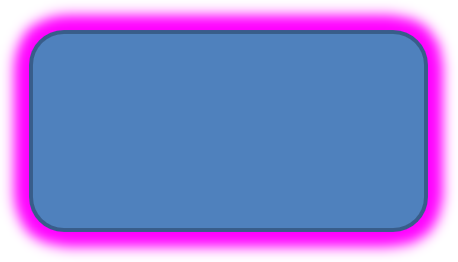

## **परिचय**

PowerPoint में प्रभावों का उपयोग किसी आकार को प्रमुख बनाने के लिए किया जा सकता है, लेकिन ये [भरण](/slides/hi/python-java/shape-formatting/#gradient-fill) या रूपरेखा से अलग होते हैं। PowerPoint प्रभावों का उपयोग करके आप किसी आकार पर विश्वसनीय प्रतिबिंब बना सकते हैं, आकार की चमक फैला सकते हैं, आदि।


PowerPoint आकारों पर लागू किए जा सकने वाले छह प्रभाव प्रदान करता है। आप किसी आकार पर एक या अधिक प्रभाव लागू कर सकते हैं।

कुछ प्रभाव संयोजन अन्य की तुलना में बेहतर दिखते हैं। इस कारण से, PowerPoint **Preset** के तहत विकल्प प्रदान करता है। Preset विकल्प दो या अधिक प्रभावों के ऐसे संयोजन हैं जो अच्छे दिखने के लिए ज्ञात हैं। इस प्रकार, एक प्रीसेट चुनकर आपको विभिन्न प्रभावों को परीक्षण या संयोजन करने में समय बर्बाद नहीं करना पड़ेगा।

Aspose.Slides [EffectFormat](https://reference.aspose.com/slides/python-java/aspose.slides/effectformat/) क्लास के तहत गुण और विधियाँ प्रदान करता है जिससे आप PowerPoint प्रस्तुतियों में आकारों पर समान प्रभाव लागू कर सकते हैं।

## **एक छाया प्रभाव लागू करें**

Aspose.Slides for Python via Java आकारों के लिए बाहरी और आंतरिक छायाएँ समर्थन करता है। आप उनके रंग, दिशा, दूरी, और धुंधरापन त्रिज्या को अपनी प्रस्तुति के डिज़ाइन के अनुसार अनुकूलित कर सकते हैं।

### **बाहरी छाया लागू करें**

स्लाइड पृष्ठभूमि पर कार्ड या पैनल को प्रमुख बनाने के लिए बाहरी छाया का उपयोग करें। छाया आकार की किनारों से बाहर तक विस्तारित होती है, जिससे ऐसा प्रभाव पैदा होता है कि आकार स्लाइड से ऊपर उठाया गया है। उसकी रंग, दिशा, दूरी, और धुंधरापन त्रिज्या को अपने टेम्पलेट की प्रकाश व्यवस्था और शैली के अनुसार समायोजित करें।

यह Python कोड दिखाता है कि कैसे [बाहरी छाया प्रभाव](https://reference.aspose.com/slides/python-java/aspose.slides/effectformat/#getOuterShadowEffect) को एक आयत पर लागू किया जाए:
```python
import jpype
import asposeslides

if not jpype.isJVMStarted():
    jpype.startJVM()

from asposeslides.api import Presentation, SaveFormat, ShapeType
from java.awt import Color

presentation = Presentation()
try:
    slide = presentation.getSlides().get_Item(0)

    shape = slide.getShapes().addAutoShape(ShapeType.RoundCornerRectangle, 20, 20, 200, 100)
    shape.getEffectFormat().enableOuterShadowEffect()
    shape.getEffectFormat().getOuterShadowEffect().getShadowColor().setColor(Color(169, 169, 169))
    shape.getEffectFormat().getOuterShadowEffect().setDistance(10)
    shape.getEffectFormat().getOuterShadowEffect().setDirection(45)

    presentation.save("shadow_effect.pptx", SaveFormat.Pptx)
finally:
    presentation.dispose()
```


### **आंतरिक छाया लागू करें**

टेम्पलेट की दृश्य शैली को पुन: उत्पन्न करते समय, कार्ड या पैनल को एक अवरुद्ध रूप देने के लिए आंतरिक छाया का उपयोग करें। बाहरी छाया आकार के बाहर तक फैलती है और इसे उठी हुई दिखाती है, जबकि आंतरिक छाया किनारों के अंदर को छाँव देती है।

Call [enableInnerShadowEffect](https://reference.aspose.com/slides/python-java/aspose.slides/effectformat/#enableInnerShadowEffect), then configure the shadow returned by [getInnerShadowEffect](https://reference.aspose.com/slides/python-java/aspose.slides/effectformat/#getInnerShadowEffect). बड़े धुंधरापन त्रिज्या मान नरम किनारे उत्पन्न करती हैं।

यह Python उदाहरण एक हल्के नीले कार्ड को गहरे ग्रे आंतरिक छाया के साथ बनाता है और इसे PPTX फ़ाइल के रूप में सहेजता है। छाया की दिशा 225 डिग्री है, उसकी दूरी 7 पॉइंट्स है, और धुंधरापन त्रिज्या 6 पॉइंट्स है:
```python
import jpype
import asposeslides

if not jpype.isJVMStarted():
    jpype.startJVM()

from asposeslides.api import FillType, Presentation, SaveFormat, ShapeType
from java.awt import Color

presentation = Presentation()
try:
    slide = presentation.getSlides().get_Item(0)

    shape = slide.getShapes().addAutoShape(ShapeType.Rectangle, 20, 20, 200, 100)
    shape.getFillFormat().setFillType(FillType.Solid)
    shape.getFillFormat().getSolidFillColor().setColor(Color(173, 216, 230))
    shape.getLineFormat().getFillFormat().setFillType(FillType.NoFill)

    shape.getEffectFormat().enableInnerShadowEffect()
    shadow = shape.getEffectFormat().getInnerShadowEffect()
    shadow.getShadowColor().setColor(Color(105, 105, 105))
    shadow.setDirection(225)
    shadow.setDistance(7)
    shadow.setBlurRadius(6)

    presentation.save("inner_shadow_effect.pptx", SaveFormat.Pptx)
finally:
    presentation.dispose()
```


आंतरिक छाया को हटाने के लिए, आकार के effect format पर [disableInnerShadowEffect](https://reference.aspose.com/slides/python-java/aspose.slides/effectformat/#disableInnerShadowEffect) को कॉल करें।

## **एक प्रतिबिंब प्रभाव लागू करें**

Aspose.Slides for Python via Java में प्रतिबिंब प्रभाव लागू करने के लिए, आप आकारों पर दर्पण जैसा प्रतिबिंब जोड़ सकते हैं, दूरी, पारदर्शिता और आकार जैसे पैरामीटर समायोजित करते हुए। यह प्रभाव आपके प्रस्तुतियों की सौंदर्यशास्त्र को बढ़ाता है, आकारों को अधिक परिष्कृत और सज्जित रूप देता है। यह सरल कोड के साथ लागू करना आसान है, जिससे एकसमान डिजाइन के लिए कई तत्वों पर शीघ्रता से लागू किया जा सके।

यह Python कोड दिखाता है कि कैसे [प्रतिबिंब प्रभाव](https://reference.aspose.com/slides/python-java/aspose.slides/effectformat/#getReflectionEffect) को किसी आकार पर लागू किया जाए:
```python
import jpype
import asposeslides

if not jpype.isJVMStarted():
    jpype.startJVM()

from asposeslides.api import Presentation, RectangleAlignment, SaveFormat, ShapeType

presentation = Presentation()
try:
    slide = presentation.getSlides().get_Item(0)

    shape = slide.getShapes().addAutoShape(ShapeType.RoundCornerRectangle, 20, 20, 200, 100)
    shape.getEffectFormat().enableReflectionEffect()
    shape.getEffectFormat().getReflectionEffect().setRectangleAlign(RectangleAlignment.Bottom)
    shape.getEffectFormat().getReflectionEffect().setDirection(90)
    shape.getEffectFormat().getReflectionEffect().setDistance(40)
    shape.getEffectFormat().getReflectionEffect().setBlurRadius(2)

    presentation.save("reflection_effect.pptx", SaveFormat.Pptx)
finally:
    presentation.dispose()
```


## **एक ग्लो प्रभाव लागू करें**

Aspose.Slides for Python via Java में किसी आकार पर ग्लो प्रभाव लागू करने के लिए, आप आकारों के चारों ओर एक नरम, चमकीला प्रभा जोड़ सकते हैं, रंग और आकार जैसी विशेषताओं को समायोजित करते हुए। यह प्रभाव आकारों को प्रमुख बनाता है और आपकी प्रस्तुति में आकर्षक, ध्यान आकर्षित करने वाला दृश्य तत्व जोड़ता है। यह न्यूनतम कोड के साथ लागू करना आसान है, जिससे आपकी स्लाइडों की समग्र रूपरेखा बेहतर होती है।

यह Python कोड दिखाता है कि कैसे [ग्लो प्रभाव](https://reference.aspose.com/slides/python-java/aspose.slides/effectformat/#getGlowEffect) को एक आकार पर लागू किया जाए:
```python
import jpype
import asposeslides

if not jpype.isJVMStarted():
    jpype.startJVM()

from asposeslides.api import Presentation, SaveFormat, ShapeType
from java.awt import Color

presentation = Presentation()
try:
    slide = presentation.getSlides().get_Item(0)

    shape = slide.getShapes().addAutoShape(ShapeType.RoundCornerRectangle, 20, 20, 200, 100)
    shape.getEffectFormat().enableGlowEffect()
    shape.getEffectFormat().getGlowEffect().getColor().setColor(Color.MAGENTA)
    shape.getEffectFormat().getGlowEffect().setRadius(15)

    presentation.save("glow_effect.pptx", SaveFormat.Pptx)
finally:
    presentation.dispose()
```



## **एक सॉफ़्ट एजेस प्रभाव लागू करें**

Aspose.Slides for Python via Java में सॉफ़्ट एजेस प्रभाव लागू करने के लिए, आप आकार के किनारों के आसपास एक सुगम, धुंधला संक्रमण बना सकते हैं। यह प्रभाव अधिक सूक्ष्म और परिष्कृत लुक जोड़ता है, उन डिज़ाइनों के लिए उपयुक्त है जिन्हें कोमल, मुलायम दिखावट चाहिए। आप आसानी से त्रिज्या जैसे पैरामीटर को समायोजित करके अपनी प्रस्तुति के विभिन्न आकारों में वांछित प्रभाव प्राप्त कर सकते हैं।

यह Python कोड दिखाता है कि कैसे [सॉफ़्ट एजेस प्रभाव](https://reference.aspose.com/slides/python-java/aspose.slides/effectformat/#getSoftEdgeEffect) को एक आकार पर लागू किया जाए:
```python
import jpype
import asposeslides

if not jpype.isJVMStarted():
    jpype.startJVM()

from asposeslides.api import Presentation, SaveFormat, ShapeType

presentation = Presentation()
try:
    slide = presentation.getSlides().get_Item(0)

    shape = slide.getShapes().addAutoShape(ShapeType.RoundCornerRectangle, 20, 20, 200, 150)
    shape.getEffectFormat().enableSoftEdgeEffect()
    shape.getEffectFormat().getSoftEdgeEffect().setRadius(8)

    presentation.save("soft_edges_effect.pptx", SaveFormat.Pptx)
finally:
    presentation.dispose()
```


## **एक ब्लर प्रभाव लागू करें**

आकार ब्लर का उपयोग करके आप आकार की भरावट और रूपरेखा को नरम बना सकते हैं जबकि आकार संपादन योग्य बना रहता है। आकार के effect format पर [setBlurEffect](https://reference.aspose.com/slides/python-java/aspose.slides/effectformat/#setBlurEffect) को कॉल करें। त्रिज्या पॉइंट्स (1/72 इंच) में मापी जाती है: गैर-नकारात्मक मान उपयोग करें, बड़ी मान अधिक तीव्र ब्लर उत्पन्न करते हैं। शून्य त्रिज्या से रूप नहीं बदलता।

[getGrow](https://reference.aspose.com/slides/python-java/aspose.slides/blur/#getGrow) सेटिंग प्रभाव की दृश्य सीमाओं को नियंत्रित करती है। `False` होने पर, ब्लर मूल चित्रित सीमाओं तक सीमित रहता है, जिसमें रूपरेखा भी शामिल है। `True` होने पर, ब्लर इन सीमाओं से बाहर तक विस्तारित हो सकता है। इन दोनों सेटिंग्स से आकार की स्थिति या आयाम नहीं बदलते।

नीचे का तुलना समान भरावट, रूपरेखा, और आकार आयामों का उपयोग करती है। शीर्ष पंक्ति में `grow = False` है; नीचे की पंक्ति में `grow = True` है।


यह Python उदाहरण एक नारंगी आयत को गहरे नीले रूपरेखा के साथ बनाता है, 5 पॉइंट ब्लर लागू करता है, और फिर [setBlurEffect](https://reference.aspose.com/slides/python-java/aspose.slides/effectformat/#setBlurEffect) को फिर से कॉल करके इसे 15 पॉइंट ब्लर में अपडेट करता है। यह दोनों ब्लर किए हुए स्थितियों को सहेजता है, फिर [disableBlurEffect](https://reference.aspose.com/slides/python-java/aspose.slides/effectformat/#disableBlurEffect) को कॉल करके ब्लर के बिना आकार को सहेजता है।
```python
import jpype
import asposeslides

if not jpype.isJVMStarted():
    jpype.startJVM()

from asposeslides.api import FillType, Presentation, SaveFormat, ShapeType
from java.awt import Color

presentation = Presentation()
try:
    slide = presentation.getSlides().get_Item(0)

    shape = slide.getShapes().addAutoShape(ShapeType.Rectangle, 100, 80, 160, 100)
    shape.getFillFormat().setFillType(FillType.Solid)
    shape.getFillFormat().getSolidFillColor().setColor(Color(255, 165, 0))
    shape.getLineFormat().getFillFormat().setFillType(FillType.Solid)
    shape.getLineFormat().getFillFormat().getSolidFillColor().setColor(Color(0, 0, 139))
    shape.getLineFormat().setWidth(8)

    shape.getEffectFormat().setBlurEffect(5, False)
    presentation.save("shape_blur_5.pptx", SaveFormat.Pptx)

    shape.getEffectFormat().setBlurEffect(15, True)
    presentation.save("shape_blur_15.pptx", SaveFormat.Pptx)

    shape.getEffectFormat().disableBlurEffect()
    presentation.save("shape_blur_removed.pptx", SaveFormat.Pptx)
finally:
    presentation.dispose()
```

आकार ब्लर भरावट और रूपरेखा दोनों को एक साथ प्रभावित करता है। सॉफ़्ट एजेस प्रभाव आकार के किनारों को फीका करता है, जबकि छाया ब्लर केवल छाया को नरम करता है। छवि रूपांतरण प्रभाव छवि सामग्री पर कार्य करते हैं; यह उदाहरण आकार को छवि में परिवर्तित किए बिना सीधे आकार के effect format पर ब्लर लागू करता है।

## **अक्सर पूछे जाने वाले प्रश्न**

**क्या मैं एक ही आकार पर कई प्रभाव लागू कर सकता हूँ?**

हाँ, आप अलग-अलग प्रभावों, जैसे छाया, प्रतिबिंब और ग्लो, को एक ही आकार पर संयोजित करके अधिक गतिशील रूप बना सकते हैं।

**मैं किन आकारों पर प्रभाव लागू कर सकता हूँ?**

आप विभिन्न आकारों पर प्रभाव लागू कर सकते हैं, जिसमें ऑटोशेप्स, चार्ट, टेबल, चित्र, SmartArt ऑब्जेक्ट, OLE ऑब्जेक्ट और अन्य शामिल हैं।

**क्या मैं समूहित आकारों पर प्रभाव लागू कर सकता हूँ?**

हाँ, आप समूहित आकारों पर प्रभाव लागू कर सकते हैं। प्रभाव पूरी समूह पर लागू होगा।