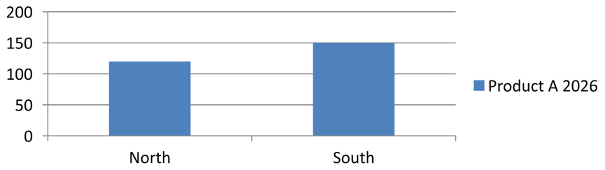

## **परिचय**

एक चार्ट अपने प्लॉट किए गए मानों को वर्कबुक कोशिकाओं में या सीधे संख्यात्मक लिटरल के रूप में संग्रहीत कर सकता है। एक [ChartSeries](https://reference.aspose.com/slides/python-net/aspose.slides.charts/chartseries/) एक संबंधित मानों के सेट को दर्शाता है, और प्रत्येक [ChartDataPoint](https://reference.aspose.com/slides/python-net/aspose.slides.charts/chartdatapoint/) उस श्रृंखला में एक बिंदु को दर्शाता है। [ChartCategory](https://reference.aspose.com/slides/python-net/aspose.slides.charts/chartcategory/) वस्तुएँ लेबल या समूहित मान प्रदान करती हैं जो श्रृंखलाओं में साझा होते हैं। डिफ़ॉल्ट डेटा के साथ बनाए गए चार्ट में, श्रृंखला नाम, श्रेणियाँ और बिंदु मान [ChartDataCell](https://reference.aspose.com/slides/python-net/aspose.slides.charts/chartdatacell/) वस्तुओं का उपयोग करते हैं जो चार्ट वर्कबुक से आती हैं।

एक सामान्य श्रेणी चार्ट के लिए, डिफ़ॉल्ट वर्कबुक श्रृंखला नामों के लिए पंक्ति 0, श्रेणी नामों के लिए स्तंभ 0, और शेष कोशिकाएँ श्रृंखला मानों के लिए उपयोग करती है। कार्यपत्रक, पंक्ति और स्तंभ सूचकांक जो [ChartDataWorkbook.get_cell](https://reference.aspose.com/slides/python-net/aspose.slides.charts/chartdataworkbook/get_cell/) को पास किए जाते हैं शून्य‑आधारित होते हैं। यह लेआउट तब उपयोगी है जब आप डिफ़ॉल्ट डेटा के साथ एक चार्ट बनाते हैं, लेकिन यह मान न लें कि हर मौजूदा चार्ट इसका उपयोग करता है। लोड किए गये प्रस्तुतीकरण के लिए, वर्कबुक मानों को बदलने से पहले श्रृंखला, श्रेणियों और डेटा बिंदुओं से संदर्भित कोशिकाओं की जाँच करें।

चार्ट सेटिंग्स के तीन अलग‑अलग स्तर होते हैं:

- श्रृंखला‑स्तर की सेटिंग्स, जैसे कि [ChartSeries.format](https://reference.aspose.com/slides/python-net/aspose.slides.charts/chartseries/format/), एक श्रृंखला के सभी बिंदुओं के लिए डिफ़ॉल्ट उपस्थिति प्रदान करती हैं।
- डेटा‑बिंदु सेटिंग्स, जैसे कि [ChartDataPoint.format](https://reference.aspose.com/slides/python-net/aspose.slides.charts/chartdatapoint/format/), एक बिंदु के लिए श्रृंखला की उपस्थिति को ओवरराइड करती हैं।
- समूह सेटिंग्स उन संगत श्रृंखलाओं पर लागू होती हैं जो उसी [ChartSeriesGroup](https://reference.aspose.com/slides/python-net/aspose.slides.charts/chartseriesgroup/) से संबंधित होती हैं। जब आपको ओवरलैप या गैप चौड़ाई जैसे विकल्प सेट करने की आवश्यकता हो, तो इसे [ChartSeries.parent_series_group](https://reference.aspose.com/slides/python-net/aspose.slides.charts/chartseries/parent_series_group/) के माध्यम से एक्सेस करें।

जब कोई स्पष्ट बिंदु या श्रृंखला भराव सेट नहीं किया जाता, तो चार्ट शैली और थीम स्वचालित उपस्थिति निर्धारित करती हैं। जब दोनों, श्रृंखला और बिंदु फ़ॉर्मेटिंग मौजूद होते हैं, तो उस बिंदु के लिए बिंदु फ़ॉर्मेटिंग प्राथमिकता लेती है।


## **संख्यात्मक लिटरल का उपयोग करके श्रृंखला मान सेट करें**

जब श्रृंखला मान एप्लिकेशन डेटा या गणनाओं से आते हैं और उन्हें कार्यपत्रक कोशिका संदर्भों की आवश्यकता नहीं होती, तब संख्यात्मक लिटरल का उपयोग करें। प्रत्येक बिंदु के [value](https://reference.aspose.com/slides/python-net/aspose.slides.charts/chartdatapoint/value/) को [as_literal_double](https://reference.aspose.com/slides/python-net/aspose.slides.charts/doublechartvalue/as_literal_double/) के माध्यम से असाइन करने से पहले [data_source_type_for_values](https://reference.aspose.com/slides/python-net/aspose.slides.charts/chartdatapointcollection/data_source_type_for_values/) को [DataSourceType.DOUBLE_LITERALS](https://reference.aspose.com/slides/python-net/aspose.slides.charts/datasourcetype/) पर सेट करें।

कलेक्शन सेटिंग उस श्रृंखला में सभी बिंदु मानों के स्रोत प्रकार को नियंत्रित करती है। प्रत्येक बिंदु का [value.data_source_type](https://reference.aspose.com/slides/python-net/aspose.slides.charts/basechartvalue/data_source_type/) चयनित प्रकार की रिपोर्ट करता है; इसे कलेक्शन सेटिंग के माध्यम से बदलें। `WORKSHEET` के साथ, संदर्भित कोशिका तक पहुँचने के लिए [as_cell](https://reference.aspose.com/slides/python-net/aspose.slides.charts/doublechartvalue/as_cell/) का उपयोग करें। `DOUBLE_LITERALS` के साथ, संख्या को सीधे पढ़ने या लिखने के लिए `as_literal_double` का उपयोग करें।

निम्न उदाहरण डिफ़ॉल्ट श्रृंखलाओं और श्रेणियों के साथ एक कॉलम चार्ट बनाता है, फिर पहले श्रृंखला के मौजूदा बिंदुओं को क्रमशः 10, 20 आदि की गणना किए गये मान असाइन करता है। यह प्रस्तुतीकरण को सहेजता है, दोबारा खोलता है, और संचित मानों को प्रिंट करता है।

```py
import aspose.slides as slides
import aspose.slides.charts as charts

with slides.Presentation() as presentation:
    slide = presentation.slides[0]

    chart = slide.shapes.add_chart(charts.ChartType.CLUSTERED_COLUMN, 20, 20, 500, 300)
    series = chart.chart_data.series[0]

    series.data_points.data_source_type_for_values = charts.DataSourceType.DOUBLE_LITERALS
    for i in range(len(series.data_points)):
        series.data_points[i].value.as_literal_double = (i + 1) * 10

    presentation.save("numeric_literals.pptx", slides.export.SaveFormat.PPTX)

with slides.Presentation("numeric_literals.pptx") as reopened_presentation:
    reopened_slide = reopened_presentation.slides[0]
    reopened_chart = reopened_slide.shapes[0]
    reopened_series = reopened_chart.chart_data.series[0]
    for point in reopened_series.data_points:
        print(point.value.as_literal_double)
```

बिंदु मान स्रोत प्रकार [ChartData.data_source_type](https://reference.aspose.com/slides/python-net/aspose.slides.charts/chartdata/data_source_type/) से अलग है, जो चार्ट के आंतरिक या बाह्य वर्कबुक कॉन्फ़िगरेशन की पहचान करता है। संख्यात्मक लिटरल का उपयोग करने से स्वयं एम्बेडेड वर्कबुक हट नहीं जाता। इस उदाहरण में, वर्कबुक श्रेणी लेबल, श्रृंखला नाम और अन्य श्रृंखलाओं के लिए उपलब्ध रहता है। वर्कबुक प्रबंधन के लिए देखें [Chart Workbook](/slides/hi/python-net/chart-workbook/)।

स्कैटर और बबल चार्ट के लिए, [data_source_type_for_x_values](https://reference.aspose.com/slides/python-net/aspose.slides.charts/chartdatapointcollection/data_source_type_for_x_values/) और [data_source_type_for_y_values](https://reference.aspose.com/slides/python-net/aspose.slides.charts/chartdatapointcollection/data_source_type_for_y_values/) को सेट करके क्रमशः [x_value](https://reference.aspose.com/slides/python-net/aspose.slides.charts/chartdatapoint/x_value/) और [y_value](https://reference.aspose.com/slides/python-net/aspose.slides.charts/chartdatapoint/y_value/) के स्रोत चुने जा सकते हैं। बबल चार्ट additionally [data_source_type_for_bubble_sizes](https://reference.aspose.com/slides/python-net/aspose.slides.charts/chartdatapointcollection/data_source_type_for_bubble_sizes/) को [bubble_size](https://reference.aspose.com/slides/python-net/aspose.slides.charts/chartdatapoint/bubble_size/) के लिए उपयोग करता है। प्रत्येक लागू स्रोत को `DOUBLE_LITERALS` पर सेट करें, फिर उस मान की `as_literal_double` प्रॉपर्टी के द्वारा संख्याएँ असाइन करें।

## **चार्ट श्रृंखला ओवरलैप सेट करें**

[ChartSeries.overlap](https://reference.aspose.com/slides/python-net/aspose.slides.charts/chartseries/overlap/) बताता है कि 2D चार्ट में बार या कॉलम कितनी प्रतिशत ओवरलैप करते हैं, -100 से 100 प्रतिशत तक। यह पैरेंट श्रृंखला समूह पर सेटिंग का केवल‑पढ़ने‑योग्य प्रोजेक्शन है। सभी संगत श्रृंखलाओं को अपडेट करने के लिये [ChartSeriesGroup.overlap](https://reference.aspose.com/slides/python-net/aspose.slides.charts/chartseriesgroup/overlap/) सेट करें। यह विकल्प उन चार्ट प्रकारों पर लागू होता है जो समूहित बार या कॉलम दिखाते हैं; यह संयोजन चार्ट में असंबंधित श्रृंखला समूहों को प्रभावित नहीं करता।

निम्न उदाहरण उस समूह के लिए ओवरलैप सेट करता है जिसमें पहली श्रृंखला शामिल है:

```py
import aspose.slides as slides
import aspose.slides.charts as charts

first_slide_index = 0
first_series_index = 0
overlap_percent = 30

with slides.Presentation() as presentation:
    slide = presentation.slides[first_slide_index]

    # नया चार्ट नमूना श्रृंखलाएँ, श्रेणियाँ और मान रखता है।
    chart = slide.shapes.add_chart(charts.ChartType.CLUSTERED_COLUMN, 20, 20, 500, 200)

    series = chart.chart_data.series[first_series_index]
    series.parent_series_group.overlap = overlap_percent

    presentation.save("series_overlap.pptx", slides.export.SaveFormat.PPTX)
```

परिणाम:


## **श्रृंखला भराव रंग बदलें**

डिफ़ॉल्ट रूप से पूरी श्रृंखला के लिए भराव सेट करने हेतु [ChartSeries.format](https://reference.aspose.com/slides/python-net/aspose.slides.charts/chartseries/format/) का उपयोग करें। यदि किसी बिंदु का स्पष्ट भराव पहले से मौजूद है, तो उसका [ChartDataPoint.format](https://reference.aspose.com/slides/python-net/aspose.slides.charts/chartdatapoint/format/) सेटिंग उस बिंदु के लिए श्रृंखला भराव को ओवरराइड करती है।

निम्न उदाहरण पहली श्रृंखला पर ठोस नीला भराव लागू करता है:

```py
import aspose.pydrawing as drawing
import aspose.slides as slides
import aspose.slides.charts as charts

first_slide_index = 0
first_series_index = 0

with slides.Presentation() as presentation:
    slide = presentation.slides[first_slide_index]

    chart = slide.shapes.add_chart(charts.ChartType.CLUSTERED_COLUMN, 20, 20, 500, 200)

    series = chart.chart_data.series[first_series_index]
    series.format.fill.fill_type = slides.FillType.SOLID
    series.format.fill.solid_fill_color.color = drawing.Color.blue

    presentation.save("series_color.pptx", slides.export.SaveFormat.PPTX)
```

परिणाम:


## **श्रृंखला का नाम बदलें**

श्रृंखला नाम चार्ट डेटा वर्कबुक में संग्रहीत होता है और सामान्यतः लेजेंड में दिखाया जाता है। क्लस्टर्ड कॉलम चार्ट के डिफ़ॉल्ट वर्कबुक में, कोशिका B1 पंक्ति 0, स्तंभ 1 पर स्थित है और पहली श्रृंखला का नाम रखती है। नीचे के उदाहरण में नामांकित स्थिरांक इस संरचना को स्पष्ट रूप से दर्शाते हैं:

```py
import aspose.slides as slides
import aspose.slides.charts as charts

first_slide_index = 0
worksheet_index = 0
series_name_row_index = 0
first_series_column_index = 1

with slides.Presentation() as presentation:
    slide = presentation.slides[first_slide_index]

    chart = slide.shapes.add_chart(charts.ChartType.CLUSTERED_COLUMN, 20, 20, 500, 200)

    workbook = chart.chart_data.chart_data_workbook
    series_name_cell = workbook.get_cell(worksheet_index, series_name_row_index, first_series_column_index)
    series_name_cell.value = "Revenue"

    presentation.save("series_name.pptx", slides.export.SaveFormat.PPTX)
```

आप [ChartSeries.name](https://reference.aspose.com/slides/python-net/aspose.slides.charts/chartseries/name/) द्वारा पहले से संदर्भित कोशिका को भी अपडेट कर सकते हैं। यह तरीका मौजूदा चार्ट में किसी विशिष्ट पंक्ति और स्तंभ को मान लेने की धारणा से बचता है:

```py
import aspose.slides as slides
import aspose.slides.charts as charts

first_slide_index = 0
first_series_index = 0
first_name_cell_index = 0

with slides.Presentation() as presentation:
    slide = presentation.slides[first_slide_index]

    chart = slide.shapes.add_chart(charts.ChartType.CLUSTERED_COLUMN, 20, 20, 500, 200)

    series = chart.chart_data.series[first_series_index]
    series_name_cell = series.name.as_cells[first_name_cell_index]
    series_name_cell.value = "Revenue"

    presentation.save("series_name.pptx", slides.export.SaveFormat.PPTX)
```

परिणाम:


### **एकाधिक कोशिकाओं से नाम के साथ श्रृंखला बनाएं**

जब उत्पाद नाम और रिपोर्टिंग अवधि अलग‑अलग वर्कबुक कोशिकाओं में संग्रहीत हों, तो संयुक्त श्रृंखला नाम उपयोगी होता है। उदाहरण के लिये, आप `Product A` को B1 और `2026` को C1 में रखकर दोनों को एक ही श्रृंखला नाम में संयोजित कर सकते हैं, जबकि दोनों भाग स्रोत कोशिकाओं के साथ लिंक्ड रहेंगे।

[ChartDataWorkbook.get_cell_collection](https://reference.aspose.com/slides/python-net/aspose.slides.charts/chartdataworkbook/get_cell_collection/) का उपयोग करके नाम रेंज प्राप्त करें, फिर उसे [ChartSeriesCollection.add](https://reference.aspose.com/slides/python-net/aspose.slides.charts/chartseriescollection/add/) को पास करें। `skip_hidden_cells` तर्क निर्धारित करता है कि छिपी हुई कोशिकाएँ शामिल हों या नहीं: `True` उन्हें बाहर करता है, जबकि `False` शामिल करता है। यह उदाहरण `False` का उपयोग करके नाम रेंज की हर कोशिका को शामिल करता है।

निम्न उदाहरण एक प्रस्तुतीकरण बनाता है जिसमें एक श्रृंखला और दो डेटा बिंदु होते हैं। कोशिकाएँ B1:C1 केवल श्रृंखला नाम प्रदान करती हैं; A2:A3 श्रेणी लेबल देती हैं, तथा B2:B3 संख्यात्मक मान देती हैं।

```py
import aspose.slides as slides
import aspose.slides.charts as charts

with slides.Presentation() as presentation:
    slide = presentation.slides[0]

    chart = slide.shapes.add_chart(charts.ChartType.CLUSTERED_COLUMN, 50, 50, 620, 180)

    chart.chart_data.series.clear()
    chart.chart_data.categories.clear()
    chart.has_legend = True

    workbook = chart.chart_data.chart_data_workbook
    workbook.clear(0)

    # ये दो कोशिकाएँ श्रृंखला का नाम प्रदान करती हैं।
    workbook.get_cell(0, 0, 1, "Product A")
    workbook.get_cell(0, 0, 2, "2026")
    name_cells = workbook.get_cell_collection("Sheet1!$B$1:$C$1", False)
    series = chart.chart_data.series.add(name_cells, charts.ChartType.CLUSTERED_COLUMN)

    # अलग-अलग कोशिकाएँ श्रेणियों और संख्यात्मक डेटा बिंदुओं को प्रदान करती हैं।
    north_category = workbook.get_cell(0, 1, 0, "North")
    south_category = workbook.get_cell(0, 2, 0, "South")
    chart.chart_data.categories.add(north_category)
    chart.chart_data.categories.add(south_category)
    north_value = workbook.get_cell(0, 1, 1, 120)
    south_value = workbook.get_cell(0, 2, 1, 150)
    series.data_points.add_data_point_for_bar_series(north_value)
    series.data_points.add_data_point_for_bar_series(south_value)

    presentation.save("composite_series_name.pptx", slides.export.SaveFormat.PPTX)
```

परिणामी श्रृंखला नाम `Product A 2026` है, जहाँ दो कोशिका मानों के बीच एक स्पेस है। लेजेंड इसे दोनों कॉलम के लिए एक प्रविष्टि के रूप में दिखाता है। नीचे की छवि सहेजी गई प्रस्तुतीकरण से रेंडर की गई है:



## **स्वचालित श्रृंखला भराव रंग प्राप्त करें**

[ChartSeries.get_automatic_series_color](https://reference.aspose.com/slides/python-net/aspose.slides.charts/chartseries/get_automatic_series_color/) वह रंग लौटाता है जो श्रृंखला अनुक्रमांक और चार्ट शैली से गणना किया जाता है। यह वही रंग है जो तब प्रयोग किया जाता है जब श्रृंखला भराव स्पष्ट रूप से परिभाषित नहीं किया गया हो। इस मेथड को कॉल करने से गणना किया गया रंग पढ़ा जाता है; यह नया भराव नहीं असाइन करता।

निम्न उदाहरण प्रत्येक डिफ़ॉल्ट श्रृंखला का स्वचालित रंग प्रिंट करता है:

```py
import aspose.slides as slides
import aspose.slides.charts as charts

first_slide_index = 0

with slides.Presentation() as presentation:
    slide = presentation.slides[first_slide_index]

    chart = slide.shapes.add_chart(charts.ChartType.CLUSTERED_COLUMN, 20, 20, 500, 200)

    series_count = len(chart.chart_data.series)
    for series_index in range(series_count):
        series = chart.chart_data.series[series_index]
        automatic_color = series.get_automatic_series_color()
        print(f"Series {series_index}: {automatic_color.name}")
```

डिफ़ॉल्ट चार्ट शैली के लिए उदाहरण आउटपुट:

```text
Series 0: ff4f81bd
Series 1: ffc0504d
Series 2: ff9bbb59
```

सटीक रंग चार्ट शैली और थीम पर निर्भर करते हैं।

## **एक चार्ट श्रृंखला के लिए उलटा भराव रंग सेट करें**

बार, कॉलम और बबल श्रृंखलाओं के लिए, [ChartSeries.invert_if_negative](https://reference.aspose.com/slides/python-net/aspose.slides.charts/chartseries/invert_if_negative/) नकारात्मक मानों को अलग रंग से प्रदर्शित कर सकता है। नियमित श्रृंखला भराव को ठोस सेट करें, उलटना सक्षम करें, और नकारात्मक‑मान रंग को [ChartSeries.inverted_solid_fill_color](https://reference.aspose.com/slides/python-net/aspose.slides.charts/chartseries/inverted_solid_fill_color/) के माध्यम से असाइन करें। नकारात्मक संख्याएँ वर्कबुक में अपरिवर्तित रहती हैं; केवल उनका प्रदर्शन रंग बदलता है।

निम्न उदाहरण डिफ़ॉल्ट चार्ट डेटा को एक श्रृंखला में बदल देता है। कार्यपत्रक पंक्ति 0 में श्रृंखला नाम, स्तंभ 0 में श्रेणी नाम, और स्तंभ 1 में मान होते हैं:

```py
import aspose.pydrawing as drawing
import aspose.slides as slides
import aspose.slides.charts as charts

first_slide_index = 0
worksheet_index = 0
header_row_index = 0
category_column_index = 0
first_series_column_index = 1
first_data_row_index = 1

category_names = ["Category 1", "Category 2", "Category 3"]
series_values = [-20, 50, -30]

with slides.Presentation() as presentation:
    slide = presentation.slides[first_slide_index]

    chart = slide.shapes.add_chart(charts.ChartType.CLUSTERED_COLUMN, 20, 20, 500, 200)
    chart_data = chart.chart_data
    workbook = chart_data.chart_data_workbook

    chart_data.series.clear()
    chart_data.categories.clear()

    series_name_cell = workbook.get_cell(worksheet_index, header_row_index, first_series_column_index, "Series 1")
    series = chart_data.series.add(series_name_cell, chart.type)

    category_count = len(category_names)
    for category_index in range(category_count):
        data_row_index = first_data_row_index + category_index
        category_name = category_names[category_index]
        series_value = series_values[category_index]

        category_cell = workbook.get_cell(worksheet_index, data_row_index, category_column_index, category_name)
        chart_data.categories.add(category_cell)

        value_cell = workbook.get_cell(worksheet_index, data_row_index, first_series_column_index, series_value)
        series.data_points.add_data_point_for_bar_series(value_cell)

    automatic_series_color = series.get_automatic_series_color()
    series.format.fill.fill_type = slides.FillType.SOLID
    series.format.fill.solid_fill_color.color = automatic_series_color
    series.invert_if_negative = True
    series.inverted_solid_fill_color.color = drawing.Color.red

    presentation.save("inverted_solid_fill_color.pptx", slides.export.SaveFormat.PPTX)
```

परिणाम:


आप किसी एक बिंदु के लिए उलटना [ChartDataPoint.invert_if_negative](https://reference.aspose.com/slides/python-net/aspose.slides.charts/chartdatapoint/invert_if_negative/) के द्वारा सक्षम कर सकते हैं। नीचे के उदाहरण में श्रृंखला के लिये उलटना अक्षम है और केवल चयनित बिंदु के लिये सक्षम किया गया है। प्रभाव को दिखाने हेतु बिंदु को भी नकारात्मक मान दिया गया है:

```py
import aspose.pydrawing as drawing
import aspose.slides as slides
import aspose.slides.charts as charts

first_slide_index = 0
first_series_index = 0
target_data_point_index = 2
negative_value = -30

with slides.Presentation() as presentation:
    slide = presentation.slides[first_slide_index]

    chart = slide.shapes.add_chart(charts.ChartType.CLUSTERED_COLUMN, 20, 20, 500, 200)

    series = chart.chart_data.series[first_series_index]
    automatic_series_color = series.get_automatic_series_color()
    series.format.fill.fill_type = slides.FillType.SOLID
    series.format.fill.solid_fill_color.color = automatic_series_color
    series.inverted_solid_fill_color.color = drawing.Color.red
    series.invert_if_negative = False

    data_point = series.data_points[target_data_point_index]
    data_point.value.as_cell.value = negative_value
    data_point.invert_if_negative = True

    presentation.save("data_point_invert_color_if_negative.pptx", slides.export.SaveFormat.PPTX)
```

## **एक विशिष्ट डेटा बिंदु मान साफ़ करें**

एक बिंदु को खाली करने के लिये, अन्य बिंदुओं को हटाए बिना, उसकी बैकिंग वर्कबुक कोशिका को `None` सेट करें। कॉलम चार्ट के लिये, प्लॉट किया गया मान [ChartDataPoint.value](https://reference.aspose.com/slides/python-net/aspose.slides.charts/chartdatapoint/value/) के माध्यम से उपलब्ध होता है। डेटा बिंदु समान श्रेणी स्थित में बना रहता है, लेकिन चार्ट अपनी खाली‑मान सेटिंग के अनुसार उसे ब्लैंक मान लेता है।

निम्न उदाहरण पहले श्रृंखला के दूसरे बिंदु को ही साफ़ करता है:

```py
import aspose.slides as slides
import aspose.slides.charts as charts

first_slide_index = 0
first_series_index = 0
target_data_point_index = 1

with slides.Presentation() as presentation:
    slide = presentation.slides[first_slide_index]

    chart = slide.shapes.add_chart(charts.ChartType.CLUSTERED_COLUMN, 20, 20, 500, 200)

    series = chart.chart_data.series[first_series_index]
    data_point = series.data_points[target_data_point_index]
    data_point.value.as_cell.value = None

    presentation.save("clear_data_point_value.pptx", slides.export.SaveFormat.PPTX)
```

स्कैटर चार्ट अलग‑अलग X और Y कोशिकाओं का उपयोग करते हैं, और बबल चार्ट additionally आकार कोशिका का उपयोग करता है। केवल उस कोशिका को साफ़ करें जो आप हटाना चाहते हैं। जब आप अन्य बिंदुओं को बनाए रखना चाहते हैं, तब [ChartDataPointCollection.clear](https://reference.aspose.com/slides/python-net/aspose.slides.charts/chartdatapointcollection/clear/) को न कॉल करें, क्योंकि यह मेथड श्रृंखला के सभी डेटा बिंदुओं को हटा देता है।

## **खाली कोशिकाओं के प्रदर्शन को नियंत्रित करें**

छिपी हुई कोशिकाएँ जिनमें मान हैं, वे खाली कोशिकाओं से अलग होती हैं। छिपी हुई कार्यपत्रक पंक्तियों और स्तंभों से डेटा शामिल/बहिर्भुक्त करने के लिये देखें [Include Data from Hidden Rows and Columns](/slides/hi/python-net/chart-workbook/#include-data-from-hidden-rows-and-columns)।

एक खाली वर्कबुक कोशिका अनुपस्थित डेटा को दर्शाती है; `0` वाले कोशिका को ज्ञात संख्यात्मक मान माना जाता है। किसी कोशिका को खाली बनाने हेतु [ChartDataCell.value](https://reference.aspose.com/slides/python-net/aspose.slides.charts/chartdatacell/value/) को `None` सेट करें। संख्यात्मक शून्य ब्लैंक‑सेल सेटिंग से स्वतंत्र रूप से शून्य बना रहता है।

खाली कोशिकाओं को कैसे प्रदर्शित किया जाए, यह चुनने हेतु [Chart.display_blanks_as](https://reference.aspose.com/slides/python-net/aspose.slides.charts/chart/display_blanks_as/) का उपयोग करें। यह सेटिंग पूरे चार्ट पर लागू होती है। यह ब्लैंक के प्लॉटिंग तरीके को बदलती है, बिना खाली वर्कबुक कोशिका को शून्य या इंटरपोलेटेड मान से भरने के।

निम्न स्वरूपित उदाहरण एक लाइन चार्ट बनाता है जिसमें एक श्रृंखला है, दिन 3 के मान को साफ़ करता है, और प्रत्येक मोड के साथ वही चार्ट सहेजता है। कोई इनपुट फ़ाइल आवश्यक नहीं है। [ChartDataWorkbook](https://reference.aspose.com/slides/python-net/aspose.slides.charts/chartdataworkbook/) कार्यपत्रक 0, स्तंभ 0 को श्रेणी लेबल और स्तंभ 1 को मान हेतु उपयोग करता है; पंक्ति 0 में श्रृंखला नाम रखता है। अंतिम डेटा `10, 20, empty, 30, 40` है।

```py
import aspose.slides as slides
import aspose.slides.charts as charts

with slides.Presentation() as presentation:
    slide = presentation.slides[0]

    chart = slide.shapes.add_chart(charts.ChartType.LINE_WITH_MARKERS, 40, 40, 640, 400)
    chart_data = chart.chart_data
    workbook = chart_data.chart_data_workbook

    chart_data.series.clear()
    chart_data.categories.clear()

    series_name_cell = workbook.get_cell(0, 0, 1, "Measurements")
    series = chart_data.series.add(series_name_cell, chart.type)
    values = [10, 20, 25, 30, 40]

    for i, value in enumerate(values):
        category_cell = workbook.get_cell(0, i + 1, 0, f"Day {i + 1}")
        chart_data.categories.add(category_cell)
        value_cell = workbook.get_cell(0, i + 1, 1, value)
        series.data_points.add_data_point_for_line_series(value_cell)

    # Day 3 को वास्तव में खाली छोड़ें, जबकि उसकी श्रेणी और डेटा बिंदु को बनाए रखें।
    workbook.get_cell(0, 3, 1).value = None

    modes = [("Gap", charts.DisplayBlanksAsType.GAP), ("Zero", charts.DisplayBlanksAsType.ZERO), ("Span", charts.DisplayBlanksAsType.SPAN)]
    for mode_name, mode in modes:
        chart.display_blanks_as = mode
        presentation.save(f"empty_cells_{mode_name}.pptx", slides.export.SaveFormat.PPTX)
```

प्रत्येक आउटपुट फ़ाइल सहेजे जाने से पहले असाइन किए गये मोड को दर्शाती है: `empty_cells_Gap.pptx`, `empty_cells_Zero.pptx`, और `empty_cells_Span.pptx`। केवल एक संस्करण सहेजने के लिये, इच्छित मोड असाइन करें और प्रस्तुतीकरण को केवल एक बार सहेजें, सभी मोड पर इटरनेट करने के बजाय।

नीचे की तुलना तीनों फ़ाइलों में समान डेटा को दर्शाती है। दिन 3 सभी मामलों में वर्कबुक में खाली है:


दिखाई देने वाला प्रभाव चार्ट प्रकार पर निर्भर करता है। लाइन चार्ट सभी तीन मोड की तुलना आसान बनाता है। बार और कॉलम चार्ट में गायब श्रेणी के कारण कनेक्ट करने हेतु कोई लाइन नहीं होती, इसलिए `SPAN` उपर्युक्त कनेक्टिंग सेगमेंट नहीं बना सकता; एक गायब कॉलम और शून्य‑ऊँचाई वाला कॉलम भी समान लग सकते हैं। इसी प्रकार, केवल मार्कर वाले स्कैटर चार्ट में कोई कनेक्टिंग लाइन नहीं होती। सभी चार्ट प्रकारों में तीन विशिष्ट परिणामों की अपेक्षा न रखें; अपने उपयोग के प्रकार के लिये आउटपुट जाँचें।

## **श्रृंखला गैप चौड़ाई सेट करें**

गैप चौड़ाई आसन्न बार या कॉलम क्लस्टर के बीच का अंतराल है, जिसे बार या कॉलम की चौड़ाई के प्रतिशत में व्यक्त किया जाता है। ओवरलैप की तरह, यह पैरेंट श्रृंखला समूह से सम्बंधित है, न कि किसी एक श्रृंखला से। समूह के लिये एक बार [ChartSeriesGroup.gap_width](https://reference.aspose.com/slides/python-net/aspose.slides.charts/chartseriesgroup/gap_width/) सेट करें। बड़ा मान क्लस्टर के बीच अधिक स्थान बनाता है; छोटा मान उन्हें घना बनाता है।

निम्न उदाहरण गैप चौड़ाई बदलता है और केवल अंतिम प्रस्तुतीकरण को सहेजता है:

```py
import aspose.slides as slides
import aspose.slides.charts as charts

first_slide_index = 0
first_series_index = 0
gap_width_percent = 30

with slides.Presentation() as presentation:
    slide = presentation.slides[first_slide_index]

    chart = slide.shapes.add_chart(charts.ChartType.STACKED_COLUMN, 20, 20, 500, 200)

    series = chart.chart_data.series[first_series_index]
    series.parent_series_group.gap_width = gap_width_percent

    presentation.save("gap_width_30.pptx", slides.export.SaveFormat.PPTX)
```

परिणाम:


## **अक्सर पूछे जाने वाले प्रश्न**

**कौन से चार्ट प्रकार डेटा श्रृंखला का समर्थन करते हैं?**

[ChartType](https://reference.aspose.com/slides/python-net/aspose.slides.charts/charttype/) enumeration द्वारा दर्शाए गये सभी चार्ट प्रकार डेटा का उपयोग करते हैं, पर उनकी श्रृंखलाओं की मान संरचना या सेटिंग समान नहीं होती। उदाहरण के लिये, श्रेणी चार्ट श्रेणियों और मानों का उपयोग करते हैं, स्कैटर चार्ट X और Y मानों का, तथा बबल चार्ट बबल आकारों का। श्रृंखला प्रकार से मेल खाते डेटा‑बिंदु निर्माण मेथड का उपयोग करें। ओवरलैप और गैप चौड़ाई जैसे विकल्प केवल संगत बार या कॉलम समूहों पर लागू होते हैं।

**एक चार्ट श्रृंखला समूह क्या है?**

[ChartSeriesGroup](https://reference.aspose.com/slides/python-net/aspose.slides.charts/chartseriesgroup/) में उन संगत श्रृंखलाओं का समूह होता है जो समूह‑स्तर की प्लॉटिंग सेटिंग्स साझा करती हैं। संयोजन चार्ट में एक से अधिक समूह हो सकते हैं, अतः एक श्रृंखला के माध्यम से पहुँचा गया समूह सभी श्रृंखलाओं को आवश्यक रूप से नहीं बदलता।

**क्या नया बनाया गया चार्ट डिफ़ॉल्ट डेटा रखता है?**

हां। डिफ़ॉल्ट रूप से, [ShapeCollection.add_chart](https://reference.aspose.com/slides/python-net/aspose.slides/shapecollection/add_chart/) नमूना श्रृंखला, श्रेणियाँ और मान बनाता है। आप उन कोशिकाओं को संपादित कर सकते हैं या पूरी तरह से कस्टम डेटा सेट जोड़ने से पहले श्रृंखला और श्रेणी संग्रह दोनों को साफ़ कर सकते हैं। एक ओवरलोड भी डिफ़ॉल्ट डेटा के बिना चार्ट बना सकता है।

**चार्ट वस्तुएँ वर्कबुक कोशिकाओं से कैसे जुड़ी होती हैं?**

श्रृंखला नाम, श्रेणी लेबल और डेटा‑बिंदु मान [ChartDataWorkbook](https://reference.aspose.com/slides/python-net/aspose.slides.charts/chartdataworkbook/) की कोशिकाओं का संदर्भ लेते हैं। किसी संदर्भित कोशिका को बदलने से संबंधित चार्ट तत्व अपडेट हो जाता है। कस्टम डेटा बनाते समय, श्रेणी पंक्तियों और श्रृंखला‑मान पंक्तियों को इस प्रकार संरेखित रखें कि प्रत्येक बिंदु इच्छित श्रेणी के नीचे प्लॉट हो।

**मैं पूरी श्रृंखला के बजाय एक बिंदु को कैसे साफ़ करूँ?**

बिंदु की संबंधित मान कोशिका को `None` सेट करें, ताकि उसका श्रेणी स्थान एक खाली बिंदु के रूप में बना रहे। जब आप सभी बिंदुओं को हटाना चाहते हैं, तभी [ChartDataPointCollection.clear](https://reference.aspose.com/slides/python-net/aspose.slides.charts/chartdatapointcollection/clear/) का उपयोग करें; यह मेथड उस श्रृंखला के सभी बिंदुओं को हटा देता है।

**खाली बिंदुओं को कैसे प्रदर्शित किया जाता है?**

परिणाम चार्ट प्रकार और [Chart.display_blanks_as](https://reference.aspose.com/slides/python-net/aspose.slides.charts/chart/display_blanks_as/) पर निर्भर करता है। समर्थित चार्ट खाली को गैप, शून्य मान, या निकटवर्ती बिंदुओं को जोड़कर प्रदर्शित कर सकते हैं। वह सेटिंग चुनें जो आपके प्रस्तुतीकरण में अनुपस्थित डेटा के अर्थ से मेल खाती हो। पूर्ण उदाहरण और दृश्य तुलना के लिये देखें [खाली कोशिकाओं के प्रदर्शन को नियंत्रित करें](#control-the-display-of-empty-cells)।

**नकारात्मक मानों को कैसे फ़ॉर्मेट किया जाता है?**

सहायक बार, कॉलम और बबल श्रृंखलाओं के लिये, [ChartSeries.invert_if_negative](https://reference.aspose.com/slides/python-net/aspose.slides.charts/chartseries/invert_if_negative/) सक्षम करें और [ChartSeries.inverted_solid_fill_color](https://reference.aspose.com/slides/python-net/aspose.slides.charts/chartseries/inverted_solid_fill_color/) के जरिए नकारात्मक‑मान रंग सेट करें। आप व्यक्तिगत बिंदु के लिये इस व्यवहार को [ChartDataPoint.invert_if_negative](https://reference.aspose.com/slides/python-net/aspose.slides.charts/chartdatapoint/invert_if_negative/) से ओवरराइड कर सकते हैं। ये प्रॉपर्टी फ़ॉर्मेटिंग को प्रभावित करती हैं, न कि संग्रहीत संख्यात्मक मानों को।

**जब दोनों, श्रृंखला और बिंदु फ़ॉर्मेट किए गये हों, तो कौन जीतेगा?**

स्पष्ट डेटा‑बिंदु फ़ॉर्मेटिंग उस बिंदु के लिये प्राथमिकता लेती है। अन्य बिंदु स्पष्ट श्रृंखला फ़ॉर्मेट या, जब श्रृंखला फ़ॉर्मेट परिभाषित नहीं है, तो स्वचालित चार्ट शैली और थीम का उपयोग जारी रखते हैं। समूह गुण जैसे ओवरलैप और गैप चौड़ाई लेआउट को नियंत्रित करते हैं और बिंदु‑स्तर की फ़ॉर्मेटिंग ओवरराइड नहीं होते।

**क्या किसी चार्ट में श्रृंखलाओं की संख्या पर सीमा है?**

Aspose.Slides कोई अलग‑थलग निश्चित श्रृंखला‑गणना सीमा नहीं लगाता। व्यावहारिक रूप से, प्रस्तुतीकरण फ़ाइल प्रतिबंध, उपलब्ध मेमोरी, रेंडरिंग समय और चार्ट की पठनीयता एक उपयोगी सीमा निर्धारित करती है।

**जब कॉलम बहुत पास‑पास या बहुत दूर हों, तो क्या बदलना चाहिए?**

उचित पैरेंट श्रृंखला समूह पर [ChartSeriesGroup.gap_width](https://reference.aspose.com/slides/python-net/aspose.slides.charts/chartseriesgroup/gap_width/) सेट करें। मान को बढ़ाकर क्लस्टर के बीच स्थान बढ़ाएँ, या घटाकर क्लस्टर को निकट लाएँ।