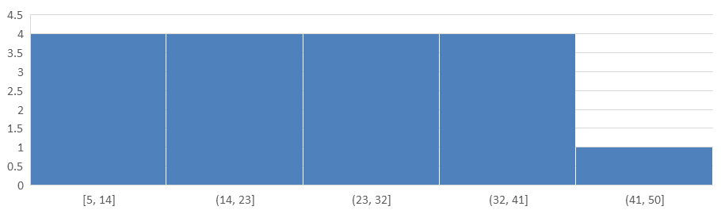

## **अवलोकन**

यह लेख Aspose.Slides for Python via .NET का उपयोग करके चार्ट बनाने और अनुकूलित करने के बारे में एक व्यापक मार्गदर्शिका प्रदान करता है। आप सीखेंगे कि कैसे प्रोग्रामेटिक रूप से स्लाइड में चार्ट जोड़ें, डेटा से उसे भरें, और विभिन्न फ़ॉर्मैटिंग विकल्प लागू करके अपने विशिष्ट डिज़ाइन आवश्यकताओं को पूरा करें। लेख के दौरान विस्तृत कोड उदाहरण प्रत्येक चरण को दर्शाते हैं, प्रस्तुति और चार्ट ऑब्जेक्ट को इनिशियलाइज़ करने से लेकर सीरीज़, अक्ष, और लीज़ेंड को कॉन्फ़िगर करने तक। इस मार्गदर्शिका का पालन करके आप अपने Python एप्लिकेशन्स में डायनेमिक चार्ट जेनरेशन को एकीकृत करने की ठोस समझ प्राप्त करेंगे, जिससे डेटा‑ड्रिवेन प्रस्तुतियों का निर्माण सरल हो जाएगा।

## **एक चार्ट बनाएं**

चार्ट लोगों को डेटा को जल्दी विज़ुअलाइज़ करने और उन अंतर्दृष्टियों को प्राप्त करने में मदद करते हैं जो तालिका या स्प्रेडशीट से तुरंत स्पष्ट नहीं होतीं।

**चार्ट क्यों बनाएं?**

चार्ट का उपयोग करके आप:

* प्रस्तुति में एक ही स्लाइड पर बड़ी मात्रा में डेटा को एकत्र, संक्षिप्त या सारांशित कर सकते हैं;
* डेटा में पैटर्न और प्रवृत्तियों को उजागर कर सकते हैं;
* समय के साथ या किसी विशिष्ट माप इकाई के संदर्भ में डेटा की दिशा और गति का अनुमान लगा सकते हैं;
* अपवर्जन, विसंगतियों, त्रुटियों और असंगत डेटा को पहचान सकते हैं;
* जटिल डेटा को संप्रेषित या प्रस्तुत कर सकते हैं।

PowerPoint में आप *Insert* फ़ंक्शन के माध्यम से कई प्रकार के चार्ट टेम्पलेट का उपयोग करके चार्ट बना सकते हैं। Aspose.Slides का उपयोग करके आप सामान्य चार्ट (लोकप्रिय चार्ट प्रकारों पर आधारित) और कस्टम चार्ट दोनों बना सकते हैं।

{}
Use the [ChartType](https://reference.aspose.com/slides/python-net/aspose.slides.charts/charttype/) enumeration under the [aspose.slides.charts](https://reference.aspose.com/slides/python-net/aspose.slides.charts/) module. The values in this enumeration correspond to different chart types.
{}

### **क्लस्टर्ड कॉलम चार्ट बनाएं**

यह उदाहरण [add_chart](https://reference.aspose.com/slides/python-net/aspose.slides/shapecollection/add_chart/) का उपयोग करके एक क्लस्टर्ड कॉलम चार्ट बनाता है जो तीन श्रेणियों में दो सीरीज़ की तुलना करता है। सीरीज़ लाल और हरे फ़िल्स का उपयोग करती हैं, और व्यक्तिगत लेबल श्रेणी नाम, सीरीज़ नाम, और मान दर्शाते हैं। वर्कशीट इंडेक्स 0 एम्बेडेड चार्ट वर्कबुक की पहली शीट को संदर्भित करता है।

```python
import aspose.pydrawing as draw
import aspose.slides as slides
import aspose.slides.charts as charts

with slides.Presentation() as presentation:
    slide = presentation.slides[0]

    chart = slide.shapes.add_chart(charts.ChartType.CLUSTERED_COLUMN, 20, 20, 500, 300)

    chart.chart_title.add_text_frame_for_overriding("Sample Title")
    chart.chart_title.text_frame_for_overriding.text_frame_format.center_text = slides.NullableBool.TRUE
    chart.chart_title.height = 20
    chart.has_title = True

    workbook = chart.chart_data.chart_data_workbook
    worksheet_index = 0

    chart.chart_data.series.clear()
    chart.chart_data.categories.clear()

    series_name_cell = workbook.get_cell(worksheet_index, 0, 1, "Series 1")
    chart.chart_data.series.add(series_name_cell, chart.type)
    series_name_cell = workbook.get_cell(worksheet_index, 0, 2, "Series 2")
    chart.chart_data.series.add(series_name_cell, chart.type)

    category_cell = workbook.get_cell(worksheet_index, 1, 0, "Category 1")
    chart.chart_data.categories.add(category_cell)
    category_cell = workbook.get_cell(worksheet_index, 2, 0, "Category 2")
    chart.chart_data.categories.add(category_cell)
    category_cell = workbook.get_cell(worksheet_index, 3, 0, "Category 3")
    chart.chart_data.categories.add(category_cell)

    series = chart.chart_data.series[0]

    value_cell = workbook.get_cell(worksheet_index, 1, 1, 20)
    series.data_points.add_data_point_for_bar_series(value_cell)
    value_cell = workbook.get_cell(worksheet_index, 2, 1, 50)
    series.data_points.add_data_point_for_bar_series(value_cell)
    value_cell = workbook.get_cell(worksheet_index, 3, 1, 30)
    series.data_points.add_data_point_for_bar_series(value_cell)

    series.format.fill.fill_type = slides.FillType.SOLID
    series.format.fill.solid_fill_color.color = draw.Color.red

    series = chart.chart_data.series[1]

    value_cell = workbook.get_cell(worksheet_index, 1, 2, 30)
    series.data_points.add_data_point_for_bar_series(value_cell)
    value_cell = workbook.get_cell(worksheet_index, 2, 2, 10)
    series.data_points.add_data_point_for_bar_series(value_cell)
    value_cell = workbook.get_cell(worksheet_index, 3, 2, 60)
    series.data_points.add_data_point_for_bar_series(value_cell)

    series.format.fill.fill_type = slides.FillType.SOLID
    series.format.fill.solid_fill_color.color = draw.Color.green

    label = series.data_points[0].label
    label.data_label_format.show_category_name = True

    label = series.data_points[1].label
    label.data_label_format.show_series_name = True

    label = series.data_points[2].label
    label.data_label_format.show_value = True
    label.data_label_format.show_series_name = True
    label.data_label_format.separator = "/"

    presentation.save("AsposeChart.pptx", slides.export.SaveFormat.PPTX)
```

परिणाम:


### **स्कैटर चार्ट बनाएं**

स्कैटर चार्ट (जिसे स्कैटर प्लॉट या x‑y ग्राफ़ भी कहा जाता है) अक्सर दो वेरिएबल्स के बीच पैटर्न या सहसंबंध जांचने के लिए उपयोग किए जाते हैं।

स्कैटर चार्ट का उपयोग तब करें जब:

* आपके पास युग्मित संख्यात्मक डेटा हो।
* दो वेरिएबल्स एक-दूसरे के साथ अच्छी तरह जुड़ते हों।
* आप यह निर्धारित करना चाहते हों कि दोनों वेरिएबल्स संबंधित हैं या नहीं।
* आपके पास एक स्वतंत्र वेरिएबल हो जिसके कई मान एक निर्भर वेरिएबल के लिए हों।

यह उदाहरण दो सेट x‑y मानों को प्लॉट करता है। पहली सीरीज़ स्टार मार्कर के साथ सीधी रेखाएँ उपयोग करती है, जबकि दूसरी स्मूद रेखाएँ सर्कल मार्कर के साथ; दोनों का [size](https://reference.aspose.com/slides/python-net/aspose.slides.charts/marker/size/) 10 है। [symbol](https://reference.aspose.com/slides/python-net/aspose.slides.charts/marker/symbol/) प्रॉपर्टी मार्कर आकार को नियंत्रित करती है।

```python
import aspose.slides as slides
import aspose.slides.charts as charts

with slides.Presentation() as presentation:
    slide = presentation.slides[0]

    chart = slide.shapes.add_chart(charts.ChartType.SCATTER_WITH_SMOOTH_LINES, 20, 20, 500, 300)

    workbook = chart.chart_data.chart_data_workbook
    worksheet_index = 0

    chart.chart_data.series.clear()

    series_name_cell = workbook.get_cell(worksheet_index, 1, 1, "Series 1")
    chart.chart_data.series.add(series_name_cell, chart.type)
    series_name_cell = workbook.get_cell(worksheet_index, 1, 3, "Series 2")
    chart.chart_data.series.add(series_name_cell, chart.type)

    series = chart.chart_data.series[0]

    x_value_cell = workbook.get_cell(worksheet_index, 2, 1, 1)
    y_value_cell = workbook.get_cell(worksheet_index, 2, 2, 3)
    series.data_points.add_data_point_for_scatter_series(x_value_cell, y_value_cell)

    x_value_cell = workbook.get_cell(worksheet_index, 3, 1, 2)
    y_value_cell = workbook.get_cell(worksheet_index, 3, 2, 10)
    series.data_points.add_data_point_for_scatter_series(x_value_cell, y_value_cell)

    series.type = charts.ChartType.SCATTER_WITH_STRAIGHT_LINES_AND_MARKERS

    series.marker.size = 10
    series.marker.symbol = charts.MarkerStyleType.STAR

    series = chart.chart_data.series[1]

    x_value_cell = workbook.get_cell(worksheet_index, 2, 3, 5)
    y_value_cell = workbook.get_cell(worksheet_index, 2, 4, 2)
    series.data_points.add_data_point_for_scatter_series(x_value_cell, y_value_cell)

    x_value_cell = workbook.get_cell(worksheet_index, 3, 3, 3)
    y_value_cell = workbook.get_cell(worksheet_index, 3, 4, 1)
    series.data_points.add_data_point_for_scatter_series(x_value_cell, y_value_cell)

    x_value_cell = workbook.get_cell(worksheet_index, 4, 3, 2)
    y_value_cell = workbook.get_cell(worksheet_index, 4, 4, 2)
    series.data_points.add_data_point_for_scatter_series(x_value_cell, y_value_cell)

    x_value_cell = workbook.get_cell(worksheet_index, 5, 3, 5)
    y_value_cell = workbook.get_cell(worksheet_index, 5, 4, 1)
    series.data_points.add_data_point_for_scatter_series(x_value_cell, y_value_cell)

    series.marker.size = 10
    series.marker.symbol = charts.MarkerStyleType.CIRCLE

    presentation.save("AsposeChart.pptx", slides.export.SaveFormat.PPTX)
```

परिणाम:


### **पाई चार्ट बनाएं**

पाई चार्ट डेटा में भाग‑से‑पूरा संबंध दिखाने के लिए सबसे उपयुक्त होते हैं, विशेषकर जब डेटा में श्रेणीबद्ध लेबल के साथ संख्यात्मक मान हों। हालांकि, यदि आपके डेटा में कई भाग या लेबल हों, तो आप बार चार्ट पर विचार कर सकते हैं।

यह उदाहरण तीन तिमाही मानों के साथ एक पाई चार्ट बनाता है। प्रत्येक स्लाइस का कस्टम फ़िल और बॉर्डर है, और लेबल विभिन्न संयोजनों में मान, प्रतिशत, और सीरीज़ जानकारी दिखाते हैं। [first_slice_angle](https://reference.aspose.com/slides/python-net/aspose.slides.charts/chartseriesgroup/first_slice_angle/) प्रॉपर्टी पहला स्लाइस 180 डिग्री से शुरू करती है।

```python
import aspose.pydrawing as draw
import aspose.slides as slides
import aspose.slides.charts as charts

with slides.Presentation() as presentation:
    slide = presentation.slides[0]

    chart = slide.shapes.add_chart(charts.ChartType.PIE, 20, 20, 500, 300)

    chart.chart_title.add_text_frame_for_overriding("Sample Title")
    chart.chart_title.text_frame_for_overriding.text_frame_format.center_text = slides.NullableBool.TRUE
    chart.chart_title.height = 20
    chart.has_title = True

    chart.chart_data.series[0].labels.default_data_label_format.show_value = True

    workbook = chart.chart_data.chart_data_workbook
    worksheet_index = 0

    chart.chart_data.series.clear()
    chart.chart_data.categories.clear()

    category_cell = workbook.get_cell(0, 1, 0, "1st Qtr")
    chart.chart_data.categories.add(category_cell)
    category_cell = workbook.get_cell(0, 2, 0, "2nd Qtr")
    chart.chart_data.categories.add(category_cell)
    category_cell = workbook.get_cell(0, 3, 0, "3rd Qtr")
    chart.chart_data.categories.add(category_cell)

    series_name_cell = workbook.get_cell(0, 0, 1, "Series 1")
    series = chart.chart_data.series.add(series_name_cell, chart.type)

    value_cell = workbook.get_cell(worksheet_index, 1, 1, 20)
    series.data_points.add_data_point_for_pie_series(value_cell)
    value_cell = workbook.get_cell(worksheet_index, 2, 1, 50)
    series.data_points.add_data_point_for_pie_series(value_cell)
    value_cell = workbook.get_cell(worksheet_index, 3, 1, 30)
    series.data_points.add_data_point_for_pie_series(value_cell)

    chart.chart_data.series_groups[0].is_color_varied = True

    first_slice = series.data_points[0]
    first_slice.format.fill.fill_type = slides.FillType.SOLID
    first_slice.format.fill.solid_fill_color.color = draw.Color.cyan

    first_slice.format.line.fill_format.fill_type = slides.FillType.SOLID
    first_slice.format.line.fill_format.solid_fill_color.color = draw.Color.gray
    first_slice.format.line.width = 3.0
    first_slice.format.line.style = slides.LineStyle.THIN_THICK
    first_slice.format.line.dash_style = slides.LineDashStyle.LARGE_DASH

    second_slice = series.data_points[1]
    second_slice.format.fill.fill_type = slides.FillType.SOLID
    second_slice.format.fill.solid_fill_color.color = draw.Color.brown

    second_slice.format.line.fill_format.fill_type = slides.FillType.SOLID
    second_slice.format.line.fill_format.solid_fill_color.color = draw.Color.blue
    second_slice.format.line.width = 3.0
    second_slice.format.line.style = slides.LineStyle.SINGLE
    second_slice.format.line.dash_style = slides.LineDashStyle.LARGE_DASH_DOT

    third_slice = series.data_points[2]
    third_slice.format.fill.fill_type = slides.FillType.SOLID
    third_slice.format.fill.solid_fill_color.color = draw.Color.coral

    third_slice.format.line.fill_format.fill_type = slides.FillType.SOLID
    third_slice.format.line.fill_format.solid_fill_color.color = draw.Color.red
    third_slice.format.line.width = 2.0
    third_slice.format.line.style = slides.LineStyle.THIN_THIN
    third_slice.format.line.dash_style = slides.LineDashStyle.LARGE_DASH_DOT_DOT

    first_label = series.data_points[0].label
    first_label.data_label_format.show_value = True

    second_label = series.data_points[1].label
    second_label.data_label_format.show_value = True
    second_label.data_label_format.show_legend_key = True
    second_label.data_label_format.show_percentage = True

    third_label = series.data_points[2].label
    third_label.data_label_format.show_series_name = True
    third_label.data_label_format.show_percentage = True

    series.labels.default_data_label_format.show_leader_lines = True

    chart.chart_data.series_groups[0].first_slice_angle = 180

    presentation.save("PieChart.pptx", slides.export.SaveFormat.PPTX)
```

परिणाम:


लेबल को पाई के बाहर पढ़ने योग्य बनाने के लिए, उदाहरण देखें [Format Leader Lines](/slides/hi/python-net/chart-data-label/#format-leader-lines) जो लेबल की स्थिति और लाइनों के रंग, चौड़ाई, पारदर्शिता, तथा डैश शैली को कस्टमाइज़ करता है।

### **लाइन चार्ट बनाएं**

लाइन चार्ट (जिसे लाइन ग्राफ़ भी कहा जाता है) उन स्थितियों में सबसे उपयुक्त होते हैं जहाँ आप समय के साथ मान में बदलाव दिखाना चाहते हैं। लाइन चार्ट के साथ आप बड़ी मात्रा में डेटा को एक साथ तुलना कर सकते हैं, समय के साथ बदलाव और प्रवृत्तियों को ट्रैक कर सकते हैं, डेटा सीरीज़ में विसंगतियों को उजागर कर सकते हैं, आदि।

यह उदाहरण [add_chart](https://reference.aspose.com/slides/python-net/aspose.slides/shapecollection/add_chart/) का उपयोग करके डिफ़ॉल्ट सीरीज़ और श्रेणियों के साथ एक लाइन चार्ट बनाता है, फिर प्रस्तुति को PPTX के रूप में सहेजता है।

```python
import aspose.slides as slides
import aspose.slides.charts as charts

with slides.Presentation() as presentation:
    slide = presentation.slides[0]

    line_chart = slide.shapes.add_chart(charts.ChartType.LINE, 20, 20, 500, 300)

    presentation.save("lineChart.pptx", slides.export.SaveFormat.PPTX)
```

डिफ़ॉल्ट रूप से, लाइन चार्ट के बिंदु सीधी निरंतर रेखाओं से जुड़े होते हैं। यदि आप बिंदुओं को डैश के साथ जोड़ना चाहते हैं, तो [dash_style](https://reference.aspose.com/slides/python-net/aspose.slides/lineformat/dash_style/) को [LineDashStyle](https://reference.aspose.com/slides/python-net/aspose.slides/linedashstyle/) के किसी मान पर सेट करें:

```python
import aspose.slides as slides
import aspose.slides.charts as charts

with slides.Presentation() as presentation:
    slide = presentation.slides[0]

    line_chart = slide.shapes.add_chart(charts.ChartType.LINE, 20, 20, 500, 300)

    for series in line_chart.chart_data.series:
        series.format.line.dash_style = slides.LineDashStyle.DASH
```

परिणाम:


### **ट्री मैप चार्ट बनाएं**

ट्री मैप चार्ट बिक्री डेटा के लिए उपयोगी होते हैं जब आप डेटा श्रेणियों के सापेक्ष आकार दिखाना चाहते हैं और प्रत्येक श्रेणी के भीतर बड़े योगदानकर्ता आइटम पर जल्दी ध्यान आकर्षित करना चाहते हैं।

यह उदाहरण चार टोकरे (stems) और दो शाखाओं (branches) में समूहित आठ लीफ़ के साथ एक ट्री मैप बनाता है। [set_grouping_item](https://reference.aspose.com/slides/python-net/aspose.slides.charts/chartcategorylevelsmanager/set_grouping_item/) मेथड समूह स्तर 1 पर टोकरे और स्तर 2 पर शाखाएं असाइन करता है। मान सापेक्ष आयत आकार निर्धारित करते हैं, जबकि श्रेणी लेबल और ओवरलैपिंग पैरेंट लेबल पदानुक्रम को पहचानते हैं।

```python
import aspose.slides as slides
import aspose.slides.charts as charts

with slides.Presentation() as presentation:
    slide = presentation.slides[0]

    chart = slide.shapes.add_chart(charts.ChartType.TREEMAP, 20, 20, 500, 300)

    chart.chart_data.categories.clear()
    chart.chart_data.series.clear()

    workbook = chart.chart_data.chart_data_workbook
    workbook.clear(0)

    # शाखा 1
    category_cell = workbook.get_cell(0, "C1", "Leaf1")
    leaf = chart.chart_data.categories.add(category_cell)
    leaf.grouping_levels.set_grouping_item(1, "Stem1")
    leaf.grouping_levels.set_grouping_item(2, "Branch1")

    category_cell = workbook.get_cell(0, "C2", "Leaf2")
    chart.chart_data.categories.add(category_cell)

    category_cell = workbook.get_cell(0, "C3", "Leaf3")
    leaf = chart.chart_data.categories.add(category_cell)
    leaf.grouping_levels.set_grouping_item(1, "Stem2")

    category_cell = workbook.get_cell(0, "C4", "Leaf4")
    chart.chart_data.categories.add(category_cell)

    # शाखा 2
    category_cell = workbook.get_cell(0, "C5", "Leaf5")
    leaf = chart.chart_data.categories.add(category_cell)
    leaf.grouping_levels.set_grouping_item(1, "Stem3")
    leaf.grouping_levels.set_grouping_item(2, "Branch2")

    category_cell = workbook.get_cell(0, "C6", "Leaf6")
    chart.chart_data.categories.add(category_cell)

    category_cell = workbook.get_cell(0, "C7", "Leaf7")
    leaf = chart.chart_data.categories.add(category_cell)
    leaf.grouping_levels.set_grouping_item(1, "Stem4")

    category_cell = workbook.get_cell(0, "C8", "Leaf8")
    chart.chart_data.categories.add(category_cell)

    series = chart.chart_data.series.add(charts.ChartType.TREEMAP)
    series.labels.default_data_label_format.show_category_name = True
    value_cell = workbook.get_cell(0, "D1", 4)
    series.data_points.add_data_point_for_treemap_series(value_cell)
    value_cell = workbook.get_cell(0, "D2", 5)
    series.data_points.add_data_point_for_treemap_series(value_cell)
    value_cell = workbook.get_cell(0, "D3", 3)
    series.data_points.add_data_point_for_treemap_series(value_cell)
    value_cell = workbook.get_cell(0, "D4", 6)
    series.data_points.add_data_point_for_treemap_series(value_cell)
    value_cell = workbook.get_cell(0, "D5", 9)
    series.data_points.add_data_point_for_treemap_series(value_cell)
    value_cell = workbook.get_cell(0, "D6", 9)
    series.data_points.add_data_point_for_treemap_series(value_cell)
    value_cell = workbook.get_cell(0, "D7", 4)
    series.data_points.add_data_point_for_treemap_series(value_cell)
    value_cell = workbook.get_cell(0, "D8", 3)
    series.data_points.add_data_point_for_treemap_series(value_cell)

    series.parent_label_layout = charts.ParentLabelLayoutType.OVERLAPPING

    presentation.save("Treemap.pptx", slides.export.SaveFormat.PPTX)
```

परिणाम:


### **वॉटरफ़ॉल चार्ट बनाएं**

वॉटरफ़ॉल चार्ट दिखाता है कि सकारात्मक और नकारात्मक बदलाव अंतिम मान में कैसे योगदान देते हैं। उदाहरण के लिए, लाभ विभाजन राजस्व से शुरू हो सकता है, लागत घटाई जा सकती है, और अन्य आय जोड़ी जा सकती है। परिवर्तन कॉलम पिछले और नए रनिंग मान के बीच तैरते हैं, जबकि कुल कॉलम शून्य से संचित मान तक विस्तारित होते हैं।

नीचे दिया गया उदाहरण हजारों US डॉलर में राशि का उपयोग करता है:

| श्रेणी | वर्कबुक मान | स्तंभ प्रकार |
| --- | ---: | --- |
| राजस्व | 1000 | Increase |
| बिक्री लागत | -400 | Decrease |
| सकल लाभ | 600 | Intermediate total |
| परिचालन खर्च | -200 | Decrease |
| अन्य आय | 50 | Increase |
| शुद्ध लाभ | 450 | Final total |

बिंदु को इंटरमीडिएट या फ़ाइनल टोटल के रूप में चिह्नित करने के लिए, उसका [set_as_total](https://reference.aspose.com/slides/python-net/aspose.slides.charts/chartdatapoint/set_as_total/) प्रॉपर्टी `True` सेट करें। उस बिंदु की वर्कबुक सेल में वास्तविक संचित राशि प्रदान करें: सकल लाभ के लिए `600` (`1000 - 400`) और शुद्ध लाभ के लिए `450` (`600 - 200 + 50`)। यह प्रॉपर्टी कॉलम को टोटल के रूप में मार्क करती है; यह सेल मान की गणना या भराव नहीं करती। शून्य को प्लेसहोल्डर के रूप में उपयोग न करें या टोटल पॉइंट के लिए कोई अन्य परिवर्तन न दें। एक टोटल कॉलम संचित मान दिखाता है बिना उसे फिर से रनिंग मान में जोड़ें।

यह पूरा C# उदाहरण [ChartType](https://reference.aspose.com/slides/python-net/aspose.slides.charts/charttype/) के `Waterfall` सदस्य का उपयोग करके एक चार्ट बनाता है, डिफ़ॉल्ट डेटा साफ़ करता है, और एम्बेडेड वर्कबुक को भरता है। वर्कशीट इंडेक्स `0` पहली वर्कशीट चुनता है; कॉलम A में श्रेणी नाम और कॉलम B में मान होते हैं। प्रत्येक मान सेल को [add_data_point_for_waterfall_series](https://reference.aspose.com/slides/python-net/aspose.slides.charts/chartdatapointcollection/add_data_point_for_waterfall_series/) से जोड़ा जाता है। शून्य‑आधारित पॉइंट इंडेक्स `2` और `5` क्रमशः इंटरमीडिएट और फ़ाइनल टोटल की पहचान करते हैं। [show_value](https://reference.aspose.com/slides/python-net/aspose.slides.charts/datalabelformat/show_value/) को सक्षम करने से मान कॉलम पर दिखते हैं। इनपुट प्रस्तुति या वर्कबुक की आवश्यकता नहीं है।

```python
import aspose.slides as slides
import aspose.slides.charts as charts

with slides.Presentation() as presentation:
    slide = presentation.slides[0]

    chart = slide.shapes.add_chart(charts.ChartType.WATERFALL, 20, 20, 680, 200)

    chart.has_title = True
    chart.chart_title.add_text_frame_for_overriding("Profit breakdown (USD thousands)")
    chart.chart_title.overlay = False
    chart.has_legend = False

    chart.chart_data.series.clear()
    chart.chart_data.categories.clear()

    workbook = chart.chart_data.chart_data_workbook
    worksheet_index = 0

    workbook.clear(worksheet_index)

    series_name_cell = workbook.get_cell(worksheet_index, 0, 1, "Profit")
    series = chart.chart_data.series.add(series_name_cell, charts.ChartType.WATERFALL)
    categories = ["Revenue", "Cost of sales", "Gross profit", "Operating expenses", "Other income", "Net profit"]
    values = [1000, -400, 600, -200, 50, 450]

    for i in range(len(categories)):
        category_cell = workbook.get_cell(worksheet_index, i + 1, 0, categories[i])
        chart.chart_data.categories.add(category_cell)
        value_cell = workbook.get_cell(worksheet_index, i + 1, 1, values[i])
        series.data_points.add_data_point_for_waterfall_series(value_cell)

    # तीसरा और छठा बिंदु कुल को दर्शाते हैं, अतिरिक्त परिवर्तन नहीं।
    series.data_points[2].set_as_total = True
    series.data_points[5].set_as_total = True
    series.show_connector_lines = True
    series.labels.default_data_label_format.show_value = True

    presentation.save("WaterfallChart.pptx", slides.export.SaveFormat.PPTX)
```

सीरीज़‑लेवल पर [show_connector_lines](https://reference.aspose.com/slides/python-net/aspose.slides.charts/chartseries/show_connector_lines/) प्रॉपर्टी को `True` सेट करके क्रमिक कॉलम को जोड़ने वाली लाइनों को दिखाया जा सकता है जिससे रनिंग वैल्यू को फॉलो करना आसान हो जाता है। इन लाइनों को छिपाने के लिए, उदाहरण में असाइनमेंट को `series.show_connector_lines = False` से बदलें और फिर सहेजें। इससे केवल लाइन की दृश्यता बदलती है, डेटा या टोटल नहीं।

सहेजी गई प्रस्तुति में 600 का सकल लाभ और 450 का शुद्ध लाभ दिखता है, दोनों टोटल शून्य से प्रारंभ होते हैं:


### **स्टॉक चार्ट बनाएं**

स्टॉक चार्ट वित्तीय डेटा जैसे ओपन, हाई, लो, और क्लोज़ प्राइस दर्शाने के लिए उपयोग किए जाते हैं, जिससे बाजार प्रवृत्तियों और अस्थिरता का विश्लेषण संभव होता है। वे स्टॉक प्रदर्शन के महत्वपूर्ण अंतर्दृष्टि प्रदान करते हैं, जिससे निवेशकों और विश्लेषकों को सूचित निर्णय लेने में मदद मिलती है।

यह उदाहरण चार श्रृंखलाओं के साथ एक ओपन‑हाई‑लो‑क्लोज़ चार्ट बनाता है, क्रम में तथा तीन श्रेणियों के साथ। [has_up_down_bars](https://reference.aspose.com/slides/python-net/aspose.slides.charts/updownbarsmanager/has_up_down_bars/) प्रॉपर्टी अप/डाउन बार को सक्षम करती है, और [hi_low_lines_format](https://reference.aspose.com/slides/python-net/aspose.slides.charts/chartseriesgroup/hi_low_lines_format/) हाई‑लो लाइनों को नियंत्रित करती है जो प्राइस रेंज दिखाती हैं, जबकि व्यक्तिगत सीरीज़ लाइनों और माइनर हॉरिज़ॉन्टल ग्रिडलाइन छिपी रहती हैं।

```python
import aspose.slides as slides
import aspose.slides.charts as charts

with slides.Presentation() as presentation:
    slide = presentation.slides[0]

    chart = slide.shapes.add_chart(charts.ChartType.OPEN_HIGH_LOW_CLOSE, 20, 20, 500, 300, False)

    workbook = chart.chart_data.chart_data_workbook

    category_cell = workbook.get_cell(0, 1, 0, "A")
    chart.chart_data.categories.add(category_cell)
    category_cell = workbook.get_cell(0, 2, 0, "B")
    chart.chart_data.categories.add(category_cell)
    category_cell = workbook.get_cell(0, 3, 0, "C")
    chart.chart_data.categories.add(category_cell)

    series_name_cell = workbook.get_cell(0, 0, 1, "Open")
    chart.chart_data.series.add(series_name_cell, charts.ChartType.OPEN_HIGH_LOW_CLOSE)
    series_name_cell = workbook.get_cell(0, 0, 2, "High")
    chart.chart_data.series.add(series_name_cell, charts.ChartType.OPEN_HIGH_LOW_CLOSE)
    series_name_cell = workbook.get_cell(0, 0, 3, "Low")
    chart.chart_data.series.add(series_name_cell, charts.ChartType.OPEN_HIGH_LOW_CLOSE)
    series_name_cell = workbook.get_cell(0, 0, 4, "Close")
    chart.chart_data.series.add(series_name_cell, charts.ChartType.OPEN_HIGH_LOW_CLOSE)

    series = chart.chart_data.series[0]
    value_cell = workbook.get_cell(0, 1, 1, 72)
    series.data_points.add_data_point_for_stock_series(value_cell)
    value_cell = workbook.get_cell(0, 2, 1, 25)
    series.data_points.add_data_point_for_stock_series(value_cell)
    value_cell = workbook.get_cell(0, 3, 1, 38)
    series.data_points.add_data_point_for_stock_series(value_cell)

    series = chart.chart_data.series[1]
    value_cell = workbook.get_cell(0, 1, 2, 172)
    series.data_points.add_data_point_for_stock_series(value_cell)
    value_cell = workbook.get_cell(0, 2, 2, 57)
    series.data_points.add_data_point_for_stock_series(value_cell)
    value_cell = workbook.get_cell(0, 3, 2, 57)
    series.data_points.add_data_point_for_stock_series(value_cell)

    series = chart.chart_data.series[2]
    value_cell = workbook.get_cell(0, 1, 3, 12)
    series.data_points.add_data_point_for_stock_series(value_cell)
    value_cell = workbook.get_cell(0, 2, 3, 12)
    series.data_points.add_data_point_for_stock_series(value_cell)
    value_cell = workbook.get_cell(0, 3, 3, 13)
    series.data_points.add_data_point_for_stock_series(value_cell)

    series = chart.chart_data.series[3]
    value_cell = workbook.get_cell(0, 1, 4, 25)
    series.data_points.add_data_point_for_stock_series(value_cell)
    value_cell = workbook.get_cell(0, 2, 4, 38)
    series.data_points.add_data_point_for_stock_series(value_cell)
    value_cell = workbook.get_cell(0, 3, 4, 50)
    series.data_points.add_data_point_for_stock_series(value_cell)

    chart.chart_data.series_groups[0].up_down_bars.has_up_down_bars = True
    chart.chart_data.series_groups[0].hi_low_lines_format.line.fill_format.fill_type = slides.FillType.SOLID

    for stock_series in chart.chart_data.series:
        stock_series.format.line.fill_format.fill_type = slides.FillType.NO_FILL

    chart.axes.vertical_axis.minor_grid_lines_format.line.fill_format.fill_type = slides.FillType.NO_FILL

    presentation.save("Stock-chart.pptx", slides.export.SaveFormat.PPTX)
```

परिणाम:


### **बॉक्स एंड व्हिस्कर चार्ट बनाएं**

बॉक्स एंड व्हिस्कर चार्ट डेटा के वितरण को प्रमुख सांख्यिकीय मापों—जैसे मीडियन, क्वारटाइल, और संभावित अपवर्जन—का सारांश प्रस्तुत करके दर्शाते हैं। वे विशेष रूप से एक्स्प्लोरटरी डेटा एनालिसिस और सांख्यिकीय अध्ययन में उपयोगी होते हैं ताकि डेटा वेरिएबिलिटी को जल्दी समझा जा सके और किसी भी विसंगति की पहचान की जा सके।

यह उदाहरण छह मानों से एक बॉक्स एंड व्हिस्कर चार्ट बनाता है। [quartile_method](https://reference.aspose.com/slides/python-net/aspose.slides.charts/chartseries/quartile_method/) प्रॉपर्टी एक्सक्लूसिव क्वारटाइल गणना चुनती है। उदाहरण में मी mean लाइन्स, मी mean मार्कर्स, इnner पॉइंट्स, और आऊटलायर पॉइंट्स को भी सक्षम किया गया है।

```python
import aspose.slides as slides
import aspose.slides.charts as charts

with slides.Presentation() as presentation:
    slide = presentation.slides[0]

    chart = slide.shapes.add_chart(charts.ChartType.BOX_AND_WHISKER, 20, 20, 500, 300)

    chart.chart_data.categories.clear()
    chart.chart_data.series.clear()

    workbook = chart.chart_data.chart_data_workbook
    workbook.clear(0)

    category_cell = workbook.get_cell(0, "A1", "Category 1")
    chart.chart_data.categories.add(category_cell)
    category_cell = workbook.get_cell(0, "A2", "Category 2")
    chart.chart_data.categories.add(category_cell)
    category_cell = workbook.get_cell(0, "A3", "Category 3")
    chart.chart_data.categories.add(category_cell)
    category_cell = workbook.get_cell(0, "A4", "Category 4")
    chart.chart_data.categories.add(category_cell)
    category_cell = workbook.get_cell(0, "A5", "Category 5")
    chart.chart_data.categories.add(category_cell)
    category_cell = workbook.get_cell(0, "A6", "Category 6")
    chart.chart_data.categories.add(category_cell)

    series = chart.chart_data.series.add(charts.ChartType.BOX_AND_WHISKER)

    series.quartile_method = charts.QuartileMethodType.EXCLUSIVE
    series.show_mean_line = True
    series.show_mean_markers = True
    series.show_inner_points = True
    series.show_outlier_points = True

    value_cell = workbook.get_cell(0, "B1", 15)
    series.data_points.add_data_point_for_box_and_whisker_series(value_cell)
    value_cell = workbook.get_cell(0, "B2", 41)
    series.data_points.add_data_point_for_box_and_whisker_series(value_cell)
    value_cell = workbook.get_cell(0, "B3", 16)
    series.data_points.add_data_point_for_box_and_whisker_series(value_cell)
    value_cell = workbook.get_cell(0, "B4", 10)
    series.data_points.add_data_point_for_box_and_whisker_series(value_cell)
    value_cell = workbook.get_cell(0, "B5", 23)
    series.data_points.add_data_point_for_box_and_whisker_series(value_cell)
    value_cell = workbook.get_cell(0, "B6", 16)
    series.data_points.add_data_point_for_box_and_whisker_series(value_cell)

    presentation.save("BoxAndWhisker.pptx", slides.export.SaveFormat.PPTX)
```

### **फ़नल चार्ट बनाएं**

फ़नल चार्ट प्रक्रियाओं को दृश्यात्मक बनाने के लिए उपयोग किए जाते हैं जिनमें क्रमिक चरण हों, जहाँ डेटा की मात्रा प्रत्येक चरण के साथ घटती जाती है। वे विशेषकर रूपांतरण दरों का विश्लेषण, बाधाओं की पहचान, और बिक्री या मार्केटिंग प्रक्रियाओं की दक्षता ट्रैक करने में मदद करते हैं।

यह उदाहरण मौजूदा प्रस्तुति की पहली स्लाइड पर एक फ़नल चार्ट जोड़ने के लिए [add_chart](https://reference.aspose.com/slides/python-net/aspose.slides/shapecollection/add_chart/) का उपयोग करता है। यह डिफ़ॉल्ट डेटा को छह श्रेणियों और 50 से 500 तक के मानों से बदलता है, फिर अपडेटेड प्रस्तुति को सहेजता है। इनपुट प्रस्तुति में कम से कम एक स्लाइड होनी चाहिए।

```python
import aspose.slides as slides
import aspose.slides.charts as charts

with slides.Presentation("test.pptx") as presentation:
    slide = presentation.slides[0]

    chart = slide.shapes.add_chart(charts.ChartType.FUNNEL, 50, 50, 500, 400)

    chart.chart_data.categories.clear()
    chart.chart_data.series.clear()

    workbook = chart.chart_data.chart_data_workbook
    workbook.clear(0)

    category_cell = workbook.get_cell(0, "A1", "Category 1")
    chart.chart_data.categories.add(category_cell)
    category_cell = workbook.get_cell(0, "A2", "Category 2")
    chart.chart_data.categories.add(category_cell)
    category_cell = workbook.get_cell(0, "A3", "Category 3")
    chart.chart_data.categories.add(category_cell)
    category_cell = workbook.get_cell(0, "A4", "Category 4")
    chart.chart_data.categories.add(category_cell)
    category_cell = workbook.get_cell(0, "A5", "Category 5")
    chart.chart_data.categories.add(category_cell)
    category_cell = workbook.get_cell(0, "A6", "Category 6")
    chart.chart_data.categories.add(category_cell)

    series = chart.chart_data.series.add(charts.ChartType.FUNNEL)

    value_cell = workbook.get_cell(0, "B1", 50)
    series.data_points.add_data_point_for_funnel_series(value_cell)
    value_cell = workbook.get_cell(0, "B2", 100)
    series.data_points.add_data_point_for_funnel_series(value_cell)
    value_cell = workbook.get_cell(0, "B3", 200)
    series.data_points.add_data_point_for_funnel_series(value_cell)
    value_cell = workbook.get_cell(0, "B4", 300)
    series.data_points.add_data_point_for_funnel_series(value_cell)
    value_cell = workbook.get_cell(0, "B5", 400)
    series.data_points.add_data_point_for_funnel_series(value_cell)
    value_cell = workbook.get_cell(0, "B6", 500)
    series.data_points.add_data_point_for_funnel_series(value_cell)

    presentation.save("Funnel.pptx", slides.export.SaveFormat.PPTX)
```

परिणाम:


### **सनबर्स्ट चार्ट बनाएं**

सनबर्स्ट चार्ट पदानुक्रमिक डेटा को दृश्यात्मक बनाने के लिए उपयोग होते हैं, जहाँ स्तर घूर्णीय रिंग के रूप में प्रदर्शित होते हैं। वे भाग‑से‑पूरा संबंधों को दर्शाते हैं और नेस्टेड श्रेणियों तथा उप‑श्रेणियों को स्पष्ट, संकुचित प्रारूप में प्रस्तुत करने के लिए आदर्श हैं।

यह उदाहरण आठ लीफ़ को चार टोकरे और दो शाखाओं में समूहित करके एक सनबर्स्ट चार्ट बनाता है। [set_grouping_item](https://reference.aspose.com/slides/python-net/aspose.slides.charts/chartcategorylevelsmanager/set_grouping_item/) मेथड समूह स्तर 1 पर टोकरे और स्तर 2 पर शाखाएँ असाइन करता है। श्रेणी लेबल खंडों की पहचान करते हैं, और मान उनके सापेक्ष आकार निर्धारित करते हैं।

```python
import aspose.slides as slides
import aspose.slides.charts as charts

with slides.Presentation() as presentation:
    slide = presentation.slides[0]

    chart = slide.shapes.add_chart(charts.ChartType.SUNBURST, 20, 20, 500, 300)

    chart.chart_data.categories.clear()
    chart.chart_data.series.clear()

    workbook = chart.chart_data.chart_data_workbook
    workbook.clear(0)

    # शाखा 1
    category_cell = workbook.get_cell(0, "C1", "Leaf1")
    leaf = chart.chart_data.categories.add(category_cell)
    leaf.grouping_levels.set_grouping_item(1, "Stem1")
    leaf.grouping_levels.set_grouping_item(2, "Branch1")

    category_cell = workbook.get_cell(0, "C2", "Leaf2")
    chart.chart_data.categories.add(category_cell)

    category_cell = workbook.get_cell(0, "C3", "Leaf3")
    leaf = chart.chart_data.categories.add(category_cell)
    leaf.grouping_levels.set_grouping_item(1, "Stem2")

    category_cell = workbook.get_cell(0, "C4", "Leaf4")
    chart.chart_data.categories.add(category_cell)

    # शाखा 2
    category_cell = workbook.get_cell(0, "C5", "Leaf5")
    leaf = chart.chart_data.categories.add(category_cell)
    leaf.grouping_levels.set_grouping_item(1, "Stem3")
    leaf.grouping_levels.set_grouping_item(2, "Branch2")

    category_cell = workbook.get_cell(0, "C6", "Leaf6")
    chart.chart_data.categories.add(category_cell)

    category_cell = workbook.get_cell(0, "C7", "Leaf7")
    leaf = chart.chart_data.categories.add(category_cell)
    leaf.grouping_levels.set_grouping_item(1, "Stem4")

    category_cell = workbook.get_cell(0, "C8", "Leaf8")
    chart.chart_data.categories.add(category_cell)

    series = chart.chart_data.series.add(charts.ChartType.SUNBURST)
    series.labels.default_data_label_format.show_category_name = True
    value_cell = workbook.get_cell(0, "D1", 4)
    series.data_points.add_data_point_for_sunburst_series(value_cell)
    value_cell = workbook.get_cell(0, "D2", 5)
    series.data_points.add_data_point_for_sunburst_series(value_cell)
    value_cell = workbook.get_cell(0, "D3", 3)
    series.data_points.add_data_point_for_sunburst_series(value_cell)
    value_cell = workbook.get_cell(0, "D4", 6)
    series.data_points.add_data_point_for_sunburst_series(value_cell)
    value_cell = workbook.get_cell(0, "D5", 9)
    series.data_points.add_data_point_for_sunburst_series(value_cell)
    value_cell = workbook.get_cell(0, "D6", 9)
    series.data_points.add_data_point_for_sunburst_series(value_cell)
    value_cell = workbook.get_cell(0, "D7", 4)
    series.data_points.add_data_point_for_sunburst_series(value_cell)
    value_cell = workbook.get_cell(0, "D8", 3)
    series.data_points.add_data_point_for_sunburst_series(value_cell)

    presentation.save("Sunburst.pptx", slides.export.SaveFormat.PPTX)
```

परिणाम:


### **हिस्टोग्राम चार्ट बनाएं**

हिस्टोग्राम चार्ट दिखाते हैं कि संख्यात्मक मान कैसे अंतराल (bins) में वितरित होते हैं। मासिक रिपोर्ट में ऑर्डर प्रोसेसिंग टाइम के लिए एक ही बिन चौड़ाई और थ्रेशोल्ड रखें ताकि अंतराल सुसंगत रहें और वितरण की तुलना आसान हो।

हॉरिज़ॉन्टल अक्ष पर [aggregation_type](https://reference.aspose.com/slides/python-net/aspose.slides.charts/axis/aggregation_type/) को [AxisAggregationType](https://reference.aspose.com/slides/python-net/aspose.slides.charts/axisaggregationtype/) के किसी मोड पर सेट करें। [bin_width](https://reference.aspose.com/slides/python-net/aspose.slides.charts/axis/bin_width/) केवल `BY_BIN_WIDTH` के लिए लागू होता है; [number_of_bins](https://reference.aspose.com/slides/python-net/aspose.slides.charts/axis/number_of_bins/) केवल `BY_NUMBER_OF_BINS` के लिए। `AUTOMATIC` का उपयोग करने पर चार्ट बिन स्वयं चुनता है।

#### **स्थिर बिन चौड़ाई का उपयोग करें**

यह उदाहरण प्रोसेसिंग टाइम को 10‑मिनट अंतराल में समूहित करता है, जहाँ 10 मिनट या उससे कम और 40 मिनट से अधिक के लिए अलग बिन होते हैं। इन बिन को [is_underflow_bin](https://reference.aspose.com/slides/python-net/aspose.slides.charts/axis/is_underflow_bin/) और [is_overflow_bin](https://reference.aspose.com/slides/python-net/aspose.slides.charts/axis/is_overflow_bin/) के साथ सक्षम करें। स्पष्ट [underflow_bin](https://reference.aspose.com/slides/python-net/aspose.slides.charts/axis/underflow_bin/) और [overflow_bin](https://reference.aspose.com/slides/python-net/aspose.slides.charts/axis/overflow_bin/) थ्रेशोल्ड प्रदान करने पर, [is_automatic_underflow_bin](https://reference.aspose.com/slides/python-net/aspose.slides.charts/axis/is_automatic_underflow_bin/) और [is_automatic_overflow_bin](https://reference.aspose.com/slides/python-net/aspose.slides.charts/axis/is_automatic_overflow_bin/) को `False` सेट करें।

```python
import aspose.slides as slides
import aspose.slides.charts as charts

with slides.Presentation() as presentation:
    slide = presentation.slides[0]

    chart = slide.shapes.add_chart(charts.ChartType.HISTOGRAM, 20, 20, 680, 200)

    chart.has_legend = False
    chart.has_title = False

    chart.chart_data.categories.clear()
    chart.chart_data.series.clear()

    workbook = chart.chart_data.chart_data_workbook
    workbook.clear(0)

    series = chart.chart_data.series.add(charts.ChartType.HISTOGRAM)
    values = [5, 10, 10, 11, 15, 20, 20, 21, 25, 30, 30, 31, 35, 40, 40, 41, 50]
    for i, value in enumerate(values):
        value_cell = workbook.get_cell(0, i, 0, value)
        series.data_points.add_data_point_for_histogram_series(value_cell)

    axis = chart.axes.horizontal_axis
    axis.aggregation_type = charts.AxisAggregationType.BY_BIN_WIDTH
    axis.bin_width = 10
    axis.is_underflow_bin = True
    axis.is_automatic_underflow_bin = False
    axis.underflow_bin = 10
    axis.is_overflow_bin = True
    axis.is_automatic_overflow_bin = False
    axis.overflow_bin = 40

    presentation.save("Histogram-bin-width.pptx", slides.export.SaveFormat.PPTX)
```

PowerPoint में प्रदर्शित प्रस्तुति बिन गिनती **3, 4, 4, 4, और 2** दिखाती है। अंडरफ़्लो बिन में `5, 10, 10` शामिल हैं, इसलिए इसका थ्रेशोल्ड इन्क्लूसिव है। ओवरफ़्लो बिन में केवल `41, 50` शामिल हैं, इसलिए इसका थ्रेशोल्ड एक्सक्लूसिव है; दोनों मान `40` पूर्ववर्ती अंतराल में रहते हैं। इंटीरियर बिन में मान उनके निचले बॉउंडरी से बड़े और ऊपर की बॉउंडरी से छोटे या बराबर होते हैं।


#### **बिन की संख्या निर्दिष्ट करें**

स्थिर अंतराल के बजाय स्थिर विवरण स्तर के लिए, समान डेटा पर पाँच बिनों का अनुरोध करें। यह उदाहरण अंडरफ़्लो और ओवरफ़्लो बिन को अक्षम छोड़ता है। चार्ट डेटा रेंज से चौड़ाई निर्धारित करता है, इसलिए सीमाएँ रिपोर्ट से रिपोर्ट बदल सकती हैं।

```python
import aspose.slides as slides
import aspose.slides.charts as charts

with slides.Presentation() as presentation:
    slide = presentation.slides[0]

    chart = slide.shapes.add_chart(charts.ChartType.HISTOGRAM, 20, 20, 680, 200)

    chart.has_legend = False
    chart.has_title = False

    chart.chart_data.categories.clear()
    chart.chart_data.series.clear()

    workbook = chart.chart_data.chart_data_workbook
    workbook.clear(0)

    series = chart.chart_data.series.add(charts.ChartType.HISTOGRAM)
    values = [5, 10, 10, 11, 15, 20, 20, 21, 25, 30, 30, 31, 35, 40, 40, 41, 50]
    for i, value in enumerate(values):
        value_cell = workbook.get_cell(0, i, 0, value)
        series.data_points.add_data_point_for_histogram_series(value_cell)

    axis = chart.axes.horizontal_axis
    axis.aggregation_type = charts.AxisAggregationType.BY_NUMBER_OF_BINS
    axis.number_of_bins = 5

    presentation.save("Histogram-bin-count.pptx", slides.export.SaveFormat.PPTX)
```

पाँच बिनों की गिनती **4, 4, 4, 4, और 1** है। इस वितरण की तुलना ऊपर के स्थिर‑चौड़ाई परिणाम से करें: इनपुट मान समान हैं, लेकिन सीमाएँ भिन्न हैं।



### **रेडार चार्ट बनाएं**

रेडार चार्ट बहु‑चर डेटा को द्वि‑आयामी रूप में प्रदर्शित करने के लिए उपयोग होते हैं, जिससे कई वेरिएबल्स की एक साथ आसान तुलना सम्भव होती है। वे कई प्रदर्शन मीट्रिक्स या गुणों के बीच पैटर्न, ताकत, और कमजोरियों की पहचान में विशेष रूप से उपयोगी होते हैं।

यह उदाहरण [add_chart](https://reference.aspose.com/slides/python-net/aspose.slides/shapecollection/add_chart/) का उपयोग करके डिफ़ॉल्ट सीरीज़ और श्रेणियों के साथ एक रेडार चार्ट बनाता है, फिर प्रस्तुति को PPTX के रूप में सहेजता है।

```python
import aspose.slides as slides
import aspose.slides.charts as charts

with slides.Presentation() as presentation:
    slide = presentation.slides[0]

    slide.shapes.add_chart(charts.ChartType.RADAR, 20, 20, 500, 300)

    presentation.save("Radar-chart.pptx", slides.export.SaveFormat.PPTX)
```

परिणाम:


### **मल्टी‑कॅटेगरी चार्ट बनाएं**

मल्टी‑कॅटेगरी चार्ट उन डेटा को दिखाने के लिए उपयोग होते हैं जिनमें एक से अधिक श्रेणीगत समूह होते हैं, जिससे आप कई आयामों में मानों की तुलना एक साथ कर सकते हैं। वे जटिल, बहु‑स्तरीय डेटा सेट में रुझान और संबंधों का विश्लेषण करने में विशेष रूप से मददगार होते हैं।

यह उदाहरण चार जोड़े में व्यवस्थित आठ श्रेणियों के साथ एक क्लस्टर्ड कॉलम चार्ट बनाता है। [set_grouping_item](https://reference.aspose.com/slides/python-net/aspose.slides.charts/chartcategorylevelsmanager/set_grouping_item/) मेथड प्रत्येक जोड़े को समूह स्तर 1 पर साझा लेबल देता है, जिससे एक श्रेणी अक्ष बनता है जिसमें व्यक्तिगत और समूह दोनों लेबल होते हैं।

```python
import aspose.slides as slides
import aspose.slides.charts as charts

with slides.Presentation() as presentation:
    slide = presentation.slides[0]

    chart = slide.shapes.add_chart(charts.ChartType.CLUSTERED_COLUMN, 20, 20, 500, 300)

    chart.chart_data.series.clear()
    chart.chart_data.categories.clear()

    workbook = chart.chart_data.chart_data_workbook
    workbook.clear(0)

    worksheet_index = 0

    category_cell = workbook.get_cell(0, "c2", "A")
    category = chart.chart_data.categories.add(category_cell)
    category.grouping_levels.set_grouping_item(1, "Group1")
    category_cell = workbook.get_cell(0, "c3", "B")
    category = chart.chart_data.categories.add(category_cell)

    category_cell = workbook.get_cell(0, "c4", "C")
    category = chart.chart_data.categories.add(category_cell)
    category.grouping_levels.set_grouping_item(1, "Group2")
    category_cell = workbook.get_cell(0, "c5", "D")
    category = chart.chart_data.categories.add(category_cell)

    category_cell = workbook.get_cell(0, "c6", "E")
    category = chart.chart_data.categories.add(category_cell)
    category.grouping_levels.set_grouping_item(1, "Group3")
    category_cell = workbook.get_cell(0, "c7", "F")
    category = chart.chart_data.categories.add(category_cell)

    category_cell = workbook.get_cell(0, "c8", "G")
    category = chart.chart_data.categories.add(category_cell)
    category.grouping_levels.set_grouping_item(1, "Group4")
    category_cell = workbook.get_cell(0, "c9", "H")
    category = chart.chart_data.categories.add(category_cell)

    series_name_cell = workbook.get_cell(0, "D1", "Series 1")
    series = chart.chart_data.series.add(series_name_cell, charts.ChartType.CLUSTERED_COLUMN)

    value_cell = workbook.get_cell(worksheet_index, "D2", 10)
    series.data_points.add_data_point_for_bar_series(value_cell)
    value_cell = workbook.get_cell(worksheet_index, "D3", 20)
    series.data_points.add_data_point_for_bar_series(value_cell)
    value_cell = workbook.get_cell(worksheet_index, "D4", 30)
    series.data_points.add_data_point_for_bar_series(value_cell)
    value_cell = workbook.get_cell(worksheet_index, "D5", 40)
    series.data_points.add_data_point_for_bar_series(value_cell)
    value_cell = workbook.get_cell(worksheet_index, "D6", 50)
    series.data_points.add_data_point_for_bar_series(value_cell)
    value_cell = workbook.get_cell(worksheet_index, "D7", 60)
    series.data_points.add_data_point_for_bar_series(value_cell)
    value_cell = workbook.get_cell(worksheet_index, "D8", 70)
    series.data_points.add_data_point_for_bar_series(value_cell)
    value_cell = workbook.get_cell(worksheet_index, "D9", 80)
    series.data_points.add_data_point_for_bar_series(value_cell)

    presentation.save("AsposeChart.pptx", slides.export.SaveFormat.PPTX)
```

परिणाम:


### **मैप चार्ट बनाएं**

मैप चार्ट भौगोलिक डेटा को विशिष्ट स्थानों (देश, राज्य, शहर) पर मैप करके दृश्यात्मक बनाने के लिए उपयोग होते हैं। वे क्षेत्रीय रुझान, जनसांख्यिकीय डेटा, और स्थानिक वितरण का विश्लेषण स्पष्ट, आकर्षक रूप में करने में मदद करते हैं।

यह उदाहरण [add_chart](https://reference.aspose.com/slides/python-net/aspose.slides/shapecollection/add_chart/) का उपयोग करके डिफ़ॉल्ट भौगोलिक डेटा के साथ एक मैप चार्ट बनाता है और इसे PowerPoint में देखने के लिए सहेजता है।

```python
import aspose.slides as slides
import aspose.slides.charts as charts

with slides.Presentation() as presentation:
    slide = presentation.slides[0]

    chart = slide.shapes.add_chart(charts.ChartType.MAP, 20, 20, 500, 300)

    presentation.save("mapChart.pptx", slides.export.SaveFormat.PPTX)
```

परिणाम:


{}
उपरोक्त चित्र में सहेजी गई प्रस्तुति PowerPoint में खुली हुई दिखाई देती है। Aspose.Slides मैप चार्ट और उसके डेटा को सही ढंग से लिखता है, लेकिन स्वयं मैप चार्ट नहीं बनाता: जब किसी स्लाइड को इमेज या PDF या SVG में रेंडर किया जाता है, तो चार्ट क्षेत्र खाली रह जाता है। उसी स्लाइड के अन्य शैप्स पर इसका कोई असर नहीं पड़ता।
{}

### **कंबिनेशन चार्ट बनाएं**

कंबिनेशन चार्ट (या कॉम्बो चार्ट) एक ही ग्राफ़ में दो या अधिक चार्ट प्रकारों को संयोजित करता है। यह चार्ट आपको दो या अधिक डेटा सेट के बीच अंतर को उजागर, तुलना या जांचने में मदद करता है, जिससे उनके बीच संबंधों की पहचान आसान हो जाती है।


यह उदाहरण दो क्लस्टर्ड कॉलम सीरीज़ को एक लाइन सीरीज़ के साथ चार श्रेणियों पर संयोजित करता है। कॉलम प्राइमरी वर्टिकल अक्ष का उपयोग करते हैं, जबकि [plot_on_second_axis](https://reference.aspose.com/slides/python-net/aspose.slides.charts/chartseries/plot_on_second_axis/) लाइन को दाएँ ओर एक सेकेंडरी वर्टिकल अक्ष पर रखता है। सहायक फ़ंक्शन शीर्षक, लीज़ेंड, अक्ष लेबल, और ग्रिडलाइन को कॉन्फ़िगर करते हैं।

```python
import aspose.pydrawing as draw
import aspose.slides as slides
import aspose.slides.charts as charts

def create_combo_chart():
    with slides.Presentation() as presentation:
        chart = create_chart_with_first_series(presentation.slides[0])

        add_second_series_to_chart(chart)
        add_third_series_to_chart(chart)

        set_primary_axes_format(chart)
        set_secondary_axes_format(chart)

        presentation.save("combo-chart.pptx", slides.export.SaveFormat.PPTX)

def create_chart_with_first_series(slide):
    chart = slide.shapes.add_chart(charts.ChartType.CLUSTERED_COLUMN, 50, 50, 600, 400)

    chart.has_title = True
    chart.chart_title.add_text_frame_for_overriding("Chart Title")
    chart.chart_title.overlay = False
    portion_format = chart.chart_title.text_frame_for_overriding.paragraphs[0].paragraph_format.default_portion_format
    portion_format.font_bold = slides.NullableBool.FALSE
    portion_format.font_height = 18

    chart.legend.position = charts.LegendPositionType.BOTTOM
    chart.legend.text_format.portion_format.font_height = 12

    chart.chart_data.series.clear()
    chart.chart_data.categories.clear()

    workbook = chart.chart_data.chart_data_workbook
    worksheet_index = 0

    category_cell = workbook.get_cell(worksheet_index, 1, 0, "Category 1")
    chart.chart_data.categories.add(category_cell)
    category_cell = workbook.get_cell(worksheet_index, 2, 0, "Category 2")
    chart.chart_data.categories.add(category_cell)
    category_cell = workbook.get_cell(worksheet_index, 3, 0, "Category 3")
    chart.chart_data.categories.add(category_cell)
    category_cell = workbook.get_cell(worksheet_index, 4, 0, "Category 4")
    chart.chart_data.categories.add(category_cell)

    series_name_cell = workbook.get_cell(worksheet_index, 0, 1, "Series 1")
    series = chart.chart_data.series.add(series_name_cell, chart.type)

    series.parent_series_group.overlap = -25
    series.parent_series_group.gap_width = 220

    value_cell = workbook.get_cell(worksheet_index, 1, 1, 4.3)
    series.data_points.add_data_point_for_bar_series(value_cell)
    value_cell = workbook.get_cell(worksheet_index, 2, 1, 2.5)
    series.data_points.add_data_point_for_bar_series(value_cell)
    value_cell = workbook.get_cell(worksheet_index, 3, 1, 3.5)
    series.data_points.add_data_point_for_bar_series(value_cell)
    value_cell = workbook.get_cell(worksheet_index, 4, 1, 4.5)
    series.data_points.add_data_point_for_bar_series(value_cell)

    return chart

def add_second_series_to_chart(chart):
    workbook = chart.chart_data.chart_data_workbook
    worksheet_index = 0

    series_name_cell = workbook.get_cell(worksheet_index, 0, 2, "Series 2")
    series = chart.chart_data.series.add(series_name_cell, charts.ChartType.CLUSTERED_COLUMN)

    series.parent_series_group.overlap = -25
    series.parent_series_group.gap_width = 220

    value_cell = workbook.get_cell(worksheet_index, 1, 2, 2.4)
    series.data_points.add_data_point_for_bar_series(value_cell)
    value_cell = workbook.get_cell(worksheet_index, 2, 2, 4.4)
    series.data_points.add_data_point_for_bar_series(value_cell)
    value_cell = workbook.get_cell(worksheet_index, 3, 2, 1.8)
    series.data_points.add_data_point_for_bar_series(value_cell)
    value_cell = workbook.get_cell(worksheet_index, 4, 2, 2.8)
    series.data_points.add_data_point_for_bar_series(value_cell)

def add_third_series_to_chart(chart):
    workbook = chart.chart_data.chart_data_workbook
    worksheet_index = 0

    series_name_cell = workbook.get_cell(worksheet_index, 0, 3, "Series 3")
    series = chart.chart_data.series.add(series_name_cell, charts.ChartType.LINE)

    value_cell = workbook.get_cell(worksheet_index, 1, 3, 2.0)
    series.data_points.add_data_point_for_line_series(value_cell)
    value_cell = workbook.get_cell(worksheet_index, 2, 3, 2.0)
    series.data_points.add_data_point_for_line_series(value_cell)
    value_cell = workbook.get_cell(worksheet_index, 3, 3, 3.0)
    series.data_points.add_data_point_for_line_series(value_cell)
    value_cell = workbook.get_cell(worksheet_index, 4, 3, 5.0)
    series.data_points.add_data_point_for_line_series(value_cell)

    series.plot_on_second_axis = True

def set_primary_axes_format(chart):
    horizontal_axis = chart.axes.horizontal_axis
    horizontal_axis.text_format.portion_format.font_height = 12
    horizontal_axis.format.line.fill_format.fill_type = slides.FillType.NO_FILL

    set_axis_title(horizontal_axis, "X Axis")

    vertical_axis = chart.axes.vertical_axis
    vertical_axis.text_format.portion_format.font_height = 12
    vertical_axis.format.line.fill_format.fill_type = slides.FillType.NO_FILL

    set_axis_title(vertical_axis, "Y Axis 1")

    major_grid_lines_format = vertical_axis.major_grid_lines_format.line.fill_format
    major_grid_lines_format.fill_type = slides.FillType.SOLID
    major_grid_lines_format.solid_fill_color.color = draw.Color.from_argb(217, 217, 217)

def set_secondary_axes_format(chart):
    secondary_horizontal_axis = chart.axes.secondary_horizontal_axis
    secondary_horizontal_axis.position = charts.AxisPositionType.BOTTOM
    secondary_horizontal_axis.cross_type = charts.CrossesType.MAXIMUM
    secondary_horizontal_axis.is_visible = False
    secondary_horizontal_axis.major_grid_lines_format.line.fill_format.fill_type = slides.FillType.NO_FILL
    secondary_horizontal_axis.minor_grid_lines_format.line.fill_format.fill_type = slides.FillType.NO_FILL

    secondary_vertical_axis = chart.axes.secondary_vertical_axis
    secondary_vertical_axis.position = charts.AxisPositionType.RIGHT
    secondary_vertical_axis.text_format.portion_format.font_height = 12
    secondary_vertical_axis.format.line.fill_format.fill_type = slides.FillType.NO_FILL
    secondary_vertical_axis.major_grid_lines_format.line.fill_format.fill_type = slides.FillType.NO_FILL
    secondary_vertical_axis.minor_grid_lines_format.line.fill_format.fill_type = slides.FillType.NO_FILL

    set_axis_title(secondary_vertical_axis, "Y Axis 2")

def set_axis_title(axis, axis_title):
    axis.has_title = True
    axis.title.overlay = False
    title_portion_format = axis.title.add_text_frame_for_overriding(axis_title).paragraphs[0].paragraph_format.default_portion_format
    title_portion_format.font_bold = slides.NullableBool.FALSE
    title_portion_format.font_height = 12


create_combo_chart()
```

## **चार्ट अपडेट करें**

Aspose.Slides for Python via .NET आपको PowerPoint चार्ट को डेटा, फ़ॉर्मैटिंग, और स्टाइलिंग को संशोधित करके अपडेट करने की सुविधा देता है। यह कार्यक्षमता प्रस्तुतियों को डायनेमिक कंटेंट के साथ अद्यतन रखने की प्रक्रिया को सरल बनाती है और सुनिश्चित करती है कि चार्ट वर्तमान डेटा और विज़ुअल मानकों को सटीक रूप से प्रतिबिंबित करें।

यह उदाहरण मौजूदा प्रस्तुति की पहली स्लाइड पर "My chart" नामक चार्ट को अपडेट करता है। इसमें प्रत्येक में तीन डेटा पॉइंट वाले दो कॉलम सीरीज़ की आवश्यकता होती है, जहाँ श्रेणी लेबल कॉलम A में और सीरीज़ नाम पहले वर्कशीट की पहली पंक्ति में होते हैं। उदाहरण [get_cell](https://reference.aspose.com/slides/python-net/aspose.slides.charts/chartdataworkbook/get_cell/) का उपयोग करके वर्कबुक सेल्स को बदलता है, सीरीज़ मानों को अपडेट करता है, तीसरी सीरीज़ जोड़ता है, और [type](https://reference.aspose.com/slides/python-net/aspose.slides.charts/chart/type/) के माध्यम से चार्ट को क्लस्टर्ड सिलेंडर में बदलता है।

```python
import aspose.slides as slides
import aspose.slides.charts as charts

chart_name = "My chart"

with slides.Presentation("ExistingChart.pptx") as presentation:
    slide = presentation.slides[0]

    for shape in slide.shapes:
        if isinstance(shape, charts.Chart) and shape.name == chart_name:
            chart = shape
            worksheet_index = 0

            workbook = chart.chart_data.chart_data_workbook

            workbook.get_cell(worksheet_index, 1, 0, "Modified Category 1")
            workbook.get_cell(worksheet_index, 2, 0, "Modified Category 2")

            series = chart.chart_data.series[0]

            workbook.get_cell(worksheet_index, 0, 1, "New_Series 1")
            series.data_points[0].value.data = 90
            series.data_points[1].value.data = 123
            series.data_points[2].value.data = 44

            series = chart.chart_data.series[1]

            workbook.get_cell(worksheet_index, 0, 2, "New_Series 2")
            series.data_points[0].value.data = 23
            series.data_points[1].value.data = 67
            series.data_points[2].value.data = 99

            series_name_cell = workbook.get_cell(worksheet_index, 0, 3, "Series 3")
            series = chart.chart_data.series.add(series_name_cell, chart.type)

            value_cell = workbook.get_cell(worksheet_index, 1, 3, 20)
            series.data_points.add_data_point_for_bar_series(value_cell)
            value_cell = workbook.get_cell(worksheet_index, 2, 3, 50)
            series.data_points.add_data_point_for_bar_series(value_cell)
            value_cell = workbook.get_cell(worksheet_index, 3, 3, 30)
            series.data_points.add_data_point_for_bar_series(value_cell)

            chart.type = charts.ChartType.CLUSTERED_CYLINDER

    presentation.save("AsposeChartModified.pptx", slides.export.SaveFormat.PPTX)
```

## **चार्ट के लिए डेटा रेंज सेट करें**

किसी मौजूदा चार्ट द्वारा उपयोग की गई रेंज को देखना है तो देखें [Retrieve a Chart's Data Range](/slides/hi/python-net/chart-workbook/#retrieve-a-charts-data-range)।

Aspose.Slides for Python via .NET आपको वर्कशीट से एक विशिष्ट डेटा रेंज को अपने चार्ट के स्रोत डेटा के रूप में परिभाषित करने की लचीलापन देता है। इसका अर्थ है कि आप सीधे अपनी वर्कशीट का एक भाग चार्ट से मैप कर सकते हैं, जिससे आप तय कर सकते हैं कि कौन से सेल चार्ट की सीरीज़ और श्रेणियों में योगदान देंगे। परिणामस्वरूप, आप अपने चार्ट को वर्कशीट में नवीनतम डेटा बदलाओं के साथ आसानी से अपडेट और सिंक्रनाइज़ कर सकते हैं, जिससे आपकी PowerPoint प्रस्तुतियां वर्तमान और सटीक जानकारी को प्रतिबिंबित करती हैं।

यह उदाहरण [set_range](https://reference.aspose.com/slides/python-net/aspose.slides.charts/chartdata/set_range/) का उपयोग करके मौजूदा प्रस्तुति की पहली स्लाइड पर "My chart" नामक चार्ट के डेटा स्रोत को `Sheet1!A1:B4` पर सेट करता है। चार्ट वर्कबुक में वह वर्कशीट और एक भरी हुई रेंज मौजूद होनी चाहिए, जिसमें पहली पंक्ति में सीरीज़ हेडिंग, कॉलम A में श्रेणी लेबल, और कॉलम B में तीन मान हों।

```python
import aspose.slides as slides
import aspose.slides.charts as charts

chart_name = "My chart"

with slides.Presentation("ExistingChart.pptx") as presentation:
    slide = presentation.slides[0]

    for shape in slide.shapes:
        if isinstance(shape, charts.Chart) and shape.name == chart_name:
            chart = shape
            chart.chart_data.set_range("Sheet1!A1:B4")

    presentation.save("SetDataRange.pptx", slides.export.SaveFormat.PPTX)
```

## **चार्ट में डिफ़ॉल्ट मार्कर उपयोग करें**

जब आप चार्ट में डिफ़ॉल्ट मार्कर उपयोग करते हैं, तो प्रत्येक चार्ट सीरीज़ को स्वचालित रूप से एक अलग डिफ़ॉल्ट मार्कर सिम्बॉल मिल जाता है।

यह उदाहरण [add_chart](https://reference.aspose.com/slides/python-net/aspose.slides/shapecollection/add_chart/) का उपयोग करके दो लाइन सीरीज़ और एक लीज़ेंड वाला चार्ट बनाता है। [marker](https://reference.aspose.com/slides/python-net/aspose.slides.charts/chartseries/marker/) सेटिंग्स स्वतः असाइन किए गए मार्कर सिम्बॉल को बरकरार रखती हैं। पहली सीरीज़ में एक नकारात्मक मान और एक मिसिंग वैल्यू (`None`) है, जबकि दूसरी में हर श्रेणी के लिए मान है।

```python
import aspose.slides as slides
import aspose.slides.charts as charts

with slides.Presentation() as presentation:
    slide = presentation.slides[0]

    chart = slide.shapes.add_chart(charts.ChartType.LINE_WITH_MARKERS, 10, 10, 400, 400)

    chart.chart_data.series.clear()
    chart.chart_data.categories.clear()

    workbook = chart.chart_data.chart_data_workbook

    series_name_cell = workbook.get_cell(0, 0, 1, "Series 1")
    series = chart.chart_data.series.add(series_name_cell, chart.type)

    category_cell = workbook.get_cell(0, 1, 0, "C1")
    chart.chart_data.categories.add(category_cell)
    value_cell = workbook.get_cell(0, 1, 1, 24)
    series.data_points.add_data_point_for_line_series(value_cell)

    category_cell = workbook.get_cell(0, 2, 0, "C2")
    chart.chart_data.categories.add(category_cell)
    value_cell = workbook.get_cell(0, 2, 1, 23)
    series.data_points.add_data_point_for_line_series(value_cell)

    category_cell = workbook.get_cell(0, 3, 0, "C3")
    chart.chart_data.categories.add(category_cell)
    value_cell = workbook.get_cell(0, 3, 1, -10)
    series.data_points.add_data_point_for_line_series(value_cell)

    category_cell = workbook.get_cell(0, 4, 0, "C4")
    chart.chart_data.categories.add(category_cell)
    value_cell = workbook.get_cell(0, 4, 1, None)
    series.data_points.add_data_point_for_line_series(value_cell)

    series_name_cell = workbook.get_cell(0, 0, 2, "Series 2")
    second_series = chart.chart_data.series.add(series_name_cell, chart.type)

    value_cell = workbook.get_cell(0, 1, 2, 30)
    second_series.data_points.add_data_point_for_line_series(value_cell)
    value_cell = workbook.get_cell(0, 2, 2, 10)
    second_series.data_points.add_data_point_for_line_series(value_cell)
    value_cell = workbook.get_cell(0, 3, 2, 60)
    second_series.data_points.add_data_point_for_line_series(value_cell)
    value_cell = workbook.get_cell(0, 4, 2, 40)
    second_series.data_points.add_data_point_for_line_series(value_cell)

    chart.has_legend = True
    chart.legend.overlay = False

    presentation.save("DefaultMarkersInChart.pptx", slides.export.SaveFormat.PPTX)
```

## **FAQ**

**Aspose.Slides for Python via .NET द्वारा कौन से चार्ट प्रकार समर्थित हैं?**

Aspose.Slides for Python via .NET कई प्रकार के चार्ट समर्थित करता है, जिसमें बार, लाइन, पाई, एरिया, स्कैटर, हिस्टोग्राम, रेडार, और कई अन्य शामिल हैं। यह लचीलापन आपको डेटा विज़ुअलाइज़ेशन आवश्यकताओं के अनुसार सबसे उपयुक्त चार्ट प्रकार चुनने की सुविधा देता है।

**मैं स्लाइड पर नया चार्ट कैसे जोड़ूँ?**

चार्ट जोड़ने के लिए पहले आप [Presentation](https://reference.aspose.com/slides/python-net/aspose.slides/presentation/) क्लास का एक इंस्टेंस बनाते हैं, इच्छित स्लाइड को उसके इंडेक्स से प्राप्त करते हैं, और फिर चार्ट जोड़ने की मेथड को कॉल करते हैं, जिसमें चार्ट प्रकार और प्रारंभिक डेटा निर्दिष्ट होते हैं। यह प्रक्रिया चार्ट को सीधे आपकी प्रस्तुति में सम्मिलित करती है।

**मैं चार्ट में प्रदर्शित डेटा को कैसे अपडेट करूँ?**

आप चार्ट के डेटा को उसके डेटा वर्कबुक ([ChartDataWorkbook](https://reference.aspose.com/slides/python-net/aspose.slides.charts/chartdataworkbook/)) तक पहुंच कर अपडेट कर सकते हैं, किसी भी डिफ़ॉल्ट सीरीज़ और श्रेणियों को साफ़ कर दें, और फिर अपनी कस्टम डेटा जोड़ें। इससे आप प्रोग्रामेटिक रूप से चार्ट को नवीनतम डेटा के साथ रिफ्रेश कर सकते हैं।

**क्या मैं चार्ट की उपस्थिति को अनुकूलित कर सकता हूँ?**

हाँ, Aspose.Slides for Python via .NET व्यापक कस्टमाइज़ेशन विकल्प प्रदान करता है। आप रंग, फ़ॉन्ट, लेबल, लीज़ेंड, और अन्य फ़ॉर्मैटिंग तत्वों को संशोधित करके चार्ट की उपस्थिति को अपनी विशिष्ट डिज़ाइन आवश्यकताओं के अनुरूप बना सकते हैं।