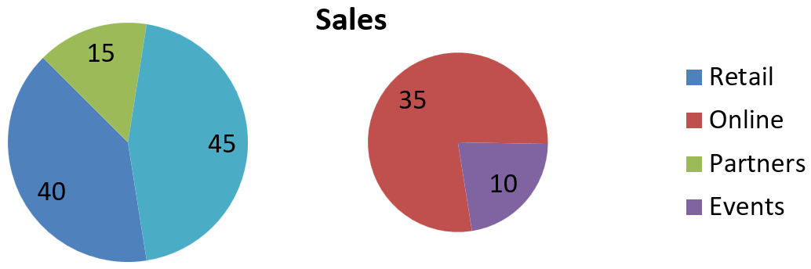

## **Áttekintés**

Ez a cikk bemutatja, hogyan dolgozhatunk kördiagramokkal az Aspose.Slides-ben. Leírja, hogyan állíthatók be a másodlagos diagrambeállítások a Pie of Pie és Bar of Pie diagramokhoz, valamint hogyan engedélyezhető az automatikus szeletszínezés egy szabványos kördiagramon.

A példák a diagram testreszabási feladataira fókuszálnak, például diagram hozzáadására egy diára, sorozat- és címke beállítások módosítására, az alapértelmezett diagramadatok helyettesítésére egyéni kategóriákkal és értékekkel, valamint a frissített bemutató mentésére.

## **Másodlagos diagrambeállítások a Pie of Pie és Bar of Pie diagramokhoz**

Az Aspose.Slides for Android via Java támogatja a másodlagos diagrambeállításokat a Pie of Pie és Bar of Pie diagramokhoz. Ezek a beállítások szabályozzák a másodlagos diagram méretét és azt, hogy az adatpontok hogyan oszlanak meg a két diagram között.

Az alábbi példa egy Pie of Pie diagramot hoz létre egy új bemutatóban, és címkéként jeleníti meg az adatpontok értékeit. A [setSecondPieSize](https://reference.aspose.com/slides/androidjava/com.aspose.slides/ichartseriesgroup/#setSecondPieSize-int-) metódus a másodlagos diagram méretét a fő diagram 149%-ára állítja. A [setPieSplitBy](https://reference.aspose.com/slides/androidjava/com.aspose.slides/ichartseriesgroup/#setPieSplitBy-int-) százalékos alapján történő felosztást választ, a [setPieSplitPosition](https://reference.aspose.com/slides/androidjava/com.aspose.slides/ichartseriesgroup/#setPieSplitPosition-double-) pedig a küszöböt 53%-ra állítja.

```java
import com.aspose.slides.*;

Presentation presentation = new Presentation();
try {
    ISlide slide = presentation.getSlides().get_Item(0);

    IChart chart = slide.getShapes().addChart(ChartType.PieOfPie, 50, 50, 500, 400);
    IChartSeries series = chart.getChartData().getSeries().get_Item(0);

    // Értékek megjelenítése és a másodlagos diagram konfigurálása.
    series.getLabels().getDefaultDataLabelFormat().setShowValue(true);
    IChartSeriesGroup seriesGroup = series.getParentSeriesGroup();
    seriesGroup.setSecondPieSize(149);
    seriesGroup.setPieSplitBy(PieSplitType.ByPercentage);
    seriesGroup.setPieSplitPosition(53);

    presentation.save("pie_of_pie.pptx", SaveFormat.Pptx);
} finally {
    presentation.dispose();
}
```

### **Kategóriák kiválasztása a másodlagos diagramhoz**

Használjon egyedi felosztást, ha konkrét kategóriákat szeretne csoportosítani a másodlagos diagramon a százalékos értéküktől függetlenül. Például egy értékesítési jelentésben megjeleníthető az Online és az Events együtt, hogy az olvasók összehasonlíthassák ezt a két csatornát, még akkor is, ha azok a teljes értékesítés 35%-át és 10%-át teszik ki.

Invoke a [setPieSplitBy](https://reference.aspose.com/slides/androidjava/com.aspose.slides/ichartseriesgroup/#setPieSplitBy-int-) metódust a [PieSplitType.Custom](https://reference.aspose.com/slides/androidjava/com.aspose.slides/piesplittype/#Custom) értékkel, és válassza ki a pontokat a [getPieSplitCustomPoints](https://reference.aspose.com/slides/androidjava/com.aspose.slides/ichartseriesgroup/#getPieSplitCustomPoints--). A gyűjtemény [add](https://reference.aspose.com/slides/androidjava/com.aspose.slides/piesplitcustompointcollection/#add-int-) metódusa sorozaton belül nulláral kezdődő indexet fogad; használja a [addItem](https://reference.aspose.com/slides/androidjava/com.aspose.slides/piesplitcustompointcollection/#addItem-com.aspose.slides.IChartDataPoint-) metódust egy adatpont objektum hozzáadásához. Ebben a példában az 1-es index az Online-ot választja, a 3-as index pedig az Events-et. A Partners is ideiglenesen hozzáadódik, majd a [removeItem](https://reference.aspose.com/slides/androidjava/com.aspose.slides/piesplitcustompointcollection/#removeItem-com.aspose.slides.IChartDataPoint-) segítségével kizárásra kerül.

```java
import com.aspose.slides.*;

Presentation presentation = new Presentation();
try {
    ISlide slide = presentation.getSlides().get_Item(0);

    IChart chart = slide.getShapes().addChart(ChartType.PieOfPie, 50, 50, 600, 200);

    // Cserélje le az alapértelmezett adatokat a csatornánkénti értékesítéssel.
    IChartDataWorkbook workbook = chart.getChartData().getChartDataWorkbook();
    chart.getChartData().getSeries().clear();
    chart.getChartData().getCategories().clear();
    String[] categoryNames = { "Retail", "Online", "Partners", "Events" };
    int[] values = { 40, 35, 15, 10 };
    IChartDataCell seriesNameCell = workbook.getCell(0, 0, 1, "Sales");
    IChartSeries series = chart.getChartData().getSeries().add(seriesNameCell, chart.getType());

    for (int i = 0; i < categoryNames.length; i++) {
        IChartDataCell categoryCell = workbook.getCell(0, i + 1, 0, categoryNames[i]);
        chart.getChartData().getCategories().add(categoryCell);

        IChartDataCell valueCell = workbook.getCell(0, i + 1, 1, values[i]);
        series.getDataPoints().addDataPointForPieSeries(valueCell);
    }

    series.getLabels().getDefaultDataLabelFormat().setShowValue(true);
    IChartSeriesGroup seriesGroup = series.getParentSeriesGroup();
    seriesGroup.setPieSplitBy(PieSplitType.Custom);
    seriesGroup.setColorVaried(true);

    // Válassza ki az Online-ot a nulláról induló indexével, az Events-et az adatpont objektumával.
    seriesGroup.getPieSplitCustomPoints().add(1);
    seriesGroup.getPieSplitCustomPoints().addItem(series.getDataPoints().get_Item(3));

    // Kizárja a Partners-t a kiválasztásból anélkül, hogy törölné a forrásadatot.
    seriesGroup.getPieSplitCustomPoints().add(2);
    seriesGroup.getPieSplitCustomPoints().removeItem(series.getDataPoints().get_Item(2));

    presentation.save("pie_of_pie_custom.pptx", SaveFormat.Pptx);
} finally {
    presentation.dispose();
}
```

Az Online (35) és az Events (10) külön szeletekként jelennek meg a másodlagos diagramon. Az elsődleges diagramon egyetlen egyesített szeletként jelennek meg 45 értékkel, a Retail (40) és a Partners (15) mellett. A Partners eltávolítása az egyedi kiválasztásból a fő diagramon marad; nem távolítja el a kategóriát vagy az értékét a diagram forrásadataiból.

A következő kép a mentett bemutatót mutatja PowerPoint‑ban:



## **Automatikus kördiagram-szelet színek beállítása**

Aspose.Slides for Android via Java automatikusan különböző színeket rendelhet a kördiagram-szeletekhez. Az alábbi példa egy középre igazított címmel rendelkező kördiagramot hoz létre, és az alapértelmezett adatokat három negyedéves kategóriával és értékekkel helyettesíti. A [setShowValue](https://reference.aspose.com/slides/androidjava/com.aspose.slides/idatalabelformat/#setShowValue-boolean-) metódus a 20, 50 és 30 értékeket jeleníti meg címkeként, míg a [setColorVaried](https://reference.aspose.com/slides/androidjava/com.aspose.slides/ichartseriesgroup/#setColorVaried-boolean-) egyedi színt biztosít minden szeletnek.

```java
import com.aspose.slides.*;

Presentation presentation = new Presentation();
try {
    ISlide slide = presentation.getSlides().get_Item(0);

    IChart chart = slide.getShapes().addChart(ChartType.Pie, 100, 100, 400, 400);

    // Középre igazított diagramcím hozzáadása.
    chart.getChartTitle().addTextFrameForOverriding("Sample Title");
    chart.getChartTitle().getTextFrameForOverriding().getTextFrameFormat().setCenterText(NullableBool.True);
    chart.getChartTitle().setHeight(20);
    chart.setTitle(true);

    // Az alapértelmezett adatok cseréje az első munkalap használatával.
    IChartDataWorkbook workbook = chart.getChartData().getChartDataWorkbook();
    int worksheetIndex = 0;
    chart.getChartData().getSeries().clear();
    chart.getChartData().getCategories().clear();
    String[] categoryNames = { "First Qtr", "2nd Qtr", "3rd Qtr" };
    int[] values = { 20, 50, 30 };
    IChartDataCell seriesNameCell = workbook.getCell(worksheetIndex, 0, 1, "Series 1");
    IChartSeries series = chart.getChartData().getSeries().add(seriesNameCell, chart.getType());

    for (int i = 0; i < categoryNames.length; i++) {
        IChartDataCell categoryCell = workbook.getCell(worksheetIndex, i + 1, 0, categoryNames[i]);
        chart.getChartData().getCategories().add(categoryCell);

        IChartDataCell valueCell = workbook.getCell(worksheetIndex, i + 1, 1, values[i]);
        series.getDataPoints().addDataPointForPieSeries(valueCell);
    }

    // Értékek megjelenítése és különböző színek hozzárendelése a szeletekhez.
    series.getLabels().getDefaultDataLabelFormat().setShowValue(true);
    series.getParentSeriesGroup().setColorVaried(true);

    presentation.save("pie.pptx", SaveFormat.Pptx);
} finally {
    presentation.dispose();
}
```

## **GYIK**

**Támogatottak a Pie of Pie és Bar of Pie változatok?**

Igen, a könyvtár [supports](https://reference.aspose.com/slides/androidjava/com.aspose.slides/charttype/) egy másodlagos diagramot a kördiagramokhoz, beleértve a Pie of Pie és Bar of Pie típusokat.

**Exportálhatom csak a diagramot képként (például PNG)?**

Igen, a [exportálja a diagramot képként](https://reference.aspose.com/slides/androidjava/com.aspose.slides/shape/#getImage--) (például PNG) exportálásával a teljes bemutató exportálása nélkül.