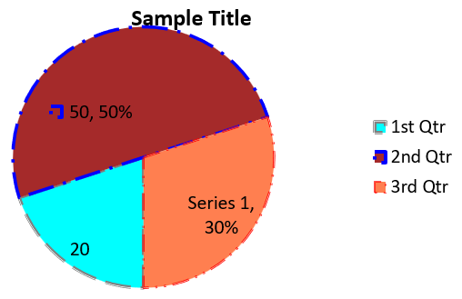

## **Áttekintés**

Ez a cikk átfogó útmutatót nyújt arról, hogyan lehet diagramokat létrehozni és testreszabni az Aspose.Slides for Android via Java használatával. Megtanulja, hogyan lehet programozottan diagramot hozzáadni egy diára, adatokat betölteni, és különféle formázási beállításokat alkalmazni a specifikus tervezési követelményeknek megfelelően. A cikk során részletes kódrészletek illusztrálják az egyes lépéseket, a bemutató és a diagramobjektum inicializálásától a sorozatok, tengelyek és jelmagyarázat konfigurálásáig. Az útmutató követésével szilárd megértést szerez a dinamikus diagramgenerálás integrálásáról Android alkalmazásaiban, egyszerűsítve az adat‑alapú bemutatók készítésének folyamatát.

## **Diagram létrehozása**

Diagramok segítenek az embereknek gyorsan megjeleníteni az adatokat és olyan betekintéseket nyerni, amelyek egy táblázatból vagy számolótábla‑adatsorozatból nem egyértelműek.

**Miért érdemes diagramokat létrehozni?**

Diagramok használatával:

* nagy mennyiségű adatot lehet összegyűjteni, tömöríteni vagy összefoglalni egyetlen dián egy prezentációban;
* mintákat és trendeket lehet felfedni az adatokban;
* meghatározható az adat iránya és lendülete az idő múlásával vagy egy adott mérőegységhez viszonyítva;
* kiemelhetők az extrém értékek, eltérések, hibák és értelmetlen adatok;
* komplex adatok kommunikálhatók vagy prezentálhatók.

PowerPoint‑ban a *Beszúrás* funkcióval hozhatók létre diagramok, amely számos sablont biztosít a különböző diagramtípusok tervezéséhez. Az Aspose.Slides‑kel mind szabványos diagramokat (a népszerű típusok alapján), mind egyedi diagramokat hozhatunk létre.

{}
Use the [ChartType](https://reference.aspose.com/slides/androidjava/com.aspose.slides/charttype/) enumeration in the [com.aspose.slides](https://reference.aspose.com/slides/androidjava/com.aspose.slides/) package. The values in this enumeration correspond to different chart types.
{}

### **Csoportosított oszlopdiagramok létrehozása**

Ez a példa a [addChart](https://reference.aspose.com/slides/androidjava/com.aspose.slides/ishapecollection/#addChart-int-float-float-float-float-) metódust használja egy csoportosított oszlopdiagram létrehozásához, amely két sorozatot hasonlít össze három kategóriában. A sorozatok piros és zöld kitöltést használnak, és az egyedi címkék a kategória‑neveket, sorozat‑neveket és értékeket mutatják. A 0‑ás munkalap‑index az beágyazott diagram‑munkafüzet első lapjára mutat.

```java
import com.aspose.slides.*;
import android.graphics.Color;

Presentation presentation = new Presentation();
try
{
    ISlide slide = presentation.getSlides().get_Item(0);

    IChart chart = slide.getShapes().addChart(ChartType.ClusteredColumn, 20, 20, 500, 300);

    chart.getChartTitle().addTextFrameForOverriding("Sample Title");
    chart.getChartTitle().getTextFrameForOverriding().getTextFrameFormat().setCenterText(NullableBool.True);
    chart.getChartTitle().setHeight(20);
    chart.setTitle(true);

    IChartDataWorkbook workbook = chart.getChartData().getChartDataWorkbook();
    int worksheetIndex = 0;

    chart.getChartData().getSeries().clear();
    chart.getChartData().getCategories().clear();

    IChartDataCell seriesNameCell = workbook.getCell(worksheetIndex, 0, 1, "Series 1");
    chart.getChartData().getSeries().add(seriesNameCell, chart.getType());
    seriesNameCell = workbook.getCell(worksheetIndex, 0, 2, "Series 2");
    chart.getChartData().getSeries().add(seriesNameCell, chart.getType());

    IChartDataCell categoryCell = workbook.getCell(worksheetIndex, 1, 0, "Category 1");
    chart.getChartData().getCategories().add(categoryCell);
    categoryCell = workbook.getCell(worksheetIndex, 2, 0, "Category 2");
    chart.getChartData().getCategories().add(categoryCell);
    categoryCell = workbook.getCell(worksheetIndex, 3, 0, "Category 3");
    chart.getChartData().getCategories().add(categoryCell);

    IChartSeries series = chart.getChartData().getSeries().get_Item(0);

    IChartDataCell valueCell = workbook.getCell(worksheetIndex, 1, 1, 20);
    series.getDataPoints().addDataPointForBarSeries(valueCell);
    valueCell = workbook.getCell(worksheetIndex, 2, 1, 50);
    series.getDataPoints().addDataPointForBarSeries(valueCell);
    valueCell = workbook.getCell(worksheetIndex, 3, 1, 30);
    series.getDataPoints().addDataPointForBarSeries(valueCell);

    series.getFormat().getFill().setFillType(FillType.Solid);
    series.getFormat().getFill().getSolidFillColor().setColor(Color.RED);

    series = chart.getChartData().getSeries().get_Item(1);

    valueCell = workbook.getCell(worksheetIndex, 1, 2, 30);
    series.getDataPoints().addDataPointForBarSeries(valueCell);
    valueCell = workbook.getCell(worksheetIndex, 2, 2, 10);
    series.getDataPoints().addDataPointForBarSeries(valueCell);
    valueCell = workbook.getCell(worksheetIndex, 3, 2, 60);
    series.getDataPoints().addDataPointForBarSeries(valueCell);

    series.getFormat().getFill().setFillType(FillType.Solid);
    series.getFormat().getFill().getSolidFillColor().setColor(Color.rgb(0, 128, 0));

    IDataLabel label = series.getDataPoints().get_Item(0).getLabel();
    label.getDataLabelFormat().setShowCategoryName(true);

    label = series.getDataPoints().get_Item(1).getLabel();
    label.getDataLabelFormat().setShowSeriesName(true);

    label = series.getDataPoints().get_Item(2).getLabel();
    label.getDataLabelFormat().setShowValue(true);
    label.getDataLabelFormat().setShowSeriesName(true);
    label.getDataLabelFormat().setSeparator("/");

    presentation.save("AsposeChart.pptx", SaveFormat.Pptx);
}
finally
{
    presentation.dispose();
}
```

Az eredmény:


### **Szórásdiagramok létrehozása**

Szórásdiagramok (más néven szóráspont-diagramok vagy x‑y grafikonok) gyakran használatosak minták keresésére vagy két változó közötti korreláció bemutatására.

Szórásdiagramot akkor használjon, amikor:

* párosított numerikus adatai vannak;
* két változó jól párosítható egymással;
* meg szeretné határozni, hogy a két változó összefügg‑e;
* van egy önálló változó, amelyhez több érték tartozik a függő változóhoz.

Ez a példa két x‑y értékkészletet ábrázol. Az első sorozat egyenes vonalakat használ csillag‑jelölőkkel, a második pedig sima vonalakat kör‑jelölőkkel; mindkettő 10 pixel méretű jelölőt használ, amelyet a [setSize](https://reference.aspose.com/slides/androidjava/com.aspose.slides/imarker/#setSize-int-) metódussal állít be. A [setSymbol](https://reference.aspose.com/slides/androidjava/com.aspose.slides/imarker/#setSymbol-int-) metódus szabályozza a jelölő alakját.

```java
import com.aspose.slides.*;

Presentation presentation = new Presentation();
try
{
    ISlide slide = presentation.getSlides().get_Item(0);

    IChart chart = slide.getShapes().addChart(ChartType.ScatterWithSmoothLines, 20, 20, 500, 300);

    IChartDataWorkbook workbook = chart.getChartData().getChartDataWorkbook();
    int worksheetIndex = 0;

    chart.getChartData().getSeries().clear();

    IChartDataCell seriesNameCell = workbook.getCell(worksheetIndex, 1, 1, "Series 1");
    chart.getChartData().getSeries().add(seriesNameCell, chart.getType());
    seriesNameCell = workbook.getCell(worksheetIndex, 1, 3, "Series 2");
    chart.getChartData().getSeries().add(seriesNameCell, chart.getType());

    IChartSeries series = chart.getChartData().getSeries().get_Item(0);

    IChartDataCell xValueCell = workbook.getCell(worksheetIndex, 2, 1, 1);
    IChartDataCell yValueCell = workbook.getCell(worksheetIndex, 2, 2, 3);
    series.getDataPoints().addDataPointForScatterSeries(xValueCell, yValueCell);

    xValueCell = workbook.getCell(worksheetIndex, 3, 1, 2);
    yValueCell = workbook.getCell(worksheetIndex, 3, 2, 10);
    series.getDataPoints().addDataPointForScatterSeries(xValueCell, yValueCell);

    series.setType(ChartType.ScatterWithStraightLinesAndMarkers);

    series.getMarker().setSize(10);
    series.getMarker().setSymbol(MarkerStyleType.Star);

    series = chart.getChartData().getSeries().get_Item(1);

    xValueCell = workbook.getCell(worksheetIndex, 2, 3, 5);
    yValueCell = workbook.getCell(worksheetIndex, 2, 4, 2);
    series.getDataPoints().addDataPointForScatterSeries(xValueCell, yValueCell);

    xValueCell = workbook.getCell(worksheetIndex, 3, 3, 3);
    yValueCell = workbook.getCell(worksheetIndex, 3, 4, 1);
    series.getDataPoints().addDataPointForScatterSeries(xValueCell, yValueCell);

    xValueCell = workbook.getCell(worksheetIndex, 4, 3, 2);
    yValueCell = workbook.getCell(worksheetIndex, 4, 4, 2);
    series.getDataPoints().addDataPointForScatterSeries(xValueCell, yValueCell);

    xValueCell = workbook.getCell(worksheetIndex, 5, 3, 5);
    yValueCell = workbook.getCell(worksheetIndex, 5, 4, 1);
    series.getDataPoints().addDataPointForScatterSeries(xValueCell, yValueCell);

    series.getMarker().setSize(10);
    series.getMarker().setSymbol(MarkerStyleType.Circle);

    presentation.save("AsposeChart.pptx", SaveFormat.Pptx);
}
finally
{
    presentation.dispose();
}
```

Az eredmény:


### **Kördiagramok létrehozása**

Kördiagramok leginkább a rész‑egész viszonyok bemutatására alkalmasak, különösen, ha az adatok kategóriákat és numerikus értékeket tartalmaznak. Ha azonban sok rész vagy címke van, érdemes inkább oszlopdiagramot használni.

Ez a példa három negyedévi értékkel hoz létre egy kördiagramot. Minden szelet egyedi kitöltéssel és szegéllyel rendelkezik, és a címkék különböző kombinációkban jelenítik meg az értékeket, százalékokat és sorozatinformációkat. A [setFirstSliceAngle](https://reference.aspose.com/slides/androidjava/com.aspose.slides/ichartseriesgroup/#setFirstSliceAngle-int-) metódus az első szeletet 180 foknál kezdi.

```java
import com.aspose.slides.*;
import android.graphics.Color;

Presentation presentation = new Presentation();
try
{
    ISlide slide = presentation.getSlides().get_Item(0);

    IChart chart = slide.getShapes().addChart(ChartType.Pie, 20, 20, 500, 300);

    chart.getChartTitle().addTextFrameForOverriding("Sample Title");
    chart.getChartTitle().getTextFrameForOverriding().getTextFrameFormat().setCenterText(NullableBool.True);
    chart.getChartTitle().setHeight(20);
    chart.setTitle(true);

    chart.getChartData().getSeries().get_Item(0).getLabels().getDefaultDataLabelFormat().setShowValue(true);

    IChartDataWorkbook workbook = chart.getChartData().getChartDataWorkbook();
    int worksheetIndex = 0;

    chart.getChartData().getSeries().clear();
    chart.getChartData().getCategories().clear();

    IChartDataCell categoryCell = workbook.getCell(0, 1, 0, "1st Qtr");
    chart.getChartData().getCategories().add(categoryCell);
    categoryCell = workbook.getCell(0, 2, 0, "2nd Qtr");
    chart.getChartData().getCategories().add(categoryCell);
    categoryCell = workbook.getCell(0, 3, 0, "3rd Qtr");
    chart.getChartData().getCategories().add(categoryCell);

    IChartDataCell seriesNameCell = workbook.getCell(0, 0, 1, "Series 1");
    IChartSeries series = chart.getChartData().getSeries().add(seriesNameCell, chart.getType());

    IChartDataCell valueCell = workbook.getCell(worksheetIndex, 1, 1, 20);
    series.getDataPoints().addDataPointForPieSeries(valueCell);
    valueCell = workbook.getCell(worksheetIndex, 2, 1, 50);
    series.getDataPoints().addDataPointForPieSeries(valueCell);
    valueCell = workbook.getCell(worksheetIndex, 3, 1, 30);
    series.getDataPoints().addDataPointForPieSeries(valueCell);

    chart.getChartData().getSeriesGroups().get_Item(0).setColorVaried(true);

    IChartDataPoint firstSlice = series.getDataPoints().get_Item(0);
    firstSlice.getFormat().getFill().setFillType(FillType.Solid);
    firstSlice.getFormat().getFill().getSolidFillColor().setColor(Color.CYAN);

    firstSlice.getFormat().getLine().getFillFormat().setFillType(FillType.Solid);
    firstSlice.getFormat().getLine().getFillFormat().getSolidFillColor().setColor(Color.rgb(128, 128, 128));
    firstSlice.getFormat().getLine().setWidth(3.0);
    firstSlice.getFormat().getLine().setStyle(LineStyle.ThinThick);
    firstSlice.getFormat().getLine().setDashStyle(LineDashStyle.LargeDash);

    IChartDataPoint secondSlice = series.getDataPoints().get_Item(1);
    secondSlice.getFormat().getFill().setFillType(FillType.Solid);
    secondSlice.getFormat().getFill().getSolidFillColor().setColor(Color.rgb(165, 42, 42));

    secondSlice.getFormat().getLine().getFillFormat().setFillType(FillType.Solid);
    secondSlice.getFormat().getLine().getFillFormat().getSolidFillColor().setColor(Color.BLUE);
    secondSlice.getFormat().getLine().setWidth(3.0);
    secondSlice.getFormat().getLine().setStyle(LineStyle.Single);
    secondSlice.getFormat().getLine().setDashStyle(LineDashStyle.LargeDashDot);

    IChartDataPoint thirdSlice = series.getDataPoints().get_Item(2);
    thirdSlice.getFormat().setFill().setFillType(FillType.Solid);
    thirdSlice.getFormat().getFill().getSolidFillColor().setColor(Color.rgb(255, 127, 80));

    thirdSlice.getFormat().getLine().getFillFormat().setFillType(FillType.Solid);
    thirdSlice.getFormat().getLine().getFillFormat().getSolidFillColor().setColor(Color.RED);
    thirdSlice.getFormat().getLine().setWidth(2.0);
    thirdSlice.getFormat().getLine().setStyle(LineStyle.ThinThin);
    thirdSlice.getFormat().getLine().setDashStyle(LineDashStyle.LargeDashDotDot);

    IDataLabel firstLabel = series.getDataPoints().get_Item(0).getLabel();
    firstLabel.getDataLabelFormat().setShowValue(true);

    IDataLabel secondLabel = series.getDataPoints().get_Item(1).getLabel();
    secondLabel.getDataLabelFormat().setShowValue(true);
    secondLabel.getDataLabelFormat().setShowLegendKey(true);
    secondLabel.getDataLabelFormat().setShowPercentage(true);

    IDataLabel thirdLabel = series.getDataPoints().get_Item(2).getLabel();
    thirdLabel.getDataLabelFormat().setShowSeriesName(true);
    thirdLabel.getDataLabelFormat().setShowPercentage(true);

    series.getLabels().getDefaultDataLabelFormat().setShowLeaderLines(true);

    chart.getChartData().getSeriesGroups().get_Item(0).setFirstSliceAngle(180);

    presentation.save("PieChart.pptx", SaveFormat.Pptx);
}
finally
{
    presentation.dispose();
}
```

Az eredmény:



A körön kívül elhelyezett címkék olvashatóságának javításához lásd a [Formázási vezetővonalak](/slides/hu/androidjava/chart-data-label/#format-leader-lines) című példát, amely a címkék elhelyezését és a vonalak színének, szélességének, átlátszóságának és vonaltípusának testreszabását mutatja be.

### **Vonaldiagramok létrehozása**

Vonaldiagramok (más néven vonalgrafikonok) leginkább olyan helyzetekben használhatók, amikor az értékek időbeli változását kívánja bemutatni. Vonaldiagram segítségével nagy mennyiségű adatot lehet egyszerre összehasonlítani, nyomon követni az időbeli változásokat és trendeket, kiemelni anomáliákat az adat‑sorozatokban, és még sok mást.

Ez a példa a [addChart](https://reference.aspose.com/slides/androidjava/com.aspose.slides/ishapecollection/#addChart-int-float-float-float-float-) metódust használja egy vonaldiagram létrehozásához az alapértelmezett sorozattal és kategóriákkal, majd PPTX‑ként menti a prezentációt.

```java
import com.aspose.slides.*;

Presentation presentation = new Presentation();
try
{
    ISlide slide = presentation.getSlides().get_Item(0);

    IChart lineChart = slide.getShapes().addChart(ChartType.Line, 20, 20, 500, 300);

    presentation.save("lineChart.pptx", SaveFormat.Pptx);
}
finally
{
    presentation.dispose();
}
```

Alapértelmezés szerint a vonaldiagram pontjait egyenes, folytonos vonalak kötik össze. Ha pontok helyett szaggatott vonalat szeretne, hívja meg a [setDashStyle](https://reference.aspose.com/slides/androidjava/com.aspose.slides/ilineformat/#setDashStyle-byte-) metódust a [LineDashStyle](https://reference.aspose.com/slides/androidjava/com.aspose.slides/linedashstyle/) valamely értékével:

```java
import com.aspose.slides.*;

Presentation presentation = new Presentation();
try
{
    ISlide slide = presentation.getSlides().get_Item(0);

    IChart lineChart = slide.getShapes().addChart(ChartType.Line, 20, 20, 500, 300);

    for (IChartSeries series : lineChart.getChartData().getSeries())
    {
        series.getFormat().getLine().setDashStyle(LineDashStyle.Dash);
    }
}
finally
{
    presentation.dispose();
}
```

Az eredmény:


### **Fa térkép diagramok létrehozása**

Fa térkép diagramok leginkább értékesítési adatok esetén hasznosak, amikor a kategóriák relatív méretét és a nagy hozzájáruló elemek gyors kiemelését szeretnénk megjeleníteni.

Ez a példa egy fa térképet hoz létre nyolc levéllel, amelyek négy szárra és két ágra csoportosulnak. A [setGroupingItem](https://reference.aspose.com/slides/androidjava/com.aspose.slides/ichartcategorylevelsmanager/#setGroupingItem-int-java.lang.Object-) metódus az 1‑es szinthez a szárakat, a 2‑es szinthez pedig az ágakat rendeli. Az értékek határozzák meg a relativ téglalapméreteket, míg a kategória‑címkék és a átfedő szülőcímkék az hierarchiát jelölik.

```java
import com.aspose.slides.*;

Presentation presentation = new Presentation();
try
{
    ISlide slide = presentation.getSlides().get_Item(0);

    IChart chart = slide.getShapes().addChart(ChartType.Treemap, 20, 20, 500, 300);

    chart.getChartData().getCategories().clear();
    chart.getChartData().getSeries().clear();

    IChartDataWorkbook workbook = chart.getChartData().getChartDataWorkbook();
    workbook.clear(0);

    // Ág 1
    IChartDataCell categoryCell = workbook.getCell(0, "C1", "Leaf1");
    IChartCategory leaf = chart.getChartData().getCategories().add(categoryCell);
    leaf.getGroupingLevels().setGroupingItem(1, "Stem1");
    leaf.getGroupingLevels().setGroupingItem(2, "Branch1");

    categoryCell = workbook.getCell(0, "C2", "Leaf2");
    chart.getChartData().getCategories().add(categoryCell);

    categoryCell = workbook.getCell(0, "C3", "Leaf3");
    leaf = chart.getChartData().getCategories().add(categoryCell);
    leaf.getGroupingLevels().setGroupingItem(1, "Stem2");

    categoryCell = workbook.getCell(0, "C4", "Leaf4");
    chart.getChartData().getCategories().add(categoryCell);

    // Ág 2
    categoryCell = workbook.getCell(0, "C5", "Leaf5");
    leaf = chart.getChartData().getCategories().add(categoryCell);
    leaf.getGroupingLevels().setGroupingItem(1, "Stem3");
    leaf.getGroupingLevels().setGroupingItem(2, "Branch2");

    categoryCell = workbook.getCell(0, "C6", "Leaf6");
    chart.getChartData().getCategories().add(categoryCell);

    categoryCell = workbook.getCell(0, "C7", "Leaf7");
    leaf = chart.getChartData().getCategories().add(categoryCell);
    leaf.getGroupingLevels().setGroupingItem(1, "Stem4");

    categoryCell = workbook.getCell(0, "C8", "Leaf8");
    chart.getChartData().getCategories().add(categoryCell);

    IChartSeries series = chart.getChartData().getSeries().add(ChartType.Treemap);
    series.getLabels().getDefaultDataLabelFormat().setShowCategoryName(true);
    IChartDataCell valueCell = workbook.getCell(0, "D1", 4);
    series.getDataPoints().addDataPointForTreemapSeries(valueCell);
    valueCell = workbook.getCell(0, "D2", 5);
    series.getDataPoints().addDataPointForTreemapSeries(valueCell);
    valueCell = workbook.getCell(0, "D3", 3);
    series.getDataPoints().addDataPointForTreemapSeries(valueCell);
    valueCell = workbook.getCell(0, "D4", 6);
    series.getDataPoints().addDataPointForTreemapSeries(valueCell);
    valueCell = workbook.getCell(0, "D5", 9);
    series.getDataPoints().addDataPointForTreemapSeries(valueCell);
    valueCell = workbook.getCell(0, "D6", 9);
    series.getDataPoints().addDataPointForTreemapSeries(valueCell);
    valueCell = workbook.getCell(0, "D7", 4);
    series.getDataPoints().addDataPointForTreemapSeries(valueCell);
    valueCell = workbook.getCell(0, "D8", 3);
    series.getDataPoints().addDataPointForTreemapSeries(valueCell);

    series.setParentLabelLayout(ParentLabelLayoutType.Overlapping);

    presentation.save("Treemap.pptx", SaveFormat.Pptx);
}
finally
{
    presentation.dispose();
}
```

Az eredmény:


### **Vízfolyami diagramok létrehozása**

Vízfolyami diagram mutatja, hogyan járulnak hozzá a pozitív és negatív változások a végső értékhez. Például egy nyereség‑felbontás a bevétellel kezdődik, majd a költségek levonásával és egyéb bevételek hozzáadásával alakul ki. A változási oszlopok az előző és az új folyó értékek között úsznak, míg a teljes oszlopok a nullától az akkumulált értékig terjednek.

| Kategória | Munkafüzet érték | Oszlop típusa |
| --- | ---: | --- |
| Bevétel | 1000 | Növekedés |
| Eladási költség | -400 | Csökkenés |
| Bruttó nyereség | 600 | Közbenső összeg |
| Működési költség | -200 | Csökkenés |
| Egyéb bevétel | 50 | Növekedés |
| Nettó nyereség | 450 | Végső összeg |

Egy pont közbenső vagy végső összegként való megjelöléséhez hívja meg a [setSetAsTotal](https://reference.aspose.com/slides/androidjava/com.aspose.slides/chartdatapoint/#setSetAsTotal-boolean-) metódust `true` értékkel. Adja meg a tényleges akkumulált összeget a pont munkafüzet‑cellájában: `600` a bruttó nyereséghez (`1000 - 400`) és `450` a nettó nyereséghez (`600 - 200 + 50`). A metódus a oszlopot összegként jelöli; nem számítja ki vagy tölti ki a cella‑értéket. Ne használjon nullát helykitöltőként, és ne adjon meg egy másik változást egy összeg‑ponthoz. Egy összeg‑oszlop az akkumulált értéket mutatja anélkül, hogy azt újra hozzáadná a folyó értékhez.

Ez a teljes Java‑példa a `Waterfall` taggal hoz létre diagramot a [ChartType](https://reference.aspose.com/slides/androidjava/com.aspose.slides/charttype/)‑ból, törli az alapértelmezett adatokat, és kitölti a beágyazott munkafüzetet. A 0‑ás munkalap‑index az első munkalapot választja; az A oszlop a kategória‑neveket, a B oszlop az értékeket tartalmazza. Minden értékcellát a [addDataPointForWaterfallSeries](https://reference.aspose.com/slides/androidjava/com.aspose.slides/ichartdatapointcollection/#addDataPointForWaterfallSeries-com.aspose.slides.IChartDataCell-) metódussal adunk hozzá. A 0‑alapú pont‑indexek `2` és `5` a közbenső és a végső összegeket azonosítják. A [setShowValue](https://reference.aspose.com/slides/androidjava/com.aspose.slides/idatalabelformat/#setShowValue-boolean-) `true` értékkel megjeleníti az összegeket az oszlopon. Nincs bemeneti prezentáció vagy munkafüzet szükséges.

```java
import com.aspose.slides.*;

Presentation presentation = new Presentation();
try
{
    ISlide slide = presentation.getSlides().get_Item(0);

    IChart chart = slide.getShapes().addChart(ChartType.Waterfall, 20, 20, 680, 200);

    chart.setTitle(true);
    chart.getChartTitle().addTextFrameForOverriding("Profit breakdown (USD thousands)");
    chart.getChartTitle().setOverlay(false);
    chart.setLegend(false);

    chart.getChartData().getSeries().clear();
    chart.getChartData().getCategories().clear();

    IChartDataWorkbook workbook = chart.getChartData().getChartDataWorkbook();
    int worksheetIndex = 0;

    workbook.clear(worksheetIndex);

    IChartDataCell seriesNameCell = workbook.getCell(worksheetIndex, 0, 1, "Profit");
    IChartSeries series = chart.getChartData().getSeries().add(seriesNameCell, ChartType.Waterfall);
    String[] categories = new String[] { "Revenue", "Cost of sales", "Gross profit", "Operating expenses", "Other income", "Net profit" };
    double[] values = new double[] { 1000, -400, 600, -200, 50, 450 };

    for (int i = 0; i < categories.length; i++)
    {
        IChartDataCell categoryCell = workbook.getCell(worksheetIndex, i + 1, 0, categories[i]);
        chart.getChartData().getCategories().add(categoryCell);
        IChartDataCell valueCell = workbook.getCell(worksheetIndex, i + 1, 1, values[i]);
        series.getDataPoints().addDataPointForWaterfallSeries(valueCell);
    }

    // A harmadik és hatodik pont összegként jelenik meg, nem további változásként.
    series.getDataPoints().get_Item(2).setSetAsTotal(true);
    series.getDataPoints().get_Item(5).setSetAsTotal(true);
    series.setShowConnectorLines(true);
    series.getLabels().getDefaultDataLabelFormat().setShowValue(true);

    presentation.save("WaterfallChart.pptx", SaveFormat.Pptx);
}
finally
{
    presentation.dispose();
}
```

A sorozatszintű [setShowConnectorLines](https://reference.aspose.com/slides/androidjava/com.aspose.slides/chartseries/#setShowConnectorLines-boolean-) `true` értékkel vonalakat jelenít meg az egymást követő oszlopok között, így könnyebben nyomon követhető a folyó érték. Ezeknek a vonalaknak a elrejtéséhez cserélje ki a metódushívást a példában `series.setShowConnectorLines(false);`‑re a mentés előtt. Ez csak a vonalak láthatóságát módosítja, az adatot vagy az összeg‑pontokat nem.

A mentett prezentáció 600‑as bruttó nyereséget és 450‑as nettó nyereséget mutat, mindkét összeg a nullától indul:


### **Részvénydiagramok létrehozása**

Részvénydiagramok pénzügyi adatok – nyitó, magas, alacsony és záró árak – megjelenítésére szolgálnak, segítve a piaci trendek és a volatilitás elemzését. Alapvető betekintést nyújtanak a részvény‑teljesítménybe, támogatva a befektetőket és elemzőket a megalapozott döntéshozatalban.

Ez a példa egy nyitó‑magas‑alacsony‑záró (OHLC) diagramot hoz létre négy sorozattal ebben a sorrendben és három kategóriával. A [setUpDownBars](https://reference.aspose.com/slides/androidjava/com.aspose.slides/iupdownbarsmanager/#setUpDownBars-boolean-) metódus engedélyezi a fel‑/le‑oszlopokat, a [getHiLowLinesFormat](https://reference.aspose.com/slides/androidjava/com.aspose.slides/ichartseriesgroup/#getHiLowLinesFormat--) szabályozza a magas‑alacsony vonalakat, míg az egyedi sorozat‑vonalak és a kisebb vízszintes rácsvonalak el vannak rejtve.

A [getUpDownBars](https://reference.aspose.com/slides/androidjava/com.aspose.slides/ichartseriesgroup/#getUpDownBars--) által visszaadott menedzser külön formázási objektumokat biztosít a [getUpBarsFormat](https://reference.aspose.com/slides/androidjava/com.aspose.slides/iupdownbarsmanager/#getUpBarsFormat--) és a [getDownBarsFormat](https://reference.aspose.com/slides/androidjava/com.aspose.slides/iupdownbarsmanager/#getDownBarsFormat--) hívásokon keresztül. Az egyes objektumok [getFill](https://reference.aspose.com/slides/androidjava/com.aspose.slides/iformat/#getFill--) és [getLine](https://reference.aspose.com/slides/androidjava/com.aspose.slides/iformat/#getLine--) metódusaival önállóan állítható be a kitöltés és a körvonal. Ebben a példában zöld oszlopok sötétzöld körvonalakkal a emelkedő időszakokra, narancssárga‑vörös oszlopok sötétvörös körvonalakkal a csökkenő időszakokra.

Adjon numerikus értékeket mind a négy sorozathoz minden kategóriánál, a Magas és Alacsony értékek a Nyitó és Záró között helyezkednek el. Az oszlopok a Záró‑t a Nyitó‑val hasonlítják **azon belül a kategórián**, nem az előző kategóriával: A 72‑ről 25‑re csökken, B 25‑ről 38‑ra nő, C 38‑ról 50‑re nő. Ha a Nyitó és Záró értékek egyenlőek, nincs látható kitöltött intervallum. A fel‑/le‑oszlopok a Nyitó‑Záró tartományt fedik le; a magas‑alacsony vonalak az Alacsony‑Magas tartományt fedik le. Ezek az oszlopok a sorozatcsoporthoz tartoznak, nem pedig a szokásos oszlopdiagram‑sorozatokhoz.

Ez a formázás [Line and LineWithMarkers](https://reference.aspose.com/slides/androidjava/com.aspose.slides/charttype/) diagramoknál is működik, ha legalább két sorozat van ugyanabban a csoportban és minden kategóriához tartozik numerikus érték. Az ilyen nem‑halmozott vonaldiagramok esetén a fel‑/le‑oszlopok az első és az utolsó sorozatot hasonlítják össze: a magasabb utolsó érték fel‑oszlopot, az alacsonyabb pedig le‑oszlopot eredményez. A sorozatok megfordítása a besorolást is megfordítja. Az alábbi példa az [OpenHighLowClose](https://reference.aspose.com/slides/androidjava/com.aspose.slides/charttype/) diagramot használja; ne feltételezze, hogy más stock, stacked‑line vagy 3D változatok ugyanazzal az adat‑elrendezéssel vagy intervallum‑értelmezéssel rendelkeznek.

```java
import com.aspose.slides.*;
import android.graphics.Color;

Presentation presentation = new Presentation();
try
{
    ISlide slide = presentation.getSlides().get_Item(0);

    IChart chart = slide.getShapes().addChart(ChartType.OpenHighLowClose, 20, 20, 500, 150, false);

    IChartDataWorkbook workbook = chart.getChartData().getChartDataWorkbook();

    IChartDataCell categoryCell = workbook.getCell(0, 1, 0, "A");
    chart.getChartData().getCategories().add(categoryCell);
    categoryCell = workbook.getCell(0, 2, 0, "B");
    chart.getChartData().getCategories().add(categoryCell);
    categoryCell = workbook.getCell(0, 3, 0, "C");
    chart.getChartData().getCategories().add(categoryCell);

    IChartDataCell seriesNameCell = workbook.getCell(0, 0, 1, "Open");
    chart.getChartData().getSeries().add(seriesNameCell, ChartType.OpenHighLowClose);
    seriesNameCell = workbook.getCell(0, 0, 2, "High");
    chart.getChartData().getSeries().add(seriesNameCell, ChartType.OpenHighLowClose);
    seriesNameCell = workbook.getCell(0, 0, 3, "Low");
    chart.getChartData().getSeries().add(seriesNameCell, ChartType.OpenHighLowClose);
    seriesNameCell = workbook.getCell(0, 0, 4, "Close");
    chart.getChartData().getSeries().add(seriesNameCell, ChartType.OpenHighLowClose);

    IChartSeries series = chart.getChartData().getSeries().get_Item(0);
    IChartDataCell valueCell = workbook.getCell(0, 1, 1, 72);
    series.getDataPoints().addDataPointForStockSeries(valueCell);
    valueCell = workbook.getCell(0, 2, 1, 25);
    series.getDataPoints().addDataPointForStockSeries(valueCell);
    valueCell = workbook.getCell(0, 3, 1, 38);
    series.getDataPoints().addDataPointForStockSeries(valueCell);

    series = chart.getChartData().getSeries().get_Item(1);
    valueCell = workbook.getCell(0, 1, 2, 172);
    series.getDataPoints().addDataPointForStockSeries(valueCell);
    valueCell = workbook.getCell(0, 2, 2, 57);
    series.getDataPoints().addDataPointForStockSeries(valueCell);
    valueCell = workbook.getCell(0, 3, 2, 57);
    series.getDataPoints().addDataPointForStockSeries(valueCell);

    series = chart.getChartData().getSeries().get_Item(2);
    valueCell = workbook.getCell(0, 1, 3, 12);
    series.getDataPoints().addDataPointForStockSeries(valueCell);
    valueCell = workbook.getCell(0, 2, 3, 12);
    series.getDataPoints().addDataPointForStockSeries(valueCell);
    valueCell = workbook.getCell(0, 3, 3, 13);
    series.getDataPoints().addDataPointForStockSeries(valueCell);

    series = chart.getChartData().getSeries().get_Item(3);
    valueCell = workbook.getCell(0, 1, 4, 25);
    series.getDataPoints().addDataPointForStockSeries(valueCell);
    valueCell = workbook.getCell(0, 2, 4, 38);
    series.getDataPoints().addDataPointForStockSeries(valueCell);
    valueCell = workbook.getCell(0, 3, 4, 50);
    series.getDataPoints().addDataPointForStockSeries(valueCell);

    IUpDownBarsManager upDownBars = chart.getChartData().getSeriesGroups().get_Item(0).getUpDownBars();
    upDownBars.setUpDownBars(true);

    upDownBars.getUpBarsFormat().getFill().setFillType(FillType.Solid);
    upDownBars.getUpBarsFormat().getFill().getSolidFillColor().setColor(Color.rgb(50, 205, 50));
    upDownBars.getUpBarsFormat().getLine().getFillFormat().setFillType(FillType.Solid);
    upDownBars.getUpBarsFormat().getLine().getFillFormat().getSolidFillColor().setColor(Color.rgb(0, 100, 0));
    upDownBars.getUpBarsFormat().getLine().setWidth(2);

    upDownBars.getDownBarsFormat().getFill().setFillType(FillType.Solid);
    upDownBars.getDownBarsFormat().getFill().getSolidFillColor().setColor(Color.rgb(255, 69, 0));
    upDownBars.getDownBarsFormat().getLine().getFillFormat().setFillType(FillType.Solid);
    upDownBars.getDownBarsFormat().getLine().getFillFormat().getSolidFillColor().setColor(Color.rgb(139, 0, 0));
    upDownBars.getDownBarsFormat().getLine().setWidth(2);
    chart.getChartData().getSeriesGroups().get_Item(0).getHiLowLinesFormat().getLine().getFillFormat().setFillType(FillType.Solid);

    for (IChartSeries stockSeries : chart.getChartData().getSeries())
    {
        stockSeries.getFormat().getLine().getFillFormat().setFillType(FillType.NoFill);
    }

    chart.getAxes().getVerticalAxis().getMinorGridLinesFormat().getLine().getFillFormat().setFillType(FillType.NoFill);

    presentation.save("Stock-chart.pptx", SaveFormat.Pptx);
}
finally
{
    presentation.dispose();
}
```

Az eredmény, PowerPoint‑ból exportálva:


### **Doboz‑ és bajuszdiagramok létrehozása**

Doboz‑ és bajuszdiagramok a dataeloszlás megjelenítésére szolgálnak, kulcsstatistika‑mértékek (medián, kvartilis, esetleges kiugró értékek) összefoglalásával. Különösen hasznosak felderítő adat‑elemzésben és statisztikai tanulmányokban, hogy gyorsan megértsük az adat‑variabilitást és az esetleges anomáliákat.

Ez a példa hat értékből hoz létre egy doboz‑ és bajuszdiagramot. A [setQuartileMethod](https://reference.aspose.com/slides/androidjava/com.aspose.slides/ichartseries/#setQuartileMethod-int-) metódus az exkluzív kvartilis‑számítást választja. A példa engedélyezi a közép‑vonalakat, közép‑jelölőket, belső pontokat és kiugró pontokat is.

```java
import com.aspose.slides.*;

Presentation presentation = new Presentation();
try
{
    ISlide slide = presentation.getSlides().get_Item(0);

    IChart chart = slide.getShapes().addChart(ChartType.BoxAndWhisker, 20, 20, 500, 300);

    chart.getChartData().getCategories().clear();
    chart.getChartData().getSeries().clear();

    IChartDataWorkbook workbook = chart.getChartData().getChartDataWorkbook();
    workbook.clear(0);

    IChartDataCell categoryCell = workbook.getCell(0, "A1", "Category 1");
    chart.getChartData().getCategories().add(categoryCell);
    categoryCell = workbook.getCell(0, "A2", "Category 2");
    chart.getChartData().getCategories().add(categoryCell);
    categoryCell = workbook.getCell(0, "A3", "Category 3");
    chart.getChartData().getCategories().add(categoryCell);
    categoryCell = workbook.getCell(0, "A4", "Category 4");
    chart.getChartData().getCategories().add(categoryCell);
    categoryCell = workbook.getCell(0, "A5", "Category 5");
    chart.getChartData().getCategories().add(categoryCell);
    categoryCell = workbook.getCell(0, "A6", "Category 6");
    chart.getChartData().getCategories().add(categoryCell);

    IChartSeries series = chart.getChartData().getSeries().add(ChartType.BoxAndWhisker);

    series.setQuartileMethod(QuartileMethodType.Exclusive);
    series.setShowMeanLine(true);
    series.setShowMeanMarkers(true);
    series.setShowInnerPoints(true);
    series.setShowOutlierPoints(true);

    IChartDataCell valueCell = workbook.getCell(0, "B1", 15);
    series.getDataPoints().addDataPointForBoxAndWhiskerSeries(valueCell);
    valueCell = workbook.getCell(0, "B2", 41);
    series.getDataPoints().addDataPointForBoxAndWhiskerSeries(valueCell);
    valueCell = workbook.getCell(0, "B3", 16);
    series.getDataPoints().addDataPointForBoxAndWhiskerSeries(valueCell);
    valueCell = workbook.getCell(0, "B4", 10);
    series.getDataPoints().addDataPointForBoxAndWhiskerSeries(valueCell);
    valueCell = workbook.getCell(0, "B5", 23);
    series.getDataPoints().addDataPointForBoxAndWhiskerSeries(valueCell);
    valueCell = workbook.getCell(0, "B6", 16);
    series.getDataPoints().addDataPointForBoxAndWhiskerSeries(valueCell);

    presentation.save("BoxAndWhisker.pptx", SaveFormat.Pptx);
}
finally
{
    presentation.dispose();
}
```

### **Tölcsérdiagramok létrehozása**

Tölcsérdiagramok segítségével olyan folyamatokat lehet vizualizálni, ahol egymást követő szakaszokban az adat‑mennyiség csökken. Különösen hasznosak a konverziós arányok elemzéséhez, szűk keresztmetszetek azonosításához és az értékesítési vagy marketing‑folyamatok hatékonyságának nyomon követéséhez.

Ez a példa a [addChart](https://reference.aspose.com/slides/androidjava/com.aspose.slides/ishapecollection/#addChart-int-float-float-float-float-) metódussal ad egy tölcsérdiagramot egy meglévő prezentáció első diájához. A alapértelmezett adatot hat kategóriára és 50‑től 500‑ig terjedő értékekre cseréli, majd menti a frissített prezentációt. A bemeneti prezentációnak legalább egy diát kell tartalmaznia.

```java
import com.aspose.slides.*;

Presentation presentation = new Presentation("test.pptx");
try
{
    ISlide slide = presentation.getSlides().get_Item(0);

    IChart chart = slide.getShapes().addChart(ChartType.Funnel, 50, 50, 500, 400);

    chart.getChartData().getCategories().clear();
    chart.getChartData().getSeries().clear();

    IChartDataWorkbook workbook = chart.getChartData().getChartDataWorkbook();
    workbook.clear(0);

    IChartDataCell categoryCell = workbook.getCell(0, "A1", "Category 1");
    chart.getChartData().getCategories().add(categoryCell);
    categoryCell = workbook.getCell(0, "A2", "Category 2");
    chart.getChartData().getCategories().add(categoryCell);
    categoryCell = workbook.getCell(0, "A3", "Category 3");
    chart.getChartData().getCategories().add(categoryCell);
    categoryCell = workbook.getCell(0, "A4", "Category 4");
    chart.getChartData().getCategories().add(categoryCell);
    categoryCell = workbook.getCell(0, "A5", "Category 5");
    chart.getChartData().getCategories().add(categoryCell);
    categoryCell = workbook.getCell(0, "A6", "Category 6");
    chart.getChartData().getCategories().add(categoryCell);

    IChartSeries series = chart.getChartData().getSeries().add(ChartType.Funnel);

    IChartDataCell valueCell = workbook.getCell(0, "B1", 50);
    series.getDataPoints().addDataPointForFunnelSeries(valueCell);
    valueCell = workbook.getCell(0, "B2", 100);
    series.getDataPoints().addDataPointForFunnelSeries(valueCell);
    valueCell = workbook.getCell(0, "B3", 200);
    series.getDataPoints().addDataPointForFunnelSeries(valueCell);
    valueCell = workbook.getCell(0, "B4", 300);
    series.getDataPoints().addDataPointForFunnelSeries(valueCell);
    valueCell = workbook.getCell(0, "B5", 400);
    series.getDataPoints().addDataPointForFunnelSeries(valueCell);
    valueCell = workbook.getCell(0, "B6", 500);
    series.getDataPoints().addDataPointForFunnelSeries(valueCell);

    presentation.save("Funnel.pptx", SaveFormat.Pptx);
}
finally
{
    presentation.dispose();
}
```

Az eredmény:


### **Napfénydiagramok létrehozása**

Napfénydiagramok hierarchikus adatok vizualizálására szolgálnak, a szinteket körkörös gyűrűkkel ábrázolva. Segítenek a rész‑egész kapcsolatok szemléltetésében, és ideálisak a beágyazott kategóriák és alkategóriák világos, kompakt megjelenítésére.

Ez a példa nyolc levélből álló napfénydiagramot hoz létre, amely négy szárra és két ágra csoportosul. A [setGroupingItem](https://reference.aspose.com/slides/androidjava/com.aspose.slides/ichartcategorylevelsmanager/#setGroupingItem-int-java.lang.Object-) metódus a 1‑es szinthez a szárakat, a 2‑es szinthez az ágakat rendeli. A kategóriacímkék az egyes szegmenseket azonosítják, az értékek pedig a relatív méreteket határozzák meg.

```java
import com.aspose.slides.*;

Presentation presentation = new Presentation();
try
{
    ISlide slide = presentation.getSlides().get_Item(0);

    IChart chart = slide.getShapes().addChart(ChartType.Sunburst, 20, 20, 500, 300);

    chart.getChartData().getCategories().clear();
    chart.getChartData().getSeries().clear();

    IChartDataWorkbook workbook = chart.getChartData().getChartDataWorkbook();
    workbook.clear(0);

    // Ág 1
    IChartDataCell categoryCell = workbook.getCell(0, "C1", "Leaf1");
    IChartCategory leaf = chart.getChartData().getCategories().add(categoryCell);
    leaf.getGroupingLevels().setGroupingItem(1, "Stem1");
    leaf.getGroupingLevels().setGroupingItem(2, "Branch1");

    categoryCell = workbook.getCell(0, "C2", "Leaf2");
    chart.getChartData().getCategories().add(categoryCell);

    categoryCell = workbook.getCell(0, "C3", "Leaf3");
    leaf = chart.getChartData().getCategories().add(categoryCell);
    leaf.getGroupingLevels().setGroupingItem(1, "Stem2");

    categoryCell = workbook.getCell(0, "C4", "Leaf4");
    chart.getChartData().getCategories().add(categoryCell);

    // Ág 2
    categoryCell = workbook.getCell(0, "C5", "Leaf5");
    leaf = chart.getChartData().getCategories().add(categoryCell);
    leaf.getGroupingLevels().setGroupingItem(1, "Stem3");
    leaf.getGroupingLevels().setGroupingItem(2, "Branch2");

    categoryCell = workbook.getCell(0, "C6", "Leaf6");
    chart.getChartData().getCategories().add(categoryCell);

    categoryCell = workbook.getCell(0, "C7", "Leaf7");
    leaf = chart.getChartData().getCategories().add(categoryCell);
    leaf.getGroupingLevels().setGroupingItem(1, "Stem4");

    categoryCell = workbook.getCell(0, "C8", "Leaf8");
    chart.getChartData().getCategories().add(categoryCell);

    IChartSeries series = chart.getChartData().getSeries().add(ChartType.Sunburst);
    series.getLabels().getDefaultDataLabelFormat().setShowCategoryName(true);
    IChartDataCell valueCell = workbook.getCell(0, "D1", 4);
    series.getDataPoints().addDataPointForSunburstSeries(valueCell);
    valueCell = workbook.getCell(0, "D2", 5);
    series.getDataPoints().addDataPointForSunburstSeries(valueCell);
    valueCell = workbook.getCell(0, "D3", 3);
    series.getDataPoints().addDataPointForSunburstSeries(valueCell);
    valueCell = workbook.getCell(0, "D4", 6);
    series.getDataPoints().addDataPointForSunburstSeries(valueCell);
    valueCell = workbook.getCell(0, "D5", 9);
    series.getDataPoints().addDataPointForSunburstSeries(valueCell);
    valueCell = workbook.getCell(0, "D6", 9);
    series.getDataPoints().addDataPointForSunburstSeries(valueCell);
    valueCell = workbook.getCell(0, "D7", 4);
    series.getDataPoints().addDataPointForSunburstSeries(valueCell);
    valueCell = workbook.getCell(0, "D8", 3);
    series.getDataPoints().addDataPointForSunburstSeries(valueCell);

    presentation.save("Sunburst.pptx", SaveFormat.Pptx);
}
finally
{
    presentation.dispose();
}
```

Az eredmény:


### **Hiszogram diagramok létrehozása**

Hiszogram diagramok azt mutatják, hogy a numerikus értékek hogyan oszlanak el intervallumokban (bin‑ekben). Havi jelentések esetén a rendelési feldolgozási időkre ugyanazt a bin‑szélességet és küszöböt használva az intervallumok konzisztenssé tehetők, így a megoszlások könnyebben összehasonlíthatók.

Hívja meg a [setAggregationType](https://reference.aspose.com/slides/androidjava/com.aspose.slides/iaxis/#setAggregationType-int-) metódust a vízszintes tengelyen a [AxisAggregationType](https://reference.aspose.com/slides/androidjava/com.aspose.slides/axisaggregationtype/) valamely módjával. A [setBinWidth](https://reference.aspose.com/slides/androidjava/com.aspose.slides/iaxis/#setBinWidth-double-) csak a `ByBinWidth` módhoz alkalmazható; a [setNumberOfBins](https://reference.aspose.com/slides/androidjava/com.aspose.slides/iaxis/#setNumberOfBins-long-) csak a `ByNumberOfBins` módhoz. Az `Automatic` használatával a diagram saját maga választja ki a bin‑eket.

#### **Rögzített bin szélesség használata**

Ez a példa a feldolgozási időket 10‑perces intervallumokra csoportosítja, külön bin‑ekkel a 10 percnél vagy annál kevesebb, illetve a 40 perc fölötti időkre. Engedélyezze ezeket a bin‑eket a [setUnderflowBin](https://reference.aspose.com/slides/androidjava/com.aspose.slides/iaxis/#setUnderflowBin-boolean-) és a [setOverflowBin](https://reference.aspose.com/slides/androidjava/com.aspose.slides/iaxis/#setOverflowBin-boolean-) hívásokkal. Ha kifejezett küszöböket ad meg a [setUnderflowBin](https://reference.aspose.com/slides/androidjava/com.aspose.slides/iaxis/#setUnderflowBin-double-) és a [setOverflowBin](https://reference.aspose.com/slides/androidjava/com.aspose.slides/iaxis/#setOverflowBin-double-) metódusokkal, akkor a [setAutomaticUnderflowBin](https://reference.aspose.com/slides/androidjava/com.aspose.slides/iaxis/#setAutomaticUnderflowBin-boolean-) és a [setAutomaticOverflowBin](https://reference.aspose.com/slides/androidjava/com.aspose.slides/iaxis/#setAutomaticOverflowBin-boolean-) `false` értékkel kapcsolandók ki.

```java
import com.aspose.slides.*;

Presentation presentation = new Presentation();
try
{
    ISlide slide = presentation.getSlides().get_Item(0);

    IChart chart = slide.getShapes().addChart(ChartType.Histogram, 20, 20, 680, 200);

    chart.setLegend(false);
    chart.setTitle(false);

    chart.getChartData().getCategories().clear();
    chart.getChartData().getSeries().clear();

    IChartDataWorkbook workbook = chart.getChartData().getChartDataWorkbook();
    workbook.clear(0);

    IChartSeries series = chart.getChartData().getSeries().add(ChartType.Histogram);
    double[] values = { 5, 10, 10, 11, 15, 20, 20, 21, 25, 30, 30, 31, 35, 40, 40, 41, 50 };
    for (int i = 0; i < values.length; i++)
    {
        IChartDataCell valueCell = workbook.getCell(0, i, 0, values[i]);
        series.getDataPoints().addDataPointForHistogramSeries(valueCell);
    }

    IAxis axis = chart.getAxes().getHorizontalAxis();
    axis.setAggregationType(AxisAggregationType.ByBinWidth);
    axis.setBinWidth(10);
    axis.setUnderflowBin(true);
    axis.setAutomaticUnderflowBin(false);
    axis.setUnderflowBin(10);
    axis.setOverflowBin(true);
    axis.setAutomaticOverflowBin(false);
    axis.setOverflowBin(40);

    presentation.save("Histogram-bin-width.pptx", SaveFormat.Pptx);
}
finally
{
    presentation.dispose();
}
```

A PowerPoint‑ban megjelenő prezentációban a bin‑számok **3, 4, 4, 4, és 2**. Az alul‑bin tartalmazza a `5, 10, 10` értékeket, ezért a küszöb inkluzív. A felül‑bin csak a `41, 50` értékeket tartalmazza, ezért a küszöb exkluzív; a `40`‑nal egyenlő értékek az előző intervallumban maradnak. A belső bin‑ek a saját alsó határuknál nagyobb, a felső határuknál kisebb vagy egyenlő értékeket tartalmazzák.


#### **A bin‑ek számának megadása**

Fix részletességi szint helyett, ahol fix intervallumok kellenek, kérje öt bin‑t ugyanarra az adat‑halmazra. Ez a példa letiltja az alul‑ és felül‑bin‑eket. A diagram a szélességet az adat‑tartományból számítja ki, így a határok jelentések között változhatnak.

```java
import com.aspose.slides.*;

Presentation presentation = new Presentation();
try
{
    ISlide slide = presentation.getSlides().get_Item(0);

    IChart chart = slide.getShapes().addChart(ChartType.Histogram, 20, 20, 680, 200);

    chart.setLegend(false);
    chart.setTitle(false);

    chart.getChartData().getCategories().clear();
    chart.getChartData().getSeries().clear();

    IChartDataWorkbook workbook = chart.getChartData().getChartDataWorkbook();
    workbook.clear(0);

    IChartSeries series = chart.getChartData().getSeries().add(ChartType.Histogram);
    double[] values = { 5, 10, 10, 11, 15, 20, 20, 21, 25, 30, 30, 31, 35, 40, 40, 41, 50 };
    for (int i = 0; i < values.length; i++)
    {
        IChartDataCell valueCell = workbook.getCell(0, i, 0, values[i]);
        series.getDataPoints().addDataPointForHistogramSeries(valueCell);
    }

    IAxis axis = chart.getAxes().getHorizontalAxis();
    axis.setAggregationType(AxisAggregationType.ByNumberOfBins);
    axis.setNumberOfBins(5);

    presentation.save("Histogram-bin-count.pptx", SaveFormat.Pptx);
}
finally
{
    presentation.dispose();
}
```

Az öt bin száma **4, 4, 4, 4, és 1**. Hasonlítsa össze ezt a fix‑szélességű eredménnyel: az bemeneti értékek azonosak, de a határok eltérnek.


### **Radar diagramok létrehozása**

Radar diagramok többváltozós adatokat jelenítenek meg kétdimenziós formátumban, lehetővé téve több változó egyszerre történő könnyű összehasonlítását. Különösen hasznosak a minták, erősségek és gyengeségek azonosítására több teljesítménymutató vagy attribútum esetén.

Ez a példa a [addChart](https://reference.aspose.com/slides/androidjava/com.aspose.slides/ishapecollection/#addChart-int-float-float-float-float-) metódussal hoz létre egy radar diagramot az alapértelmezett sorozattal és kategóriákkal, majd PPTX‑ként menti a prezentációt.

```java
import com.aspose.slides.*;

Presentation presentation = new Presentation();
try
{
    ISlide slide = presentation.getSlides().get_Item(0);

    slide.getShapes().addChart(ChartType.Radar, 20, 20, 500, 300);

    presentation.save("Radar-chart.pptx", SaveFormat.Pptx);
}
finally
{
    presentation.dispose();
}
```

Az eredmény:


### **Többkategóriás diagramok létrehozása**

Többkategóriás diagramok olyan adatokat jelenítenek meg, amelyek több kategória‑csoportot tartalmaznak, lehetővé téve az értékek összehasonlítását több dimenzióban egyszerre. Különösen hasznosak, ha összetett, többrétegű adatkészletek trendjeit és összefüggéseit kell elemezni.

Ez a példa egy csoportosított oszlopdiagramot hoz létre nyolc kategóriával, négy párban elrendezve. A [setGroupingItem](https://reference.aspose.com/slides/androidjava/com.aspose.slides/ichartcategorylevelsmanager/#setGroupingItem-int-java.lang.Object-) metódus minden párhoz közös címkét ad az 1‑es csoportosítási szinten, így a kategória‑tengely egyaránt mutat egyedi és csoportcímkéket.

```java
import com.aspose.slides.*;

Presentation presentation = new Presentation();
try
{
    ISlide slide = presentation.getSlides().get_Item(0);

    IChart chart = slide.getShapes().addChart(ChartType.ClusteredColumn, 20, 20, 500, 300);

    chart.getChartData().getSeries().clear();
    chart.getChartData().getCategories().clear();

    IChartDataWorkbook workbook = chart.getChartData().getChartDataWorkbook();
    workbook.clear(0);

    int worksheetIndex = 0;

    IChartDataCell categoryCell = workbook.getCell(0, "c2", "A");
    IChartCategory category = chart.getChartData().getCategories().add(categoryCell);
    category.getGroupingLevels().setGroupingItem(1, "Group1");
    categoryCell = workbook.getCell(0, "c3", "B");
    category = chart.getChartData().getCategories().add(categoryCell);

    categoryCell = workbook.getCell(0, "c4", "C");
    category = chart.getChartData().getCategories().add(categoryCell);
    category.getGroupingLevels().setGroupingItem(1, "Group2");
    categoryCell = workbook.getCell(0, "c5", "D");
    category = chart.getChartData().getCategories().add(categoryCell);

    categoryCell = workbook.getCell(0, "c6", "E");
    category = chart.getChartData().getCategories().add(categoryCell);
    category.getGroupingLevels().setGroupingItem(1, "Group3");
    categoryCell = workbook.getCell(0, "c7", "F");
    category = chart.getChartData().getCategories().add(categoryCell);

    categoryCell = workbook.getCell(0, "c8", "G");
    category = chart.getChartData().getCategories().add(categoryCell);
    category.getGroupingLevels().setGroupingItem(1, "Group4");
    categoryCell = workbook.getCell(0, "c9", "H");
    category = chart.getChartData().getCategories().add(categoryCell);

    IChartDataCell seriesNameCell = workbook.getCell(0, "D1", "Series 1");
    IChartSeries series = chart.getChartData().getSeries().add(seriesNameCell, ChartType.ClusteredColumn);

    IChartDataCell valueCell = workbook.getCell(worksheetIndex, "D2", 10);
    series.getDataPoints().addDataPointForBarSeries(valueCell);
    valueCell = workbook.getCell(worksheetIndex, "D3", 20);
    series.getDataPoints().addDataPointForBarSeries(valueCell);
    valueCell = workbook.getCell(worksheetIndex, "D4", 30);
    series.getDataPoints().addDataPointForBarSeries(valueCell);
    valueCell = workbook.getCell(worksheetIndex, "D5", 40);
    series.getDataPoints().addDataPointForBarSeries(valueCell);
    valueCell = workbook.getCell(worksheetIndex, "D6", 50);
    series.getDataPoints().addDataPointForBarSeries(valueCell);
    valueCell = workbook.getCell(worksheetIndex, "D7", 60);
    series.getDataPoints().addDataPointForBarSeries(valueCell);
    valueCell = workbook.getCell(worksheetIndex, "D8", 70);
    series.getDataPoints().addDataPointForBarSeries(valueCell);
    valueCell = workbook.getCell(worksheetIndex, "D9", 80);
    series.getDataPoints().addDataPointForBarSeries(valueCell);

    presentation.save("AsposeChart.pptx", SaveFormat.Pptx);
}
finally
{
    presentation.dispose();
}
```

Az eredmény:


#### **Negyedéves címke eltávolítása**

Töltse le a [quarters.pptx](quarters.pptx) fájlt, és helyezze a munkakönyvtárba. A diagram kilenc hónapot és egyetlen érték‑sorozatot mutat 10‑től 18‑ig terjedő értékekkel. A kategória‑tengelyen a Q1 januártól márciusig, a Q2 áprilistól júniusig, a Q3 július‑szeptemberig terjed.

Az április a negyedik kategória (index 3) és a Q2 címkét hordozza. Hívja a [getGroupingLevels](https://reference.aspose.com/slides/androidjava/com.aspose.slides/ichartcategory/#getGroupingLevels--) metódust, hogy hozzáférjen április csoportosítási szintjeihez, majd a [deleteGroupingItem](https://reference.aspose.com/slides/androidjava/com.aspose.slides/ichartcategorylevelsmanager/#deleteGroupingItem-int-)‑t hívja 1‑es szinttel a negyedéves címke eltávolításához. A 0‑es szint a hónapot jelöli, és ezzel a módszerrel nem távolítható el.

```java
import com.aspose.slides.*;
import java.util.ArrayList;
import java.util.List;
import android.text.TextUtils;

Presentation presentation = new Presentation("quarters.pptx");
try {
    IChart chart = (IChart) presentation.getSlides().get_Item(0).getShapes().get_Item(0);
    IChartCategory april = chart.getChartData().getCategories().get_Item(3);
    april.getGroupingLevels().deleteGroupingItem(1);

    presentation.save("quarters-updated.pptx", SaveFormat.Pptx);
} finally {
    presentation.dispose();
}

Presentation reopened = new Presentation("quarters-updated.pptx");
try {
    IChart updatedChart = (IChart) reopened.getSlides().get_Item(0).getShapes().get_Item(0);
    IChartData data = updatedChart.getChartData();
    
    List<String> months = new ArrayList<>();
    for (IChartCategory month : data.getCategories()) {
        months.add(String.valueOf(month.getAsCell().getValue()));
    }
    List<String> sales = new ArrayList<>();
    for (IChartDataPoint point : data.getSeries().get_Item(0).getDataPoints()) {
        sales.add(String.valueOf(point.getValue().getData()));
    }
    System.out.println(TextUtils.join(", ", months));
    System.out.println(TextUtils.join(", ", sales));
} finally {
    reopened.dispose();
}
```

A diagram újbóli megnyitása után a példa az eredeti hónapokat (`Jan, Feb, Mar, Apr, May, Jun, Jul, Aug, Sep`) és az értékeket (`10, 11, 12, 13, 14, 15, 16, 17, 18`) ugyanabban a sorrendben írja ki. Nyissa meg a `quarters-updated.pptx` fájlt PowerPoint‑ban a tengelycímkék összehasonlításához. A Q2 címke és az április előtti csoporthatár eltűnik, így a Q1 januártól júniusig terjed. A Q3 továbbra is júliusban kezdődik.


### **Térképi diagramok létrehozása**

Térképi diagramok földrajzi adatok vizualizálására szolgálnak, információkat térképezve konkrét helyekhez, például országokhoz, államokhoz vagy városokhoz. Különösen hasznosak a regionális trendek, demográfiai adatok és térbeli eloszlások elemzéséhez világos, vizuálisan vonzó módon.

Ez a példa a [addChart](https://reference.aspose.com/slides/androidjava/com.aspose.slides/ishapecollection/#addChart-int-float-float-float-float-) metódussal hoz létre egy térképi diagramot az alapértelmezett földrajzi adatokkal, majd menti a megtekintéshez PowerPoint‑ban.

```java
import com.aspose.slides.*;

Presentation presentation = new Presentation();
try
{
    ISlide slide = presentation.getSlides().get_Item(0);

    IChart chart = slide.getShapes().addChart(ChartType.Map, 20, 20, 500, 300);

    presentation.save("mapChart.pptx", SaveFormat.Pptx);
}
finally
{
    presentation.dispose();
}
```

Az eredmény:


{}
The picture above shows the saved presentation opened in PowerPoint. Aspose.Slides writes the map chart and its data correctly, but it does not draw map charts itself: when a slide holding one is rendered to an image or converted to PDF or SVG, the chart area comes out blank. Other shapes on the same slide are unaffected.
{}

### **Kombinációs diagramok létrehozása**

A kombinációs diagram (vagy combo diagram) több diagramtípust egyesít egyetlen grafikonban. Ez a diagram lehetővé teszi, hogy kiemeljünk, összehasonlítsunk vagy megvizsgáljunk különböző adatcsoportok közti eltéréseket, segítve a kapcsolatok felismerését.


Ez a példa két csoportosított oszlop‑sorozatot kombinál egy vonal‑sorozattal négy kategóriában. Az oszlopok az elsődleges függőleges tengelyen jelennek meg, míg a [setPlotOnSecondAxis](https://reference.aspose.com/slides/androidjava/com.aspose.slides/ichartseries/#setPlotOnSecondAxis-boolean-) a vonalat a jobb oldalra helyezett másodlagos függőleges tengelyre. A segédfüggvények beállítják a címet, jelmagyarázatot, tengelycímkéket és rácsvonalakat.

```java
import com.aspose.slides.*;
import android.graphics.Color;

class ComboChartExample
{
    void createComboChart()
    {
        Presentation presentation = new Presentation();
        try
        {
            IChart chart = createChartWithFirstSeries(presentation.getSlides().get_Item(0));

            addSecondSeriesToChart(chart);
            addThirdSeriesToChart(chart);

            setPrimaryAxesFormat(chart);
            setSecondaryAxesFormat(chart);

            presentation.save("combo-chart.pptx", SaveFormat.Pptx);
        }
        finally
        {
            presentation.dispose();
        }
    }

    IChart createChartWithFirstSeries(ISlide slide)
    {
        IChart chart = slide.getShapes().addChart(ChartType.ClusteredColumn, 50, 50, 600, 400);

        chart.setTitle(true);
        chart.getChartTitle().addTextFrameForOverriding("Chart Title");
        chart.getChartTitle().setOverlay(false);
        IPortionFormat portionFormat = chart.getChartTitle().getTextFrameForOverriding().getParagraphs().get_Item(0).getParagraphFormat().getDefaultPortionFormat();
        portionFormat.setFontBold(NullableBool.False);
        portionFormat.setFontHeight(18f);

        chart.getLegend().setPosition(LegendPositionType.Bottom);
        chart.getLegend().getTextFormat().getPortionFormat().setFontHeight(12f);

        chart.getChartData().getSeries().clear();
        chart.getChartData().getCategories().clear();

        IChartDataWorkbook workbook = chart.getChartData().getChartDataWorkbook();
        int worksheetIndex = 0;

        IChartDataCell categoryCell = workbook.getCell(worksheetIndex, 1, 0, "Category 1");
        chart.getChartData().getCategories().add(categoryCell);
        categoryCell = workbook.getCell(worksheetIndex, 2, 0, "Category 2");
        chart.getChartData().getCategories().add(categoryCell);
        categoryCell = workbook.getCell(worksheetIndex, 3, 0, "Category 3");
        chart.getChartData().getCategories().add(categoryCell);
        categoryCell = workbook.getCell(worksheetIndex, 4, 0, "Category 4");
        chart.getChartData().getCategories().add(categoryCell);

        IChartDataCell seriesNameCell = workbook.getCell(worksheetIndex, 0, 1, "Series 1");
        IChartSeries series = chart.getChartData().getSeries().add(seriesNameCell, chart.getType());

        series.getParentSeriesGroup().setOverlap((byte) -25);
        series.getParentSeriesGroup().setGapWidth(220);

        IChartDataCell valueCell = workbook.getCell(worksheetIndex, 1, 1, 4.3);
        series.getDataPoints().addDataPointForBarSeries(valueCell);
        valueCell = workbook.getCell(worksheetIndex, 2, 1, 2.5);
        series.getDataPoints().addDataPointForBarSeries(valueCell);
        valueCell = workbook.getCell(worksheetIndex, 3, 1, 3.5);
        series.getDataPoints().addDataPointForBarSeries(valueCell);
        valueCell = workbook.getCell(worksheetIndex, 4, 1, 4.5);
        series.getDataPoints().addDataPointForBarSeries(valueCell);

        return chart;
    }

    void addSecondSeriesToChart(IChart chart)
    {
        IChartDataWorkbook workbook = chart.getChartData().getChartDataWorkbook();
        final int worksheetIndex = 0;

        IChartDataCell seriesNameCell = workbook.getCell(worksheetIndex, 0, 2, "Series 2");
        IChartSeries series = chart.getChartData().getSeries().add(seriesNameCell, ChartType.ClusteredColumn);

        series.getParentSeriesGroup().setOverlap((byte) -25);
        series.getParentSeriesGroup().setGapWidth(220);

        IChartDataCell valueCell = workbook.getCell(worksheetIndex, 1, 2, 2.4);
        series.getDataPoints().addDataPointForBarSeries(valueCell);
        valueCell = workbook.getCell(worksheetIndex, 2, 2, 4.4);
        series.getDataPoints().addDataPointForBarSeries(valueCell);
        valueCell = workbook.getCell(worksheetIndex, 3, 2, 1.8);
        series.getDataPoints().addDataPointForBarSeries(valueCell);
        valueCell = workbook.getCell(worksheetIndex, 4, 2, 2.8);
        series.getDataPoints().addDataPointForBarSeries(valueCell);
    }

    void addThirdSeriesToChart(IChart chart)
    {
        IChartDataWorkbook workbook = chart.getChartData().getChartDataWorkbook();
        final int worksheetIndex = 0;

        IChartDataCell seriesNameCell = workbook.getCell(worksheetIndex, 0, 3, "Series 3");
        IChartSeries series = chart.getChartData().getSeries().add(seriesNameCell, ChartType.Line);

        IChartDataCell valueCell = workbook.getCell(worksheetIndex, 1, 3, 2.0);
        series.getDataPoints().addDataPointForLineSeries(valueCell);
        valueCell = workbook.getCell(worksheetIndex, 2, 3, 2.0);
        series.getDataPoints().addDataPointForLineSeries(valueCell);
        valueCell = workbook.getCell(worksheetIndex, 3, 3, 3.0);
        series.getDataPoints().addDataPointForLineSeries(valueCell);
        valueCell = workbook.getCell(worksheetIndex, 4, 3, 5.0);
        series.getDataPoints().addDataPointForLineSeries(valueCell);

        series.setPlotOnSecondAxis(true);
    }

    void setPrimaryAxesFormat(IChart chart)
    {
        IAxis horizontalAxis = chart.getAxes().getHorizontalAxis();
        horizontalAxis.getTextFormat().getPortionFormat().setFontHeight(12f);
        horizontalAxis.getFormat().getLine().getFillFormat().setFillType(FillType.NoFill);

        setAxisTitle(horizontalAxis, "X Axis");

        IAxis verticalAxis = chart.getAxes().getVerticalAxis();
        verticalAxis.getTextFormat().getPortionFormat().setFontHeight(12f);
        verticalAxis.getFormat().getLine().getFillFormat().setFillType(FillType.NoFill);

        setAxisTitle(verticalAxis, "Y Axis 1");

        ILineFillFormat majorGridLinesFormat = verticalAxis.getMajorGridLinesFormat().getLine().getFillFormat();
        majorGridLinesFormat.setFillType(FillType.Solid);
        majorGridLinesFormat.getSolidFillColor().setColor(Color.rgb(217, 217, 217));
    }

    void setSecondaryAxesFormat(IChart chart)
    {
        IAxis secondaryHorizontalAxis = chart.getAxes().getSecondaryHorizontalAxis();
        secondaryHorizontalAxis.setPosition(AxisPositionType.Bottom);
        secondaryHorizontalAxis.setCrossType(CrossesType.Maximum);
        secondaryHorizontalAxis.setVisible(false);
        secondaryHorizontalAxis.getMajorGridLinesFormat().getLine().getFillFormat().setFillType(FillType.NoFill);
        secondaryHorizontalAxis.getMinorGridLinesFormat().getLine().getFillFormat().setFillType(FillType.NoFill);

        IAxis secondaryVerticalAxis = chart.getAxes().getSecondaryVerticalAxis();
        secondaryVerticalAxis.setPosition(AxisPositionType.Right);
        secondaryVerticalAxis.getTextFormat().getPortionFormat().setFontHeight(12f);
        secondaryVerticalAxis.getFormat().getLine().getFillFormat().setFillType(FillType.NoFill);
        secondaryVerticalAxis.getMajorGridLinesFormat().getLine().getFillFormat().setFillType(FillType.NoFill);
        secondaryVerticalAxis.getMinorGridLinesFormat().getLine().getFillFormat().setFillType(FillType.NoFill);

        setAxisTitle(secondaryVerticalAxis, "Y Axis 2");
    }

    void setAxisTitle(IAxis axis, String axisTitle)
    {
        axis.setTitle(true);
        axis.getTitle().setOverlay(false);
        IPortionFormat titlePortionFormat = axis.getTitle().addTextFrameForOverriding(axisTitle).getParagraphs().get_Item(0).getParagraphFormat().getDefaultPortionFormat();
        titlePortionFormat.setFontBold(NullableBool.False);
        titlePortionFormat.setFontHeight(12f);
    }
}

ComboChartExample example = new ComboChartExample();
example.createComboChart();
```

## **Diagramok frissítése**

Az Aspose.Slides for Android via Java lehetővé teszi a PowerPoint‑diagramok frissítését adat‑, formázási‑ és stílus‑módosításokkal. Ez a funkció leegyszerűsíti a prezentációk dinamikus tartalommal való naprakészen tartását, és biztosítja, hogy a diagramok pontosan tükrözzék a jelenlegi adatokat és a vizuális szabványokat.

Ez a példa frissíti a „My chart” nevű diagramot egy meglévő prezentáció első diáján. Két oszlop‑sorozatot vár el, mindegyiknek három adat­pontja van, a kategória‑címkék az A oszlopban, a sorozat‑nevek az első sorban az első munkalapon. A [getCell](https://reference.aspose.com/slides/androidjava/com.aspose.slides/ichartdataworkbook/#getCell-int-int-int-java.lang.Object-) segítségével módosítja a munkafüzet‑cellákat, frissíti a sorozat‑értékeket, egy harmadik sorozatot ad hozzá, és a [setType](https://reference.aspose.com/slides/androidjava/com.aspose.slides/ichart/#setType-int-)‑vel csoportosított hengereket (clustered cylinders) állít be.

```java
import com.aspose.slides.*;

final String chartName = "My chart";

Presentation presentation = new Presentation("ExistingChart.pptx");
try
{
    ISlide slide = presentation.getSlides().get_Item(0);

    for (IShape shape : slide.getShapes())
    {
        if (shape instanceof IChart && chartName.equals(shape.getName()))
        {
            IChart chart = (IChart) shape;
            int worksheetIndex = 0;

            IChartDataWorkbook workbook = chart.getChartData().getChartDataWorkbook();

            workbook.getCell(worksheetIndex, 1, 0, "Modified Category 1");
            workbook.getCell(worksheetIndex, 2, 0, "Modified Category 2");

            IChartSeries series = chart.getChartData().getSeries().get_Item(0);

            workbook.getCell(worksheetIndex, 0, 1, "New_Series 1");
            series.getDataPoints().get_Item(0).getValue().setData(90);
            series.getDataPoints().get_Item(1).getValue().setData(123);
            series.getDataPoints().get_Item(2).getValue().setData(44);

            series = chart.getChartData().getSeries().get_Item(1);

            workbook.getCell(worksheetIndex, 0, 2, "New_Series 2");
            series.getDataPoints().get_Item(0).getValue().setData(23);
            series.getDataPoints().get_Item(1).getValue().setData(67);
            series.getDataPoints().get_Item(2).getValue().setData(99);

            IChartDataCell seriesNameCell = workbook.getCell(worksheetIndex, 0, 3, "Series 3");
            series = chart.getChartData().getSeries().add(seriesNameCell, chart.getType());

            IChartDataCell valueCell = workbook.getCell(worksheetIndex, 1, 3, 20);
            series.getDataPoints().addDataPointForBarSeries(valueCell);
            valueCell = workbook.getCell(worksheetIndex, 2, 3, 50);
            series.getDataPoints().addDataPointForBarSeries(valueCell);
            valueCell = workbook.getCell(worksheetIndex, 3, 3, 30);
            series.getDataPoints().addDataPointForBarSeries(valueCell);

            chart.setType(ChartType.ClusteredCylinder);
        }
    }

    presentation.save("AsposeChartModified.pptx", SaveFormat.Pptx);
}
finally
{
    presentation.dispose();
}
```

## **Diagram adat tartomány beállítása**

A már használt adat‑tartomány megtekintéséhez lásd a [Diagram adat tartomány lekérése](/slides/hu/androidjava/chart-workbook/#retrieve-a-charts-data-range) című útmutatót.

Az Aspose.Slides for Android via Java rugalmasságot biztosít egy munkalap‑tartomány meghatározásához, mint a diagram adatforrására. Így közvetlenül leképezheti a munkalap egy részét a diagramra, és kontrollálhatja, mely cellák járulnak hozzá a sorozatokhoz és kategóriákhoz. Ennek eredményeként a diagramok egyszerűen frissíthetők és szinkronizálhatók a munkalap legújabb változásaival, biztosítva a PowerPoint‑prezentációk aktuális és pontos információkat.

Ez a példa a [setRange](https://reference.aspose.com/slides/androidjava/com.aspose.slides/ichartdata/#setRange-java.lang.String-)‑t használja a „My chart” nevű diagram adatforrásának beállításához az első dián egy meglévő prezentációban a `Sheet1!A1:B4` tartományra. A diagram‑munkafüzetnek tartalmaznia kell ezt a munkalapot, és egy sorozat‑fejlécet tartalmazó, az A oszlopban kategória‑címkékkel és a B oszlopban három értékkel feltöltött tartományt.

```java
import com.aspose.slides.*;

final String chartName = "My chart";

Presentation presentation = new Presentation("ExistingChart.pptx");
try
{
    ISlide slide = presentation.getSlides().get_Item(0);

    for (IShape shape : slide.getShapes())
    {
        if (shape instanceof IChart && chartName.equals(shape.getName()))
        {
            IChart chart = (IChart) shape;
            chart.getChartData().setRange("Sheet1!A1:B4");
        }
    }

    presentation.save("SetDataRange.pptx", SaveFormat.Pptx);
}
finally
{
    presentation.dispose();
}
```

## **Alapértelmezett jelölők használata diagramokban**

Alapértelmezett jelölők használatakor minden diagram‑sorozat automatikusan más‑más alap‑jelölő szimbólumot kap.

Ez a példa a [addChart](https://reference.aspose.com/slides/androidjava/com.aspose.slides/ishapecollection/#addChart-int-float-float-float-float-) metódussal hoz létre egy diagramot két vonal‑sorozattal és egy jelmagyarázattal. A [getMarker](https://reference.aspose.com/slides/androidjava/com.aspose.slides/ichartseries/#getMarker--)‑on keresztül elért jelölő‑beállítások megtartják a automatikusan hozzárendelt jelölő‑szimbólumokat. Az első sorozat negatív értéket és egy hiányzó értéket (`null`) tartalmaz, míg a második minden kategóriához rendelkezik értékkel.

```java
import com.aspose.slides.*;

Presentation presentation = new Presentation();
try
{
    ISlide slide = presentation.getSlides().get_Item(0);

    IChart chart = slide.getShapes().addChart(ChartType.LineWithMarkers, 10, 10, 400, 400);

    chart.getChartData().getSeries().clear();
    chart.getChartData().getCategories().clear();

    IChartDataWorkbook workbook = chart.getChartData().getChartDataWorkbook();

    IChartDataCell seriesNameCell = workbook.getCell(0, 0, 1, "Series 1");
    IChartSeries series = chart.getChartData().getSeries().add(seriesNameCell, chart.getType());

    IChartDataCell categoryCell = workbook.getCell(0, 1, 0, "C1");
    chart.getChartData().getCategories().add(categoryCell);
    IChartDataCell valueCell = workbook.getCell(0, 1, 1, 24);
    series.getDataPoints().addDataPointForLineSeries(valueCell);

    categoryCell = workbook.getCell(0, 2, 0, "C2");
    chart.getChartData().getCategories().add(categoryCell);
    valueCell = workbook.getCell(0, 2, 1, 23);
    series.getDataPoints().addDataPointForLineSeries(valueCell);

    categoryCell = workbook.getCell(0, 3, 0, "C3");
    chart.getChartData().getCategories().add(categoryCell);
    valueCell = workbook.getCell(0, 3, 1, -10);
    series.getDataPoints().addDataPointForLineSeries(valueCell);

    categoryCell = workbook.getCell(0, 4, 0, "C4");
    chart.getChartData().getCategories().add(categoryCell);
    valueCell = workbook.getCell(0, 4, 1, null);
    series.getDataPoints().addDataPointForLineSeries(valueCell);

    seriesNameCell = workbook.getCell(0, 0, 2, "Series 2");
    IChartSeries secondSeries = chart.getChartData().getSeries().add(seriesNameCell, chart.getType());

    valueCell = workbook.getCell(0, 1, 2, 30);
    secondSeries.getDataPoints().addDataPointForLineSeries(valueCell);
    valueCell = workbook.getCell(0, 2, 2, 10);
    secondSeries.getDataPoints().addDataPointForLineSeries(valueCell);
    valueCell = workbook.getCell(0, 3, 2, 60);
    secondSeries.getDataPoints().addDataPointForLineSeries(valueCell);
    valueCell = workbook.getCell(0, 4, 2, 40);
    secondSeries.getDataPoints().addDataPointForLineSeries(valueCell);

    chart.setLegend(true);
    chart.getLegend().setOverlay(false);

    presentation.save("DefaultMarkersInChart.pptx", SaveFormat.Pptx);
}
finally
{
    presentation.dispose();
}
```

## **FAQ**

**Milyen diagramtípusokat támogat az Aspose.Slides for Android via Java?**

Az Aspose.Slides for Android via Java széles körű diagramtípusokat támogat, többek között oszlop, vonal, kör, terület, szórás, hiszogram, radar és sok más típust. Ez a rugalmasság lehetővé teszi, hogy a legmegfelelőbb diagramtípust válassza az adat‑vizualizációs igényeihez.

**Hogyan adhatok új diagramot egy diára?**

Új diagram hozzáadásához először hozza létre a [Presentation](https://reference.aspose.com/slides/androidjava/com.aspose.slides/presentation/) osztály egy példányát, szerezze meg a kívánt diát az indexe alapján, majd hívja meg a diagram hozzáadására szolgáló metódust, megadva a diagram típusát és a kezdeti adatokat. Ez a folyamat közvetlenül a prezentációba integrálja a diagramot.

**Hogyan frissíthetem a diagramon megjelenített adatokat?**

A diagram adatait a [IChartDataWorkbook](https://reference.aspose.com/slides/androidjava/com.aspose.slides/ichartdataworkbook/) segítségével érheti el, törölheti az alapértelmezett sorozatokat és kategóriákat, majd hozzáadhatja a saját egyedi adatait. Így programozottan frissítheti a diagramot, hogy tükrözze a legújabb adatokat.

**Lehetőség van a diagram megjelenésének testreszabására?**

Igen, az Aspose.Slides for Android via Java kiterjedt testreszabási lehetőségeket biztosít. Módosíthatja a színeket, betűtípusokat, címkéket, jelmagyarázatokat és egyéb formázási elemeket, hogy a diagram megjelenése pontosan megfeleljen a tervezési követelményeinek.