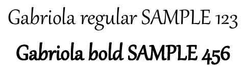

## **Áttekintés**

A PowerPoint-prezentációk (PPT, PPTX, ODP stb.) PDF formátumba konvertálása C++ nyelven több előnnyel jár, többek között eszközök közötti kompatibilitással és a prezentáció elrendezésének és formázásának megőrzésével. Ez az útmutató bemutatja, hogyan konvertálhatók a prezentációk PDF dokumentumokká, hogyan használhatók különféle beállítások a képek minőségének szabályozására, rejtett diák bevonására, PDF-fájlok jelszóval való védelmére, betűkészlet-helyettesítések észlelésére, konkrét diák kiválasztására a konverzióhoz, valamint a megfelelőségi szabványok alkalmazására a kimeneti dokumentumokban.

## **PowerPoint → PDF konverziók**

Az Aspose.Slides segítségével a következő formátumú prezentációkat konvertálhatja PDF-be:

* **PPT**
* **PPTX**
* **ODP**

Egy prezentáció PDF‑be konvertálásához adja át a fájlnevet argumentumként a [Prezentáció](https://reference.aspose.com/slides/cpp/aspose.slides/presentation/) osztálynak, majd mentse a prezentációt PDF‑ként egy [Save](https://reference.aspose.com/slides/cpp/aspose.slides/presentation/save/) metódussal. A [Prezentáció](https://reference.aspose.com/slides/cpp/aspose.slides/presentation/) osztály szolgáltatja a [Save](https://reference.aspose.com/slides/cpp/aspose.slides/presentation/save/) metódust, amelyet általában a prezentáció PDF‑re konvertálásához használnak.

{}

Az Aspose.Slides for C++ beilleszti saját API‑információit és verziószámát a kimeneti dokumentumokba. Például egy prezentáció PDF‑re konvertálásakor az Aspose.Slides kitölti az **Application** mezőt a "*Aspose.Slides*" szöveggel, a **PDF Producer** mezőt pedig "*Aspose.Slides v XX.XX*" formátumú értékkel. **Megjegyzés**: nem adhatja meg az Aspose.Slides‑nek, hogy módosítsa vagy távolítsa el ezt az információt a kimeneti dokumentumokból.

{}

Az Aspose.Slides lehetővé teszi:

* Teljes prezentációk PDF‑be konvertálását
* Kiválasztott diák PDF‑be konvertálását a prezentációból

Az Aspose.Slides PDF‑be exportálja a prezentációkat, biztosítva, hogy a létrehozott PDF-ek szorosan megegyezzenek az eredeti prezentációkkal. Az elemek és attribútumok pontosan kerülnek renderelésre a konverzió során, többek között:

* Képek
* Szövegdobozok és alakzatok
* Szövegformázás
* Bekezdésformázás
* Hiperhivatkozások
* Fejléc és lábléc
* Felsorolások
* Táblázatok

## **PowerPoint → PDF konvertálása**

A szabványos PowerPoint‑PDF konverzió alapértelmezett beállításokkal történik. Ebben az esetben az Aspose.Slides megpróbálja a megadott prezentációt a legmagasabb minőségi szinteken, optimális beállításokkal PDF‑re konvertálni.

Az alábbi példa betölt egy prezentációt, és az összes látható diát alapértelmezett exportbeállításokkal PDF‑be menti.

```cpp
#include <DOM/Presentation.h>
#include <Export/SaveFormat.h>
#include <system/smart_ptr.h>

using namespace Aspose::Slides;
using namespace Aspose::Slides::Export;
using namespace System;

auto presentation = MakeObject<Presentation>(u"PowerPoint.ppt");
presentation->Save(u"PPT-to-PDF.pdf", SaveFormat::Pdf);
presentation->Dispose();
```

{}

Az Aspose ingyenes online [**PowerPoint → PDF konvertáló**](https://products.aspose.app/slides/conversion/ppt-to-pdf) bemutatja a prezentáció‑PDF konverziós folyamatot. A konverterrel élő tesztet futtathat a leírt eljárás kipróbálásához.

{}

## **PowerPoint → PDF konvertálása beállításokkal**

Az Aspose.Slides testreszabott beállításokat – a [PdfOptions](https://reference.aspose.com/slides/cpp/aspose.slides.export/pdfoptions/) osztály tulajdonságait – kínál, amelyekkel testreszabhatja a létrehozott PDF‑et, jelszóval zárolhatja, vagy meghatározhatja, hogyan haladjon a konverziós folyamat.

### **PowerPoint → PDF konvertálása egyéni beállításokkal**

Egyedi konverziós beállításokkal meghatározhatja a rasterképek preferált minőségét, megadhatja, hogyan kezelje a metafájlokat, beállíthatja a szöveg tömörítési szintjét, konfigurálhatja a DPI‑t a képekhez, és még sok mást.

Az alábbi példa egy prezentációt PDF 1.5‑re exportál JPEG‑minőség 90‑tel, képfelbontás 300 DPI, metafájlok PNG‑ként mentve, valamint Flate szövegtömörítéssel.

```cpp
#include <DOM/Presentation.h>
#include <Export/PdfCompliance.h>
#include <Export/PdfOptions.h>
#include <Export/PdfTextCompression.h>
#include <Export/SaveFormat.h>
#include <system/smart_ptr.h>

using namespace Aspose::Slides;
using namespace Aspose::Slides::Export;
using namespace System;

auto pdfOptions = MakeObject<PdfOptions>();
pdfOptions->set_JpegQuality(90);
pdfOptions->set_SufficientResolution(300);
pdfOptions->set_SaveMetafilesAsPng(true);
pdfOptions->set_TextCompression(PdfTextCompression::Flate);
pdfOptions->set_Compliance(PdfCompliance::Pdf15);

auto presentation = MakeObject<Presentation>(u"PowerPoint.pptx");
presentation->Save(u"PowerPoint-to-PDF.pdf", SaveFormat::Pdf, pdfOptions);
presentation->Dispose();
```

### **Automatikus képtömörítés kiválasztása**

Ha egy prezentáció sok fényképet vagy képernyőképet tartalmaz, a PDF méretének csökkentése könnyebbé teheti a küldést vagy letöltést. Hívja meg a [PdfOptions::set_BestImagesCompressionRatio](https://reference.aspose.com/slides/cpp/aspose.slides.export/pdfoptions/set_bestimagescompressionratio/) metódust `true` értékkel, hogy a PDF‑export során automatikusan a legmegfelelőbb tömörítési algoritmust válassza minden képhez.

Az alábbi példa betölt egy meglévő prezentációt, engedélyezi az automatikus képtömörítés‑kiválasztást, és PDF‑dokumentumként menti. Minden egyéb PDF‑export beállítás az alapértelmezett értékeket használja.

```cpp
#include <DOM/Presentation.h>
#include <Export/PdfOptions.h>
#include <Export/SaveFormat.h>
#include <system/smart_ptr.h>

using namespace Aspose::Slides;
using namespace Aspose::Slides::Export;
using namespace System;

auto pdfOptions = MakeObject<PdfOptions>();
pdfOptions->set_BestImagesCompressionRatio(true);

auto presentation = MakeObject<Presentation>(u"image-heavy.pptx");
presentation->Save(u"image-heavy.pdf", SaveFormat::Pdf, pdfOptions);
presentation->Dispose();
```

Ez a beállítás minden képre külön algoritmust választ. A JPEG‑minőség csökkentése a [set_JpegQuality](https://reference.aspose.com/slides/cpp/aspose.slides.export/pdfoptions/set_jpegquality/) metódussal közvetlenül rontja a JPEG‑kép minőségét, míg a [set_SufficientResolution](https://reference.aspose.com/slides/cpp/aspose.slides.export/pdfoptions/set_sufficientresolution/) alacsonyabb felbontásra való beállítása lecsökkentheti a kép részletességét. Az automatikus tömörítés‑kiválasztás önmagában nem módosítja ezeket a beállításokat.

A képtömörítési algoritmusok kiválasztása további feldolgozási időt és memóriát igényel. A méretcsökkenés a prezentáció képeitől és az exportbeállításoktól függ; minden prezentációra nem garantálható fix csökkenés.

### **Beágyazott OLE‑fájlok megőrzése PDF‑csatolmányként**

Ha egy prezentáció beágyazott Excel‑munkafüzetet tartalmaz, a PDF‑címzettek számára is elérhetővé teheti a munkafüzet adatait. Hívja meg a [PdfOptions::set_IncludeOleData](https://reference.aspose.com/slides/cpp/aspose.slides.export/pdfoptions/set_includeoledata/) metódust `true` értékkel, hogy a beágyazott OLE‑fájlok csatolmányként maradjanak a létrehozott PDF‑ben.

Az alapértelmezett érték `false`: az OLE‑objektum előnézeti képe vagy ikonja megjelenik a PDF‑oldalon, de a beágyazott fájl nem kerül csatolásként hozzáadásra. `true` beállítása a fájl adatait is tartalmazza. Az előnézet továbbra is vizuális ábrázolás marad; a csatolmány lehetővé teszi a címzetteknek a beágyazott fájl különálló megnyitását vagy mentését. Az OLE‑objektum nem válik interaktív Excel‑munkalappá a PDF‑oldalon.

Az alábbi példa betölt egy prezentációt, amely már tartalmaz beágyazott Excel‑munkafüzetet, és PDF‑ként exportálja a munkafüzet csatolásával.

```cpp
#include <DOM/Presentation.h>
#include <Export/PdfOptions.h>
#include <Export/SaveFormat.h>
#include <system/smart_ptr.h>

using namespace Aspose::Slides;
using namespace Aspose::Slides::Export;
using namespace System;

auto pdfOptions = MakeObject<PdfOptions>();
pdfOptions->set_IncludeOleData(true);

auto presentation = MakeObject<Presentation>(u"presentation.pptx");
presentation->Save(u"presentation.pdf", SaveFormat::Pdf, pdfOptions);
presentation->Dispose();
```

Az eredmény ellenőrzéséhez:

1. Nyissa meg a kiexportált PDF‑et egy csatolmányok támogatásával rendelkező megjelenítőben, például az Adobe Acrobat Reader‑ben.
2. Nyissa meg a megjelenítő **Attachments** paneljét, és keresse meg a beágyazott munkafüzetet.
3. Mentse el a csatolmányt, és nyissa meg Excel‑ben az adatok ellenőrzéséhez, vagy nyissa meg közvetlenül, ha a megjelenítő ezt engedélyezi. Az PDF‑oldalon lévő előnézet elkülönül a csatolmánytól.

{}

A PDF/A szabványok csatolmányokra vonatkozó korlátozásokat írnak elő: a PDF/A‑1 tiltja a beágyazott fájlokat, a PDF/A‑2 csak PDF/A‑csatolmányokat engedélyez, a PDF/A‑3 pedig egyéb fájltípusokat, köztük Excel‑munkafüzeteket is. Ezek a szabványkövetelmények, nem az Aspose.Slides‑re vonatkozó korlátozások. Ez a példa az alapértelmezett PDF‑megfelelőségi beállítást használja, és nem mutat PDF/A exportot.

{}

### **PowerPoint → PDF konvertálása rejtett diák beépítésével**

Ha egy prezentáció rejtett diákot tartalmaz, a [PdfOptions::set_ShowHiddenSlides](https://reference.aspose.com/slides/cpp/aspose.slides.export/pdfoptions/set_showhiddenslides/) metódust a [PdfOptions](https://reference.aspose.com/slides/cpp/aspose.slides.export/pdfoptions/) osztályból használva a rejtett diák is oldalként kerülnek a kimeneti PDF‑be.

Az alábbi példa egy prezentációt PDF‑be exportál, beleértve a rejtett diákot is.

```cpp
#include <DOM/Presentation.h>
#include <Export/PdfOptions.h>
#include <Export/SaveFormat.h>
#include <system/smart_ptr.h>

using namespace Aspose::Slides;
using namespace Aspose::Slides::Export;
using namespace System;

auto pdfOptions = MakeObject<PdfOptions>();
pdfOptions->set_ShowHiddenSlides(true);

auto presentation = MakeObject<Presentation>(u"PowerPoint.pptx");
presentation->Save(u"PowerPoint-to-PDF.pdf", SaveFormat::Pdf, pdfOptions);
presentation->Dispose();
```

### **PowerPoint → jelszóval védett PDF konvertálása**

Az alábbi példa egy prezentációt PDF‑ként exportál, amely a `password` jelszó megadásával nyitható meg. A hozzáférési engedélyek lehetővé teszik a nyomtatást, beleértve a magas minőségű nyomtatást is.

```cpp
#include <DOM/Presentation.h>
#include <Export/PdfAccessPermissions.h>
#include <Export/PdfOptions.h>
#include <Export/SaveFormat.h>
#include <system/smart_ptr.h>

using namespace Aspose::Slides;
using namespace Aspose::Slides::Export;
using namespace System;

auto pdfOptions = MakeObject<PdfOptions>();
pdfOptions->set_Password(u"password");
pdfOptions->set_AccessPermissions(PdfAccessPermissions::PrintDocument | PdfAccessPermissions::HighQualityPrint);

auto presentation = MakeObject<Presentation>(u"PowerPoint.pptx");
presentation->Save(u"PPTX-to-PDF.pdf", SaveFormat::Pdf, pdfOptions);
presentation->Dispose();
```

### **Betűkészlet‑helyettesítések észlelése**

Az Aspose.Slides a [PdfOptions::set_WarningCallback](https://reference.aspose.com/slides/cpp/aspose.slides.export/saveoptions/set_warningcallback/) metódust a [PdfOptions](https://reference.aspose.com/slides/cpp/aspose.slides.export/pdfoptions/) osztályban biztosítja, amely lehetővé teszi a betűkészlet‑helyettesítések észlelését a prezentáció‑PDF konverziós folyamat során.

Az alábbi példa egy prezentációt PDF‑be exportál, és a betűkészlet‑helyettesítési figyelmeztetéseket a konzolra írja. Figyelmeztetés csak akkor jelenik meg, ha egy nem elérhető betűkészlet helyettesítésre kerül az export során.

```cpp
#include <DOM/Presentation.h>
#include <Export/PdfOptions.h>
#include <Export/SaveFormat.h>
#include <Warnings/IWarningCallback.h>
#include <Warnings/IWarningInfo.h>
#include <Warnings/ReturnAction.h>
#include <Warnings/WarningType.h>
#include <system/console.h>
#include <system/smart_ptr.h>

using namespace Aspose::Slides;
using namespace Aspose::Slides::Export;
using namespace Aspose::Slides::Warnings;
using namespace System;

class FontSubstitutionHandler : public IWarningCallback
{
public:
    ReturnAction Warning(SharedPtr<IWarningInfo> warning) override
    {
        if (warning->get_WarningType() == WarningType::DataLoss && warning->get_Description().StartsWith(u"Font will be substituted"))
        {
            Console::WriteLine(u"Font substitution warning: {0}", warning->get_Description());
        }

        return ReturnAction::Continue;
    }
};

auto pdfOptions = MakeObject<PdfOptions>();
auto warningHandler = MakeObject<FontSubstitutionHandler>();
pdfOptions->set_WarningCallback(warningHandler);

auto presentation = MakeObject<Presentation>(u"sample.pptx");
presentation->Save(u"output.pdf", SaveFormat::Pdf, pdfOptions);
presentation->Dispose();
```

{}

További információk a betűkészlet‑helyettesítésről a [Betűkészlet‑helyettesítés](/slides/hu/cpp/font-substitution/) cikkben találhatók.

{} 

### **Nem dedikált félkövér betűtípusú betűk kezelése**

Egy prezentáció alkalmazhat félkövér formázást egy olyan betűtípusra, amelynek nincs dedikált félkövér változata. Ilyenkor a szöveg szintetikus félkövérrel jelenik meg, ami mesterségesen vastagabbá teszi a normál glifeket. Ha ez a szöveg a PDF‑ben túl nehézkesnek vagy nem megfelelőnek tűnik, próbálja meg meghívni a [PdfOptions::set_RasterizeUnsupportedFontStyles](https://reference.aspose.com/slides/cpp/aspose.slides.export/pdfoptions/set_rasterizeunsupportedfontstyles/) metódust `true` értékkel. Ez a beállítás a nem támogatott betűtípus‑stílusú szöveget bitmapként rendereli a PDF‑export során, és bizonyos betűk esetén javíthatja a megjelenést. Alapértelmezett értéke `false`.

A mintaprezentáció két szövegdobozt tartalmaz: egyet normál szöveggel és egyet ugyanazzal a betűtípussal, de félkövér formázással, amelynek nincs dedikált félkövér változata. Az alábbi példa betölti a prezentációt, engedélyezi a nem támogatott betűtípus‑stílusok rasterizálását, és PDF‑ként exportálja:

```cpp
#include <DOM/Presentation.h>
#include <Export/PdfOptions.h>
#include <Export/SaveFormat.h>
#include <system/smart_ptr.h>

using namespace Aspose::Slides;
using namespace Aspose::Slides::Export;
using namespace System;

auto pdfOptions = MakeObject<PdfOptions>();
pdfOptions->set_RasterizeUnsupportedFontStyles(true);

auto presentation = MakeObject<Presentation>(u"unsupported-bold.pptx");
presentation->Save(u"rasterized.pdf", SaveFormat::Pdf, pdfOptions);
presentation->Dispose();
```

Az alábbi előnézetek a letiltott és az engedélyezett kimenetet mutatják. Ebben a példában a félkövér szöveg vastagabb vonalakkal jelenik meg a letiltott opció esetén. Az opció engedélyezése esetén a vonalak könnyebbek; a normál szöveg változatlan marad. Hasonlítsa össze az eredményeket, mielőtt kiválasztaná a beállítást a saját prezentációjában.

| Az opció letiltva (`false`, az alapértelmezett) | Az opció engedélyezve (`true`) |
|---|---|
|  |  |

Ebben a példában az opció engedélyezése csak a félkövér szöveget alakítja bitmap‑képpé: nem választható, másolható vagy kereshető szöveg OCR nélkül, és szegélyei lágyabbak 800 %‑os nagyításnál. A normál szöveg továbbra is kereshető marad. Az opció letiltása esetén mindkét szöveg karakterlánc szövegként marad.

Ez a beállítás a félkövér formázású, de dedikált félkövér betűtípussal nem rendelkező szöveget rasterizálja. A [Betűkészlet‑helyettesítés](/slides/hu/cpp/font-substitution/) ehelyett egy másik betűtípust választ, ha az eredeti nem érhető el.

## **Kiválasztott diák konvertálása PowerPoint‑ból PDF‑be**

Az alábbi példa a prezentáció 1. és 3. diaját exportálja PDF‑be. A tömbben szereplő dia‑számok egy‑alapúak, a bemeneti prezentációnak legalább három diájnak kell lennie.

```cpp
#include <DOM/Presentation.h>
#include <Export/SaveFormat.h>
#include <system/array.h>
#include <system/smart_ptr.h>

using namespace Aspose::Slides;
using namespace Aspose::Slides::Export;
using namespace System;

auto presentation = MakeObject<Presentation>(u"PowerPoint.pptx");
auto slides = MakeArray<int32_t>({ 1, 3 });
presentation->Save(u"PPTX-to-PDF.pdf", slides, SaveFormat::Pdf);
presentation->Dispose();
```

## **PowerPoint → PDF konvertálása egyéni dia‑mérettel**

Az alábbi példa az első diát átmásolja egy új prezentációba, amelynek dia‑mérete 612 × 792 pont (8,5 × 11 hú) és a dia‑tartalmat átméretezi, hogy illeszkedjen, majd az egyetlen diát PDF‑be exportálja.

```cpp
#include <DOM/ISlideCollection.h>
#include <DOM/ISlideSize.h>
#include <DOM/Presentation.h>
#include <DOM/SlideSizeScaleType.h>
#include <Export/SaveFormat.h>
#include <system/smart_ptr.h>

using namespace Aspose::Slides;
using namespace Aspose::Slides::Export;
using namespace System;

auto slideWidth = 612;
auto slideHeight = 792;

auto presentation = MakeObject<Presentation>(u"SelectedSlides.pptx");
auto resizedPresentation = MakeObject<Presentation>();

resizedPresentation->get_SlideSize()->SetSize(slideWidth, slideHeight, SlideSizeScaleType::EnsureFit);

auto slide = presentation->get_Slide(0);
resizedPresentation->get_Slides()->InsertClone(0, slide);

// Remove the blank slide that the new presentation was created with.
resizedPresentation->get_Slides()->RemoveAt(1);

resizedPresentation->Save(u"PDF_with_custom_slide_size.pdf", SaveFormat::Pdf);

resizedPresentation->Dispose();
presentation->Dispose();
```

## **PowerPoint → PDF konvertálása jegyzet‑diák nézetben**

Az alábbi példa egy prezentációt exportál PDF‑be, minden dia alá helyezve a prezentáló jegyzeteit. Használjon jegyzetekkel rendelkező prezentációt a végeredmény megtekintéséhez.

```cpp
#include <DOM/Presentation.h>
#include <Export/NotesCommentsLayoutingOptions.h>
#include <Export/NotesPositions.h>
#include <Export/PdfOptions.h>
#include <Export/SaveFormat.h>
#include <system/smart_ptr.h>

using namespace Aspose::Slides;
using namespace Aspose::Slides::Export;
using namespace System;

auto notesOptions = MakeObject<NotesCommentsLayoutingOptions>();
notesOptions->set_NotesPosition(NotesPositions::BottomFull);

auto pdfOptions = MakeObject<PdfOptions>();
pdfOptions->set_SlidesLayoutOptions(notesOptions);

auto presentation = MakeObject<Presentation>(u"NotesFile.pptx");
presentation->Save(u"PDF_with_notes.pdf", SaveFormat::Pdf, pdfOptions);
presentation->Dispose();
```

## **PDF hozzáférhetőségi és megfelelőségi szabványok**

Az Aspose.Slides lehetővé teszi egy olyan konverziós eljárás használatát, amely megfelel a [Web Content Accessibility Guidelines (**WCAG**)](https://www.w3.org/TR/WCAG-TECHS/pdf.html) irányelveinek. A PowerPoint‑dokumentumot a következő megfelelőségi szabványok valamelyikével exportálhatja PDF‑be: **PDF/A1a**, **PDF/A1b**, és **PDF/UA**.

Ez a C++ kód bemutat egy PowerPoint‑PDF konverziós folyamatot, amely különböző megfelelőségi szabványok alapján több PDF‑et hoz létre:

```cpp
#include <DOM/Presentation.h>
#include <Export/PdfCompliance.h>
#include <Export/PdfOptions.h>
#include <Export/SaveFormat.h>
#include <system/smart_ptr.h>

using namespace Aspose::Slides;
using namespace Aspose::Slides::Export;
using namespace System;

auto presentation = MakeObject<Presentation>(u"pres.pptx");

auto pdfOptionsA1a = MakeObject<PdfOptions>();

pdfOptionsA1a->set_Compliance(PdfCompliance::PdfA1a);
presentation->Save(u"pres-a1a-compliance.pdf", SaveFormat::Pdf, pdfOptionsA1a);

auto pdfOptionsA1b = MakeObject<PdfOptions>();
pdfOptionsA1b->set_Compliance(PdfCompliance::PdfA1b);
presentation->Save(u"pres-a1b-compliance.pdf", SaveFormat::Pdf, pdfOptionsA1b);

auto pdfOptionsUa = MakeObject<PdfOptions>();
pdfOptionsUa->set_Compliance(PdfCompliance::PdfUa);

presentation->Save(u"pres-ua-compliance.pdf", SaveFormat::Pdf, pdfOptionsUa);

presentation->Dispose();
```

{}

Az Aspose.Slides támogatja a PDF konverziós műveleteket, lehetővé téve a PDF‑fájlok átalakítását népszerű formátumokba. Végrehajthatja a [PDF → HTML](https://products.aspose.com/slides/cpp/conversion/pdf-to-html/), [PDF → kép](https://products.aspose.com/slides/cpp/conversion/pdf-to-image/), [PDF → JPG](https://products.aspose.com/slides/cpp/conversion/pdf-to-jpg/), és [PDF → PNG](https://products.aspose.com/slides/cpp/conversion/pdf-to-png/) konverziókat. Egyéb, speciális formátumokra irányuló PDF‑konverziók – [PDF → SVG](https://products.aspose.com/slides/cpp/conversion/pdf-to-svg/), [PDF → TIFF](https://products.aspose.com/slides/cpp/conversion/pdf-to-tiff/), és [PDF → XML](https://products.aspose.com/slides/cpp/conversion/pdf-to-xml/) – szintén támogatottak.

{}

> **Megjegyzés:** PDF/UA exportálásakor az Aspose.Slides a komplex grafikus elemeket, például a SmartArt‑ot, diagramokat és képleteket egyetlen ábrának kezeli. Az egyedi útvonalak nem maradnak meg különálló tartalomként, és esetleg „artifact”‑ként jelölődnek; az alternatív szöveg csak az egész ábra számára kerül megadásra.

## **GYIK**

**Több PowerPoint‑fájlt konvertálhatok egyszerre PDF‑re?**

Igen, az Aspose.Slides támogatja több PPT vagy PPTX fájl kötegelt konvertálását PDF‑re. Programozottan iterálhat a fájlok között, és alkalmazhatja a konverziós folyamatot.

**Lehet jelszóval védeni a konvertált PDF‑et?**

Igen. Használja a [PdfOptions](https://reference.aspose.com/slides/cpp/aspose.slides.export/pdfoptions/) osztályt a jelszó beállításához és a hozzáférési engedélyek meghatározásához a konverzió során.

**Hogyan vonhatom be a rejtett diákat a PDF‑be?**

Használja a [PdfOptions::set_ShowHiddenSlides](https://reference.aspose.com/slides/cpp/aspose.slides.export/pdfoptions/set_showhiddenslides/) metódust a [PdfOptions](https://reference.aspose.com/slides/cpp/aspose.slides.export/pdfoptions/) osztályban, hogy a rejtett diák bekerüljenek a kimeneti PDF‑be.

**Az Aspose.Slides képes magas képmintavételezést biztosítani a PDF‑ben?**

Igen, a képminőséget szabályozhatja a [set_JpegQuality](https://reference.aspose.com/slides/cpp/aspose.slides.export/pdfoptions/set_jpegquality/) és a [set_SufficientResolution](https://reference.aspose.com/slides/cpp/aspose.slides.export/pdfoptions/set_sufficientresolution/) metódusokkal a [PdfOptions](https://reference.aspose.com/slides/cpp/aspose.slides.export/pdfoptions/) osztályban, hogy magas minőségű képeket kapjon a PDF‑ben.

**Az Aspose.Slides támogatja a PDF/A megfelelőségi szabványokat?**

Igen, az Aspose.Slides lehetővé teszi PDF‑ek exportálását, amelyek megfelelnek különböző szabványoknak, beleértve a PDF/A1a, PDF/A1b és PDF/UA szabványokat is, ezáltal biztosítva a dokumentumok hozzáférhetőségét és archiválhatóságát.

## **További források**

- [Aspose.Slides for C++ Documentation](/slides/hu/cpp/)
- [Aspose.Slides for C++ API Reference](https://reference.aspose.com/slides/cpp/)
- [Aspose Free Online Converters](https://products.aspose.app/slides/conversion)