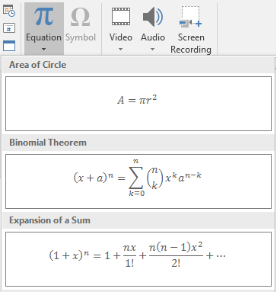

## **Áttekintés**

A PowerPoint a képleteket Office Math Markup Language (OMML) formátumban tárolja. Az Aspose.Slides for C++ segítségével programozottan létrehozhatja ugyanezt a típusú matematikai tartalmat: törtek, gyökök, függvények, határok, N‑áris operátorok, mátrixok, tömbök és formázott matematikai blokkok.

PowerPointban a felhasználók általában a **Beszúrás > Egyenlet** menüpontból adnak hozzá képleteket:



Az eredmény egy szerkeszthető matematikai szöveg a dián:


Az Aspose.Slides ezt a matematikai szöveget három fő objektumon keresztül építi fel:

- Egy matematikai alakzat, amelyet a [AddMathShape](https://reference.aspose.com/slides/cpp/aspose.slides/shapecollection/) hoz létre, az az alakzat, amely a képletet tartalmazza.
- A [MathPortion](https://reference.aspose.com/slides/cpp/aspose.slides.mathtext/mathportion/) tárolja a matematikai tartalmat az alakzat szövegdobozában.
- A [MathParagraph](https://reference.aspose.com/slides/cpp/aspose.slides.mathtext/mathparagraph/) egy vagy több [MathBlock](https://reference.aspose.com/slides/cpp/aspose.slides.mathtext/mathblock/) objektumot tartalmaz.

A lenti példák a [MathematicalText](https://reference.aspose.com/slides/cpp/aspose.slides.mathtext/mathematicaltext/) és az [IMathElement](https://reference.aspose.com/slides/cpp/aspose.slides.mathtext/imathelement/) folyékony metódusait használják a kód rövid és olvasható tartásához.

MathML export szcenáriókhoz lásd a [Export Math Equations from Presentations in C++](/slides/hu/cpp/exporting-math-equations/).

## **Egyenlet létrehozása**

Ez a példa a [AddMathShape](https://reference.aspose.com/slides/cpp/aspose.slides/ishapecollection/addmathshape/) használatával hoz létre egy matematikai alakzatot, és hozzáadja a Pithagorasz‑tételeket:


```cpp
#include <DOM/IAutoShape.h>
#include <DOM/IParagraph.h>
#include <DOM/IShapeCollection.h>
#include <DOM/ISlide.h>
#include <DOM/ITextFrame.h>
#include <DOM/MathText/IMathBlock.h>
#include <DOM/MathText/IMathParagraph.h>
#include <DOM/MathText/IMathSuperscriptElement.h>
#include <DOM/MathText/MathPortion.h>
#include <DOM/MathText/MathematicalText.h>
#include <DOM/Presentation.h>
#include <Export/SaveFormat.h>

using namespace Aspose::Slides;
using namespace Aspose::Slides::Export;
using namespace Aspose::Slides::MathText;

auto presentation = System::MakeObject<Presentation>();
auto slide = presentation->get_Slide(0);

auto mathShape = slide->get_Shapes()->AddMathShape(20.0f, 20.0f, 700.0f, 120.0f);
auto mathPortion = System::ExplicitCast<MathPortion>(mathShape->get_TextFrame()->get_Paragraph(0)->get_Portion(0));
auto mathParagraph = mathPortion->get_MathParagraph();

auto equation = System::MakeObject<MathematicalText>(u"c")
        - >SetSuperscript(u"2")
        - >Join(u"=")
        - >Join(System::MakeObject<MathematicalText>(u"a")->SetSuperscript(u"2"))
        - >Join(u"+")
        - >Join(System::MakeObject<MathematicalText>(u"b")->SetSuperscript(u"2"));

mathParagraph->Add(equation);

presentation->Save(u"pythagorean-theorem.pptx", SaveFormat::Pptx);
presentation->Dispose();
```

{}
[AddMathShape](https://reference.aspose.com/slides/cpp/aspose.slides/ishapecollection/addmathshape/) olyan alakzatot hoz létre, amely már tartalmaz egy matematikai bekezdést. Érje el az első [MathPortion](https://reference.aspose.com/slides/cpp/aspose.slides.mathtext/mathportion/)-t, hívja meg a [get_MathParagraph](https://reference.aspose.com/slides/cpp/aspose.slides.mathtext/mathportion/get_mathparagraph/)-t, és adjon hozzá matematikai blokkokat vagy elemeket.
{}

## **Törtek hozzáadása**

Használja a [Divide](https://reference.aspose.com/slides/cpp/aspose.slides.mathtext/imathelement/divide/) metódust törtek létrehozásához. A törtszerkezet stílusát a [MathFractionTypes](https://reference.aspose.com/slides/cpp/aspose.slides.mathtext/mathfractiontypes/) segítségével választhatja ki.


```cpp
#include <DOM/IAutoShape.h>
#include <DOM/IParagraph.h>
#include <DOM/IShapeCollection.h>
#include <DOM/ISlide.h>
#include <DOM/ITextFrame.h>
#include <DOM/MathText/IMathParagraph.h>
#include <DOM/MathText/MathBlock.h>
#include <DOM/MathText/MathFractionTypes.h>
#include <DOM/MathText/MathPortion.h>
#include <DOM/MathText/MathematicalText.h>
#include <DOM/Presentation.h>
#include <Export/SaveFormat.h>

using namespace Aspose::Slides;
using namespace Aspose::Slides::Export;
using namespace Aspose::Slides::MathText;

auto presentation = System::MakeObject<Presentation>();
auto slide = presentation->get_Slide(0);

auto mathShape = slide->get_Shapes()->AddMathShape(20.0f, 20.0f, 700.0f, 100.0f);
auto mathPortion = System::ExplicitCast<MathPortion>(mathShape->get_TextFrame()->get_Paragraph(0)->get_Portion(0));
auto mathParagraph = mathPortion->get_MathParagraph();

auto fraction = System::MakeObject<MathematicalText>(u"1")
        - >Divide(u"x", MathFractionTypes::Skewed);

mathParagraph->Add(System::MakeObject<MathBlock>(fraction));

presentation->Save(u"fraction.pptx", SaveFormat::Pptx);
presentation->Dispose();
```

Halmozott törthöz használja a [MathFractionTypes::Bar](https://reference.aspose.com/slides/cpp/aspose.slides.mathtext/mathfractiontypes/) értéket:

```cpp
#include <DOM/MathText/MathFractionTypes.h>
#include <DOM/MathText/MathematicalText.h>
using namespace Aspose::Slides::MathText;

auto stackedFraction = System::MakeObject<MathematicalText>(u"x + 1")->Divide(u"y - 1", MathFractionTypes::Bar);
```

## **Gyökök hozzáadása**

Használja a [Radical](https://reference.aspose.com/slides/cpp/aspose.slides.mathtext/imathelement/radical/) metódust négyzetgyök, köbgyök vagy egyéb gyök létrehozásához. A jelenlegi elem a gyök alapja, az argumentum pedig a gyök fokát adja meg.


```cpp
#include <DOM/IAutoShape.h>
#include <DOM/IParagraph.h>
#include <DOM/IShapeCollection.h>
#include <DOM/ISlide.h>
#include <DOM/ITextFrame.h>
#include <DOM/MathText/IMathParagraph.h>
#include <DOM/MathText/MathBlock.h>
#include <DOM/MathText/MathPortion.h>
#include <DOM/MathText/MathematicalText.h>
#include <DOM/Presentation.h>
#include <Export/SaveFormat.h>

using namespace Aspose::Slides;
using namespace Aspose::Slides::Export;
using namespace Aspose::Slides::MathText;

auto presentation = System::MakeObject<Presentation>();
auto slide = presentation->get_Slide(0);

auto mathShape = slide->get_Shapes()->AddMathShape(20.0f, 20.0f, 700.0f, 100.0f);
auto mathPortion = System::ExplicitCast<MathPortion>(mathShape->get_TextFrame()->get_Paragraph(0)->get_Portion(0));
auto mathParagraph = mathPortion->get_MathParagraph();

auto radical = System::MakeObject<MathematicalText>(u"x")
        - >Radical(u"n");

mathParagraph->Add(System::MakeObject<MathBlock>(radical));

presentation->Save(u"radical.pptx", SaveFormat::Pptx);
presentation->Dispose();
```

## **Függvények és határok hozzáadása**

Használja az [AsArgumentOfFunction](https://reference.aspose.com/slides/cpp/aspose.slides.mathtext/imathelement/asargumentoffunction/) vagy a [Function](https://reference.aspose.com/slides/cpp/aspose.slides.mathtext/imathelement/function/) metódust olyan függvényekhez, mint a `sin(x)`, `log(x)` vagy saját függvénynevek. Határok esetén helyezze a `lim`‑et egy [MathLimit](https://reference.aspose.com/slides/cpp/aspose.slides.mathtext/mathlimit/)-ba, vagy használja a [SetLowerLimit](https://reference.aspose.com/slides/cpp/aspose.slides.mathtext/imathelement/setlowerlimit/)-et.


```cpp
#include <DOM/IAutoShape.h>
#include <DOM/IParagraph.h>
#include <DOM/IShapeCollection.h>
#include <DOM/ISlide.h>
#include <DOM/ITextFrame.h>
#include <DOM/MathText/IMathLimit.h>
#include <DOM/MathText/IMathParagraph.h>
#include <DOM/MathText/MathBlock.h>
#include <DOM/MathText/MathPortion.h>
#include <DOM/MathText/MathematicalText.h>
#include <DOM/Presentation.h>
#include <Export/SaveFormat.h>

using namespace Aspose::Slides;
using namespace Aspose::Slides::Export;
using namespace Aspose::Slides::MathText;

auto presentation = System::MakeObject<Presentation>();
auto slide = presentation->get_Slide(0);

auto mathShape = slide->get_Shapes()->AddMathShape(20.0f, 20.0f, 700.0f, 100.0f);
auto mathPortion = System::ExplicitCast<MathPortion>(mathShape->get_TextFrame()->get_Paragraph(0)->get_Portion(0));
auto mathParagraph = mathPortion->get_MathParagraph();

auto limit = System::MakeObject<MathematicalText>(u"lim")
        - >SetLowerLimit(u"x→∞")
        - >Function(u"x");

mathParagraph->Add(System::MakeObject<MathBlock>(limit));

presentation->Save(u"functions-and-limits.pptx", SaveFormat::Pptx);
presentation->Dispose();
```

Egy saját függvénynévhez tegye a függvénynevet a jelenlegi elemnek, majd hívja meg a [Function](https://reference.aspose.com/slides/cpp/aspose.slides.mathtext/imathelement/function/)‑t az argumentummal:

```cpp
#include <DOM/MathText/MathematicalText.h>
using namespace Aspose::Slides::MathText;

auto customFunction = System::MakeObject<MathematicalText>(u"f")->Function(u"x + 1");
```

## **N‑áris operátorok és integrálok hozzáadása**

Használja a [Nary](https://reference.aspose.com/slides/cpp/aspose.slides.mathtext/imathelement/nary/) metódust összegzések, uniók, metszetek és egyéb nagy operátorok kezelésére. Az integrálokhoz használja a [Integral](https://reference.aspose.com/slides/cpp/aspose.slides.mathtext/imathelement/integral/) metódust. Mindkét módszer lehetővé teszi a felső és alsó határok beállítását.


```cpp
#include <DOM/IAutoShape.h>
#include <DOM/IParagraph.h>
#include <DOM/IShapeCollection.h>
#include <DOM/ISlide.h>
#include <DOM/ITextFrame.h>
#include <DOM/MathText/IMathParagraph.h>
#include <DOM/MathText/IMathSuperscriptElement.h>
#include <DOM/MathText/MathBlock.h>
#include <DOM/MathText/MathNaryOperatorTypes.h>
#include <DOM/MathText/MathPortion.h>
#include <DOM/MathText/MathematicalText.h>
#include <DOM/Presentation.h>
#include <Export/SaveFormat.h>

using namespace Aspose::Slides;
using namespace Aspose::Slides::Export;
using namespace Aspose::Slides::MathText;

auto presentation = System::MakeObject<Presentation>();
auto slide = presentation->get_Slide(0);

auto mathShape = slide->get_Shapes()->AddMathShape(20.0f, 20.0f, 700.0f, 120.0f);
auto mathPortion = System::ExplicitCast<MathPortion>(mathShape->get_TextFrame()->get_Paragraph(0)->get_Portion(0));
auto mathParagraph = mathPortion->get_MathParagraph();

auto summationBase = System::MakeObject<MathematicalText>(u"x")
        - >SetSuperscript(u"k")
        - >Join(System::MakeObject<MathematicalText>(u"a")->SetSuperscript(u"n-k"));

auto summation = summationBase->Nary(MathNaryOperatorTypes::Summation, u"k=0", u"n");

mathParagraph->Add(System::MakeObject<MathBlock>(summation));

presentation->Save(u"nary-operators.pptx", SaveFormat::Pptx);
presentation->Dispose();
```

Az N‑áris operátorok nagy operátorok opcionális határokkal. Az egyszerű operátorok, mint a `+`, `-` és `=` általában a [MathematicalText](https://reference.aspose.com/slides/cpp/aspose.slides.mathtext/mathematicaltext/) segítségével kerülnek a kifejezésbe.

Integrálhoz használja a [Integral](https://reference.aspose.com/slides/cpp/aspose.slides.mathtext/imathelement/integral/) metódust:

```cpp
#include <DOM/MathText/IMathBlock.h>
#include <DOM/MathText/IMathBox.h>
#include <DOM/MathText/IMathElement.h>
#include <DOM/MathText/MathIntegralTypes.h>
#include <DOM/MathText/MathematicalText.h>

using namespace Aspose::Slides::MathText;

auto integralBase = System::MakeObject<MathematicalText>(u"x")->Join(System::MakeObject<MathematicalText>(u"dx")->ToBox());
auto integral = integralBase->Integral(MathIntegralTypes::Simple, u"0", u"1");
```

## **Mátrixok hozzáadása**

Használja a [MathMatrix](https://reference.aspose.com/slides/cpp/aspose.slides.mathtext/mathmatrix/) metódust sorok és oszlopok definiálásához. A mátrixok alapértelmezés szerint nem tartalmaznak zárójeleket, ezért kösse be a mátrixot zárójelek, szögletes zárójelek vagy kapcsos zárójelek segítségével, ha szükséges.


```cpp
#include <DOM/IAutoShape.h>
#include <DOM/IParagraph.h>
#include <DOM/IShapeCollection.h>
#include <DOM/ISlide.h>
#include <DOM/ITextFrame.h>
#include <DOM/MathText/IMathBlock.h>
#include <DOM/MathText/IMathElement.h>
#include <DOM/MathText/IMathParagraph.h>
#include <DOM/MathText/MathBlock.h>
#include <DOM/MathText/MathMatrix.h>
#include <DOM/MathText/MathPortion.h>
#include <DOM/MathText/MathematicalText.h>
#include <DOM/Presentation.h>
#include <Export/SaveFormat.h>

using namespace Aspose::Slides;
using namespace Aspose::Slides::Export;
using namespace Aspose::Slides::MathText;

auto presentation = System::MakeObject<Presentation>();
auto slide = presentation->get_Slide(0);

auto mathShape = slide->get_Shapes()->AddMathShape(20.0f, 20.0f, 700.0f, 120.0f);
auto mathPortion = System::ExplicitCast<MathPortion>(mathShape->get_TextFrame()->get_Paragraph(0)->get_Portion(0));
auto mathParagraph = mathPortion->get_MathParagraph();

auto matrix = System::MakeObject<MathMatrix>(2, 3);
matrix->idx_set(0, 0, System::MakeObject<MathematicalText>(u"1"));
matrix->idx_set(0, 1, System::MakeObject<MathematicalText>(u"x"));
matrix->idx_set(1, 0, System::MakeObject<MathematicalText>(u"x"));
matrix->idx_set(1, 1, System::MakeObject<MathematicalText>(u"2"));
matrix->idx_set(1, 2, System::MakeObject<MathematicalText>(u"y"));

mathParagraph->Add(System::MakeObject<MathBlock>(matrix));

presentation->Save(u"matrix.pptx", SaveFormat::Pptx);
presentation->Dispose();
```

## **Egyenlet tömbök hozzáadása**

Használja a [ToMathArray](https://reference.aspose.com/slides/cpp/aspose.slides.mathtext/imathelement/tomatharray/) metódust, ha igazított egyenletekre vagy függőleges kifejezéshalmazra van szüksége.


```cpp
#include <DOM/IAutoShape.h>
#include <DOM/IParagraph.h>
#include <DOM/IShapeCollection.h>
#include <DOM/ISlide.h>
#include <DOM/ITextFrame.h>
#include <DOM/MathText/IMathParagraph.h>
#include <DOM/MathText/MathBlock.h>
#include <DOM/MathText/MathPortion.h>
#include <DOM/MathText/MathematicalText.h>
#include <DOM/Presentation.h>
#include <Export/SaveFormat.h>

using namespace Aspose::Slides;
using namespace Aspose::Slides::Export;
using namespace Aspose::Slides::MathText;

auto presentation = System::MakeObject<Presentation>();
auto slide = presentation->get_Slide(0);

auto mathShape = slide->get_Shapes()->AddMathShape(20.0f, 20.0f, 700.0f, 140.0f);
auto mathPortion = System::ExplicitCast<MathPortion>(mathShape->get_TextFrame()->get_Paragraph(0)->get_Portion(0));
auto mathParagraph = mathPortion->get_MathParagraph();

auto equationArray = System::MakeObject<MathematicalText>(u"x")
        - >Join(u"y")
        - >ToMathArray();

mathParagraph->Add(System::MakeObject<MathBlock>(equationArray));

presentation->Save(u"equation-array.pptx", SaveFormat::Pptx);
presentation->Dispose();
```

## **Trigonometrikus függvények hozzáadása**

Használja az [AsArgumentOfFunction](https://reference.aspose.com/slides/cpp/aspose.slides.mathtext/imathelement/asargumentoffunction/) metódust, amikor az argumentum a jelenlegi elem, és a függvény neve ismert.


```cpp
#include <DOM/IAutoShape.h>
#include <DOM/IParagraph.h>
#include <DOM/IShapeCollection.h>
#include <DOM/ISlide.h>
#include <DOM/ITextFrame.h>
#include <DOM/MathText/IMathParagraph.h>
#include <DOM/MathText/MathBlock.h>
#include <DOM/MathText/MathFunctionsOfOneArgument.h>
#include <DOM/MathText/MathPortion.h>
#include <DOM/MathText/MathematicalText.h>
#include <DOM/Presentation.h>
#include <Export/SaveFormat.h>

using namespace Aspose::Slides;
using namespace Aspose::Slides::Export;
using namespace Aspose::Slides::MathText;

auto presentation = System::MakeObject<Presentation>();
auto slide = presentation->get_Slide(0);

auto mathShape = slide->get_Shapes()->AddMathShape(20.0f, 20.0f, 700.0f, 100.0f);
auto mathPortion = System::ExplicitCast<MathPortion>(mathShape->get_TextFrame()->get_Paragraph(0)->get_Portion(0));
auto mathParagraph = mathPortion->get_MathParagraph();

auto cosine = System::MakeObject<MathematicalText>(u"2x")
        - >AsArgumentOfFunction(MathFunctionsOfOneArgument::Cos);

mathParagraph->Add(System::MakeObject<MathBlock>(cosine));

presentation->Save(u"trigonometric-function.pptx", SaveFormat::Pptx);
presentation->Dispose();
```

## **Alsó- és felső indexek hozzáadása**

Használja az alsó‑ és felső index segédfüggvényeit indexek és hatványok megadásához. Ha az indexeknek a bázis bal oldalán kell megjelenniük, alkalmazza a [SetSubSuperscriptOnTheLeft](https://reference.aspose.com/slides/cpp/aspose.slides.mathtext/imathelement/setsubsuperscriptontheleft/) metódust.


```cpp
#include <DOM/IAutoShape.h>
#include <DOM/IParagraph.h>
#include <DOM/IShapeCollection.h>
#include <DOM/ISlide.h>
#include <DOM/ITextFrame.h>
#include <DOM/MathText/IMathParagraph.h>
#include <DOM/MathText/MathBlock.h>
#include <DOM/MathText/MathPortion.h>
#include <DOM/MathText/MathematicalText.h>
#include <DOM/Presentation.h>
#include <Export/SaveFormat.h>

using namespace Aspose::Slides;
using namespace Aspose::Slides::Export;
using namespace Aspose::Slides::MathText;

auto presentation = System::MakeObject<Presentation>();
auto slide = presentation->get_Slide(0);

auto mathShape = slide->get_Shapes()->AddMathShape(20.0f, 20.0f, 700.0f, 100.0f);
auto mathPortion = System::ExplicitCast<MathPortion>(mathShape->get_TextFrame()->get_Paragraph(0)->get_Portion(0));
auto mathParagraph = mathPortion->get_MathParagraph();

auto scripts = System::MakeObject<MathematicalText>(u"Y")
        - >SetSubSuperscriptOnTheLeft(u"1", u"n");

mathParagraph->Add(System::MakeObject<MathBlock>(scripts));

presentation->Save(u"subscript-superscript.pptx", SaveFormat::Pptx);
presentation->Dispose();
```

## **Határolók hozzáadása**

Használja a [Enclose](https://reference.aspose.com/slides/cpp/aspose.slides.mathtext/imathelement/enclose/) metódust kifejezés határolók közé helyezéséhez. Több elemet tartalmazó határoló kifejezéseknél beállíthat egy elválasztó karaktert is.


```cpp
#include <DOM/IAutoShape.h>
#include <DOM/IParagraph.h>
#include <DOM/IShapeCollection.h>
#include <DOM/ISlide.h>
#include <DOM/ITextFrame.h>
#include <DOM/MathText/IMathParagraph.h>
#include <DOM/MathText/MathBlock.h>
#include <DOM/MathText/MathPortion.h>
#include <DOM/MathText/MathematicalText.h>
#include <DOM/Presentation.h>
#include <Export/SaveFormat.h>

using namespace Aspose::Slides;
using namespace Aspose::Slides::Export;
using namespace Aspose::Slides::MathText;

auto presentation = System::MakeObject<Presentation>();
auto slide = presentation->get_Slide(0);

auto mathShape = slide->get_Shapes()->AddMathShape(20.0f, 20.0f, 700.0f, 100.0f);
auto mathPortion = System::ExplicitCast<MathPortion>(mathShape->get_TextFrame()->get_Paragraph(0)->get_Portion(0));
auto mathParagraph = mathPortion->get_MathParagraph();

auto delimiter = System::MakeObject<MathematicalText>(u"x")
        - >Join(u"y")
        - >Join(u"z")
        - >Enclose(u'<', u'>', u'|');

mathParagraph->Add(System::MakeObject<MathBlock>(delimiter));

presentation->Save(u"delimiters.pptx", SaveFormat::Pptx);
presentation->Dispose();
```

### **Méret és igazítás a határolókhoz**

Adja meg a `true` értéket a [set_GrowToMatchOperandHeight](https://reference.aspose.com/slides/cpp/aspose.slides.mathtext/imathdelimiter/set_growtomatchoperandheight/) metódusnak, hogy a zárójelek a magas operandus köré nőjenek, vagy a `false` értéket, hogy a normál méretben maradjanak. A [set_DelimiterShape](https://reference.aspose.com/slides/cpp/aspose.slides.mathtext/imathdelimiter/set_delimitershape/) a két [MathDelimiterShape](https://reference.aspose.com/slides/cpp/aspose.slides.mathtext/mathdelimitershape/) érték egyikét veszi fel. A `Centered` középre helyezi a zárójeleket a matematikai tengelyen, amely a egyenlőségjel közepén megy át. A `Match` a zárójeleket a tartalommal igazítja. Mindkét beállítás csak a határolókra vonatkozik; a bennük lévő kifejezés változatlan marad.

A példa egy törtrészt helyez az `x` kitevőjébe, így a kifejezés a vonal felett magasabb, mint alatta. A négy egyenlet ugyanazokat a zárójeleket és betűtípus‑beállításokat használja.

```cpp
#include <DOM/IAutoShape.h>
#include <DOM/IParagraph.h>
#include <DOM/IShapeCollection.h>
#include <DOM/ISlide.h>
#include <DOM/ITextFrame.h>
#include <DOM/MathText/IMathParagraph.h>
#include <DOM/IPortionFormat.h>
#include <DOM/MathText/IMathBlock.h>
#include <DOM/MathText/IMathDelimiter.h>
#include <DOM/MathText/IMathFraction.h>
#include <DOM/MathText/IMathSuperscriptElement.h>
#include <DOM/MathText/MathDelimiterShape.h>
#include <DOM/MathText/MathPortion.h>
#include <DOM/MathText/MathematicalText.h>
#include <DOM/Presentation.h>
#include <Export/SaveFormat.h>

using namespace Aspose::Slides;
using namespace Aspose::Slides::Export;
using namespace Aspose::Slides::MathText;

auto presentation = System::MakeObject<Presentation>();
auto slide = presentation->get_Slide(0);

auto addExpression = [slide](float left, float top, bool grow, MathDelimiterShape shape)
{
    auto fraction = System::MakeObject<MathematicalText>(u"a + b")->Divide(u"c + d");
    auto power = System::MakeObject<MathematicalText>(u"x")->SetSuperscript(fraction);
    auto delimiter = power->Enclose(u'(', u')');
    delimiter->set_GrowToMatchOperandHeight(grow);
    delimiter->set_DelimiterShape(shape);

    auto mathShape = slide->get_Shapes()->AddMathShape(left, top, 300, 100);
    auto portion = System::ExplicitCast<MathPortion>(mathShape->get_TextFrame()->get_Paragraph(0)->get_Portion(0));
    portion->get_PortionFormat()->set_FontHeight(32);
    auto equation = System::MakeObject<MathematicalText>(u"y = ")->Join(delimiter);
    portion->get_MathParagraph()->Add(equation);
};

addExpression(20, 20, true, MathDelimiterShape::Centered);
addExpression(350, 20, true, MathDelimiterShape::Match);
addExpression(20, 140, false, MathDelimiterShape::Centered);
addExpression(350, 140, false, MathDelimiterShape::Match);

presentation->Save(u"delimiter-sizing.pptx", SaveFormat::Pptx);
presentation->Dispose();
```

PowerPointban hasonlítsa össze a sorokat a növekedés hatásának megtekintéséhez. A felső sorban a zárójelek nőnek, hogy befoglalják a kitevőt, és mindkét alakzatnál egyformán néznek ki. Az alsó sorban a növekedés ki van kapcsolva. A baloldali kisebb zárójelek (`Centered`) az egyenlőségjelhez igazodnak, míg a jobboldali (`Match`) magasabban helyezkednek el a kifejezés körül.


## **Határdoboz hozzáadása**

Használja a [ToBorderBox](https://reference.aspose.com/slides/cpp/aspose.slides.mathtext/imathelement/toborderbox/) metódust, ha magát az egyenletet keretbe szeretné tenni.


```cpp
#include <DOM/IAutoShape.h>
#include <DOM/IParagraph.h>
#include <DOM/IShapeCollection.h>
#include <DOM/ISlide.h>
#include <DOM/ITextFrame.h>
#include <DOM/MathText/IMathParagraph.h>
#include <DOM/MathText/IMathSuperscriptElement.h>
#include <DOM/MathText/MathBlock.h>
#include <DOM/MathText/MathPortion.h>
#include <DOM/MathText/MathematicalText.h>
#include <DOM/Presentation.h>
#include <Export/SaveFormat.h>

using namespace Aspose::Slides;
using namespace Aspose::Slides::Export;
using namespace Aspose::Slides::MathText;

auto presentation = System::MakeObject<Presentation>();
auto slide = presentation->get_Slide(0);

auto mathShape = slide->get_Shapes()->AddMathShape(20.0f, 20.0f, 700.0f, 100.0f);
auto mathPortion = System::ExplicitCast<MathPortion>(mathShape->get_TextFrame()->get_Paragraph(0)->get_Portion(0));
auto mathParagraph = mathPortion->get_MathParagraph();

auto boxedEquation = System::MakeObject<MathematicalText>(u"a")
        - >SetSuperscript(u"2")
        - >Join(u"=")
        - >Join(System::MakeObject<MathematicalText>(u"b")->SetSuperscript(u"2"))
        - >Join(u"+")
        - >Join(System::MakeObject<MathematicalText>(u"c")->SetSuperscript(u"2"))
        - >ToBorderBox();

mathParagraph->Add(System::MakeObject<MathBlock>(boxedEquation));

presentation->Save(u"border-box.pptx", SaveFormat::Pptx);
presentation->Dispose();
```

## **Kifejezések csoportosítása**

Használja a [Group](https://reference.aspose.com/slides/cpp/aspose.slides.mathtext/imathelement/group/) metódust, hogy egy csoportosító karaktert helyezzen a kifejezés fölé vagy alá. Adj meg egy határt a csoportosított elemek feliratozásához.


```cpp
#include <DOM/IAutoShape.h>
#include <DOM/IParagraph.h>
#include <DOM/IShapeCollection.h>
#include <DOM/ISlide.h>
#include <DOM/ITextFrame.h>
#include <DOM/MathText/IMathGroupingCharacter.h>
#include <DOM/MathText/IMathParagraph.h>
#include <DOM/MathText/MathBlock.h>
#include <DOM/MathText/MathPortion.h>
#include <DOM/MathText/MathTopBotPositions.h>
#include <DOM/MathText/MathematicalText.h>
#include <DOM/Presentation.h>
#include <Export/SaveFormat.h>

using namespace Aspose::Slides;
using namespace Aspose::Slides::Export;
using namespace Aspose::Slides::MathText;

auto presentation = System::MakeObject<Presentation>();
auto slide = presentation->get_Slide(0);

auto mathShape = slide->get_Shapes()->AddMathShape(20.0f, 20.0f, 700.0f, 120.0f);
auto mathPortion = System::ExplicitCast<MathPortion>(mathShape->get_TextFrame()->get_Paragraph(0)->get_Portion(0));
auto mathParagraph = mathPortion->get_MathParagraph();

auto grouped = System::MakeObject<MathematicalText>(u"x + y")
        - >Group(u'\u23DF', MathTopBotPositions::Bottom, MathTopBotPositions::Top)
        - >SetLowerLimit(u"any text");

mathParagraph->Add(System::MakeObject<MathBlock>(grouped));

presentation->Save(u"grouped-terms.pptx", SaveFormat::Pptx);
presentation->Dispose();
```

## **Matematikai elemek formázása**

Használja a formázó segédfüggvényeket csak akkor, ha azok tisztábbá teszik a képletet. Például az [Overbar](https://reference.aspose.com/slides/cpp/aspose.slides.mathtext/imathelement/overbar/) egy sávot helyez egy matematikai elem fölé.


```cpp
#include <DOM/IAutoShape.h>
#include <DOM/IParagraph.h>
#include <DOM/IShapeCollection.h>
#include <DOM/ISlide.h>
#include <DOM/ITextFrame.h>
#include <DOM/MathText/IMathParagraph.h>
#include <DOM/MathText/MathBlock.h>
#include <DOM/MathText/MathPortion.h>
#include <DOM/MathText/MathematicalText.h>
#include <DOM/Presentation.h>
#include <Export/SaveFormat.h>

using namespace Aspose::Slides;
using namespace Aspose::Slides::Export;
using namespace Aspose::Slides::MathText;

auto presentation = System::MakeObject<Presentation>();
auto slide = presentation->get_Slide(0);

auto mathShape = slide->get_Shapes()->AddMathShape(20.0f, 20.0f, 700.0f, 100.0f);
auto mathPortion = System::ExplicitCast<MathPortion>(mathShape->get_TextFrame()->get_Paragraph(0)->get_Portion(0));
auto mathParagraph = mathPortion->get_MathParagraph();

auto overbar = System::MakeObject<MathematicalText>(u"ABC")->Overbar();

mathParagraph->Add(System::MakeObject<MathBlock>(overbar));

presentation->Save(u"overbar.pptx", SaveFormat::Pptx);
presentation->Dispose();
```

### **Szöveg formázása egy meglévő egyenletben**

A szöveg formázásához egy meglévő egyenletben járja be minden matematikai blokk elemes fáját. Az [IMathElement::GetChildren](https://reference.aspose.com/slides/cpp/aspose.slides.mathtext/imathelement/getchildren/) csak a közvetlen gyermekeket adja vissza, ezért rekurzívan kell meghívni, hogy elérje a tömbök, indexek, gyökök és egyéb beágyazott struktúrák szövegét. Ellenőrizze a jelenlegi elemet, valamint annak gyermekeit is, hogy a kezdőelemet is belevegye, ha az [MathematicalText](https://reference.aspose.com/slides/cpp/aspose.slides.mathtext/mathematicaltext/).

Ez a példa azt feltételezi, hogy egy bemutató tartalmaz egy olyan egyenletet, mint `z = xᵢ / ∛y`, ahol a tört számlálója alsóindexet, a nevezője pedig gyököt tartalmaz. Ha csak a blokk felső‑szintű elemeit dolgozná fel, a törtben lévő szöveget kimaradt volna. A példa megtalálja a matematikai részeket a diák szövegdobozában, hozzáfér a blokkokhoz az [IMathPortion::get_MathParagraph](https://reference.aspose.com/slides/cpp/aspose.slides.mathtext/imathportion/get_mathparagraph/)-on keresztül, és a [set_FontHeight](https://reference.aspose.com/slides/cpp/aspose.slides/baseportionformat/set_fontheight/) segítségével 28 pontba állítja a betűméretet, a formázást minden szövegelem [get_Format](https://reference.aspose.com/slides/cpp/aspose.slides.mathtext/mathematicaltext/get_format/)-metódusával érve.

```cpp
#include <functional>
#include <system/array.h>
#include <DOM/IAutoShape.h>
#include <DOM/IParagraph.h>
#include <DOM/IParagraphCollection.h>
#include <DOM/IPortion.h>
#include <DOM/IPortionCollection.h>
#include <DOM/IPortionFormat.h>
#include <DOM/IShapeCollection.h>
#include <DOM/ISlide.h>
#include <DOM/ISlideCollection.h>
#include <DOM/ITextFrame.h>
#include <DOM/MathText/IMathBlock.h>
#include <DOM/MathText/IMathElement.h>
#include <DOM/MathText/IMathParagraph.h>
#include <DOM/MathText/IMathPortion.h>
#include <DOM/MathText/MathematicalText.h>
#include <DOM/Presentation.h>
#include <Export/SaveFormat.h>

using namespace Aspose::Slides;
using namespace Aspose::Slides::Export;
using namespace Aspose::Slides::MathText;

std::function<void(System::SharedPtr<IMathElement>)> formatMathText;
formatMathText = [&formatMathText](System::SharedPtr<IMathElement> element)
{
    auto text = System::DynamicCast<MathematicalText>(element);
    if (text != nullptr)
        text->get_Format()->set_FontHeight(28.0f);

    for (auto child : element->GetChildren())
        formatMathText(child);
};

auto presentation = System::MakeObject<Presentation>(u"input.pptx");

for (auto slide : presentation->get_Slides())
{
    for (auto shape : slide->get_Shapes())
    {
        auto autoShape = System::DynamicCast<IAutoShape>(shape);
        if (autoShape == nullptr || autoShape->get_TextFrame() == nullptr)
            continue;

        for (auto paragraph : autoShape->get_TextFrame()->get_Paragraphs())
        {
            for (auto portion : paragraph->get_Portions())
            {
                auto mathPortion = System::DynamicCast<IMathPortion>(portion);
                if (mathPortion != nullptr)
                {
                    for (auto block : mathPortion->get_MathParagraph())
                        formatMathText(block);
                }
            }
        }
    }
}

presentation->Save(u"formatted-equations.pptx", SaveFormat::Pptx);
presentation->Dispose();
```

A mentett bemutató minden szinten frissített szövegformázást tartalmaz a feldolgozott egyenletekben, miközben megőrzi a szövegtartalmat és a matematikai struktúrát.

## **Gyors referenciák**

| Feladat | Fő API |
| --- | --- |
| Matematikai szöveg létrehozása | [MathematicalText](https://reference.aspose.com/slides/cpp/aspose.slides.mathtext/mathematicaltext/) |
| Elemek egyesítése | [IMathElement.Join](https://reference.aspose.com/slides/cpp/aspose.slides.mathtext/imathelement/join/) |
| Törtek létrehozása | [IMathElement.Divide](https://reference.aspose.com/slides/cpp/aspose.slides.mathtext/imathelement/divide/) |
| Felső- vagy alsóindex hozzáadása | [SetSuperscript](https://reference.aspose.com/slides/cpp/aspose.slides.mathtext/imathelement/setsuperscript/), [SetSubscript](https://reference.aspose.com/slides/cpp/aspose.slides.mathtext/imathelement/setsubscript/) |
| Függvények hozzáadása | [Function](https://reference.aspose.com/slides/cpp/aspose.slides.mathtext/imathelement/function/), [AsArgumentOfFunction](https://reference.aspose.com/slides/cpp/aspose.slides.mathtext/imathelement/asargumentoffunction/) |
| Gyökök hozzáadása | [IMathElement.Radical](https://reference.aspose.com/slides/cpp/aspose.slides.mathtext/imathelement/radical/) |
| Határok hozzáadása | [SetLowerLimit](https://reference.aspose.com/slides/cpp/aspose.slides.mathtext/imathelement/setlowerlimit/), [SetUpperLimit](https://reference.aspose.com/slides/cpp/aspose.slides.mathtext/imathelement/setupperlimit/) |
| Baloldali indexek hozzáadása | [SetSubSuperscriptOnTheLeft](https://reference.aspose.com/slides/cpp/aspose.slides.mathtext/imathelement/setsubsuperscriptontheleft/) |
| Összegzések és integrálok hozzáadása | [Nary](https://reference.aspose.com/slides/cpp/aspose.slides.mathtext/imathelement/nary/), [Integral](https://reference.aspose.com/slides/cpp/aspose.slides.mathtext/imathelement/integral/) |
| Mátrixok hozzáadása | [MathMatrix](https://reference.aspose.com/slides/cpp/aspose.slides.mathtext/mathmatrix/) |
| Egyenlet tömbök hozzáadása | [ToMathArray](https://reference.aspose.com/slides/cpp/aspose.slides.mathtext/imathelement/tomatharray/) |
| Határolók hozzáadása | [Enclose](https://reference.aspose.com/slides/cpp/aspose.slides.mathtext/imathelement/enclose/) |
| Vízszintes vonalak és szegélyek hozzáadása | [Overbar](https://reference.aspose.com/slides/cpp/aspose.slides.mathtext/imathelement/overbar/), [ToBorderBox](https://reference.aspose.com/slides/cpp/aspose.slides.mathtext/imathelement/toborderbox/) |
| Kifejezések csoportosítása | [Group](https://reference.aspose.com/slides/cpp/aspose.slides.mathtext/imathelement/group/) |

## **Gyakran ismételt kérdések**

**Szerkeszthetek egy meglévő PowerPoint képletet?**

Igen. Nyissa meg a bemutatót, keresse meg azt az alakzatot, amely egy [MathPortion](https://reference.aspose.com/slides/cpp/aspose.slides.mathtext/mathportion/)‑t tartalmaz, hívja meg a [get_MathParagraph](https://reference.aspose.com/slides/cpp/aspose.slides.mathtext/mathportion/get_mathparagraph/)-t, és frissítse a matematikai blokkokat az adott bekezdésben.

**Az egyenletek szerkeszthető PowerPoint‑matematikaként vannak mentve?**

Igen. PPTX formátumba mentéskor az Aspose.Slides a képletet szerkeszthető Office‑math tartalomként írja.

**Exportálhatok képleteket LaTeX‑be?**

Igen. Szerezze meg az egyenlet [IMathParagraph](https://reference.aspose.com/slides/cpp/aspose.slides.mathtext/imathparagraph/)-ját a [IMathPortion](https://reference.aspose.com/slides/cpp/aspose.slides.mathtext/imathportion/)-ból, majd hívja meg az [IMathParagraph::ToLatex](https://reference.aspose.com/slides/cpp/aspose.slides.mathtext/imathparagraph/tolatex/) metódust a közvetlen exportáláshoz. Teljes példáért lásd a [Export Math Equations from Presentations in C++](/slides/hu/cpp/exporting-math-equations/#export-math-equations-to-latex).