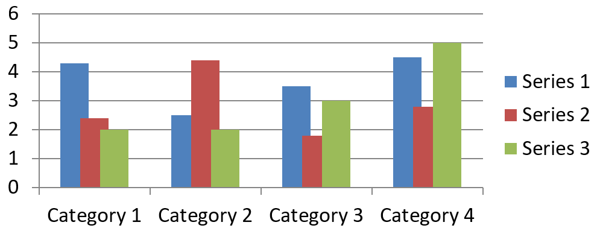

## **Áttekintés**

A diagram tárolhatja a megjelenített értékeket a munkafüzet celláiban, vagy közvetlenül numerikus literálokként. Egy [IChartSeries](https://reference.aspose.com/slides/java/com.aspose.slides/ichartseries/) egy kapcsolódó értékkészletet képvisel, és minden egyes [IChartDataPoint](https://reference.aspose.com/slides/java/com.aspose.slides/ichartdatapoint/) egy pontot jelent ebben a sorozatban. Az [IChartCategory](https://reference.aspose.com/slides/java/com.aspose.slides/ichartcategory/) objektumok biztosítják a sorozatok által megosztott címkéket vagy csoportosítási értékeket. Alapértelmezett adatokkal létrehozott diagramok esetén a sorozatnevek, kategóriák és pontértékek az [IChartDataCell](https://reference.aspose.com/slides/java/com.aspose.slides/ichartdatacell/) objektumokat használják a diagram munkafüzetéből.

Tipikus kategóriadiagram esetén az alapértelmezett munkafüzet az 0‑s sort használja a sorozatnevekre, a 0‑s oszlopot a kategórianévre, a maradék cellákat pedig a sorozatértékekre. A [IChartDataWorkbook.getCell](https://reference.aspose.com/slides/java/com.aspose.slides/ichartdataworkbook/#getCell-int-int-int-)‑nek átadott munkalap-, sor‑ és oszlopindexek nullán alapulnak. Ez a felépítés akkor hasznos, ha alapértelmezett adatokkal hoz létre diagramot, de nem szabad azt feltételezni, hogy minden meglévő diagram ezt használja. Betöltött prezentáció esetén ellenőrizze a sorozatok, kategóriák és adatpontok által hivatkozott cellákat, mielőtt a munkafüzet értékeit módosítaná.

A diagrambeállítások három különböző hatókörrel rendelkeznek:

- Sorozatszintű beállítások, például az [IChartSeries.getFormat](https://reference.aspose.com/slides/java/com.aspose.slides/ichartseries/#getFormat--) biztosítják az alapértelmezett megjelenést az egész sorozatra.
- Adatpont beállítások, például az [IChartDataPoint.getFormat](https://reference.aspose.com/slides/java/com.aspose.slides/ichartdatapoint/#getFormat--) felülbírálják a sorozat megjelenését egy adott pontra.
- Csoportbeállítások vonatkoznak az egységes [IChartSeriesGroup](https://reference.aspose.com/slides/java/com.aspose.slides/ichartseriesgroup/)‑hez tartozó kompatibilis sorozatokra. A csoporthoz a [IChartSeries.getParentSeriesGroup](https://reference.aspose.com/slides/java/com.aspose.slides/ichartseries/#getParentSeriesGroup--) segítségével férhet hozzá, ha például átfedés vagy hézag szélesség beállítását szeretné megadni.

Ha nincs kifejezetten beállítva pont- vagy sorozattöltés, a diagramstílus és a sablon határozza meg az automatikus megjelenést. Ha mind a sorozat-, mind a pontformázás meg van adva, a pontformázás felülírja a sorozatáthelyezést az adott pontnál.


## **Sorozatértékek beállítása numerikus literálok használatával**

Használjon numerikus literálokat, ha a sorozatértékek az alkalmazás adatából vagy számításából származnak, és nem igényelnek munkalap‑cellahivatkozást. Hívja meg a [setDataSourceTypeForValues](https://reference.aspose.com/slides/java/com.aspose.slides/ichartdatapointcollection/#setDataSourceTypeForValues-int-)‑t a [DataSourceType.DoubleLiterals](https://reference.aspose.com/slides/java/com.aspose.slides/datasourcetype/#DoubleLiterals) paraméterrel, mielőtt minden pont [getValue](https://reference.aspose.com/slides/java/com.aspose.slides/ichartdatapoint/#getValue--) eredményét a [setAsLiteralDouble](https://reference.aspose.com/slides/java/com.aspose.slides/idoublechartvalue/#setAsLiteralDouble-double-)‑vel állítaná be.

A gyűjtemény beállítása irányítja az összes pont értékének forrástípusát az adott sorozatban. Minden pont [getDataSourceType](https://reference.aspose.com/slides/java/com.aspose.slides/ibasechartvalue/#getDataSourceType--) metódusa jelzi a kiválasztott típust; ezt a gyűjtemény beállításával módosíthatja. `Worksheet` esetén a [getAsCell](https://reference.aspose.com/slides/java/com.aspose.slides/isinglecellchartvalue/#getAsCell--) segítségével érheti el a hivatkozott cellát. `DoubleLiterals` esetén a [getAsLiteralDouble](https://reference.aspose.com/slides/java/com.aspose.slides/idoublechartvalue/#getAsLiteralDouble--) vagy a `setAsLiteralDouble` használható a szám közvetlen beolvasásához vagy írásához.

Az alábbi példa oszlopdiagramot hoz létre alapértelmezett sorozattal és kategóriákkal, majd a számított 10, 20, … értékeket rendeli az első sorozat meglévő pontjaihoz. Ezután elmenti a prezentációt, újra megnyitja, és kiírja a tárolt értékeket.

```java
import com.aspose.slides.*;

Presentation presentation = new Presentation();
try {
    ISlide slide = presentation.getSlides().get_Item(0);

    IChart chart = slide.getShapes().addChart(ChartType.ClusteredColumn, 20, 20, 500, 300);
    IChartSeries series = chart.getChartData().getSeries().get_Item(0);

    series.getDataPoints().setDataSourceTypeForValues(DataSourceType.DoubleLiterals);
    for (int i = 0; i < series.getDataPoints().size(); i++) {
        series.getDataPoints().get_Item(i).getValue().setAsLiteralDouble((i + 1) * 10);
    }

    presentation.save("numeric_literals.pptx", SaveFormat.Pptx);
} finally {
    presentation.dispose();
}

Presentation reopenedPresentation = new Presentation("numeric_literals.pptx");
try {
    ISlide reopenedSlide = reopenedPresentation.getSlides().get_Item(0);
    IChart reopenedChart = (IChart) reopenedSlide.getShapes().get_Item(0);
    IChartSeries reopenedSeries = reopenedChart.getChartData().getSeries().get_Item(0);
    for (IChartDataPoint point : reopenedSeries.getDataPoints()) {
        System.out.println(point.getValue().getAsLiteralDouble());
    }
} finally {
    reopenedPresentation.dispose();
}
```

A pontérték forrástípusa különbözik az [IChartData.getDataSourceType](https://reference.aspose.com/slides/java/com.aspose.slides/ichartdata/#getDataSourceType--)‑tól, amely a diagram belső vagy külső munkafüzet‑konfigurációját azonosítja. Numerikus literálok használata önmagában nem távolítja el a beágyazott munkafüzetet. Ebben a példában a munkafüzet továbbra is elérhető a kategóriacímkék, sorozatnevek és a többi sorozat számára. Lásd a [Diagram munkafüzet](/slides/hu/java/chart-workbook/) dokumentációt a munkafüzet‑kezelésről.

Szórt és buborék diagramok esetén a [setDataSourceTypeForXValues](https://reference.aspose.com/slides/java/com.aspose.slides/ichartdatapointcollection/#setDataSourceTypeForXValues-int-) és a [setDataSourceTypeForYValues](https://reference.aspose.com/slides/java/com.aspose.slides/ichartdatapointcollection/#setDataSourceTypeForYValues-int-) használható a [getXValue](https://reference.aspose.com/slides/java/com.aspose.slides/ichartdatapoint/#getXValue--) és a [getYValue](https://reference.aspose.com/slides/java/com.aspose.slides/ichartdatapoint/#getYValue--) forrásának kiválasztásához. A buborék diagramokhoz a [setDataSourceTypeForBubbleSizes](https://reference.aspose.com/slides/java/com.aspose.slides/ichartdatapointcollection/#setDataSourceTypeForBubbleSizes-int-) is szükséges a [getBubbleSize](https://reference.aspose.com/slides/java/com.aspose.slides/ichartdatapoint/#getBubbleSize--) esetén. Minden alkalmazandó forrást állítson `DoubleLiterals`‑re, mielőtt a `setAsLiteralDouble` metódussal számot rendelnék hozzá.

## **Diagramsorozat átfedésének beállítása**

Az [IChartSeries.getOverlap](https://reference.aspose.com/slides/java/com.aspose.slides/ichartseries/#getOverlap--) megadja, hogy egy 2D diagram oszlopai vagy sávjai milyen mértékben fednek át –100 és 100 százalék között. Ez a beállítás csak olvasható, és a szülő sorozatcsoportbeállítást tükrözi. A [IChartSeriesGroup.setOverlap](https://reference.aspose.com/slides/java/com.aspose.slides/ichartseriesgroup/#setOverlap-byte-) segítségével frissítheti a csoport minden kompatibilis sorozatát. Ez a lehetőség a csoportos oszlop‑ vagy sávdiagramokra vonatkozik; kombinált diagramok esetén a nem kapcsolódó sorozatcsoportokat nem érinti.

Az alábbi példa beállítja az átfedést az első sorozatot tartalmazó csoportra:

```java
import com.aspose.slides.*;

final int firstSlideIndex = 0;
final int firstSeriesIndex = 0;
final byte overlapPercent = 30;

Presentation presentation = new Presentation();
try {
    ISlide slide = presentation.getSlides().get_Item(firstSlideIndex);

    // Az új diagram minta sorozatokat, kategóriákat és értékeket tartalmaz.
    IChart chart = slide.getShapes().addChart(ChartType.ClusteredColumn, 20, 20, 500, 200);

    IChartSeries series = chart.getChartData().getSeries().get_Item(firstSeriesIndex);
    series.getParentSeriesGroup().setOverlap(overlapPercent);

    presentation.save("series_overlap.pptx", SaveFormat.Pptx);
} finally {
    presentation.dispose();
}
```

Az eredmény:



## **A sorozat kitöltőszínének módosítása**

Használja az [IChartSeries.getFormat](https://reference.aspose.com/slides/java/com.aspose.slides/ichartseries/#getFormat--) metódust az egész sorozat alapértelmezett kitöltésének megadásához. Ha egy pont már rendelkezik kifejezett kitöltéssel, annak [IChartDataPoint.getFormat](https://reference.aspose.com/slides/java/com.aspose.slides/ichartdatapoint/#getFormat--) beállítása felülírja a sorozat kitöltését az adott pontnál.

Az alábbi példa kék szilárd kitöltést alkalmaz az első sorozatra:

```java
import com.aspose.slides.*;
import java.awt.Color;

final int firstSlideIndex = 0;
final int firstSeriesIndex = 0;

Presentation presentation = new Presentation();
try {
    ISlide slide = presentation.getSlides().get_Item(firstSlideIndex);

    IChart chart = slide.getShapes().addChart(ChartType.ClusteredColumn, 20, 20, 500, 200);

    IChartSeries series = chart.getChartData().getSeries().get_Item(firstSeriesIndex);
    series.getFormat().getFill().setFillType(FillType.Solid);
    series.getFormat().getFill().getSolidFillColor().setColor(Color.BLUE);

    presentation.save("series_color.pptx", SaveFormat.Pptx);
} finally {
    presentation.dispose();
}
```

Az eredmény:


## **A sorozat nevének módosítása**

A sorozat neve a diagram adatmunka‑füzetében van tárolva, és általában a jelmagyarázatban jelenik meg. Egy klaszter‑oszlop diagram alapértelmezett munkafüzetében a B1 cella (0‑s sor, 1‑s oszlop) tartalmazza az első sorozat nevét. Az alábbi példában a névkonstansok ezt a szerkezetet teszik egyértelművé:

```java
import com.aspose.slides.*;

final int firstSlideIndex = 0;
final int worksheetIndex = 0;
final int seriesNameRowIndex = 0;
final int firstSeriesColumnIndex = 1;

Presentation presentation = new Presentation();
try {
    ISlide slide = presentation.getSlides().get_Item(firstSlideIndex);

    IChart chart = slide.getShapes().addChart(ChartType.ClusteredColumn, 20, 20, 500, 200);

    IChartDataWorkbook workbook = chart.getChartData().getChartDataWorkbook();
    IChartDataCell seriesNameCell = workbook.getCell(worksheetIndex, seriesNameRowIndex, firstSeriesColumnIndex);
    seriesNameCell.setValue("Revenue");

    presentation.save("series_name.pptx", SaveFormat.Pptx);
} finally {
    presentation.dispose();
}
```

A cellát közvetlenül is frissítheti a [IChartSeries.getName](https://reference.aspose.com/slides/java/com.aspose.slides/ichartseries/#getName--) által már hivatkozott helyen. Ez a megközelítés elkerüli a konkrét sor‑ és oszlopindexek feltételezését egy meglévő diagram esetén:

```java
import com.aspose.slides.*;

final int firstSlideIndex = 0;
final int firstSeriesIndex = 0;
final int firstNameCellIndex = 0;

Presentation presentation = new Presentation();
try {
    ISlide slide = presentation.getSlides().get_Item(firstSlideIndex);

    IChart chart = slide.getShapes().addChart(ChartType.ClusteredColumn, 20, 20, 500, 200);

    IChartSeries series = chart.getChartData().getSeries().get_Item(firstSeriesIndex);
    IChartDataCell seriesNameCell = series.getName().getAsCells().get_Item(firstNameCellIndex);
    seriesNameCell.setValue("Revenue");

    presentation.save("series_name.pptx", SaveFormat.Pptx);
} finally {
    presentation.dispose();
}
```

Az eredmény:


### **Sorozat létrehozása több cellából származó névvel**

Összetett sorozatnév akkor hasznos, ha a termék neve és a jelentési időszak külön‑külön munkafüzetcellákban van tárolva. Például a `Product A` B1‑ben és a `2026` C1‑ben egyetlen sorozatnevébe kombinálható, miközben mindkét rész továbbra is hivatkozik a forráscelláira.

Használja a [IChartDataWorkbook.getCellCollection](https://reference.aspose.com/slides/java/com.aspose.slides/ichartdataworkbook/#getCellCollection-java.lang.String-boolean-)‑t a névtartomány lekéréséhez, majd adja át a gyűjteményt a [IChartSeriesCollection.add](https://reference.aspose.com/slides/java/com.aspose.slides/ichartseriescollection/#add-com.aspose.slides.IChartCellCollection-int-)‑nek. A `skipHiddenCells` argumentum határozza meg, hogy a rejtett cellák is belekerülnek-e: `true` kizárja őket, `false` pedig belefoglalja őket. Ebben a példában `false`-t használunk, hogy minden cella belekerüljön a névtartományba.

Az alábbi példa egy prezentációt hoz létre egy sorozattal és két adatponttal. A B1:C1 cellák csak a sorozatnevet tartalmazzák; az A2:A3 a kategóriacímkéket, a B2:B3 pedig a numerikus értékeket.

```java
import com.aspose.slides.*;

Presentation presentation = new Presentation();
try {
    ISlide slide = presentation.getSlides().get_Item(0);

    IChart chart = slide.getShapes().addChart(ChartType.ClusteredColumn, 50, 50, 620, 180);

    chart.getChartData().getSeries().clear();
    chart.getChartData().getCategories().clear();
    chart.setLegend(true);

    IChartDataWorkbook workbook = chart.getChartData().getChartDataWorkbook();
    workbook.clear(0);

    // Ezek a két cella biztosítják a sorozat nevét.
    workbook.getCell(0, 0, 1, "Product A");
    workbook.getCell(0, 0, 2, "2026");
    IChartCellCollection nameCells = workbook.getCellCollection("Sheet1!$B$1:$C$1", false);
    IChartSeries series = chart.getChartData().getSeries().add(nameCells, ChartType.ClusteredColumn);

    // Különálló cellák szolgáltatják a kategóriákat és a numerikus adatpontokat.
    IChartDataCell northCategory = workbook.getCell(0, 1, 0, "North");
    IChartDataCell southCategory = workbook.getCell(0, 2, 0, "South");
    chart.getChartData().getCategories().add(northCategory);
    chart.getChartData().getCategories().add(southCategory);
    IChartDataCell northValue = workbook.getCell(0, 1, 1, 120);
    IChartDataCell southValue = workbook.getCell(0, 2, 1, 150);
    series.getDataPoints().addDataPointForBarSeries(northValue);
    series.getDataPoints().addDataPointForBarSeries(southValue);

    presentation.save("composite_series_name.pptx", SaveFormat.Pptx);
} finally {
    presentation.dispose();
}
```

Az eredményül kapott sorozatnév `Product A 2026`, a két cellaérték között szóközzel. A jelmagyarázat egyetlen bejegyzésként jeleníti meg mindkét oszlopot. Az alábbi kép illusztrálja az eredményt:


## **Automatikus sorozatkitöltőszín lekérése**

Az [IChartSeries.getAutomaticSeriesColor](https://reference.aspose.com/slides/java/com.aspose.slides/ichartseries/#getAutomaticSeriesColor--) visszaadja a sorozat indexéből és a diagram stílusából számított színt. Ez a szín akkor használatos, ha a sorozatkitöltést nem definiálta kifejezetten. A metódus csak a számított színt olvassa ki; nem állít be új kitöltést.

Az alábbi példa kiírja az alapértelmezett sorozatok automatikus színét:

```java
import com.aspose.slides.*;
import java.awt.Color;

final int firstSlideIndex = 0;

Presentation presentation = new Presentation();
try {
    ISlide slide = presentation.getSlides().get_Item(firstSlideIndex);

    IChart chart = slide.getShapes().addChart(ChartType.ClusteredColumn, 20, 20, 500, 200);

    int seriesCount = chart.getChartData().getSeries().size();
    for (int seriesIndex = 0; seriesIndex < seriesCount; seriesIndex++) {
        IChartSeries series = chart.getChartData().getSeries().get_Item(seriesIndex);
        Color automaticColor = series.getAutomaticSeriesColor();
        System.out.println("Series " + seriesIndex + ": " + automaticColor);
    }
} finally {
    presentation.dispose();
}
```

Példa kimenet az alapértelmezett diagramstílushoz:

```text
Series 0: java.awt.Color[r=79,g=129,b=189]
Series 1: java.awt.Color[r=192,g=80,b=77]
Series 2: java.awt.Color[r=155,g=187,b=89]
```

A pontos színek a diagramstílustól és a sablontól függenek.

## **Invertált kitöltőszín beállítása egy diagramsorozathoz**

Oszlop‑, sáv‑ és buborék sorozatok esetén az [IChartSeries.setInvertIfNegative](https://reference.aspose.com/slides/java/com.aspose.slides/ichartseries/#setInvertIfNegative-boolean-) segítségével a negatív értékek más kitöltéssel jeleníthetők meg. Állítsa be a normál sorozatkitöltést szilárd színre, engedélyezze az invertálást, és a negatív értékek színét a [IChartSeries.getInvertedSolidFillColor](https://reference.aspose.com/slides/java/com.aspose.slides/ichartseries/#getInvertedSolidFillColor--) adja meg. A negatív számok a munkafüzetben változatlanok maradnak; csak a megjelenített színük változik.

Az alábbi példa lecseréli az alapértelmezett diagramadatot egy sorozatra. A 0‑s sor a sorozatnevet, a 0‑s oszlop a kategória neveket, az 1‑s oszlop pedig az értékeket tartalmazza:

```java
import com.aspose.slides.*;
import java.awt.Color;

final int firstSlideIndex = 0;
final int worksheetIndex = 0;
final int headerRowIndex = 0;
final int categoryColumnIndex = 0;
final int firstSeriesColumnIndex = 1;
final int firstDataRowIndex = 1;

String[] categoryNames = { "Category 1", "Category 2", "Category 3" };
int[] seriesValues = { -20, 50, -30 };

Presentation presentation = new Presentation();
try {
    ISlide slide = presentation.getSlides().get_Item(firstSlideIndex);

    IChart chart = slide.getShapes().addChart(ChartType.ClusteredColumn, 20, 20, 500, 200);
    IChartData chartData = chart.getChartData();
    IChartDataWorkbook workbook = chartData.getChartDataWorkbook();

    chartData.getSeries().clear();
    chartData.getCategories().clear();

    IChartDataCell seriesNameCell = workbook.getCell(worksheetIndex, headerRowIndex, firstSeriesColumnIndex, "Series 1");
    int chartType = chart.getType();
    IChartSeries series = chartData.getSeries().add(seriesNameCell, chartType);

    for (int categoryIndex = 0; categoryIndex < categoryNames.length; categoryIndex++) {
        int dataRowIndex = firstDataRowIndex + categoryIndex;
        String categoryName = categoryNames[categoryIndex];
        int seriesValue = seriesValues[categoryIndex];

        IChartDataCell categoryCell = workbook.getCell(worksheetIndex, dataRowIndex, categoryColumnIndex, categoryName);
        chartData.getCategories().add(categoryCell);

        IChartDataCell valueCell = workbook.getCell(worksheetIndex, dataRowIndex, firstSeriesColumnIndex, seriesValue);
        series.getDataPoints().addDataPointForBarSeries(valueCell);
    }

    Color automaticSeriesColor = series.getAutomaticSeriesColor();
    series.getFormat().getFill().setFillType(FillType.Solid);
    series.getFormat().getFill().getSolidFillColor().setColor(automaticSeriesColor);
    series.setInvertIfNegative(true);
    series.getInvertedSolidFillColor().setColor(Color.RED);

    presentation.save("inverted_solid_fill_color.pptx", SaveFormat.Pptx);
} finally {
    presentation.dispose();
}
```

Az eredmény:


Az invertálást egyetlen pontra is engedélyezheti az [IChartDataPoint.setInvertIfNegative](https://reference.aspose.com/slides/java/com.aspose.slides/ichartdatapoint/#setInvertIfNegative-boolean-) használatával. Az alábbi példában a sorozatra vonatkozó invertálás le van tiltva, csak a kiválasztott ponton engedélyezve, amelyhez negatív értéket is rendelnek, hogy a hatás látható legyen:

```java
import com.aspose.slides.*;
import java.awt.Color;

final int firstSlideIndex = 0;
final int firstSeriesIndex = 0;
final int targetDataPointIndex = 2;
final int negativeValue = -30;

Presentation presentation = new Presentation();
try {
    ISlide slide = presentation.getSlides().get_Item(firstSlideIndex);

    IChart chart = slide.getShapes().addChart(ChartType.ClusteredColumn, 20, 20, 500, 200);

    IChartSeries series = chart.getChartData().getSeries().get_Item(firstSeriesIndex);
    Color automaticSeriesColor = series.getAutomaticSeriesColor();
    series.getFormat().getFill().setFillType(FillType.Solid);
    series.getFormat().getFill().getSolidFillColor().setColor(automaticSeriesColor);
    series.getInvertedSolidFillColor().setColor(Color.RED);
    series.setInvertIfNegative(false);

    IChartDataPoint dataPoint = series.getDataPoints().get_Item(targetDataPointIndex);
    dataPoint.getValue().getAsCell().setValue(negativeValue);
    dataPoint.setInvertIfNegative(true);

    presentation.save("data_point_invert_color_if_negative.pptx", SaveFormat.Pptx);
} finally {
    presentation.dispose();
}
```

## **Egy adott adatpontérték törlése**

Egy pont „üres” állapotba hozatalához a többi pont eltávolítása nélkül, állítsa a mögöttes munkafüzet‑cellát `null`‑ra. Oszlopdiagram esetén a megjelenített érték a [IChartDataPoint.getValue](https://reference.aspose.com/slides/java/com.aspose.slides/ichartdatapoint/#getValue--)‑n keresztül érhető el. Az adatpont a kategóriapozíciójában marad, de a diagram a beállított üres‑érték‑szabályok szerint úgy kezeli, mintha az érték hiányozna.

Az alábbi példa csak a második pontot törli az első sorozatban:

```java
import com.aspose.slides.*;

final int firstSlideIndex = 0;
final int firstSeriesIndex = 0;
final int targetDataPointIndex = 1;

Presentation presentation = new Presentation();
try {
    ISlide slide = presentation.getSlides().get_Item(firstSlideIndex);

    IChart chart = slide.getShapes().addChart(ChartType.ClusteredColumn, 20, 20, 500, 200);

    IChartSeries series = chart.getChartData().getSeries().get_Item(firstSeriesIndex);
    IChartDataPoint dataPoint = series.getDataPoints().get_Item(targetDataPointIndex);
    dataPoint.getValue().getAsCell().setValue(null);

    presentation.save("clear_data_point_value.pptx", SaveFormat.Pptx);
} finally {
    presentation.dispose();
}
```

A szórt diagramok külön X és Y cellákat használnak, a buborék diagramok pedig egy méretcellát is. Csak azt a cellát ürítse ki, amely az eltávolítandó értéket jelenti. Ne hívja meg az [IChartDataPointCollection.clear](https://reference.aspose.com/slides/java/com.aspose.slides/ichartdatapointcollection/#clear--) metódust, ha a többi pontot megtartaná, mert ez a metódus a gyűjtemény összes adatpontját eltávolítja.

## **Az üres cellák megjelenésének vezérlése**

A rejtett, értéket tartalmazó cellák külön esetet képeznek az üres cellákkal szemben. A rejtett munkalap‑sorok és -oszlopok adatainak bevonásával vagy kizárásával kapcsolatban lásd a [Include Data from Hidden Rows and Columns](/slides/hu/java/chart-workbook/#include-data-from-hidden-rows-and-columns) dokumentációt.

Az üres munkafüzet‑cellák hiányzó adatot jelentenek; a `0`‑t tartalmazó cella ismert numerikus értéket jelent. Hívja meg az [IChartDataCell.setValue](https://reference.aspose.com/slides/java/com.aspose.slides/ichartdatacell/#setValue-java.lang.Object-)‑t `null`‑ral, hogy a cellát üresre állítsa. A numerikus nulla továbbra is nulla marad, függetlenül az üres‑cellás beállítástól.

Az [IChart.setDisplayBlanksAs](https://reference.aspose.com/slides/java/com.aspose.slides/ichart/#setDisplayBlanksAs-int-) segítségével választhatja ki, hogy a diagram hogyan jelenítse meg az üres cellákat. Ez a beállítás a teljes diagramra vonatkozik, és megváltoztatja az üres értékek ábrázolását anélkül, hogy a munkafüzet‑cellát nullával vagy interpolált értékkel töltené fel.

Az alábbi önálló példa egy vonaldiagramot hoz létre egy sorozattal, a 3. nap értékét törli, majd minden üzemmódban elmenti a diagramot. Bemeneti fájl nem szükséges. Az [IChartDataWorkbook](https://reference.aspose.com/slides/java/com.aspose.slides/ichartdataworkbook/) a 0‑s munkalapot, a 0‑s oszlopot a kategóriacímkékhez, az 1‑s oszlopot az értékekhez használja; a 0‑s sor a sorozatnevet tartalmazza. A végső adatsor: `10, 20, empty, 30, 40`.

```java
import com.aspose.slides.*;

Presentation presentation = new Presentation();
try {
    ISlide slide = presentation.getSlides().get_Item(0);

    IChart chart = slide.getShapes().addChart(ChartType.LineWithMarkers, 40, 40, 640, 400);
    IChartData chartData = chart.getChartData();
    IChartDataWorkbook workbook = chartData.getChartDataWorkbook();

    chartData.getSeries().clear();
    chartData.getCategories().clear();

    IChartDataCell seriesNameCell = workbook.getCell(0, 0, 1, "Measurements");
    IChartSeries series = chartData.getSeries().add(seriesNameCell, chart.getType());
    int[] values = { 10, 20, 25, 30, 40 };

    for (int i = 0; i < values.length; i++) {
        IChartDataCell categoryCell = workbook.getCell(0, i + 1, 0, "Day " + (i + 1));
        chartData.getCategories().add(categoryCell);
        IChartDataCell valueCell = workbook.getCell(0, i + 1, 1, values[i]);
        series.getDataPoints().addDataPointForLineSeries(valueCell);
    }

    // Hagyja a 3. napot valóban üresen, miközben megtartja a kategóriát és az adatpontot.
    workbook.getCell(0, 3, 1).setValue(null);

    int[] modes = { DisplayBlanksAsType.Gap, DisplayBlanksAsType.Zero, DisplayBlanksAsType.Span };
    String[] modeNames = { "Gap", "Zero", "Span" };
    for (int i = 0; i < modes.length; i++) {
        chart.setDisplayBlanksAs(modes[i]);
        presentation.save("empty_cells_" + modeNames[i] + ".pptx", SaveFormat.Pptx);
    }
} finally {
    presentation.dispose();
}
```

Minden kimeneti fájl a mentés előtt beállított módot tartalmazza: `empty_cells_Gap.pptx`, `empty_cells_Zero.pptx` és `empty_cells_Span.pptx`. Ha csak egy verziót szeretne menteni, állítsa be a kívánt módot, és egyszer mentse a prezentációt a módok ciklikus végrehajtása helyett.

Az alábbi összehasonlítás mindhárom fájlban ugyanazt az adatot mutatja. A 3. nap minden esetben üres a munkafüzetben:


A látható hatás a diagramtípustól függ. A vonaldiagram mindhárom módot könnyen összehasonlíthatóvá teszi. Sáv‑ és oszlopdiagramok esetén nincs vonal, amely áthidalná a hiányzó kategóriát, ezért a `Span` nem hozhat létre csatlakozó szegmenst; egy hiányzó oszlop és egy nulla‑magasságú oszlop hasonlóan nézhet ki. Hasonlóképpen a szórt diagram csak jelölőkkel nem rendelkezik vonallal. Ne várjon három különböző eredményt minden diagramtípusnál; ellenőrizze a kimenetet az Ön által használt diagramtípusnál.

## **Sorozati hézag szélességének beállítása**

A hézag szélessége a szomszédos sáv‑ vagy oszlopcsoportok közötti távolság, amely a sáv vagy oszlop szélességének százalékában van megadva. Az átfedéshez hasonlóan ez is a szülő sorozatcsoporthoz tartozik, nem egyetlen sorozathoz. Hívja meg egyszer a [IChartSeriesGroup.setGapWidth](https://reference.aspose.com/slides/java/com.aspose.slides/ichartseriesgroup/#setGapWidth-int-)‑t a csoporton. Nagyobb érték nagyobb távolságot hoz létre a csoportok között; kisebb érték sűrűbb elrendezést eredményez.

Az alábbi példa módosítja a hézag szélességét, és csak a végső prezentációt menti el:

```java
import com.aspose.slides.*;

final int firstSlideIndex = 0;
final int firstSeriesIndex = 0;
final int gapWidthPercent = 30;

Presentation presentation = new Presentation();
try {
    ISlide slide = presentation.getSlides().get_Item(firstSlideIndex);

    IChart chart = slide.getShapes().addChart(ChartType.StackedColumn, 20, 20, 500, 200);

    IChartSeries series = chart.getChartData().getSeries().get_Item(firstSeriesIndex);
    series.getParentSeriesGroup().setGapWidth(gapWidthPercent);

    presentation.save("gap_width_30.pptx", SaveFormat.Pptx);
} finally {
    presentation.dispose();
}
```

Az eredmény:


## **GYIK**

**Mely diagramtípusok támogatják az adat sorozatokat?**

Az összes, a [ChartType](https://reference.aspose.com/slides/java/com.aspose.slides/charttype/) felsorolásában szereplő diagramtípus használ diagramadatot, de sorozataik nem mindegyik rendelkezik ugyanazzal az értékstruktúrával vagy beállításokkal. Például a kategóriadiagramok kategóriákat és értékeket használnak, a szórt diagramok X és Y értékeket, a buborék diagramok pedig buborékméreteket. Használja a sorozattípusnak megfelelő adatpont‑létrehozó metódust. Az olyan beállítások, mint az átfedés és a hézag szélesség, csak kompatibilis sáv‑ vagy oszlopcsoportokra vonatkoznak.

**Mi az a diagram sorozatcsoport?**

Az [IChartSeriesGroup](https://reference.aspose.com/slides/java/com.aspose.slides/ichartseriesgroup/) kompatibilis sorozatokat tartalmaz, amelyek közös csoportszintű ábrázolási beállításokat osztanak meg. Egy kombinált diagram több csoportot is tartalmazhat, így egy sorozaton keresztül elért csoport módosítása nem feltétlenül változtatja meg a diagram összes sorozatát.

**Tartalmaz-e egy újonnan létrehozott diagram alapértelmezett adatot?**

Igen. Alapértelmezés szerint az [IShapeCollection.addChart](https://reference.aspose.com/slides/java/com.aspose.slides/ishapecollection/#addChart-int-float-float-float-float-) mintasorozatokat, kategóriákat és értékeket hoz létre. Ezeket a cellákat szerkesztheti, vagy a sorozat‑ és kategóriagyűjteményeket is törölheti, mielőtt teljesen egyedi adatot adna hozzá. Egy túlterhelés (overload) is létrehozhat diagramot alapértelmezett adatok nélkül.

**Hogyan kapcsolódnak a diagram objektumok a munkafüzet‑cellákhoz?**

A sorozatnevek, kategóriacímkék és adatpont‑értékek cellákra hivatkoznak egy [IChartDataWorkbook](https://reference.aspose.com/slides/java/com.aspose.slides/ichartdataworkbook/)-ban. Egy hivatkozott cella módosítása frissíti a megfelelő diagramelemet. Egyedi adat építésekor tartsa a kategóriasorokat és a sorozat‑értéksorokat igazban, hogy minden pont a kívánt kategória alá kerüljön.

**Hogyan töröljek egy pontot, anélkül hogy az egész sorozatot eltávolítanám?**

Állítsa a vonatkozó értékkellátó cellát `null`‑ra, így a pont kategóriapozíciója üres pontként marad. Az [IChartDataPointCollection.clear](https://reference.aspose.com/slides/java/com.aspose.slides/ichartdatapointcollection/#clear--)‑t csak akkor használja, ha minden pontot el kíván távolítani az adott sorozatból. Ha kategóriákat is töröl, frissítse minden sorozatot, hogy azok értékei igazodjanak a kategória‑gyűjteményhez.

**Hogyan jelennek meg az üres pontok?**

Az eredmény a diagramtípustól és az [IChart.setDisplayBlanksAs](https://reference.aspose.com/slides/java/com.aspose.slides/ichart/#setDisplayBlanksAs-int-)‑n keresztül konfigurált értéktől függ. A támogatott diagramok megjeleníthetik az üreseknek a hézagot, nullákat, vagy a szomszédos pontok összekapcsolásával. Válassza ki a prezentációjában a hiányzó adat jelentésének megfelelő beállítást. Lásd a [Az üres cellák megjelenésének vezérlése](#control-the-display-of-empty-cells) szakaszt a teljes példáért és vizuális összehasonlításért.

**Hogyan formázzák a negatív értékeket?**

Támogatott sáv‑, oszlop‑ és buborék sorozatok esetén hívja meg az [IChartSeries.setInvertIfNegative](https://reference.aspose.com/slides/java/com.aspose.slides/ichartseries/#setInvertIfNegative-boolean-)‑t, és állítsa be a [IChartSeries.getInvertedSolidFillColor](https://reference.aspose.com/slides/java/com.aspose.slides/ichartseries/#getInvertedSolidFillColor--) által visszaadott színt. Az egyes pontokat a [IChartDataPoint.setInvertIfNegative](https://reference.aspose.com/slides/java/com.aspose.slides/ichartdatapoint/#setInvertIfNegative-boolean-)‑val felülbírálhatja. Ezek a módszerek a formázásra, nem a tárolt numerikus értékekre hatnak.

**Melyik formázás nyer, ha mind a sorozat, mind a pont formázva van?**

A kifejezett adatpont‑formázás felülírja a sorozatformázást az adott pontnál. A többi pont a kifejezett sorozatformátumot vagy, ha az nincs definiálva, a automatikus diagramstílust és sablont használja. A csoportbeállítások, mint az átfedés és a hézag szélesség, a elrendezést szabályozzák, és nem pont‑szintű formázási felülírások.

**Van korlát a diagramban lévő sorozatok számát illetően?**

Az Aspose.Slides nem alkalmaz különálló rögzített sorozatszám‑korlátot. Gyakorlatban a prezentációfájl korlátai, a rendelkezésre álló memória, a renderelési idő és a diagram olvashatósága határozza meg a hasznos limitet.

**Mit kell módosítanom, ha a oszlopok túl közel vagy túl távol vannak egymástól?**

Hívja meg a [IChartSeriesGroup.setGapWidth](https://reference.aspose.com/slides/java/com.aspose.slides/ichartseriesgroup/#setGapWidth-int-)‑t a megfelelő szülő sorozatcsoporton. Növelje az értéket a csoportok közti tér növeléséhez, vagy csökkentse a közelebbi elhelyezkedésért.