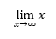

## **Áttekintés**

A PowerPoint egyenleteket az Office Math Markup Language (OMML) formátumban tárolja. Az Aspose.Slides for Java segítségével programozottan hozhat létre ugyanilyen matematikai tartalmakat: tört, gyökök, függvények, határok, N-áris operátorok, mátrixok, tömbök és formázott matematikai blokkok.

PowerPointban a felhasználók általában a **Insert > Equation** menüponttal adnak hozzá egyenleteket:


A PowerPoint-diapozitív szerkeszthető matematikai egyenlettel:


Az Aspose.Slides ezt a matematikai szöveget három fő objektumon keresztül építi fel:

- A matematikai alakzat, amelyet a [addMathShape](https://reference.aspose.com/slides/java/com.aspose.slides/ishapecollection/#addMathShape-float-float-float-float-) hívással hozunk létre, az az alakzat, amely az egyenletet tartalmazza.
- [MathPortion](https://reference.aspose.com/slides/java/com.aspose.slides/mathportion/) tárolja a matematikai tartalmat az alakzat szövegkeretében.
- [MathParagraph](https://reference.aspose.com/slides/java/com.aspose.slides/mathparagraph/) egy vagy több [MathBlock](https://reference.aspose.com/slides/java/com.aspose.slides/mathblock/) objektumot tartalmaz.

Az alábbi példák a [MathematicalText](https://reference.aspose.com/slides/java/com.aspose.slides/mathematicaltext/) és az [IMathElement](https://reference.aspose.com/slides/java/com.aspose.slides/imathelement/) folyékony metódusait használják, hogy a kód rövid és olvasható legyen.

MathML export esetekhez lásd a [Matematikai egyenletek exportálása prezentációkból Java-ban](/slides/hu/java/exporting-math-equations/).

## **Egyenlet létrehozása**

Ez a példa a [addMathShape](https://reference.aspose.com/slides/java/com.aspose.slides/ishapecollection/#addMathShape-float-float-float-float-) használatával hoz létre egy matematikai alakzatot, és hozzáadja a Pitagorasz‑tételt:


```java
import com.aspose.slides.*;

Presentation presentation = new Presentation();
try {
    ISlide slide = presentation.getSlides().get_Item(0);

    IAutoShape mathShape = slide.getShapes().addMathShape(20, 20, 700, 120);
    IMathParagraph mathParagraph = ((MathPortion) mathShape.getTextFrame().getParagraphs()
            .get_Item(0).getPortions().get_Item(0)).getMathParagraph();

    IMathBlock equation = new MathematicalText("c")
            .setSuperscript("2")
            .join("=")
            .join(new MathematicalText("a").setSuperscript("2"))
            .join("+")
            .join(new MathematicalText("b").setSuperscript("2"));

    mathParagraph.add(equation);

    presentation.save("pythagorean-theorem.pptx", SaveFormat.Pptx);
} finally {
    presentation.dispose();
}
```

{}
[addMathShape](https://reference.aspose.com/slides/java/com.aspose.slides/ishapecollection/#addMathShape-float-float-float-float-) olyan alakzatot hoz létre, amely már tartalmaz egy matematikai bekezdést. Az első [MathPortion](https://reference.aspose.com/slides/java/com.aspose.slides/mathportion/) elérésével, a [getMathParagraph](https://reference.aspose.com/slides/java/com.aspose.slides/imathportion/#getMathParagraph--) hívásával, hozzáadhatja a matematikai blokkokat vagy elemeket.
{}

## **Törtek hozzáadása**

Használja a [divide](https://reference.aspose.com/slides/java/com.aspose.slides/imathelement/#divide-com.aspose.slides.IMathElement-) metódust tört létrehozásához. A tört stílusát a [MathFractionTypes](https://reference.aspose.com/slides/java/com.aspose.slides/mathfractiontypes/) segítségével választhatja ki.


```java
import com.aspose.slides.*;

Presentation presentation = new Presentation();
try {
    ISlide slide = presentation.getSlides().get_Item(0);

    IAutoShape mathShape = slide.getShapes().addMathShape(20, 20, 700, 100);
    IMathParagraph mathParagraph = ((MathPortion) mathShape.getTextFrame().getParagraphs()
            .get_Item(0).getPortions().get_Item(0)).getMathParagraph();

    IMathFraction fraction = new MathematicalText("1")
            .divide("x", MathFractionTypes.Skewed);

    mathParagraph.add(new MathBlock(fraction));

    presentation.save("fraction.pptx", SaveFormat.Pptx);
} finally {
    presentation.dispose();
}
```

Egymás fölött megjelenő tört esetén használja a [MathFractionTypes.Bar](https://reference.aspose.com/slides/java/com.aspose.slides/mathfractiontypes/#Bar)-t:

```java
import com.aspose.slides.*;

IMathFraction stackedFraction = new MathematicalText("x + 1").divide("y - 1", MathFractionTypes.Bar);
```

## **Gyökök hozzáadása**

Használja a [radical](https://reference.aspose.com/slides/java/com.aspose.slides/imathelement/#radical-com.aspose.slides.IMathElement-) metódust négyzetgyök, köbgyök vagy más gyök létrehozásához. A jelenlegi elem lesz az alap, az argumentum pedig a kitevő.


```java
import com.aspose.slides.*;

Presentation presentation = new Presentation();
try {
    ISlide slide = presentation.getSlides().get_Item(0);

    IAutoShape mathShape = slide.getShapes().addMathShape(20, 20, 700, 100);
    IMathParagraph mathParagraph = ((MathPortion) mathShape.getTextFrame().getParagraphs()
            .get_Item(0).getPortions().get_Item(0)).getMathParagraph();

    IMathRadical radical = new MathematicalText("x")
            .radical("n");

    mathParagraph.add(new MathBlock(radical));

    presentation.save("radical.pptx", SaveFormat.Pptx);
} finally {
    presentation.dispose();
}
```

### **A négyzetgyök kitevőjének megjelenítése vagy elrejtése**

A négyzetgyök megjeleníthet egy explicite 2‑t vagy a hagyományos √x jelölést használhatja. Az [IMathRadical](https://reference.aspose.com/slides/java/com.aspose.slides/imathradical/) [setHideDegree](https://reference.aspose.com/slides/java/com.aspose.slides/imathradical/#setHideDegree-boolean-) metódusa szabályozza, melyik forma jelenik meg. Mindkét forma megőrzi a 2‑es kitevőt és az x radikandust a szerkeszthető egyenletben.


A példa kétszer menti ugyanazt a négyzetgyököt. A `visible-degree.pptx` fájlban a 2 látható. A `hidden-degree.pptx` fájlban rejtve van.

```java
import com.aspose.slides.*;

Presentation presentation = new Presentation();
try {
    ISlide slide = presentation.getSlides().get_Item(0);
    
    IMathRadical radical = new MathematicalText("x").radical("2");

    IAutoShape shape = slide.getShapes().addMathShape(20, 20, 200, 100);
    IMathPortion portion = (IMathPortion) shape.getTextFrame().getParagraphs().get_Item(0).getPortions().get_Item(0);
    portion.getMathParagraph().add(new MathBlock(radical));

    radical.setHideDegree(false);
    presentation.save("visible-degree.pptx", SaveFormat.Pptx);

    radical.setHideDegree(true);
    presentation.save("hidden-degree.pptx", SaveFormat.Pptx);
} finally {
    presentation.dispose();
}
```

## **Függvények és határok hozzáadása**

Használja a [asArgumentOfFunction](https://reference.aspose.com/slides/java/com.aspose.slides/imathelement/#asArgumentOfFunction-com.aspose.slides.IMathElement-) vagy a [function](https://reference.aspose.com/slides/java/com.aspose.slides/imathelement/#function-com.aspose.slides.IMathElement-) metódusokat olyan függvényekhez, mint a `sin(x)`, `log(x)` vagy egyedi függvénynevek. Határok esetén helyezze a `lim`-et egy [MathLimit](https://reference.aspose.com/slides/java/com.aspose.slides/mathlimit/) objektumba, vagy használja a [setLowerLimit](https://reference.aspose.com/slides/java/com.aspose.slides/imathelement/#setLowerLimit-com.aspose.slides.IMathElement-) metódust.



```java
import com.aspose.slides.*;

Presentation presentation = new Presentation();
try {
    ISlide slide = presentation.getSlides().get_Item(0);

    IAutoShape mathShape = slide.getShapes().addMathShape(20, 20, 700, 100);
    IMathParagraph mathParagraph = ((MathPortion) mathShape.getTextFrame().getParagraphs()
            .get_Item(0).getPortions().get_Item(0)).getMathParagraph();

    IMathFunction limit = new MathematicalText("lim")
            .setLowerLimit("x\u2192\u221E")
            .function("x");

    mathParagraph.add(new MathBlock(limit));

    presentation.save("functions-and-limits.pptx", SaveFormat.Pptx);
} finally {
    presentation.dispose();
}
```

Egyedi függvény név esetén tegye a függvény nevet a jelenlegi elemmé, és hívja a [function](https://reference.aspose.com/slides/java/com.aspose.slides/imathelement/#function-com.aspose.slides.IMathElement-) metódust az argumentummal:

```java
import com.aspose.slides.*;

IMathFunction customFunction = new MathematicalText("f").function("x + 1");
```

## **N-áris operátorok és integrálok hozzáadása**

Használja a [nary](https://reference.aspose.com/slides/java/com.aspose.slides/imathelement/#nary-int-com.aspose.slides.IMathElement-com.aspose.slides.IMathElement-) metódust összegeknél, unióknál, metszetknél és más nagy operátoroknál. Használja az [integral](https://reference.aspose.com/slides/java/com.aspose.slides/imathelement/#integral-int-com.aspose.slides.IMathElement-com.aspose.slides.IMathElement-) metódust integrálokhoz. Mindkét metódus lehetővé teszi a alsó és felső határok beállítását.


```java
import com.aspose.slides.*;

Presentation presentation = new Presentation();
try {
    ISlide slide = presentation.getSlides().get_Item(0);

    IAutoShape mathShape = slide.getShapes().addMathShape(20, 20, 700, 120);
    IMathParagraph mathParagraph = ((MathPortion) mathShape.getTextFrame().getParagraphs()
            .get_Item(0).getPortions().get_Item(0)).getMathParagraph();

    IMathBlock summationBase = new MathematicalText("x")
            .setSuperscript("k")
            .join(new MathematicalText("a").setSuperscript("n-k"));

    IMathNaryOperator summation = summationBase.nary(MathNaryOperatorTypes.Summation, "k=0", "n");

    mathParagraph.add(new MathBlock(summation));

    presentation.save("nary-operators.pptx", SaveFormat.Pptx);
} finally {
    presentation.dispose();
}
```

Az N-áris operátorok nagy operátorokhoz készülnek, opcionális határokkal. Az egyszerű operátorok, mint a `+`, `-`, és `=` általában [MathematicalText](https://reference.aspose.com/slides/java/com.aspose.slides/mathematicaltext/) segítségével kerülnek hozzáadásra és kapcsolódnak a kifejezéshez.

Integrálhoz használja az [integral](https://reference.aspose.com/slides/java/com.aspose.slides/imathelement/#integral-int-com.aspose.slides.IMathElement-com.aspose.slides.IMathElement-)-t:

```java
import com.aspose.slides.*;

IMathBlock integralBase = new MathematicalText("x").join(new MathematicalText("dx").toBox());
IMathNaryOperator integral = integralBase.integral(MathIntegralTypes.Simple, "0", "1");
```

## **Mátrixok hozzáadása**

Használja a [MathMatrix](https://reference.aspose.com/slides/java/com.aspose.slides/mathmatrix/) oszlopok és sorok kezeléséhez. Alapértelmezés szerint a mátrixok nem tartalmaznak zárójeleket, ezért zárójelek, szögletes vagy kapcsos zárójelek szükségesek esetén a mátrixot körül kell venni.


```java
import com.aspose.slides.*;

Presentation presentation = new Presentation();
try {
    ISlide slide = presentation.getSlides().get_Item(0);

    IAutoShape mathShape = slide.getShapes().addMathShape(20, 20, 700, 120);
    IMathParagraph mathParagraph = ((MathPortion) mathShape.getTextFrame().getParagraphs()
            .get_Item(0).getPortions().get_Item(0)).getMathParagraph();

    MathMatrix matrix = new MathMatrix(2, 3);
    matrix.set_Item(0, 0, new MathematicalText("1"));
    matrix.set_Item(0, 1, new MathematicalText("x"));
    matrix.set_Item(1, 0, new MathematicalText("x"));
    matrix.set_Item(1, 1, new MathematicalText("2"));
    matrix.set_Item(1, 2, new MathematicalText("y"));

    mathParagraph.add(new MathBlock(matrix));

    presentation.save("matrix.pptx", SaveFormat.Pptx);
} finally {
    presentation.dispose();
}
```

### **Létező mátrix szerkesztése**

Tegyük fel, hogy egy lineáris algebra óra a `matrix.pptx` fájlban lévő koefficiens mátrixszal kezdődik, amelyet az előző példa mentett. A következő feladathoz tartsa meg az első egyenletet, cserélje le a másodikat két új egyenletre, és módosítsa a változók halmazát. Nyissa meg a meglévő mátrixot a [IMathMatrix](https://reference.aspose.com/slides/java/com.aspose.slides/imathmatrix/) segítségével, hogy megőrizze a még érvényes koefficienseket.


A sor- és oszlopindexek nulláról indulnak, és az aktuális mátrix állapotára vonatkoznak minden hívásnál. Sor beszúrása az 1-es index előtt az eredeti második sort a 2-es indexre helyezi. Az 2-es index után történő beszúrás egy új sort ad hozzá. A 2-es sor törlése eltávolítja az eredeti második egyenletet, és a hozzáadott sort egy pozícióval felfelé mozgatja. Az oszlopok ugyanígy eltolódnak.

```java
import com.aspose.slides.*;

Presentation presentation = new Presentation("matrix.pptx");
try {
    IAutoShape shape = (IAutoShape) presentation.getSlides().get_Item(0).getShapes().get_Item(0);
    IMathPortion portion = (IMathPortion) shape.getTextFrame().getParagraphs().get_Item(0).getPortions().get_Item(0);
    IMathMatrix matrix = (IMathMatrix) portion.getMathParagraph().get_Item(0).get_Item(0);

    matrix.insertRowBefore(1);
    matrix.insertRowAfter(2);
    matrix.deleteRow(2);

    matrix.insertColumnBefore(1);
    matrix.insertColumnAfter(3);
    matrix.deleteColumn(3);

    // Az új cellák kezdetben null értékűek. Először állítsa be a nem nulla együtthatókat.
    matrix.set_Item(1, 0, new MathematicalText("12"));
    matrix.set_Item(1, 1, new MathematicalText("1"));
    matrix.set_Item(2, 2, new MathematicalText("10"));
    matrix.set_Item(2, 3, new MathematicalText("1"));
    for (int row = 0; row < matrix.getRowCount(); row++) {
        for (int column = 0; column < matrix.getColumnCount(); column++) {
            if (matrix.get_Item(row, column) == null) {
                matrix.set_Item(row, column, new MathematicalText("0"));
            }
        }
    }

    matrix.setColumnAlignment(0, MathHorizontalAlignment.Left);
    matrix.setColumnsAlignment(1, 3, MathHorizontalAlignment.Right);

    presentation.save("updated-matrix.pptx", SaveFormat.Pptx);
} finally {
    presentation.dispose();
}
```

[setColumnAlignment](https://reference.aspose.com/slides/java/com.aspose.slides/imathmatrix/#setColumnAlignment-int-int-) az első oszlopot balra igazítja. [setColumnsAlignment](https://reference.aspose.com/slides/java/com.aspose.slides/imathmatrix/#setColumnsAlignment-int-long-int-) három egymást követő oszlopot jobbra igazít a 1-es indextől kezdve. Az `updated-matrix.pptx` fájlban a mátrix három egyenletet és négy változót tartalmaz. Az eredeti első sor koefficiensei, a `1` és az `x`, most az első és a harmadik oszlopban jelennek meg.


## **Egyenlet tömbök hozzáadása**

Használja a [toMathArray](https://reference.aspose.com/slides/java/com.aspose.slides/imathelement/#toMathArray--) metódust, ha igazított egyenletekre vagy a kifejezések függőleges halmazára van szükség.


```java
import com.aspose.slides.*;

Presentation presentation = new Presentation();
try {
    ISlide slide = presentation.getSlides().get_Item(0);

    IAutoShape mathShape = slide.getShapes().addMathShape(20, 20, 700, 140);
    IMathParagraph mathParagraph = ((MathPortion) mathShape.getTextFrame().getParagraphs()
            .get_Item(0).getPortions().get_Item(0)).getMathParagraph();

    IMathArray equationArray = new MathematicalText("x")
            .join("y")
            .toMathArray();

    mathParagraph.add(new MathBlock(equationArray));

    presentation.save("equation-array.pptx", SaveFormat.Pptx);
} finally {
    presentation.dispose();
}
```

### **Tömb igazítása a környező elemekhez**

[setBaseJustification](https://reference.aspose.com/slides/java/com.aspose.slides/imatharray/#setBaseJustification-int-) a tömb függőleges igazítását szabályozza a mellette lévő matematikai elemekhez képest. Az alábbi példa a első sor, a tömb középső része és az utolsó sor igazítását hasonlítja össze.

A következő példa három azonos tömböt hoz létre, mindegyik három soros, a szomszédos elemekkel `A=` és `=B`. Minden matematikai szöveg Cambria Math betűtípust használ 24 pontos méretben. Csak a tömb igazítása változik.

```java
import com.aspose.slides.*;
import java.awt.Color;

class MathTextFactory {
    MathematicalText createText(String value) {
        MathematicalText text = new MathematicalText(value);
        text.getFormat().setFontHeight(24);
        text.getFormat().setLatinFont(new FontData("Cambria Math"));
        return text;
    }
}

MathTextFactory factory = new MathTextFactory();
Presentation presentation = new Presentation();
try {
    presentation.getSlideSize().setSize(780, 200, SlideSizeScaleType.DoNotScale);
    ISlide slide = presentation.getSlides().get_Item(0);
    
    int[] alignments = { MathVerticalAlignment.Top, MathVerticalAlignment.Center, MathVerticalAlignment.Bottom };
    String[] alignmentNames = { "Top", "Center", "Bottom" };

    for (int i = 0; i < alignments.length; i++) {
        IAutoShape label = slide.getShapes().addAutoShape(ShapeType.Rectangle, 20 + i * 260, 10, 240, 30);
        label.getFillFormat().setFillType(FillType.NoFill);
        label.getLineFormat().getFillFormat().setFillType(FillType.NoFill);
        label.getTextFrame().setText(alignmentNames[i]);
        IPortionFormat labelFormat = label.getTextFrame().getParagraphs().get_Item(0).getPortions().get_Item(0).getPortionFormat();
        labelFormat.setFontHeight(16);
        labelFormat.getFillFormat().setFillType(FillType.Solid);
        labelFormat.getFillFormat().getSolidFillColor().setColor(Color.BLACK);

        IAutoShape mathShape = slide.getShapes().addMathShape(20 + i * 260, 60, 240, 130);
        mathShape.getTextFrame().getTextFrameFormat().setAnchoringType(TextAnchorType.Top);
        IMathParagraph mathParagraph = ((IMathPortion) mathShape.getTextFrame().getParagraphs().get_Item(0).getPortions().get_Item(0)).getMathParagraph();
        mathParagraph.setJustification(MathJustification.LeftJustified);

        IMathElement[] rows = { factory.createText("x+y=3"), factory.createText("x-y=1"), factory.createText("x=2") };
        MathArray equationArray = new MathArray(rows[0]);
        equationArray.getArguments().add(rows[1]);
        equationArray.getArguments().add(rows[2]);
        equationArray.setBaseJustification(alignments[i]);
        MathematicalText leftText = factory.createText("A=");
        MathematicalText rightText = factory.createText("=B");
        IMathBlock equation = new MathBlock(leftText).join(equationArray).join(rightText);
        mathParagraph.add(equation);
    }

    presentation.save("equation-array-alignment.pptx", SaveFormat.Pptx);
} finally {
    presentation.dispose();
}
```

A következő összehasonlítás a PowerPointban mentett prezentációt mutatja. Figyelje meg a `A=` és `=B` pozícióját minden tömb mellett.


### **Sorok távolságának beállítása**

[setRowSpacingRule](https://reference.aspose.com/slides/java/com.aspose.slides/imatharray/#setRowSpacingRule-int-) a tömbön belüli sorok távolság szabályát választja. [setRowSpacing](https://reference.aspose.com/slides/java/com.aspose.slides/imatharray/#setRowSpacing-long-) egy numerikus értéket ad meg egy explicit távolság szabályhoz, és a beépített szabályok figyelmen kívül hagyják.

Pontos távolság esetén az értéket pontban mérik. Arányos távolság esetén fél sorokban: a példában a `3` érték 1,5 sort jelent. Mindkét tulajdonságot állítsa be explicit érték megadásakor; csak a numerikus érték módosítása nem választ szabályt.

Az alábbi példa öt prezentációt ment ugyanazzal az egyenlettel, igazítással és betűtípus-beállítással. Az első három előre definiált beállítást használ, az utolsó kettő explicit értékeket mutat.

```java
import com.aspose.slides.*;

class MathTextFactory {
    MathematicalText createText(String value) {
        MathematicalText text = new MathematicalText(value);
        text.getFormat().setFontHeight(24);
        text.getFormat().setLatinFont(new FontData("Cambria Math"));
        return text;
    }
}

MathTextFactory factory = new MathTextFactory();
int[] rules = { MathRowSpacingRule.SingleLineGap, MathRowSpacingRule.OneAndAHalfLineGap, MathRowSpacingRule.TwoLineGap, MathRowSpacingRule.Exactly, MathRowSpacingRule.Multiple };
int[] spacingValues = { 0, 0, 0, 20, 3 };
String[] ruleNames = { "SingleLineGap", "OneAndAHalfLineGap", "TwoLineGap", "Exactly", "Multiple" };

for (int i = 0; i < rules.length; i++) {
    String fileName = "equation-array-" + ruleNames[i] + ".pptx";
    Presentation presentation = new Presentation();
    try {
        IAutoShape mathShape = presentation.getSlides().get_Item(0).getShapes().addMathShape(20, 20, 600, 300);
        IParagraph paragraph = mathShape.getTextFrame().getParagraphs().get_Item(0);
        paragraph.getParagraphFormat().setSpaceBefore(0);
        paragraph.getParagraphFormat().setSpaceAfter(0);
        IMathParagraph mathParagraph = ((IMathPortion) paragraph.getPortions().get_Item(0)).getMathParagraph();
        mathParagraph.setJustification(MathJustification.LeftJustified);

        IMathElement[] rows = { factory.createText("x+y=3"), factory.createText("x-y=1"), factory.createText("x=2") };
        MathArray equationArray = new MathArray(rows[0]);
        equationArray.getArguments().add(rows[1]);
        equationArray.getArguments().add(rows[2]);
        equationArray.setBaseJustification(MathVerticalAlignment.Center);
        equationArray.setRowSpacingRule(rules[i]);
        equationArray.setRowSpacing(spacingValues[i]);
        MathematicalText leftText = factory.createText("A=");
        MathematicalText rightText = factory.createText("=B");
        IMathBlock equation = new MathBlock(leftText).join(equationArray).join(rightText);
        mathParagraph.add(equation);

        presentation.save(fileName, SaveFormat.Pptx);
    } finally {
        presentation.dispose();
    }
}
```

A tömb sorok távolsága különálló a bekezdés távolságától. A [setSpaceBefore](https://reference.aspose.com/slides/java/com.aspose.slides/iparagraphformat/#setSpaceBefore-float-) és a [setSpaceAfter](https://reference.aspose.com/slides/java/com.aspose.slides/iparagraphformat/#setSpaceAfter-float-) a körülvevő bekezdés körül ad távolságot, nem a tömb sorok között. Hasonlóképpen, az [IMathParagraph.setJustification](https://reference.aspose.com/slides/java/com.aspose.slides/imathparagraph/#setJustification-int-) a teljes matematikai bekezdést vízszintesen helyezi el; nem felváltja a tömb függőleges igazítási beállítását.

## **Trigonometrikus függvények hozzáadása**

Használja a [asArgumentOfFunction](https://reference.aspose.com/slides/java/com.aspose.slides/imathelement/#asArgumentOfFunction-com.aspose.slides.IMathElement-) metódust, ha az argumentum a jelenlegi elem és a függvény neve ismert.


```java
import com.aspose.slides.*;

Presentation presentation = new Presentation();
try {
    ISlide slide = presentation.getSlides().get_Item(0);

    IAutoShape mathShape = slide.getShapes().addMathShape(20, 20, 700, 100);
    IMathParagraph mathParagraph = ((MathPortion) mathShape.getTextFrame().getParagraphs()
            .get_Item(0).getPortions().get_Item(0)).getMathParagraph();

    IMathFunction cosine = new MathematicalText("2x")
            .asArgumentOfFunction(MathFunctionsOfOneArgument.Cos);

    mathParagraph.add(new MathBlock(cosine));

    presentation.save("trigonometric-function.pptx", SaveFormat.Pptx);
} finally {
    presentation.dispose();
}
```

## **Alsó- és felső indexek hozzáadása**

Használja az alsó- és felső index segédfüggvényeit a határolók és hatványok megadásához. Ha az indexeknek a bázis bal oldalán kell megjelenniük, használja a [setSubSuperscriptOnTheLeft](https://reference.aspose.com/slides/java/com.aspose.slides/imathelement/#setSubSuperscriptOnTheLeft-com.aspose.slides.IMathElement-com.aspose.slides.IMathElement-) metódust.


```java
import com.aspose.slides.*;

Presentation presentation = new Presentation();
try {
    ISlide slide = presentation.getSlides().get_Item(0);

    IAutoShape mathShape = slide.getShapes().addMathShape(20, 20, 700, 100);
    IMathParagraph mathParagraph = ((MathPortion) mathShape.getTextFrame().getParagraphs()
            .get_Item(0).getPortions().get_Item(0)).getMathParagraph();

    IMathLeftSubSuperscriptElement scripts = new MathematicalText("Y")
            .setSubSuperscriptOnTheLeft("1", "n");

    mathParagraph.add(new MathBlock(scripts));

    presentation.save("subscript-superscript.pptx", SaveFormat.Pptx);
} finally {
    presentation.dispose();
}
```

## **Határolók hozzáadása**

Használja a [enclose](https://reference.aspose.com/slides/java/com.aspose.slides/imathelement/#enclose-char-char-) metódust egy kifejezés határoló jelek közé helyezéséhez. Több elemet tartalmazó határoló kifejezésekhez beállíthat elválasztó karaktert is.


```java
import com.aspose.slides.*;

Presentation presentation = new Presentation();
try {
    ISlide slide = presentation.getSlides().get_Item(0);

    IAutoShape mathShape = slide.getShapes().addMathShape(20, 20, 700, 100);
    IMathParagraph mathParagraph = ((MathPortion) mathShape.getTextFrame().getParagraphs()
            .get_Item(0).getPortions().get_Item(0)).getMathParagraph();

    IMathDelimiter delimiter = new MathematicalText("x")
            .join("y")
            .join("z")
            .enclose('<', '>');
    delimiter.setSeparatorCharacter('|');

    mathParagraph.add(new MathBlock(delimiter));

    presentation.save("delimiters.pptx", SaveFormat.Pptx);
} finally {
    presentation.dispose();
}
```

### **Határolók mérete és igazítása**

Adjon `true` értéket a [setGrowToMatchOperandHeight](https://reference.aspose.com/slides/java/com.aspose.slides/imathdelimiter/#setGrowToMatchOperandHeight-boolean-) metódusnak, hogy a zárójelek egy magas operandus körül növekedjenek, vagy `false` értéket adjon meg, hogy a normál méretben maradjanak. Használja a [setDelimiterShape](https://reference.aspose.com/slides/java/com.aspose.slides/imathdelimiter/#setDelimiterShape-int-) metódust a két [MathDelimiterShape](https://reference.aspose.com/slides/java/com.aspose.slides/mathdelimitershape/) érték egyikével. A `Centered` a zárójeleket a matematikai tengelyen középre helyezi, amely az egyenlőségjel közepén halad. A `Match` a zárójeleket a körülvevő tartalomhoz igazítja. Mindkét beállítás csak a határolókat érinti. A kifejezés belseje változatlan marad.

A példa egy törtet helyez az `x` kitevőjébe, így a kifejezés a vonal fölött magasabb, mint alatta. Mind a négy egyenlet ugyanazt a zárójelet és betűtípus-beállítást használja.

```java
import com.aspose.slides.*;

Presentation presentation = new Presentation();
try {
    ISlide slide = presentation.getSlides().get_Item(0);
    for (int row = 0; row < 2; row++) {
        for (int column = 0; column < 2; column++) {
            IMathFraction fraction = new MathematicalText("a + b").divide("c + d");
            IMathSuperscriptElement power = new MathematicalText("x").setSuperscript(fraction);
            IMathDelimiter delimiter = power.enclose('(', ')');
            delimiter.setGrowToMatchOperandHeight(row == 0);
            delimiter.setDelimiterShape(column == 0 ? MathDelimiterShape.Centered : MathDelimiterShape.Match);

            IAutoShape mathShape = slide.getShapes().addMathShape(20 + 330 * column, 20 + 120 * row, 300, 100);
            MathPortion portion = (MathPortion) mathShape.getTextFrame().getParagraphs().get_Item(0).getPortions().get_Item(0);
            portion.getPortionFormat().setFontHeight(32);
            IMathBlock equation = new MathematicalText("y = ").join(delimiter);
            portion.getMathParagraph().add(equation);
        }
    }
    presentation.save("delimiter-sizing.pptx", SaveFormat.Pptx);
} finally {
    presentation.dispose();
}
```

PowerPointban hasonlítsa össze a sorokat, hogy lássa a növekedés hatását. A felső sorban a zárójelek a kitevőt befoglalva nőnek, és mindkét alakzat hasonló. Az alsó sorban a növekedés ki van kapcsolva. A baloldali kisebb zárójelek (`Centered`) az egyenlőségjelhez igazodnak, míg a jobboldali (`Match`) magasabban helyezkednek el a kifejezés körül.


## **Keretes doboz hozzáadása**

Hívja a [toBorderBox](https://reference.aspose.com/slides/java/com.aspose.slides/imathelement/#toBorderBox--) metódust egy törtön, hogy keretezze az egész kifejezést. A visszaadott [IMathBorderBox](https://reference.aspose.com/slides/java/com.aspose.slides/imathborderbox/) alapértelmezés szerint mind a négy oldalt megjeleníti. A [setHideTop](https://reference.aspose.com/slides/java/com.aspose.slides/imathborderbox/#setHideTop-boolean-), [setHideBottom](https://reference.aspose.com/slides/java/com.aspose.slides/imathborderbox/#setHideBottom-boolean-), [setHideLeft](https://reference.aspose.com/slides/java/com.aspose.slides/imathborderbox/#setHideLeft-boolean-), és a [setHideRight](https://reference.aspose.com/slides/java/com.aspose.slides/imathborderbox/#setHideRight-boolean-) használatával eltávolíthatja az egyes oldalakat.

A példa hat példányban helyezi el ugyanazt a törtet egy dián. A törlés megjelenítéséhez rejti mind a négy oldalt, és `true` értéket ad a [setStrikethroughBottomLeftToTopRight](https://reference.aspose.com/slides/java/com.aspose.slides/imathborderbox/#setStrikethroughBottomLeftToTopRight-boolean-) metódusnak egy emelkedő átlóhoz (↗), vagy a [setStrikethroughTopLeftToBottomRight](https://reference.aspose.com/slides/java/com.aspose.slides/imathborderbox/#setStrikethroughTopLeftToBottomRight-boolean-) metódusnak egy csökkenő átlóhoz (↘). Használhatja a [setStrikethroughHorizontal](https://reference.aspose.com/slides/java/com.aspose.slides/imathborderbox/#setStrikethroughHorizontal-boolean-) vagy a [setStrikethroughVertical](https://reference.aspose.com/slides/java/com.aspose.slides/imathborderbox/#setStrikethroughVertical-boolean-) metódusokat is bármilyen látható oldalkombinációval.

```java
import com.aspose.slides.*;

Presentation presentation = new Presentation();
try {
    presentation.getSlideSize().setSize(540, 220, SlideSizeScaleType.DoNotScale);
    ISlide slide = presentation.getSlides().get_Item(0);

    class FractionBuilder {
        IMathBorderBox addFraction(float x, float y, boolean hideBorder) {
            IMathFraction fraction = new MathematicalText("x+1").divide("y+2");
            IMathBorderBox box = fraction.toBorderBox();
            box.setHideTop(hideBorder);
            box.setHideBottom(hideBorder);
            box.setHideLeft(hideBorder);
            box.setHideRight(hideBorder);

            IAutoShape shape = slide.getShapes().addMathShape(x, y, 160, 90);
            MathPortion portion = (MathPortion) shape.getTextFrame().getParagraphs().get_Item(0).getPortions().get_Item(0);
            portion.getPortionFormat().setFontHeight(28);
            portion.getMathParagraph().add(new MathBlock(box));
            return box;
        }
    }

    FractionBuilder builder = new FractionBuilder();
    builder.addFraction(10, 10, false);

    IMathBorderBox partial = builder.addFraction(190, 10, false);
    partial.setHideTop(true);
    partial.setHideRight(true);

    builder.addFraction(370, 10, true).setStrikethroughBottomLeftToTopRight(true);
    builder.addFraction(10, 120, true).setStrikethroughTopLeftToBottomRight(true);
    builder.addFraction(190, 120, true).setStrikethroughHorizontal(true);
    builder.addFraction(370, 120, false).setStrikethroughVertical(true);

    presentation.save("border-box.pptx", SaveFormat.Pptx);
} finally {
    presentation.dispose();
}
```


Ezen a törtön a vízszintes áthúzás átfedi a törtvonalat. A függőleges áthúzás áthalad a számláló és a nevező felett, miközben a környező keret látható marad. Ezek a vonalak az egész kifejezést díszítik. Az általános szöveges áthúzás a szövegrész karaktereire vonatkozik. A prezentáció PowerPointban való újranyitása után is szerkeszthető a számláló és a nevező külön-külön.

## **Láthatóság és elrendezés vezérlése fantom elemekkel**

Csomagolja be egy kifejezést a [MathPhantom](https://reference.aspose.com/slides/java/com.aspose.slides/mathphantom/) segítségével, hogy önállóan szabályozza a láthatóságát és a helyet, amelyet egyenlethez hozzájárul. A [IMathPhantom](https://reference.aspose.com/slides/java/com.aspose.slides/imathphantom/) metódusok a következőt szabályozzák:

| Módszer | Hatás |
| --- | --- |
| [setShow](https://reference.aspose.com/slides/java/com.aspose.slides/imathphantom/#setShow-boolean-) | Adjon `false` értéket a kifejezés elrejtéséhez. Méretei továbbra is hozzájárulnak az elrendezéshez, hacsak az alábbi megfelelő metódusok nem kapnak `true`-t. |
| [setZeroWidth](https://reference.aspose.com/slides/java/com.aspose.slides/imathphantom/#setZeroWidth-boolean-) | A kifejezés vízszintes szélességét nullának tekinti, lehetővé téve a szomszédos elemek közelebb kerülését. |
| [setZeroAsc](https://reference.aspose.com/slides/java/com.aspose.slides/imathphantom/#setZeroAsc-boolean-) | A felmenetét, a betűalapvonal feletti magasságot nullának tekinti. Ez csökkentheti a szomszédos elemek fölött lefoglalt helyet. |
| [setZeroDesc](https://reference.aspose.com/slides/java/com.aspose.slides/imathphantom/#setZeroDesc-boolean-) | A lemenetét, a betűalapvonal alatti mélységet nullának tekinti. Ez a törtvonalat vagy az alsó tartalmat közelebb hozhatja a szomszédos elemekhez. |

A betűalapvonal az a referencia vonal, amelyen a szokásos matematikai betűk helyezkednek el. A tartalom elrejtése nem távolítja el a méreteket, és egy dimenzió nullaként kezelése nem törli a kifejezést. Az alatta lévő kifejezés elérhető a [getBase](https://reference.aspose.com/slides/java/com.aspose.slides/imathphantom/#getBase--) segítségével. Adjon `true` értéket a [setShow](https://reference.aspose.com/slides/java/com.aspose.slides/imathphantom/#setShow-boolean-) metódusnak a megjelenítéshez; a dimenzió beállítások változatlanok maradnak.

Az alábbi példa öt egymás melletti változatot hoz létre: egy látható tört, egy rejtett tört, amely helyet foglal, és három rejtett tört, amelyben egy dimenziót nullaként kezelnek. Minden változat ugyanazt a környező kifejezést és Cambria Math 24 pontot használ. Minden egyenlet alakzat ugyanazon a felső pozíción kezdődik, amelyet a szürke segédvonal jelöl. A fantom elhelyezése egy külső tört számlálójában megkönnyíti a függőleges elrendezés változásainak észlelését.

```java
import com.aspose.slides.*;
import java.awt.Color;

class MathTextFactory {
    MathematicalText createText(String value) {
        MathematicalText text = new MathematicalText(value);
        text.getFormat().setFontHeight(24);
        text.getFormat().setLatinFont(new FontData("Cambria Math"));
        return text;
    }
}

MathTextFactory factory = new MathTextFactory();
Presentation presentation = new Presentation();
try {
    presentation.getSlideSize().setSize(1000, 180, SlideSizeScaleType.DoNotScale);
    ISlide slide = presentation.getSlides().get_Item(0);

    String[] labels = { "Visible", "Hidden: reserves space", "Hidden: ZeroWidth", "Hidden: ZeroAsc", "Hidden: ZeroDesc" };

    IAutoShape guide = slide.getShapes().addAutoShape(ShapeType.Line, 10, 60, 980, 0);
    guide.getLineFormat().getFillFormat().setFillType(FillType.Solid);
    guide.getLineFormat().getFillFormat().getSolidFillColor().setColor(Color.LIGHT_GRAY);

    for (int i = 0; i < labels.length; i++) {
        int left = 10 + i * 200;

        IAutoShape label = slide.getShapes().addAutoShape(ShapeType.Rectangle, left, 10, 190, 30);
        label.getFillFormat().setFillType(FillType.NoFill);
        label.getLineFormat().getFillFormat().setFillType(FillType.NoFill);
        label.getTextFrame().setText(labels[i]);

        IPortionFormat labelFormat = label.getTextFrame().getParagraphs().get_Item(0).getPortions().get_Item(0).getPortionFormat();
        labelFormat.setFontHeight(14);
        labelFormat.getFillFormat().setFillType(FillType.Solid);
        labelFormat.getFillFormat().getSolidFillColor().setColor(Color.BLACK);

        MathematicalText fractionNumerator = factory.createText("a+b");
        MathematicalText fractionDenominator = factory.createText("c+d");
        MathFraction fraction = new MathFraction(fractionNumerator, fractionDenominator);
        MathPhantom phantom = new MathPhantom(fraction);
        phantom.setShow(i == 0);
        phantom.setZeroWidth(i == 2);
        phantom.setZeroAsc(i == 3);
        phantom.setZeroDesc(i == 4);

        MathematicalText leftText = factory.createText("x+");
        MathematicalText rightText = factory.createText("+y");
        IMathBlock numerator = new MathBlock(leftText).join(phantom).join(rightText);
        MathematicalText denominator = factory.createText("z");
        MathFraction equation = new MathFraction(numerator, denominator);

        IAutoShape shape = slide.getShapes().addMathShape(left, 60, 190, 100);
        shape.getTextFrame().getTextFrameFormat().setAnchoringType(TextAnchorType.Top);

        IMathPortion mathPortion = (IMathPortion) shape.getTextFrame().getParagraphs().get_Item(0).getPortions().get_Item(0);
        IMathParagraph mathParagraph = mathPortion.getMathParagraph();
        mathParagraph.add(new MathBlock(equation));
    }

    presentation.save("math-phantom.pptx", SaveFormat.Pptx);
} finally {
    presentation.dispose();
}
```


## **Tagok összegcsoportosítása**

Használja a [group](https://reference.aspose.com/slides/java/com.aspose.slides/imathelement/#group-char-int-int-) metódust egy csoportoló karakter kifejezés fölé vagy alá helyezéséhez. Határ hozzáadásával felcímkézheti a csoportosított tagokat.


```java
import com.aspose.slides.*;

Presentation presentation = new Presentation();
try {
    ISlide slide = presentation.getSlides().get_Item(0);

    IAutoShape mathShape = slide.getShapes().addMathShape(20, 20, 700, 120);
    IMathParagraph mathParagraph = ((MathPortion) mathShape.getTextFrame().getParagraphs()
            .get_Item(0).getPortions().get_Item(0)).getMathParagraph();

    IMathLimit grouped = new MathematicalText("x + y")
            .group('\u23DF', MathTopBotPositions.Bottom, MathTopBotPositions.Top)
            .setLowerLimit("any text");

    mathParagraph.add(new MathBlock(grouped));

    presentation.save("grouped-terms.pptx", SaveFormat.Pptx);
} finally {
    presentation.dispose();
}
```

## **Matematikai elemek formázása**

Használjon formázó segédfüggvényeket csak ott, ahol a képletet érthetővé teszik. Például a [overbar](https://reference.aspose.com/slides/java/com.aspose.slides/imathelement/#overbar--) egy vonalat helyez a matematikai elem fölé.


```java
import com.aspose.slides.*;

Presentation presentation = new Presentation();
try {
    ISlide slide = presentation.getSlides().get_Item(0);

    IAutoShape mathShape = slide.getShapes().addMathShape(20, 20, 700, 100);
    IMathParagraph mathParagraph = ((MathPortion) mathShape.getTextFrame().getParagraphs()
            .get_Item(0).getPortions().get_Item(0)).getMathParagraph();

    IMathBar overbar = new MathematicalText("ABC").overbar();

    mathParagraph.add(new MathBlock(overbar));

    presentation.save("overbar.pptx", SaveFormat.Pptx);
} finally {
    presentation.dispose();
}
```

### **Szöveg formázása meglévő egyenletben**

A szöveg formázásához egy meglévő egyenletben járja be minden matematikai blokk elemfáját. Az [IMathElement.getChildren](https://reference.aspose.com/slides/java/com.aspose.slides/imathelement/#getChildren--) csak a közvetlen gyermekeket adja vissza, ezért rekurzívan kell hívni, hogy elérje a szöveget a törtek, indexek, gyökök és egyéb beágyazott struktúrák belsejében. Ellenőrizze a jelenlegi elemet és annak gyermekeit is, hogy a [MathematicalText](https://reference.aspose.com/slides/java/com.aspose.slides/mathematicaltext/) esetén is belefoglalja a kezdőelemet.

Ez a példa felteszi, hogy az `input.pptx` egy egyenletet tartalmaz, például `z = xᵢ / ∛y`, ahol egy tört van egy alsó indexszel a számlálóban és egy gyök a nevezőben. Ha csak a blokk felső szintű elemeit dolgozzuk fel, a törtben lévő szöveget kimaradna. A példa megtalálja a matematikai részeket a diák szövegkereteiben, eléri a blokkokat a [IMathPortion.getMathParagraph](https://reference.aspose.com/slides/java/com.aspose.slides/imathportion/#getMathParagraph--) segítségével, és a [setFontHeight](https://reference.aspose.com/slides/java/com.aspose.slides/baseportionformat/#setFontHeight-float-) metódussal 28 pont méretre állítja a betűméretet minden szövegelemtől a [getFormat](https://reference.aspose.com/slides/java/com.aspose.slides/mathematicaltext/#getFormat--) metóduson keresztül.

```java
import com.aspose.slides.*;

class MathTextFormatter {
    void formatMathText(IMathElement element) {
        if (element instanceof MathematicalText) {
            MathematicalText text = (MathematicalText) element;
            text.getFormat().setFontHeight(28);
        }

        for (IMathElement child : element.getChildren()) {
            formatMathText(child);
        }
    }
}

MathTextFormatter formatter = new MathTextFormatter();
Presentation presentation = new Presentation("input.pptx");
try {
    for (ISlide slide : presentation.getSlides()) {
        for (IShape shape : slide.getShapes()) {
            if (!(shape instanceof IAutoShape)) {
                continue;
            }

            IAutoShape autoShape = (IAutoShape) shape;
            if (autoShape.getTextFrame() == null) {
                continue;
            }

            for (IParagraph paragraph : autoShape.getTextFrame().getParagraphs()) {
                for (IPortion portion : paragraph.getPortions()) {
                    if (portion instanceof IMathPortion) {
                        IMathPortion mathPortion = (IMathPortion) portion;
                        for (IMathBlock block : mathPortion.getMathParagraph()) {
                            formatter.formatMathText(block);
                        }
                    }
                }
            }
        }
    }

    presentation.save("formatted-equations.pptx", SaveFormat.Pptx);
} finally {
    presentation.dispose();
}
```

A mentett prezentáció minden feldolgozott egyenlet minden szintjén frissített szöveges formázást tartalmaz, miközben megőrzi a szövegtartalmat és a matematikai szerkezetet.

## **Gyors referencia**

| Feladat | Fő API |
| --- | --- |
| Matematikai szöveg létrehozása | [MathematicalText](https://reference.aspose.com/slides/java/com.aspose.slides/mathematicaltext/) |
| Elemek egyesítése | [IMathElement.join](https://reference.aspose.com/slides/java/com.aspose.slides/imathelement/#join-com.aspose.slides.IMathElement-) |
| Törtek létrehozása | [IMathElement.divide](https://reference.aspose.com/slides/java/com.aspose.slides/imathelement/#divide-com.aspose.slides.IMathElement-) |
| Felső vagy alsó index hozzáadása | [setSuperscript](https://reference.aspose.com/slides/java/com.aspose.slides/imathelement/#setSuperscript-com.aspose.slides.IMathElement-), [setSubscript](https://reference.aspose.com/slides/java/com.aspose.slides/imathelement/#setSubscript-com.aspose.slides.IMathElement-) |
| Függvények hozzáadása | [function](https://reference.aspose.com/slides/java/com.aspose.slides/imathelement/#function-com.aspose.slides.IMathElement-), [asArgumentOfFunction](https://reference.aspose.com/slides/java/com.aspose.slides/imathelement/#asArgumentOfFunction-com.aspose.slides.IMathElement-) |
| Gyökök hozzáadása | [IMathElement.radical](https://reference.aspose.com/slides/java/com.aspose.slides/imathelement/#radical-com.aspose.slides.IMathElement-) |
| Határok hozzáadása | [setLowerLimit](https://reference.aspose.com/slides/java/com.aspose.slides/imathelement/#setLowerLimit-com.aspose.slides.IMathElement-), [setUpperLimit](https://reference.aspose.com/slides/java/com.aspose.slides/imathelement/#setUpperLimit-com.aspose.slides.IMathElement-) |
| Baloldali indexek hozzáadása | [setSubSuperscriptOnTheLeft](https://reference.aspose.com/slides/java/com.aspose.slides/imathelement/#setSubSuperscriptOnTheLeft-com.aspose.slides.IMathElement-com.aspose.slides.IMathElement-) |
| Összegek és integrálok hozzáadása | [nary](https://reference.aspose.com/slides/java/com.aspose.slides/imathelement/#nary-int-com.aspose.slides.IMathElement-com.aspose.slides.IMathElement-), [integral](https://reference.aspose.com/slides/java/com.aspose.slides/imathelement/#integral-int-com.aspose.slides.IMathElement-com.aspose.slides.IMathElement-) |
| Mátrixok hozzáadása | [MathMatrix](https://reference.aspose.com/slides/java/com.aspose.slides/mathmatrix/) |
| Egyenlet tömbök hozzáadása | [toMathArray](https://reference.aspose.com/slides/java/com.aspose.slides/imathelement/#toMathArray--) |
| Határolók hozzáadása | [enclose](https://reference.aspose.com/slides/java/com.aspose.slides/imathelement/#enclose-char-char-) |
| Vonalak és keretek hozzáadása | [overbar](https://reference.aspose.com/slides/java/com.aspose.slides/imathelement/#overbar--), [toBorderBox](https://reference.aspose.com/slides/java/com.aspose.slides/imathelement/#toBorderBox--) |
| Tagok csoportosítása | [group](https://reference.aspose.com/slides/java/com.aspose.slides/imathelement/#group-char-int-int-) |

## **FAQ**

**Szerkeszthetek meglévő PowerPoint egyenletet?**

Igen. Nyissa meg a prezentációt, keresse meg azt az alakzatot, amely [MathPortion](https://reference.aspose.com/slides/java/com.aspose.slides/mathportion/) tartalmaz, hívja meg a [getMathParagraph](https://reference.aspose.com/slides/java/com.aspose.slides/imathportion/#getMathParagraph--) metódust, és frissítse a matematikai blokkokat abban a bekezdésben.

**Mentéskor az egyenletek szerkeszthető PowerPoint matematika formátumban maradnak?**

Igen. PPTX formátumba mentéskor az Aspose.Slides az egyenletet szerkeszthető Office matematika tartalomként írja.

**Exportálhatok egyenleteket LaTeX-be?**

Igen. Szerezze meg az egyenlet [IMathParagraph](https://reference.aspose.com/slides/java/com.aspose.slides/imathparagraph/) objektumát a [IMathPortion](https://reference.aspose.com/slides/java/com.aspose.slides/imathportion/) segítségével, majd hívja a [IMathParagraph.toLatex](https://reference.aspose.com/slides/java/com.aspose.slides/imathparagraph/#toLatex--) metódust a közvetlen exportáláshoz. Egy teljes példáért lásd a [Matematikai egyenletek exportálása prezentációkból Java-ban](/slides/hu/java/exporting-math-equations/#export-math-equations-to-latex).