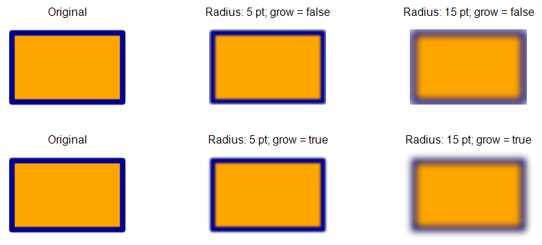

## **Bevezetés**

Miközben a PowerPoint effektusok használhatók egy alakzat kiemelésére, eltérnek a [kitöltésektől](/slides/hu/java/shape-formatting/#gradient-fill) vagy a körvonaltól. A PowerPoint effektusok segítségével meggyőző tükröződéseket hozhat létre egy alakzaton, elterjesztheti az alakzat ragyogását stb.


A PowerPoint hat effektust biztosít, amelyeket alakzatokra lehet alkalmazni. Egy vagy több effektust is alkalmazhat egy alakzatra.

Néhány effektuskombináció jobban néz ki, mint mások. Ezért a PowerPoint **Preset** opciókat kínál. Az Előre beállított lehetőségek két vagy több effektus kombinációi, amelyekről ismert, hogy jól mutatnak. Így egy előre beállítást kiválasztva nem kell időt pazarolni különböző effektusok tesztelésével vagy kombinálásával, hogy jó kombinációt találjon.

Az Aspose.Slides a [EffectFormat](https://reference.aspose.com/slides/java/com.aspose.slides/effectformat/) osztály alatt olyan tulajdonságokat és metódusokat biztosít, amelyek lehetővé teszik, hogy ugyanazokat az effektusokat alkalmazza a PowerPoint előadások alakzataira.

## **Árnyék effektus alkalmazása**

Az Aspose.Slides for Java külső és belső árnyékokat támogat alakzatokhoz. Testreszabhatja a színüket, irányukat, távolságukat és elmosódási sugarukat, hogy megfeleljenek az előadás tervezésének.

### **Külső árnyék alkalmazása**

Használjon külső árnyékot, hogy egy kártya vagy panel kiemelkedjen a dia háttérrel szemben. Az árnyék a forma széleit meghaladja, így a benyomást kelti, mintha a forma a dia fölött volna emelve. Állítsa be a színét, irányát, távolságát és elmosódási sugarát, hogy illeszkedjen a sablon megvilágításához és stílusához.

Ez a Java kód bemutatja, hogyan alkalmazhatja a [külső árnyék effektust](https://reference.aspose.com/slides/java/com.aspose.slides/effectformat/#getOuterShadowEffect--) egy téglalapra:

```java
import com.aspose.slides.*;
import java.awt.Color;

Presentation presentation = new Presentation();
try {
    ISlide slide = presentation.getSlides().get_Item(0);

    IShape shape = slide.getShapes().addAutoShape(ShapeType.RoundCornerRectangle, 20, 20, 200, 100);
    shape.getEffectFormat().enableOuterShadowEffect();
    shape.getEffectFormat().getOuterShadowEffect().getShadowColor().setColor(new Color(169, 169, 169));
    shape.getEffectFormat().getOuterShadowEffect().setDistance(10);
    shape.getEffectFormat().getOuterShadowEffect().setDirection(45);

    presentation.save("shadow_effect.pptx", SaveFormat.Pptx);
} finally {
    presentation.dispose();
}
```


### **Belső árnyék alkalmazása**

Sablon vizuális stílusának reprodukálásakor használjon belső árnyékot, hogy egy kártya vagy panel besüllyedett megjelenést kapjon. A külső árnyék a forma kívülére nyúlik és emeltnek mutatja, míg a belső árnyék a szélek belsejét árnyékolja.

Hívja meg a [enableInnerShadowEffect](https://reference.aspose.com/slides/java/com.aspose.slides/effectformat/#enableInnerShadowEffect--) metódust, majd konfigurálja a [getInnerShadowEffect](https://reference.aspose.com/slides/java/com.aspose.slides/effectformat/#getInnerShadowEffect--) által visszaadott árnyékot. A nagyobb elmosódási sugárértékek puhább széleket eredményeznek.

Ez a Java példa egy világoskék kártyát hoz létre sötétszürke belső árnyékkal, és PPTX fájlként menti. Az árnyék iránya 225 fok, távolsága 7 pont, és elmosódási sugara 6 pont:

```java
import com.aspose.slides.*;
import java.awt.Color;

Presentation presentation = new Presentation();
try {
    ISlide slide = presentation.getSlides().get_Item(0);

    IAutoShape shape = slide.getShapes().addAutoShape(ShapeType.Rectangle, 20, 20, 200, 100);
    shape.getFillFormat().setFillType(FillType.Solid);
    shape.getFillFormat().getSolidFillColor().setColor(new Color(173, 216, 230));
    shape.getLineFormat().getFillFormat().setFillType(FillType.NoFill);

    shape.getEffectFormat().enableInnerShadowEffect();
    IInnerShadow shadow = shape.getEffectFormat().getInnerShadowEffect();
    shadow.getShadowColor().setColor(new Color(105, 105, 105));
    shadow.setDirection(225);
    shadow.setDistance(7);
    shadow.setBlurRadius(6);

    presentation.save("inner_shadow_effect.pptx", SaveFormat.Pptx);
} finally {
    presentation.dispose();
}
```


A belső árnyék eltávolításához hívja meg a [disableInnerShadowEffect](https://reference.aspose.com/slides/java/com.aspose.slides/effectformat/#disableInnerShadowEffect--) metódust az alakzat effektusformátumán.

## **Tükröződés effektus alkalmazása**

A reflection (tükröződés) effektus alkalmazásához az Aspose.Slides for Java-ban hozzáadhat tükörszerű tükröződést az alakzatokhoz, beállítva olyan paramétereket, mint a távolság, átlátszóság és méret. Ez az effektus javítja az előadások esztétikáját, finomabb és kifinomultabb megjelenést kölcsönözve az alakzatoknak. Egyszerű kóddal könnyen megvalósítható, gyors alkalmazást tesz lehetővé több elemre a konzisztens tervezés érdekében.

Ez a Java kód bemutatja, hogyan alkalmazhatja a [tükröződés effektust](https://reference.aspose.com/slides/java/com.aspose.slides/effectformat/#getReflectionEffect--) egy alakzatra:

```java
import com.aspose.slides.*;

Presentation presentation = new Presentation();
try {
    ISlide slide = presentation.getSlides().get_Item(0);

    IShape shape = slide.getShapes().addAutoShape(ShapeType.RoundCornerRectangle, 20, 20, 200, 100);
    shape.getEffectFormat().enableReflectionEffect();
    shape.getEffectFormat().getReflectionEffect().setRectangleAlign(RectangleAlignment.Bottom);
    shape.getEffectFormat().getReflectionEffect().setDirection(90);
    shape.getEffectFormat().getReflectionEffect().setDistance(40);
    shape.getEffectFormat().getReflectionEffect().setBlurRadius(2);

    presentation.save("reflection_effect.pptx", SaveFormat.Pptx);
} finally {
    presentation.dispose();
}
```


## **Ragyogás effektus alkalmazása**

A ragyogás effektus alkalmazásához egy alakzatra az Aspose.Slides for Java-ban hozzáadhat egy lágy, fényes aurát az alakzatok köré, beállítva olyan tulajdonságokat, mint a szín és a méret. Ez az effektus segít kiemelni az alakzatokat, és vonzó, szemrevaló vizuális elemet ad az előadáshoz. Minimális kóddal könnyen megvalósítható, javítva a diák általános megjelenését.

Ez a Java kód bemutatja, hogyan alkalmazhatja a [ragyogás effektust](https://reference.aspose.com/slides/java/com.aspose.slides/effectformat/#getGlowEffect--) egy alakzatra:

```java
import com.aspose.slides.*;
import java.awt.Color;

Presentation presentation = new Presentation();
try {
    ISlide slide = presentation.getSlides().get_Item(0);

    IShape shape = slide.getShapes().addAutoShape(ShapeType.RoundCornerRectangle, 20, 20, 200, 100);
    shape.getEffectFormat().enableGlowEffect();
    shape.getEffectFormat().getGlowEffect().getColor().setColor(Color.MAGENTA);
    shape.getEffectFormat().getGlowEffect().setRadius(15);

    presentation.save("glow_effect.pptx", SaveFormat.Pptx);
} finally {
    presentation.dispose();
}
```


## **Lágy szélek effektus alkalmazása**

A lágy szélek effektus alkalmazásához az Aspose.Slides for Java-ban létrehozhat egy sima, elmosódott átmenetet egy alakzat szélei körül. Ez az effektus finomabb és kifinomultabb megjelenést kölcsönöz, tökéletes olyan tervekhez, amelyeknek enyhe, lágyabb megjelenésre van szükségük. Könnyen beállíthatja például a sugarat, hogy a kívánt hatást elérje különböző alakzatoknál az előadásban.

Ez a Java kód bemutatja, hogyan alkalmazhatja a [lágy szélek effektust](https://reference.aspose.com/slides/java/com.aspose.slides/effectformat/#getSoftEdgeEffect--) egy alakzatra:

```java
import com.aspose.slides.*;

Presentation presentation = new Presentation();
try {
    ISlide slide = presentation.getSlides().get_Item(0);

    IShape shape = slide.getShapes().addAutoShape(ShapeType.RoundCornerRectangle, 20, 20, 200, 150);
    shape.getEffectFormat().enableSoftEdgeEffect();
    shape.getEffectFormat().getSoftEdgeEffect().setRadius(8);

    presentation.save("soft_edges_effect.pptx", SaveFormat.Pptx);
} finally {
    presentation.dispose();
}
```


## **Elmosódás effektus alkalmazása**

Használja a forma elmosódást a forma kitöltésének és körvonalának lágyításához, miközben a forma szerkeszthető marad. Hívja meg a [setBlurEffect](https://reference.aspose.com/slides/java/com.aspose.slides/ieffectformat/#setBlurEffect-double-boolean-) metódust az alakzat effektusformátumán. A sugár pontokban van mérve (1/72 hüvelyk): használjon nem negatív értéket, a nagyobb értékek erősebb elmosódást eredményeznek. A nulla sugár változatlan megjelenést hagy.

A [getGrow](https://reference.aspose.com/slides/java/com.aspose.slides/iblur/#getGrow--) beállítás szabályozza az effektus látható határait. `false` esetén az elmosódás az eredeti festett határokra, beleértve a körvonalat, lesz vágva. `true` esetén az elmosódás kiterjeszthető ezen határokon túlra. Egyik beállítás sem módosítja az alakzat pozícióját vagy méreteit.

Az alábbi összehasonlítás ugyanazt a kitöltést, körvonalat és alakzatmérőket használja mindenhol. A felső sor `grow = false`; az alsó sor `grow = true`.



Ez a Java példa egy narancssárga téglalapot hoz létre sötétkék körvonallal, 5 pontos elmosódást alkalmaz, majd ismét a [setBlurEffect](https://reference.aspose.com/slides/java/com.aspose.slides/ieffectformat/#setBlurEffect-double-boolean-) hívásával 15 pontos elmosódásra frissíti. Mindkét elmosódott állapotot menti, majd meghívja a [disableBlurEffect](https://reference.aspose.com/slides/java/com.aspose.slides/ieffectformat/#disableBlurEffect--) metódust, és elmenti az alakzatot elmosódás nélkül.

```java
import com.aspose.slides.*;
import java.awt.Color;

Presentation presentation = new Presentation();
try {
    ISlide slide = presentation.getSlides().get_Item(0);

    IAutoShape shape = slide.getShapes().addAutoShape(ShapeType.Rectangle, 100, 80, 160, 100);
    shape.getFillFormat().setFillType(FillType.Solid);
    shape.getFillFormat().getSolidFillColor().setColor(new Color(255, 165, 0));
    shape.getLineFormat().getFillFormat().setFillType(FillType.Solid);
    shape.getLineFormat().getFillFormat().getSolidFillColor().setColor(new Color(0, 0, 139));
    shape.getLineFormat().setWidth(8);

    shape.getEffectFormat().setBlurEffect(5, false);
    presentation.save("shape_blur_5.pptx", SaveFormat.Pptx);

    shape.getEffectFormat().setBlurEffect(15, true);
    presentation.save("shape_blur_15.pptx", SaveFormat.Pptx);

    shape.getEffectFormat().disableBlurEffect();
    presentation.save("shape_blur_removed.pptx", SaveFormat.Pptx);
} finally {
    presentation.dispose();
}
```

A forma elmosódás a kitöltést és a körvonalat egyaránt érinti. A lágy szélek effektus a forma széleit halványítja, míg az árnyék elmosódás csak az árnyékot lágyítja. A képtranszformációs effektusok a kép tartalmán működnek; ez a példa közvetlenül a forma effektusformátumára alkalmaz elmosódást, anélkül, hogy a formát képpé konvertálná.

## **FAQ**

**Alkalmazhatok több effektust ugyanarra az alakzatra?**

Igen, különböző effektusokat, például árnyékot, tükröződést és ragyogást kombinálhat egyetlen alakzaton, hogy dinamikusabb megjelenést érjen el.

**Milyen alakzatokra alkalmazhatok effektusokat?**

Effektusokat különféle alakzatokra alkalmazhat, beleértve az automatikus alakzatokat, diagramokat, táblázatokat, képeket, SmartArt objektumokat, OLE objektumokat és egyebeket.

**Alkalmazhatok effektusokat csoportosított alakzatokra?**

Igen, csoportosított alakzatokra is alkalmazhat effektusokat. Az effektus a teljes csoportra lesz alkalmazva.