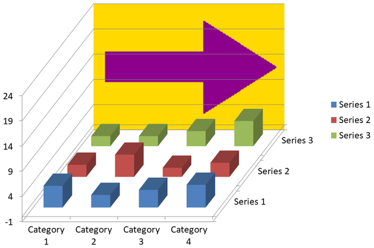

## **Áttekintés**

Az Aspose.Slides for .NET lehetővé teszi a 3D diagram nézetének testreszabását az [IChart.Rotation3D](https://reference.aspose.com/slides/net/aspose.slides.charts/ichart/rotation3d/) tulajdonsággal. Ez a cikk bemutatja, hogyan állítható be a forgatás, a magasságarányok, a mélység, a derékszögű tengelyek és a sorozatok közötti távolság, majd hogyan menthető a prezentáció PPTX formátumban.

## **A 3D diagram forgatásának és mélységének beállítása**

Az alábbi példa létrehoz egy [Presentation](https://reference.aspose.com/slides/net/aspose.slides/presentation/) és a [IShapeCollection.AddChart](https://reference.aspose.com/slides/net/aspose.slides/ishapecollection/addchart/) segítségével hozzáad egy rétegezett 3D oszlopdiagramot az első diájához. Lecseréli az alapértelmezett sorozatokat és kategóriákat két sorozatra, amelyek mindegyike három értéket tartalmaz. A munkalap indexe `0` azonosítja a diagram első adatmunkalapját; a `0`‑s sor tartalmazza a sorozatneveket, a `0`‑s oszlop pedig a kategóriacímkéket.

A [RotationX](https://reference.aspose.com/slides/net/aspose.slides.charts/irotation3d/rotationx/) és a [RotationY](https://reference.aspose.com/slides/net/aspose.slides.charts/irotation3d/rotationy/) tulajdonságok a diagram forgatását 40‑re és 270‑re fokra állítják. A [DepthPercents](https://reference.aspose.com/slides/net/aspose.slides.charts/irotation3d/depthpercents/) a mélységét a szélesség 150 %-ára állítja, míg a [RightAngleAxes](https://reference.aspose.com/slides/net/aspose.slides.charts/irotation3d/rightangleaxes/) derékszögű tengelyeket kapcsol be perspektíva helyett. Az eredményül kapott prezentáció a kitöltött diagramot tartalmazza ezekkel a 3D‑nézetbeállításokkal.

```csharp
using Aspose.Slides;
using Aspose.Slides.Charts;
using Aspose.Slides.Export;

using var presentation = new Presentation();
var slide = presentation.Slides[0];

var chart = slide.Shapes.AddChart(ChartType.StackedColumn3D, 0, 0, 500, 500);

chart.ChartData.Series.Clear();
chart.ChartData.Categories.Clear();

var workbook = chart.ChartData.ChartDataWorkbook;
var worksheetIndex = 0;

var values = new double[,] { { 20, 50, 30 }, { 30, 10, 60 } };

for (var categoryIndex = 0; categoryIndex < 3; categoryIndex++)
{
    var categoryCell = workbook.GetCell(worksheetIndex, categoryIndex + 1, 0, $"Category {categoryIndex + 1}");
    chart.ChartData.Categories.Add(categoryCell);
}

for (var seriesIndex = 0; seriesIndex < 2; seriesIndex++)
{
    var seriesCell = workbook.GetCell(worksheetIndex, 0, seriesIndex + 1, $"Series {seriesIndex + 1}");
    var series = chart.ChartData.Series.Add(seriesCell, chart.Type);

    for (var categoryIndex = 0; categoryIndex < 3; categoryIndex++)
    {
        var valueCell = workbook.GetCell(worksheetIndex, categoryIndex + 1, seriesIndex + 1, values[seriesIndex, categoryIndex]);
        series.DataPoints.AddDataPointForBarSeries(valueCell);
    }
}

chart.Rotation3D.RightAngleAxes = true;
chart.Rotation3D.RotationX = 40;
chart.Rotation3D.RotationY = 270;
chart.Rotation3D.DepthPercents = 150;

presentation.Save("Rotation3D_out.pptx", SaveFormat.Pptx);
```

## **Képtöltés alkalmazása egy 3D diagram felületére**

Egy 3D diagram három felülettel rendelkezik, amelyeket függetlenül tölthetünk ki: a [side wall](https://reference.aspose.com/slides/net/aspose.slides.charts/ichart/sidewall/), a [back wall](https://reference.aspose.com/slides/net/aspose.slides.charts/ichart/backwall/) és a [floor](https://reference.aspose.com/slides/net/aspose.slides.charts/ichart/floor/). Állítsa a kiválasztott felület [fill type](https://reference.aspose.com/slides/net/aspose.slides/ifillformat/filltype/) tulajdonságát `Picture`‑ra, és rendelje hozzá a képet. Állítsa mind a [picture fill mode](https://reference.aspose.com/slides/net/aspose.slides/ipicturefillformat/picturefillmode/)‑t, mind a felület [picture type](https://reference.aspose.com/slides/net/aspose.slides.charts/ichartwall/picturetype/)‑t `Stretch`‑re, hogy a kép egy példánya kitöltse a felületet.

Mentse el az [arrow.png](arrow.png) fájlt a munkakönyvtárba. A példa elforgatja a diagramot, és növeli a függőleges tengely maximális értékét, hogy a padló látható legyen az oszlopok között. Ezután kétszer klónozza a diát, mielőtt az nyilat különböző felületeken helyezné el. Mindhárom diagram ugyanolyan adatot, nézeti szöget és hátteret tartalmaz.

```csharp
using System.IO;
using Aspose.Slides;
using Aspose.Slides.Charts;
using Aspose.Slides.Export;

using var presentation = new Presentation();
var slide = presentation.Slides[0];

var chart = slide.Shapes.AddChart(ChartType.Column3D, 20, 30, 680, 480);
chart.Rotation3D.RightAngleAxes = true;
chart.Rotation3D.RotationX = 40;
chart.Rotation3D.RotationY = 30;
chart.Axes.VerticalAxis.IsAutomaticMaxValue = false;
chart.Axes.VerticalAxis.MaxValue = 24;

var backSlide = presentation.Slides.AddClone(slide);
var floorSlide = presentation.Slides.AddClone(slide);
var backChart = (IChart)backSlide.Shapes[0];
var floorChart = (IChart)floorSlide.Shapes[0];

var imageBytes = File.ReadAllBytes("arrow.png");
var arrow = presentation.Images.AddImage(imageBytes);

foreach (var surface in new[] { chart.SideWall, backChart.BackWall, floorChart.Floor })
{
    var fill = surface.Format.Fill;
    fill.FillType = FillType.Picture;
    fill.PictureFillFormat.Picture.Image = arrow;
    fill.PictureFillFormat.PictureFillMode = PictureFillMode.Stretch;
    surface.PictureType = PictureType.Stretch;
}

presentation.Save("chart-surfaces.pptx", SaveFormat.Pptx);
```

A Microsoft PowerPoint a három diát az alábbi módon jeleníti meg.

| Oldalfal | Hátfal | Alap |
| --- | --- | --- |
|  |  |  |

## **A 3D diagram magasságarányainak módosítása**

Használja a [IRotation3D.HeightPercents](https://reference.aspose.com/slides/net/aspose.slides.charts/irotation3d/heightpercents/) tulajdonságot, hogy a 3D diagram magasságát a szélesség százalékában adja meg. Ez megváltoztatja a 3D jelenet arányait anélkül, hogy átméretezné a diagram objektumot a dián.

A következő példa egy [Column3D](https://reference.aspose.com/slides/net/aspose.slides.charts/charttype/) diagramot hoz létre az alapértelmezett adatokkal: három sorozat és négy kategória. Három prezentációt ment 50 %, 100 % és 200 % magasságarányokkal. A diagram pozíciója, szélessége és magassága változatlan marad. Az adatok, a forgatás, a mélység, a sorozatok távolsága és a formázás minden fájlban azonos; csak a magasság százalékos értéke változik.

```csharp
using Aspose.Slides;
using Aspose.Slides.Charts;
using Aspose.Slides.Export;

using var presentation = new Presentation();
var slide = presentation.Slides[0];

var chart = slide.Shapes.AddChart(ChartType.Column3D, 40, 30, 620, 460);
chart.Rotation3D.RotationX = 20;
chart.Rotation3D.RotationY = 30;
chart.Rotation3D.RightAngleAxes = true;
chart.Rotation3D.DepthPercents = 100;
chart.ChartData.Series[0].ParentSeriesGroup.GapDepth = 150;

foreach (ushort heightPercent in new ushort[] { 50, 100, 200 })
{
    chart.Rotation3D.HeightPercents = heightPercent;
    presentation.Save($"chart_height_{heightPercent}.pptx", SaveFormat.Pptx);
}
```

Az alábbi képeket a generált prezentációkból exportálta a Microsoft PowerPoint. A kisebb százalék laposabb jelenetet eredményez, míg a nagyobb százalék magasabb jelenetet a diagram objektumon belül. A PowerPoint akár a tengelyjelölők intervallumát és a címkék elhelyezését is módosíthatja a jelenethez igazodva.

| Magasság: 50% | Magasság: 100% | Magasság: 200% |
| --- | --- | --- |
|  |  |  |

| Tulajdonság | Hatás |
| --- | --- |
| [IRotation3D.HeightPercents](https://reference.aspose.com/slides/net/aspose.slides.charts/irotation3d/heightpercents/) | A 3D jelenet magassága a szélességének százalékában. |
| [IChart.Height](https://reference.aspose.com/slides/net/aspose.slides/ishape/height/) | A diagram objektum magassága a dián, pontokban. |
| [IRotation3D.DepthPercents](https://reference.aspose.com/slides/net/aspose.slides.charts/irotation3d/depthpercents/) | A 3D jelenet mélysége a szélességének százalékában. |
| [IChartSeriesGroup.GapDepth](https://reference.aspose.com/slides/net/aspose.slides.charts/ichartseriesgroup/gapdepth/) | A sorozatok közötti távolság a mélységi tengelyen, a jelölő szélességének százalékában. |

A magasságbeállítás hatással van a 3D oszlop- és sávdiagramokra, beleértve a henger, kúp és piramis változatokat, valamint a 3D vonal-, terület-, kör- és felületdiagramokra. A fenti összehasonlítás a hitelesített `Column3D` típust használja. A beállítás nem változtatja meg a 2D `ClusteredColumn` vagy a `BubbleWith3D` diagram megjelenését; ezek a nevek a [ChartType](https://reference.aspose.com/slides/net/aspose.slides.charts/charttype/) felsorolás elemei. Egyéb diagramformázási beállításokért lásd a [Chart Formatting](/slides/hu/net/chart-formatting/) cikket.

## **A sorozatok közötti hézag módosítása**

Használja a [IChartSeriesGroup.GapDepth](https://reference.aspose.com/slides/net/aspose.slides.charts/ichartseriesgroup/gapdepth/) tulajdonságot a 3D diagram adat-sorozatai közötti távolság szabályozására a mélységi tengely mentén, a jelölő szélességének százalékában kifejezve. Használjon **0‑tól 500‑ig** terjedő értékeket, beleértve a 0‑t: `0` eltávolítja a hézagot, a nagyobb értékek pedig növelik a távolságot. Fix diagrammélység esetén a hézag növelése a jelölőket vékonyabbá teszi a mélységi tengelyen.

A csoportot a [IChartSeries.ParentSeriesGroup](https://reference.aspose.com/slides/net/aspose.slides.charts/ichartseries/parentseriesgroup/) segítségével érheti el. A beállítás a csoport minden sorozatára vonatkozik, nem csak arra, amelyiken keresztül elérte. Az [IChartSeries.GapDepth](https://reference.aspose.com/slides/net/aspose.slides.charts/ichartseries/gapdepth/) csak olvasható, és a szülőcsoport beállítását tükrözi.

Ez a beállítás hatással van a 3D oszlop- és sávdiagramokra, beleértve henger, kúp és piramis változataikat, valamint a 3D vonal‑ és területdiagramokra. A megjelenés attól függ, hogy a sorozatok mélységben, csoportosítva vagy rétegezve vannak-e. A sorozatok közötti hézagok világos összehasonlításához használja a `ChartType.Column3D` típust a [ChartType](https://reference.aspose.com/slides/net/aspose.slides.charts/charttype/) felsorolásból.

| Tulajdonság | Hatás |
| --- | --- |
| [IChartSeriesGroup.GapDepth](https://reference.aspose.com/slides/net/aspose.slides.charts/ichartseriesgroup/gapdepth/) | A sorozatok közötti távolság a mélységi tengelyen, a jelölő szélességének százalékában. |
| [IChartSeriesGroup.GapWidth](https://reference.aspose.com/slides/net/aspose.slides.charts/ichartseriesgroup/gapwidth/) | A szomszédos sáv‑ vagy oszlopklaszterek közötti távolság, a sáv vagy oszlop szélességének százalékában. |
| [IRotation3D.DepthPercents](https://reference.aspose.com/slides/net/aspose.slides.charts/irotation3d/depthpercents/) | A diagram teljes mélysége, a diagram szélességének százalékában. |

```csharp
using Aspose.Slides;
using Aspose.Slides.Charts;
using Aspose.Slides.Export;

using var presentation = new Presentation();
var slide = presentation.Slides[0];

var chart = slide.Shapes.AddChart(ChartType.Column3D, 40, 30, 620, 230);

chart.Rotation3D.RotationX = 20;
chart.Rotation3D.RotationY = 30;
chart.Rotation3D.DepthPercents = 100;

var series = chart.ChartData.Series[0];
var group = series.ParentSeriesGroup;
group.GapWidth = 150;

foreach (ushort gapDepth in new ushort[] { 0, 500 })
{
    group.GapDepth = gapDepth;

    var fileName = $"series_gap_depth_{gapDepth}.pptx";
    presentation.Save(fileName, SaveFormat.Pptx);

}
```

Az alábbi képeket a generált prezentációkból exportálta a Microsoft PowerPoint.

| Hézag mélység: 0% | Hézag mélység: 500% |
| --- | --- |
|  |  |

## **A 3D sorozattípus és a sávforma módosítása**

Egy csoportosított henger diagram első sorozata henger alakú sávval indul. A példa a [IChartSeries.Type](https://reference.aspose.com/slides/net/aspose.slides.charts/ichartseries/type/) és a [IChartSeries.Bar3DShape](https://reference.aspose.com/slides/net/aspose.slides.charts/ichartseries/bar3dshape/) értékét olvassa minden módosítás előtt és után.

```cs
using System;
using Aspose.Slides;
using Aspose.Slides.Charts;
using Aspose.Slides.Export;

using var presentation = new Presentation();
var slide = presentation.Slides[0];

var chart = slide.Shapes.AddChart(ChartType.ClusteredCylinder, 20, 20, 500, 300);
var series = chart.ChartData.Series[0];

Console.WriteLine($"{series.Type} | {series.Bar3DShape}");

series.Type = ChartType.ClusteredCone;
Console.WriteLine($"{series.Type} | {series.Bar3DShape}");

series.Bar3DShape = ChartShapeType.Box;
Console.WriteLine($"{series.Type} | {series.Bar3DShape}");

presentation.Save("series_shape.pptx", SaveFormat.Pptx);
```

| Módosítás az első sorozatra | `Type` | `Bar3DShape` |
| --- | --- | --- |
| Diagram létrehozása | `ClusteredCylinder` | `Cylinder` |
| Állítsa a `Type`‑t `ClusteredCone`‑ra | `ClusteredCone` | `Cone` |
| Állítsa a `Bar3DShape`‑t `Box`‑ra | `ClusteredColumn3D` | `Box` |

A sávforma `Box`‑ra állítása szintén a sorozattípust `ClusteredColumn3D`‑ra változtatja. Ha a kód a sorozattípus alapján ágazik, olvassa a `series.Type`‑t a forma módosítása után. A hozzárendelés előtt tárolt érték továbbra is a `ClusteredCone` ágat választhatja.


## **GYIK**

**Mely diagramtípusok támogatják a 3D módot az Aspose.Slides‑ben?**

Az Aspose.Slides támogatja a 3D változatokat az oszlopdiagramoknál, beleértve a Column 3D, Clustered Column 3D, Stacked Column 3D és 100 % Stacked Column 3D típusokat, valamint a kapcsolódó 3D típusokat, amelyeket a [ChartType](https://reference.aspose.com/slides/net/aspose.slides.charts/charttype/) felsorolás definiál. A pontos, naprakész lista megtekinthető a telepített verzió API‑referenciájában a [ChartType](https://reference.aspose.com/slides/net/aspose.slides.charts/charttype/) elemei között.

**Kaphatok raszteres képet egy 3D diagramról jelentéshez vagy a webhez?**

Igen. A diagramot exportálhatja képként a [Shape.GetImage](https://reference.aspose.com/slides/net/aspose.slides/shape/getimage/) vagy a teljes dia [renderelése](/slides/hu/net/convert-powerpoint-to-png/) PNG vagy JPEG formátumba. Ez akkor hasznos, ha raszteres előnézetre van szükség, vagy be szeretné ágyazni a diagramot dokumentumokba, irányítópultokra vagy weboldalakra anélkül, hogy a PowerPointot igényelné.

**Mennyire magas a teljesítmény nagy 3D diagramok építése és renderelése esetén?**

A teljesítmény az adatmennyiségtől és a vizuális komplexitástól függ. A legjobb eredmény érdekében tartsa a 3D‑effekteket minimális szinten, kerüljön el nehéz textúrákat a falakon és a plot területeken, korlátozza a sorozatonkénti adatpontok számát, amennyiben lehetséges, és rendereljen a célnak megfelelő felbontású és méretű kimenetre, hogy megfeleljen a megjelenítési vagy nyomtatási igényeknek.