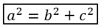

## **Áttekintés**

A PowerPoint a képleteket Office Math Markup Language (OMML) formátumban tárolja. Az Aspose.Slides for .NET segítségével programozottan létrehozhatja ugyanazt a típusú matematikai tartalmat: törtöket, gyököket, függvényeket, határokat, N-áramú operátorokat, mátrixokat, tömböket és formázott matematikai blokkokat.

PowerPointban a felhasználók általában a **Insert > Equation** menüpontból adnak hozzá képleteket:


Az eredmény egy szerkeszthető matematikai szöveg a dián:


Aspose.Slides három fő objektumon keresztül építi fel ezt a matematikai szöveget:

- A matematikai alakzat, amelyet a [AddMathShape](https://reference.aspose.com/slides/net/aspose.slides/ishapecollection/addmathshape/) létrehoz, az az alakzat, amely a képletet tartalmazza.
- [MathPortion](https://reference.aspose.com/slides/net/aspose.slides.mathtext/mathportion/) a matematikai tartalmat tárolja az alakzat szövegkeretén belül.
- [MathParagraph](https://reference.aspose.com/slides/net/aspose.slides.mathtext/mathparagraph/) egy vagy több [MathBlock](https://reference.aspose.com/slides/net/aspose.slides.mathtext/mathblock/) objektumot tartalmaz.

A legtöbb alábbi példa a [MathematicalText](https://reference.aspose.com/slides/net/aspose.slides.mathtext/mathematicaltext/) és az [IMathElement](https://reference.aspose.com/slides/net/aspose.slides.mathtext/imathelement/) folyékony metódusait használja a kód rövid és olvasható tartásához.

MathML export esetén lásd a [Matematikai egyenletek exportálása prezentációkból .NET-ben](/slides/hu/net/exporting-math-equations/).

## **Egyenlet létrehozása**

Ez a példa a [AddMathShape](https://reference.aspose.com/slides/net/aspose.slides/ishapecollection/addmathshape/) használatával hoz létre egy matematikai alakzatot, és hozzáadja a Pitagorasz tételt:


```csharp
using Aspose.Slides;
using Aspose.Slides.Export;
using Aspose.Slides.MathText;

using var presentation = new Presentation();
var slide = presentation.Slides[0];

var mathShape = slide.Shapes.AddMathShape(20, 20, 700, 120);
var mathParagraph = ((MathPortion)mathShape.TextFrame.Paragraphs[0].Portions[0]).MathParagraph;

var equation = new MathematicalText("c")
    .SetSuperscript("2")
    .Join("=")
    .Join(new MathematicalText("a").SetSuperscript("2"))
    .Join("+")
    .Join(new MathematicalText("b").SetSuperscript("2"));

mathParagraph.Add(equation);

presentation.Save("pythagorean-theorem.pptx", SaveFormat.Pptx);
```

{}
[AddMathShape](https://reference.aspose.com/slides/net/aspose.slides/ishapecollection/addmathshape/) egy olyan alakzatot hoz létre, amely már tartalmaz egy matematikai bekezdést. Elérhető az első [MathPortion](https://reference.aspose.com/slides/net/aspose.slides.mathtext/mathportion/), lekérhető annak [MathParagraph](https://reference.aspose.com/slides/net/aspose.slides.mathtext/mathportion/mathparagraph/), majd hozzáadhatók matematikai blokkok vagy elemek.
{}

## **Törtök hozzáadása**

A [Divide](https://reference.aspose.com/slides/net/aspose.slides.mathtext/imathelement/divide/) használatával hozhat létre törtet. A tört stílusát a [MathFractionTypes](https://reference.aspose.com/slides/net/aspose.slides.mathtext/mathfractiontypes/) segítségével választhatja ki.


```csharp
using Aspose.Slides;
using Aspose.Slides.Export;
using Aspose.Slides.MathText;

using var presentation = new Presentation();
var slide = presentation.Slides[0];

var mathShape = slide.Shapes.AddMathShape(20, 20, 700, 100);
var mathParagraph = ((MathPortion)mathShape.TextFrame.Paragraphs[0].Portions[0]).MathParagraph;

var fraction = new MathematicalText("1")
    .Divide("x", MathFractionTypes.Skewed);

mathParagraph.Add(new MathBlock(fraction));

presentation.Save("fraction.pptx", SaveFormat.Pptx);
```

Egy vízszintes vonalas tört (stacked) létrehozásához használja a [MathFractionTypes.Bar](https://reference.aspose.com/slides/net/aspose.slides.mathtext/mathfractiontypes/)‑t:

```csharp
using Aspose.Slides.MathText;

var stackedFraction = new MathematicalText("x + 1").Divide("y - 1", MathFractionTypes.Bar);
```

## **Gyökök hozzáadása**

A [Radical](https://reference.aspose.com/slides/net/aspose.slides.mathtext/imathelement/radical/) használatával hozhat létre négyzetgyököt, köbgyököt vagy más gyököt. A jelenlegi elem lesz az alap, az argumentum pedig a kitevő.


```csharp
using Aspose.Slides;
using Aspose.Slides.Export;
using Aspose.Slides.MathText;

using var presentation = new Presentation();
var slide = presentation.Slides[0];

var mathShape = slide.Shapes.AddMathShape(20, 20, 700, 100);
var mathParagraph = ((MathPortion)mathShape.TextFrame.Paragraphs[0].Portions[0]).MathParagraph;

var radical = new MathematicalText("x")
    .Radical("n");

mathParagraph.Add(new MathBlock(radical));

presentation.Save("radical.pptx", SaveFormat.Pptx);
```

## **Függvények és határok hozzáadása**

A [AsArgumentOfFunction](https://reference.aspose.com/slides/net/aspose.slides.mathtext/imathelement/asargumentoffunction/) vagy [Function](https://reference.aspose.com/slides/net/aspose.slides.mathtext/imathelement/function/) használható olyan függvényekhez, mint a `sin(x)`, `log(x)`, vagy egyedi függvénynevek. Határok esetén a `lim`‑et helyezze egy [MathLimit](https://reference.aspose.com/slides/net/aspose.slides.mathtext/mathlimit/) elembe, vagy használja a [SetLowerLimit](https://reference.aspose.com/slides/net/aspose.slides.mathtext/imathelement/setlowerlimit/).


```csharp
using Aspose.Slides;
using Aspose.Slides.Export;
using Aspose.Slides.MathText;

using var presentation = new Presentation();
var slide = presentation.Slides[0];

var mathShape = slide.Shapes.AddMathShape(20, 20, 700, 100);
var mathParagraph = ((MathPortion)mathShape.TextFrame.Paragraphs[0].Portions[0]).MathParagraph;

var limit = new MathematicalText("lim")
    .SetLowerLimit("x→∞")
    .Function("x");

mathParagraph.Add(new MathBlock(limit));

presentation.Save("functions-and-limits.pptx", SaveFormat.Pptx);
```

Egy egyedi függvény névhez tegye a függvény nevet a jelenlegi elemmé, és hívja meg a [Function](https://reference.aspose.com/slides/net/aspose.slides.mathtext/imathelement/function/) a argumentummal:

```csharp
using Aspose.Slides.MathText;

var customFunction = new MathematicalText("f").Function("x + 1");
```

## **N-áramú operátorok és integrálok hozzáadása**

A [Nary](https://reference.aspose.com/slides/net/aspose.slides.mathtext/imathelement/nary/) a összegekre, uniókra, metszetekre és egyéb nagy operátorokra használható. Az [Integral](https://reference.aspose.com/slides/net/aspose.slides.mathtext/imathelement/integral/) integrálokhoz. Mindkét metódus lehetővé teszi a felső és alsó határok beállítását.


```csharp
using Aspose.Slides;
using Aspose.Slides.Export;
using Aspose.Slides.MathText;

using var presentation = new Presentation();
var slide = presentation.Slides[0];

var mathShape = slide.Shapes.AddMathShape(20, 20, 700, 120);
var mathParagraph = ((MathPortion)mathShape.TextFrame.Paragraphs[0].Portions[0]).MathParagraph;

var summationBase = new MathematicalText("x")
    .SetSuperscript("k")
    .Join(new MathematicalText("a").SetSuperscript("n-k"));

var summation = summationBase.Nary(MathNaryOperatorTypes.Summation, "k=0", "n");

mathParagraph.Add(new MathBlock(summation));

presentation.Save("nary-operators.pptx", SaveFormat.Pptx);
```

Az N-áramú operátorok nagy operátorok opcionális határokkal. Az egyszerű operátorok, mint a `+`, `-`, és `=` általában [MathematicalText](https://reference.aspose.com/slides/net/aspose.slides.mathtext/mathematicaltext/)‑ként kerülnek hozzáadásra, és a kifejezésbe illesztésre.

Integrálhoz használja a [Integral](https://reference.aspose.com/slides/net/aspose.slides.mathtext/imathelement/integral/)-t:

```csharp
using Aspose.Slides.MathText;

var integralBase = new MathematicalText("x").Join(new MathematicalText("dx").ToBox());
var integral = integralBase.Integral(MathIntegralTypes.Simple, "0", "1");
```

## **Mátrixok hozzáadása**

A [MathMatrix](https://reference.aspose.com/slides/net/aspose.slides.mathtext/mathmatrix/) a sorok és oszlopok kezelésére szolgál. A mátrixok alapértelmezés szerint nem tartalmaznak zárójeleket, ezért ha zárójelek, szögletes vagy kapcsos zárójelek szükségesek, a mátrixot kell körülvenni.


```csharp
using Aspose.Slides;
using Aspose.Slides.Export;
using Aspose.Slides.MathText;

using var presentation = new Presentation();
var slide = presentation.Slides[0];

var mathShape = slide.Shapes.AddMathShape(20, 20, 700, 120);
var mathParagraph = ((MathPortion)mathShape.TextFrame.Paragraphs[0].Portions[0]).MathParagraph;

var matrix = new MathMatrix(2, 3);
matrix[0, 0] = new MathematicalText("1");
matrix[0, 1] = new MathematicalText("x");
matrix[1, 0] = new MathematicalText("x");
matrix[1, 1] = new MathematicalText("2");
matrix[1, 2] = new MathematicalText("y");

mathParagraph.Add(new MathBlock(matrix));

presentation.Save("matrix.pptx", SaveFormat.Pptx);
```

## **Egyenlet tömbök hozzáadása**

Használja a [ToMathArray](https://reference.aspose.com/slides/net/aspose.slides.mathtext/imathelement/tomatharray/)‑t, ha igazított egyenletekre vagy függőleges kifejezések sorozatára van szükség.


```csharp
using Aspose.Slides;
using Aspose.Slides.Export;
using Aspose.Slides.MathText;

using var presentation = new Presentation();
var slide = presentation.Slides[0];

var mathShape = slide.Shapes.AddMathShape(20, 20, 700, 140);
var mathParagraph = ((MathPortion)mathShape.TextFrame.Paragraphs[0].Portions[0]).MathParagraph;

var equationArray = new MathematicalText("x")
    .Join("y")
    .ToMathArray();

mathParagraph.Add(new MathBlock(equationArray));

presentation.Save("equation-array.pptx", SaveFormat.Pptx);
```

## **Trigonometrikus függvények hozzáadása**

Használja a [AsArgumentOfFunction](https://reference.aspose.com/slides/net/aspose.slides.mathtext/imathelement/asargumentoffunction/)‑t, ha az argumentum a jelenlegi elem, és a függvény neve ismert.


```csharp
using Aspose.Slides;
using Aspose.Slides.Export;
using Aspose.Slides.MathText;

using var presentation = new Presentation();
var slide = presentation.Slides[0];

var mathShape = slide.Shapes.AddMathShape(20, 20, 700, 100);
var mathParagraph = ((MathPortion)mathShape.TextFrame.Paragraphs[0].Portions[0]).MathParagraph;

var cosine = new MathematicalText("2x")
    .AsArgumentOfFunction(MathFunctionsOfOneArgument.Cos);

mathParagraph.Add(new MathBlock(cosine));

presentation.Save("trigonometric-function.pptx", SaveFormat.Pptx);
```

## **Alsó- és felső indexek hozzáadása**

Az alsó- és felső indexekhez használja a megfelelő segédfüggvényeket. Ha az indexeknek a bázis bal oldalán kell megjelenniük, használja a [SetSubSuperscriptOnTheLeft](https://reference.aspose.com/slides/net/aspose.slides.mathtext/imathelement/setsubsuperscriptontheleft/)‑t.


```csharp
using Aspose.Slides;
using Aspose.Slides.Export;
using Aspose.Slides.MathText;

using var presentation = new Presentation();
var slide = presentation.Slides[0];

var mathShape = slide.Shapes.AddMathShape(20, 20, 700, 100);
var mathParagraph = ((MathPortion)mathShape.TextFrame.Paragraphs[0].Portions[0]).MathParagraph;

var scripts = new MathematicalText("Y")
    .SetSubSuperscriptOnTheLeft("1", "n");

mathParagraph.Add(new MathBlock(scripts));

presentation.Save("subscript-superscript.pptx", SaveFormat.Pptx);
```

## **Elválasztók (delimiterek) hozzáadása**

A [Enclose](https://reference.aspose.com/slides/net/aspose.slides.mathtext/imathelement/enclose/) használatával helyezhet kifejezést elválasztók közé. A több elemet tartalmazó elválasztókhoz beállíthat elválasztó karaktert is.


```csharp
using Aspose.Slides;
using Aspose.Slides.Export;
using Aspose.Slides.MathText;

using var presentation = new Presentation();
var slide = presentation.Slides[0];

var mathShape = slide.Shapes.AddMathShape(20, 20, 700, 100);
var mathParagraph = ((MathPortion)mathShape.TextFrame.Paragraphs[0].Portions[0]).MathParagraph;

var delimiter = new MathematicalText("x")
    .Join("y")
    .Join("z")
    .Enclose('<', '>');
delimiter.SeparatorCharacter = '|';

mathParagraph.Add(new MathBlock(delimiter));

presentation.Save("delimiters.pptx", SaveFormat.Pptx);
```

### **Elválasztók mérete és igazítása**

A [GrowToMatchOperandHeight](https://reference.aspose.com/slides/net/aspose.slides.mathtext/imathdelimiter/growtomatchoperandheight/) `true` értékre állításával a zárójelek a magas operandus köré növekednek, `false` értékre állításával a normál méretük marad. A [DelimiterShape](https://reference.aspose.com/slides/net/aspose.slides.mathtext/imathdelimiter/delimitershape/) a [MathDelimiterShape](https://reference.aspose.com/slides/net/aspose.slides.mathtext/mathdelimitershape/) két értékének egyét veszi fel. A `Centered` középre helyezi a zárójeleket a matematikai tengelyen, amely az egyenlőség jel középvonalán halad. A `Match` a zárójeleket a tartalomhoz igazítja. Mindkét beállítás csak a zárójeleket érinti. A kifejezés belseje változatlan marad.

A példa egy törtet helyez az `x` kitevőjébe, így a kifejezés a vonal felett tovább nyúlik, mint alatta. Mind a négy egyenlet ugyanazokat a zárójeleket és betűtípus-beállításokat használja.

```csharp
using Aspose.Slides;
using Aspose.Slides.Export;
using Aspose.Slides.MathText;

using var presentation = new Presentation();
var slide = presentation.Slides[0];

void AddExpression(float left, float top, bool grow, MathDelimiterShape shape)
{
    var fraction = new MathematicalText("a + b").Divide("c + d");
    var power = new MathematicalText("x").SetSuperscript(fraction);
    var delimiter = power.Enclose('(', ')');
    delimiter.GrowToMatchOperandHeight = grow;
    delimiter.DelimiterShape = shape;

    var mathShape = slide.Shapes.AddMathShape(left, top, 300, 100);
    var portion = (MathPortion)mathShape.TextFrame.Paragraphs[0].Portions[0];
    portion.PortionFormat.FontHeight = 32;
    var equation = new MathematicalText("y = ").Join(delimiter);
    portion.MathParagraph.Add(equation);
}

AddExpression(20, 20, true, MathDelimiterShape.Centered);
AddExpression(350, 20, true, MathDelimiterShape.Match);
AddExpression(20, 140, false, MathDelimiterShape.Centered);
AddExpression(350, 140, false, MathDelimiterShape.Match);

presentation.Save("delimiter-sizing.pptx", SaveFormat.Pptx);
```

PowerPointban hasonlítsa össze a sorokat a növekedés hatásának megtekintéséhez. A felső sorban a zárójelek növekednek, hogy befoglalják a kitevőt, és mindkét alakzatra ugyanúgy néznek ki. Az alsó sorban a növekedés ki van kapcsolva. A bal oldali kisebb zárójelek (`Centered`) az egyenlőség jelhez igazodnak, míg a jobb oldali (`Match`) magasabban helyezkednek el a kifejezés körül.


## **Keret doboz hozzáadása**

A [ToBorderBox](https://reference.aspose.com/slides/net/aspose.slides.mathtext/imathelement/toborderbox/) használata akkor ajánlott, ha magát az egyenletet keretbe szeretnénk helyezni.



```csharp
using Aspose.Slides;
using Aspose.Slides.Export;
using Aspose.Slides.MathText;

using var presentation = new Presentation();
var slide = presentation.Slides[0];

var mathShape = slide.Shapes.AddMathShape(20, 20, 700, 100);
var mathParagraph = ((MathPortion)mathShape.TextFrame.Paragraphs[0].Portions[0]).MathParagraph;

var boxedEquation = new MathematicalText("a")
    .SetSuperscript("2")
    .Join("=")
    .Join(new MathematicalText("b").SetSuperscript("2"))
    .Join("+")
    .Join(new MathematicalText("c").SetSuperscript("2"))
    .ToBorderBox();

mathParagraph.Add(new MathBlock(boxedEquation));

presentation.Save("border-box.pptx", SaveFormat.Pptx);
```

## **Tagok csoportosítása**

A [Group](https://reference.aspose.com/slides/net/aspose.slides.mathtext/imathelement/group/) használatával csoportosító karaktert helyezhet kifejezés fölé vagy alá. Hozzáadhat egy határt, amely címkézi a csoportosított tagokat.


```csharp
using Aspose.Slides;
using Aspose.Slides.Export;
using Aspose.Slides.MathText;

using var presentation = new Presentation();
var slide = presentation.Slides[0];

var mathShape = slide.Shapes.AddMathShape(20, 20, 700, 120);
var mathParagraph = ((MathPortion)mathShape.TextFrame.Paragraphs[0].Portions[0]).MathParagraph;

var grouped = new MathematicalText("x + y")
    .Group('\u23DF', MathTopBotPositions.Bottom, MathTopBotPositions.Top)
    .SetLowerLimit("any text");

mathParagraph.Add(new MathBlock(grouped));

presentation.Save("grouped-terms.pptx", SaveFormat.Pptx);
```

## **Matematikai elemek formázása**

Használjon formázó segédfüggvényeket csak ott, ahol a képletet egyértelművé teszik. Például a [Overbar](https://reference.aspose.com/slides/net/aspose.slides.mathtext/imathelement/overbar/) egy vonalat helyez egy matematikai elem fölé.


```csharp
using Aspose.Slides;
using Aspose.Slides.Export;
using Aspose.Slides.MathText;

using var presentation = new Presentation();
var slide = presentation.Slides[0];

var mathShape = slide.Shapes.AddMathShape(20, 20, 700, 100);
var mathParagraph = ((MathPortion)mathShape.TextFrame.Paragraphs[0].Portions[0]).MathParagraph;

var overbar = new MathematicalText("ABC").Overbar();

mathParagraph.Add(new MathBlock(overbar));

presentation.Save("overbar.pptx", SaveFormat.Pptx);
```

### **Szöveg formázása meglévő egyenletben**

A szöveg formázásához egy létező egyenletben, járja végig minden matematikai blokk elemfáját. Az [IMathElement.GetChildren](https://reference.aspose.com/slides/net/aspose.slides.mathtext/imathelement/getchildren/) csak közvetlen gyermekeket ad vissza, ezért rekurzívan hívja meg, hogy elérje a tört, index, gyök és egyéb beágyazott struktúrák szövegét. Ellenőrizze a jelenlegi elemet és gyermekeit, hogy a kezdő elemet is belefoglalja, ha az [MathematicalText](https://reference.aspose.com/slides/net/aspose.slides.mathtext/mathematicaltext/)‑ként van jelen.

Ez a példa azt feltételezi, hogy egy bemutató tartalmaz egy olyan egyenletet, mint `z = xᵢ / ∛y`, ahol a tört számlálója alsó indexet, a nevezője pedig gyököt tartalmaz. Ha csak a blokk felső szintű elemeit dolgozzuk fel, a tört belsejében lévő szöveget figyelmen kívül hagyjuk. A példa megtalálja a matematikai részeket a diák szövegkereteiben, hozzáfér a blokkokhoz az [IMathPortion.MathParagraph](https://reference.aspose.com/slides/net/aspose.slides.mathtext/imathportion/mathparagraph/) segítségével, és minden szövegelemen keresztül a [FontHeight](https://reference.aspose.com/slides/net/aspose.slides/baseportionformat/fontheight/) 28 pontra állítja a [Format](https://reference.aspose.com/slides/net/aspose.slides.mathtext/mathematicaltext/format/) tulajdonságban.

```csharp
using Aspose.Slides;
using Aspose.Slides.Export;
using Aspose.Slides.MathText;

using var presentation = new Presentation("input.pptx");

foreach (var slide in presentation.Slides)
{
    foreach (var shape in slide.Shapes)
    {
        if (shape is not IAutoShape autoShape || autoShape.TextFrame == null)
            continue;

        foreach (var paragraph in autoShape.TextFrame.Paragraphs)
        {
            foreach (var portion in paragraph.Portions)
            {
                if (portion is IMathPortion mathPortion)
                {
                    foreach (var block in mathPortion.MathParagraph)
                        FormatMathText(block);
                }
            }
        }
    }
}

presentation.Save("formatted-equations.pptx", SaveFormat.Pptx);

void FormatMathText(IMathElement element)
{
    if (element is MathematicalText text)
        text.Format.FontHeight = 28;

    foreach (var child in element.GetChildren())
        FormatMathText(child);
}
```

A mentett prezentáció minden szintjén tartalmazza a frissített szövegformázást a feldolgozott egyenletekben, miközben megőrzi a szöveg tartalmát és a matematikai struktúrát.

## **Gyors referenciaként**

| Feladat | Fő API |
| --- | --- |
| Matematikai szöveg létrehozása | [MathematicalText](https://reference.aspose.com/slides/net/aspose.slides.mathtext/mathematicaltext/) |
| Elemek kombinálása | [IMathElement.Join](https://reference.aspose.com/slides/net/aspose.slides.mathtext/imathelement/join/) |
| Törtök létrehozása | [IMathElement.Divide](https://reference.aspose.com/slides/net/aspose.slides.mathtext/imathelement/divide/) |
| Felső- vagy alsó index hozzáadása | [SetSuperscript](https://reference.aspose.com/slides/net/aspose.slides.mathtext/imathelement/setsuperscript/), [SetSubscript](https://reference.aspose.com/slides/net/aspose.slides.mathtext/imathelement/setsubscript/) |
| Függvények hozzáadása | [Function](https://reference.aspose.com/slides/net/aspose.slides.mathtext/imathelement/function/), [AsArgumentOfFunction](https://reference.aspose.com/slides/net/aspose.slides.mathtext/imathelement/asargumentoffunction/) |
| Gyökök hozzáadása | [IMathElement.Radical](https://reference.aspose.com/slides/net/aspose.slides.mathtext/imathelement/radical/) |
| Határok hozzáadása | [SetLowerLimit](https://reference.aspose.com/slides/net/aspose.slides.mathtext/imathelement/setlowerlimit/), [SetUpperLimit](https://reference.aspose.com/slides/net/aspose.slides.mathtext/imathelement/setupperlimit/) |
| Baloldali indexek hozzáadása | [SetSubSuperscriptOnTheLeft](https://reference.aspose.com/slides/net/aspose.slides.mathtext/imathelement/setsubsuperscriptontheleft/) |
| Összegekkel és integrálok hozzáadása | [Nary](https://reference.aspose.com/slides/net/aspose.slides.mathtext/imathelement/nary/), [Integral](https://reference.aspose.com/slides/net/aspose.slides.mathtext/imathelement/integral/) |
| Mátrixok hozzáadása | [MathMatrix](https://reference.aspose.com/slides/net/aspose.slides.mathtext/mathmatrix/) |
| Egyenlet tömbök hozzáadása | [ToMathArray](https://reference.aspose.com/slides/net/aspose.slides.mathtext/imathelement/tomatharray/) |
| Elválasztók hozzáadása | [Enclose](https://reference.aspose.com/slides/net/aspose.slides.mathtext/imathelement/enclose/) |
| Vonalak és keretek hozzáadása | [Overbar](https://reference.aspose.com/slides/net/aspose.slides.mathtext/imathelement/overbar/), [ToBorderBox](https://reference.aspose.com/slides/net/aspose.slides.mathtext/imathelement/toborderbox/) |
| Tagok csoportosítása | [Group](https://reference.aspose.com/slides/net/aspose.slides.mathtext/imathelement/group/) |

## **GYIK**

**Szerkeszthetem a létező PowerPoint egyenletet?**

Igen. Nyissa meg a prezentációt, keresse meg azt az alakzatot, amely egy [MathPortion](https://reference.aspose.com/slides/net/aspose.slides.mathtext/mathportion/) tartalmaz, szerezze meg annak [MathParagraph](https://reference.aspose.com/slides/net/aspose.slides.mathtext/mathportion/mathparagraph/), és frissítse a matematikai blokkokat abban a bekezdésben.

**A képletek szerkeszthető PowerPoint matematikaként mentődnek?**

Igen. PPTX formátumba mentéskor az Aspose.Slides a képletet szerkeszthető Office matematikai tartalomként írja.

**Exportálhatok egyenleteket LaTeX-be?**

Igen. Szerezze meg az egyenlet [IMathParagraph](https://reference.aspose.com/slides/net/aspose.slides.mathtext/imathparagraph/) objektumát a [MathPortion](https://reference.aspose.com/slides/net/aspose.slides.mathtext/mathportion/)‑ból, majd hívja meg a [IMathParagraph.ToLatex](https://reference.aspose.com/slides/net/aspose.slides.mathtext/imathparagraph/tolatex/)‑t a közvetlen exportáláshoz. Egy teljes példa megtalálható a [Export Math Equations from Presentations in .NET](/slides/hu/net/exporting-math-equations/#export-math-equations-to-latex) címen.